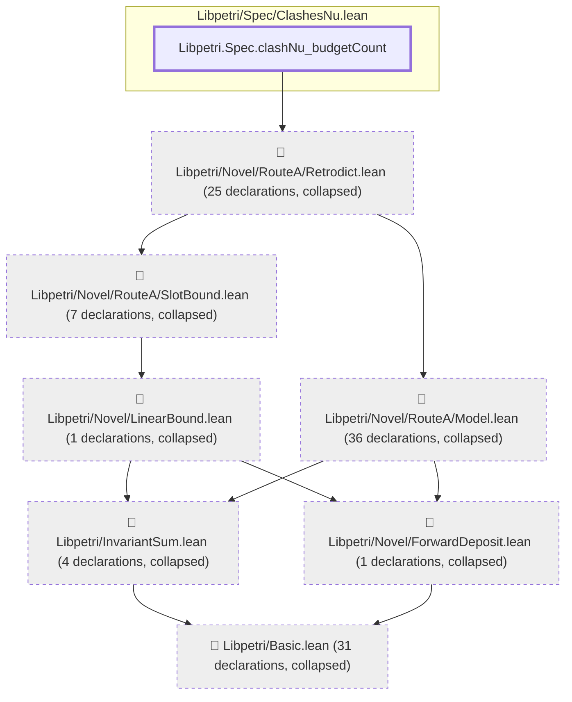
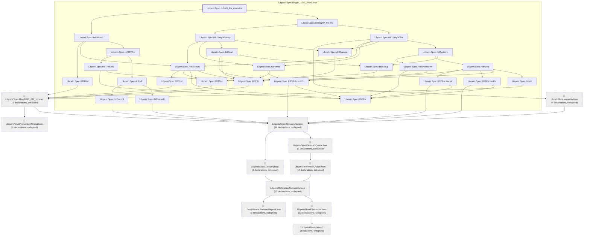
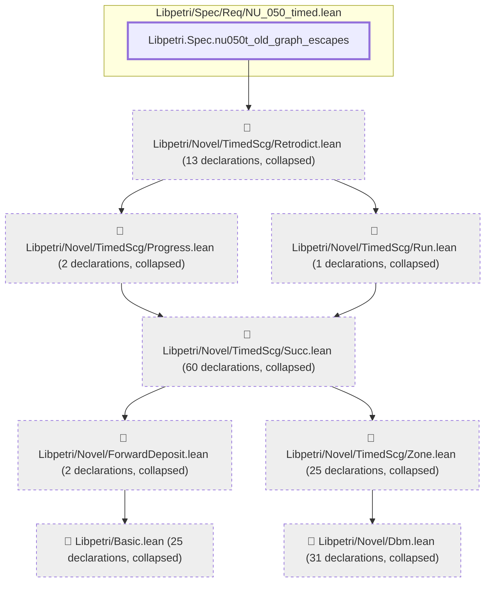

# NU-050

Generated by `scripts/proof-graph.py` from `proof-graph.json`. Do not edit.

Theorems carrying this ID:

- `Libpetri.Novel.CanonicalKey.canonicalKey_comp` (theorem, `Libpetri/Novel/CanonicalKey.lean:278`)
- `Libpetri.Novel.CanonicalKey.canonicalKey_complete` (theorem, `Libpetri/Novel/CanonicalKey.lean:310`)
- `Libpetri.Spec.NU_050_prefix_open_never_proven` (theorem, `Libpetri/Spec/Req/NU_050.lean:156`)
- `Libpetri.Spec.NU_050_timed_covers_reference` (theorem, `Libpetri/Spec/Req/NU_050_timed.lean:456`)
- `Libpetri.Spec.clashNu_budgetCount` (theorem, `Libpetri/Spec/ClashesNu.lean:340`)
- `Libpetri.Spec.nu050t_fire_executor` (theorem, `Libpetri/Spec/Req/NU_050_timed.lean:483`)
- `Libpetri.Spec.nu050t_old_graph_escapes` (theorem, `Libpetri/Spec/Req/NU_050_timed.lean:494`)

> **Note:** the full tree has 454 nodes (limit 60), so it is drawn as one diagram per theorem (7 theorems).

### `Libpetri.Novel.CanonicalKey.canonicalKey_comp`

> Rule: this theorem's whole tree, 37 nodes.

```mermaid
flowchart TD
  subgraph g0["Libpetri/Novel/CanonicalKey.lean"]
    n156["Libpetri.Novel.CanonicalKey.canonicalKey"]
    n157["Libpetri.Novel.CanonicalKey.canonicalKey_comp"]
    n159["Libpetri.Novel.CanonicalKey.canonicalKey_eq_iff"]
    n161["Libpetri.Novel.CanonicalKey.canonicalKey_eq_of_sigs"]
    n162["Libpetri.Novel.CanonicalKey.cnt"]
    n163["Libpetri.Novel.CanonicalKey.cnt_eq_zero"]
    n164["Libpetri.Novel.CanonicalKey.cnt_sigs"]
    n165["Libpetri.Novel.CanonicalKey.entries"]
    n166["Libpetri.Novel.CanonicalKey.entries_pairwise_lt"]
    n167["Libpetri.Novel.CanonicalKey.exists_cnt_ne"]
    n168["Libpetri.Novel.CanonicalKey.exists_ne_of_mem_live"]
    n170["Libpetri.Novel.CanonicalKey.getElem?_rank"]
    n171["Libpetri.Novel.CanonicalKey.getElem_sigs"]
    n172["Libpetri.Novel.CanonicalKey.length_sigs"]
    n173["Libpetri.Novel.CanonicalKey.live"]
    n174["Libpetri.Novel.CanonicalKey.liveSet"]
    n175["Libpetri.Novel.CanonicalKey.live_comp"]
    n176["Libpetri.Novel.CanonicalKey.mem_entries"]
    n177["Libpetri.Novel.CanonicalKey.mem_live_of_finite"]
    n178["Libpetri.Novel.CanonicalKey.mem_syms"]
    n179["Libpetri.Novel.CanonicalKey.rank"]
    n180["Libpetri.Novel.CanonicalKey.rank_getElem"]
    n181["Libpetri.Novel.CanonicalKey.rank_injOn"]
    n182["Libpetri.Novel.CanonicalKey.rank_lt"]
    n183["Libpetri.Novel.CanonicalKey.ranked"]
    n184["Libpetri.Novel.CanonicalKey.ranked_eq"]
    n185["Libpetri.Novel.CanonicalKey.sig"]
    n186["Libpetri.Novel.CanonicalKey.sigs"]
    n187["Libpetri.Novel.CanonicalKey.sigs_coe"]
    n188["Libpetri.Novel.CanonicalKey.sigs_eq_iff"]
    n189["Libpetri.Novel.CanonicalKey.sigs_eq_of_canonicalKey"]
    n190["Libpetri.Novel.CanonicalKey.sigs_eq_sort"]
    n191["Libpetri.Novel.CanonicalKey.sigs_sorted"]
    n192["Libpetri.Novel.CanonicalKey.syms"]
    n193["Libpetri.Novel.CanonicalKey.syms_coe"]
    n194["Libpetri.Novel.CanonicalKey.syms_nodup"]
    n195["Libpetri.Novel.CanonicalKey.toLex_mem_entries"]
  end
  n156 --> n165
  n157 --> n159
  n157 --> n175
  n159 --> n161
  n159 --> n188
  n159 --> n189
  n161 --> n156
  n161 --> n166
  n161 --> n176
  n163 --> n162
  n164 --> n162
  n164 --> n186
  n165 --> n179
  n166 --> n165
  n166 --> n181
  n167 --> n164
  n167 --> n168
  n167 --> n172
  n167 --> n178
  n168 --> n173
  n170 --> n182
  n171 --> n164
  n171 --> n172
  n172 --> n186
  n173 --> n174
  n175 --> n177
  n176 --> n164
  n176 --> n165
  n176 --> n170
  n176 --> n172
  n176 --> n180
  n177 --> n173
  n178 --> n193
  n179 --> n192
  n180 --> n179
  n180 --> n194
  n181 --> n170
  n182 --> n178
  n182 --> n179
  n183 --> n173
  n183 --> n185
  n184 --> n192
  n186 --> n192
  n187 --> n186
  n187 --> n193
  n188 --> n190
  n189 --> n156
  n189 --> n167
  n189 --> n171
  n189 --> n195
  n190 --> n187
  n190 --> n191
  n191 --> n184
  n191 --> n186
  n192 --> n183
  n193 --> n192
  n194 --> n193
  n195 --> n163
  n195 --> n176
  classDef root stroke-width:3px
  classDef locked fill:#fff3cd,stroke:#b8860b
  classDef collapsed fill:#eeeeee,stroke-dasharray:4 4
  class n157 root
```

### `Libpetri.Novel.CanonicalKey.canonicalKey_complete`

> Rule: this theorem's whole tree, 28 nodes.

```mermaid
flowchart TD
  subgraph g0["Libpetri/Novel/CanonicalKey.lean"]
    n156["Libpetri.Novel.CanonicalKey.canonicalKey"]
    n158["Libpetri.Novel.CanonicalKey.canonicalKey_complete"]
    n162["Libpetri.Novel.CanonicalKey.cnt"]
    n163["Libpetri.Novel.CanonicalKey.cnt_eq_zero"]
    n164["Libpetri.Novel.CanonicalKey.cnt_sigs"]
    n165["Libpetri.Novel.CanonicalKey.entries"]
    n167["Libpetri.Novel.CanonicalKey.exists_cnt_ne"]
    n168["Libpetri.Novel.CanonicalKey.exists_ne_of_mem_live"]
    n169["Libpetri.Novel.CanonicalKey.exists_perm_map_eq"]
    n170["Libpetri.Novel.CanonicalKey.getElem?_rank"]
    n171["Libpetri.Novel.CanonicalKey.getElem_sigs"]
    n172["Libpetri.Novel.CanonicalKey.length_sigs"]
    n173["Libpetri.Novel.CanonicalKey.live"]
    n174["Libpetri.Novel.CanonicalKey.liveSet"]
    n176["Libpetri.Novel.CanonicalKey.mem_entries"]
    n177["Libpetri.Novel.CanonicalKey.mem_live_of_finite"]
    n178["Libpetri.Novel.CanonicalKey.mem_syms"]
    n179["Libpetri.Novel.CanonicalKey.rank"]
    n180["Libpetri.Novel.CanonicalKey.rank_getElem"]
    n182["Libpetri.Novel.CanonicalKey.rank_lt"]
    n183["Libpetri.Novel.CanonicalKey.ranked"]
    n185["Libpetri.Novel.CanonicalKey.sig"]
    n186["Libpetri.Novel.CanonicalKey.sigs"]
    n189["Libpetri.Novel.CanonicalKey.sigs_eq_of_canonicalKey"]
    n192["Libpetri.Novel.CanonicalKey.syms"]
    n193["Libpetri.Novel.CanonicalKey.syms_coe"]
    n194["Libpetri.Novel.CanonicalKey.syms_nodup"]
    n195["Libpetri.Novel.CanonicalKey.toLex_mem_entries"]
  end
  n156 --> n165
  n158 --> n169
  n158 --> n177
  n158 --> n189
  n163 --> n162
  n164 --> n162
  n164 --> n186
  n165 --> n179
  n167 --> n164
  n167 --> n168
  n167 --> n172
  n167 --> n178
  n168 --> n173
  n170 --> n182
  n171 --> n164
  n171 --> n172
  n172 --> n186
  n173 --> n174
  n176 --> n164
  n176 --> n165
  n176 --> n170
  n176 --> n172
  n176 --> n180
  n177 --> n173
  n178 --> n193
  n179 --> n192
  n180 --> n179
  n180 --> n194
  n182 --> n178
  n182 --> n179
  n183 --> n173
  n183 --> n185
  n186 --> n192
  n189 --> n156
  n189 --> n167
  n189 --> n171
  n189 --> n195
  n192 --> n183
  n193 --> n192
  n194 --> n193
  n195 --> n163
  n195 --> n176
  classDef root stroke-width:3px
  classDef locked fill:#fff3cd,stroke:#b8860b
  classDef collapsed fill:#eeeeee,stroke-dasharray:4 4
  class n158 root
```

### `Libpetri.Spec.NU_050_prefix_open_never_proven`

> Rule: this theorem's whole tree, 22 nodes.

```mermaid
flowchart TD
  subgraph g0["Libpetri/Interning.lean"]
    n38["Libpetri.Explorer"]
    n56["Libpetri.Explorer.bound"]
    n65["Libpetri.Explorer.succ"]
  end
  subgraph g1["Libpetri/Novel/RouteB/Decide.lean"]
    n1542["Libpetri.Novel.RouteB.Decide.Out"]
    n1543["Libpetri.Novel.RouteB.Decide.Out.cls"]
    n1544["Libpetri.Novel.RouteB.Decide.Out.complete"]
    n1546["Libpetri.Novel.RouteB.Decide.Out.exp"]
    n1548["Libpetri.Novel.RouteB.Decide.Out.stopped"]
    n1549["Libpetri.Novel.RouteB.Decide.Prop'"]
    n1550["Libpetri.Novel.RouteB.Decide.Prop'.quiescence"]
    n1551["Libpetri.Novel.RouteB.Decide.Prop'.safety"]
    n1552["Libpetri.Novel.RouteB.Decide.Verdict"]
    n1553["Libpetri.Novel.RouteB.Decide.Verdict.proven"]
    n1554["Libpetri.Novel.RouteB.Decide.Verdict.unknown"]
    n1555["Libpetri.Novel.RouteB.Decide.Verdict.violated"]
    n1576["Libpetri.Novel.RouteB.Decide.quiescentAt"]
    n1582["Libpetri.Novel.RouteB.Decide.violatesAt"]
  end
  subgraph g2["Libpetri/Spec/GlossaryNuVer.lean"]
    n10126["Libpetri.Spec.RouteBVerdict"]
  end
  subgraph g3["Libpetri/Spec/Req/NU_050.lean"]
    n9109["Libpetri.Spec.NU_050_prefix"]
    n9116["Libpetri.Spec.NU_050_prefix_never_proven"]
    n9118["Libpetri.Spec.NU_050_prefix_open_never_proven"]
  end
  subgraph g4["Libpetri/Spec/Req/NU_055.lean"]
    n5975["Libpetri.Spec.ClassVerdict"]
  end
  n56 --> n38
  n65 --> n38
  n1543 --> n1542
  n1544 --> n1542
  n1546 --> n1542
  n1548 --> n1542
  n1550 --> n1549
  n1551 --> n1549
  n1553 --> n1552
  n1554 --> n1552
  n1555 --> n1552
  n1576 --> n56
  n1576 --> n65
  n1576 --> n1543
  n1576 --> n1546
  n1582 --> n1550
  n1582 --> n1551
  n1582 --> n1576
  n5975 --> n38
  n5975 --> n1542
  n5975 --> n1549
  n5975 --> n10126
  n9109 --> n1544
  n9109 --> n1548
  n9109 --> n1553
  n9109 --> n1554
  n9109 --> n1555
  n9109 --> n1582
  n9109 --> n5975
  n9116 --> n9109
  n9118 --> n9116
  n10126 --> n1552
  classDef root stroke-width:3px
  classDef locked fill:#fff3cd,stroke:#b8860b
  classDef collapsed fill:#eeeeee,stroke-dasharray:4 4
  class n9118 root
```

### `Libpetri.Spec.NU_050_timed_covers_reference`

> Rule: this theorem's tree has 156 nodes (limit 60); every file other than its own is collapsed into one node, leaving 42.

```mermaid
flowchart TD
  subgraph g0["Libpetri/Spec/Req/NU_050_timed.lean"]
    n8907["Libpetri.Spec.NU_050_timed_covers_reference"]
    n9348["Libpetri.Spec.NuShared"]
    n9763["Libpetri.Spec.RBTClock"]
    n9764["Libpetri.Spec.RBTCovers"]
    n9766["Libpetri.Spec.RBTLbl"]
    n9767["Libpetri.Spec.RBTNet"]
    n9768["Libpetri.Spec.RBTPol"]
    n9769["Libpetri.Spec.RBTPol.clockEn"]
    n9770["Libpetri.Spec.RBTPol.keepX"]
    n9771["Libpetri.Spec.RBTPol.midEn"]
    n9772["Libpetri.Spec.RBTPol.mk"]
    n9773["Libpetri.Spec.RBTPol.rearm"]
    n9774["Libpetri.Spec.RBTRel"]
    n9775["Libpetri.Spec.RBTSt"]
    n9776["Libpetri.Spec.RBTStepW"]
    n9777["Libpetri.Spec.RBTStepW.delay"]
    n9778["Libpetri.Spec.RBTStepW.fire"]
    n9857["Libpetri.Spec.RefRouteBT"]
    n19883["Libpetri.Spec.rbtArmed"]
    n19884["Libpetri.Spec.rbtClean"]
    n19886["Libpetri.Spec.rbtCountB"]
    n19887["Libpetri.Spec.rbtElapsed"]
    n19888["Libpetri.Spec.rbtEnB"]
    n19892["Libpetri.Spec.rbtEnB_iff"]
    n19894["Libpetri.Spec.rbtKeep"]
    n19895["Libpetri.Spec.rbtLookup"]
    n19897["Libpetri.Spec.rbtMid"]
    n19899["Libpetri.Spec.rbtRestamp"]
    n19901["Libpetri.Spec.rbtSharedB"]
    n19903["Libpetri.Spec.rbtSharedB_iff"]
    n20271["Libpetri.Spec.refRBTPol"]
  end
  c0["📁 Libpetri/Basic.lean (7 declarations, collapsed)"]
  c28["📁 Libpetri/Novel/ForwardDeposit.lean (3 declarations, collapsed)"]
  c54["📁 Libpetri/Novel/Seam/Net.lean (12 declarations, collapsed)"]
  c66["📁 Libpetri/Novel/TimedScg/Timing.lean (9 declarations, collapsed)"]
  c87["📁 Libpetri/Reference/Nu.lean (4 declarations, collapsed)"]
  c91["📁 Libpetri/Reference/Queue.lean (17 declarations, collapsed)"]
  c94["📁 Libpetri/Reference/Semantics.lean (15 declarations, collapsed)"]
  c132["📁 Libpetri/Spec/Glossary.lean (3 declarations, collapsed)"]
  c142["📁 Libpetri/Spec/GlossaryNu.lean (39 declarations, collapsed)"]
  c144["📁 Libpetri/Spec/GlossaryQueue.lean (3 declarations, collapsed)"]
  c334["📁 Libpetri/Spec/Req/TIME_012_nu.lean (13 declarations, collapsed)"]
  c54 --> c0
  c87 --> c142
  c91 --> c94
  c94 --> c28
  c94 --> c54
  c132 --> c94
  c142 --> c132
  c142 --> c144
  c144 --> c91
  c334 --> c66
  c334 --> c142
  n8907 --> n9764
  n8907 --> n9777
  n8907 --> n9778
  n8907 --> n9857
  n8907 --> n19892
  n9348 --> c142
  n9763 --> n9775
  n9764 --> c87
  n9764 --> n9763
  n9764 --> n9774
  n9764 --> n19887
  n9766 --> c334
  n9767 --> c334
  n9769 --> c142
  n9769 --> n9768
  n9770 --> c142
  n9770 --> n9768
  n9771 --> c142
  n9771 --> n9768
  n9772 --> n9768
  n9772 --> n9775
  n9773 --> n9768
  n9773 --> n9775
  n9774 --> c334
  n9775 --> c334
  n9776 --> n9766
  n9776 --> n9767
  n9776 --> n9768
  n9776 --> n9775
  n9777 --> n9776
  n9777 --> n19883
  n9777 --> n19884
  n9777 --> n19887
  n9778 --> c87
  n9778 --> n9776
  n9778 --> n19883
  n9778 --> n19887
  n9778 --> n19899
  n9857 --> n9774
  n9857 --> n9776
  n9857 --> n20271
  n19883 --> n9769
  n19883 --> n9775
  n19884 --> n9769
  n19884 --> n9775
  n19884 --> n19895
  n19886 --> c142
  n19887 --> n9775
  n19888 --> n19886
  n19888 --> n19901
  n19892 --> n19888
  n19892 --> n19903
  n19894 --> n9769
  n19894 --> n9770
  n19894 --> n9771
  n19894 --> n9775
  n19894 --> n19897
  n19895 --> n9767
  n19897 --> c334
  n19899 --> n9773
  n19899 --> n19894
  n19899 --> n19895
  n19901 --> c142
  n19903 --> n9348
  n19903 --> n19901
  n20271 --> n9772
  n20271 --> n19888
  classDef root stroke-width:3px
  classDef locked fill:#fff3cd,stroke:#b8860b
  classDef collapsed fill:#eeeeee,stroke-dasharray:4 4
  class n8907 root
  class c0,c28,c54,c66,c87,c91,c94,c132,c142,c144,c334 collapsed
```

### `Libpetri.Spec.clashNu_budgetCount`

> Rule: this theorem's tree has 106 nodes (limit 60); every file other than its own is collapsed into one node, leaving 8.

### `Libpetri.Spec.nu050t_fire_executor`

> Rule: this theorem's tree has 152 nodes (limit 60); every file other than its own is collapsed into one node, leaving 38.

### `Libpetri.Spec.nu050t_old_graph_escapes`

> Rule: this theorem's tree has 160 nodes (limit 60); every file other than its own is collapsed into one node, leaving 9.

Axioms used:

- `Libpetri.Novel.CanonicalKey.canonicalKey_comp`: `Classical.choice`, `Quot.sound`, `propext`
- `Libpetri.Novel.CanonicalKey.canonicalKey_complete`: `Classical.choice`, `Quot.sound`, `propext`
- `Libpetri.Spec.NU_050_prefix_open_never_proven`: `Classical.choice`, `Quot.sound`, `propext`
- `Libpetri.Spec.NU_050_timed_covers_reference`: `Classical.choice`, `Quot.sound`, `propext`
- `Libpetri.Spec.clashNu_budgetCount`: `Classical.choice`, `Quot.sound`, `propext`
- `Libpetri.Spec.nu050t_fire_executor`: `Classical.choice`, `Quot.sound`, `propext`
- `Libpetri.Spec.nu050t_old_graph_escapes`: `Classical.choice`, `Quot.sound`, `propext`
