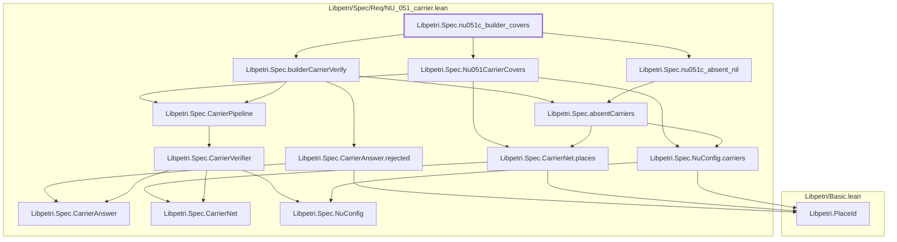
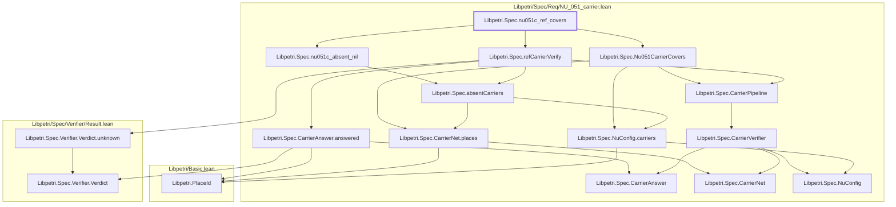

# NU-051

Generated by `scripts/proof-graph.py` from `proof-graph.json`. Do not edit.

Theorems carrying this ID:

- `Libpetri.Spec.NU_051_routeA_consume` (theorem, `Libpetri/Spec/Req/NU_051.lean:956`)
- `Libpetri.Spec.nu051c_builder_covers` (theorem, `Libpetri/Spec/Req/NU_051_carrier.lean:668`)
- `Libpetri.Spec.nu051c_covers_baseRefuses` (theorem, `Libpetri/Spec/Req/NU_051_carrier.lean:691`)
- `Libpetri.Spec.nu051c_covers_refusesAll` (theorem, `Libpetri/Spec/Req/NU_051_carrier.lean:704`)
- `Libpetri.Spec.nu051c_ref_covers` (theorem, `Libpetri/Spec/Req/NU_051_carrier.lean:660`)

> **Note:** the full tree has 94 nodes (limit 60), so it is drawn as one diagram per theorem (5 theorems).

### `Libpetri.Spec.NU_051_routeA_consume`

> Rule: this theorem's whole tree, 35 nodes.

### `Libpetri.Spec.nu051c_builder_covers`

> Rule: this theorem's whole tree, 14 nodes.

### `Libpetri.Spec.nu051c_covers_baseRefuses`

> Rule: this theorem's whole tree, 59 nodes.

```mermaid
flowchart TD
  subgraph g0["Libpetri/Basic.lean"]
    n8["Libpetri.Card"]
    n13["Libpetri.Card.one"]
    n21["Libpetri.Colour"]
    n132["Libpetri.Guard"]
    n134["Libpetri.InSpec"]
    n137["Libpetri.InSpec.mk"]
    n2723["Libpetri.PlaceId"]
    n22341["Libpetri.Transition"]
    n22344["Libpetri.Transition.mk"]
  end
  subgraph g1["Libpetri/Novel/ForwardDeposit.lean"]
    n867["Libpetri.Novel.ForwardDeposit.Deposit"]
  end
  subgraph g2["Libpetri/Novel/RouteB/Classify.lean"]
    n1607["Libpetri.Novel.RouteB.Mode"]
    n1608["Libpetri.Novel.RouteB.Mode.base"]
    n1609["Libpetri.Novel.RouteB.Mode.extended"]
    n1775["Libpetri.Novel.RouteB.inOne"]
  end
  subgraph g3["Libpetri/Novel/RouteB/Graph.lean"]
    n1621["Libpetri.Novel.RouteB.NuTrans"]
    n1624["Libpetri.Novel.RouteB.NuTrans.mk"]
    n1640["Libpetri.Novel.RouteB.Row"]
    n1643["Libpetri.Novel.RouteB.Row.mk"]
  end
  subgraph g4["Libpetri/Spec/Req/NU_051_carrier.lean"]
    n4808["Libpetri.Spec.AbsentCarrier"]
    n5883["Libpetri.Spec.CarrierAnswer"]
    n5884["Libpetri.Spec.CarrierAnswer.answered"]
    n5885["Libpetri.Spec.CarrierAnswer.rejected"]
    n5886["Libpetri.Spec.CarrierEscape"]
    n5887["Libpetri.Spec.CarrierNet"]
    n5888["Libpetri.Spec.CarrierNet.mk"]
    n5889["Libpetri.Spec.CarrierNet.places"]
    n5891["Libpetri.Spec.CarrierPipeline"]
    n5892["Libpetri.Spec.CarrierRefusal"]
    n5893["Libpetri.Spec.CarrierVerifier"]
    n8035["Libpetri.Spec.LoudRefusal"]
    n8920["Libpetri.Spec.NU_051_carrier"]
    n8938["Libpetri.Spec.NU_051_carrier_reference"]
    n9272["Libpetri.Spec.Nu051CarrierCovers"]
    n9306["Libpetri.Spec.NuConfig"]
    n9307["Libpetri.Spec.NuConfig.carriers"]
    n9308["Libpetri.Spec.NuConfig.mk"]
    n9309["Libpetri.Spec.NuConfig.mode"]
    n12311["Libpetri.Spec.absentCarriers"]
    n17052["Libpetri.Spec.instDecidableEqCarrierAnswer"]
    n17053["Libpetri.Spec.instDecidableEqCarrierAnswer.decEq"]
    n19399["Libpetri.Spec.nu051c_absent_head"]
    n19400["Libpetri.Spec.nu051c_absent_mem"]
    n19401["Libpetri.Spec.nu051c_absent_ne_nil"]
    n19404["Libpetri.Spec.nu051c_baseRefuses"]
    n19407["Libpetri.Spec.nu051c_cnet"]
    n19408["Libpetri.Spec.nu051c_covers_baseRefuses"]
    n19412["Libpetri.Spec.nu051c_fork"]
    n19414["Libpetri.Spec.nu051c_join"]
    n19417["Libpetri.Spec.nu051c_net"]
    n19418["Libpetri.Spec.nu051c_proves"]
    n19420["Libpetri.Spec.nu051c_ref_loud"]
    n19422["Libpetri.Spec.nu051c_relay"]
    n19974["Libpetri.Spec.refCarrierVerify"]
  end
  subgraph g5["Libpetri/Spec/Verifier/Result.lean"]
    n12015["Libpetri.Spec.Verifier.Verdict"]
    n12016["Libpetri.Spec.Verifier.Verdict.proven"]
    n12017["Libpetri.Spec.Verifier.Verdict.unknown"]
    n12018["Libpetri.Spec.Verifier.Verdict.violated"]
    n12077["Libpetri.Spec.Verifier.instDecidableEqVerdict"]
    n12078["Libpetri.Spec.Verifier.instDecidableEqVerdict.decEq"]
  end
  n13 --> n8
  n132 --> n21
  n137 --> n8
  n137 --> n132
  n137 --> n134
  n137 --> n2723
  n867 --> n2723
  n1608 --> n1607
  n1609 --> n1607
  n1624 --> n1621
  n1624 --> n1640
  n1624 --> n2723
  n1624 --> n22341
  n1643 --> n867
  n1643 --> n1640
  n1775 --> n13
  n1775 --> n137
  n4808 --> n5889
  n4808 --> n9307
  n5884 --> n2723
  n5884 --> n5883
  n5884 --> n12015
  n5885 --> n2723
  n5885 --> n5883
  n5886 --> n5891
  n5886 --> n5892
  n5886 --> n9308
  n5886 --> n9309
  n5888 --> n1621
  n5888 --> n2723
  n5888 --> n5887
  n5889 --> n2723
  n5889 --> n5887
  n5891 --> n5893
  n5892 --> n5884
  n5892 --> n5885
  n5892 --> n12016
  n5892 --> n12017
  n5892 --> n12018
  n5893 --> n5883
  n5893 --> n5887
  n5893 --> n9306
  n8035 --> n4808
  n8035 --> n5884
  n8035 --> n5885
  n8035 --> n12016
  n8035 --> n12017
  n8035 --> n12018
  n8920 --> n5886
  n8920 --> n8035
  n8938 --> n8920
  n8938 --> n19420
  n9272 --> n5889
  n9272 --> n5891
  n9272 --> n9307
  n9307 --> n2723
  n9307 --> n9306
  n9308 --> n1607
  n9308 --> n2723
  n9308 --> n9306
  n9309 --> n1607
  n9309 --> n9306
  n12016 --> n12015
  n12017 --> n12015
  n12018 --> n12015
  n12077 --> n12078
  n12078 --> n12016
  n12078 --> n12017
  n12078 --> n12018
  n12311 --> n5889
  n12311 --> n9307
  n17052 --> n17053
  n17053 --> n5884
  n17053 --> n5885
  n17053 --> n12077
  n19399 --> n19400
  n19400 --> n4808
  n19400 --> n12311
  n19401 --> n19400
  n19404 --> n1608
  n19404 --> n1609
  n19404 --> n5885
  n19404 --> n9309
  n19404 --> n19974
  n19407 --> n5888
  n19407 --> n19417
  n19408 --> n8938
  n19408 --> n9272
  n19408 --> n17052
  n19408 --> n19404
  n19408 --> n19407
  n19408 --> n19418
  n19412 --> n1624
  n19412 --> n1643
  n19412 --> n1775
  n19412 --> n22344
  n19414 --> n1624
  n19414 --> n1643
  n19414 --> n1775
  n19414 --> n22344
  n19417 --> n19412
  n19417 --> n19414
  n19417 --> n19422
  n19418 --> n5884
  n19418 --> n5893
  n19418 --> n12016
  n19420 --> n8035
  n19420 --> n19399
  n19420 --> n19401
  n19420 --> n19974
  n19422 --> n1624
  n19422 --> n1643
  n19422 --> n1775
  n19422 --> n22344
  n19974 --> n5884
  n19974 --> n5891
  n19974 --> n12017
  n19974 --> n12311
  n22344 --> n134
  n22344 --> n2723
  n22344 --> n22341
  classDef root stroke-width:3px
  classDef locked fill:#fff3cd,stroke:#b8860b
  classDef collapsed fill:#eeeeee,stroke-dasharray:4 4
  class n19408 root
```

### `Libpetri.Spec.nu051c_covers_refusesAll`

> Rule: this theorem's whole tree, 58 nodes.

```mermaid
flowchart TD
  subgraph g0["Libpetri/Basic.lean"]
    n8["Libpetri.Card"]
    n13["Libpetri.Card.one"]
    n21["Libpetri.Colour"]
    n132["Libpetri.Guard"]
    n134["Libpetri.InSpec"]
    n137["Libpetri.InSpec.mk"]
    n2723["Libpetri.PlaceId"]
    n22341["Libpetri.Transition"]
    n22344["Libpetri.Transition.mk"]
  end
  subgraph g1["Libpetri/Novel/ForwardDeposit.lean"]
    n867["Libpetri.Novel.ForwardDeposit.Deposit"]
  end
  subgraph g2["Libpetri/Novel/RouteB/Classify.lean"]
    n1607["Libpetri.Novel.RouteB.Mode"]
    n1609["Libpetri.Novel.RouteB.Mode.extended"]
    n1775["Libpetri.Novel.RouteB.inOne"]
  end
  subgraph g3["Libpetri/Novel/RouteB/Graph.lean"]
    n1621["Libpetri.Novel.RouteB.NuTrans"]
    n1624["Libpetri.Novel.RouteB.NuTrans.mk"]
    n1640["Libpetri.Novel.RouteB.Row"]
    n1643["Libpetri.Novel.RouteB.Row.mk"]
  end
  subgraph g4["Libpetri/Spec/Req/NU_051_carrier.lean"]
    n4808["Libpetri.Spec.AbsentCarrier"]
    n5883["Libpetri.Spec.CarrierAnswer"]
    n5884["Libpetri.Spec.CarrierAnswer.answered"]
    n5885["Libpetri.Spec.CarrierAnswer.rejected"]
    n5886["Libpetri.Spec.CarrierEscape"]
    n5887["Libpetri.Spec.CarrierNet"]
    n5888["Libpetri.Spec.CarrierNet.mk"]
    n5889["Libpetri.Spec.CarrierNet.places"]
    n5891["Libpetri.Spec.CarrierPipeline"]
    n5892["Libpetri.Spec.CarrierRefusal"]
    n5893["Libpetri.Spec.CarrierVerifier"]
    n8035["Libpetri.Spec.LoudRefusal"]
    n8920["Libpetri.Spec.NU_051_carrier"]
    n8938["Libpetri.Spec.NU_051_carrier_reference"]
    n9272["Libpetri.Spec.Nu051CarrierCovers"]
    n9306["Libpetri.Spec.NuConfig"]
    n9307["Libpetri.Spec.NuConfig.carriers"]
    n9308["Libpetri.Spec.NuConfig.mk"]
    n9309["Libpetri.Spec.NuConfig.mode"]
    n12311["Libpetri.Spec.absentCarriers"]
    n17052["Libpetri.Spec.instDecidableEqCarrierAnswer"]
    n17053["Libpetri.Spec.instDecidableEqCarrierAnswer.decEq"]
    n19399["Libpetri.Spec.nu051c_absent_head"]
    n19400["Libpetri.Spec.nu051c_absent_mem"]
    n19401["Libpetri.Spec.nu051c_absent_ne_nil"]
    n19407["Libpetri.Spec.nu051c_cnet"]
    n19409["Libpetri.Spec.nu051c_covers_refusesAll"]
    n19412["Libpetri.Spec.nu051c_fork"]
    n19414["Libpetri.Spec.nu051c_join"]
    n19417["Libpetri.Spec.nu051c_net"]
    n19418["Libpetri.Spec.nu051c_proves"]
    n19420["Libpetri.Spec.nu051c_ref_loud"]
    n19421["Libpetri.Spec.nu051c_refusesAll"]
    n19422["Libpetri.Spec.nu051c_relay"]
    n19974["Libpetri.Spec.refCarrierVerify"]
  end
  subgraph g5["Libpetri/Spec/Verifier/Result.lean"]
    n12015["Libpetri.Spec.Verifier.Verdict"]
    n12016["Libpetri.Spec.Verifier.Verdict.proven"]
    n12017["Libpetri.Spec.Verifier.Verdict.unknown"]
    n12018["Libpetri.Spec.Verifier.Verdict.violated"]
    n12077["Libpetri.Spec.Verifier.instDecidableEqVerdict"]
    n12078["Libpetri.Spec.Verifier.instDecidableEqVerdict.decEq"]
  end
  n13 --> n8
  n132 --> n21
  n137 --> n8
  n137 --> n132
  n137 --> n134
  n137 --> n2723
  n867 --> n2723
  n1609 --> n1607
  n1624 --> n1621
  n1624 --> n1640
  n1624 --> n2723
  n1624 --> n22341
  n1643 --> n867
  n1643 --> n1640
  n1775 --> n13
  n1775 --> n137
  n4808 --> n5889
  n4808 --> n9307
  n5884 --> n2723
  n5884 --> n5883
  n5884 --> n12015
  n5885 --> n2723
  n5885 --> n5883
  n5886 --> n5891
  n5886 --> n5892
  n5886 --> n9308
  n5886 --> n9309
  n5888 --> n1621
  n5888 --> n2723
  n5888 --> n5887
  n5889 --> n2723
  n5889 --> n5887
  n5891 --> n5893
  n5892 --> n5884
  n5892 --> n5885
  n5892 --> n12016
  n5892 --> n12017
  n5892 --> n12018
  n5893 --> n5883
  n5893 --> n5887
  n5893 --> n9306
  n8035 --> n4808
  n8035 --> n5884
  n8035 --> n5885
  n8035 --> n12016
  n8035 --> n12017
  n8035 --> n12018
  n8920 --> n5886
  n8920 --> n8035
  n8938 --> n8920
  n8938 --> n19420
  n9272 --> n5889
  n9272 --> n5891
  n9272 --> n9307
  n9307 --> n2723
  n9307 --> n9306
  n9308 --> n1607
  n9308 --> n2723
  n9308 --> n9306
  n9309 --> n1607
  n9309 --> n9306
  n12016 --> n12015
  n12017 --> n12015
  n12018 --> n12015
  n12077 --> n12078
  n12078 --> n12016
  n12078 --> n12017
  n12078 --> n12018
  n12311 --> n5889
  n12311 --> n9307
  n17052 --> n17053
  n17053 --> n5884
  n17053 --> n5885
  n17053 --> n12077
  n19399 --> n19400
  n19400 --> n4808
  n19400 --> n12311
  n19401 --> n19400
  n19407 --> n5888
  n19407 --> n19417
  n19409 --> n1609
  n19409 --> n8938
  n19409 --> n9272
  n19409 --> n17052
  n19409 --> n19407
  n19409 --> n19418
  n19409 --> n19421
  n19412 --> n1624
  n19412 --> n1643
  n19412 --> n1775
  n19412 --> n22344
  n19414 --> n1624
  n19414 --> n1643
  n19414 --> n1775
  n19414 --> n22344
  n19417 --> n19412
  n19417 --> n19414
  n19417 --> n19422
  n19418 --> n5884
  n19418 --> n5893
  n19418 --> n12016
  n19420 --> n8035
  n19420 --> n19399
  n19420 --> n19401
  n19420 --> n19974
  n19421 --> n19974
  n19422 --> n1624
  n19422 --> n1643
  n19422 --> n1775
  n19422 --> n22344
  n19974 --> n5884
  n19974 --> n5891
  n19974 --> n12017
  n19974 --> n12311
  n22344 --> n134
  n22344 --> n2723
  n22344 --> n22341
  classDef root stroke-width:3px
  classDef locked fill:#fff3cd,stroke:#b8860b
  classDef collapsed fill:#eeeeee,stroke-dasharray:4 4
  class n19409 root
```

### `Libpetri.Spec.nu051c_ref_covers`

> Rule: this theorem's whole tree, 16 nodes.

```mermaid
flowchart TD
  subgraph g0["Libpetri/Basic.lean"]
    n8["Libpetri.Card"]
    n9["Libpetri.Card.all"]
    n10["Libpetri.Card.atLeast"]
    n12["Libpetri.Card.exactly"]
    n13["Libpetri.Card.one"]
    n14["Libpetri.Card.required"]
    n134["Libpetri.InSpec"]
    n135["Libpetri.InSpec.card"]
    n138["Libpetri.InSpec.place"]
    n2720["Libpetri.PlaceId"]
    n7739["Libpetri.Transition"]
    n7741["Libpetri.Transition.inputs"]
    n7991["Libpetri.pre"]
    n8046["Libpetri.specAt"]
  end
  subgraph g1["Libpetri/Novel/ForwardDeposit.lean"]
    n867["Libpetri.Novel.ForwardDeposit.Deposit"]
  end
  subgraph g2["Libpetri/Novel/RouteA/Model.lean"]
    n1179["Libpetri.Novel.RouteA.Cls"]
    n1180["Libpetri.Novel.RouteA.Cls.consume"]
    n1181["Libpetri.Novel.RouteA.Cls.join"]
    n1182["Libpetri.Novel.RouteA.Cls.mint"]
    n1184["Libpetri.Novel.RouteA.Cls.untouched"]
  end
  subgraph g3["Libpetri/Novel/RouteA/Plan.lean"]
    n1217["Libpetri.Novel.RouteA.Gate"]
    n1226["Libpetri.Novel.RouteA.MatchInfo"]
    n1227["Libpetri.Novel.RouteA.MatchInfo.keys"]
    n1229["Libpetri.Novel.RouteA.MatchInfo.relays"]
    n1391["Libpetri.Novel.RouteA.SrcRow"]
    n1392["Libpetri.Novel.RouteA.SrcRow.d"]
    n1393["Libpetri.Novel.RouteA.SrcRow.declared"]
    n1396["Libpetri.Novel.RouteA.SrcRow.ms"]
    n1397["Libpetri.Novel.RouteA.SrcRow.t"]
    n1398["Libpetri.Novel.RouteA.SrcRow.tw"]
    n1422["Libpetri.Novel.RouteA.classifyRowG"]
    n1423["Libpetri.Novel.RouteA.classifyRowG_consume_gate"]
    n1501["Libpetri.Novel.RouteA.shippedGate"]
    n1502["Libpetri.Novel.RouteA.shipped_consume"]
  end
  subgraph g4["Libpetri/Spec/Req/NU_051.lean"]
    n4508["Libpetri.Spec.NU_051_routeA_consume"]
  end
  n9 --> n8
  n10 --> n8
  n12 --> n8
  n13 --> n8
  n14 --> n9
  n14 --> n10
  n14 --> n12
  n14 --> n13
  n135 --> n8
  n135 --> n134
  n138 --> n134
  n138 --> n2720
  n867 --> n2720
  n1180 --> n1179
  n1180 --> n2720
  n1181 --> n1179
  n1181 --> n2720
  n1182 --> n1179
  n1182 --> n2720
  n1184 --> n1179
  n1217 --> n1391
  n1217 --> n2720
  n1227 --> n1226
  n1227 --> n2720
  n1229 --> n1226
  n1229 --> n2720
  n1392 --> n867
  n1392 --> n1391
  n1393 --> n1391
  n1396 --> n1226
  n1396 --> n1391
  n1397 --> n1391
  n1397 --> n7739
  n1398 --> n1391
  n1398 --> n2720
  n1422 --> n867
  n1422 --> n1180
  n1422 --> n1181
  n1422 --> n1182
  n1422 --> n1184
  n1422 --> n1227
  n1422 --> n1229
  n1422 --> n7991
  n1423 --> n1422
  n1501 --> n1217
  n1501 --> n1393
  n1501 --> n1398
  n1502 --> n1392
  n1502 --> n1396
  n1502 --> n1397
  n1502 --> n1423
  n1502 --> n1501
  n4508 --> n1502
  n7741 --> n134
  n7741 --> n7739
  n7991 --> n14
  n7991 --> n135
  n7991 --> n8046
  n8046 --> n138
  n8046 --> n7741
  classDef root stroke-width:3px
  classDef locked fill:#fff3cd,stroke:#b8860b
  classDef collapsed fill:#eeeeee,stroke-dasharray:4 4
  class n4508 root
```

Axioms used:

- `Libpetri.Spec.NU_051_routeA_consume`: `Quot.sound`, `propext`
- `Libpetri.Spec.nu051c_builder_covers`: `Classical.choice`, `Quot.sound`, `propext`
- `Libpetri.Spec.nu051c_covers_baseRefuses`: `Quot.sound`, `propext`
- `Libpetri.Spec.nu051c_covers_refusesAll`: `Quot.sound`, `propext`
- `Libpetri.Spec.nu051c_ref_covers`: `Classical.choice`, `Quot.sound`, `propext`
