# NU-051

Generated by `scripts/proof-graph.py` from `proof-graph.json`. Do not edit.

Theorems carrying this ID:

- `Libpetri.Spec.NU_051_routeA_consume` (theorem, `Libpetri/Spec/Req/NU_051.lean:955`)

```mermaid
flowchart TD
  subgraph g0["Libpetri/Basic.lean"]
    n8["Libpetri.Card"]
    n9["Libpetri.Card.all"]
    n10["Libpetri.Card.atLeast"]
    n12["Libpetri.Card.exactly"]
    n13["Libpetri.Card.one"]
    n14["Libpetri.Card.required"]
    n134["Libpetri.InSpec"]
    n135["Libpetri.InSpec.card"]
    n138["Libpetri.InSpec.place"]
    n2720["Libpetri.PlaceId"]
    n7739["Libpetri.Transition"]
    n7741["Libpetri.Transition.inputs"]
    n7991["Libpetri.pre"]
    n8046["Libpetri.specAt"]
  end
  subgraph g1["Libpetri/Novel/ForwardDeposit.lean"]
    n867["Libpetri.Novel.ForwardDeposit.Deposit"]
  end
  subgraph g2["Libpetri/Novel/RouteA/Model.lean"]
    n1179["Libpetri.Novel.RouteA.Cls"]
    n1180["Libpetri.Novel.RouteA.Cls.consume"]
    n1181["Libpetri.Novel.RouteA.Cls.join"]
    n1182["Libpetri.Novel.RouteA.Cls.mint"]
    n1184["Libpetri.Novel.RouteA.Cls.untouched"]
  end
  subgraph g3["Libpetri/Novel/RouteA/Plan.lean"]
    n1217["Libpetri.Novel.RouteA.Gate"]
    n1226["Libpetri.Novel.RouteA.MatchInfo"]
    n1227["Libpetri.Novel.RouteA.MatchInfo.keys"]
    n1229["Libpetri.Novel.RouteA.MatchInfo.relays"]
    n1391["Libpetri.Novel.RouteA.SrcRow"]
    n1392["Libpetri.Novel.RouteA.SrcRow.d"]
    n1393["Libpetri.Novel.RouteA.SrcRow.declared"]
    n1396["Libpetri.Novel.RouteA.SrcRow.ms"]
    n1397["Libpetri.Novel.RouteA.SrcRow.t"]
    n1398["Libpetri.Novel.RouteA.SrcRow.tw"]
    n1422["Libpetri.Novel.RouteA.classifyRowG"]
    n1423["Libpetri.Novel.RouteA.classifyRowG_consume_gate"]
    n1501["Libpetri.Novel.RouteA.shippedGate"]
    n1502["Libpetri.Novel.RouteA.shipped_consume"]
  end
  subgraph g4["Libpetri/Spec/Req/NU_051.lean"]
    n4508["Libpetri.Spec.NU_051_routeA_consume"]
  end
  n9 --> n8
  n10 --> n8
  n12 --> n8
  n13 --> n8
  n14 --> n9
  n14 --> n10
  n14 --> n12
  n14 --> n13
  n135 --> n8
  n135 --> n134
  n138 --> n134
  n138 --> n2720
  n867 --> n2720
  n1180 --> n1179
  n1180 --> n2720
  n1181 --> n1179
  n1181 --> n2720
  n1182 --> n1179
  n1182 --> n2720
  n1184 --> n1179
  n1217 --> n1391
  n1217 --> n2720
  n1227 --> n1226
  n1227 --> n2720
  n1229 --> n1226
  n1229 --> n2720
  n1392 --> n867
  n1392 --> n1391
  n1393 --> n1391
  n1396 --> n1226
  n1396 --> n1391
  n1397 --> n1391
  n1397 --> n7739
  n1398 --> n1391
  n1398 --> n2720
  n1422 --> n867
  n1422 --> n1180
  n1422 --> n1181
  n1422 --> n1182
  n1422 --> n1184
  n1422 --> n1227
  n1422 --> n1229
  n1422 --> n7991
  n1423 --> n1422
  n1501 --> n1217
  n1501 --> n1393
  n1501 --> n1398
  n1502 --> n1392
  n1502 --> n1396
  n1502 --> n1397
  n1502 --> n1423
  n1502 --> n1501
  n4508 --> n1502
  n7741 --> n134
  n7741 --> n7739
  n7991 --> n14
  n7991 --> n135
  n7991 --> n8046
  n8046 --> n138
  n8046 --> n7741
  classDef root stroke-width:3px
  classDef locked fill:#fff3cd,stroke:#b8860b
  classDef collapsed fill:#eeeeee,stroke-dasharray:4 4
  class n4508 root
```

Axioms used:

- `Libpetri.Spec.NU_051_routeA_consume`: `Quot.sound`, `propext`
