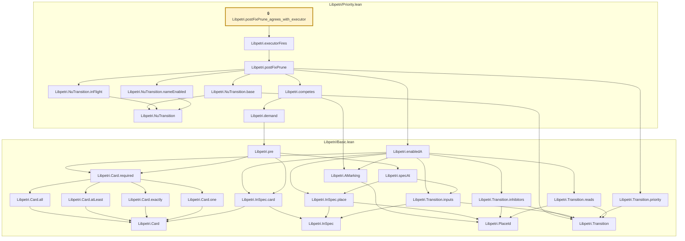

# NU-052

Generated by `scripts/proof-graph.py` from `proof-graph.json`. Do not edit.

Theorems carrying this ID:

- `Libpetri.Spec.clashNu_demand` (theorem, `Libpetri/Spec/ClashesNu.lean:398`)
- `Libpetri.inFlight_guard_is_necessary` (theorem, `Libpetri/Priority.lean:173`)
- `Libpetri.postFixPrune_agrees_with_executor` (theorem, `Libpetri/Priority.lean:89`) 🔒 locked
- `Libpetri.willFire_guard_is_necessary` (theorem, `Libpetri/Priority.lean:132`) 🔒 locked

> **Note:** the full tree has 72 nodes (limit 60), so it is drawn as one diagram per theorem (4 theorems).

### `Libpetri.Spec.clashNu_demand`

> Rule: this theorem's whole tree, 40 nodes.

```mermaid
flowchart TD
  subgraph g0["Libpetri/Basic.lean"]
    n0["Libpetri.AMarking"]
    n8["Libpetri.Card"]
    n9["Libpetri.Card.all"]
    n10["Libpetri.Card.atLeast"]
    n11["Libpetri.Card.consumesAll"]
    n12["Libpetri.Card.exactly"]
    n13["Libpetri.Card.one"]
    n14["Libpetri.Card.required"]
    n21["Libpetri.Colour"]
    n132["Libpetri.Guard"]
    n134["Libpetri.InSpec"]
    n135["Libpetri.InSpec.card"]
    n137["Libpetri.InSpec.mk"]
    n138["Libpetri.InSpec.place"]
    n2723["Libpetri.PlaceId"]
    n21910["Libpetri.Transition"]
    n21912["Libpetri.Transition.inputs"]
    n21913["Libpetri.Transition.mk"]
  end
  subgraph g1["Libpetri/Novel/ForwardDeposit.lean"]
    n867["Libpetri.Novel.ForwardDeposit.Deposit"]
  end
  subgraph g2["Libpetri/Novel/RouteB/Classify.lean"]
    n1775["Libpetri.Novel.RouteB.inOne"]
  end
  subgraph g3["Libpetri/Novel/RouteB/Exec.lean"]
    n1730["Libpetri.Novel.RouteB.demandOn"]
    n1883["Libpetri.Novel.RouteB.sharesConsumed"]
  end
  subgraph g4["Libpetri/Novel/RouteB/Graph.lean"]
    n1621["Libpetri.Novel.RouteB.NuTrans"]
    n1622["Libpetri.Novel.RouteB.NuTrans.base"]
    n1624["Libpetri.Novel.RouteB.NuTrans.mk"]
    n1640["Libpetri.Novel.RouteB.Row"]
    n1643["Libpetri.Novel.RouteB.Row.mk"]
  end
  subgraph g5["Libpetri/Spec/ClashesNu.lean"]
    n5934["Libpetri.Spec.ClashNu.clashNuAllH"]
    n5935["Libpetri.Spec.ClashNu.clashNuAllL"]
    n5943["Libpetri.Spec.ClashNu.consumedCompete"]
    n5944["Libpetri.Spec.ClashNu.consumedDemandOn"]
    n5945["Libpetri.Spec.ClashNu.demandOn_le_consumed"]
    n12377["Libpetri.Spec.clashNu_demand"]
  end
  subgraph g6["Libpetri/Spec/Req/NU_052.lean"]
    n5998["Libpetri.Spec.Compete"]
    n19071["Libpetri.Spec.nu052_a"]
    n19079["Libpetri.Spec.nu052_hi"]
    n19083["Libpetri.Spec.nu052_lo"]
    n19088["Libpetri.Spec.nu052_nt"]
    n19095["Libpetri.Spec.nu052_tr"]
    n19631["Libpetri.Spec.refCompete"]
  end
  n0 --> n2723
  n9 --> n8
  n10 --> n8
  n11 --> n9
  n11 --> n10
  n11 --> n12
  n11 --> n13
  n12 --> n8
  n13 --> n8
  n14 --> n9
  n14 --> n10
  n14 --> n12
  n14 --> n13
  n132 --> n21
  n135 --> n8
  n135 --> n134
  n137 --> n8
  n137 --> n132
  n137 --> n134
  n137 --> n2723
  n138 --> n134
  n138 --> n2723
  n867 --> n2723
  n1622 --> n1621
  n1622 --> n21910
  n1624 --> n1621
  n1624 --> n1640
  n1624 --> n2723
  n1624 --> n21910
  n1643 --> n867
  n1643 --> n1640
  n1730 --> n14
  n1730 --> n135
  n1730 --> n138
  n1730 --> n21912
  n1775 --> n13
  n1775 --> n137
  n1883 --> n0
  n1883 --> n1730
  n5934 --> n9
  n5934 --> n137
  n5934 --> n19095
  n5935 --> n9
  n5935 --> n137
  n5935 --> n19095
  n5943 --> n5944
  n5943 --> n5998
  n5944 --> n0
  n5944 --> n11
  n5944 --> n14
  n5944 --> n135
  n5944 --> n138
  n5944 --> n21912
  n5945 --> n1730
  n5945 --> n5944
  n5998 --> n0
  n5998 --> n21910
  n12377 --> n1622
  n12377 --> n5934
  n12377 --> n5935
  n12377 --> n5943
  n12377 --> n5945
  n12377 --> n19071
  n12377 --> n19079
  n12377 --> n19083
  n12377 --> n19631
  n19071 --> n0
  n19079 --> n1775
  n19079 --> n19088
  n19083 --> n1775
  n19083 --> n19088
  n19088 --> n1624
  n19088 --> n1643
  n19088 --> n19095
  n19095 --> n21913
  n19631 --> n1883
  n19631 --> n5998
  n21912 --> n134
  n21912 --> n21910
  n21913 --> n134
  n21913 --> n2723
  n21913 --> n21910
  classDef root stroke-width:3px
  classDef locked fill:#fff3cd,stroke:#b8860b
  classDef collapsed fill:#eeeeee,stroke-dasharray:4 4
  class n12377 root
```

### `Libpetri.inFlight_guard_is_necessary`

> Rule: this theorem's whole tree, 41 nodes.

```mermaid
flowchart TD
  subgraph g0["Libpetri/Basic.lean"]
    n0["Libpetri.AMarking"]
    n8["Libpetri.Card"]
    n9["Libpetri.Card.all"]
    n10["Libpetri.Card.atLeast"]
    n12["Libpetri.Card.exactly"]
    n13["Libpetri.Card.one"]
    n14["Libpetri.Card.required"]
    n21["Libpetri.Colour"]
    n132["Libpetri.Guard"]
    n134["Libpetri.InSpec"]
    n135["Libpetri.InSpec.card"]
    n137["Libpetri.InSpec.mk"]
    n138["Libpetri.InSpec.place"]
    n2723["Libpetri.PlaceId"]
    n21910["Libpetri.Transition"]
    n21911["Libpetri.Transition.inhibitors"]
    n21912["Libpetri.Transition.inputs"]
    n21913["Libpetri.Transition.mk"]
    n21915["Libpetri.Transition.priority"]
    n21916["Libpetri.Transition.reads"]
    n22039["Libpetri.enabledA"]
    n22162["Libpetri.pre"]
    n22217["Libpetri.specAt"]
  end
  subgraph g1["Libpetri/Priority.lean"]
    n2712["Libpetri.NuTransition"]
    n2713["Libpetri.NuTransition.base"]
    n2714["Libpetri.NuTransition.inFlight"]
    n2715["Libpetri.NuTransition.mk"]
    n2716["Libpetri.NuTransition.nameEnabled"]
    n21982["Libpetri.candsSplit"]
    n21985["Libpetri.competes"]
    n22021["Libpetri.demand"]
    n22057["Libpetri.executorFires"]
    n22080["Libpetri.hInFlight"]
    n22081["Libpetri.hSplit"]
    n22082["Libpetri.inFlight_guard_is_necessary"]
    n22118["Libpetri.lIdle"]
    n22119["Libpetri.lSplit"]
    n22124["Libpetri.mOne"]
    n22154["Libpetri.placesOne"]
    n22160["Libpetri.postFixPrune"]
    n22166["Libpetri.preInFlightPrune"]
  end
  n0 --> n2723
  n9 --> n8
  n10 --> n8
  n12 --> n8
  n13 --> n8
  n14 --> n9
  n14 --> n10
  n14 --> n12
  n14 --> n13
  n132 --> n21
  n135 --> n8
  n135 --> n134
  n137 --> n8
  n137 --> n132
  n137 --> n134
  n137 --> n2723
  n138 --> n134
  n138 --> n2723
  n2713 --> n2712
  n2713 --> n21910
  n2714 --> n2712
  n2715 --> n2712
  n2715 --> n21910
  n2716 --> n2712
  n21911 --> n2723
  n21911 --> n21910
  n21912 --> n134
  n21912 --> n21910
  n21913 --> n134
  n21913 --> n2723
  n21913 --> n21910
  n21915 --> n21910
  n21916 --> n2723
  n21916 --> n21910
  n21982 --> n22080
  n21982 --> n22118
  n21985 --> n0
  n21985 --> n22021
  n22021 --> n22162
  n22039 --> n0
  n22039 --> n14
  n22039 --> n135
  n22039 --> n138
  n22039 --> n21911
  n22039 --> n21912
  n22039 --> n21916
  n22057 --> n22160
  n22080 --> n2715
  n22080 --> n22081
  n22081 --> n13
  n22081 --> n137
  n22081 --> n21913
  n22082 --> n21982
  n22082 --> n22057
  n22082 --> n22124
  n22082 --> n22154
  n22082 --> n22166
  n22118 --> n2715
  n22118 --> n22119
  n22119 --> n13
  n22119 --> n137
  n22119 --> n21913
  n22124 --> n0
  n22154 --> n2723
  n22160 --> n2713
  n22160 --> n2714
  n22160 --> n2716
  n22160 --> n21915
  n22160 --> n21985
  n22160 --> n22039
  n22162 --> n14
  n22162 --> n135
  n22162 --> n22217
  n22166 --> n2713
  n22166 --> n2716
  n22166 --> n21915
  n22166 --> n21985
  n22166 --> n22039
  n22217 --> n138
  n22217 --> n21912
  classDef root stroke-width:3px
  classDef locked fill:#fff3cd,stroke:#b8860b
  classDef collapsed fill:#eeeeee,stroke-dasharray:4 4
  class n22082 root
```

### `Libpetri.postFixPrune_agrees_with_executor`

> Rule: this theorem's whole tree, 28 nodes.

### `Libpetri.willFire_guard_is_necessary`

> Rule: this theorem's whole tree, 41 nodes.

```mermaid
flowchart TD
  subgraph g0["Libpetri/Basic.lean"]
    n0["Libpetri.AMarking"]
    n8["Libpetri.Card"]
    n9["Libpetri.Card.all"]
    n10["Libpetri.Card.atLeast"]
    n12["Libpetri.Card.exactly"]
    n13["Libpetri.Card.one"]
    n14["Libpetri.Card.required"]
    n21["Libpetri.Colour"]
    n132["Libpetri.Guard"]
    n134["Libpetri.InSpec"]
    n135["Libpetri.InSpec.card"]
    n137["Libpetri.InSpec.mk"]
    n138["Libpetri.InSpec.place"]
    n2723["Libpetri.PlaceId"]
    n21910["Libpetri.Transition"]
    n21911["Libpetri.Transition.inhibitors"]
    n21912["Libpetri.Transition.inputs"]
    n21913["Libpetri.Transition.mk"]
    n21915["Libpetri.Transition.priority"]
    n21916["Libpetri.Transition.reads"]
    n22039["Libpetri.enabledA"]
    n22162["Libpetri.pre"]
    n22217["Libpetri.specAt"]
  end
  subgraph g1["Libpetri/Priority.lean"]
    n2712["Libpetri.NuTransition"]
    n2713["Libpetri.NuTransition.base"]
    n2714["Libpetri.NuTransition.inFlight"]
    n2715["Libpetri.NuTransition.mk"]
    n2716["Libpetri.NuTransition.nameEnabled"]
    n21981["Libpetri.candsOne"]
    n21985["Libpetri.competes"]
    n22021["Libpetri.demand"]
    n22037["Libpetri.drainNu"]
    n22057["Libpetri.executorFires"]
    n22114["Libpetri.joinNu"]
    n22124["Libpetri.mOne"]
    n22144["Libpetri.pDrain"]
    n22145["Libpetri.pJoin"]
    n22154["Libpetri.placesOne"]
    n22160["Libpetri.postFixPrune"]
    n22164["Libpetri.preFixPrune"]
    n22276["🔒 Libpetri.willFire_guard_is_necessary"]
  end
  n0 --> n2723
  n9 --> n8
  n10 --> n8
  n12 --> n8
  n13 --> n8
  n14 --> n9
  n14 --> n10
  n14 --> n12
  n14 --> n13
  n132 --> n21
  n135 --> n8
  n135 --> n134
  n137 --> n8
  n137 --> n132
  n137 --> n134
  n137 --> n2723
  n138 --> n134
  n138 --> n2723
  n2713 --> n2712
  n2713 --> n21910
  n2714 --> n2712
  n2715 --> n2712
  n2715 --> n21910
  n2716 --> n2712
  n21911 --> n2723
  n21911 --> n21910
  n21912 --> n134
  n21912 --> n21910
  n21913 --> n134
  n21913 --> n2723
  n21913 --> n21910
  n21915 --> n21910
  n21916 --> n2723
  n21916 --> n21910
  n21981 --> n22037
  n21981 --> n22114
  n21985 --> n0
  n21985 --> n22021
  n22021 --> n22162
  n22037 --> n2715
  n22037 --> n22144
  n22039 --> n0
  n22039 --> n14
  n22039 --> n135
  n22039 --> n138
  n22039 --> n21911
  n22039 --> n21912
  n22039 --> n21916
  n22057 --> n22160
  n22114 --> n2715
  n22114 --> n22145
  n22124 --> n0
  n22144 --> n13
  n22144 --> n137
  n22144 --> n21913
  n22145 --> n13
  n22145 --> n137
  n22145 --> n21913
  n22154 --> n2723
  n22160 --> n2713
  n22160 --> n2714
  n22160 --> n2716
  n22160 --> n21915
  n22160 --> n21985
  n22160 --> n22039
  n22162 --> n14
  n22162 --> n135
  n22162 --> n22217
  n22164 --> n2713
  n22164 --> n21915
  n22164 --> n21985
  n22164 --> n22039
  n22217 --> n138
  n22217 --> n21912
  n22276 --> n21981
  n22276 --> n22057
  n22276 --> n22124
  n22276 --> n22154
  n22276 --> n22164
  classDef root stroke-width:3px
  classDef locked fill:#fff3cd,stroke:#b8860b
  classDef collapsed fill:#eeeeee,stroke-dasharray:4 4
  class n22276 root
  class n22276 locked
```

Axioms used:

- `Libpetri.Spec.clashNu_demand`: `Quot.sound`, `propext`
- `Libpetri.inFlight_guard_is_necessary`: none
- `Libpetri.postFixPrune_agrees_with_executor`: `propext`
- `Libpetri.willFire_guard_is_necessary`: none
