# NU-053

Generated by `scripts/proof-graph.py` from `proof-graph.json`. Do not edit.

Theorems carrying this ID:

- `Libpetri.Novel.RouteA.buildPlan_premisesS` (theorem, `Libpetri/Novel/RouteA/Plan.lean:556`)
- `Libpetri.Novel.RouteA.checkCover_sound` (theorem, `Libpetri/Novel/RouteA/SlotBound.lean:126`)
- `Libpetri.Novel.RouteA.vacuous_colour_layer_lp` (theorem, `Libpetri/Novel/RouteA/SlotBound.lean:213`)
- `Libpetri.Spec.NU_053_ac6` (theorem, `Libpetri/Spec/Req/NU_053.lean:638`)
- `Libpetri.Spec.NU_053_ac8` (theorem, `Libpetri/Spec/Req/NU_053.lean:647`)
- `Libpetri.Spec.NU_053_ac9_reset` (theorem, `Libpetri/Spec/Req/NU_053.lean:656`)
- `Libpetri.Spec.NU_053_answers_least` (theorem, `Libpetri/Spec/Req/NU_053.lean:323`)
- `Libpetri.Spec.NU_053_infeasible` (theorem, `Libpetri/Spec/Req/NU_053.lean:312`)
- `Libpetri.Spec.NU_053_le_semiflow` (theorem, `Libpetri/Spec/Req/NU_053.lean:362`)
- `Libpetri.Spec.NU_053_otherRefund` (theorem, `Libpetri/Spec/Req/NU_053.lean:673`)
- `Libpetri.Spec.NU_053_relayRefund` (theorem, `Libpetri/Spec/Req/NU_053.lean:665`)
- `Libpetri.Spec.NU_053_tokens_le` (theorem, `Libpetri/Spec/Req/NU_053.lean:340`)
- `Libpetri.Spec.NU_053_unique` (theorem, `Libpetri/Spec/Req/NU_053.lean:298`)
- `Libpetri.Spec.NU_053_zero_exact` (theorem, `Libpetri/Spec/Req/NU_053.lean:350`)
- `Libpetri.covered_place_empty` (theorem, `Libpetri/Semiflow.lean:331`) 🔒 locked
- `Libpetri.vacuous_colour_layer` (theorem, `Libpetri/Semiflow.lean:381`) 🔒 locked

> **Note:** the full tree has 185 nodes (limit 60), so it is drawn as one diagram per theorem (16 theorems).

### `Libpetri.Novel.RouteA.buildPlan_premisesS`

> Rule: this theorem's tree has 88 nodes (limit 60); every file other than its own is collapsed into one node, leaving 32.

```mermaid
flowchart TD
  subgraph g0["Libpetri/Novel/RouteA/Plan.lean"]
    n1018["Libpetri.Novel.RouteA.Gate"]
    n1027["Libpetri.Novel.RouteA.MatchInfo"]
    n1028["Libpetri.Novel.RouteA.MatchInfo.keys"]
    n1030["Libpetri.Novel.RouteA.MatchInfo.relays"]
    n1052["Libpetri.Novel.RouteA.PremisesS"]
    n1058["Libpetri.Novel.RouteA.PremisesS.mk"]
    n1192["Libpetri.Novel.RouteA.SrcRow"]
    n1193["Libpetri.Novel.RouteA.SrcRow.d"]
    n1194["Libpetri.Novel.RouteA.SrcRow.declared"]
    n1195["Libpetri.Novel.RouteA.SrcRow.flat"]
    n1197["Libpetri.Novel.RouteA.SrcRow.ms"]
    n1198["Libpetri.Novel.RouteA.SrcRow.t"]
    n1199["Libpetri.Novel.RouteA.SrcRow.tw"]
    n1204["Libpetri.Novel.RouteA.arcsOK"]
    n1205["Libpetri.Novel.RouteA.arcsOK_spec"]
    n1207["Libpetri.Novel.RouteA.buildPlan"]
    n1211["Libpetri.Novel.RouteA.buildPlanG"]
    n1213["Libpetri.Novel.RouteA.buildPlanG_premisesS"]
    n1215["Libpetri.Novel.RouteA.buildPlan_premisesS"]
    n1220["Libpetri.Novel.RouteA.classifyAllG"]
    n1221["Libpetri.Novel.RouteA.classifyAll_spec"]
    n1223["Libpetri.Novel.RouteA.classifyRowG"]
    n1226["Libpetri.Novel.RouteA.classifyRowG_ok"]
    n1274["Libpetri.Novel.RouteA.mem_cin"]
    n1302["Libpetri.Novel.RouteA.shippedGate"]
  end
  c0["📁 Libpetri/Basic.lean (26 declarations, collapsed)"]
  c6["📁 Libpetri/InvariantSum.lean (4 declarations, collapsed)"]
  c26["📁 Libpetri/Novel/ForwardDeposit.lean (1 declarations, collapsed)"]
  c28["📁 Libpetri/Novel/LinearBound.lean (1 declarations, collapsed)"]
  c33["📁 Libpetri/Novel/RouteA/Model.lean (23 declarations, collapsed)"]
  c39["📁 Libpetri/Novel/RouteA/SlotBound.lean (7 declarations, collapsed)"]
  c133["📁 Libpetri/Strengthening/Hypotheses.lean (1 declarations, collapsed)"]
  c6 --> c0
  c26 --> c0
  c28 --> c6
  c28 --> c26
  c33 --> c6
  c33 --> c26
  c39 --> c28
  c133 --> c6
  n1018 --> c0
  n1018 --> n1192
  n1028 --> c0
  n1028 --> n1027
  n1030 --> c0
  n1030 --> n1027
  n1052 --> c33
  n1058 --> c39
  n1058 --> c133
  n1058 --> n1052
  n1193 --> c26
  n1193 --> n1192
  n1194 --> n1192
  n1195 --> n1193
  n1195 --> n1198
  n1197 --> n1027
  n1197 --> n1192
  n1198 --> c0
  n1198 --> n1192
  n1199 --> c0
  n1199 --> n1192
  n1204 --> c0
  n1205 --> c33
  n1205 --> n1204
  n1207 --> c39
  n1207 --> n1195
  n1207 --> n1211
  n1207 --> n1302
  n1211 --> n1204
  n1211 --> n1220
  n1213 --> n1058
  n1213 --> n1205
  n1213 --> n1211
  n1213 --> n1221
  n1215 --> n1207
  n1215 --> n1213
  n1220 --> n1018
  n1220 --> n1193
  n1220 --> n1197
  n1220 --> n1198
  n1220 --> n1223
  n1221 --> n1195
  n1221 --> n1220
  n1221 --> n1226
  n1223 --> c33
  n1223 --> n1028
  n1223 --> n1030
  n1226 --> n1223
  n1226 --> n1274
  n1274 --> c0
  n1302 --> n1018
  n1302 --> n1194
  n1302 --> n1199
  classDef root stroke-width:3px
  classDef locked fill:#fff3cd,stroke:#b8860b
  classDef collapsed fill:#eeeeee,stroke-dasharray:4 4
  class n1215 root
  class c0,c6,c26,c28,c33,c39,c133 collapsed
```

### `Libpetri.Novel.RouteA.checkCover_sound`

> Rule: this theorem's whole tree, 26 nodes.

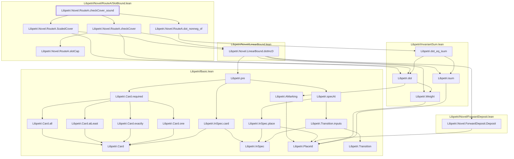

### `Libpetri.Novel.RouteA.vacuous_colour_layer_lp`

> Rule: this theorem's whole tree, 47 nodes.

```mermaid
flowchart TD
  subgraph g0["Libpetri/Basic.lean"]
    n0["Libpetri.AMarking"]
    n8["Libpetri.Card"]
    n9["Libpetri.Card.all"]
    n10["Libpetri.Card.atLeast"]
    n11["Libpetri.Card.consumesAll"]
    n12["Libpetri.Card.exactly"]
    n13["Libpetri.Card.one"]
    n14["Libpetri.Card.required"]
    n134["Libpetri.InSpec"]
    n135["Libpetri.InSpec.card"]
    n138["Libpetri.InSpec.place"]
    n2720["Libpetri.PlaceId"]
    n13129["Libpetri.Transition"]
    n13130["Libpetri.Transition.inhibitors"]
    n13131["Libpetri.Transition.inputs"]
    n13135["Libpetri.Transition.reads"]
    n13136["Libpetri.Transition.resets"]
    n13206["Libpetri.consumeAllAt"]
    n13258["Libpetri.enabledA"]
    n13381["Libpetri.pre"]
    n13436["Libpetri.specAt"]
  end
  subgraph g1["Libpetri/InvariantSum.lean"]
    n13146["Libpetri.Weight"]
    n13245["Libpetri.dot"]
    n13247["Libpetri.dot_eq_isum"]
    n13325["Libpetri.isum"]
    n13326["🔒 Libpetri.isum_add"]
    n13328["🔒 Libpetri.isum_congr"]
  end
  subgraph g2["Libpetri/Novel/ForwardDeposit.lean"]
    n867["Libpetri.Novel.ForwardDeposit.Deposit"]
    n877["Libpetri.Novel.ForwardDeposit.ReachAD"]
    n878["Libpetri.Novel.ForwardDeposit.ReachADInj"]
    n880["Libpetri.Novel.ForwardDeposit.StepAD"]
    n881["Libpetri.Novel.ForwardDeposit.StepADInj"]
    n895["Libpetri.Novel.ForwardDeposit.fireAD"]
    n930["Libpetri.Novel.ForwardDeposit.reachAD_sub_inj"]
  end
  subgraph g3["Libpetri/Novel/LinearBound.lean"]
    n1039["Libpetri.Novel.LinearBound.dotIncD"]
    n1042["Libpetri.Novel.LinearBound.dot_fireAD_le"]
    n1044["Libpetri.Novel.LinearBound.dot_inject"]
    n1046["Libpetri.Novel.LinearBound.dot_le_initial_rows"]
    n1049["Libpetri.Novel.LinearBound.fireAD_le_linear"]
    n1052["Libpetri.Novel.LinearBound.isum_le"]
  end
  subgraph g4["Libpetri/Novel/RouteA/SlotBound.lean"]
    n1385["Libpetri.Novel.RouteA.ScaledCover"]
    n1444["Libpetri.Novel.RouteA.coloured_tokens_le"]
    n1445["Libpetri.Novel.RouteA.count_le_fireAD"]
    n1509["Libpetri.Novel.RouteA.sum_le_dot_scaled"]
    n1515["Libpetri.Novel.RouteA.vacuous_colour_layer_lp"]
  end
  subgraph g5["Libpetri/Soundness.lean"]
    n13440["🔒 Libpetri.specAt_sound"]
  end
  subgraph g6["Libpetri/Strengthening/Hypotheses.lean"]
    n13386["🔒 Libpetri.pre_le_of_enabledA"]
  end
  n0 --> n2720
  n9 --> n8
  n10 --> n8
  n11 --> n9
  n11 --> n10
  n11 --> n12
  n11 --> n13
  n12 --> n8
  n13 --> n8
  n14 --> n9
  n14 --> n10
  n14 --> n12
  n14 --> n13
  n135 --> n8
  n135 --> n134
  n138 --> n134
  n138 --> n2720
  n867 --> n2720
  n877 --> n880
  n878 --> n881
  n880 --> n895
  n880 --> n13258
  n881 --> n880
  n895 --> n0
  n895 --> n867
  n895 --> n13136
  n895 --> n13206
  n895 --> n13381
  n930 --> n877
  n930 --> n878
  n1039 --> n867
  n1039 --> n13146
  n1039 --> n13325
  n1039 --> n13381
  n1042 --> n1039
  n1042 --> n1049
  n1042 --> n1052
  n1042 --> n13247
  n1042 --> n13326
  n1044 --> n13247
  n1044 --> n13328
  n1046 --> n878
  n1046 --> n1042
  n1046 --> n1044
  n1049 --> n895
  n1049 --> n13386
  n1052 --> n13325
  n1385 --> n1039
  n1385 --> n13245
  n1444 --> n930
  n1444 --> n1046
  n1444 --> n1385
  n1444 --> n1509
  n1445 --> n895
  n1509 --> n13247
  n1515 --> n1444
  n1515 --> n1445
  n13130 --> n2720
  n13130 --> n13129
  n13131 --> n134
  n13131 --> n13129
  n13135 --> n2720
  n13135 --> n13129
  n13136 --> n2720
  n13136 --> n13129
  n13146 --> n2720
  n13206 --> n11
  n13206 --> n135
  n13206 --> n13436
  n13245 --> n0
  n13245 --> n13146
  n13247 --> n13245
  n13247 --> n13325
  n13258 --> n0
  n13258 --> n14
  n13258 --> n135
  n13258 --> n138
  n13258 --> n13130
  n13258 --> n13131
  n13258 --> n13135
  n13325 --> n2720
  n13326 --> n13325
  n13328 --> n13325
  n13381 --> n14
  n13381 --> n135
  n13381 --> n13436
  n13386 --> n13258
  n13386 --> n13381
  n13386 --> n13440
  n13436 --> n138
  n13436 --> n13131
  n13440 --> n13436
  classDef root stroke-width:3px
  classDef locked fill:#fff3cd,stroke:#b8860b
  classDef collapsed fill:#eeeeee,stroke-dasharray:4 4
  class n1515 root
  class n13326,n13328,n13386,n13440 locked
```

### `Libpetri.Spec.NU_053_ac6`

> Rule: this theorem's tree has 70 nodes (limit 60); every file other than its own is collapsed into one node, leaving 21.

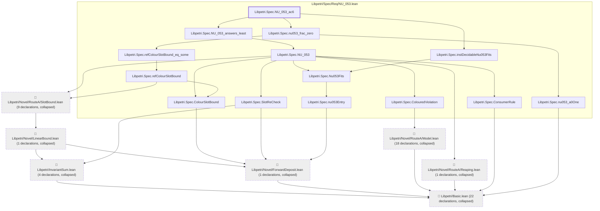

### `Libpetri.Spec.NU_053_ac8`

> Rule: this theorem's tree has 72 nodes (limit 60); every file other than its own is collapsed into one node, leaving 21.

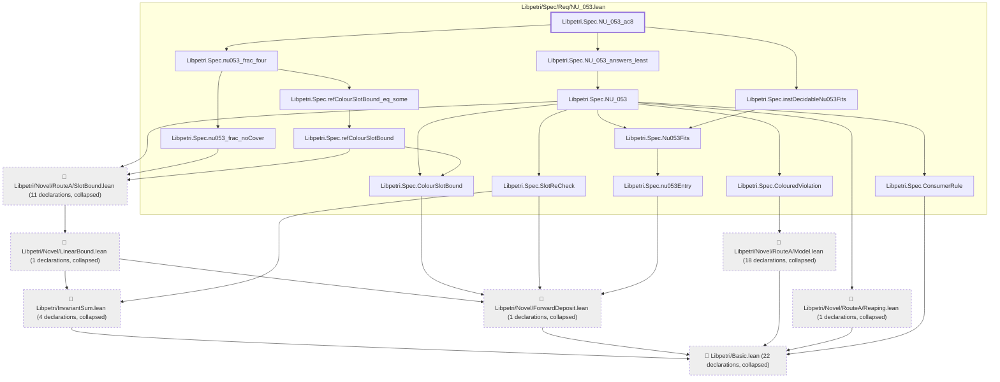

### `Libpetri.Spec.NU_053_ac9_reset`

> Rule: this theorem's tree has 72 nodes (limit 60); every file other than its own is collapsed into one node, leaving 26.

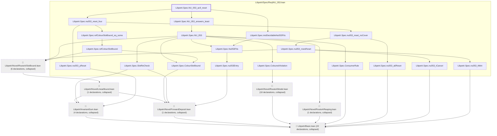

### `Libpetri.Spec.NU_053_answers_least`

> Rule: this theorem's whole tree, 52 nodes.

```mermaid
flowchart TD
  subgraph g0["Libpetri/Basic.lean"]
    n0["Libpetri.AMarking"]
    n8["Libpetri.Card"]
    n9["Libpetri.Card.all"]
    n10["Libpetri.Card.atLeast"]
    n12["Libpetri.Card.exactly"]
    n13["Libpetri.Card.one"]
    n14["Libpetri.Card.required"]
    n134["Libpetri.InSpec"]
    n135["Libpetri.InSpec.card"]
    n138["Libpetri.InSpec.place"]
    n2720["Libpetri.PlaceId"]
    n13129["Libpetri.Transition"]
    n13130["Libpetri.Transition.inhibitors"]
    n13131["Libpetri.Transition.inputs"]
    n13133["Libpetri.Transition.name"]
    n13135["Libpetri.Transition.reads"]
    n13381["Libpetri.pre"]
    n13436["Libpetri.specAt"]
  end
  subgraph g1["Libpetri/InvariantSum.lean"]
    n13146["Libpetri.Weight"]
    n13245["Libpetri.dot"]
    n13325["Libpetri.isum"]
  end
  subgraph g2["Libpetri/Novel/ForwardDeposit.lean"]
    n867["Libpetri.Novel.ForwardDeposit.Deposit"]
  end
  subgraph g3["Libpetri/Novel/LinearBound.lean"]
    n1039["Libpetri.Novel.LinearBound.dotIncD"]
  end
  subgraph g4["Libpetri/Novel/RouteA/Model.lean"]
    n1164["Libpetri.Novel.RouteA.CRow"]
    n1165["Libpetri.Novel.RouteA.CRow.cls"]
    n1173["Libpetri.Novel.RouteA.CRow.t"]
    n1179["Libpetri.Novel.RouteA.Cls"]
    n1180["Libpetri.Novel.RouteA.Cls.consume"]
    n1181["Libpetri.Novel.RouteA.Cls.join"]
    n1182["Libpetri.Novel.RouteA.Cls.mint"]
    n1184["Libpetri.Novel.RouteA.Cls.untouched"]
    n1190["Libpetri.Novel.RouteA.EState"]
    n1192["Libpetri.Novel.RouteA.EState.s"]
    n1193["Libpetri.Novel.RouteA.EState.u"]
    n1200["Libpetri.Novel.RouteA.Enc"]
    n1201["Libpetri.Novel.RouteA.Enc.C"]
    n1204["Libpetri.Novel.RouteA.Enc.k"]
    n1207["Libpetri.Novel.RouteA.Enc.rows"]
    n1401["Libpetri.Novel.RouteA.agg"]
    n1434["Libpetri.Novel.RouteA.colDisabled"]
    n1511["Libpetri.Novel.RouteA.uDisabled"]
  end
  subgraph g5["Libpetri/Novel/RouteA/Reaping.lean"]
    n1486["Libpetri.Novel.RouteA.reapT"]
  end
  subgraph g6["Libpetri/Novel/RouteA/SlotBound.lean"]
    n1385["Libpetri.Novel.RouteA.ScaledCover"]
    n1506["Libpetri.Novel.RouteA.slotCap"]
  end
  subgraph g7["Libpetri/Spec/Req/NU_053.lean"]
    n4891["Libpetri.Spec.ColourSlotBound"]
    n4894["Libpetri.Spec.ColouredViolation"]
    n4922["Libpetri.Spec.ConsumerRule"]
    n6601["Libpetri.Spec.NU_053"]
    n6605["Libpetri.Spec.NU_053_answers_least"]
    n6707["Libpetri.Spec.Nu053Fits"]
    n6931["Libpetri.Spec.SlotReCheck"]
    n11634["Libpetri.Spec.nu053Entry"]
  end
  n0 --> n2720
  n9 --> n8
  n10 --> n8
  n12 --> n8
  n13 --> n8
  n14 --> n9
  n14 --> n10
  n14 --> n12
  n14 --> n13
  n135 --> n8
  n135 --> n134
  n138 --> n134
  n138 --> n2720
  n867 --> n2720
  n1039 --> n867
  n1039 --> n13146
  n1039 --> n13325
  n1039 --> n13381
  n1165 --> n1164
  n1165 --> n1179
  n1173 --> n1164
  n1173 --> n13129
  n1180 --> n1179
  n1180 --> n2720
  n1181 --> n1179
  n1181 --> n2720
  n1182 --> n1179
  n1182 --> n2720
  n1184 --> n1179
  n1192 --> n1190
  n1192 --> n2720
  n1193 --> n0
  n1193 --> n1190
  n1201 --> n1200
  n1201 --> n2720
  n1204 --> n1200
  n1207 --> n1164
  n1207 --> n1200
  n1385 --> n1039
  n1385 --> n13245
  n1401 --> n1192
  n1401 --> n1193
  n1434 --> n1180
  n1434 --> n1181
  n1434 --> n1182
  n1434 --> n1184
  n1486 --> n13133
  n1511 --> n1193
  n1511 --> n13130
  n1511 --> n13135
  n1511 --> n13381
  n4891 --> n0
  n4891 --> n867
  n4891 --> n13129
  n4894 --> n0
  n4894 --> n1190
  n4894 --> n1200
  n4922 --> n2720
  n6601 --> n1165
  n6601 --> n1173
  n6601 --> n1201
  n6601 --> n1204
  n6601 --> n1207
  n6601 --> n1385
  n6601 --> n1401
  n6601 --> n1434
  n6601 --> n1486
  n6601 --> n1506
  n6601 --> n1511
  n6601 --> n4891
  n6601 --> n4894
  n6601 --> n4922
  n6601 --> n6707
  n6601 --> n6931
  n6605 --> n6601
  n6707 --> n11634
  n6931 --> n0
  n6931 --> n867
  n6931 --> n13129
  n6931 --> n13146
  n11634 --> n0
  n11634 --> n867
  n11634 --> n13381
  n13130 --> n2720
  n13130 --> n13129
  n13131 --> n134
  n13131 --> n13129
  n13133 --> n13129
  n13135 --> n2720
  n13135 --> n13129
  n13146 --> n2720
  n13245 --> n0
  n13245 --> n13146
  n13325 --> n2720
  n13381 --> n14
  n13381 --> n135
  n13381 --> n13436
  n13436 --> n138
  n13436 --> n13131
  classDef root stroke-width:3px
  classDef locked fill:#fff3cd,stroke:#b8860b
  classDef collapsed fill:#eeeeee,stroke-dasharray:4 4
  class n6605 root
```

### `Libpetri.Spec.NU_053_infeasible`

> Rule: this theorem's whole tree, 52 nodes.

### `Libpetri.Spec.NU_053_le_semiflow`

> Rule: this theorem's whole tree, 53 nodes.

```mermaid
flowchart TD
  subgraph g0["Libpetri/Basic.lean"]
    n0["Libpetri.AMarking"]
    n8["Libpetri.Card"]
    n9["Libpetri.Card.all"]
    n10["Libpetri.Card.atLeast"]
    n12["Libpetri.Card.exactly"]
    n13["Libpetri.Card.one"]
    n14["Libpetri.Card.required"]
    n134["Libpetri.InSpec"]
    n135["Libpetri.InSpec.card"]
    n138["Libpetri.InSpec.place"]
    n2720["Libpetri.PlaceId"]
    n13129["Libpetri.Transition"]
    n13130["Libpetri.Transition.inhibitors"]
    n13131["Libpetri.Transition.inputs"]
    n13133["Libpetri.Transition.name"]
    n13135["Libpetri.Transition.reads"]
    n13381["Libpetri.pre"]
    n13436["Libpetri.specAt"]
  end
  subgraph g1["Libpetri/InvariantSum.lean"]
    n13146["Libpetri.Weight"]
    n13245["Libpetri.dot"]
    n13325["Libpetri.isum"]
  end
  subgraph g2["Libpetri/Novel/ForwardDeposit.lean"]
    n867["Libpetri.Novel.ForwardDeposit.Deposit"]
  end
  subgraph g3["Libpetri/Novel/LinearBound.lean"]
    n1039["Libpetri.Novel.LinearBound.dotIncD"]
  end
  subgraph g4["Libpetri/Novel/RouteA/Model.lean"]
    n1164["Libpetri.Novel.RouteA.CRow"]
    n1165["Libpetri.Novel.RouteA.CRow.cls"]
    n1173["Libpetri.Novel.RouteA.CRow.t"]
    n1179["Libpetri.Novel.RouteA.Cls"]
    n1180["Libpetri.Novel.RouteA.Cls.consume"]
    n1181["Libpetri.Novel.RouteA.Cls.join"]
    n1182["Libpetri.Novel.RouteA.Cls.mint"]
    n1184["Libpetri.Novel.RouteA.Cls.untouched"]
    n1190["Libpetri.Novel.RouteA.EState"]
    n1192["Libpetri.Novel.RouteA.EState.s"]
    n1193["Libpetri.Novel.RouteA.EState.u"]
    n1200["Libpetri.Novel.RouteA.Enc"]
    n1201["Libpetri.Novel.RouteA.Enc.C"]
    n1204["Libpetri.Novel.RouteA.Enc.k"]
    n1207["Libpetri.Novel.RouteA.Enc.rows"]
    n1401["Libpetri.Novel.RouteA.agg"]
    n1434["Libpetri.Novel.RouteA.colDisabled"]
    n1511["Libpetri.Novel.RouteA.uDisabled"]
  end
  subgraph g5["Libpetri/Novel/RouteA/Reaping.lean"]
    n1486["Libpetri.Novel.RouteA.reapT"]
  end
  subgraph g6["Libpetri/Novel/RouteA/SlotBound.lean"]
    n1385["Libpetri.Novel.RouteA.ScaledCover"]
    n1499["Libpetri.Novel.RouteA.scaledCover_of_cover"]
    n1506["Libpetri.Novel.RouteA.slotCap"]
  end
  subgraph g7["Libpetri/Spec/Req/NU_053.lean"]
    n4891["Libpetri.Spec.ColourSlotBound"]
    n4894["Libpetri.Spec.ColouredViolation"]
    n4922["Libpetri.Spec.ConsumerRule"]
    n6601["Libpetri.Spec.NU_053"]
    n6625["Libpetri.Spec.NU_053_le_semiflow"]
    n6707["Libpetri.Spec.Nu053Fits"]
    n6931["Libpetri.Spec.SlotReCheck"]
    n11634["Libpetri.Spec.nu053Entry"]
  end
  n0 --> n2720
  n9 --> n8
  n10 --> n8
  n12 --> n8
  n13 --> n8
  n14 --> n9
  n14 --> n10
  n14 --> n12
  n14 --> n13
  n135 --> n8
  n135 --> n134
  n138 --> n134
  n138 --> n2720
  n867 --> n2720
  n1039 --> n867
  n1039 --> n13146
  n1039 --> n13325
  n1039 --> n13381
  n1165 --> n1164
  n1165 --> n1179
  n1173 --> n1164
  n1173 --> n13129
  n1180 --> n1179
  n1180 --> n2720
  n1181 --> n1179
  n1181 --> n2720
  n1182 --> n1179
  n1182 --> n2720
  n1184 --> n1179
  n1192 --> n1190
  n1192 --> n2720
  n1193 --> n0
  n1193 --> n1190
  n1201 --> n1200
  n1201 --> n2720
  n1204 --> n1200
  n1207 --> n1164
  n1207 --> n1200
  n1385 --> n1039
  n1385 --> n13245
  n1401 --> n1192
  n1401 --> n1193
  n1434 --> n1180
  n1434 --> n1181
  n1434 --> n1182
  n1434 --> n1184
  n1486 --> n13133
  n1499 --> n1385
  n1511 --> n1193
  n1511 --> n13130
  n1511 --> n13135
  n1511 --> n13381
  n4891 --> n0
  n4891 --> n867
  n4891 --> n13129
  n4894 --> n0
  n4894 --> n1190
  n4894 --> n1200
  n4922 --> n2720
  n6601 --> n1165
  n6601 --> n1173
  n6601 --> n1201
  n6601 --> n1204
  n6601 --> n1207
  n6601 --> n1385
  n6601 --> n1401
  n6601 --> n1434
  n6601 --> n1486
  n6601 --> n1506
  n6601 --> n1511
  n6601 --> n4891
  n6601 --> n4894
  n6601 --> n4922
  n6601 --> n6707
  n6601 --> n6931
  n6625 --> n1499
  n6625 --> n6601
  n6707 --> n11634
  n6931 --> n0
  n6931 --> n867
  n6931 --> n13129
  n6931 --> n13146
  n11634 --> n0
  n11634 --> n867
  n11634 --> n13381
  n13130 --> n2720
  n13130 --> n13129
  n13131 --> n134
  n13131 --> n13129
  n13133 --> n13129
  n13135 --> n2720
  n13135 --> n13129
  n13146 --> n2720
  n13245 --> n0
  n13245 --> n13146
  n13325 --> n2720
  n13381 --> n14
  n13381 --> n135
  n13381 --> n13436
  n13436 --> n138
  n13436 --> n13131
  classDef root stroke-width:3px
  classDef locked fill:#fff3cd,stroke:#b8860b
  classDef collapsed fill:#eeeeee,stroke-dasharray:4 4
  class n6625 root
```

### `Libpetri.Spec.NU_053_otherRefund`

> Rule: this theorem's tree has 70 nodes (limit 60); every file other than its own is collapsed into one node, leaving 25.

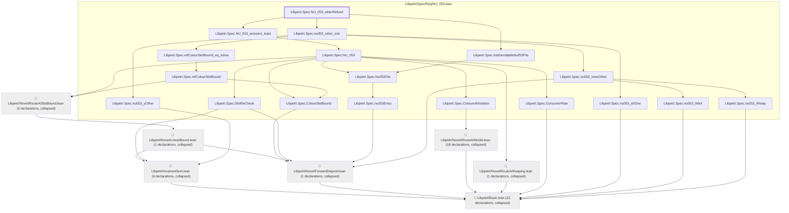

### `Libpetri.Spec.NU_053_relayRefund`

> Rule: this theorem's tree has 62 nodes (limit 60); every file other than its own is collapsed into one node, leaving 21.

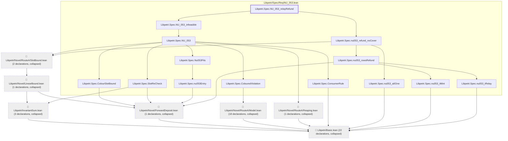

### `Libpetri.Spec.NU_053_tokens_le`

> Rule: this theorem's tree has 74 nodes (limit 60); every file other than its own is collapsed into one node, leaving 17.

### `Libpetri.Spec.NU_053_unique`

> Rule: this theorem's whole tree, 52 nodes.

### `Libpetri.Spec.NU_053_zero_exact`

> Rule: this theorem's tree has 76 nodes (limit 60); every file other than its own is collapsed into one node, leaving 17.

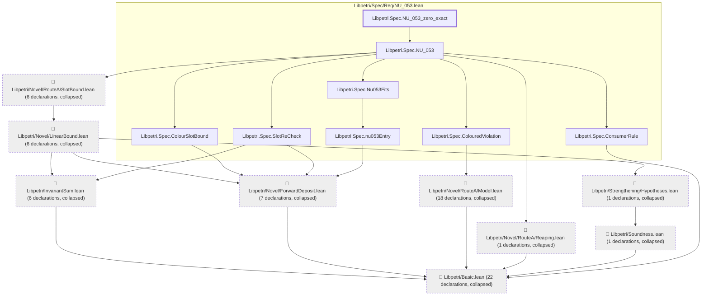

### `Libpetri.covered_place_empty`

> Rule: this theorem's whole tree, 49 nodes.

```mermaid
flowchart TD
  subgraph g0["Libpetri/Basic.lean"]
    n0["Libpetri.AMarking"]
    n8["Libpetri.Card"]
    n9["Libpetri.Card.all"]
    n10["Libpetri.Card.atLeast"]
    n11["Libpetri.Card.consumesAll"]
    n12["Libpetri.Card.exactly"]
    n13["Libpetri.Card.one"]
    n14["Libpetri.Card.required"]
    n134["Libpetri.InSpec"]
    n135["Libpetri.InSpec.card"]
    n138["Libpetri.InSpec.place"]
    n2720["Libpetri.PlaceId"]
    n13129["Libpetri.Transition"]
    n13130["Libpetri.Transition.inhibitors"]
    n13131["Libpetri.Transition.inputs"]
    n13135["Libpetri.Transition.reads"]
    n13136["Libpetri.Transition.resets"]
    n13206["Libpetri.consumeAllAt"]
    n13258["Libpetri.enabledA"]
    n13280["Libpetri.fireA"]
    n13376["Libpetri.post"]
    n13381["Libpetri.pre"]
    n13436["Libpetri.specAt"]
  end
  subgraph g1["Libpetri/InvariantSum.lean"]
    n13146["Libpetri.Weight"]
    n13245["Libpetri.dot"]
    n13246["Libpetri.dotInc"]
    n13247["Libpetri.dot_eq_isum"]
    n13325["Libpetri.isum"]
    n13326["🔒 Libpetri.isum_add"]
    n13328["🔒 Libpetri.isum_congr"]
  end
  subgraph g2["Libpetri/Semiflow.lean"]
    n13138["Libpetri.ValidLaw"]
    n13139["Libpetri.ValidLaw.h1"]
    n13140["Libpetri.ValidLaw.h2"]
    n13233["🔒 Libpetri.covered_place_empty"]
    n13251["🔒 Libpetri.dot_zero_forces_empty"]
    n13331["🔒 Libpetri.isum_term_le"]
  end
  subgraph g3["Libpetri/Soundness.lean"]
    n130["Libpetri.FlatNet"]
    n131["Libpetri.FlatTransition"]
    n2868["Libpetri.ReachA"]
    n2869["Libpetri.ReachA.init"]
    n2870["Libpetri.ReachA.rec'"]
    n2871["Libpetri.ReachA.step"]
    n13110["Libpetri.StepARel"]
    n13440["🔒 Libpetri.specAt_sound"]
  end
  subgraph g4["Libpetri/Strengthening.lean"]
    n13322["🔒 Libpetri.invariant_strengthening_sound"]
  end
  subgraph g5["Libpetri/Strengthening/Hypotheses.lean"]
    n13148["Libpetri.ZeroOnNonlinear"]
    n13248["🔒 Libpetri.dot_fireA"]
    n13289["🔒 Libpetri.fire_term"]
    n13386["🔒 Libpetri.pre_le_of_enabledA"]
  end
  n0 --> n2720
  n9 --> n8
  n10 --> n8
  n11 --> n9
  n11 --> n10
  n11 --> n12
  n11 --> n13
  n12 --> n8
  n13 --> n8
  n14 --> n9
  n14 --> n10
  n14 --> n12
  n14 --> n13
  n130 --> n131
  n131 --> n2720
  n131 --> n13129
  n135 --> n8
  n135 --> n134
  n138 --> n134
  n138 --> n2720
  n2868 --> n13110
  n2869 --> n2868
  n2870 --> n2869
  n2870 --> n2871
  n2871 --> n2868
  n13110 --> n130
  n13110 --> n13258
  n13110 --> n13280
  n13130 --> n2720
  n13130 --> n13129
  n13131 --> n134
  n13131 --> n13129
  n13135 --> n2720
  n13135 --> n13129
  n13136 --> n2720
  n13136 --> n13129
  n13138 --> n130
  n13138 --> n13146
  n13139 --> n13138
  n13139 --> n13148
  n13140 --> n13138
  n13140 --> n13246
  n13146 --> n2720
  n13148 --> n13136
  n13148 --> n13146
  n13148 --> n13206
  n13206 --> n11
  n13206 --> n135
  n13206 --> n13436
  n13233 --> n13139
  n13233 --> n13140
  n13233 --> n13251
  n13233 --> n13322
  n13245 --> n0
  n13245 --> n13146
  n13246 --> n131
  n13246 --> n13146
  n13246 --> n13325
  n13246 --> n13376
  n13246 --> n13381
  n13247 --> n13245
  n13247 --> n13325
  n13248 --> n13246
  n13248 --> n13247
  n13248 --> n13289
  n13248 --> n13326
  n13248 --> n13328
  n13251 --> n13247
  n13251 --> n13331
  n13258 --> n0
  n13258 --> n14
  n13258 --> n135
  n13258 --> n138
  n13258 --> n13130
  n13258 --> n13131
  n13258 --> n13135
  n13280 --> n0
  n13280 --> n13136
  n13280 --> n13206
  n13280 --> n13376
  n13280 --> n13381
  n13289 --> n13148
  n13289 --> n13280
  n13289 --> n13386
  n13322 --> n2870
  n13322 --> n13248
  n13325 --> n2720
  n13326 --> n13325
  n13328 --> n13325
  n13331 --> n13325
  n13376 --> n2720
  n13381 --> n14
  n13381 --> n135
  n13381 --> n13436
  n13386 --> n13258
  n13386 --> n13381
  n13386 --> n13440
  n13436 --> n138
  n13436 --> n13131
  n13440 --> n13436
  classDef root stroke-width:3px
  classDef locked fill:#fff3cd,stroke:#b8860b
  classDef collapsed fill:#eeeeee,stroke-dasharray:4 4
  class n13233 root
  class n13233,n13248,n13251,n13289,n13322,n13326,n13328,n13331,n13386,n13440 locked
```

### `Libpetri.vacuous_colour_layer`

> Rule: this theorem's whole tree, 52 nodes.

```mermaid
flowchart TD
  subgraph g0["Libpetri/Basic.lean"]
    n0["Libpetri.AMarking"]
    n8["Libpetri.Card"]
    n9["Libpetri.Card.all"]
    n10["Libpetri.Card.atLeast"]
    n11["Libpetri.Card.consumesAll"]
    n12["Libpetri.Card.exactly"]
    n13["Libpetri.Card.one"]
    n14["Libpetri.Card.required"]
    n134["Libpetri.InSpec"]
    n135["Libpetri.InSpec.card"]
    n138["Libpetri.InSpec.place"]
    n2720["Libpetri.PlaceId"]
    n13129["Libpetri.Transition"]
    n13130["Libpetri.Transition.inhibitors"]
    n13131["Libpetri.Transition.inputs"]
    n13135["Libpetri.Transition.reads"]
    n13136["Libpetri.Transition.resets"]
    n13206["Libpetri.consumeAllAt"]
    n13258["Libpetri.enabledA"]
    n13280["Libpetri.fireA"]
    n13376["Libpetri.post"]
    n13381["Libpetri.pre"]
    n13436["Libpetri.specAt"]
  end
  subgraph g1["Libpetri/InvariantSum.lean"]
    n13146["Libpetri.Weight"]
    n13245["Libpetri.dot"]
    n13246["Libpetri.dotInc"]
    n13247["Libpetri.dot_eq_isum"]
    n13325["Libpetri.isum"]
    n13326["🔒 Libpetri.isum_add"]
    n13328["🔒 Libpetri.isum_congr"]
  end
  subgraph g2["Libpetri/Semiflow.lean"]
    n13138["Libpetri.ValidLaw"]
    n13139["Libpetri.ValidLaw.h1"]
    n13140["Libpetri.ValidLaw.h2"]
    n13233["🔒 Libpetri.covered_place_empty"]
    n13235["🔒 Libpetri.covered_transition_dead"]
    n13251["🔒 Libpetri.dot_zero_forces_empty"]
    n13331["🔒 Libpetri.isum_term_le"]
    n13467["Libpetri.touchesCovered"]
    n13482["🔒 Libpetri.vacuous_colour_layer"]
  end
  subgraph g3["Libpetri/Soundness.lean"]
    n130["Libpetri.FlatNet"]
    n131["Libpetri.FlatTransition"]
    n2868["Libpetri.ReachA"]
    n2869["Libpetri.ReachA.init"]
    n2870["Libpetri.ReachA.rec'"]
    n2871["Libpetri.ReachA.step"]
    n13110["Libpetri.StepARel"]
    n13440["🔒 Libpetri.specAt_sound"]
  end
  subgraph g4["Libpetri/Strengthening.lean"]
    n13322["🔒 Libpetri.invariant_strengthening_sound"]
  end
  subgraph g5["Libpetri/Strengthening/Hypotheses.lean"]
    n13148["Libpetri.ZeroOnNonlinear"]
    n13248["🔒 Libpetri.dot_fireA"]
    n13289["🔒 Libpetri.fire_term"]
    n13386["🔒 Libpetri.pre_le_of_enabledA"]
  end
  n0 --> n2720
  n9 --> n8
  n10 --> n8
  n11 --> n9
  n11 --> n10
  n11 --> n12
  n11 --> n13
  n12 --> n8
  n13 --> n8
  n14 --> n9
  n14 --> n10
  n14 --> n12
  n14 --> n13
  n130 --> n131
  n131 --> n2720
  n131 --> n13129
  n135 --> n8
  n135 --> n134
  n138 --> n134
  n138 --> n2720
  n2868 --> n13110
  n2869 --> n2868
  n2870 --> n2869
  n2870 --> n2871
  n2871 --> n2868
  n13110 --> n130
  n13110 --> n13258
  n13110 --> n13280
  n13130 --> n2720
  n13130 --> n13129
  n13131 --> n134
  n13131 --> n13129
  n13135 --> n2720
  n13135 --> n13129
  n13136 --> n2720
  n13136 --> n13129
  n13138 --> n130
  n13138 --> n13146
  n13139 --> n13138
  n13139 --> n13148
  n13140 --> n13138
  n13140 --> n13246
  n13146 --> n2720
  n13148 --> n13136
  n13148 --> n13146
  n13148 --> n13206
  n13206 --> n11
  n13206 --> n135
  n13206 --> n13436
  n13233 --> n13139
  n13233 --> n13140
  n13233 --> n13251
  n13233 --> n13322
  n13235 --> n13233
  n13235 --> n13467
  n13245 --> n0
  n13245 --> n13146
  n13246 --> n131
  n13246 --> n13146
  n13246 --> n13325
  n13246 --> n13376
  n13246 --> n13381
  n13247 --> n13245
  n13247 --> n13325
  n13248 --> n13246
  n13248 --> n13247
  n13248 --> n13289
  n13248 --> n13326
  n13248 --> n13328
  n13251 --> n13247
  n13251 --> n13331
  n13258 --> n0
  n13258 --> n14
  n13258 --> n135
  n13258 --> n138
  n13258 --> n13130
  n13258 --> n13131
  n13258 --> n13135
  n13280 --> n0
  n13280 --> n13136
  n13280 --> n13206
  n13280 --> n13376
  n13280 --> n13381
  n13289 --> n13148
  n13289 --> n13280
  n13289 --> n13386
  n13322 --> n2870
  n13322 --> n13248
  n13325 --> n2720
  n13326 --> n13325
  n13328 --> n13325
  n13331 --> n13325
  n13376 --> n2720
  n13381 --> n14
  n13381 --> n135
  n13381 --> n13436
  n13386 --> n13258
  n13386 --> n13381
  n13386 --> n13440
  n13436 --> n138
  n13436 --> n13131
  n13440 --> n13436
  n13467 --> n131
  n13467 --> n13146
  n13467 --> n13376
  n13467 --> n13381
  n13482 --> n13235
  classDef root stroke-width:3px
  classDef locked fill:#fff3cd,stroke:#b8860b
  classDef collapsed fill:#eeeeee,stroke-dasharray:4 4
  class n13482 root
  class n13233,n13235,n13248,n13251,n13289,n13322,n13326,n13328,n13331,n13386,n13440,n13482 locked
```

Axioms used:

- `Libpetri.Novel.RouteA.buildPlan_premisesS`: `Classical.choice`, `Quot.sound`, `propext`
- `Libpetri.Novel.RouteA.checkCover_sound`: `Classical.choice`, `Quot.sound`, `propext`
- `Libpetri.Novel.RouteA.vacuous_colour_layer_lp`: `Classical.choice`, `Quot.sound`, `propext`
- `Libpetri.Spec.NU_053_ac6`: `Classical.choice`, `Quot.sound`, `propext`
- `Libpetri.Spec.NU_053_ac8`: `Classical.choice`, `Quot.sound`, `propext`
- `Libpetri.Spec.NU_053_ac9_reset`: `Classical.choice`, `Quot.sound`, `propext`
- `Libpetri.Spec.NU_053_answers_least`: `Classical.choice`, `Quot.sound`, `propext`
- `Libpetri.Spec.NU_053_infeasible`: `Classical.choice`, `Quot.sound`, `propext`
- `Libpetri.Spec.NU_053_le_semiflow`: `Classical.choice`, `Quot.sound`, `propext`
- `Libpetri.Spec.NU_053_otherRefund`: `Classical.choice`, `Quot.sound`, `propext`
- `Libpetri.Spec.NU_053_relayRefund`: `Classical.choice`, `Quot.sound`, `propext`
- `Libpetri.Spec.NU_053_tokens_le`: `Classical.choice`, `Quot.sound`, `propext`
- `Libpetri.Spec.NU_053_unique`: `Classical.choice`, `Quot.sound`, `propext`
- `Libpetri.Spec.NU_053_zero_exact`: `Classical.choice`, `Quot.sound`, `propext`
- `Libpetri.covered_place_empty`: `Classical.choice`, `Quot.sound`, `propext`
- `Libpetri.vacuous_colour_layer`: `Classical.choice`, `Quot.sound`, `propext`
