# PERF-002

Generated by `scripts/proof-graph.py` from `proof-graph.json`. Do not edit.

Theorems carrying this ID:

- `Libpetri.Spec.CONC_004_reference` (theorem, `Libpetri/Spec/Req/CONC_004.lean:92`)

```mermaid
flowchart TD
  subgraph g0["Libpetri/Basic.lean"]
    n8["Libpetri.Card"]
    n9["Libpetri.Card.all"]
    n10["Libpetri.Card.atLeast"]
    n12["Libpetri.Card.exactly"]
    n13["Libpetri.Card.one"]
    n14["Libpetri.Card.required"]
  end
  subgraph g1["Libpetri/Novel/Seam/Net.lean"]
    n1878["Libpetri.Novel.Seam.NInSpec"]
    n1879["Libpetri.Novel.Seam.NInSpec.card"]
    n1881["Libpetri.Novel.Seam.NInSpec.place"]
    n1896["Libpetri.Novel.Seam.NTransition"]
    n1897["Libpetri.Novel.Seam.NTransition.inhibitors"]
    n1898["Libpetri.Novel.Seam.NTransition.inputs"]
    n1901["Libpetri.Novel.Seam.NTransition.reads"]
  end
  subgraph g2["Libpetri/Reference/Semantics.lean"]
    n2924["Libpetri.Reference.Trans"]
    n2925["Libpetri.Reference.Trans.core"]
  end
  subgraph g3["Libpetri/Spec/Glossary.lean"]
    n3399["Libpetri.Spec.CountMarking"]
    n3884["Libpetri.Spec.InhibitorArc"]
    n3892["Libpetri.Spec.Marked"]
    n4036["Libpetri.Spec.ReadArc"]
    n5022["Libpetri.Spec.inPlaces"]
    n5042["Libpetri.Spec.instDecidableMarked"]
    n5537["Libpetri.Spec.requiredCount"]
  end
  subgraph g4["Libpetri/Spec/GlossaryEnable.lean"]
    n3508["Libpetri.Spec.EnableCheck"]
    n3511["Libpetri.Spec.EnableCheck.mk"]
    n3512["Libpetri.Spec.EnableCheck.presence"]
    n3885["Libpetri.Spec.InhibitorMask"]
    n3903["Libpetri.Spec.MaskCheck"]
    n3995["Libpetri.Spec.NeedsMask"]
    n5452["Libpetri.Spec.presenceOf"]
  end
  subgraph g5["Libpetri/Spec/Req/CONC_004.lean"]
    n3049["Libpetri.Spec.CONC_004"]
    n3057["Libpetri.Spec.CONC_004_reference"]
    n5468["Libpetri.Spec.refEnableCheck"]
    n5472["Libpetri.Spec.refEnableCheck_presence"]
  end
  n9 --> n8
  n10 --> n8
  n12 --> n8
  n13 --> n8
  n14 --> n9
  n14 --> n10
  n14 --> n12
  n14 --> n13
  n1879 --> n8
  n1879 --> n1878
  n1881 --> n1878
  n1897 --> n1896
  n1898 --> n1878
  n1898 --> n1896
  n1901 --> n1896
  n2925 --> n1896
  n2925 --> n2924
  n3049 --> n3512
  n3049 --> n3903
  n3057 --> n3049
  n3057 --> n5472
  n3511 --> n2924
  n3511 --> n3399
  n3511 --> n3508
  n3512 --> n2924
  n3512 --> n3508
  n3884 --> n1897
  n3884 --> n2925
  n3885 --> n3884
  n3892 --> n3399
  n3903 --> n3885
  n3903 --> n3995
  n3995 --> n4036
  n3995 --> n5022
  n4036 --> n1901
  n4036 --> n2925
  n5022 --> n1881
  n5022 --> n1898
  n5022 --> n2925
  n5042 --> n3892
  n5452 --> n5042
  n5468 --> n1879
  n5468 --> n1897
  n5468 --> n1901
  n5468 --> n3511
  n5468 --> n5022
  n5468 --> n5452
  n5468 --> n5537
  n5472 --> n3512
  n5472 --> n3903
  n5472 --> n5468
  n5537 --> n14
  classDef root stroke-width:3px
  classDef locked fill:#fff3cd,stroke:#b8860b
  classDef collapsed fill:#eeeeee,stroke-dasharray:4 4
  class n3057 root
```

Axioms used:

- `Libpetri.Spec.CONC_004_reference`: `Quot.sound`, `propext`
