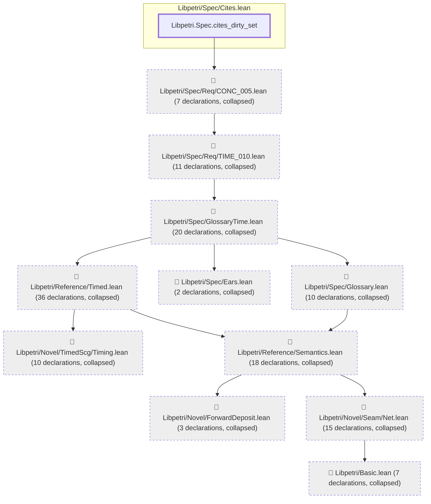
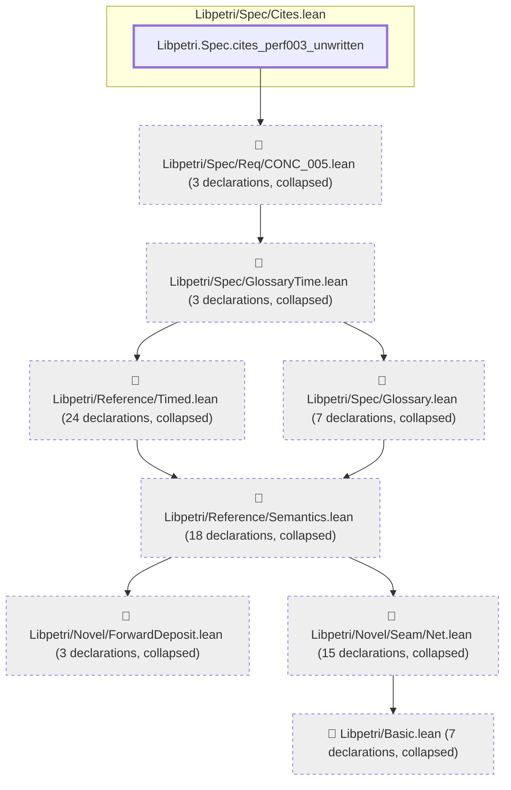

# PERF-003

Generated by `scripts/proof-graph.py` from `proof-graph.json`. Do not edit.

Theorems carrying this ID:

- `Libpetri.Spec.cites_dirty_set` (theorem, `Libpetri/Spec/Cites.lean:121`)
- `Libpetri.Spec.cites_perf003_unwritten` (theorem, `Libpetri/Spec/Cites.lean:130`)

> **Note:** the full tree has 141 nodes (limit 60), so it is drawn as one diagram per theorem (2 theorems).

### `Libpetri.Spec.cites_dirty_set`

> Rule: this theorem's tree has 140 nodes (limit 60); every file other than its own is collapsed into one node, leaving 12.

### `Libpetri.Spec.cites_perf003_unwritten`

> Rule: this theorem's tree has 81 nodes (limit 60); every file other than its own is collapsed into one node, leaving 9.

Axioms used:

- `Libpetri.Spec.cites_dirty_set`: `Quot.sound`, `propext`
- `Libpetri.Spec.cites_perf003_unwritten`: `Quot.sound`, `propext`
