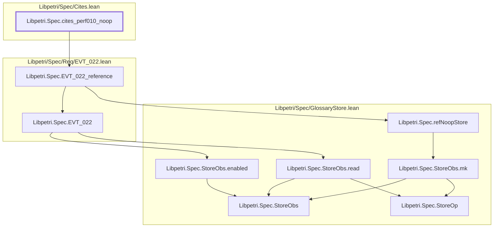

# PERF-010

Generated by `scripts/proof-graph.py` from `proof-graph.json`. Do not edit.

Theorems carrying this ID:

- `Libpetri.Spec.cites_perf010_noop` (theorem, `Libpetri/Spec/Cites.lean:143`)

Axioms used:

- `Libpetri.Spec.cites_perf010_noop`: none
