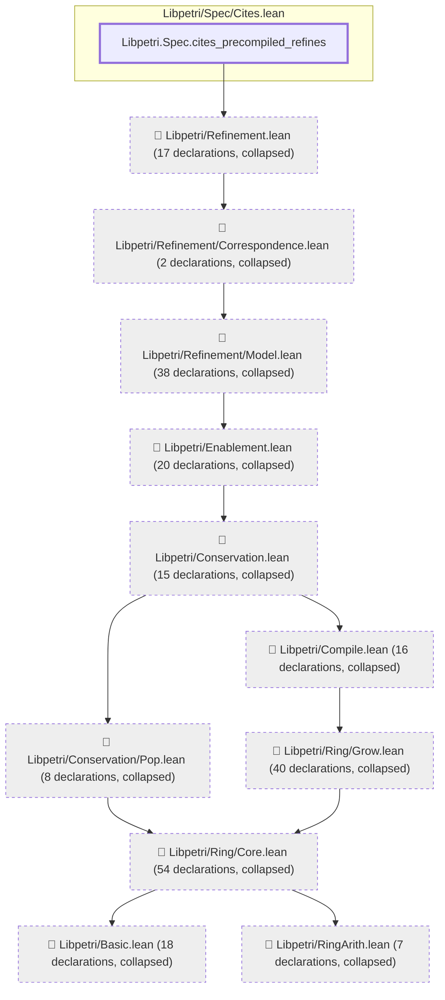

# PERF-041

Generated by `scripts/proof-graph.py` from `proof-graph.json`. Do not edit.

Theorems carrying this ID:

- `Libpetri.Spec.cites_precompiled_refines` (theorem, `Libpetri/Spec/Cites.lean:96`)

> **Note:** the full tree has 236 nodes (limit 60).

> Rule: this theorem's tree has 236 nodes (limit 60); every file other than its own is collapsed into one node, leaving 12.

Axioms used:

- `Libpetri.Spec.cites_precompiled_refines`: `Quot.sound`, `propext`
