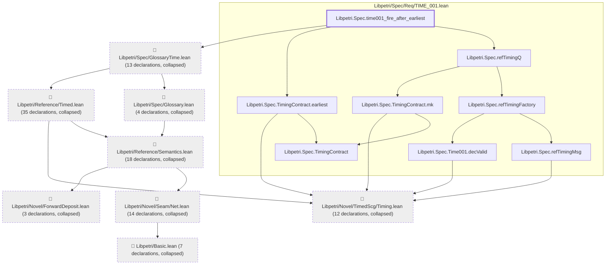
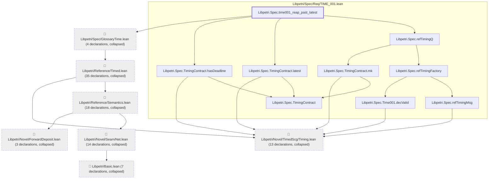
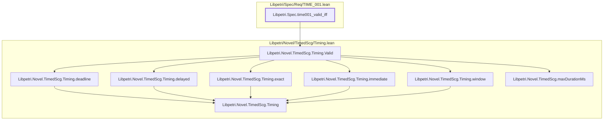

# TIME-001

Generated by `scripts/proof-graph.py` from `proof-graph.json`. Do not edit.

Theorems carrying this ID:

- `Libpetri.Spec.time001_fire_after_earliest` (theorem, `Libpetri/Spec/Req/TIME_001.lean:703`)
- `Libpetri.Spec.time001_reap_past_latest` (theorem, `Libpetri/Spec/Req/TIME_001.lean:712`)
- `Libpetri.Spec.time001_valid_iff` (theorem, `Libpetri/Spec/Req/TIME_001.lean:265`)

> **Note:** the full tree has 119 nodes (limit 60), so it is drawn as one diagram per theorem (3 theorems).

### `Libpetri.Spec.time001_fire_after_earliest`

> Rule: this theorem's tree has 114 nodes (limit 60); every file other than its own is collapsed into one node, leaving 16.

### `Libpetri.Spec.time001_reap_past_latest`

> Rule: this theorem's tree has 103 nodes (limit 60); every file other than its own is collapsed into one node, leaving 16.

### `Libpetri.Spec.time001_valid_iff`

> Rule: this theorem's whole tree, 9 nodes.

Axioms used:

- `Libpetri.Spec.time001_fire_after_earliest`: `propext`
- `Libpetri.Spec.time001_reap_past_latest`: `Quot.sound`, `propext`
- `Libpetri.Spec.time001_valid_iff`: `Classical.choice`, `Quot.sound`, `propext`
