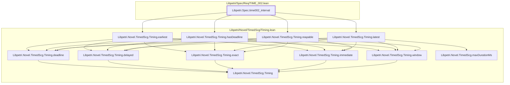

# TIME-002

Generated by `scripts/proof-graph.py` from `proof-graph.json`. Do not edit.

Theorems carrying this ID:

- `Libpetri.Spec.time002_interval` (theorem, `Libpetri/Spec/Req/TIME_002.lean:318`)

Axioms used:

- `Libpetri.Spec.time002_interval`: `propext`
