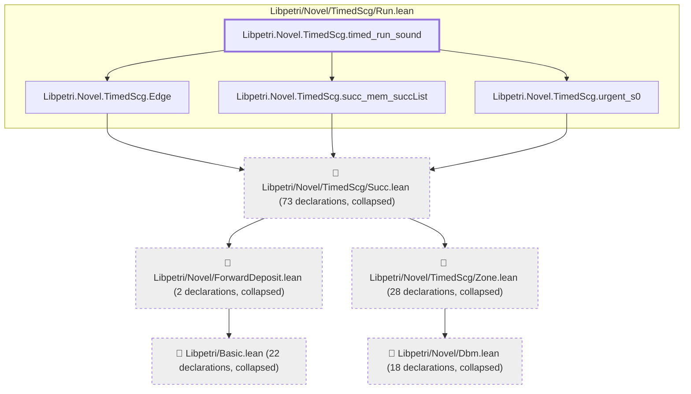
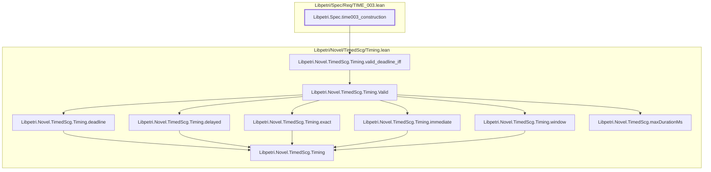
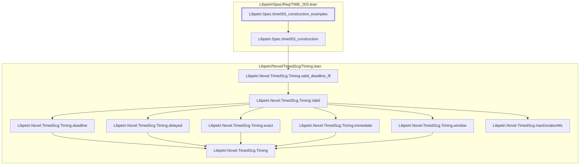
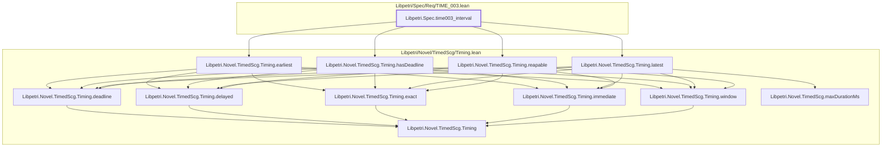

# TIME-003

Generated by `scripts/proof-graph.py` from `proof-graph.json`. Do not edit.

Theorems carrying this ID:

- `Libpetri.Novel.TimedScg.timed_run_sound` (theorem, `Libpetri/Novel/TimedScg/Run.lean:46`)
- `Libpetri.Spec.time003_construction` (theorem, `Libpetri/Spec/Req/TIME_003.lean:574`)
- `Libpetri.Spec.time003_construction_examples` (theorem, `Libpetri/Spec/Req/TIME_003.lean:581`)
- `Libpetri.Spec.time003_interval` (theorem, `Libpetri/Spec/Req/TIME_003.lean:566`)

> **Note:** the full tree has 163 nodes (limit 60), so it is drawn as one diagram per theorem (4 theorems).

### `Libpetri.Novel.TimedScg.timed_run_sound`

> Rule: this theorem's tree has 147 nodes (limit 60); every file other than its own is collapsed into one node, leaving 9.

### `Libpetri.Spec.time003_construction`

> Rule: this theorem's whole tree, 10 nodes.

### `Libpetri.Spec.time003_construction_examples`

> Rule: this theorem's whole tree, 11 nodes.

### `Libpetri.Spec.time003_interval`

> Rule: this theorem's whole tree, 12 nodes.

Axioms used:

- `Libpetri.Novel.TimedScg.timed_run_sound`: `Classical.choice`, `Quot.sound`, `propext`
- `Libpetri.Spec.time003_construction`: none
- `Libpetri.Spec.time003_construction_examples`: `propext`
- `Libpetri.Spec.time003_interval`: `propext`
