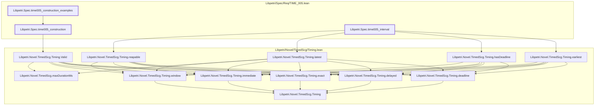

# TIME-005

Generated by `scripts/proof-graph.py` from `proof-graph.json`. Do not edit.

Theorems carrying this ID:

- `Libpetri.Spec.time005_construction` (theorem, `Libpetri/Spec/Req/TIME_005.lean:210`)
- `Libpetri.Spec.time005_construction_examples` (theorem, `Libpetri/Spec/Req/TIME_005.lean:217`)
- `Libpetri.Spec.time005_interval` (theorem, `Libpetri/Spec/Req/TIME_005.lean:202`)

Axioms used:

- `Libpetri.Spec.time005_construction`: none
- `Libpetri.Spec.time005_construction_examples`: `propext`
- `Libpetri.Spec.time005_interval`: `propext`
