# TIME-006

Generated by `scripts/proof-graph.py` from `proof-graph.json`. Do not edit.

Theorems carrying this ID:

- `Libpetri.Spec.time006_graph_interval` (theorem, `Libpetri/Spec/Req/TIME_006.lean:182`)
- `Libpetri.Spec.time006_interval` (theorem, `Libpetri/Spec/Req/TIME_006.lean:172`)

```mermaid
flowchart TD
  subgraph g0["Libpetri/Novel/Dbm.lean"]
    n237["Libpetri.Novel.Dbm.Bound"]
  end
  subgraph g1["Libpetri/Novel/TimedScg/Timing.lean"]
    n2432["Libpetri.Novel.TimedScg.Timing"]
    n2433["Libpetri.Novel.TimedScg.Timing.Valid"]
    n2439["Libpetri.Novel.TimedScg.Timing.deadline"]
    n2441["Libpetri.Novel.TimedScg.Timing.delayed"]
    n2442["Libpetri.Novel.TimedScg.Timing.earliest"]
    n2443["Libpetri.Novel.TimedScg.Timing.exact"]
    n2444["Libpetri.Novel.TimedScg.Timing.hasDeadline"]
    n2445["Libpetri.Novel.TimedScg.Timing.immediate"]
    n2446["Libpetri.Novel.TimedScg.Timing.latest"]
    n2447["Libpetri.Novel.TimedScg.Timing.reapable"]
    n2459["Libpetri.Novel.TimedScg.Timing.window"]
    n2486["Libpetri.Novel.TimedScg.eftT"]
    n2565["Libpetri.Novel.TimedScg.lftT"]
    n2576["Libpetri.Novel.TimedScg.maxDurationMs"]
  end
  subgraph g2["Libpetri/Spec/Req/TIME_006.lean"]
    n12423["Libpetri.Spec.time006_graph_interval"]
    n12427["Libpetri.Spec.time006_interval"]
  end
  n2433 --> n2439
  n2433 --> n2441
  n2433 --> n2443
  n2433 --> n2445
  n2433 --> n2459
  n2433 --> n2576
  n2439 --> n2432
  n2441 --> n2432
  n2442 --> n2439
  n2442 --> n2441
  n2442 --> n2443
  n2442 --> n2445
  n2442 --> n2459
  n2443 --> n2432
  n2444 --> n2439
  n2444 --> n2441
  n2444 --> n2443
  n2444 --> n2445
  n2444 --> n2459
  n2445 --> n2432
  n2446 --> n2439
  n2446 --> n2441
  n2446 --> n2443
  n2446 --> n2445
  n2446 --> n2459
  n2446 --> n2576
  n2447 --> n2439
  n2447 --> n2441
  n2447 --> n2443
  n2447 --> n2445
  n2447 --> n2459
  n2459 --> n2432
  n2486 --> n2442
  n2565 --> n237
  n2565 --> n2446
  n12423 --> n2486
  n12423 --> n2565
  n12427 --> n2433
  n12427 --> n2442
  n12427 --> n2444
  n12427 --> n2446
  n12427 --> n2447
  classDef root stroke-width:3px
  classDef locked fill:#fff3cd,stroke:#b8860b
  classDef collapsed fill:#eeeeee,stroke-dasharray:4 4
  class n12423,n12427 root
```

Axioms used:

- `Libpetri.Spec.time006_graph_interval`: `Classical.choice`, `Quot.sound`, `propext`
- `Libpetri.Spec.time006_interval`: `propext`
