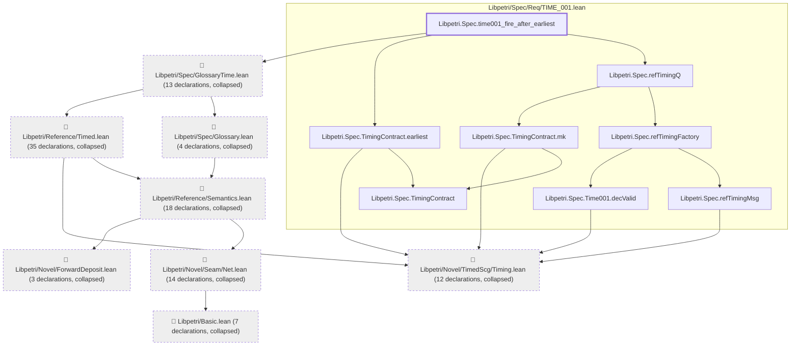
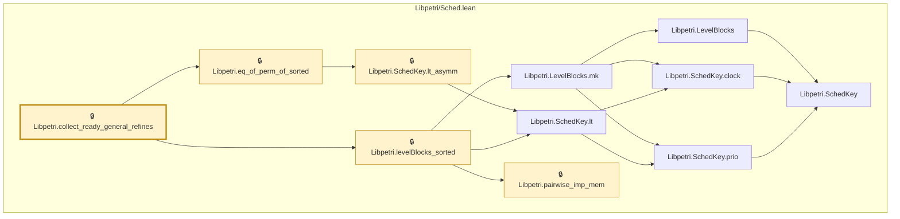

# TIME-010

Generated by `scripts/proof-graph.py` from `proof-graph.json`. Do not edit.

Theorems carrying this ID:

- `Libpetri.Spec.time001_fire_after_earliest` (theorem, `Libpetri/Spec/Req/TIME_001.lean:703`)
- `Libpetri.collect_ready_general_refines` (theorem, `Libpetri/Sched.lean:174`) 🔒 locked

> **Note:** the full tree has 125 nodes (limit 60), so it is drawn as one diagram per theorem (2 theorems).

### `Libpetri.Spec.time001_fire_after_earliest`

> Rule: this theorem's tree has 114 nodes (limit 60); every file other than its own is collapsed into one node, leaving 16.

### `Libpetri.collect_ready_general_refines`

> Rule: this theorem's whole tree, 11 nodes.

Axioms used:

- `Libpetri.Spec.time001_fire_after_earliest`: `propext`
- `Libpetri.collect_ready_general_refines`: `Quot.sound`, `propext`
