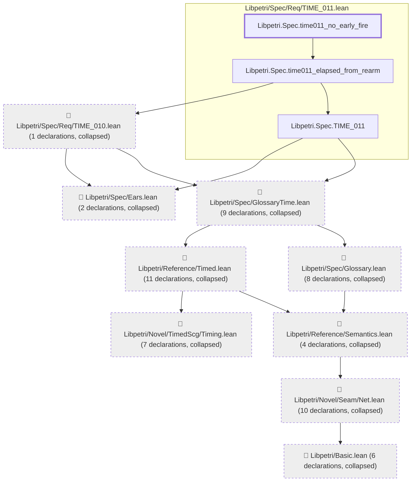
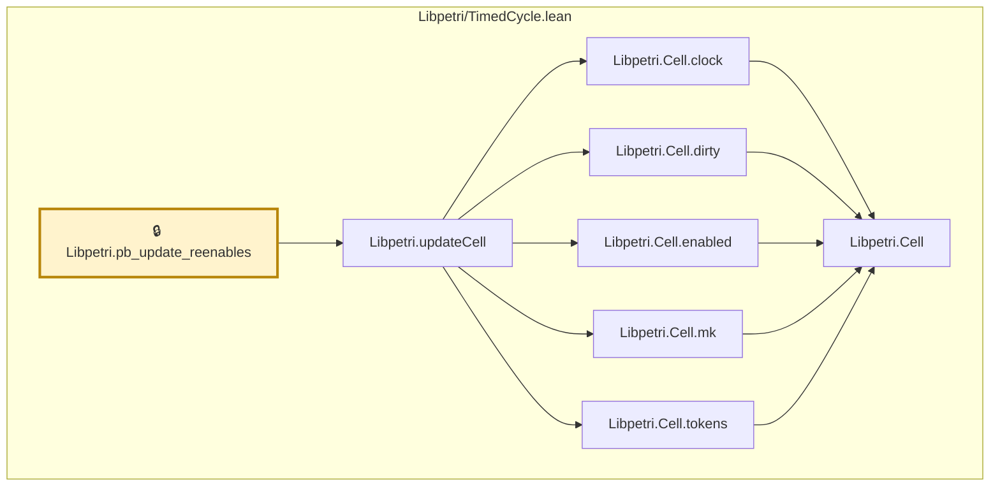

# TIME-011

Generated by `scripts/proof-graph.py` from `proof-graph.json`. Do not edit.

Theorems carrying this ID:

- `Libpetri.Spec.core073T_initArms` (theorem, `Libpetri/Spec/Req/CORE_073.lean:800`)
- `Libpetri.Spec.time011_elapsed_from_rearm` (theorem, `Libpetri/Spec/Req/TIME_011.lean:175`)
- `Libpetri.Spec.time011_no_early_fire` (theorem, `Libpetri/Spec/Req/TIME_011.lean:209`)
- `Libpetri.pb_update_reenables` (theorem, `Libpetri/TimedCycle.lean:234`) 🔒 locked

> **Note:** the full tree has 74 nodes (limit 60), so it is drawn as one diagram per theorem (4 theorems).

### `Libpetri.Spec.core073T_initArms`

> Rule: this theorem's whole tree, 35 nodes.

```mermaid
flowchart TD
  subgraph g0["Libpetri/Basic.lean"]
    n8["Libpetri.Card"]
    n9["Libpetri.Card.all"]
    n10["Libpetri.Card.atLeast"]
    n12["Libpetri.Card.exactly"]
    n13["Libpetri.Card.one"]
    n14["Libpetri.Card.required"]
  end
  subgraph g1["Libpetri/Novel/Seam/Net.lean"]
    n1936["Libpetri.Novel.Seam.NInSpec"]
    n1937["Libpetri.Novel.Seam.NInSpec.card"]
    n1939["Libpetri.Novel.Seam.NInSpec.place"]
    n1954["Libpetri.Novel.Seam.NTransition"]
    n1955["Libpetri.Novel.Seam.NTransition.inhibitors"]
    n1956["Libpetri.Novel.Seam.NTransition.inputs"]
    n1958["Libpetri.Novel.Seam.NTransition.name"]
    n1959["Libpetri.Novel.Seam.NTransition.reads"]
    n2049["Libpetri.Novel.Seam.enabledNA"]
  end
  subgraph g2["Libpetri/Reference/Queue.lean"]
    n3114["Libpetri.Reference.QMarking"]
    n3560["Libpetri.Reference.qCount"]
  end
  subgraph g3["Libpetri/Reference/Semantics.lean"]
    n3047["Libpetri.Reference.Net"]
    n3050["Libpetri.Reference.Net.transitions"]
    n3226["Libpetri.Reference.Trans"]
    n3227["Libpetri.Reference.Trans.core"]
  end
  subgraph g4["Libpetri/Reference/Snapshot.lean"]
    n3115["Libpetri.Reference.QSnap"]
  end
  subgraph g5["Libpetri/Reference/Timed.lean"]
    n3213["Libpetri.Reference.TSt"]
    n3217["Libpetri.Reference.TSt.m"]
    n3219["Libpetri.Reference.TSt.now"]
    n3220["Libpetri.Reference.TSt.stamp"]
    n3221["Libpetri.Reference.TimedNet"]
    n3223["Libpetri.Reference.TimedNet.net"]
  end
  subgraph g6["Libpetri/Spec/Glossary.lean"]
    n4929["Libpetri.Spec.CountMarking"]
    n5741["Libpetri.Spec.Enabled"]
  end
  subgraph g7["Libpetri/Spec/GlossaryTime.lean"]
    n4007["Libpetri.Spec.Armed"]
    n4865["Libpetri.Spec.ClockReading"]
    n6447["Libpetri.Spec.InNet"]
  end
  subgraph g8["Libpetri/Spec/Req/CORE_073.lean"]
    n4787["Libpetri.Spec.CORE_073_T"]
    n9078["Libpetri.Spec.core073T_initArms"]
  end
  n9 --> n8
  n10 --> n8
  n12 --> n8
  n13 --> n8
  n14 --> n9
  n14 --> n10
  n14 --> n12
  n14 --> n13
  n1937 --> n8
  n1937 --> n1936
  n1939 --> n1936
  n1955 --> n1954
  n1956 --> n1936
  n1956 --> n1954
  n1958 --> n1954
  n1959 --> n1954
  n2049 --> n14
  n2049 --> n1937
  n2049 --> n1939
  n2049 --> n1955
  n2049 --> n1956
  n2049 --> n1959
  n3050 --> n3047
  n3050 --> n3226
  n3217 --> n3213
  n3219 --> n3213
  n3220 --> n3213
  n3223 --> n3047
  n3223 --> n3221
  n3227 --> n1954
  n3227 --> n3226
  n3560 --> n3114
  n4007 --> n1958
  n4007 --> n3217
  n4007 --> n3220
  n4007 --> n5741
  n4787 --> n3115
  n4787 --> n3217
  n4787 --> n3220
  n4787 --> n3560
  n4787 --> n4865
  n4787 --> n5741
  n4787 --> n6447
  n4865 --> n3219
  n5741 --> n2049
  n5741 --> n3227
  n5741 --> n4929
  n6447 --> n1958
  n6447 --> n3050
  n6447 --> n3223
  n6447 --> n3227
  n9078 --> n4007
  n9078 --> n4787
  classDef root stroke-width:3px
  classDef locked fill:#fff3cd,stroke:#b8860b
  classDef collapsed fill:#eeeeee,stroke-dasharray:4 4
  class n9078 root
```

### `Libpetri.Spec.time011_elapsed_from_rearm`

> Rule: this theorem's whole tree, 58 nodes.

```mermaid
flowchart TD
  subgraph g0["Libpetri/Basic.lean"]
    n8["Libpetri.Card"]
    n9["Libpetri.Card.all"]
    n10["Libpetri.Card.atLeast"]
    n12["Libpetri.Card.exactly"]
    n13["Libpetri.Card.one"]
    n14["Libpetri.Card.required"]
  end
  subgraph g1["Libpetri/Novel/Seam/Net.lean"]
    n1737["Libpetri.Novel.Seam.NInSpec"]
    n1738["Libpetri.Novel.Seam.NInSpec.card"]
    n1740["Libpetri.Novel.Seam.NInSpec.place"]
    n1755["Libpetri.Novel.Seam.NTransition"]
    n1756["Libpetri.Novel.Seam.NTransition.inhibitors"]
    n1757["Libpetri.Novel.Seam.NTransition.inputs"]
    n1759["Libpetri.Novel.Seam.NTransition.name"]
    n1760["Libpetri.Novel.Seam.NTransition.reads"]
    n1761["Libpetri.Novel.Seam.NTransition.resets"]
    n1850["Libpetri.Novel.Seam.enabledNA"]
  end
  subgraph g2["Libpetri/Novel/TimedScg/Timing.lean"]
    n2232["Libpetri.Novel.TimedScg.Timing"]
    n2239["Libpetri.Novel.TimedScg.Timing.deadline"]
    n2241["Libpetri.Novel.TimedScg.Timing.delayed"]
    n2242["Libpetri.Novel.TimedScg.Timing.earliest"]
    n2243["Libpetri.Novel.TimedScg.Timing.exact"]
    n2245["Libpetri.Novel.TimedScg.Timing.immediate"]
    n2259["Libpetri.Novel.TimedScg.Timing.window"]
  end
  subgraph g3["Libpetri/Reference/Semantics.lean"]
    n2711["Libpetri.Reference.Net"]
    n2714["Libpetri.Reference.Net.transitions"]
    n2773["Libpetri.Reference.Trans"]
    n2774["Libpetri.Reference.Trans.core"]
  end
  subgraph g4["Libpetri/Reference/Timed.lean"]
    n2756["Libpetri.Reference.TLbl"]
    n2757["Libpetri.Reference.TLbl.delay"]
    n2758["Libpetri.Reference.TLbl.fire"]
    n2759["Libpetri.Reference.TLbl.reap"]
    n2760["Libpetri.Reference.TSt"]
    n2764["Libpetri.Reference.TSt.m"]
    n2766["Libpetri.Reference.TSt.now"]
    n2767["Libpetri.Reference.TSt.stamp"]
    n2768["Libpetri.Reference.TimedNet"]
    n2770["Libpetri.Reference.TimedNet.net"]
    n2771["Libpetri.Reference.TimedNet.timing"]
  end
  subgraph g5["Libpetri/Spec/Ears.lean"]
    n3422["Libpetri.Spec.StepShall"]
    n3613["Libpetri.Spec.WhileNever"]
  end
  subgraph g6["Libpetri/Spec/Glossary.lean"]
    n2991["Libpetri.Spec.CountMarking"]
    n3023["Libpetri.Spec.Enabled"]
    n3368["Libpetri.Spec.InhibitorArc"]
    n3384["Libpetri.Spec.Produced"]
    n3386["Libpetri.Spec.ReadArc"]
    n3412["Libpetri.Spec.ResetArc"]
    n3932["Libpetri.Spec.inPlaces"]
  end
  subgraph g7["Libpetri/Spec/GlossaryTime.lean"]
    n2828["Libpetri.Spec.ArcPlace"]
    n2829["Libpetri.Spec.Armed"]
    n2988["Libpetri.Spec.ClockReading"]
    n3022["Libpetri.Spec.Elapsed"]
    n3367["Libpetri.Spec.InNet"]
    n3581["Libpetri.Spec.TRel"]
    n3594["Libpetri.Spec.TimingOf"]
    n3616["Libpetri.Spec.Writes"]
  end
  subgraph g8["Libpetri/Spec/Req/TIME_010.lean"]
    n3504["Libpetri.Spec.TIME_010"]
  end
  subgraph g9["Libpetri/Spec/Req/TIME_011.lean"]
    n3515["Libpetri.Spec.TIME_011"]
    n4495["Libpetri.Spec.time011_elapsed_from_rearm"]
  end
  n9 --> n8
  n10 --> n8
  n12 --> n8
  n13 --> n8
  n14 --> n9
  n14 --> n10
  n14 --> n12
  n14 --> n13
  n1738 --> n8
  n1738 --> n1737
  n1740 --> n1737
  n1756 --> n1755
  n1757 --> n1737
  n1757 --> n1755
  n1759 --> n1755
  n1760 --> n1755
  n1761 --> n1755
  n1850 --> n14
  n1850 --> n1738
  n1850 --> n1740
  n1850 --> n1756
  n1850 --> n1757
  n1850 --> n1760
  n2239 --> n2232
  n2241 --> n2232
  n2242 --> n2239
  n2242 --> n2241
  n2242 --> n2243
  n2242 --> n2245
  n2242 --> n2259
  n2243 --> n2232
  n2245 --> n2232
  n2259 --> n2232
  n2714 --> n2711
  n2714 --> n2773
  n2757 --> n2756
  n2758 --> n2756
  n2758 --> n2773
  n2759 --> n2756
  n2759 --> n2773
  n2764 --> n2760
  n2766 --> n2760
  n2767 --> n2760
  n2770 --> n2711
  n2770 --> n2768
  n2771 --> n2232
  n2771 --> n2768
  n2771 --> n2773
  n2774 --> n1755
  n2774 --> n2773
  n2828 --> n3368
  n2828 --> n3386
  n2828 --> n3412
  n2828 --> n3932
  n2829 --> n1759
  n2829 --> n2764
  n2829 --> n2767
  n2829 --> n3023
  n2988 --> n2766
  n3022 --> n1759
  n3022 --> n2767
  n3022 --> n2774
  n3022 --> n2988
  n3023 --> n1850
  n3023 --> n2774
  n3023 --> n2991
  n3367 --> n1759
  n3367 --> n2714
  n3367 --> n2770
  n3367 --> n2774
  n3368 --> n1756
  n3368 --> n2774
  n3386 --> n1760
  n3386 --> n2774
  n3412 --> n1761
  n3412 --> n2774
  n3504 --> n2242
  n3504 --> n2758
  n3504 --> n2828
  n3504 --> n2829
  n3504 --> n3022
  n3504 --> n3367
  n3504 --> n3422
  n3504 --> n3581
  n3504 --> n3594
  n3504 --> n3613
  n3504 --> n3616
  n3515 --> n2829
  n3515 --> n2988
  n3515 --> n3367
  n3515 --> n3422
  n3515 --> n3581
  n3581 --> n2756
  n3581 --> n2760
  n3581 --> n2768
  n3594 --> n2771
  n3616 --> n3384
  n3616 --> n3412
  n3616 --> n3932
  n3932 --> n1740
  n3932 --> n1757
  n3932 --> n2774
  n4495 --> n2757
  n4495 --> n2759
  n4495 --> n3504
  n4495 --> n3515
  classDef root stroke-width:3px
  classDef locked fill:#fff3cd,stroke:#b8860b
  classDef collapsed fill:#eeeeee,stroke-dasharray:4 4
  class n4495 root
```

### `Libpetri.Spec.time011_no_early_fire`

> Rule: this theorem's tree has 61 nodes (limit 60); every file other than its own is collapsed into one node, leaving 12.

### `Libpetri.pb_update_reenables`

> Rule: this theorem's whole tree, 8 nodes.

Axioms used:

- `Libpetri.Spec.core073T_initArms`: none
- `Libpetri.Spec.time011_elapsed_from_rearm`: `Quot.sound`, `propext`
- `Libpetri.Spec.time011_no_early_fire`: `Quot.sound`, `propext`
- `Libpetri.pb_update_reenables`: `propext`
