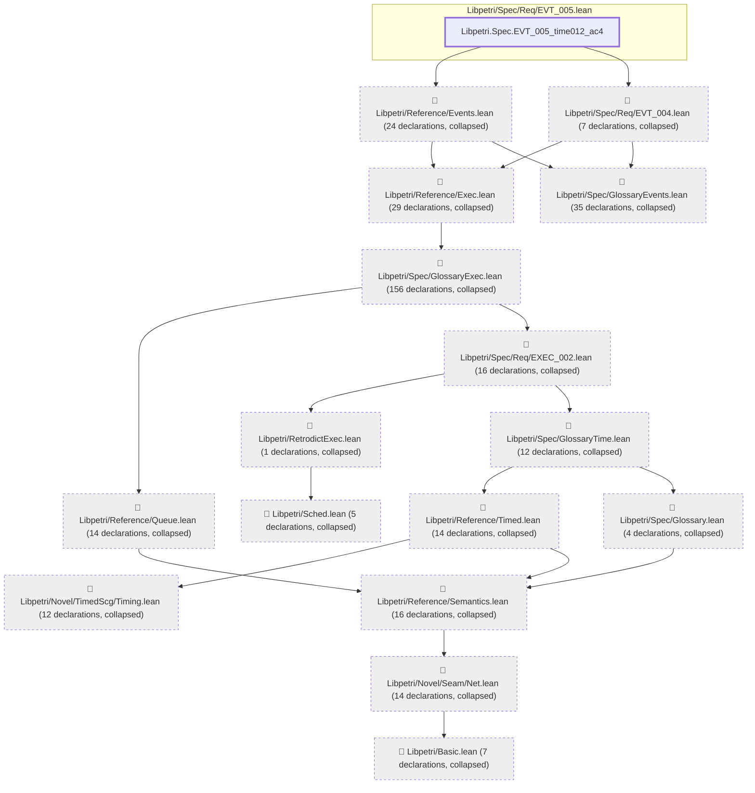
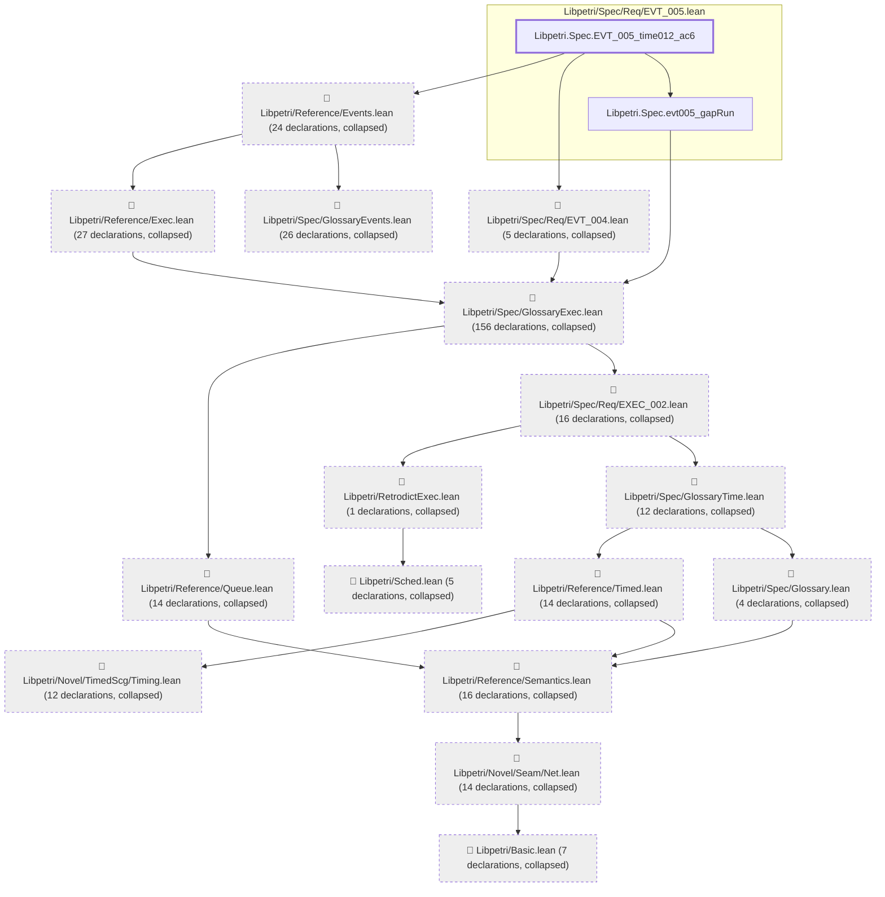

# TIME-012

Generated by `scripts/proof-graph.py` from `proof-graph.json`. Do not edit.

Theorems carrying this ID:

- `Libpetri.Novel.TimedScg.fired_never_persists` (theorem, `Libpetri/Novel/TimedScg/Run.lean:122`)
- `Libpetri.Novel.TimedScg.persistence_rule` (theorem, `Libpetri/Novel/TimedScg/Run.lean:101`)
- `Libpetri.Novel.TimedScg.reset_restarts` (theorem, `Libpetri/Novel/TimedScg/Run.lean:142`)
- `Libpetri.Novel.TimedScg.surplus_keeps` (theorem, `Libpetri/Novel/TimedScg/Run.lean:164`)
- `Libpetri.Spec.EVT_005_time012_ac4` (theorem, `Libpetri/Spec/Req/EVT_005.lean:338`)
- `Libpetri.Spec.EVT_005_time012_ac6` (theorem, `Libpetri/Spec/Req/EVT_005.lean:317`)
- `Libpetri.Spec.evt005_one_of` (theorem, `Libpetri/Spec/Req/EVT_005.lean:253`)

> **Note:** the full tree has 425 nodes (limit 60), so it is drawn as one diagram per theorem (7 theorems).

### `Libpetri.Novel.TimedScg.fired_never_persists`

> Rule: this theorem's whole tree, 34 nodes.

```mermaid
flowchart TD
  subgraph g0["Libpetri/Basic.lean"]
    n0["Libpetri.AMarking"]
    n8["Libpetri.Card"]
    n9["Libpetri.Card.all"]
    n10["Libpetri.Card.atLeast"]
    n11["Libpetri.Card.consumesAll"]
    n12["Libpetri.Card.exactly"]
    n13["Libpetri.Card.one"]
    n14["Libpetri.Card.required"]
    n134["Libpetri.InSpec"]
    n135["Libpetri.InSpec.card"]
    n138["Libpetri.InSpec.place"]
    n2723["Libpetri.PlaceId"]
    n22401["Libpetri.Transition"]
    n22402["Libpetri.Transition.inhibitors"]
    n22403["Libpetri.Transition.inputs"]
    n22404["Libpetri.Transition.mk"]
    n22407["Libpetri.Transition.reads"]
    n22408["Libpetri.Transition.resets"]
    n22478["Libpetri.consumeAllAt"]
    n22530["Libpetri.enabledA"]
    n22653["Libpetri.pre"]
    n22708["Libpetri.specAt"]
  end
  subgraph g1["Libpetri/Novel/ForwardDeposit.lean"]
    n867["Libpetri.Novel.ForwardDeposit.Deposit"]
    n895["Libpetri.Novel.ForwardDeposit.fireAD"]
  end
  subgraph g2["Libpetri/Novel/TimedScg/Run.lean"]
    n2507["Libpetri.Novel.TimedScg.fired_never_persists"]
  end
  subgraph g3["Libpetri/Novel/TimedScg/Succ.lean"]
    n2420["Libpetri.Novel.TimedScg.TNet"]
    n2429["Libpetri.Novel.TimedScg.TTrans"]
    n2434["Libpetri.Novel.TimedScg.TTrans.tr"]
    n2491["Libpetri.Novel.TimedScg.en"]
    n2555["Libpetri.Novel.TimedScg.inter"]
    n2607["Libpetri.Novel.TimedScg.noTr"]
    n2616["Libpetri.Novel.TimedScg.persists"]
    n2673["Libpetri.Novel.TimedScg.survives"]
    n2691["Libpetri.Novel.TimedScg.trOf"]
  end
  n0 --> n2723
  n9 --> n8
  n10 --> n8
  n11 --> n9
  n11 --> n10
  n11 --> n12
  n11 --> n13
  n12 --> n8
  n13 --> n8
  n14 --> n9
  n14 --> n10
  n14 --> n12
  n14 --> n13
  n135 --> n8
  n135 --> n134
  n138 --> n134
  n138 --> n2723
  n867 --> n2723
  n895 --> n0
  n895 --> n867
  n895 --> n22408
  n895 --> n22478
  n895 --> n22653
  n2420 --> n2429
  n2434 --> n2429
  n2434 --> n22401
  n2491 --> n2420
  n2491 --> n2434
  n2491 --> n22530
  n2507 --> n2616
  n2555 --> n0
  n2555 --> n22408
  n2555 --> n22478
  n2555 --> n22653
  n2607 --> n22404
  n2616 --> n895
  n2616 --> n2555
  n2616 --> n2673
  n2616 --> n2691
  n2673 --> n2491
  n2691 --> n2420
  n2691 --> n2434
  n2691 --> n2607
  n22402 --> n2723
  n22402 --> n22401
  n22403 --> n134
  n22403 --> n22401
  n22404 --> n134
  n22404 --> n2723
  n22404 --> n22401
  n22407 --> n2723
  n22407 --> n22401
  n22408 --> n2723
  n22408 --> n22401
  n22478 --> n11
  n22478 --> n135
  n22478 --> n22708
  n22530 --> n0
  n22530 --> n14
  n22530 --> n135
  n22530 --> n138
  n22530 --> n22402
  n22530 --> n22403
  n22530 --> n22407
  n22653 --> n14
  n22653 --> n135
  n22653 --> n22708
  n22708 --> n138
  n22708 --> n22403
  classDef root stroke-width:3px
  classDef locked fill:#fff3cd,stroke:#b8860b
  classDef collapsed fill:#eeeeee,stroke-dasharray:4 4
  class n2507 root
```

### `Libpetri.Novel.TimedScg.persistence_rule`

> Rule: this theorem's whole tree, 34 nodes.

```mermaid
flowchart TD
  subgraph g0["Libpetri/Basic.lean"]
    n0["Libpetri.AMarking"]
    n8["Libpetri.Card"]
    n9["Libpetri.Card.all"]
    n10["Libpetri.Card.atLeast"]
    n11["Libpetri.Card.consumesAll"]
    n12["Libpetri.Card.exactly"]
    n13["Libpetri.Card.one"]
    n14["Libpetri.Card.required"]
    n134["Libpetri.InSpec"]
    n135["Libpetri.InSpec.card"]
    n138["Libpetri.InSpec.place"]
    n2723["Libpetri.PlaceId"]
    n22401["Libpetri.Transition"]
    n22402["Libpetri.Transition.inhibitors"]
    n22403["Libpetri.Transition.inputs"]
    n22404["Libpetri.Transition.mk"]
    n22407["Libpetri.Transition.reads"]
    n22408["Libpetri.Transition.resets"]
    n22478["Libpetri.consumeAllAt"]
    n22530["Libpetri.enabledA"]
    n22653["Libpetri.pre"]
    n22708["Libpetri.specAt"]
  end
  subgraph g1["Libpetri/Novel/ForwardDeposit.lean"]
    n867["Libpetri.Novel.ForwardDeposit.Deposit"]
    n895["Libpetri.Novel.ForwardDeposit.fireAD"]
  end
  subgraph g2["Libpetri/Novel/TimedScg/Run.lean"]
    n2615["Libpetri.Novel.TimedScg.persistence_rule"]
  end
  subgraph g3["Libpetri/Novel/TimedScg/Succ.lean"]
    n2420["Libpetri.Novel.TimedScg.TNet"]
    n2429["Libpetri.Novel.TimedScg.TTrans"]
    n2434["Libpetri.Novel.TimedScg.TTrans.tr"]
    n2491["Libpetri.Novel.TimedScg.en"]
    n2555["Libpetri.Novel.TimedScg.inter"]
    n2607["Libpetri.Novel.TimedScg.noTr"]
    n2616["Libpetri.Novel.TimedScg.persists"]
    n2673["Libpetri.Novel.TimedScg.survives"]
    n2691["Libpetri.Novel.TimedScg.trOf"]
  end
  n0 --> n2723
  n9 --> n8
  n10 --> n8
  n11 --> n9
  n11 --> n10
  n11 --> n12
  n11 --> n13
  n12 --> n8
  n13 --> n8
  n14 --> n9
  n14 --> n10
  n14 --> n12
  n14 --> n13
  n135 --> n8
  n135 --> n134
  n138 --> n134
  n138 --> n2723
  n867 --> n2723
  n895 --> n0
  n895 --> n867
  n895 --> n22408
  n895 --> n22478
  n895 --> n22653
  n2420 --> n2429
  n2434 --> n2429
  n2434 --> n22401
  n2491 --> n2420
  n2491 --> n2434
  n2491 --> n22530
  n2555 --> n0
  n2555 --> n22408
  n2555 --> n22478
  n2555 --> n22653
  n2607 --> n22404
  n2615 --> n2616
  n2616 --> n895
  n2616 --> n2555
  n2616 --> n2673
  n2616 --> n2691
  n2673 --> n2491
  n2691 --> n2420
  n2691 --> n2434
  n2691 --> n2607
  n22402 --> n2723
  n22402 --> n22401
  n22403 --> n134
  n22403 --> n22401
  n22404 --> n134
  n22404 --> n2723
  n22404 --> n22401
  n22407 --> n2723
  n22407 --> n22401
  n22408 --> n2723
  n22408 --> n22401
  n22478 --> n11
  n22478 --> n135
  n22478 --> n22708
  n22530 --> n0
  n22530 --> n14
  n22530 --> n135
  n22530 --> n138
  n22530 --> n22402
  n22530 --> n22403
  n22530 --> n22407
  n22653 --> n14
  n22653 --> n135
  n22653 --> n22708
  n22708 --> n138
  n22708 --> n22403
  classDef root stroke-width:3px
  classDef locked fill:#fff3cd,stroke:#b8860b
  classDef collapsed fill:#eeeeee,stroke-dasharray:4 4
  class n2615 root
```

### `Libpetri.Novel.TimedScg.reset_restarts`

> Rule: this theorem's whole tree, 37 nodes.

```mermaid
flowchart TD
  subgraph g0["Libpetri/Basic.lean"]
    n0["Libpetri.AMarking"]
    n8["Libpetri.Card"]
    n9["Libpetri.Card.all"]
    n10["Libpetri.Card.atLeast"]
    n11["Libpetri.Card.consumesAll"]
    n12["Libpetri.Card.exactly"]
    n13["Libpetri.Card.one"]
    n14["Libpetri.Card.required"]
    n134["Libpetri.InSpec"]
    n135["Libpetri.InSpec.card"]
    n138["Libpetri.InSpec.place"]
    n2723["Libpetri.PlaceId"]
    n22401["Libpetri.Transition"]
    n22402["Libpetri.Transition.inhibitors"]
    n22403["Libpetri.Transition.inputs"]
    n22404["Libpetri.Transition.mk"]
    n22407["Libpetri.Transition.reads"]
    n22408["Libpetri.Transition.resets"]
    n22478["Libpetri.consumeAllAt"]
    n22530["Libpetri.enabledA"]
    n22653["Libpetri.pre"]
    n22708["Libpetri.specAt"]
  end
  subgraph g1["Libpetri/Novel/ForwardDeposit.lean"]
    n867["Libpetri.Novel.ForwardDeposit.Deposit"]
    n895["Libpetri.Novel.ForwardDeposit.fireAD"]
  end
  subgraph g2["Libpetri/Novel/TimedScg/Run.lean"]
    n2615["Libpetri.Novel.TimedScg.persistence_rule"]
    n2641["Libpetri.Novel.TimedScg.reset_restarts"]
  end
  subgraph g3["Libpetri/Novel/TimedScg/Succ.lean"]
    n2420["Libpetri.Novel.TimedScg.TNet"]
    n2429["Libpetri.Novel.TimedScg.TTrans"]
    n2434["Libpetri.Novel.TimedScg.TTrans.tr"]
    n2491["Libpetri.Novel.TimedScg.en"]
    n2492["Libpetri.Novel.TimedScg.en_eq"]
    n2493["Libpetri.Novel.TimedScg.en_lt"]
    n2555["Libpetri.Novel.TimedScg.inter"]
    n2607["Libpetri.Novel.TimedScg.noTr"]
    n2616["Libpetri.Novel.TimedScg.persists"]
    n2673["Libpetri.Novel.TimedScg.survives"]
    n2691["Libpetri.Novel.TimedScg.trOf"]
  end
  n0 --> n2723
  n9 --> n8
  n10 --> n8
  n11 --> n9
  n11 --> n10
  n11 --> n12
  n11 --> n13
  n12 --> n8
  n13 --> n8
  n14 --> n9
  n14 --> n10
  n14 --> n12
  n14 --> n13
  n135 --> n8
  n135 --> n134
  n138 --> n134
  n138 --> n2723
  n867 --> n2723
  n895 --> n0
  n895 --> n867
  n895 --> n22408
  n895 --> n22478
  n895 --> n22653
  n2420 --> n2429
  n2434 --> n2429
  n2434 --> n22401
  n2491 --> n2420
  n2491 --> n2434
  n2491 --> n22530
  n2492 --> n2491
  n2492 --> n2691
  n2493 --> n2491
  n2555 --> n0
  n2555 --> n22408
  n2555 --> n22478
  n2555 --> n22653
  n2607 --> n22404
  n2615 --> n2616
  n2616 --> n895
  n2616 --> n2555
  n2616 --> n2673
  n2616 --> n2691
  n2641 --> n2492
  n2641 --> n2493
  n2641 --> n2615
  n2673 --> n2491
  n2691 --> n2420
  n2691 --> n2434
  n2691 --> n2607
  n22402 --> n2723
  n22402 --> n22401
  n22403 --> n134
  n22403 --> n22401
  n22404 --> n134
  n22404 --> n2723
  n22404 --> n22401
  n22407 --> n2723
  n22407 --> n22401
  n22408 --> n2723
  n22408 --> n22401
  n22478 --> n11
  n22478 --> n135
  n22478 --> n22708
  n22530 --> n0
  n22530 --> n14
  n22530 --> n135
  n22530 --> n138
  n22530 --> n22402
  n22530 --> n22403
  n22530 --> n22407
  n22653 --> n14
  n22653 --> n135
  n22653 --> n22708
  n22708 --> n138
  n22708 --> n22403
  classDef root stroke-width:3px
  classDef locked fill:#fff3cd,stroke:#b8860b
  classDef collapsed fill:#eeeeee,stroke-dasharray:4 4
  class n2641 root
```

### `Libpetri.Novel.TimedScg.surplus_keeps`

> Rule: this theorem's whole tree, 35 nodes.

```mermaid
flowchart TD
  subgraph g0["Libpetri/Basic.lean"]
    n0["Libpetri.AMarking"]
    n8["Libpetri.Card"]
    n9["Libpetri.Card.all"]
    n10["Libpetri.Card.atLeast"]
    n11["Libpetri.Card.consumesAll"]
    n12["Libpetri.Card.exactly"]
    n13["Libpetri.Card.one"]
    n14["Libpetri.Card.required"]
    n134["Libpetri.InSpec"]
    n135["Libpetri.InSpec.card"]
    n138["Libpetri.InSpec.place"]
    n2723["Libpetri.PlaceId"]
    n22401["Libpetri.Transition"]
    n22402["Libpetri.Transition.inhibitors"]
    n22403["Libpetri.Transition.inputs"]
    n22404["Libpetri.Transition.mk"]
    n22407["Libpetri.Transition.reads"]
    n22408["Libpetri.Transition.resets"]
    n22478["Libpetri.consumeAllAt"]
    n22530["Libpetri.enabledA"]
    n22653["Libpetri.pre"]
    n22708["Libpetri.specAt"]
  end
  subgraph g1["Libpetri/Novel/ForwardDeposit.lean"]
    n867["Libpetri.Novel.ForwardDeposit.Deposit"]
    n895["Libpetri.Novel.ForwardDeposit.fireAD"]
  end
  subgraph g2["Libpetri/Novel/TimedScg/Run.lean"]
    n2615["Libpetri.Novel.TimedScg.persistence_rule"]
    n2672["Libpetri.Novel.TimedScg.surplus_keeps"]
  end
  subgraph g3["Libpetri/Novel/TimedScg/Succ.lean"]
    n2420["Libpetri.Novel.TimedScg.TNet"]
    n2429["Libpetri.Novel.TimedScg.TTrans"]
    n2434["Libpetri.Novel.TimedScg.TTrans.tr"]
    n2491["Libpetri.Novel.TimedScg.en"]
    n2555["Libpetri.Novel.TimedScg.inter"]
    n2607["Libpetri.Novel.TimedScg.noTr"]
    n2616["Libpetri.Novel.TimedScg.persists"]
    n2673["Libpetri.Novel.TimedScg.survives"]
    n2691["Libpetri.Novel.TimedScg.trOf"]
  end
  n0 --> n2723
  n9 --> n8
  n10 --> n8
  n11 --> n9
  n11 --> n10
  n11 --> n12
  n11 --> n13
  n12 --> n8
  n13 --> n8
  n14 --> n9
  n14 --> n10
  n14 --> n12
  n14 --> n13
  n135 --> n8
  n135 --> n134
  n138 --> n134
  n138 --> n2723
  n867 --> n2723
  n895 --> n0
  n895 --> n867
  n895 --> n22408
  n895 --> n22478
  n895 --> n22653
  n2420 --> n2429
  n2434 --> n2429
  n2434 --> n22401
  n2491 --> n2420
  n2491 --> n2434
  n2491 --> n22530
  n2555 --> n0
  n2555 --> n22408
  n2555 --> n22478
  n2555 --> n22653
  n2607 --> n22404
  n2615 --> n2616
  n2616 --> n895
  n2616 --> n2555
  n2616 --> n2673
  n2616 --> n2691
  n2672 --> n2615
  n2673 --> n2491
  n2691 --> n2420
  n2691 --> n2434
  n2691 --> n2607
  n22402 --> n2723
  n22402 --> n22401
  n22403 --> n134
  n22403 --> n22401
  n22404 --> n134
  n22404 --> n2723
  n22404 --> n22401
  n22407 --> n2723
  n22407 --> n22401
  n22408 --> n2723
  n22408 --> n22401
  n22478 --> n11
  n22478 --> n135
  n22478 --> n22708
  n22530 --> n0
  n22530 --> n14
  n22530 --> n135
  n22530 --> n138
  n22530 --> n22402
  n22530 --> n22403
  n22530 --> n22407
  n22653 --> n14
  n22653 --> n135
  n22653 --> n22708
  n22708 --> n138
  n22708 --> n22403
  classDef root stroke-width:3px
  classDef locked fill:#fff3cd,stroke:#b8860b
  classDef collapsed fill:#eeeeee,stroke-dasharray:4 4
  class n2672 root
```

### `Libpetri.Spec.EVT_005_time012_ac4`

> Rule: this theorem's tree has 367 nodes (limit 60); every file other than its own is collapsed into one node, leaving 17.

### `Libpetri.Spec.EVT_005_time012_ac6`

> Rule: this theorem's tree has 355 nodes (limit 60); every file other than its own is collapsed into one node, leaving 18.

### `Libpetri.Spec.evt005_one_of`

> Rule: this theorem's tree has 68 nodes (limit 60); every file other than its own is collapsed into one node, leaving 12.

```mermaid
flowchart TD
  subgraph g0["Libpetri/Spec/Req/EVT_005.lean"]
    n6339["Libpetri.Spec.EVT_005"]
    n15345["Libpetri.Spec.evt005_one_of"]
  end
  c54["📁 Libpetri/Novel/Seam/Net.lean (2 declarations, collapsed)"]
  c78["📁 Libpetri/Reference/Events.lean (6 declarations, collapsed)"]
  c91["📁 Libpetri/Reference/Queue.lean (1 declarations, collapsed)"]
  c94["📁 Libpetri/Reference/Semantics.lean (4 declarations, collapsed)"]
  c98["📁 Libpetri/Reference/Timed.lean (2 declarations, collapsed)"]
  c131["📁 Libpetri/Spec/Ears.lean (1 declarations, collapsed)"]
  c139["📁 Libpetri/Spec/GlossaryEvents.lean (34 declarations, collapsed)"]
  c140["📁 Libpetri/Spec/GlossaryExec.lean (13 declarations, collapsed)"]
  c147["📁 Libpetri/Spec/GlossaryTime.lean (1 declarations, collapsed)"]
  c213["📁 Libpetri/Spec/Req/EVT_004.lean (2 declarations, collapsed)"]
  c78 --> c91
  c78 --> c139
  c78 --> c140
  c94 --> c54
  c98 --> c94
  c140 --> c98
  c147 --> c98
  c213 --> c78
  c213 --> c131
  c213 --> c147
  n6339 --> c213
  n15345 --> n6339
  classDef root stroke-width:3px
  classDef locked fill:#fff3cd,stroke:#b8860b
  classDef collapsed fill:#eeeeee,stroke-dasharray:4 4
  class n15345 root
  class c54,c78,c91,c94,c98,c131,c139,c140,c147,c213 collapsed
```

Axioms used:

- `Libpetri.Novel.TimedScg.fired_never_persists`: `Quot.sound`, `propext`
- `Libpetri.Novel.TimedScg.persistence_rule`: `Quot.sound`, `propext`
- `Libpetri.Novel.TimedScg.reset_restarts`: `Quot.sound`, `propext`
- `Libpetri.Novel.TimedScg.surplus_keeps`: `Quot.sound`, `propext`
- `Libpetri.Spec.EVT_005_time012_ac4`: `Quot.sound`, `propext`
- `Libpetri.Spec.EVT_005_time012_ac6`: `Quot.sound`, `propext`
- `Libpetri.Spec.evt005_one_of`: `Quot.sound`, `propext`
