# TIME-012

Generated by `scripts/proof-graph.py` from `proof-graph.json`. Do not edit.

Theorems carrying this ID:

- `Libpetri.Novel.TimedScg.fired_never_persists` (theorem, `Libpetri/Novel/TimedScg/Run.lean:122`)
- `Libpetri.Novel.TimedScg.persistence_rule` (theorem, `Libpetri/Novel/TimedScg/Run.lean:101`)
- `Libpetri.Novel.TimedScg.reset_restarts` (theorem, `Libpetri/Novel/TimedScg/Run.lean:142`)
- `Libpetri.Novel.TimedScg.surplus_keeps` (theorem, `Libpetri/Novel/TimedScg/Run.lean:164`)

```mermaid
flowchart TD
  subgraph g0["Libpetri/Basic.lean"]
    n0["Libpetri.AMarking"]
    n8["Libpetri.Card"]
    n9["Libpetri.Card.all"]
    n10["Libpetri.Card.atLeast"]
    n11["Libpetri.Card.consumesAll"]
    n12["Libpetri.Card.exactly"]
    n13["Libpetri.Card.one"]
    n14["Libpetri.Card.required"]
    n134["Libpetri.InSpec"]
    n135["Libpetri.InSpec.card"]
    n138["Libpetri.InSpec.place"]
    n2720["Libpetri.PlaceId"]
    n13129["Libpetri.Transition"]
    n13130["Libpetri.Transition.inhibitors"]
    n13131["Libpetri.Transition.inputs"]
    n13132["Libpetri.Transition.mk"]
    n13135["Libpetri.Transition.reads"]
    n13136["Libpetri.Transition.resets"]
    n13206["Libpetri.consumeAllAt"]
    n13258["Libpetri.enabledA"]
    n13381["Libpetri.pre"]
    n13436["Libpetri.specAt"]
  end
  subgraph g1["Libpetri/Novel/ForwardDeposit.lean"]
    n867["Libpetri.Novel.ForwardDeposit.Deposit"]
    n895["Libpetri.Novel.ForwardDeposit.fireAD"]
  end
  subgraph g2["Libpetri/Novel/TimedScg/Run.lean"]
    n2504["Libpetri.Novel.TimedScg.fired_never_persists"]
    n2612["Libpetri.Novel.TimedScg.persistence_rule"]
    n2638["Libpetri.Novel.TimedScg.reset_restarts"]
    n2669["Libpetri.Novel.TimedScg.surplus_keeps"]
  end
  subgraph g3["Libpetri/Novel/TimedScg/Succ.lean"]
    n2417["Libpetri.Novel.TimedScg.TNet"]
    n2426["Libpetri.Novel.TimedScg.TTrans"]
    n2431["Libpetri.Novel.TimedScg.TTrans.tr"]
    n2488["Libpetri.Novel.TimedScg.en"]
    n2489["Libpetri.Novel.TimedScg.en_eq"]
    n2490["Libpetri.Novel.TimedScg.en_lt"]
    n2552["Libpetri.Novel.TimedScg.inter"]
    n2604["Libpetri.Novel.TimedScg.noTr"]
    n2613["Libpetri.Novel.TimedScg.persists"]
    n2670["Libpetri.Novel.TimedScg.survives"]
    n2688["Libpetri.Novel.TimedScg.trOf"]
  end
  n0 --> n2720
  n9 --> n8
  n10 --> n8
  n11 --> n9
  n11 --> n10
  n11 --> n12
  n11 --> n13
  n12 --> n8
  n13 --> n8
  n14 --> n9
  n14 --> n10
  n14 --> n12
  n14 --> n13
  n135 --> n8
  n135 --> n134
  n138 --> n134
  n138 --> n2720
  n867 --> n2720
  n895 --> n0
  n895 --> n867
  n895 --> n13136
  n895 --> n13206
  n895 --> n13381
  n2417 --> n2426
  n2431 --> n2426
  n2431 --> n13129
  n2488 --> n2417
  n2488 --> n2431
  n2488 --> n13258
  n2489 --> n2488
  n2489 --> n2688
  n2490 --> n2488
  n2504 --> n2613
  n2552 --> n0
  n2552 --> n13136
  n2552 --> n13206
  n2552 --> n13381
  n2604 --> n13132
  n2612 --> n2613
  n2613 --> n895
  n2613 --> n2552
  n2613 --> n2670
  n2613 --> n2688
  n2638 --> n2489
  n2638 --> n2490
  n2638 --> n2612
  n2669 --> n2612
  n2670 --> n2488
  n2688 --> n2417
  n2688 --> n2431
  n2688 --> n2604
  n13130 --> n2720
  n13130 --> n13129
  n13131 --> n134
  n13131 --> n13129
  n13132 --> n134
  n13132 --> n2720
  n13132 --> n13129
  n13135 --> n2720
  n13135 --> n13129
  n13136 --> n2720
  n13136 --> n13129
  n13206 --> n11
  n13206 --> n135
  n13206 --> n13436
  n13258 --> n0
  n13258 --> n14
  n13258 --> n135
  n13258 --> n138
  n13258 --> n13130
  n13258 --> n13131
  n13258 --> n13135
  n13381 --> n14
  n13381 --> n135
  n13381 --> n13436
  n13436 --> n138
  n13436 --> n13131
  classDef root stroke-width:3px
  classDef locked fill:#fff3cd,stroke:#b8860b
  classDef collapsed fill:#eeeeee,stroke-dasharray:4 4
  class n2504,n2612,n2638,n2669 root
```

Axioms used:

- `Libpetri.Novel.TimedScg.fired_never_persists`: `Quot.sound`, `propext`
- `Libpetri.Novel.TimedScg.persistence_rule`: `Quot.sound`, `propext`
- `Libpetri.Novel.TimedScg.reset_restarts`: `Quot.sound`, `propext`
- `Libpetri.Novel.TimedScg.surplus_keeps`: `Quot.sound`, `propext`
