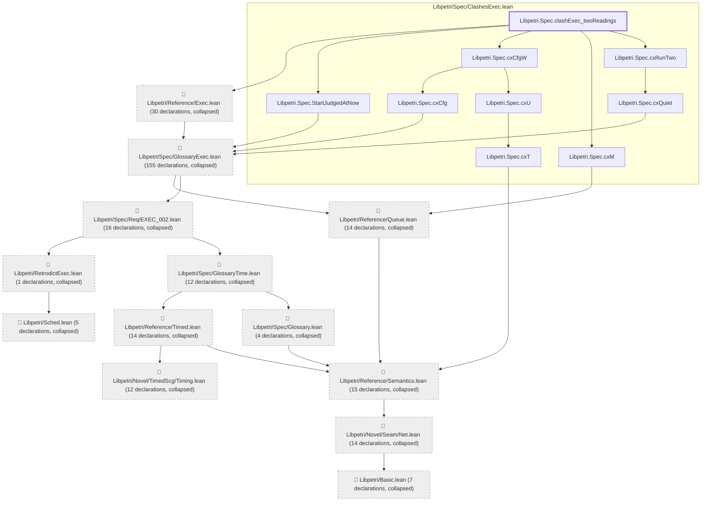
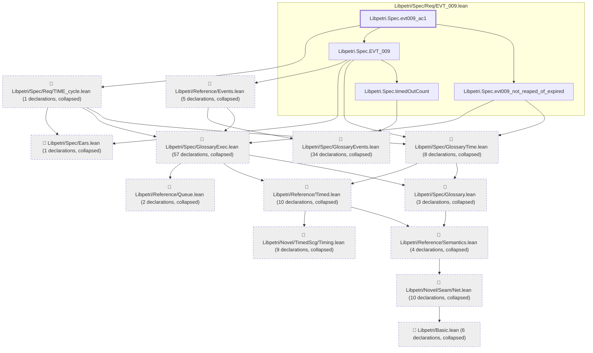
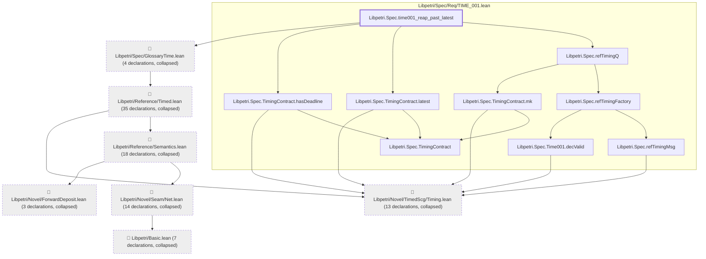
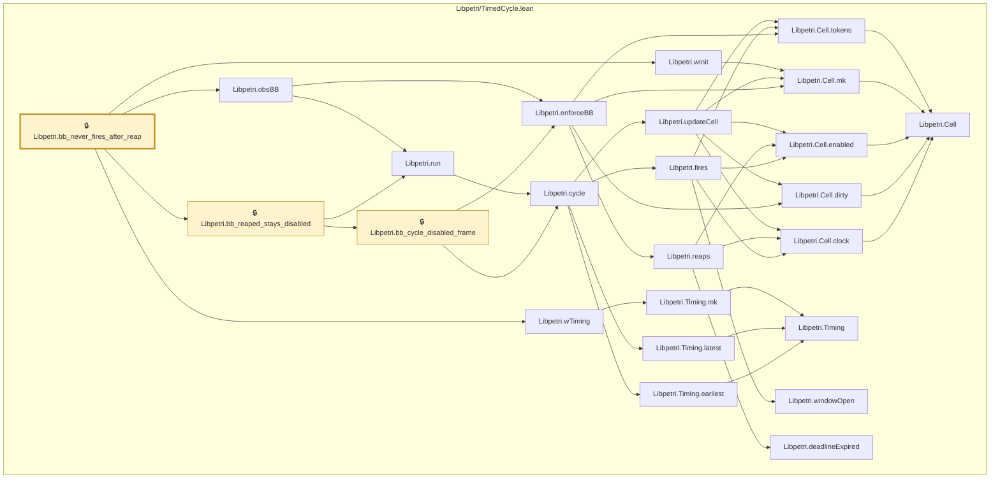
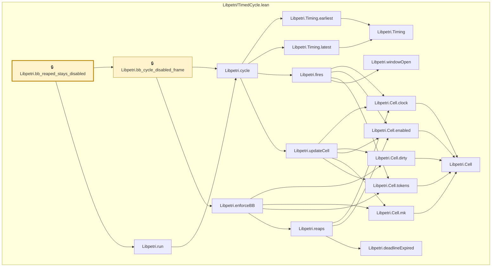
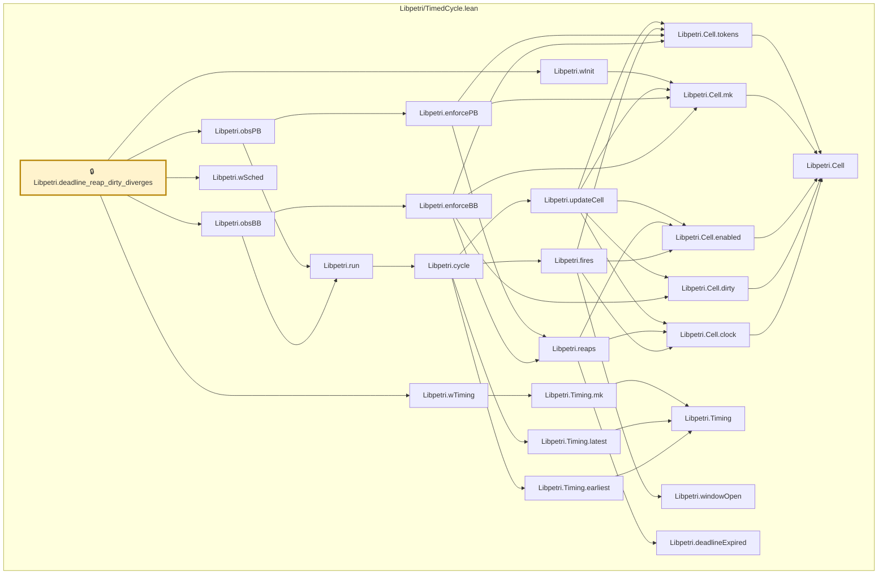
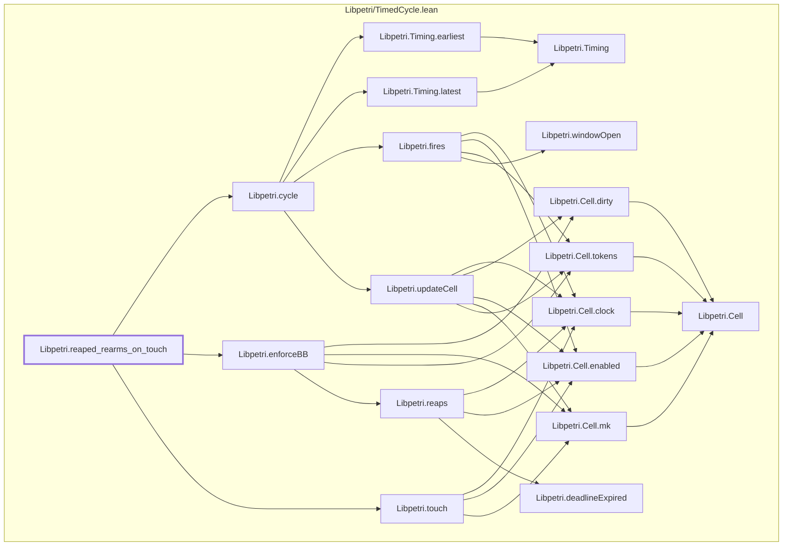

# TIME-013

Generated by `scripts/proof-graph.py` from `proof-graph.json`. Do not edit.

Theorems carrying this ID:

- `Libpetri.Novel.ReapAware.rest_sound` (theorem, `Libpetri/Novel/ReapAware.lean:314`)
- `Libpetri.Spec.clashExec_twoReadings` (theorem, `Libpetri/Spec/ClashesExec.lean:233`)
- `Libpetri.Spec.evt009_ac1` (theorem, `Libpetri/Spec/Req/EVT_009.lean:385`)
- `Libpetri.Spec.time001_reap_past_latest` (theorem, `Libpetri/Spec/Req/TIME_001.lean:708`)
- `Libpetri.bb_never_fires_after_reap` (theorem, `Libpetri/TimedCycle.lean:327`) 🔒 locked
- `Libpetri.bb_reaped_stays_disabled` (theorem, `Libpetri/TimedCycle.lean:256`) 🔒 locked
- `Libpetri.deadline_reap_dirty_diverges` (theorem, `Libpetri/TimedCycle.lean:309`) 🔒 locked
- `Libpetri.reaped_rearms_on_touch` (theorem, `Libpetri/TimedCycle.lean:279`)

> **Note:** the full tree has 479 nodes (limit 60), so it is drawn as one diagram per theorem (8 theorems).

### `Libpetri.Novel.ReapAware.rest_sound`

> Rule: this theorem's tree has 66 nodes (limit 60); every file other than its own is collapsed into one node, leaving 31.

```mermaid
flowchart TD
  subgraph g0["Libpetri/Novel/ReapAware.lean"]
    n1020["Libpetri.Novel.ReapAware.Cycle"]
    n1021["Libpetri.Novel.ReapAware.FireStep"]
    n1022["Libpetri.Novel.ReapAware.Halts"]
    n1023["Libpetri.Novel.ReapAware.Inv"]
    n1025["Libpetri.Novel.ReapAware.ReapQuiescentA"]
    n1026["Libpetri.Novel.ReapAware.RestsAt"]
    n1027["Libpetri.Novel.ReapAware.Runs"]
    n1028["Libpetri.Novel.ReapAware.TTiming"]
    n1029["Libpetri.Novel.ReapAware.TTiming.earliest"]
    n1030["Libpetri.Novel.ReapAware.TTiming.latest"]
    n1032["Libpetri.Novel.ReapAware.Touches"]
    n1033["Libpetri.Novel.ReapAware.XState"]
    n1034["Libpetri.Novel.ReapAware.XState.a"]
    n1035["Libpetri.Novel.ReapAware.XState.cells"]
    n1036["Libpetri.Novel.ReapAware.XState.mk"]
    n1037["Libpetri.Novel.ReapAware.cycle_inv"]
    n1039["Libpetri.Novel.ReapAware.enabledA_congr"]
    n1040["Libpetri.Novel.ReapAware.enf"]
    n1041["Libpetri.Novel.ReapAware.enf_enabled"]
    n1042["Libpetri.Novel.ReapAware.firePhase_reach"]
    n1043["Libpetri.Novel.ReapAware.halts_reapQuiescent"]
    n1044["Libpetri.Novel.ReapAware.initCells"]
    n1045["Libpetri.Novel.ReapAware.inv_init"]
    n1056["Libpetri.Novel.ReapAware.reapable"]
    n1057["Libpetri.Novel.ReapAware.rest_sound"]
    n1060["Libpetri.Novel.ReapAware.run_inv"]
    n1062["Libpetri.Novel.ReapAware.upd"]
    n1063["Libpetri.Novel.ReapAware.upd_enabled"]
  end
  c0["📁 Libpetri/Basic.lean (23 declarations, collapsed)"]
  c84["📁 Libpetri/Soundness.lean (6 declarations, collapsed)"]
  c136["📁 Libpetri/TimedCycle.lean (9 declarations, collapsed)"]
  c84 --> c0
  n1020 --> n1021
  n1020 --> n1022
  n1020 --> n1032
  n1021 --> c84
  n1021 --> n1029
  n1021 --> n1040
  n1022 --> c84
  n1022 --> n1040
  n1023 --> c84
  n1023 --> n1034
  n1023 --> n1035
  n1023 --> n1056
  n1025 --> c84
  n1026 --> n1027
  n1026 --> n1036
  n1026 --> n1044
  n1027 --> n1020
  n1029 --> n1028
  n1030 --> n1028
  n1032 --> c0
  n1034 --> c0
  n1034 --> n1033
  n1035 --> c0
  n1035 --> c136
  n1035 --> n1033
  n1036 --> c0
  n1036 --> c136
  n1036 --> n1033
  n1037 --> n1020
  n1037 --> n1039
  n1037 --> n1041
  n1037 --> n1063
  n1039 --> n1032
  n1040 --> n1030
  n1040 --> n1062
  n1041 --> n1040
  n1041 --> n1056
  n1042 --> n1021
  n1043 --> n1022
  n1043 --> n1025
  n1043 --> n1041
  n1043 --> n1063
  n1044 --> c0
  n1044 --> c136
  n1045 --> n1023
  n1045 --> n1036
  n1045 --> n1044
  n1056 --> c0
  n1056 --> n1030
  n1057 --> n1026
  n1057 --> n1043
  n1057 --> n1060
  n1060 --> n1027
  n1060 --> n1037
  n1060 --> n1042
  n1060 --> n1045
  n1062 --> n1034
  n1062 --> n1035
  n1063 --> n1023
  n1063 --> n1062
  classDef root stroke-width:3px
  classDef locked fill:#fff3cd,stroke:#b8860b
  classDef collapsed fill:#eeeeee,stroke-dasharray:4 4
  class n1057 root
  class c0,c84,c136 collapsed
```

### `Libpetri.Spec.clashExec_twoReadings`

> Rule: this theorem's tree has 308 nodes (limit 60); every file other than its own is collapsed into one node, leaving 22.

### `Libpetri.Spec.evt009_ac1`

> Rule: this theorem's tree has 154 nodes (limit 60); every file other than its own is collapsed into one node, leaving 17.

### `Libpetri.Spec.time001_reap_past_latest`

> Rule: this theorem's tree has 103 nodes (limit 60); every file other than its own is collapsed into one node, leaving 16.

### `Libpetri.bb_never_fires_after_reap`

> Rule: this theorem's whole tree, 24 nodes.

### `Libpetri.bb_reaped_stays_disabled`

> Rule: this theorem's whole tree, 19 nodes.

### `Libpetri.deadline_reap_dirty_diverges`

> Rule: this theorem's whole tree, 25 nodes.

### `Libpetri.reaped_rearms_on_touch`

> Rule: this theorem's whole tree, 18 nodes.

Axioms used:

- `Libpetri.Novel.ReapAware.rest_sound`: `Quot.sound`, `propext`
- `Libpetri.Spec.clashExec_twoReadings`: `Quot.sound`, `propext`
- `Libpetri.Spec.evt009_ac1`: `propext`
- `Libpetri.Spec.time001_reap_past_latest`: `Quot.sound`, `propext`
- `Libpetri.bb_never_fires_after_reap`: `propext`
- `Libpetri.bb_reaped_stays_disabled`: `propext`
- `Libpetri.deadline_reap_dirty_diverges`: none
- `Libpetri.reaped_rearms_on_touch`: `propext`
