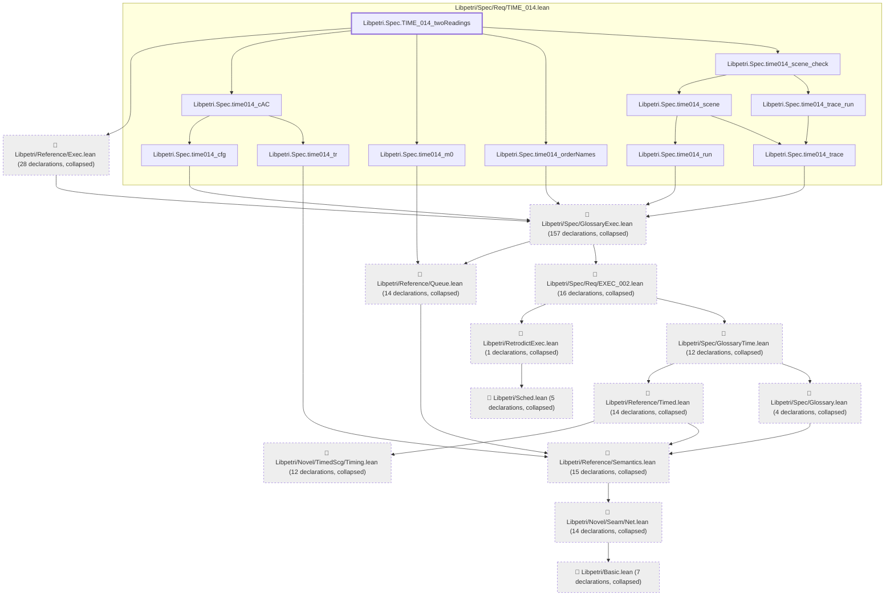
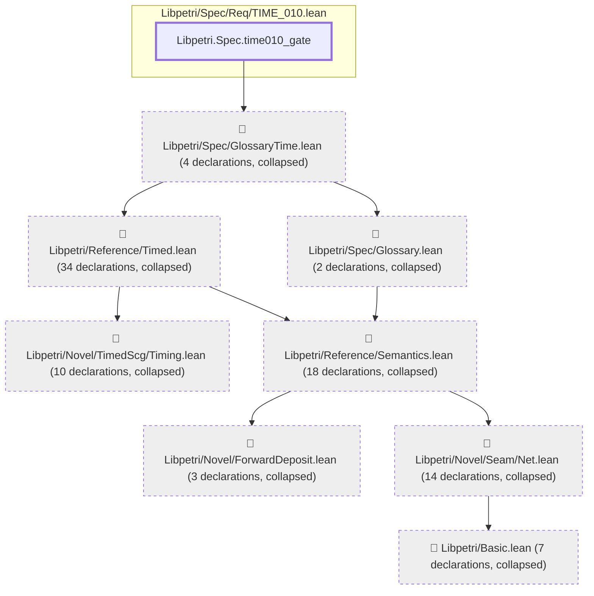

# TIME-014

Generated by `scripts/proof-graph.py` from `proof-graph.json`. Do not edit.

Theorems carrying this ID:

- `Libpetri.Spec.TIME_014_twoReadings` (theorem, `Libpetri/Spec/Req/TIME_014.lean:1086`)
- `Libpetri.Spec.time010_gate` (theorem, `Libpetri/Spec/Req/TIME_010.lean:206`)

> **Note:** the full tree has 345 nodes (limit 60), so it is drawn as one diagram per theorem (2 theorems).

### `Libpetri.Spec.TIME_014_twoReadings`

> Rule: this theorem's tree has 310 nodes (limit 60); every file other than its own is collapsed into one node, leaving 24.

### `Libpetri.Spec.time010_gate`

> Rule: this theorem's tree has 93 nodes (limit 60); every file other than its own is collapsed into one node, leaving 9.

Axioms used:

- `Libpetri.Spec.TIME_014_twoReadings`: `Quot.sound`, `propext`
- `Libpetri.Spec.time010_gate`: `propext`
