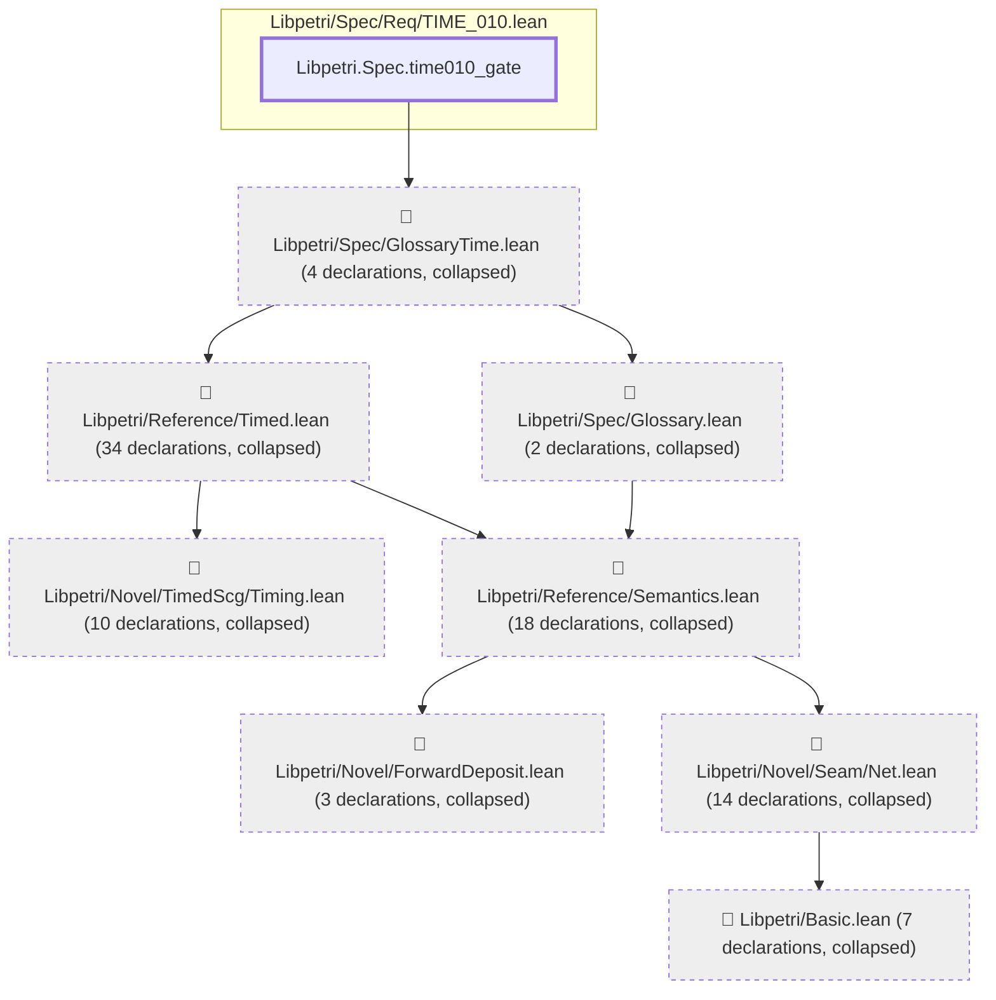

# TIME-014

Generated by `scripts/proof-graph.py` from `proof-graph.json`. Do not edit.

Theorems carrying this ID:

- `Libpetri.Spec.time010_gate` (theorem, `Libpetri/Spec/Req/TIME_010.lean:205`)

> **Note:** the full tree has 93 nodes (limit 60).

> Rule: this theorem's tree has 93 nodes (limit 60); every file other than its own is collapsed into one node, leaving 9.

Axioms used:

- `Libpetri.Spec.time010_gate`: `propext`
