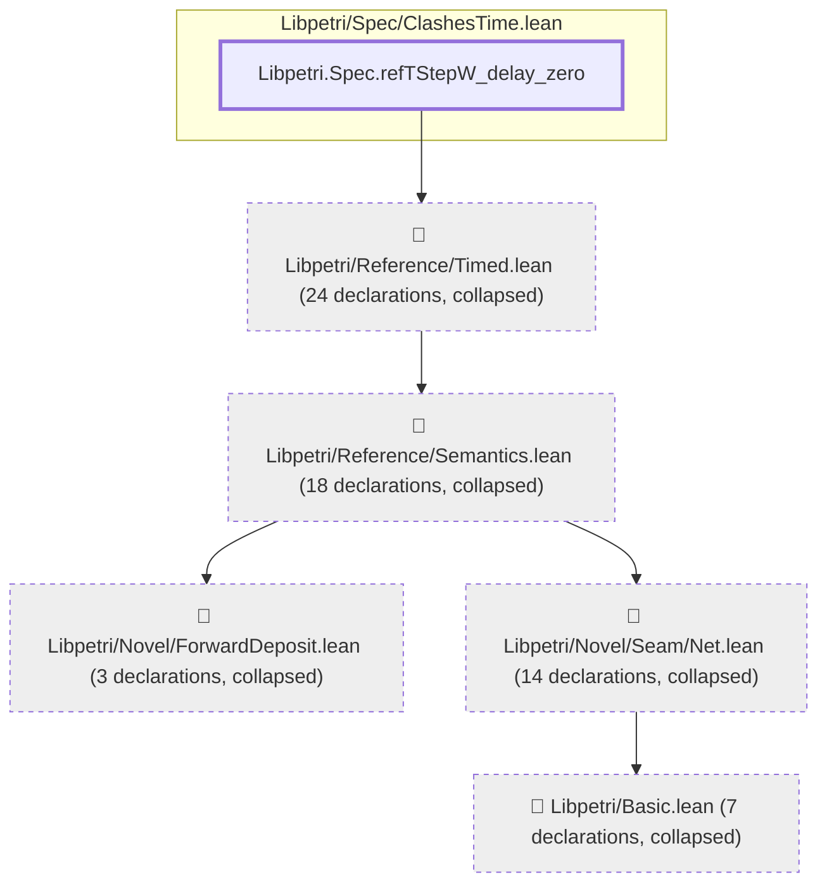
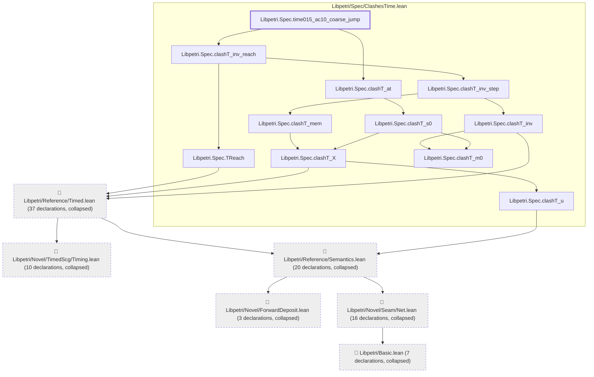
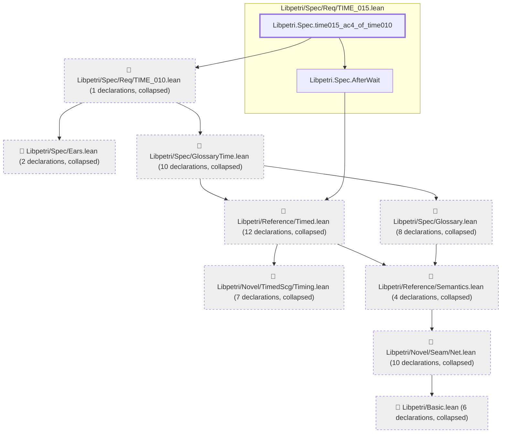
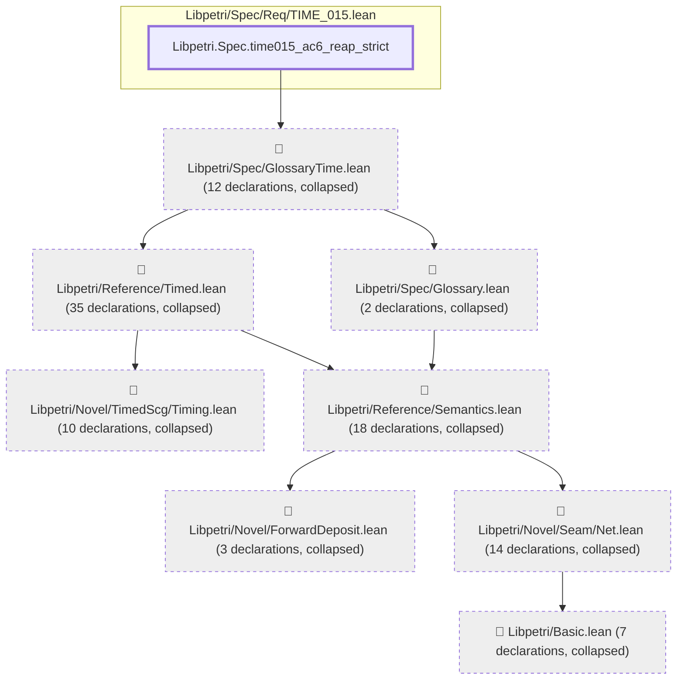

# TIME-015

Generated by `scripts/proof-graph.py` from `proof-graph.json`. Do not edit.

Theorems carrying this ID:

- `Libpetri.Spec.refTStepW_delay_zero` (theorem, `Libpetri/Spec/ClashesTime.lean:363`)
- `Libpetri.Spec.time015_ac10_coarse_jump` (theorem, `Libpetri/Spec/ClashesTime.lean:412`)
- `Libpetri.Spec.time015_ac4_of_time010` (theorem, `Libpetri/Spec/Req/TIME_015.lean:197`)
- `Libpetri.Spec.time015_ac6_reap_strict` (theorem, `Libpetri/Spec/Req/TIME_015.lean:222`)

> **Note:** the full tree has 136 nodes (limit 60), so it is drawn as one diagram per theorem (4 theorems).

### `Libpetri.Spec.refTStepW_delay_zero`

> Rule: this theorem's tree has 67 nodes (limit 60); every file other than its own is collapsed into one node, leaving 6.

### `Libpetri.Spec.time015_ac10_coarse_jump`

> Rule: this theorem's tree has 104 nodes (limit 60); every file other than its own is collapsed into one node, leaving 17.

### `Libpetri.Spec.time015_ac4_of_time010`

> Rule: this theorem's tree has 62 nodes (limit 60); every file other than its own is collapsed into one node, leaving 11.

### `Libpetri.Spec.time015_ac6_reap_strict`

> Rule: this theorem's tree has 102 nodes (limit 60); every file other than its own is collapsed into one node, leaving 9.

Axioms used:

- `Libpetri.Spec.refTStepW_delay_zero`: `propext`
- `Libpetri.Spec.time015_ac10_coarse_jump`: `Quot.sound`, `propext`
- `Libpetri.Spec.time015_ac4_of_time010`: `propext`
- `Libpetri.Spec.time015_ac6_reap_strict`: `propext`
