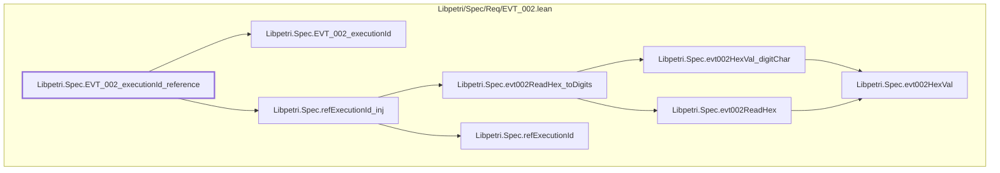
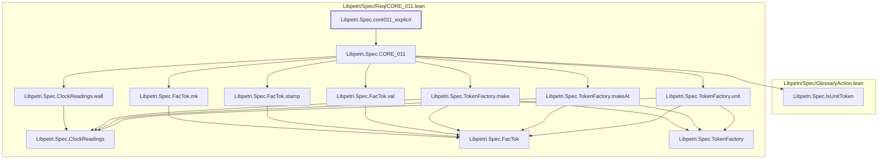
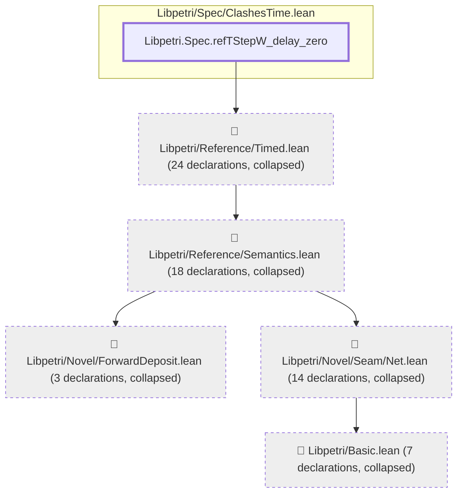
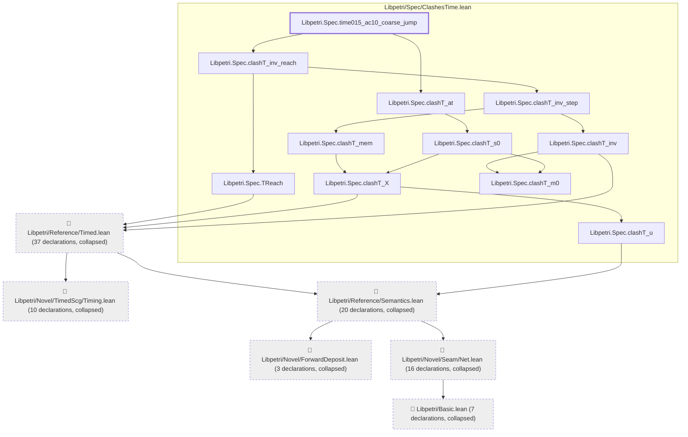
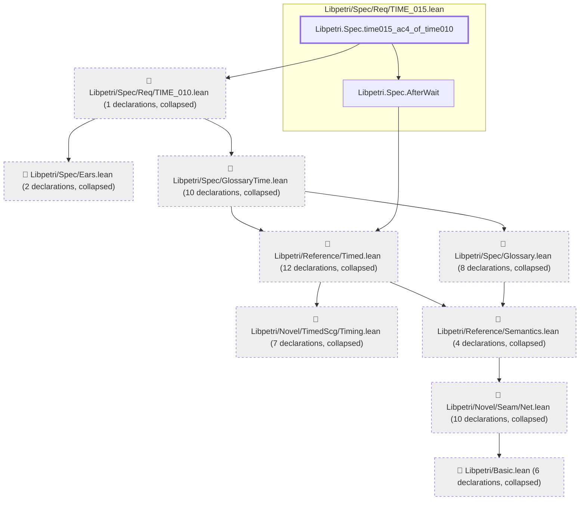
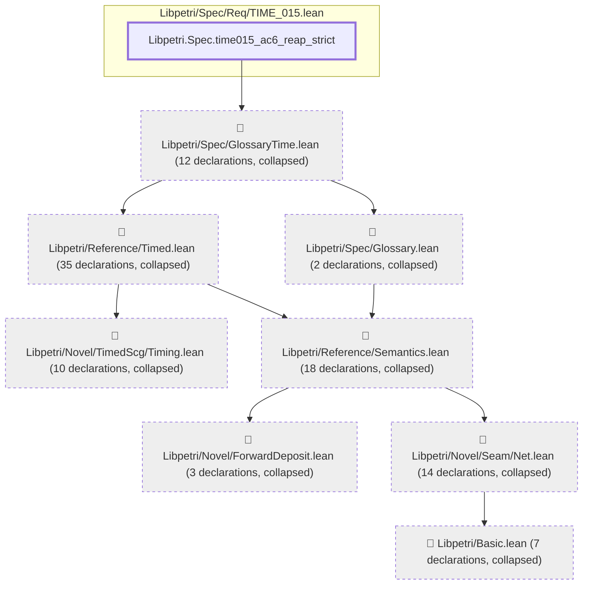

# TIME-015

Generated by `scripts/proof-graph.py` from `proof-graph.json`. Do not edit.

Theorems carrying this ID:

- `Libpetri.Spec.EVT_002_executionId_reference` (theorem, `Libpetri/Spec/Req/EVT_002.lean:554`)
- `Libpetri.Spec.core011_explicit` (theorem, `Libpetri/Spec/Req/CORE_011.lean:219`)
- `Libpetri.Spec.core011b_ref_wall_blind` (theorem, `Libpetri/Spec/Req/CORE_011_B.lean:636`)
- `Libpetri.Spec.refTStepW_delay_zero` (theorem, `Libpetri/Spec/ClashesTime.lean:372`)
- `Libpetri.Spec.time015_ac10_coarse_jump` (theorem, `Libpetri/Spec/ClashesTime.lean:421`)
- `Libpetri.Spec.time015_ac4_of_time010` (theorem, `Libpetri/Spec/Req/TIME_015.lean:199`)
- `Libpetri.Spec.time015_ac6_reap_strict` (theorem, `Libpetri/Spec/Req/TIME_015.lean:224`)

> **Note:** the full tree has 408 nodes (limit 60), so it is drawn as one diagram per theorem (7 theorems).

### `Libpetri.Spec.EVT_002_executionId_reference`

> Rule: this theorem's whole tree, 8 nodes.

### `Libpetri.Spec.core011_explicit`

> Rule: this theorem's whole tree, 13 nodes.

### `Libpetri.Spec.core011b_ref_wall_blind`

> Rule: this theorem's tree has 321 nodes (limit 60); every file other than its own is collapsed into one node, leaving 39.

```mermaid
flowchart TD
  subgraph g0["Libpetri/Spec/Req/CORE_011_B.lean"]
    n7203["Libpetri.Spec.EpochLbl"]
    n7204["Libpetri.Spec.EpochLbl.requestVal"]
    n7205["Libpetri.Spec.EpochLbl.step"]
    n7206["Libpetri.Spec.EpochLbl.tick"]
    n7207["Libpetri.Spec.EpochLbl.writeVal"]
    n7208["Libpetri.Spec.EpochPol"]
    n7209["Libpetri.Spec.EpochPol.forward"]
    n7210["Libpetri.Spec.EpochPol.keepHost"]
    n7211["Libpetri.Spec.EpochPol.mintInject"]
    n7212["Libpetri.Spec.EpochPol.mintUnit"]
    n7213["Libpetri.Spec.EpochPol.mintWrite"]
    n7214["Libpetri.Spec.EpochPol.mk"]
    n7215["Libpetri.Spec.EpochRel"]
    n7216["Libpetri.Spec.EpochSt"]
    n7217["Libpetri.Spec.EpochSt.mk"]
    n7218["Libpetri.Spec.EpochSt.rd"]
    n7219["Libpetri.Spec.EpochSt.x"]
    n9727["Libpetri.Spec.RefEpochExec"]
    n13085["Libpetri.Spec.core011b_exec"]
    n13093["Libpetri.Spec.core011b_expireOk"]
    n13109["Libpetri.Spec.core011b_mint"]
    n13123["Libpetri.Spec.core011b_ref_wall_blind"]
    n13137["Libpetri.Spec.core011b_stepW"]
    n13139["Libpetri.Spec.core011b_stepX"]
    n19699["Libpetri.Spec.refEpochPol"]
  end
  c0["📁 Libpetri/Basic.lean (7 declarations, collapsed)"]
  c54["📁 Libpetri/Novel/Seam/Net.lean (12 declarations, collapsed)"]
  c66["📁 Libpetri/Novel/TimedScg/Timing.lean (12 declarations, collapsed)"]
  c80["📁 Libpetri/Reference/Exec.lean (26 declarations, collapsed)"]
  c91["📁 Libpetri/Reference/Queue.lean (15 declarations, collapsed)"]
  c94["📁 Libpetri/Reference/Semantics.lean (13 declarations, collapsed)"]
  c98["📁 Libpetri/Reference/Timed.lean (13 declarations, collapsed)"]
  c103["📁 Libpetri/RetrodictExec.lean (1 declarations, collapsed)"]
  c109["📁 Libpetri/Sched.lean (5 declarations, collapsed)"]
  c132["📁 Libpetri/Spec/Glossary.lean (4 declarations, collapsed)"]
  c139["📁 Libpetri/Spec/GlossaryExec.lean (153 declarations, collapsed)"]
  c146["📁 Libpetri/Spec/GlossaryTime.lean (12 declarations, collapsed)"]
  c165["📁 Libpetri/Spec/Req/CORE_011.lean (7 declarations, collapsed)"]
  c232["📁 Libpetri/Spec/Req/EXEC_002.lean (16 declarations, collapsed)"]
  c54 --> c0
  c80 --> c139
  c91 --> c94
  c94 --> c54
  c98 --> c66
  c98 --> c94
  c103 --> c109
  c132 --> c94
  c139 --> c91
  c139 --> c232
  c146 --> c98
  c146 --> c132
  c232 --> c103
  c232 --> c146
  n7204 --> c139
  n7204 --> n7203
  n7205 --> c139
  n7205 --> c165
  n7205 --> n7203
  n7206 --> c165
  n7206 --> n7203
  n7207 --> n7203
  n7209 --> c165
  n7209 --> n7208
  n7210 --> c165
  n7210 --> n7208
  n7211 --> c165
  n7211 --> n7208
  n7212 --> c165
  n7212 --> n7208
  n7213 --> c165
  n7213 --> n7208
  n7214 --> c165
  n7214 --> n7208
  n7215 --> c139
  n7215 --> c165
  n7215 --> n7203
  n7215 --> n7216
  n7217 --> c139
  n7217 --> c165
  n7217 --> n7216
  n7218 --> c165
  n7218 --> n7216
  n7219 --> c139
  n7219 --> c165
  n7219 --> n7216
  n9727 --> n13085
  n9727 --> n19699
  n13085 --> n7215
  n13085 --> n13137
  n13093 --> c139
  n13093 --> n13109
  n13109 --> c91
  n13109 --> n7209
  n13109 --> n7212
  n13123 --> n9727
  n13137 --> n7204
  n13137 --> n7205
  n13137 --> n7206
  n13137 --> n7207
  n13137 --> n7211
  n13137 --> n7213
  n13137 --> n7217
  n13137 --> n13139
  n13139 --> c80
  n13139 --> n7210
  n13139 --> n7218
  n13139 --> n7219
  n13139 --> n13093
  n19699 --> n7214
  classDef root stroke-width:3px
  classDef locked fill:#fff3cd,stroke:#b8860b
  classDef collapsed fill:#eeeeee,stroke-dasharray:4 4
  class n13123 root
  class c0,c54,c66,c80,c91,c94,c98,c103,c109,c132,c139,c146,c165,c232 collapsed
```

### `Libpetri.Spec.refTStepW_delay_zero`

> Rule: this theorem's tree has 67 nodes (limit 60); every file other than its own is collapsed into one node, leaving 6.

### `Libpetri.Spec.time015_ac10_coarse_jump`

> Rule: this theorem's tree has 104 nodes (limit 60); every file other than its own is collapsed into one node, leaving 17.

### `Libpetri.Spec.time015_ac4_of_time010`

> Rule: this theorem's tree has 62 nodes (limit 60); every file other than its own is collapsed into one node, leaving 11.

### `Libpetri.Spec.time015_ac6_reap_strict`

> Rule: this theorem's tree has 102 nodes (limit 60); every file other than its own is collapsed into one node, leaving 9.

Axioms used:

- `Libpetri.Spec.EVT_002_executionId_reference`: `Classical.choice`, `Quot.sound`, `propext`
- `Libpetri.Spec.core011_explicit`: none
- `Libpetri.Spec.core011b_ref_wall_blind`: `Quot.sound`, `propext`
- `Libpetri.Spec.refTStepW_delay_zero`: `propext`
- `Libpetri.Spec.time015_ac10_coarse_jump`: `Quot.sound`, `propext`
- `Libpetri.Spec.time015_ac4_of_time010`: `propext`
- `Libpetri.Spec.time015_ac6_reap_strict`: `propext`
