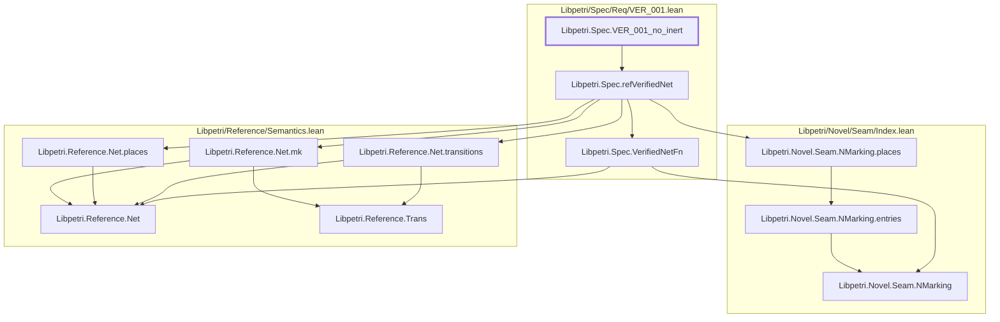

# VER-001

Generated by `scripts/proof-graph.py` from `proof-graph.json`. Do not edit.

Theorems carrying this ID:

- `Libpetri.Novel.ForwardDeposit.deposit_mem_fixedRows` (theorem, `Libpetri/Novel/ForwardDeposit.lean:406`)
- `Libpetri.Novel.ForwardDeposit.drained_forward_has_no_row` (theorem, `Libpetri/Novel/ForwardDeposit.lean:258`)
- `Libpetri.Novel.ForwardDeposit.fixedRows_mem_deposit` (theorem, `Libpetri/Novel/ForwardDeposit.lean:436`)
- `Libpetri.Spec.VER_001_covers` (theorem, `Libpetri/Spec/Req/VER_001.lean:421`)
- `Libpetri.Spec.VER_001_no_inert` (theorem, `Libpetri/Spec/Req/VER_001.lean:429`)
- `Libpetri.Spec.VER_001_rows_are_outcomes` (theorem, `Libpetri/Spec/Req/VER_001.lean:387`)

> **Note:** the full tree has 132 nodes (limit 60), so it is drawn as one diagram per theorem (6 theorems).

### `Libpetri.Novel.ForwardDeposit.deposit_mem_fixedRows`

> Rule: this theorem's whole tree, 50 nodes.

```mermaid
flowchart TD
  subgraph g0["Libpetri/Basic.lean"]
    n6["Libpetri.CMarking"]
    n8["Libpetri.Card"]
    n9["Libpetri.Card.all"]
    n10["Libpetri.Card.atLeast"]
    n11["Libpetri.Card.consumesAll"]
    n12["Libpetri.Card.exactly"]
    n13["Libpetri.Card.one"]
    n14["Libpetri.Card.required"]
    n21["Libpetri.Colour"]
    n132["Libpetri.Guard"]
    n134["Libpetri.InSpec"]
    n135["Libpetri.InSpec.card"]
    n136["Libpetri.InSpec.guard"]
    n138["Libpetri.InSpec.place"]
    n2720["Libpetri.PlaceId"]
    n13126["Libpetri.Transition"]
    n13128["Libpetri.Transition.inputs"]
    n13203["Libpetri.consumeAllAt"]
    n13204["Libpetri.consumeCount"]
    n13217["Libpetri.consumedAt"]
    n13343["Libpetri.matchCount"]
    n13378["Libpetri.pre"]
    n13433["Libpetri.specAt"]
  end
  subgraph g1["Libpetri/Novel/ForwardDeposit.lean"]
    n864["Libpetri.Novel.ForwardDeposit.Choice"]
    n865["Libpetri.Novel.ForwardDeposit.Choice.action"]
    n866["Libpetri.Novel.ForwardDeposit.Choice.timedOut"]
    n867["Libpetri.Novel.ForwardDeposit.Deposit"]
    n868["Libpetri.Novel.ForwardDeposit.FixedForwards"]
    n869["Libpetri.Novel.ForwardDeposit.OutSpec"]
    n870["Libpetri.Novel.ForwardDeposit.OutSpec.and"]
    n872["Libpetri.Novel.ForwardDeposit.OutSpec.brecOn.go"]
    n873["Libpetri.Novel.ForwardDeposit.OutSpec.forward"]
    n874["Libpetri.Novel.ForwardDeposit.OutSpec.place"]
    n875["Libpetri.Novel.ForwardDeposit.OutSpec.timeout"]
    n876["Libpetri.Novel.ForwardDeposit.OutSpec.xor"]
    n885["Libpetri.Novel.ForwardDeposit.branches"]
    n886["Libpetri.Novel.ForwardDeposit.consumedAt_eq_pre"]
    n887["Libpetri.Novel.ForwardDeposit.cross"]
    n888["Libpetri.Novel.ForwardDeposit.dedupAppend"]
    n889["Libpetri.Novel.ForwardDeposit.dedupAppend_covers"]
    n891["Libpetri.Novel.ForwardDeposit.deposit"]
    n892["Libpetri.Novel.ForwardDeposit.deposit_mem_fixedRows"]
    n894["Libpetri.Novel.ForwardDeposit.findTimeout"]
    n897["Libpetri.Novel.ForwardDeposit.fixedRows"]
    n902["Libpetri.Novel.ForwardDeposit.forwardSources"]
    n903["Libpetri.Novel.ForwardDeposit.forwardSources_findTimeout"]
    n918["Libpetri.Novel.ForwardDeposit.mem_dedupAppend_of_mem"]
    n936["Libpetri.Novel.ForwardDeposit.timeoutDeposits"]
    n937["Libpetri.Novel.ForwardDeposit.timeoutDeposits_congr"]
    n938["Libpetri.Novel.ForwardDeposit.timeoutDeposits_fixed"]
  end
  n6 --> n21
  n6 --> n2720
  n9 --> n8
  n10 --> n8
  n11 --> n9
  n11 --> n10
  n11 --> n12
  n11 --> n13
  n12 --> n8
  n13 --> n8
  n14 --> n9
  n14 --> n10
  n14 --> n12
  n14 --> n13
  n132 --> n21
  n135 --> n8
  n135 --> n134
  n136 --> n132
  n136 --> n134
  n138 --> n134
  n138 --> n2720
  n865 --> n864
  n866 --> n864
  n867 --> n2720
  n868 --> n902
  n868 --> n13203
  n870 --> n869
  n872 --> n870
  n872 --> n873
  n872 --> n874
  n872 --> n875
  n872 --> n876
  n873 --> n869
  n873 --> n2720
  n874 --> n869
  n874 --> n2720
  n875 --> n869
  n876 --> n869
  n885 --> n872
  n885 --> n887
  n886 --> n13203
  n886 --> n13217
  n886 --> n13378
  n887 --> n867
  n888 --> n867
  n889 --> n918
  n891 --> n865
  n891 --> n866
  n891 --> n885
  n891 --> n894
  n891 --> n936
  n892 --> n889
  n892 --> n891
  n892 --> n897
  n892 --> n938
  n894 --> n872
  n897 --> n885
  n897 --> n888
  n897 --> n894
  n897 --> n936
  n897 --> n13378
  n902 --> n872
  n903 --> n894
  n903 --> n902
  n918 --> n888
  n936 --> n872
  n936 --> n887
  n937 --> n902
  n937 --> n936
  n938 --> n868
  n938 --> n886
  n938 --> n903
  n938 --> n937
  n13128 --> n134
  n13128 --> n13126
  n13203 --> n11
  n13203 --> n135
  n13203 --> n13433
  n13204 --> n11
  n13204 --> n14
  n13204 --> n135
  n13204 --> n13343
  n13217 --> n13204
  n13217 --> n13433
  n13343 --> n6
  n13343 --> n136
  n13343 --> n138
  n13378 --> n14
  n13378 --> n135
  n13378 --> n13433
  n13433 --> n138
  n13433 --> n13128
  classDef root stroke-width:3px
  classDef locked fill:#fff3cd,stroke:#b8860b
  classDef collapsed fill:#eeeeee,stroke-dasharray:4 4
  class n892 root
```

### `Libpetri.Novel.ForwardDeposit.drained_forward_has_no_row`

> Rule: this theorem's whole tree, 48 nodes.

```mermaid
flowchart TD
  subgraph g0["Libpetri/Basic.lean"]
    n6["Libpetri.CMarking"]
    n8["Libpetri.Card"]
    n9["Libpetri.Card.all"]
    n10["Libpetri.Card.atLeast"]
    n11["Libpetri.Card.consumesAll"]
    n12["Libpetri.Card.exactly"]
    n13["Libpetri.Card.one"]
    n14["Libpetri.Card.required"]
    n21["Libpetri.Colour"]
    n132["Libpetri.Guard"]
    n134["Libpetri.InSpec"]
    n135["Libpetri.InSpec.card"]
    n136["Libpetri.InSpec.guard"]
    n137["Libpetri.InSpec.mk"]
    n138["Libpetri.InSpec.place"]
    n2720["Libpetri.PlaceId"]
    n13126["Libpetri.Transition"]
    n13127["Libpetri.Transition.inhibitors"]
    n13128["Libpetri.Transition.inputs"]
    n13129["Libpetri.Transition.mk"]
    n13132["Libpetri.Transition.reads"]
    n13204["Libpetri.consumeCount"]
    n13217["Libpetri.consumedAt"]
    n13256["Libpetri.enabledC"]
    n13343["Libpetri.matchCount"]
    n13433["Libpetri.specAt"]
  end
  subgraph g1["Libpetri/Novel/ForwardDeposit.lean"]
    n864["Libpetri.Novel.ForwardDeposit.Choice"]
    n865["Libpetri.Novel.ForwardDeposit.Choice.action"]
    n866["Libpetri.Novel.ForwardDeposit.Choice.timedOut"]
    n867["Libpetri.Novel.ForwardDeposit.Deposit"]
    n869["Libpetri.Novel.ForwardDeposit.OutSpec"]
    n870["Libpetri.Novel.ForwardDeposit.OutSpec.and"]
    n872["Libpetri.Novel.ForwardDeposit.OutSpec.brecOn.go"]
    n873["Libpetri.Novel.ForwardDeposit.OutSpec.forward"]
    n874["Libpetri.Novel.ForwardDeposit.OutSpec.place"]
    n875["Libpetri.Novel.ForwardDeposit.OutSpec.timeout"]
    n876["Libpetri.Novel.ForwardDeposit.OutSpec.xor"]
    n885["Libpetri.Novel.ForwardDeposit.branches"]
    n887["Libpetri.Novel.ForwardDeposit.cross"]
    n891["Libpetri.Novel.ForwardDeposit.deposit"]
    n893["Libpetri.Novel.ForwardDeposit.drained_forward_has_no_row"]
    n894["Libpetri.Novel.ForwardDeposit.findTimeout"]
    n919["Libpetri.Novel.ForwardDeposit.oFwd"]
    n925["Libpetri.Novel.ForwardDeposit.pa"]
    n926["Libpetri.Novel.ForwardDeposit.pb"]
    n927["Libpetri.Novel.ForwardDeposit.pc"]
    n934["Libpetri.Novel.ForwardDeposit.tAll"]
    n936["Libpetri.Novel.ForwardDeposit.timeoutDeposits"]
  end
  n6 --> n21
  n6 --> n2720
  n9 --> n8
  n10 --> n8
  n11 --> n9
  n11 --> n10
  n11 --> n12
  n11 --> n13
  n12 --> n8
  n13 --> n8
  n14 --> n9
  n14 --> n10
  n14 --> n12
  n14 --> n13
  n132 --> n21
  n135 --> n8
  n135 --> n134
  n136 --> n132
  n136 --> n134
  n137 --> n8
  n137 --> n132
  n137 --> n134
  n137 --> n2720
  n138 --> n134
  n138 --> n2720
  n865 --> n864
  n866 --> n864
  n867 --> n2720
  n870 --> n869
  n872 --> n870
  n872 --> n873
  n872 --> n874
  n872 --> n875
  n872 --> n876
  n873 --> n869
  n873 --> n2720
  n874 --> n869
  n874 --> n2720
  n875 --> n869
  n876 --> n869
  n885 --> n872
  n885 --> n887
  n887 --> n867
  n891 --> n865
  n891 --> n866
  n891 --> n885
  n891 --> n894
  n891 --> n936
  n893 --> n891
  n893 --> n919
  n893 --> n934
  n893 --> n13217
  n893 --> n13256
  n894 --> n872
  n919 --> n873
  n919 --> n874
  n919 --> n875
  n919 --> n876
  n919 --> n925
  n919 --> n926
  n919 --> n927
  n925 --> n2720
  n926 --> n2720
  n927 --> n2720
  n934 --> n9
  n934 --> n137
  n934 --> n925
  n934 --> n13129
  n936 --> n872
  n936 --> n887
  n13127 --> n2720
  n13127 --> n13126
  n13128 --> n134
  n13128 --> n13126
  n13129 --> n134
  n13129 --> n2720
  n13129 --> n13126
  n13132 --> n2720
  n13132 --> n13126
  n13204 --> n11
  n13204 --> n14
  n13204 --> n135
  n13204 --> n13343
  n13217 --> n13204
  n13217 --> n13433
  n13256 --> n14
  n13256 --> n135
  n13256 --> n13127
  n13256 --> n13128
  n13256 --> n13132
  n13256 --> n13343
  n13343 --> n6
  n13343 --> n136
  n13343 --> n138
  n13433 --> n138
  n13433 --> n13128
  classDef root stroke-width:3px
  classDef locked fill:#fff3cd,stroke:#b8860b
  classDef collapsed fill:#eeeeee,stroke-dasharray:4 4
  class n893 root
```

### `Libpetri.Novel.ForwardDeposit.fixedRows_mem_deposit`

> Rule: this theorem's whole tree, 49 nodes.

```mermaid
flowchart TD
  subgraph g0["Libpetri/Basic.lean"]
    n6["Libpetri.CMarking"]
    n8["Libpetri.Card"]
    n9["Libpetri.Card.all"]
    n10["Libpetri.Card.atLeast"]
    n11["Libpetri.Card.consumesAll"]
    n12["Libpetri.Card.exactly"]
    n13["Libpetri.Card.one"]
    n14["Libpetri.Card.required"]
    n21["Libpetri.Colour"]
    n132["Libpetri.Guard"]
    n134["Libpetri.InSpec"]
    n135["Libpetri.InSpec.card"]
    n136["Libpetri.InSpec.guard"]
    n138["Libpetri.InSpec.place"]
    n2720["Libpetri.PlaceId"]
    n13126["Libpetri.Transition"]
    n13128["Libpetri.Transition.inputs"]
    n13203["Libpetri.consumeAllAt"]
    n13204["Libpetri.consumeCount"]
    n13217["Libpetri.consumedAt"]
    n13343["Libpetri.matchCount"]
    n13378["Libpetri.pre"]
    n13433["Libpetri.specAt"]
  end
  subgraph g1["Libpetri/Novel/ForwardDeposit.lean"]
    n864["Libpetri.Novel.ForwardDeposit.Choice"]
    n865["Libpetri.Novel.ForwardDeposit.Choice.action"]
    n866["Libpetri.Novel.ForwardDeposit.Choice.timedOut"]
    n867["Libpetri.Novel.ForwardDeposit.Deposit"]
    n868["Libpetri.Novel.ForwardDeposit.FixedForwards"]
    n869["Libpetri.Novel.ForwardDeposit.OutSpec"]
    n870["Libpetri.Novel.ForwardDeposit.OutSpec.and"]
    n872["Libpetri.Novel.ForwardDeposit.OutSpec.brecOn.go"]
    n873["Libpetri.Novel.ForwardDeposit.OutSpec.forward"]
    n874["Libpetri.Novel.ForwardDeposit.OutSpec.place"]
    n875["Libpetri.Novel.ForwardDeposit.OutSpec.timeout"]
    n876["Libpetri.Novel.ForwardDeposit.OutSpec.xor"]
    n885["Libpetri.Novel.ForwardDeposit.branches"]
    n886["Libpetri.Novel.ForwardDeposit.consumedAt_eq_pre"]
    n887["Libpetri.Novel.ForwardDeposit.cross"]
    n888["Libpetri.Novel.ForwardDeposit.dedupAppend"]
    n890["Libpetri.Novel.ForwardDeposit.dedupAppend_subset"]
    n891["Libpetri.Novel.ForwardDeposit.deposit"]
    n894["Libpetri.Novel.ForwardDeposit.findTimeout"]
    n897["Libpetri.Novel.ForwardDeposit.fixedRows"]
    n898["Libpetri.Novel.ForwardDeposit.fixedRows_mem_deposit"]
    n902["Libpetri.Novel.ForwardDeposit.forwardSources"]
    n903["Libpetri.Novel.ForwardDeposit.forwardSources_findTimeout"]
    n936["Libpetri.Novel.ForwardDeposit.timeoutDeposits"]
    n937["Libpetri.Novel.ForwardDeposit.timeoutDeposits_congr"]
    n938["Libpetri.Novel.ForwardDeposit.timeoutDeposits_fixed"]
  end
  n6 --> n21
  n6 --> n2720
  n9 --> n8
  n10 --> n8
  n11 --> n9
  n11 --> n10
  n11 --> n12
  n11 --> n13
  n12 --> n8
  n13 --> n8
  n14 --> n9
  n14 --> n10
  n14 --> n12
  n14 --> n13
  n132 --> n21
  n135 --> n8
  n135 --> n134
  n136 --> n132
  n136 --> n134
  n138 --> n134
  n138 --> n2720
  n865 --> n864
  n866 --> n864
  n867 --> n2720
  n868 --> n902
  n868 --> n13203
  n870 --> n869
  n872 --> n870
  n872 --> n873
  n872 --> n874
  n872 --> n875
  n872 --> n876
  n873 --> n869
  n873 --> n2720
  n874 --> n869
  n874 --> n2720
  n875 --> n869
  n876 --> n869
  n885 --> n872
  n885 --> n887
  n886 --> n13203
  n886 --> n13217
  n886 --> n13378
  n887 --> n867
  n888 --> n867
  n890 --> n888
  n891 --> n865
  n891 --> n866
  n891 --> n885
  n891 --> n894
  n891 --> n936
  n894 --> n872
  n897 --> n885
  n897 --> n888
  n897 --> n894
  n897 --> n936
  n897 --> n13378
  n898 --> n890
  n898 --> n891
  n898 --> n897
  n898 --> n938
  n902 --> n872
  n903 --> n894
  n903 --> n902
  n936 --> n872
  n936 --> n887
  n937 --> n902
  n937 --> n936
  n938 --> n868
  n938 --> n886
  n938 --> n903
  n938 --> n937
  n13128 --> n134
  n13128 --> n13126
  n13203 --> n11
  n13203 --> n135
  n13203 --> n13433
  n13204 --> n11
  n13204 --> n14
  n13204 --> n135
  n13204 --> n13343
  n13217 --> n13204
  n13217 --> n13433
  n13343 --> n6
  n13343 --> n136
  n13343 --> n138
  n13378 --> n14
  n13378 --> n135
  n13378 --> n13433
  n13433 --> n138
  n13433 --> n13128
  classDef root stroke-width:3px
  classDef locked fill:#fff3cd,stroke:#b8860b
  classDef collapsed fill:#eeeeee,stroke-dasharray:4 4
  class n898 root
```

### `Libpetri.Spec.VER_001_covers`

> Rule: this theorem's whole tree, 31 nodes.

```mermaid
flowchart TD
  subgraph g0["Libpetri/Novel/Seam/Index.lean"]
    n1916["Libpetri.Novel.Seam.Covers"]
    n1940["Libpetri.Novel.Seam.NMarking"]
    n1941["Libpetri.Novel.Seam.NMarking.count"]
    n1942["Libpetri.Novel.Seam.NMarking.count_ne_zero_iff"]
    n1943["Libpetri.Novel.Seam.NMarking.entries"]
    n1947["Libpetri.Novel.Seam.NMarking.places"]
    n1948["Libpetri.Novel.Seam.NMarking.pos"]
    n1962["Libpetri.Novel.Seam.PlaceIndex"]
    n1973["Libpetri.Novel.Seam.PlaceIndex.mk"]
    n1977["Libpetri.Novel.Seam.PlaceIndex.names"]
    n2067["Libpetri.Novel.Seam.flatIndex"]
    n2085["Libpetri.Novel.Seam.mem_flatIndex"]
  end
  subgraph g1["Libpetri/Novel/Seam/Net.lean"]
    n1935["Libpetri.Novel.Seam.NFlatTransition"]
    n1949["Libpetri.Novel.Seam.NNet"]
    n1950["Libpetri.Novel.Seam.NNet.mk"]
    n1951["Libpetri.Novel.Seam.NNet.places"]
    n1952["Libpetri.Novel.Seam.NNet.transitions"]
    n1954["Libpetri.Novel.Seam.NTransition"]
    n2078["Libpetri.Novel.Seam.inertNet"]
    n2081["Libpetri.Novel.Seam.inertPlaces"]
    n2082["Libpetri.Novel.Seam.inert_covers"]
  end
  subgraph g2["Libpetri/Reference/Link.lean"]
    n2950["Libpetri.Reference.Link.toNNet"]
  end
  subgraph g3["Libpetri/Reference/Semantics.lean"]
    n2955["Libpetri.Reference.Net"]
    n2956["Libpetri.Reference.Net.mk"]
    n2957["Libpetri.Reference.Net.places"]
    n2958["Libpetri.Reference.Net.transitions"]
    n3064["Libpetri.Reference.Trans"]
    n3065["Libpetri.Reference.Trans.core"]
  end
  subgraph g4["Libpetri/Spec/Req/VER_001.lean"]
    n4951["Libpetri.Spec.VER_001_covers"]
    n5179["Libpetri.Spec.VerifiedNetFn"]
    n6903["Libpetri.Spec.refVerifiedNet"]
  end
  n1916 --> n1977
  n1935 --> n1954
  n1941 --> n1943
  n1942 --> n1941
  n1942 --> n1947
  n1942 --> n1948
  n1943 --> n1940
  n1947 --> n1943
  n1948 --> n1943
  n1950 --> n1935
  n1950 --> n1949
  n1951 --> n1949
  n1952 --> n1935
  n1952 --> n1949
  n1973 --> n1962
  n1977 --> n1962
  n2067 --> n1973
  n2078 --> n1950
  n2078 --> n1952
  n2078 --> n2081
  n2081 --> n1947
  n2081 --> n1951
  n2082 --> n1916
  n2082 --> n1942
  n2082 --> n2078
  n2082 --> n2085
  n2085 --> n1977
  n2085 --> n2067
  n2950 --> n1950
  n2950 --> n2957
  n2950 --> n2958
  n2950 --> n3065
  n2956 --> n2955
  n2956 --> n3064
  n2957 --> n2955
  n2958 --> n2955
  n2958 --> n3064
  n3065 --> n1954
  n3065 --> n3064
  n4951 --> n2082
  n4951 --> n2950
  n4951 --> n6903
  n5179 --> n1940
  n5179 --> n2955
  n6903 --> n1947
  n6903 --> n2956
  n6903 --> n2957
  n6903 --> n2958
  n6903 --> n5179
  classDef root stroke-width:3px
  classDef locked fill:#fff3cd,stroke:#b8860b
  classDef collapsed fill:#eeeeee,stroke-dasharray:4 4
  class n4951 root
```

### `Libpetri.Spec.VER_001_no_inert`

> Rule: this theorem's whole tree, 11 nodes.

### `Libpetri.Spec.VER_001_rows_are_outcomes`

> Rule: this theorem's whole tree, 50 nodes.

```mermaid
flowchart TD
  subgraph g0["Libpetri/Basic.lean"]
    n8["Libpetri.Card"]
    n9["Libpetri.Card.all"]
    n10["Libpetri.Card.atLeast"]
    n11["Libpetri.Card.consumesAll"]
    n12["Libpetri.Card.exactly"]
    n13["Libpetri.Card.one"]
    n14["Libpetri.Card.required"]
  end
  subgraph g1["Libpetri/Novel/ForwardDeposit.lean"]
    n864["Libpetri.Novel.ForwardDeposit.Choice"]
    n865["Libpetri.Novel.ForwardDeposit.Choice.action"]
    n866["Libpetri.Novel.ForwardDeposit.Choice.timedOut"]
  end
  subgraph g2["Libpetri/Novel/Seam/Net.lean"]
    n1936["Libpetri.Novel.Seam.NInSpec"]
    n1937["Libpetri.Novel.Seam.NInSpec.card"]
    n1939["Libpetri.Novel.Seam.NInSpec.place"]
    n1954["Libpetri.Novel.Seam.NTransition"]
    n1956["Libpetri.Novel.Seam.NTransition.inputs"]
    n2044["Libpetri.Novel.Seam.depProd"]
    n2087["Libpetri.Novel.Seam.nconsumed"]
    n2090["Libpetri.Novel.Seam.nspecAt"]
  end
  subgraph g3["Libpetri/Reference/Semantics.lean"]
    n2965["Libpetri.Reference.Out"]
    n2966["Libpetri.Reference.Out.and"]
    n2967["Libpetri.Reference.Out.branches"]
    n2969["Libpetri.Reference.Out.brecOn.go"]
    n2970["Libpetri.Reference.Out.findTimeout"]
    n2971["Libpetri.Reference.Out.forward"]
    n2972["Libpetri.Reference.Out.place"]
    n2973["Libpetri.Reference.Out.timeout"]
    n2974["Libpetri.Reference.Out.timeoutDeposits"]
    n2975["Libpetri.Reference.Out.xor"]
    n3064["Libpetri.Reference.Trans"]
    n3065["Libpetri.Reference.Trans.core"]
    n3067["Libpetri.Reference.Trans.out"]
    n3109["Libpetri.Reference.cross"]
    n3113["Libpetri.Reference.deposit"]
  end
  subgraph g4["Libpetri/Spec/Glossary.lean"]
    n3804["Libpetri.Spec.Consumes"]
    n3808["Libpetri.Spec.CountMarking"]
    n3829["Libpetri.Spec.Deposits"]
    n4727["Libpetri.Spec.SamePerPlace"]
    n6180["Libpetri.Spec.forwardSources"]
    n6919["Libpetri.Spec.requiredCount"]
  end
  subgraph g5["Libpetri/Spec/Req/VER_001.lean"]
    n3831["Libpetri.Spec.DrainedForward"]
    n4967["Libpetri.Spec.VER_001_rows_are_outcomes"]
    n6905["Libpetri.Spec.refVirtualRows"]
    n7307["Libpetri.Spec.timeoutRequired"]
    n7332["Libpetri.Spec.ver001_actionRows"]
    n7333["Libpetri.Spec.ver001_actionRows_getElem?"]
    n7336["Libpetri.Spec.ver001_deposit_timedOut"]
    n7357["Libpetri.Spec.ver001_samePerPlace_iff"]
    n7369["Libpetri.Spec.ver001_timeoutDeposits_congr"]
    n7371["Libpetri.Spec.ver001_timeoutRows"]
    n7372["Libpetri.Spec.ver001_timeoutRows_spec"]
  end
  n9 --> n8
  n10 --> n8
  n11 --> n9
  n11 --> n10
  n11 --> n12
  n11 --> n13
  n12 --> n8
  n13 --> n8
  n14 --> n9
  n14 --> n10
  n14 --> n12
  n14 --> n13
  n865 --> n864
  n866 --> n864
  n1937 --> n8
  n1937 --> n1936
  n1939 --> n1936
  n1956 --> n1936
  n1956 --> n1954
  n2087 --> n11
  n2087 --> n14
  n2087 --> n1937
  n2087 --> n2090
  n2090 --> n1939
  n2090 --> n1956
  n2966 --> n2965
  n2967 --> n2969
  n2967 --> n3109
  n2969 --> n2966
  n2969 --> n2971
  n2969 --> n2972
  n2969 --> n2973
  n2969 --> n2975
  n2970 --> n2969
  n2971 --> n2965
  n2972 --> n2965
  n2973 --> n2965
  n2974 --> n2969
  n2974 --> n3109
  n2975 --> n2965
  n3065 --> n1954
  n3065 --> n3064
  n3067 --> n2965
  n3067 --> n3064
  n3113 --> n865
  n3113 --> n866
  n3113 --> n2967
  n3113 --> n2970
  n3113 --> n2974
  n3804 --> n2087
  n3804 --> n3065
  n3804 --> n3808
  n3829 --> n2044
  n3831 --> n11
  n3831 --> n1937
  n3831 --> n2090
  n3831 --> n2970
  n3831 --> n3065
  n3831 --> n3067
  n3831 --> n6180
  n4727 --> n3829
  n4967 --> n6905
  n4967 --> n7333
  n4967 --> n7336
  n4967 --> n7372
  n6180 --> n2969
  n6905 --> n7371
  n6919 --> n14
  n7307 --> n1937
  n7307 --> n2090
  n7307 --> n3065
  n7307 --> n6919
  n7332 --> n2967
  n7332 --> n3067
  n7333 --> n3113
  n7333 --> n7332
  n7336 --> n3113
  n7336 --> n3804
  n7336 --> n3831
  n7336 --> n7307
  n7336 --> n7369
  n7357 --> n4727
  n7369 --> n2974
  n7369 --> n6180
  n7371 --> n3113
  n7371 --> n7307
  n7371 --> n7332
  n7372 --> n7357
  n7372 --> n7371
  classDef root stroke-width:3px
  classDef locked fill:#fff3cd,stroke:#b8860b
  classDef collapsed fill:#eeeeee,stroke-dasharray:4 4
  class n4967 root
```

Axioms used:

- `Libpetri.Novel.ForwardDeposit.deposit_mem_fixedRows`: `Classical.choice`, `Quot.sound`, `propext`
- `Libpetri.Novel.ForwardDeposit.drained_forward_has_no_row`: `Classical.choice`, `Quot.sound`, `propext`
- `Libpetri.Novel.ForwardDeposit.fixedRows_mem_deposit`: `Quot.sound`, `propext`
- `Libpetri.Spec.VER_001_covers`: `Classical.choice`, `Quot.sound`, `propext`
- `Libpetri.Spec.VER_001_no_inert`: `Classical.choice`, `Quot.sound`, `propext`
- `Libpetri.Spec.VER_001_rows_are_outcomes`: `Classical.choice`, `Quot.sound`, `propext`
