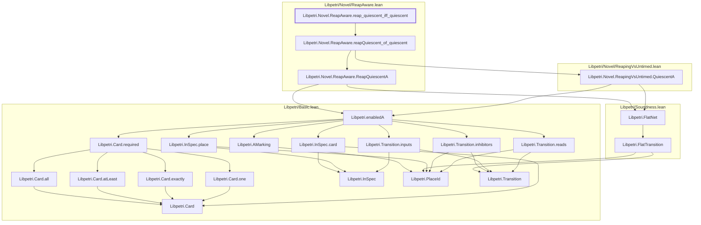
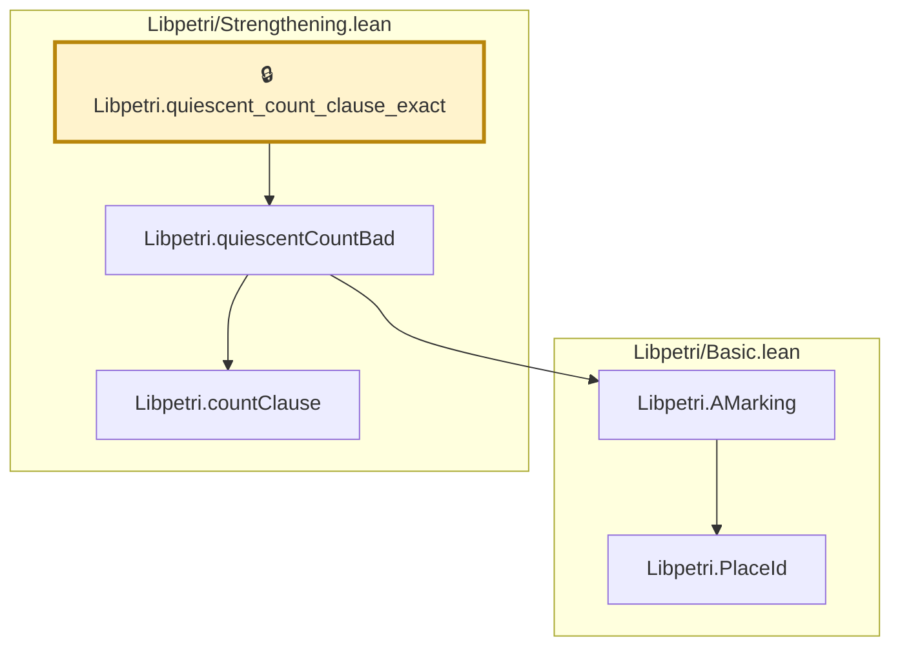

# VER-002

Generated by `scripts/proof-graph.py` from `proof-graph.json`. Do not edit.

Theorems carrying this ID:

- `Libpetri.Novel.InFlight.quiescent_count_stop_sound` (theorem, `Libpetri/Novel/InFlight.lean:625`)
- `Libpetri.Novel.ReapAware.reap_aware_ac3` (theorem, `Libpetri/Novel/ReapAware.lean:335`)
- `Libpetri.Novel.ReapAware.reap_quiescent_iff_quiescent` (theorem, `Libpetri/Novel/ReapAware.lean:110`)
- `Libpetri.Novel.ReapAware.rest_sound` (theorem, `Libpetri/Novel/ReapAware.lean:314`)
- `Libpetri.Novel.ReapAware.witness_caught` (theorem, `Libpetri/Novel/ReapAware.lean:406`)
- `Libpetri.quiescent_count_clause_exact` (theorem, `Libpetri/Strengthening.lean:482`) 🔒 locked

> **Note:** the full tree has 144 nodes (limit 60), so it is drawn as one diagram per theorem (6 theorems).

### `Libpetri.Novel.InFlight.quiescent_count_stop_sound`

> Rule: this theorem's tree has 70 nodes (limit 60); every file other than its own is collapsed into one node, leaving 48.

```mermaid
flowchart TD
  subgraph g0["Libpetri/Novel/InFlight.lean"]
    n882["Libpetri.Novel.InFlight.Completes"]
    n883["Libpetri.Novel.InFlight.MonoAt"]
    n884["Libpetri.Novel.InFlight.NamesUnique"]
    n885["Libpetri.Novel.InFlight.Row"]
    n886["Libpetri.Novel.InFlight.SReach"]
    n887["Libpetri.Novel.InFlight.SStep"]
    n888["Libpetri.Novel.InFlight.SStep.atomic"]
    n889["Libpetri.Novel.InFlight.SStep.complete"]
    n890["Libpetri.Novel.InFlight.SStep.start"]
    n891["Libpetri.Novel.InFlight.Untested"]
    n893["Libpetri.Novel.InFlight.UpClosedOff"]
    n894["Libpetri.Novel.InFlight.XReach"]
    n895["Libpetri.Novel.InFlight.XState"]
    n896["Libpetri.Novel.InFlight.XState.a"]
    n897["Libpetri.Novel.InFlight.XState.mk"]
    n898["Libpetri.Novel.InFlight.XState.pend"]
    n899["Libpetri.Novel.InFlight.XStep"]
    n900["Libpetri.Novel.InFlight.XStep.complete"]
    n901["Libpetri.Novel.InFlight.XStep.start"]
    n904["Libpetri.Novel.InFlight.addAll"]
    n905["Libpetri.Novel.InFlight.addAll_cons"]
    n906["Libpetri.Novel.InFlight.addAll_nil"]
    n907["Libpetri.Novel.InFlight.addAll_of_zero"]
    n908["Libpetri.Novel.InFlight.addAll_perm"]
    n909["Libpetri.Novel.InFlight.addD"]
    n910["Libpetri.Novel.InFlight.addD_addAll"]
    n914["Libpetri.Novel.InFlight.completes_exists"]
    n915["Libpetri.Novel.InFlight.completes_nonsplit"]
    n918["Libpetri.Novel.InFlight.enabledA_addAll"]
    n919["Libpetri.Novel.InFlight.enabledA_addD"]
    n923["Libpetri.Novel.InFlight.filter_erase_of_false"]
    n924["Libpetri.Novel.InFlight.filter_erase_of_true"]
    n925["Libpetri.Novel.InFlight.fireAD_eq_addD_startA"]
    n927["Libpetri.Novel.InFlight.le_addAll"]
    n930["Libpetri.Novel.InFlight.live_addAll"]
    n931["Libpetri.Novel.InFlight.pend_has_row"]
    n935["Libpetri.Novel.InFlight.quiescent_count_stop_sound"]
    n941["Libpetri.Novel.InFlight.split_covers_executor"]
    n945["Libpetri.Novel.InFlight.split_stop_sound"]
    n946["Libpetri.Novel.InFlight.startA"]
    n947["Libpetri.Novel.InFlight.startA_addAll"]
    n948["Libpetri.Novel.InFlight.startA_addD"]
    n949["Libpetri.Novel.InFlight.stopCountBad"]
    n950["Libpetri.Novel.InFlight.stopCountBad_upClosedOff"]
  end
  c0["📁 Libpetri/Basic.lean (22 declarations, collapsed)"]
  c27["📁 Libpetri/Novel/ForwardDeposit.lean (2 declarations, collapsed)"]
  c84["📁 Libpetri/Soundness.lean (1 declarations, collapsed)"]
  c135["📁 Libpetri/Strengthening/Hypotheses.lean (1 declarations, collapsed)"]
  c27 --> c0
  c84 --> c0
  c135 --> c84
  n882 --> n885
  n883 --> c0
  n884 --> n885
  n885 --> c27
  n886 --> n887
  n886 --> n897
  n887 --> n885
  n887 --> n895
  n888 --> n887
  n888 --> n896
  n888 --> n897
  n888 --> n898
  n889 --> n887
  n889 --> n896
  n889 --> n897
  n889 --> n898
  n889 --> n909
  n890 --> n887
  n890 --> n896
  n890 --> n897
  n890 --> n898
  n890 --> n946
  n891 --> n883
  n891 --> n885
  n893 --> c0
  n894 --> n897
  n894 --> n899
  n896 --> c0
  n896 --> n895
  n897 --> c0
  n897 --> n895
  n898 --> n895
  n899 --> n885
  n899 --> n895
  n900 --> n896
  n900 --> n897
  n900 --> n898
  n900 --> n899
  n900 --> n909
  n901 --> n896
  n901 --> n897
  n901 --> n898
  n901 --> n899
  n901 --> n946
  n904 --> n885
  n905 --> n904
  n905 --> n909
  n906 --> n904
  n907 --> n904
  n908 --> n904
  n909 --> c27
  n910 --> n904
  n910 --> n909
  n914 --> n882
  n915 --> n882
  n918 --> n891
  n918 --> n905
  n918 --> n906
  n918 --> n919
  n919 --> n883
  n919 --> n909
  n925 --> n909
  n925 --> n946
  n927 --> n904
  n930 --> n905
  n930 --> n906
  n931 --> n894
  n931 --> n900
  n931 --> n901
  n935 --> n945
  n935 --> n950
  n941 --> n884
  n941 --> n886
  n941 --> n888
  n941 --> n889
  n941 --> n890
  n941 --> n894
  n941 --> n900
  n941 --> n901
  n941 --> n908
  n941 --> n910
  n941 --> n915
  n941 --> n918
  n941 --> n923
  n941 --> n924
  n941 --> n925
  n941 --> n930
  n941 --> n947
  n945 --> n893
  n945 --> n907
  n945 --> n914
  n945 --> n927
  n945 --> n931
  n945 --> n941
  n946 --> c27
  n947 --> n891
  n947 --> n905
  n947 --> n906
  n947 --> n919
  n947 --> n948
  n948 --> c135
  n948 --> n883
  n948 --> n909
  n948 --> n946
  n949 --> c0
  n950 --> n893
  n950 --> n949
  classDef root stroke-width:3px
  classDef locked fill:#fff3cd,stroke:#b8860b
  classDef collapsed fill:#eeeeee,stroke-dasharray:4 4
  class n935 root
  class c0,c27,c84,c135 collapsed
```

### `Libpetri.Novel.ReapAware.reap_aware_ac3`

> Rule: this theorem's tree has 68 nodes (limit 60); every file other than its own is collapsed into one node, leaving 33.

```mermaid
flowchart TD
  subgraph g0["Libpetri/Novel/ReapAware.lean"]
    n1020["Libpetri.Novel.ReapAware.Cycle"]
    n1021["Libpetri.Novel.ReapAware.FireStep"]
    n1022["Libpetri.Novel.ReapAware.Halts"]
    n1023["Libpetri.Novel.ReapAware.Inv"]
    n1025["Libpetri.Novel.ReapAware.ReapQuiescentA"]
    n1026["Libpetri.Novel.ReapAware.RestsAt"]
    n1027["Libpetri.Novel.ReapAware.Runs"]
    n1028["Libpetri.Novel.ReapAware.TTiming"]
    n1029["Libpetri.Novel.ReapAware.TTiming.earliest"]
    n1030["Libpetri.Novel.ReapAware.TTiming.latest"]
    n1032["Libpetri.Novel.ReapAware.Touches"]
    n1033["Libpetri.Novel.ReapAware.XState"]
    n1034["Libpetri.Novel.ReapAware.XState.a"]
    n1035["Libpetri.Novel.ReapAware.XState.cells"]
    n1036["Libpetri.Novel.ReapAware.XState.mk"]
    n1037["Libpetri.Novel.ReapAware.cycle_inv"]
    n1039["Libpetri.Novel.ReapAware.enabledA_congr"]
    n1040["Libpetri.Novel.ReapAware.enf"]
    n1041["Libpetri.Novel.ReapAware.enf_enabled"]
    n1042["Libpetri.Novel.ReapAware.firePhase_reach"]
    n1043["Libpetri.Novel.ReapAware.halts_reapQuiescent"]
    n1044["Libpetri.Novel.ReapAware.initCells"]
    n1045["Libpetri.Novel.ReapAware.inv_init"]
    n1054["Libpetri.Novel.ReapAware.reap_aware_ac3"]
    n1056["Libpetri.Novel.ReapAware.reapable"]
    n1057["Libpetri.Novel.ReapAware.rest_sound"]
    n1060["Libpetri.Novel.ReapAware.run_inv"]
    n1062["Libpetri.Novel.ReapAware.upd"]
    n1063["Libpetri.Novel.ReapAware.upd_enabled"]
  end
  c0["📁 Libpetri/Basic.lean (23 declarations, collapsed)"]
  c84["📁 Libpetri/Soundness.lean (6 declarations, collapsed)"]
  c134["📁 Libpetri/Strengthening.lean (1 declarations, collapsed)"]
  c136["📁 Libpetri/TimedCycle.lean (9 declarations, collapsed)"]
  c84 --> c0
  c134 --> c0
  n1020 --> n1021
  n1020 --> n1022
  n1020 --> n1032
  n1021 --> c84
  n1021 --> n1029
  n1021 --> n1040
  n1022 --> c84
  n1022 --> n1040
  n1023 --> c84
  n1023 --> n1034
  n1023 --> n1035
  n1023 --> n1056
  n1025 --> c84
  n1026 --> n1027
  n1026 --> n1036
  n1026 --> n1044
  n1027 --> n1020
  n1029 --> n1028
  n1030 --> n1028
  n1032 --> c0
  n1034 --> c0
  n1034 --> n1033
  n1035 --> c0
  n1035 --> c136
  n1035 --> n1033
  n1036 --> c0
  n1036 --> c136
  n1036 --> n1033
  n1037 --> n1020
  n1037 --> n1039
  n1037 --> n1041
  n1037 --> n1063
  n1039 --> n1032
  n1040 --> n1030
  n1040 --> n1062
  n1041 --> n1040
  n1041 --> n1056
  n1042 --> n1021
  n1043 --> n1022
  n1043 --> n1025
  n1043 --> n1041
  n1043 --> n1063
  n1044 --> c0
  n1044 --> c136
  n1045 --> n1023
  n1045 --> n1036
  n1045 --> n1044
  n1054 --> c134
  n1054 --> n1057
  n1056 --> c0
  n1056 --> n1030
  n1057 --> n1026
  n1057 --> n1043
  n1057 --> n1060
  n1060 --> n1027
  n1060 --> n1037
  n1060 --> n1042
  n1060 --> n1045
  n1062 --> n1034
  n1062 --> n1035
  n1063 --> n1023
  n1063 --> n1062
  classDef root stroke-width:3px
  classDef locked fill:#fff3cd,stroke:#b8860b
  classDef collapsed fill:#eeeeee,stroke-dasharray:4 4
  class n1054 root
  class c0,c84,c134,c136 collapsed
```

### `Libpetri.Novel.ReapAware.reap_quiescent_iff_quiescent`

> Rule: this theorem's whole tree, 22 nodes.

### `Libpetri.Novel.ReapAware.rest_sound`

> Rule: this theorem's tree has 66 nodes (limit 60); every file other than its own is collapsed into one node, leaving 31.

```mermaid
flowchart TD
  subgraph g0["Libpetri/Novel/ReapAware.lean"]
    n1020["Libpetri.Novel.ReapAware.Cycle"]
    n1021["Libpetri.Novel.ReapAware.FireStep"]
    n1022["Libpetri.Novel.ReapAware.Halts"]
    n1023["Libpetri.Novel.ReapAware.Inv"]
    n1025["Libpetri.Novel.ReapAware.ReapQuiescentA"]
    n1026["Libpetri.Novel.ReapAware.RestsAt"]
    n1027["Libpetri.Novel.ReapAware.Runs"]
    n1028["Libpetri.Novel.ReapAware.TTiming"]
    n1029["Libpetri.Novel.ReapAware.TTiming.earliest"]
    n1030["Libpetri.Novel.ReapAware.TTiming.latest"]
    n1032["Libpetri.Novel.ReapAware.Touches"]
    n1033["Libpetri.Novel.ReapAware.XState"]
    n1034["Libpetri.Novel.ReapAware.XState.a"]
    n1035["Libpetri.Novel.ReapAware.XState.cells"]
    n1036["Libpetri.Novel.ReapAware.XState.mk"]
    n1037["Libpetri.Novel.ReapAware.cycle_inv"]
    n1039["Libpetri.Novel.ReapAware.enabledA_congr"]
    n1040["Libpetri.Novel.ReapAware.enf"]
    n1041["Libpetri.Novel.ReapAware.enf_enabled"]
    n1042["Libpetri.Novel.ReapAware.firePhase_reach"]
    n1043["Libpetri.Novel.ReapAware.halts_reapQuiescent"]
    n1044["Libpetri.Novel.ReapAware.initCells"]
    n1045["Libpetri.Novel.ReapAware.inv_init"]
    n1056["Libpetri.Novel.ReapAware.reapable"]
    n1057["Libpetri.Novel.ReapAware.rest_sound"]
    n1060["Libpetri.Novel.ReapAware.run_inv"]
    n1062["Libpetri.Novel.ReapAware.upd"]
    n1063["Libpetri.Novel.ReapAware.upd_enabled"]
  end
  c0["📁 Libpetri/Basic.lean (23 declarations, collapsed)"]
  c84["📁 Libpetri/Soundness.lean (6 declarations, collapsed)"]
  c136["📁 Libpetri/TimedCycle.lean (9 declarations, collapsed)"]
  c84 --> c0
  n1020 --> n1021
  n1020 --> n1022
  n1020 --> n1032
  n1021 --> c84
  n1021 --> n1029
  n1021 --> n1040
  n1022 --> c84
  n1022 --> n1040
  n1023 --> c84
  n1023 --> n1034
  n1023 --> n1035
  n1023 --> n1056
  n1025 --> c84
  n1026 --> n1027
  n1026 --> n1036
  n1026 --> n1044
  n1027 --> n1020
  n1029 --> n1028
  n1030 --> n1028
  n1032 --> c0
  n1034 --> c0
  n1034 --> n1033
  n1035 --> c0
  n1035 --> c136
  n1035 --> n1033
  n1036 --> c0
  n1036 --> c136
  n1036 --> n1033
  n1037 --> n1020
  n1037 --> n1039
  n1037 --> n1041
  n1037 --> n1063
  n1039 --> n1032
  n1040 --> n1030
  n1040 --> n1062
  n1041 --> n1040
  n1041 --> n1056
  n1042 --> n1021
  n1043 --> n1022
  n1043 --> n1025
  n1043 --> n1041
  n1043 --> n1063
  n1044 --> c0
  n1044 --> c136
  n1045 --> n1023
  n1045 --> n1036
  n1045 --> n1044
  n1056 --> c0
  n1056 --> n1030
  n1057 --> n1026
  n1057 --> n1043
  n1057 --> n1060
  n1060 --> n1027
  n1060 --> n1037
  n1060 --> n1042
  n1060 --> n1045
  n1062 --> n1034
  n1062 --> n1035
  n1063 --> n1023
  n1063 --> n1062
  classDef root stroke-width:3px
  classDef locked fill:#fff3cd,stroke:#b8860b
  classDef collapsed fill:#eeeeee,stroke-dasharray:4 4
  class n1057 root
  class c0,c84,c136 collapsed
```

### `Libpetri.Novel.ReapAware.witness_caught`

> Rule: this theorem's tree has 78 nodes (limit 60); every file other than its own is collapsed into one node, leaving 29.

```mermaid
flowchart TD
  subgraph g0["Libpetri/Novel/ReapAware.lean"]
    n1020["Libpetri.Novel.ReapAware.Cycle"]
    n1021["Libpetri.Novel.ReapAware.FireStep"]
    n1022["Libpetri.Novel.ReapAware.Halts"]
    n1025["Libpetri.Novel.ReapAware.ReapQuiescentA"]
    n1026["Libpetri.Novel.ReapAware.RestsAt"]
    n1027["Libpetri.Novel.ReapAware.Runs"]
    n1028["Libpetri.Novel.ReapAware.TTiming"]
    n1029["Libpetri.Novel.ReapAware.TTiming.earliest"]
    n1030["Libpetri.Novel.ReapAware.TTiming.latest"]
    n1031["Libpetri.Novel.ReapAware.TTiming.mk"]
    n1032["Libpetri.Novel.ReapAware.Touches"]
    n1033["Libpetri.Novel.ReapAware.XState"]
    n1034["Libpetri.Novel.ReapAware.XState.a"]
    n1035["Libpetri.Novel.ReapAware.XState.cells"]
    n1036["Libpetri.Novel.ReapAware.XState.mk"]
    n1040["Libpetri.Novel.ReapAware.enf"]
    n1044["Libpetri.Novel.ReapAware.initCells"]
    n1052["Libpetri.Novel.ReapAware.reapDlfBad"]
    n1056["Libpetri.Novel.ReapAware.reapable"]
    n1061["Libpetri.Novel.ReapAware.tmR"]
    n1062["Libpetri.Novel.ReapAware.upd"]
    n1064["Libpetri.Novel.ReapAware.witness_caught"]
    n1066["Libpetri.Novel.ReapAware.witness_rests_BB"]
    n1067["Libpetri.Novel.ReapAware.witness_rests_PB"]
  end
  c0["📁 Libpetri/Basic.lean (27 declarations, collapsed)"]
  c32["📁 Libpetri/Novel/ReapingVsUntimed.lean (8 declarations, collapsed)"]
  c84["📁 Libpetri/Soundness.lean (5 declarations, collapsed)"]
  c134["📁 Libpetri/Strengthening.lean (1 declarations, collapsed)"]
  c136["📁 Libpetri/TimedCycle.lean (13 declarations, collapsed)"]
  c32 --> c84
  c32 --> c134
  c84 --> c0
  c134 --> c0
  n1020 --> n1021
  n1020 --> n1022
  n1020 --> n1032
  n1021 --> c84
  n1021 --> n1029
  n1021 --> n1040
  n1022 --> c84
  n1022 --> n1040
  n1025 --> c84
  n1026 --> n1027
  n1026 --> n1036
  n1026 --> n1044
  n1027 --> n1020
  n1029 --> n1028
  n1030 --> n1028
  n1031 --> n1028
  n1032 --> c0
  n1034 --> c0
  n1034 --> n1033
  n1035 --> c0
  n1035 --> c136
  n1035 --> n1033
  n1036 --> c0
  n1036 --> c136
  n1036 --> n1033
  n1040 --> n1030
  n1040 --> n1062
  n1044 --> c0
  n1044 --> c136
  n1052 --> c32
  n1052 --> n1025
  n1056 --> c0
  n1056 --> n1030
  n1061 --> c0
  n1061 --> n1031
  n1062 --> n1034
  n1062 --> n1035
  n1064 --> n1052
  n1064 --> n1056
  n1064 --> n1066
  n1064 --> n1067
  n1066 --> c32
  n1066 --> n1026
  n1066 --> n1061
  n1067 --> c32
  n1067 --> n1026
  n1067 --> n1061
  classDef root stroke-width:3px
  classDef locked fill:#fff3cd,stroke:#b8860b
  classDef collapsed fill:#eeeeee,stroke-dasharray:4 4
  class n1064 root
  class c0,c32,c84,c134,c136 collapsed
```

### `Libpetri.quiescent_count_clause_exact`

> Rule: this theorem's whole tree, 5 nodes.

Axioms used:

- `Libpetri.Novel.InFlight.quiescent_count_stop_sound`: `Classical.choice`, `Quot.sound`, `propext`
- `Libpetri.Novel.ReapAware.reap_aware_ac3`: `Quot.sound`, `propext`
- `Libpetri.Novel.ReapAware.reap_quiescent_iff_quiescent`: none
- `Libpetri.Novel.ReapAware.rest_sound`: `Quot.sound`, `propext`
- `Libpetri.Novel.ReapAware.witness_caught`: `Classical.choice`, `Quot.sound`, `propext`
- `Libpetri.quiescent_count_clause_exact`: `Classical.choice`, `Quot.sound`, `propext`
