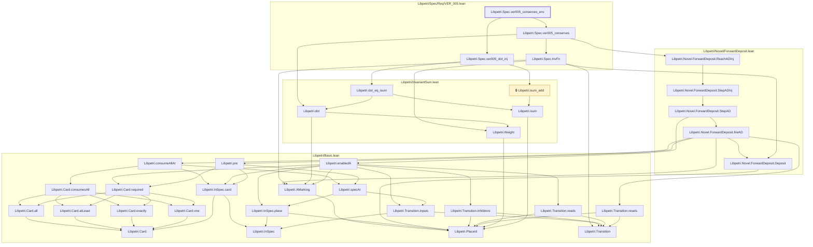

# VER-005

Generated by `scripts/proof-graph.py` from `proof-graph.json`. Do not edit.

Theorems carrying this ID:

- `Libpetri.Novel.Farkas.certificate_sound` (theorem, `Libpetri/Novel/Farkas.lean:324`)
- `Libpetri.Spec.refPInv_sound` (theorem, `Libpetri/Spec/Req/VER_005.lean:223`)
- `Libpetri.Spec.ver005_conserves_env` (theorem, `Libpetri/Spec/Req/VER_005.lean:187`)
- `Libpetri.Spec.ver005_units_complete` (theorem, `Libpetri/Spec/Req/VER_005.lean:253`)
- `Libpetri.consume_all_hypothesis_is_necessary` (theorem, `Libpetri/Strengthening.lean:373`) 🔒 locked
- `Libpetri.invariant_strengthening_sound` (theorem, `Libpetri/Strengthening.lean:66`) 🔒 locked
- `Libpetri.strengthened_reach_eq` (theorem, `Libpetri/Strengthening.lean:130`) 🔒 locked

> **Note:** the full tree has 92 nodes (limit 60), so it is drawn as one diagram per theorem (7 theorems).

### `Libpetri.Novel.Farkas.certificate_sound`

> Rule: this theorem's whole tree, 50 nodes.

```mermaid
flowchart TD
  subgraph g0["Libpetri/Basic.lean"]
    n0["Libpetri.AMarking"]
    n8["Libpetri.Card"]
    n9["Libpetri.Card.all"]
    n10["Libpetri.Card.atLeast"]
    n11["Libpetri.Card.consumesAll"]
    n12["Libpetri.Card.exactly"]
    n13["Libpetri.Card.one"]
    n14["Libpetri.Card.required"]
    n134["Libpetri.InSpec"]
    n135["Libpetri.InSpec.card"]
    n138["Libpetri.InSpec.place"]
    n2720["Libpetri.PlaceId"]
    n13126["Libpetri.Transition"]
    n13127["Libpetri.Transition.inhibitors"]
    n13128["Libpetri.Transition.inputs"]
    n13132["Libpetri.Transition.reads"]
    n13133["Libpetri.Transition.resets"]
    n13203["Libpetri.consumeAllAt"]
    n13255["Libpetri.enabledA"]
    n13277["Libpetri.fireA"]
    n13373["Libpetri.post"]
    n13378["Libpetri.pre"]
    n13433["Libpetri.specAt"]
  end
  subgraph g1["Libpetri/InvariantSum.lean"]
    n13143["Libpetri.Weight"]
    n13242["Libpetri.dot"]
    n13243["Libpetri.dotInc"]
    n13244["Libpetri.dot_eq_isum"]
    n13322["Libpetri.isum"]
    n13323["🔒 Libpetri.isum_add"]
    n13325["🔒 Libpetri.isum_congr"]
    n13327["Libpetri.isum_succ"]
  end
  subgraph g2["Libpetri/Novel/Farkas.lean"]
    n553["Libpetri.Novel.Farkas.certificate_sound"]
    n555["Libpetri.Novel.Farkas.dotInc_eq_lin"]
    n556["Libpetri.Novel.Farkas.dotInc_zero_of_lin"]
    n573["Libpetri.Novel.Farkas.isum_eq_sum"]
    n575["Libpetri.Novel.Farkas.lin"]
  end
  subgraph g3["Libpetri/Soundness.lean"]
    n130["Libpetri.FlatNet"]
    n131["Libpetri.FlatTransition"]
    n2868["Libpetri.ReachA"]
    n2869["Libpetri.ReachA.init"]
    n2870["Libpetri.ReachA.rec'"]
    n2871["Libpetri.ReachA.step"]
    n13107["Libpetri.StepARel"]
    n13437["🔒 Libpetri.specAt_sound"]
  end
  subgraph g4["Libpetri/StateEquation.lean"]
    n13299["Libpetri.incAt"]
  end
  subgraph g5["Libpetri/Strengthening.lean"]
    n13319["🔒 Libpetri.invariant_strengthening_sound"]
  end
  subgraph g6["Libpetri/Strengthening/Hypotheses.lean"]
    n13145["Libpetri.ZeroOnNonlinear"]
    n13245["🔒 Libpetri.dot_fireA"]
    n13286["🔒 Libpetri.fire_term"]
    n13383["🔒 Libpetri.pre_le_of_enabledA"]
  end
  n0 --> n2720
  n9 --> n8
  n10 --> n8
  n11 --> n9
  n11 --> n10
  n11 --> n12
  n11 --> n13
  n12 --> n8
  n13 --> n8
  n14 --> n9
  n14 --> n10
  n14 --> n12
  n14 --> n13
  n130 --> n131
  n131 --> n2720
  n131 --> n13126
  n135 --> n8
  n135 --> n134
  n138 --> n134
  n138 --> n2720
  n553 --> n556
  n553 --> n13319
  n555 --> n573
  n555 --> n575
  n555 --> n13243
  n555 --> n13299
  n556 --> n555
  n573 --> n13327
  n575 --> n13143
  n2868 --> n13107
  n2869 --> n2868
  n2870 --> n2869
  n2870 --> n2871
  n2871 --> n2868
  n13107 --> n130
  n13107 --> n13255
  n13107 --> n13277
  n13127 --> n2720
  n13127 --> n13126
  n13128 --> n134
  n13128 --> n13126
  n13132 --> n2720
  n13132 --> n13126
  n13133 --> n2720
  n13133 --> n13126
  n13143 --> n2720
  n13145 --> n13133
  n13145 --> n13143
  n13145 --> n13203
  n13203 --> n11
  n13203 --> n135
  n13203 --> n13433
  n13242 --> n0
  n13242 --> n13143
  n13243 --> n131
  n13243 --> n13143
  n13243 --> n13322
  n13243 --> n13373
  n13243 --> n13378
  n13244 --> n13242
  n13244 --> n13322
  n13245 --> n13243
  n13245 --> n13244
  n13245 --> n13286
  n13245 --> n13323
  n13245 --> n13325
  n13255 --> n0
  n13255 --> n14
  n13255 --> n135
  n13255 --> n138
  n13255 --> n13127
  n13255 --> n13128
  n13255 --> n13132
  n13277 --> n0
  n13277 --> n13133
  n13277 --> n13203
  n13277 --> n13373
  n13277 --> n13378
  n13286 --> n13145
  n13286 --> n13277
  n13286 --> n13383
  n13299 --> n130
  n13299 --> n13373
  n13299 --> n13378
  n13319 --> n2870
  n13319 --> n13245
  n13322 --> n2720
  n13323 --> n13322
  n13325 --> n13322
  n13327 --> n13322
  n13373 --> n2720
  n13378 --> n14
  n13378 --> n135
  n13378 --> n13433
  n13383 --> n13255
  n13383 --> n13378
  n13383 --> n13437
  n13433 --> n138
  n13433 --> n13128
  n13437 --> n13433
  classDef root stroke-width:3px
  classDef locked fill:#fff3cd,stroke:#b8860b
  classDef collapsed fill:#eeeeee,stroke-dasharray:4 4
  class n553 root
  class n13245,n13286,n13319,n13323,n13325,n13383,n13437 locked
```

### `Libpetri.Spec.refPInv_sound`

> Rule: this theorem's whole tree, 48 nodes.

```mermaid
flowchart TD
  subgraph g0["Libpetri/Basic.lean"]
    n0["Libpetri.AMarking"]
    n8["Libpetri.Card"]
    n9["Libpetri.Card.all"]
    n10["Libpetri.Card.atLeast"]
    n11["Libpetri.Card.consumesAll"]
    n12["Libpetri.Card.exactly"]
    n13["Libpetri.Card.one"]
    n14["Libpetri.Card.required"]
    n134["Libpetri.InSpec"]
    n135["Libpetri.InSpec.card"]
    n138["Libpetri.InSpec.place"]
    n2720["Libpetri.PlaceId"]
    n13126["Libpetri.Transition"]
    n13127["Libpetri.Transition.inhibitors"]
    n13128["Libpetri.Transition.inputs"]
    n13132["Libpetri.Transition.reads"]
    n13133["Libpetri.Transition.resets"]
    n13203["Libpetri.consumeAllAt"]
    n13255["Libpetri.enabledA"]
    n13378["Libpetri.pre"]
    n13433["Libpetri.specAt"]
  end
  subgraph g1["Libpetri/InvariantSum.lean"]
    n13143["Libpetri.Weight"]
    n13242["Libpetri.dot"]
    n13244["Libpetri.dot_eq_isum"]
    n13322["Libpetri.isum"]
    n13323["🔒 Libpetri.isum_add"]
    n13325["🔒 Libpetri.isum_congr"]
  end
  subgraph g2["Libpetri/Novel/ForwardDeposit.lean"]
    n867["Libpetri.Novel.ForwardDeposit.Deposit"]
    n878["Libpetri.Novel.ForwardDeposit.ReachADInj"]
    n880["Libpetri.Novel.ForwardDeposit.StepAD"]
    n881["Libpetri.Novel.ForwardDeposit.StepADInj"]
    n895["Libpetri.Novel.ForwardDeposit.fireAD"]
  end
  subgraph g3["Libpetri/Novel/LinearBound.lean"]
    n1039["Libpetri.Novel.LinearBound.dotIncD"]
  end
  subgraph g4["Libpetri/Novel/RouteA/Simulate.lean"]
    n1455["Libpetri.Novel.RouteA.dot_fireAD_eq"]
  end
  subgraph g5["Libpetri/Soundness.lean"]
    n13437["🔒 Libpetri.specAt_sound"]
  end
  subgraph g6["Libpetri/Spec/Req/VER_005.lean"]
    n6455["Libpetri.Spec.InvFn"]
    n11993["Libpetri.Spec.refPInv"]
    n11994["Libpetri.Spec.refPInv_sound"]
    n12793["Libpetri.Spec.ver005_conserves"]
    n12797["Libpetri.Spec.ver005_dot_inj"]
    n12798["Libpetri.Spec.ver005_dot_inject"]
    n12800["Libpetri.Spec.ver005_gate"]
    n12804["Libpetri.Spec.ver005_gate_spec"]
    n12809["Libpetri.Spec.ver005_nonzero"]
    n12810["Libpetri.Spec.ver005_nonzero_iff"]
    n12813["Libpetri.Spec.ver005_sound"]
  end
  subgraph g7["Libpetri/Strengthening/Hypotheses.lean"]
    n13145["Libpetri.ZeroOnNonlinear"]
    n13383["🔒 Libpetri.pre_le_of_enabledA"]
  end
  n0 --> n2720
  n9 --> n8
  n10 --> n8
  n11 --> n9
  n11 --> n10
  n11 --> n12
  n11 --> n13
  n12 --> n8
  n13 --> n8
  n14 --> n9
  n14 --> n10
  n14 --> n12
  n14 --> n13
  n135 --> n8
  n135 --> n134
  n138 --> n134
  n138 --> n2720
  n867 --> n2720
  n878 --> n881
  n880 --> n895
  n880 --> n13255
  n881 --> n880
  n895 --> n0
  n895 --> n867
  n895 --> n13133
  n895 --> n13203
  n895 --> n13378
  n1039 --> n867
  n1039 --> n13143
  n1039 --> n13322
  n1039 --> n13378
  n1455 --> n895
  n1455 --> n1039
  n1455 --> n13145
  n1455 --> n13244
  n1455 --> n13323
  n1455 --> n13325
  n1455 --> n13383
  n6455 --> n0
  n6455 --> n867
  n6455 --> n13126
  n6455 --> n13143
  n11993 --> n6455
  n11993 --> n12800
  n11993 --> n12809
  n11994 --> n1455
  n11994 --> n11993
  n11994 --> n12798
  n11994 --> n12804
  n11994 --> n12810
  n11994 --> n12813
  n12793 --> n878
  n12793 --> n6455
  n12793 --> n13242
  n12797 --> n13244
  n12797 --> n13323
  n12798 --> n12797
  n12800 --> n1039
  n12800 --> n13133
  n12800 --> n13203
  n12800 --> n13242
  n12804 --> n12800
  n12804 --> n13145
  n12809 --> n13143
  n12810 --> n12809
  n12813 --> n1039
  n12813 --> n12793
  n13127 --> n2720
  n13127 --> n13126
  n13128 --> n134
  n13128 --> n13126
  n13132 --> n2720
  n13132 --> n13126
  n13133 --> n2720
  n13133 --> n13126
  n13143 --> n2720
  n13145 --> n13133
  n13145 --> n13143
  n13145 --> n13203
  n13203 --> n11
  n13203 --> n135
  n13203 --> n13433
  n13242 --> n0
  n13242 --> n13143
  n13244 --> n13242
  n13244 --> n13322
  n13255 --> n0
  n13255 --> n14
  n13255 --> n135
  n13255 --> n138
  n13255 --> n13127
  n13255 --> n13128
  n13255 --> n13132
  n13322 --> n2720
  n13323 --> n13322
  n13325 --> n13322
  n13378 --> n14
  n13378 --> n135
  n13378 --> n13433
  n13383 --> n13255
  n13383 --> n13378
  n13383 --> n13437
  n13433 --> n138
  n13433 --> n13128
  n13437 --> n13433
  classDef root stroke-width:3px
  classDef locked fill:#fff3cd,stroke:#b8860b
  classDef collapsed fill:#eeeeee,stroke-dasharray:4 4
  class n11994 root
  class n13323,n13325,n13383,n13437 locked
```

### `Libpetri.Spec.ver005_conserves_env`

> Rule: this theorem's whole tree, 35 nodes.

### `Libpetri.Spec.ver005_units_complete`

> Rule: this theorem's whole tree, 33 nodes.

```mermaid
flowchart TD
  subgraph g0["Libpetri/Basic.lean"]
    n0["Libpetri.AMarking"]
    n8["Libpetri.Card"]
    n9["Libpetri.Card.all"]
    n10["Libpetri.Card.atLeast"]
    n11["Libpetri.Card.consumesAll"]
    n12["Libpetri.Card.exactly"]
    n13["Libpetri.Card.one"]
    n14["Libpetri.Card.required"]
    n134["Libpetri.InSpec"]
    n135["Libpetri.InSpec.card"]
    n138["Libpetri.InSpec.place"]
    n2720["Libpetri.PlaceId"]
    n13126["Libpetri.Transition"]
    n13128["Libpetri.Transition.inputs"]
    n13133["Libpetri.Transition.resets"]
    n13203["Libpetri.consumeAllAt"]
    n13378["Libpetri.pre"]
    n13433["Libpetri.specAt"]
  end
  subgraph g1["Libpetri/InvariantSum.lean"]
    n13118["Libpetri.SupportBelow"]
    n13143["Libpetri.Weight"]
    n13242["Libpetri.dot"]
    n13322["Libpetri.isum"]
  end
  subgraph g2["Libpetri/Novel/ForwardDeposit.lean"]
    n867["Libpetri.Novel.ForwardDeposit.Deposit"]
  end
  subgraph g3["Libpetri/Novel/LinearBound.lean"]
    n1039["Libpetri.Novel.LinearBound.dotIncD"]
  end
  subgraph g4["Libpetri/Spec/Req/VER_005.lean"]
    n6455["Libpetri.Spec.InvFn"]
    n11993["Libpetri.Spec.refPInv"]
    n12800["Libpetri.Spec.ver005_gate"]
    n12805["Libpetri.Spec.ver005_mem_units"]
    n12809["Libpetri.Spec.ver005_nonzero"]
    n12810["Libpetri.Spec.ver005_nonzero_iff"]
    n12815["Libpetri.Spec.ver005_units"]
    n12816["Libpetri.Spec.ver005_units_complete"]
    n12817["Libpetri.Spec.ver005_vec"]
  end
  n0 --> n2720
  n9 --> n8
  n10 --> n8
  n11 --> n9
  n11 --> n10
  n11 --> n12
  n11 --> n13
  n12 --> n8
  n13 --> n8
  n14 --> n9
  n14 --> n10
  n14 --> n12
  n14 --> n13
  n135 --> n8
  n135 --> n134
  n138 --> n134
  n138 --> n2720
  n867 --> n2720
  n1039 --> n867
  n1039 --> n13143
  n1039 --> n13322
  n1039 --> n13378
  n6455 --> n0
  n6455 --> n867
  n6455 --> n13126
  n6455 --> n13143
  n11993 --> n6455
  n11993 --> n12800
  n11993 --> n12809
  n12800 --> n1039
  n12800 --> n13133
  n12800 --> n13203
  n12800 --> n13242
  n12805 --> n12815
  n12809 --> n13143
  n12810 --> n12809
  n12815 --> n6455
  n12815 --> n12817
  n12815 --> n13242
  n12816 --> n11993
  n12816 --> n12805
  n12816 --> n12810
  n12816 --> n13118
  n12817 --> n13143
  n13118 --> n13143
  n13128 --> n134
  n13128 --> n13126
  n13133 --> n2720
  n13133 --> n13126
  n13143 --> n2720
  n13203 --> n11
  n13203 --> n135
  n13203 --> n13433
  n13242 --> n0
  n13242 --> n13143
  n13322 --> n2720
  n13378 --> n14
  n13378 --> n135
  n13378 --> n13433
  n13433 --> n138
  n13433 --> n13128
  classDef root stroke-width:3px
  classDef locked fill:#fff3cd,stroke:#b8860b
  classDef collapsed fill:#eeeeee,stroke-dasharray:4 4
  class n12816 root
```

### `Libpetri.consume_all_hypothesis_is_necessary`

> Rule: this theorem's whole tree, 50 nodes.

```mermaid
flowchart TD
  subgraph g0["Libpetri/Basic.lean"]
    n0["Libpetri.AMarking"]
    n8["Libpetri.Card"]
    n9["Libpetri.Card.all"]
    n10["Libpetri.Card.atLeast"]
    n11["Libpetri.Card.consumesAll"]
    n12["Libpetri.Card.exactly"]
    n13["Libpetri.Card.one"]
    n14["Libpetri.Card.required"]
    n21["Libpetri.Colour"]
    n132["Libpetri.Guard"]
    n134["Libpetri.InSpec"]
    n135["Libpetri.InSpec.card"]
    n137["Libpetri.InSpec.mk"]
    n138["Libpetri.InSpec.place"]
    n2720["Libpetri.PlaceId"]
    n13126["Libpetri.Transition"]
    n13127["Libpetri.Transition.inhibitors"]
    n13128["Libpetri.Transition.inputs"]
    n13129["Libpetri.Transition.mk"]
    n13132["Libpetri.Transition.reads"]
    n13133["Libpetri.Transition.resets"]
    n13203["Libpetri.consumeAllAt"]
    n13255["Libpetri.enabledA"]
    n13277["Libpetri.fireA"]
    n13373["Libpetri.post"]
    n13378["Libpetri.pre"]
    n13433["Libpetri.specAt"]
  end
  subgraph g1["Libpetri/InvariantSum.lean"]
    n13143["Libpetri.Weight"]
    n13242["Libpetri.dot"]
    n13243["Libpetri.dotInc"]
    n13247["🔒 Libpetri.dot_two"]
    n13322["Libpetri.isum"]
  end
  subgraph g2["Libpetri/Soundness.lean"]
    n130["Libpetri.FlatNet"]
    n131["Libpetri.FlatTransition"]
    n2868["Libpetri.ReachA"]
    n2869["Libpetri.ReachA.init"]
    n2871["Libpetri.ReachA.step"]
    n13107["Libpetri.StepARel"]
  end
  subgraph g3["Libpetri/Strengthening.lean"]
    n2887["Libpetri.ReachAStr"]
    n2888["Libpetri.ReachAStr.init"]
    n2889["Libpetri.ReachAStr.rec'"]
    n2890["Libpetri.ReachAStr.step"]
    n13108["Libpetri.StepAStrRel"]
    n13146["Libpetri.a0All"]
    n13213["🔒 Libpetri.consume_all_hypothesis_is_necessary"]
    n13214["🔒 Libpetri.consume_all_reaches_violation"]
    n13350["Libpetri.netAll"]
    n13442["🔒 Libpetri.strengthened_all_freezes"]
    n13454["Libpetri.tAll"]
    n13494["Libpetri.yUnit"]
  end
  n0 --> n2720
  n9 --> n8
  n10 --> n8
  n11 --> n9
  n11 --> n10
  n11 --> n12
  n11 --> n13
  n12 --> n8
  n13 --> n8
  n14 --> n9
  n14 --> n10
  n14 --> n12
  n14 --> n13
  n130 --> n131
  n131 --> n2720
  n131 --> n13126
  n132 --> n21
  n135 --> n8
  n135 --> n134
  n137 --> n8
  n137 --> n132
  n137 --> n134
  n137 --> n2720
  n138 --> n134
  n138 --> n2720
  n2868 --> n13107
  n2869 --> n2868
  n2871 --> n2868
  n2887 --> n13108
  n2888 --> n2887
  n2889 --> n2888
  n2889 --> n2890
  n2890 --> n2887
  n13107 --> n130
  n13107 --> n13255
  n13107 --> n13277
  n13108 --> n13107
  n13108 --> n13242
  n13127 --> n2720
  n13127 --> n13126
  n13128 --> n134
  n13128 --> n13126
  n13129 --> n134
  n13129 --> n2720
  n13129 --> n13126
  n13132 --> n2720
  n13132 --> n13126
  n13133 --> n2720
  n13133 --> n13126
  n13143 --> n2720
  n13146 --> n0
  n13203 --> n11
  n13203 --> n135
  n13203 --> n13433
  n13213 --> n13214
  n13213 --> n13243
  n13213 --> n13442
  n13214 --> n2869
  n13214 --> n2871
  n13214 --> n13146
  n13214 --> n13350
  n13242 --> n0
  n13242 --> n13143
  n13243 --> n131
  n13243 --> n13143
  n13243 --> n13322
  n13243 --> n13373
  n13243 --> n13378
  n13247 --> n13242
  n13255 --> n0
  n13255 --> n14
  n13255 --> n135
  n13255 --> n138
  n13255 --> n13127
  n13255 --> n13128
  n13255 --> n13132
  n13277 --> n0
  n13277 --> n13133
  n13277 --> n13203
  n13277 --> n13373
  n13277 --> n13378
  n13322 --> n2720
  n13350 --> n130
  n13350 --> n13454
  n13373 --> n2720
  n13378 --> n14
  n13378 --> n135
  n13378 --> n13433
  n13433 --> n138
  n13433 --> n13128
  n13442 --> n2889
  n13442 --> n13146
  n13442 --> n13247
  n13442 --> n13350
  n13442 --> n13494
  n13454 --> n9
  n13454 --> n137
  n13454 --> n13129
  n13494 --> n13143
  classDef root stroke-width:3px
  classDef locked fill:#fff3cd,stroke:#b8860b
  classDef collapsed fill:#eeeeee,stroke-dasharray:4 4
  class n13213 root
  class n13213,n13214,n13247,n13442 locked
```

### `Libpetri.invariant_strengthening_sound`

> Rule: this theorem's whole tree, 43 nodes.

```mermaid
flowchart TD
  subgraph g0["Libpetri/Basic.lean"]
    n0["Libpetri.AMarking"]
    n8["Libpetri.Card"]
    n9["Libpetri.Card.all"]
    n10["Libpetri.Card.atLeast"]
    n11["Libpetri.Card.consumesAll"]
    n12["Libpetri.Card.exactly"]
    n13["Libpetri.Card.one"]
    n14["Libpetri.Card.required"]
    n134["Libpetri.InSpec"]
    n135["Libpetri.InSpec.card"]
    n138["Libpetri.InSpec.place"]
    n2720["Libpetri.PlaceId"]
    n13126["Libpetri.Transition"]
    n13127["Libpetri.Transition.inhibitors"]
    n13128["Libpetri.Transition.inputs"]
    n13132["Libpetri.Transition.reads"]
    n13133["Libpetri.Transition.resets"]
    n13203["Libpetri.consumeAllAt"]
    n13255["Libpetri.enabledA"]
    n13277["Libpetri.fireA"]
    n13373["Libpetri.post"]
    n13378["Libpetri.pre"]
    n13433["Libpetri.specAt"]
  end
  subgraph g1["Libpetri/InvariantSum.lean"]
    n13143["Libpetri.Weight"]
    n13242["Libpetri.dot"]
    n13243["Libpetri.dotInc"]
    n13244["Libpetri.dot_eq_isum"]
    n13322["Libpetri.isum"]
    n13323["🔒 Libpetri.isum_add"]
    n13325["🔒 Libpetri.isum_congr"]
  end
  subgraph g2["Libpetri/Soundness.lean"]
    n130["Libpetri.FlatNet"]
    n131["Libpetri.FlatTransition"]
    n2868["Libpetri.ReachA"]
    n2869["Libpetri.ReachA.init"]
    n2870["Libpetri.ReachA.rec'"]
    n2871["Libpetri.ReachA.step"]
    n13107["Libpetri.StepARel"]
    n13437["🔒 Libpetri.specAt_sound"]
  end
  subgraph g3["Libpetri/Strengthening.lean"]
    n13319["🔒 Libpetri.invariant_strengthening_sound"]
  end
  subgraph g4["Libpetri/Strengthening/Hypotheses.lean"]
    n13145["Libpetri.ZeroOnNonlinear"]
    n13245["🔒 Libpetri.dot_fireA"]
    n13286["🔒 Libpetri.fire_term"]
    n13383["🔒 Libpetri.pre_le_of_enabledA"]
  end
  n0 --> n2720
  n9 --> n8
  n10 --> n8
  n11 --> n9
  n11 --> n10
  n11 --> n12
  n11 --> n13
  n12 --> n8
  n13 --> n8
  n14 --> n9
  n14 --> n10
  n14 --> n12
  n14 --> n13
  n130 --> n131
  n131 --> n2720
  n131 --> n13126
  n135 --> n8
  n135 --> n134
  n138 --> n134
  n138 --> n2720
  n2868 --> n13107
  n2869 --> n2868
  n2870 --> n2869
  n2870 --> n2871
  n2871 --> n2868
  n13107 --> n130
  n13107 --> n13255
  n13107 --> n13277
  n13127 --> n2720
  n13127 --> n13126
  n13128 --> n134
  n13128 --> n13126
  n13132 --> n2720
  n13132 --> n13126
  n13133 --> n2720
  n13133 --> n13126
  n13143 --> n2720
  n13145 --> n13133
  n13145 --> n13143
  n13145 --> n13203
  n13203 --> n11
  n13203 --> n135
  n13203 --> n13433
  n13242 --> n0
  n13242 --> n13143
  n13243 --> n131
  n13243 --> n13143
  n13243 --> n13322
  n13243 --> n13373
  n13243 --> n13378
  n13244 --> n13242
  n13244 --> n13322
  n13245 --> n13243
  n13245 --> n13244
  n13245 --> n13286
  n13245 --> n13323
  n13245 --> n13325
  n13255 --> n0
  n13255 --> n14
  n13255 --> n135
  n13255 --> n138
  n13255 --> n13127
  n13255 --> n13128
  n13255 --> n13132
  n13277 --> n0
  n13277 --> n13133
  n13277 --> n13203
  n13277 --> n13373
  n13277 --> n13378
  n13286 --> n13145
  n13286 --> n13277
  n13286 --> n13383
  n13319 --> n2870
  n13319 --> n13245
  n13322 --> n2720
  n13323 --> n13322
  n13325 --> n13322
  n13373 --> n2720
  n13378 --> n14
  n13378 --> n135
  n13378 --> n13433
  n13383 --> n13255
  n13383 --> n13378
  n13383 --> n13437
  n13433 --> n138
  n13433 --> n13128
  n13437 --> n13433
  classDef root stroke-width:3px
  classDef locked fill:#fff3cd,stroke:#b8860b
  classDef collapsed fill:#eeeeee,stroke-dasharray:4 4
  class n13319 root
  class n13245,n13286,n13319,n13323,n13325,n13383,n13437 locked
```

### `Libpetri.strengthened_reach_eq`

> Rule: this theorem's whole tree, 49 nodes.

```mermaid
flowchart TD
  subgraph g0["Libpetri/Basic.lean"]
    n0["Libpetri.AMarking"]
    n8["Libpetri.Card"]
    n9["Libpetri.Card.all"]
    n10["Libpetri.Card.atLeast"]
    n11["Libpetri.Card.consumesAll"]
    n12["Libpetri.Card.exactly"]
    n13["Libpetri.Card.one"]
    n14["Libpetri.Card.required"]
    n134["Libpetri.InSpec"]
    n135["Libpetri.InSpec.card"]
    n138["Libpetri.InSpec.place"]
    n2720["Libpetri.PlaceId"]
    n13126["Libpetri.Transition"]
    n13127["Libpetri.Transition.inhibitors"]
    n13128["Libpetri.Transition.inputs"]
    n13132["Libpetri.Transition.reads"]
    n13133["Libpetri.Transition.resets"]
    n13203["Libpetri.consumeAllAt"]
    n13255["Libpetri.enabledA"]
    n13277["Libpetri.fireA"]
    n13373["Libpetri.post"]
    n13378["Libpetri.pre"]
    n13433["Libpetri.specAt"]
  end
  subgraph g1["Libpetri/InvariantSum.lean"]
    n13143["Libpetri.Weight"]
    n13242["Libpetri.dot"]
    n13243["Libpetri.dotInc"]
    n13244["Libpetri.dot_eq_isum"]
    n13322["Libpetri.isum"]
    n13323["🔒 Libpetri.isum_add"]
    n13325["🔒 Libpetri.isum_congr"]
  end
  subgraph g2["Libpetri/Soundness.lean"]
    n130["Libpetri.FlatNet"]
    n131["Libpetri.FlatTransition"]
    n2868["Libpetri.ReachA"]
    n2869["Libpetri.ReachA.init"]
    n2870["Libpetri.ReachA.rec'"]
    n2871["Libpetri.ReachA.step"]
    n13107["Libpetri.StepARel"]
    n13437["🔒 Libpetri.specAt_sound"]
  end
  subgraph g3["Libpetri/Strengthening.lean"]
    n2887["Libpetri.ReachAStr"]
    n2888["Libpetri.ReachAStr.init"]
    n2889["Libpetri.ReachAStr.rec'"]
    n2890["Libpetri.ReachAStr.step"]
    n13108["Libpetri.StepAStrRel"]
    n13319["🔒 Libpetri.invariant_strengthening_sound"]
    n13444["🔒 Libpetri.strengthened_reach_eq"]
  end
  subgraph g4["Libpetri/Strengthening/Hypotheses.lean"]
    n13145["Libpetri.ZeroOnNonlinear"]
    n13245["🔒 Libpetri.dot_fireA"]
    n13286["🔒 Libpetri.fire_term"]
    n13383["🔒 Libpetri.pre_le_of_enabledA"]
  end
  n0 --> n2720
  n9 --> n8
  n10 --> n8
  n11 --> n9
  n11 --> n10
  n11 --> n12
  n11 --> n13
  n12 --> n8
  n13 --> n8
  n14 --> n9
  n14 --> n10
  n14 --> n12
  n14 --> n13
  n130 --> n131
  n131 --> n2720
  n131 --> n13126
  n135 --> n8
  n135 --> n134
  n138 --> n134
  n138 --> n2720
  n2868 --> n13107
  n2869 --> n2868
  n2870 --> n2869
  n2870 --> n2871
  n2871 --> n2868
  n2887 --> n13108
  n2888 --> n2887
  n2889 --> n2888
  n2889 --> n2890
  n2890 --> n2887
  n13107 --> n130
  n13107 --> n13255
  n13107 --> n13277
  n13108 --> n13107
  n13108 --> n13242
  n13127 --> n2720
  n13127 --> n13126
  n13128 --> n134
  n13128 --> n13126
  n13132 --> n2720
  n13132 --> n13126
  n13133 --> n2720
  n13133 --> n13126
  n13143 --> n2720
  n13145 --> n13133
  n13145 --> n13143
  n13145 --> n13203
  n13203 --> n11
  n13203 --> n135
  n13203 --> n13433
  n13242 --> n0
  n13242 --> n13143
  n13243 --> n131
  n13243 --> n13143
  n13243 --> n13322
  n13243 --> n13373
  n13243 --> n13378
  n13244 --> n13242
  n13244 --> n13322
  n13245 --> n13243
  n13245 --> n13244
  n13245 --> n13286
  n13245 --> n13323
  n13245 --> n13325
  n13255 --> n0
  n13255 --> n14
  n13255 --> n135
  n13255 --> n138
  n13255 --> n13127
  n13255 --> n13128
  n13255 --> n13132
  n13277 --> n0
  n13277 --> n13133
  n13277 --> n13203
  n13277 --> n13373
  n13277 --> n13378
  n13286 --> n13145
  n13286 --> n13277
  n13286 --> n13383
  n13319 --> n2870
  n13319 --> n13245
  n13322 --> n2720
  n13323 --> n13322
  n13325 --> n13322
  n13373 --> n2720
  n13378 --> n14
  n13378 --> n135
  n13378 --> n13433
  n13383 --> n13255
  n13383 --> n13378
  n13383 --> n13437
  n13433 --> n138
  n13433 --> n13128
  n13437 --> n13433
  n13444 --> n2889
  n13444 --> n13319
  classDef root stroke-width:3px
  classDef locked fill:#fff3cd,stroke:#b8860b
  classDef collapsed fill:#eeeeee,stroke-dasharray:4 4
  class n13444 root
  class n13245,n13286,n13319,n13323,n13325,n13383,n13437,n13444 locked
```

Axioms used:

- `Libpetri.Novel.Farkas.certificate_sound`: `Classical.choice`, `Quot.sound`, `propext`
- `Libpetri.Spec.refPInv_sound`: `Classical.choice`, `Quot.sound`, `propext`
- `Libpetri.Spec.ver005_conserves_env`: `Classical.choice`, `Quot.sound`, `propext`
- `Libpetri.Spec.ver005_units_complete`: `Classical.choice`, `Quot.sound`, `propext`
- `Libpetri.consume_all_hypothesis_is_necessary`: `Classical.choice`, `Quot.sound`, `propext`
- `Libpetri.invariant_strengthening_sound`: `Classical.choice`, `Quot.sound`, `propext`
- `Libpetri.strengthened_reach_eq`: `Classical.choice`, `Quot.sound`, `propext`
