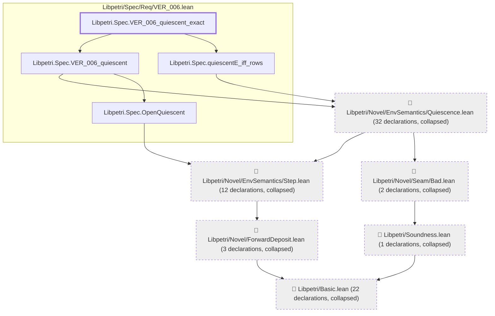

# VER-006

Generated by `scripts/proof-graph.py` from `proof-graph.json`. Do not edit.

Theorems carrying this ID:

- `Libpetri.Spec.VER_006_ac2` (theorem, `Libpetri/Spec/Req/VER_006.lean:128`)
- `Libpetri.Spec.VER_006_frozen_in_injected` (theorem, `Libpetri/Spec/Req/VER_006.lean:1302`)
- `Libpetri.Spec.VER_006_quiescent_exact` (theorem, `Libpetri/Spec/Req/VER_006.lean:468`)
- `Libpetri.Spec.VER_006_quiescent_stuck` (theorem, `Libpetri/Spec/Req/VER_006.lean:445`)
- `Libpetri.false_proven_without_injection` (theorem, `Libpetri/Retrodict.lean:51`) 🔒 locked
- `Libpetri.injection_hypothesis_is_necessary` (theorem, `Libpetri/Strengthening.lean:313`) 🔒 locked
- `Libpetri.injection_reaches_violation` (theorem, `Libpetri/Retrodict.lean:111`) 🔒 locked
- `Libpetri.invariant_strengthening_sound_inj` (theorem, `Libpetri/Strengthening.lean:158`) 🔒 locked
- `Libpetri.strengthened_reach_eq_inj` (theorem, `Libpetri/Strengthening.lean:246`) 🔒 locked

> **Note:** the full tree has 136 nodes (limit 60), so it is drawn as one diagram per theorem (9 theorems).

### `Libpetri.Spec.VER_006_ac2`

> Rule: this theorem's whole tree, 49 nodes.

```mermaid
flowchart TD
  subgraph g0["Libpetri/Basic.lean"]
    n0["Libpetri.AMarking"]
    n8["Libpetri.Card"]
    n9["Libpetri.Card.all"]
    n10["Libpetri.Card.atLeast"]
    n11["Libpetri.Card.consumesAll"]
    n12["Libpetri.Card.exactly"]
    n13["Libpetri.Card.one"]
    n14["Libpetri.Card.required"]
    n21["Libpetri.Colour"]
    n132["Libpetri.Guard"]
    n134["Libpetri.InSpec"]
    n135["Libpetri.InSpec.card"]
    n137["Libpetri.InSpec.mk"]
    n138["Libpetri.InSpec.place"]
    n2723["Libpetri.PlaceId"]
    n21910["Libpetri.Transition"]
    n21911["Libpetri.Transition.inhibitors"]
    n21912["Libpetri.Transition.inputs"]
    n21913["Libpetri.Transition.mk"]
    n21916["Libpetri.Transition.reads"]
    n21917["Libpetri.Transition.resets"]
    n21987["Libpetri.consumeAllAt"]
    n22039["Libpetri.enabledA"]
    n22162["Libpetri.pre"]
    n22217["Libpetri.specAt"]
  end
  subgraph g1["Libpetri/Novel/EnvSemantics/Step.lean"]
    n321["Libpetri.Novel.EnvSemantics.InjMode"]
    n322["Libpetri.Novel.EnvSemantics.InjMode.admits"]
    n323["Libpetri.Novel.EnvSemantics.InjMode.always"]
    n324["Libpetri.Novel.EnvSemantics.InjMode.bounded"]
    n325["Libpetri.Novel.EnvSemantics.InjMode.capped"]
    n337["Libpetri.Novel.EnvSemantics.ReachAE"]
    n341["Libpetri.Novel.EnvSemantics.Rows"]
    n344["Libpetri.Novel.EnvSemantics.StepAE"]
    n432["Libpetri.Novel.EnvSemantics.injA"]
  end
  subgraph g2["Libpetri/Novel/ForwardDeposit.lean"]
    n867["Libpetri.Novel.ForwardDeposit.Deposit"]
    n880["Libpetri.Novel.ForwardDeposit.StepAD"]
    n895["Libpetri.Novel.ForwardDeposit.fireAD"]
  end
  subgraph g3["Libpetri/Retrodict.lean"]
    n22043["Libpetri.envPlace"]
    n22122["Libpetri.m0A"]
    n22135["Libpetri.netEnv"]
    n22142["Libpetri.outPlace"]
    n22239["Libpetri.tConsume"]
  end
  subgraph g4["Libpetri/Soundness.lean"]
    n130["Libpetri.FlatNet"]
    n131["Libpetri.FlatTransition"]
  end
  subgraph g5["Libpetri/Spec/Req/VER_006.lean"]
    n9518["Libpetri.Spec.OpenReach"]
    n10413["Libpetri.Spec.VER_006_ac2"]
    n19849["Libpetri.Spec.refOpenReach"]
    n21131["Libpetri.Spec.ver006Out"]
    n21153["Libpetri.Spec.ver006_out_succ"]
  end
  n0 --> n2723
  n9 --> n8
  n10 --> n8
  n11 --> n9
  n11 --> n10
  n11 --> n12
  n11 --> n13
  n12 --> n8
  n13 --> n8
  n14 --> n9
  n14 --> n10
  n14 --> n12
  n14 --> n13
  n130 --> n131
  n131 --> n2723
  n131 --> n21910
  n132 --> n21
  n135 --> n8
  n135 --> n134
  n137 --> n8
  n137 --> n132
  n137 --> n134
  n137 --> n2723
  n138 --> n134
  n138 --> n2723
  n322 --> n323
  n322 --> n324
  n323 --> n321
  n324 --> n321
  n325 --> n0
  n325 --> n323
  n325 --> n324
  n337 --> n344
  n341 --> n867
  n341 --> n21910
  n344 --> n322
  n344 --> n325
  n344 --> n341
  n344 --> n432
  n344 --> n880
  n432 --> n0
  n867 --> n2723
  n880 --> n895
  n880 --> n22039
  n895 --> n0
  n895 --> n867
  n895 --> n21917
  n895 --> n21987
  n895 --> n22162
  n9518 --> n0
  n9518 --> n321
  n9518 --> n341
  n10413 --> n19849
  n10413 --> n21153
  n10413 --> n22122
  n19849 --> n337
  n19849 --> n9518
  n21131 --> n0
  n21131 --> n22142
  n21153 --> n337
  n21153 --> n21131
  n21153 --> n22135
  n21911 --> n2723
  n21911 --> n21910
  n21912 --> n134
  n21912 --> n21910
  n21913 --> n134
  n21913 --> n2723
  n21913 --> n21910
  n21916 --> n2723
  n21916 --> n21910
  n21917 --> n2723
  n21917 --> n21910
  n21987 --> n11
  n21987 --> n135
  n21987 --> n22217
  n22039 --> n0
  n22039 --> n14
  n22039 --> n135
  n22039 --> n138
  n22039 --> n21911
  n22039 --> n21912
  n22039 --> n21916
  n22043 --> n2723
  n22122 --> n0
  n22135 --> n130
  n22135 --> n22142
  n22135 --> n22239
  n22142 --> n2723
  n22162 --> n14
  n22162 --> n135
  n22162 --> n22217
  n22217 --> n138
  n22217 --> n21912
  n22239 --> n13
  n22239 --> n137
  n22239 --> n21913
  n22239 --> n22043
  classDef root stroke-width:3px
  classDef locked fill:#fff3cd,stroke:#b8860b
  classDef collapsed fill:#eeeeee,stroke-dasharray:4 4
  class n10413 root
```

### `Libpetri.Spec.VER_006_frozen_in_injected`

> Rule: this theorem's whole tree, 35 nodes.

```mermaid
flowchart TD
  subgraph g0["Libpetri/Basic.lean"]
    n0["Libpetri.AMarking"]
    n8["Libpetri.Card"]
    n9["Libpetri.Card.all"]
    n10["Libpetri.Card.atLeast"]
    n11["Libpetri.Card.consumesAll"]
    n12["Libpetri.Card.exactly"]
    n13["Libpetri.Card.one"]
    n14["Libpetri.Card.required"]
    n134["Libpetri.InSpec"]
    n135["Libpetri.InSpec.card"]
    n138["Libpetri.InSpec.place"]
    n2723["Libpetri.PlaceId"]
    n21910["Libpetri.Transition"]
    n21911["Libpetri.Transition.inhibitors"]
    n21912["Libpetri.Transition.inputs"]
    n21916["Libpetri.Transition.reads"]
    n21917["Libpetri.Transition.resets"]
    n21987["Libpetri.consumeAllAt"]
    n22039["Libpetri.enabledA"]
    n22162["Libpetri.pre"]
    n22217["Libpetri.specAt"]
  end
  subgraph g1["Libpetri/Novel/EnvSemantics/Step.lean"]
    n321["Libpetri.Novel.EnvSemantics.InjMode"]
    n322["Libpetri.Novel.EnvSemantics.InjMode.admits"]
    n323["Libpetri.Novel.EnvSemantics.InjMode.always"]
    n324["Libpetri.Novel.EnvSemantics.InjMode.bounded"]
    n325["Libpetri.Novel.EnvSemantics.InjMode.capped"]
    n337["Libpetri.Novel.EnvSemantics.ReachAE"]
    n341["Libpetri.Novel.EnvSemantics.Rows"]
    n344["Libpetri.Novel.EnvSemantics.StepAE"]
    n432["Libpetri.Novel.EnvSemantics.injA"]
  end
  subgraph g2["Libpetri/Novel/ForwardDeposit.lean"]
    n867["Libpetri.Novel.ForwardDeposit.Deposit"]
    n877["Libpetri.Novel.ForwardDeposit.ReachAD"]
    n880["Libpetri.Novel.ForwardDeposit.StepAD"]
    n895["Libpetri.Novel.ForwardDeposit.fireAD"]
  end
  subgraph g3["Libpetri/Spec/Req/VER_006.lean"]
    n10424["Libpetri.Spec.VER_006_frozen_in_injected"]
  end
  n0 --> n2723
  n9 --> n8
  n10 --> n8
  n11 --> n9
  n11 --> n10
  n11 --> n12
  n11 --> n13
  n12 --> n8
  n13 --> n8
  n14 --> n9
  n14 --> n10
  n14 --> n12
  n14 --> n13
  n135 --> n8
  n135 --> n134
  n138 --> n134
  n138 --> n2723
  n322 --> n323
  n322 --> n324
  n323 --> n321
  n324 --> n321
  n325 --> n0
  n325 --> n323
  n325 --> n324
  n337 --> n344
  n341 --> n867
  n341 --> n21910
  n344 --> n322
  n344 --> n325
  n344 --> n341
  n344 --> n432
  n344 --> n880
  n432 --> n0
  n867 --> n2723
  n877 --> n880
  n880 --> n895
  n880 --> n22039
  n895 --> n0
  n895 --> n867
  n895 --> n21917
  n895 --> n21987
  n895 --> n22162
  n10424 --> n337
  n10424 --> n877
  n21911 --> n2723
  n21911 --> n21910
  n21912 --> n134
  n21912 --> n21910
  n21916 --> n2723
  n21916 --> n21910
  n21917 --> n2723
  n21917 --> n21910
  n21987 --> n11
  n21987 --> n135
  n21987 --> n22217
  n22039 --> n0
  n22039 --> n14
  n22039 --> n135
  n22039 --> n138
  n22039 --> n21911
  n22039 --> n21912
  n22039 --> n21916
  n22162 --> n14
  n22162 --> n135
  n22162 --> n22217
  n22217 --> n138
  n22217 --> n21912
  classDef root stroke-width:3px
  classDef locked fill:#fff3cd,stroke:#b8860b
  classDef collapsed fill:#eeeeee,stroke-dasharray:4 4
  class n10424 root
```

### `Libpetri.Spec.VER_006_quiescent_exact`

> Rule: this theorem's tree has 76 nodes (limit 60); every file other than its own is collapsed into one node, leaving 10.

### `Libpetri.Spec.VER_006_quiescent_stuck`

> Rule: this theorem's whole tree, 56 nodes.

```mermaid
flowchart TD
  subgraph g0["Libpetri/Basic.lean"]
    n0["Libpetri.AMarking"]
    n8["Libpetri.Card"]
    n9["Libpetri.Card.all"]
    n10["Libpetri.Card.atLeast"]
    n11["Libpetri.Card.consumesAll"]
    n12["Libpetri.Card.exactly"]
    n13["Libpetri.Card.one"]
    n14["Libpetri.Card.required"]
    n134["Libpetri.InSpec"]
    n135["Libpetri.InSpec.card"]
    n138["Libpetri.InSpec.place"]
    n2723["Libpetri.PlaceId"]
    n21910["Libpetri.Transition"]
    n21911["Libpetri.Transition.inhibitors"]
    n21912["Libpetri.Transition.inputs"]
    n21916["Libpetri.Transition.reads"]
    n21917["Libpetri.Transition.resets"]
    n21987["Libpetri.consumeAllAt"]
    n22039["Libpetri.enabledA"]
    n22162["Libpetri.pre"]
    n22217["Libpetri.specAt"]
  end
  subgraph g1["Libpetri/Novel/EnvSemantics/Quiescence.lean"]
    n315["Libpetri.Novel.EnvSemantics.Dead"]
    n326["Libpetri.Novel.EnvSemantics.InjMode.unsupplied"]
    n327["Libpetri.Novel.EnvSemantics.InjReach"]
    n330["Libpetri.Novel.EnvSemantics.InjStep"]
    n336["Libpetri.Novel.EnvSemantics.OpenStuck"]
    n393["Libpetri.Novel.EnvSemantics.dead_of_quiescentE"]
    n399["Libpetri.Novel.EnvSemantics.disableReasonsE"]
    n409["Libpetri.Novel.EnvSemantics.encodeQuiescentE"]
    n467["Libpetri.Novel.EnvSemantics.permDisabled"]
    n480["Libpetri.Novel.EnvSemantics.quiescentE"]
    n481["Libpetri.Novel.EnvSemantics.quiescentE_iff"]
    n482["Libpetri.Novel.EnvSemantics.quiescentE_injA"]
    n484["Libpetri.Novel.EnvSemantics.quiescentE_openStuck"]
    n496["Libpetri.Novel.EnvSemantics.relaxed_violation_real"]
  end
  subgraph g2["Libpetri/Novel/EnvSemantics/Step.lean"]
    n321["Libpetri.Novel.EnvSemantics.InjMode"]
    n322["Libpetri.Novel.EnvSemantics.InjMode.admits"]
    n323["Libpetri.Novel.EnvSemantics.InjMode.always"]
    n324["Libpetri.Novel.EnvSemantics.InjMode.bounded"]
    n325["Libpetri.Novel.EnvSemantics.InjMode.capped"]
    n337["Libpetri.Novel.EnvSemantics.ReachAE"]
    n341["Libpetri.Novel.EnvSemantics.Rows"]
    n344["Libpetri.Novel.EnvSemantics.StepAE"]
    n380["Libpetri.Novel.EnvSemantics.capped_bounded_iff"]
    n381["Libpetri.Novel.EnvSemantics.capped_injA"]
    n432["Libpetri.Novel.EnvSemantics.injA"]
    n489["Libpetri.Novel.EnvSemantics.reachAE_capped"]
  end
  subgraph g3["Libpetri/Novel/ForwardDeposit.lean"]
    n867["Libpetri.Novel.ForwardDeposit.Deposit"]
    n880["Libpetri.Novel.ForwardDeposit.StepAD"]
    n895["Libpetri.Novel.ForwardDeposit.fireAD"]
  end
  subgraph g4["Libpetri/Novel/Seam/Bad.lean"]
    n2108["Libpetri.Novel.Seam.pre_pos_spec"]
  end
  subgraph g5["Libpetri/Soundness.lean"]
    n22221["🔒 Libpetri.specAt_sound"]
  end
  subgraph g6["Libpetri/Spec/Req/VER_006.lean"]
    n9517["Libpetri.Spec.OpenQuiescent"]
    n10431["Libpetri.Spec.VER_006_quiescent"]
    n10438["Libpetri.Spec.VER_006_quiescent_stuck"]
    n19506["Libpetri.Spec.quiescentE_iff_rows"]
  end
  n0 --> n2723
  n9 --> n8
  n10 --> n8
  n11 --> n9
  n11 --> n10
  n11 --> n12
  n11 --> n13
  n12 --> n8
  n13 --> n8
  n14 --> n9
  n14 --> n10
  n14 --> n12
  n14 --> n13
  n135 --> n8
  n135 --> n134
  n138 --> n134
  n138 --> n2723
  n315 --> n341
  n315 --> n22039
  n322 --> n323
  n322 --> n324
  n323 --> n321
  n324 --> n321
  n325 --> n0
  n325 --> n323
  n325 --> n324
  n326 --> n323
  n326 --> n324
  n327 --> n330
  n330 --> n322
  n330 --> n432
  n336 --> n315
  n336 --> n327
  n337 --> n344
  n341 --> n867
  n341 --> n21910
  n344 --> n322
  n344 --> n325
  n344 --> n341
  n344 --> n432
  n344 --> n880
  n380 --> n325
  n381 --> n322
  n381 --> n380
  n381 --> n432
  n393 --> n315
  n393 --> n380
  n393 --> n481
  n393 --> n2108
  n399 --> n0
  n399 --> n21911
  n399 --> n21916
  n399 --> n22162
  n409 --> n341
  n409 --> n399
  n409 --> n467
  n432 --> n0
  n467 --> n326
  n467 --> n21916
  n467 --> n22162
  n480 --> n409
  n481 --> n480
  n482 --> n432
  n482 --> n481
  n484 --> n336
  n484 --> n381
  n484 --> n393
  n484 --> n482
  n489 --> n337
  n489 --> n381
  n496 --> n484
  n496 --> n489
  n867 --> n2723
  n880 --> n895
  n880 --> n22039
  n895 --> n0
  n895 --> n867
  n895 --> n21917
  n895 --> n21987
  n895 --> n22162
  n2108 --> n22162
  n2108 --> n22221
  n9517 --> n0
  n9517 --> n321
  n9517 --> n341
  n10431 --> n399
  n10431 --> n467
  n10431 --> n9517
  n10438 --> n496
  n10438 --> n10431
  n10438 --> n19506
  n19506 --> n481
  n21911 --> n2723
  n21911 --> n21910
  n21912 --> n134
  n21912 --> n21910
  n21916 --> n2723
  n21916 --> n21910
  n21917 --> n2723
  n21917 --> n21910
  n21987 --> n11
  n21987 --> n135
  n21987 --> n22217
  n22039 --> n0
  n22039 --> n14
  n22039 --> n135
  n22039 --> n138
  n22039 --> n21911
  n22039 --> n21912
  n22039 --> n21916
  n22162 --> n14
  n22162 --> n135
  n22162 --> n22217
  n22217 --> n138
  n22217 --> n21912
  n22221 --> n22217
  classDef root stroke-width:3px
  classDef locked fill:#fff3cd,stroke:#b8860b
  classDef collapsed fill:#eeeeee,stroke-dasharray:4 4
  class n10438 root
  class n22221 locked
```

### `Libpetri.false_proven_without_injection`

> Rule: this theorem's whole tree, 41 nodes.

```mermaid
flowchart TD
  subgraph g0["Libpetri/Basic.lean"]
    n0["Libpetri.AMarking"]
    n8["Libpetri.Card"]
    n9["Libpetri.Card.all"]
    n10["Libpetri.Card.atLeast"]
    n11["Libpetri.Card.consumesAll"]
    n12["Libpetri.Card.exactly"]
    n13["Libpetri.Card.one"]
    n14["Libpetri.Card.required"]
    n21["Libpetri.Colour"]
    n132["Libpetri.Guard"]
    n134["Libpetri.InSpec"]
    n135["Libpetri.InSpec.card"]
    n137["Libpetri.InSpec.mk"]
    n138["Libpetri.InSpec.place"]
    n2720["Libpetri.PlaceId"]
    n13126["Libpetri.Transition"]
    n13127["Libpetri.Transition.inhibitors"]
    n13128["Libpetri.Transition.inputs"]
    n13129["Libpetri.Transition.mk"]
    n13132["Libpetri.Transition.reads"]
    n13133["Libpetri.Transition.resets"]
    n13203["Libpetri.consumeAllAt"]
    n13255["Libpetri.enabledA"]
    n13277["Libpetri.fireA"]
    n13373["Libpetri.post"]
    n13378["Libpetri.pre"]
    n13433["Libpetri.specAt"]
  end
  subgraph g1["Libpetri/Retrodict.lean"]
    n13259["Libpetri.envPlace"]
    n13260["🔒 Libpetri.envless_reach_is_trivial"]
    n13274["🔒 Libpetri.false_proven_without_injection"]
    n13338["Libpetri.m0A"]
    n13351["Libpetri.netEnv"]
    n13358["Libpetri.outPlace"]
    n13455["Libpetri.tConsume"]
  end
  subgraph g2["Libpetri/Soundness.lean"]
    n130["Libpetri.FlatNet"]
    n131["Libpetri.FlatTransition"]
    n2868["Libpetri.ReachA"]
    n2869["Libpetri.ReachA.init"]
    n2870["Libpetri.ReachA.rec'"]
    n2871["Libpetri.ReachA.step"]
    n13107["Libpetri.StepARel"]
  end
  n0 --> n2720
  n9 --> n8
  n10 --> n8
  n11 --> n9
  n11 --> n10
  n11 --> n12
  n11 --> n13
  n12 --> n8
  n13 --> n8
  n14 --> n9
  n14 --> n10
  n14 --> n12
  n14 --> n13
  n130 --> n131
  n131 --> n2720
  n131 --> n13126
  n132 --> n21
  n135 --> n8
  n135 --> n134
  n137 --> n8
  n137 --> n132
  n137 --> n134
  n137 --> n2720
  n138 --> n134
  n138 --> n2720
  n2868 --> n13107
  n2869 --> n2868
  n2870 --> n2869
  n2870 --> n2871
  n2871 --> n2868
  n13107 --> n130
  n13107 --> n13255
  n13107 --> n13277
  n13127 --> n2720
  n13127 --> n13126
  n13128 --> n134
  n13128 --> n13126
  n13129 --> n134
  n13129 --> n2720
  n13129 --> n13126
  n13132 --> n2720
  n13132 --> n13126
  n13133 --> n2720
  n13133 --> n13126
  n13203 --> n11
  n13203 --> n135
  n13203 --> n13433
  n13255 --> n0
  n13255 --> n14
  n13255 --> n135
  n13255 --> n138
  n13255 --> n13127
  n13255 --> n13128
  n13255 --> n13132
  n13259 --> n2720
  n13260 --> n2870
  n13260 --> n13338
  n13260 --> n13351
  n13274 --> n13260
  n13277 --> n0
  n13277 --> n13133
  n13277 --> n13203
  n13277 --> n13373
  n13277 --> n13378
  n13338 --> n0
  n13351 --> n130
  n13351 --> n13358
  n13351 --> n13455
  n13358 --> n2720
  n13373 --> n2720
  n13378 --> n14
  n13378 --> n135
  n13378 --> n13433
  n13433 --> n138
  n13433 --> n13128
  n13455 --> n13
  n13455 --> n137
  n13455 --> n13129
  n13455 --> n13259
  classDef root stroke-width:3px
  classDef locked fill:#fff3cd,stroke:#b8860b
  classDef collapsed fill:#eeeeee,stroke-dasharray:4 4
  class n13274 root
  class n13260,n13274 locked
```

### `Libpetri.injection_hypothesis_is_necessary`

> Rule: this theorem's whole tree, 57 nodes.

```mermaid
flowchart TD
  subgraph g0["Libpetri/Basic.lean"]
    n0["Libpetri.AMarking"]
    n8["Libpetri.Card"]
    n9["Libpetri.Card.all"]
    n10["Libpetri.Card.atLeast"]
    n11["Libpetri.Card.consumesAll"]
    n12["Libpetri.Card.exactly"]
    n13["Libpetri.Card.one"]
    n14["Libpetri.Card.required"]
    n21["Libpetri.Colour"]
    n132["Libpetri.Guard"]
    n134["Libpetri.InSpec"]
    n135["Libpetri.InSpec.card"]
    n137["Libpetri.InSpec.mk"]
    n138["Libpetri.InSpec.place"]
    n2720["Libpetri.PlaceId"]
    n13126["Libpetri.Transition"]
    n13127["Libpetri.Transition.inhibitors"]
    n13128["Libpetri.Transition.inputs"]
    n13129["Libpetri.Transition.mk"]
    n13132["Libpetri.Transition.reads"]
    n13133["Libpetri.Transition.resets"]
    n13203["Libpetri.consumeAllAt"]
    n13255["Libpetri.enabledA"]
    n13277["Libpetri.fireA"]
    n13373["Libpetri.post"]
    n13378["Libpetri.pre"]
    n13433["Libpetri.specAt"]
  end
  subgraph g1["Libpetri/InvariantSum.lean"]
    n13143["Libpetri.Weight"]
    n13242["Libpetri.dot"]
    n13243["Libpetri.dotInc"]
    n13247["🔒 Libpetri.dot_two"]
    n13322["Libpetri.isum"]
  end
  subgraph g2["Libpetri/Retrodict.lean"]
    n2872["Libpetri.ReachAInj"]
    n2873["Libpetri.ReachAInj.init"]
    n2874["Libpetri.ReachAInj.inject"]
    n2876["Libpetri.ReachAInj.step"]
    n13104["Libpetri.StepAInjRel"]
    n13147["Libpetri.aInjected"]
    n13259["Libpetri.envPlace"]
    n13301["🔒 Libpetri.injection_reaches_violation"]
    n13338["Libpetri.m0A"]
    n13351["Libpetri.netEnv"]
    n13358["Libpetri.outPlace"]
    n13455["Libpetri.tConsume"]
  end
  subgraph g3["Libpetri/Soundness.lean"]
    n130["Libpetri.FlatNet"]
    n131["Libpetri.FlatTransition"]
    n13107["Libpetri.StepARel"]
  end
  subgraph g4["Libpetri/Strengthening.lean"]
    n2877["Libpetri.ReachAInjStr"]
    n2878["Libpetri.ReachAInjStr.init"]
    n2879["Libpetri.ReachAInjStr.inject"]
    n2880["Libpetri.ReachAInjStr.rec'"]
    n2881["Libpetri.ReachAInjStr.step"]
    n13105["Libpetri.StepAInjStrRel"]
    n13108["Libpetri.StepAStrRel"]
    n13300["🔒 Libpetri.injection_hypothesis_is_necessary"]
    n13443["🔒 Libpetri.strengthened_inj_freezes"]
    n13494["Libpetri.yUnit"]
  end
  n0 --> n2720
  n9 --> n8
  n10 --> n8
  n11 --> n9
  n11 --> n10
  n11 --> n12
  n11 --> n13
  n12 --> n8
  n13 --> n8
  n14 --> n9
  n14 --> n10
  n14 --> n12
  n14 --> n13
  n130 --> n131
  n131 --> n2720
  n131 --> n13126
  n132 --> n21
  n135 --> n8
  n135 --> n134
  n137 --> n8
  n137 --> n132
  n137 --> n134
  n137 --> n2720
  n138 --> n134
  n138 --> n2720
  n2872 --> n13104
  n2873 --> n2872
  n2874 --> n2872
  n2876 --> n2872
  n2877 --> n13105
  n2878 --> n2877
  n2879 --> n2877
  n2880 --> n2878
  n2880 --> n2879
  n2880 --> n2881
  n2881 --> n2877
  n13104 --> n13107
  n13105 --> n13108
  n13107 --> n130
  n13107 --> n13255
  n13107 --> n13277
  n13108 --> n13107
  n13108 --> n13242
  n13127 --> n2720
  n13127 --> n13126
  n13128 --> n134
  n13128 --> n13126
  n13129 --> n134
  n13129 --> n2720
  n13129 --> n13126
  n13132 --> n2720
  n13132 --> n13126
  n13133 --> n2720
  n13133 --> n13126
  n13143 --> n2720
  n13147 --> n13259
  n13147 --> n13338
  n13203 --> n11
  n13203 --> n135
  n13203 --> n13433
  n13242 --> n0
  n13242 --> n13143
  n13243 --> n131
  n13243 --> n13143
  n13243 --> n13322
  n13243 --> n13373
  n13243 --> n13378
  n13247 --> n13242
  n13255 --> n0
  n13255 --> n14
  n13255 --> n135
  n13255 --> n138
  n13255 --> n13127
  n13255 --> n13128
  n13255 --> n13132
  n13259 --> n2720
  n13277 --> n0
  n13277 --> n13133
  n13277 --> n13203
  n13277 --> n13373
  n13277 --> n13378
  n13300 --> n13243
  n13300 --> n13301
  n13300 --> n13443
  n13301 --> n2873
  n13301 --> n2874
  n13301 --> n2876
  n13301 --> n13147
  n13301 --> n13351
  n13322 --> n2720
  n13338 --> n0
  n13351 --> n130
  n13351 --> n13358
  n13351 --> n13455
  n13358 --> n2720
  n13373 --> n2720
  n13378 --> n14
  n13378 --> n135
  n13378 --> n13433
  n13433 --> n138
  n13433 --> n13128
  n13443 --> n2880
  n13443 --> n13247
  n13443 --> n13338
  n13443 --> n13351
  n13443 --> n13494
  n13455 --> n13
  n13455 --> n137
  n13455 --> n13129
  n13455 --> n13259
  n13494 --> n13143
  classDef root stroke-width:3px
  classDef locked fill:#fff3cd,stroke:#b8860b
  classDef collapsed fill:#eeeeee,stroke-dasharray:4 4
  class n13300 root
  class n13247,n13300,n13301,n13443 locked
```

### `Libpetri.injection_reaches_violation`

> Rule: this theorem's whole tree, 42 nodes.

```mermaid
flowchart TD
  subgraph g0["Libpetri/Basic.lean"]
    n0["Libpetri.AMarking"]
    n8["Libpetri.Card"]
    n9["Libpetri.Card.all"]
    n10["Libpetri.Card.atLeast"]
    n11["Libpetri.Card.consumesAll"]
    n12["Libpetri.Card.exactly"]
    n13["Libpetri.Card.one"]
    n14["Libpetri.Card.required"]
    n21["Libpetri.Colour"]
    n132["Libpetri.Guard"]
    n134["Libpetri.InSpec"]
    n135["Libpetri.InSpec.card"]
    n137["Libpetri.InSpec.mk"]
    n138["Libpetri.InSpec.place"]
    n2720["Libpetri.PlaceId"]
    n13126["Libpetri.Transition"]
    n13127["Libpetri.Transition.inhibitors"]
    n13128["Libpetri.Transition.inputs"]
    n13129["Libpetri.Transition.mk"]
    n13132["Libpetri.Transition.reads"]
    n13133["Libpetri.Transition.resets"]
    n13203["Libpetri.consumeAllAt"]
    n13255["Libpetri.enabledA"]
    n13277["Libpetri.fireA"]
    n13373["Libpetri.post"]
    n13378["Libpetri.pre"]
    n13433["Libpetri.specAt"]
  end
  subgraph g1["Libpetri/Retrodict.lean"]
    n2872["Libpetri.ReachAInj"]
    n2873["Libpetri.ReachAInj.init"]
    n2874["Libpetri.ReachAInj.inject"]
    n2876["Libpetri.ReachAInj.step"]
    n13104["Libpetri.StepAInjRel"]
    n13147["Libpetri.aInjected"]
    n13259["Libpetri.envPlace"]
    n13301["🔒 Libpetri.injection_reaches_violation"]
    n13338["Libpetri.m0A"]
    n13351["Libpetri.netEnv"]
    n13358["Libpetri.outPlace"]
    n13455["Libpetri.tConsume"]
  end
  subgraph g2["Libpetri/Soundness.lean"]
    n130["Libpetri.FlatNet"]
    n131["Libpetri.FlatTransition"]
    n13107["Libpetri.StepARel"]
  end
  n0 --> n2720
  n9 --> n8
  n10 --> n8
  n11 --> n9
  n11 --> n10
  n11 --> n12
  n11 --> n13
  n12 --> n8
  n13 --> n8
  n14 --> n9
  n14 --> n10
  n14 --> n12
  n14 --> n13
  n130 --> n131
  n131 --> n2720
  n131 --> n13126
  n132 --> n21
  n135 --> n8
  n135 --> n134
  n137 --> n8
  n137 --> n132
  n137 --> n134
  n137 --> n2720
  n138 --> n134
  n138 --> n2720
  n2872 --> n13104
  n2873 --> n2872
  n2874 --> n2872
  n2876 --> n2872
  n13104 --> n13107
  n13107 --> n130
  n13107 --> n13255
  n13107 --> n13277
  n13127 --> n2720
  n13127 --> n13126
  n13128 --> n134
  n13128 --> n13126
  n13129 --> n134
  n13129 --> n2720
  n13129 --> n13126
  n13132 --> n2720
  n13132 --> n13126
  n13133 --> n2720
  n13133 --> n13126
  n13147 --> n13259
  n13147 --> n13338
  n13203 --> n11
  n13203 --> n135
  n13203 --> n13433
  n13255 --> n0
  n13255 --> n14
  n13255 --> n135
  n13255 --> n138
  n13255 --> n13127
  n13255 --> n13128
  n13255 --> n13132
  n13259 --> n2720
  n13277 --> n0
  n13277 --> n13133
  n13277 --> n13203
  n13277 --> n13373
  n13277 --> n13378
  n13301 --> n2873
  n13301 --> n2874
  n13301 --> n2876
  n13301 --> n13147
  n13301 --> n13351
  n13338 --> n0
  n13351 --> n130
  n13351 --> n13358
  n13351 --> n13455
  n13358 --> n2720
  n13373 --> n2720
  n13378 --> n14
  n13378 --> n135
  n13378 --> n13433
  n13433 --> n138
  n13433 --> n13128
  n13455 --> n13
  n13455 --> n137
  n13455 --> n13129
  n13455 --> n13259
  classDef root stroke-width:3px
  classDef locked fill:#fff3cd,stroke:#b8860b
  classDef collapsed fill:#eeeeee,stroke-dasharray:4 4
  class n13301 root
  class n13301 locked
```

### `Libpetri.invariant_strengthening_sound_inj`

> Rule: this theorem's whole tree, 45 nodes.

```mermaid
flowchart TD
  subgraph g0["Libpetri/Basic.lean"]
    n0["Libpetri.AMarking"]
    n8["Libpetri.Card"]
    n9["Libpetri.Card.all"]
    n10["Libpetri.Card.atLeast"]
    n11["Libpetri.Card.consumesAll"]
    n12["Libpetri.Card.exactly"]
    n13["Libpetri.Card.one"]
    n14["Libpetri.Card.required"]
    n134["Libpetri.InSpec"]
    n135["Libpetri.InSpec.card"]
    n138["Libpetri.InSpec.place"]
    n2720["Libpetri.PlaceId"]
    n13126["Libpetri.Transition"]
    n13127["Libpetri.Transition.inhibitors"]
    n13128["Libpetri.Transition.inputs"]
    n13132["Libpetri.Transition.reads"]
    n13133["Libpetri.Transition.resets"]
    n13203["Libpetri.consumeAllAt"]
    n13255["Libpetri.enabledA"]
    n13277["Libpetri.fireA"]
    n13373["Libpetri.post"]
    n13378["Libpetri.pre"]
    n13433["Libpetri.specAt"]
  end
  subgraph g1["Libpetri/InvariantSum.lean"]
    n13143["Libpetri.Weight"]
    n13242["Libpetri.dot"]
    n13243["Libpetri.dotInc"]
    n13244["Libpetri.dot_eq_isum"]
    n13322["Libpetri.isum"]
    n13323["🔒 Libpetri.isum_add"]
    n13325["🔒 Libpetri.isum_congr"]
  end
  subgraph g2["Libpetri/Retrodict.lean"]
    n2872["Libpetri.ReachAInj"]
    n2873["Libpetri.ReachAInj.init"]
    n2874["Libpetri.ReachAInj.inject"]
    n2875["Libpetri.ReachAInj.rec'"]
    n2876["Libpetri.ReachAInj.step"]
    n13104["Libpetri.StepAInjRel"]
  end
  subgraph g3["Libpetri/Soundness.lean"]
    n130["Libpetri.FlatNet"]
    n131["Libpetri.FlatTransition"]
    n13107["Libpetri.StepARel"]
    n13437["🔒 Libpetri.specAt_sound"]
  end
  subgraph g4["Libpetri/Strengthening.lean"]
    n13320["🔒 Libpetri.invariant_strengthening_sound_inj"]
  end
  subgraph g5["Libpetri/Strengthening/Hypotheses.lean"]
    n13145["Libpetri.ZeroOnNonlinear"]
    n13245["🔒 Libpetri.dot_fireA"]
    n13286["🔒 Libpetri.fire_term"]
    n13383["🔒 Libpetri.pre_le_of_enabledA"]
  end
  n0 --> n2720
  n9 --> n8
  n10 --> n8
  n11 --> n9
  n11 --> n10
  n11 --> n12
  n11 --> n13
  n12 --> n8
  n13 --> n8
  n14 --> n9
  n14 --> n10
  n14 --> n12
  n14 --> n13
  n130 --> n131
  n131 --> n2720
  n131 --> n13126
  n135 --> n8
  n135 --> n134
  n138 --> n134
  n138 --> n2720
  n2872 --> n13104
  n2873 --> n2872
  n2874 --> n2872
  n2875 --> n2873
  n2875 --> n2874
  n2875 --> n2876
  n2876 --> n2872
  n13104 --> n13107
  n13107 --> n130
  n13107 --> n13255
  n13107 --> n13277
  n13127 --> n2720
  n13127 --> n13126
  n13128 --> n134
  n13128 --> n13126
  n13132 --> n2720
  n13132 --> n13126
  n13133 --> n2720
  n13133 --> n13126
  n13143 --> n2720
  n13145 --> n13133
  n13145 --> n13143
  n13145 --> n13203
  n13203 --> n11
  n13203 --> n135
  n13203 --> n13433
  n13242 --> n0
  n13242 --> n13143
  n13243 --> n131
  n13243 --> n13143
  n13243 --> n13322
  n13243 --> n13373
  n13243 --> n13378
  n13244 --> n13242
  n13244 --> n13322
  n13245 --> n13243
  n13245 --> n13244
  n13245 --> n13286
  n13245 --> n13323
  n13245 --> n13325
  n13255 --> n0
  n13255 --> n14
  n13255 --> n135
  n13255 --> n138
  n13255 --> n13127
  n13255 --> n13128
  n13255 --> n13132
  n13277 --> n0
  n13277 --> n13133
  n13277 --> n13203
  n13277 --> n13373
  n13277 --> n13378
  n13286 --> n13145
  n13286 --> n13277
  n13286 --> n13383
  n13320 --> n2875
  n13320 --> n13245
  n13322 --> n2720
  n13323 --> n13322
  n13325 --> n13322
  n13373 --> n2720
  n13378 --> n14
  n13378 --> n135
  n13378 --> n13433
  n13383 --> n13255
  n13383 --> n13378
  n13383 --> n13437
  n13433 --> n138
  n13433 --> n13128
  n13437 --> n13433
  classDef root stroke-width:3px
  classDef locked fill:#fff3cd,stroke:#b8860b
  classDef collapsed fill:#eeeeee,stroke-dasharray:4 4
  class n13320 root
  class n13245,n13286,n13320,n13323,n13325,n13383,n13437 locked
```

### `Libpetri.strengthened_reach_eq_inj`

> Rule: this theorem's whole tree, 53 nodes.

```mermaid
flowchart TD
  subgraph g0["Libpetri/Basic.lean"]
    n0["Libpetri.AMarking"]
    n8["Libpetri.Card"]
    n9["Libpetri.Card.all"]
    n10["Libpetri.Card.atLeast"]
    n11["Libpetri.Card.consumesAll"]
    n12["Libpetri.Card.exactly"]
    n13["Libpetri.Card.one"]
    n14["Libpetri.Card.required"]
    n134["Libpetri.InSpec"]
    n135["Libpetri.InSpec.card"]
    n138["Libpetri.InSpec.place"]
    n2720["Libpetri.PlaceId"]
    n13126["Libpetri.Transition"]
    n13127["Libpetri.Transition.inhibitors"]
    n13128["Libpetri.Transition.inputs"]
    n13132["Libpetri.Transition.reads"]
    n13133["Libpetri.Transition.resets"]
    n13203["Libpetri.consumeAllAt"]
    n13255["Libpetri.enabledA"]
    n13277["Libpetri.fireA"]
    n13373["Libpetri.post"]
    n13378["Libpetri.pre"]
    n13433["Libpetri.specAt"]
  end
  subgraph g1["Libpetri/InvariantSum.lean"]
    n13143["Libpetri.Weight"]
    n13242["Libpetri.dot"]
    n13243["Libpetri.dotInc"]
    n13244["Libpetri.dot_eq_isum"]
    n13322["Libpetri.isum"]
    n13323["🔒 Libpetri.isum_add"]
    n13325["🔒 Libpetri.isum_congr"]
  end
  subgraph g2["Libpetri/Retrodict.lean"]
    n2872["Libpetri.ReachAInj"]
    n2873["Libpetri.ReachAInj.init"]
    n2874["Libpetri.ReachAInj.inject"]
    n2875["Libpetri.ReachAInj.rec'"]
    n2876["Libpetri.ReachAInj.step"]
    n13104["Libpetri.StepAInjRel"]
  end
  subgraph g3["Libpetri/Soundness.lean"]
    n130["Libpetri.FlatNet"]
    n131["Libpetri.FlatTransition"]
    n13107["Libpetri.StepARel"]
    n13437["🔒 Libpetri.specAt_sound"]
  end
  subgraph g4["Libpetri/Strengthening.lean"]
    n2877["Libpetri.ReachAInjStr"]
    n2878["Libpetri.ReachAInjStr.init"]
    n2879["Libpetri.ReachAInjStr.inject"]
    n2880["Libpetri.ReachAInjStr.rec'"]
    n2881["Libpetri.ReachAInjStr.step"]
    n13105["Libpetri.StepAInjStrRel"]
    n13108["Libpetri.StepAStrRel"]
    n13320["🔒 Libpetri.invariant_strengthening_sound_inj"]
    n13445["🔒 Libpetri.strengthened_reach_eq_inj"]
  end
  subgraph g5["Libpetri/Strengthening/Hypotheses.lean"]
    n13145["Libpetri.ZeroOnNonlinear"]
    n13245["🔒 Libpetri.dot_fireA"]
    n13286["🔒 Libpetri.fire_term"]
    n13383["🔒 Libpetri.pre_le_of_enabledA"]
  end
  n0 --> n2720
  n9 --> n8
  n10 --> n8
  n11 --> n9
  n11 --> n10
  n11 --> n12
  n11 --> n13
  n12 --> n8
  n13 --> n8
  n14 --> n9
  n14 --> n10
  n14 --> n12
  n14 --> n13
  n130 --> n131
  n131 --> n2720
  n131 --> n13126
  n135 --> n8
  n135 --> n134
  n138 --> n134
  n138 --> n2720
  n2872 --> n13104
  n2873 --> n2872
  n2874 --> n2872
  n2875 --> n2873
  n2875 --> n2874
  n2875 --> n2876
  n2876 --> n2872
  n2877 --> n13105
  n2878 --> n2877
  n2879 --> n2877
  n2880 --> n2878
  n2880 --> n2879
  n2880 --> n2881
  n2881 --> n2877
  n13104 --> n13107
  n13105 --> n13108
  n13107 --> n130
  n13107 --> n13255
  n13107 --> n13277
  n13108 --> n13107
  n13108 --> n13242
  n13127 --> n2720
  n13127 --> n13126
  n13128 --> n134
  n13128 --> n13126
  n13132 --> n2720
  n13132 --> n13126
  n13133 --> n2720
  n13133 --> n13126
  n13143 --> n2720
  n13145 --> n13133
  n13145 --> n13143
  n13145 --> n13203
  n13203 --> n11
  n13203 --> n135
  n13203 --> n13433
  n13242 --> n0
  n13242 --> n13143
  n13243 --> n131
  n13243 --> n13143
  n13243 --> n13322
  n13243 --> n13373
  n13243 --> n13378
  n13244 --> n13242
  n13244 --> n13322
  n13245 --> n13243
  n13245 --> n13244
  n13245 --> n13286
  n13245 --> n13323
  n13245 --> n13325
  n13255 --> n0
  n13255 --> n14
  n13255 --> n135
  n13255 --> n138
  n13255 --> n13127
  n13255 --> n13128
  n13255 --> n13132
  n13277 --> n0
  n13277 --> n13133
  n13277 --> n13203
  n13277 --> n13373
  n13277 --> n13378
  n13286 --> n13145
  n13286 --> n13277
  n13286 --> n13383
  n13320 --> n2875
  n13320 --> n13245
  n13322 --> n2720
  n13323 --> n13322
  n13325 --> n13322
  n13373 --> n2720
  n13378 --> n14
  n13378 --> n135
  n13378 --> n13433
  n13383 --> n13255
  n13383 --> n13378
  n13383 --> n13437
  n13433 --> n138
  n13433 --> n13128
  n13437 --> n13433
  n13445 --> n2880
  n13445 --> n13320
  classDef root stroke-width:3px
  classDef locked fill:#fff3cd,stroke:#b8860b
  classDef collapsed fill:#eeeeee,stroke-dasharray:4 4
  class n13445 root
  class n13245,n13286,n13320,n13323,n13325,n13383,n13437,n13445 locked
```

Axioms used:

- `Libpetri.Spec.VER_006_ac2`: `Classical.choice`, `Quot.sound`, `propext`
- `Libpetri.Spec.VER_006_frozen_in_injected`: `propext`
- `Libpetri.Spec.VER_006_quiescent_exact`: `Classical.choice`, `Quot.sound`, `propext`
- `Libpetri.Spec.VER_006_quiescent_stuck`: `Classical.choice`, `Quot.sound`, `propext`
- `Libpetri.false_proven_without_injection`: `propext`
- `Libpetri.injection_hypothesis_is_necessary`: `Classical.choice`, `Quot.sound`, `propext`
- `Libpetri.injection_reaches_violation`: `propext`
- `Libpetri.invariant_strengthening_sound_inj`: `Classical.choice`, `Quot.sound`, `propext`
- `Libpetri.strengthened_reach_eq_inj`: `Classical.choice`, `Quot.sound`, `propext`
