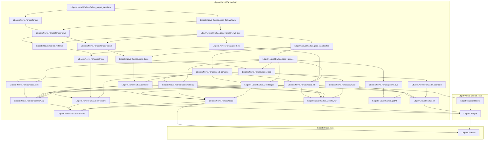

# VER-007

Generated by `scripts/proof-graph.py` from `proof-graph.json`. Do not edit.

Theorems carrying this ID:

- `Libpetri.Novel.Farkas.farkas_output_semiflow` (theorem, `Libpetri/Novel/Farkas.lean:297`)
- `Libpetri.Novel.Farkas.farkas_output_sound` (theorem, `Libpetri/Novel/Farkas.lean:344`)
- `Libpetri.Spec.VER_007_preserves_reach` (theorem, `Libpetri/Spec/Req/VER_007.lean:288`)
- `Libpetri.semiflow_gate_is_necessary` (theorem, `Libpetri/Semiflow.lean:278`) 🔒 locked
- `Libpetri.semiflow_union_sound` (theorem, `Libpetri/Semiflow.lean:147`) 🔒 locked
- `Libpetri.semiflow_union_sound_inj` (theorem, `Libpetri/Semiflow.lean:254`) 🔒 locked
- `Libpetri.strengthening_monotone` (theorem, `Libpetri/Semiflow.lean:164`) 🔒 locked

> **Note:** the full tree has 158 nodes (limit 60), so it is drawn as one diagram per theorem (7 theorems).

### `Libpetri.Novel.Farkas.farkas_output_semiflow`

> Rule: this theorem's whole tree, 32 nodes.

### `Libpetri.Novel.Farkas.farkas_output_sound`

> Rule: this theorem's tree has 81 nodes (limit 60); every file other than its own is collapsed into one node, leaving 41.

```mermaid
flowchart TD
  subgraph g0["Libpetri/Novel/Farkas.lean"]
    n485["Libpetri.Novel.Farkas.GenRow"]
    n486["Libpetri.Novel.Farkas.GenRow.mk"]
    n487["Libpetri.Novel.Farkas.GenRow.sig"]
    n488["Libpetri.Novel.Farkas.GenRow.w"]
    n489["Libpetri.Novel.Farkas.Good"]
    n490["Libpetri.Novel.Farkas.Good.elim"]
    n491["Libpetri.Novel.Farkas.Good.mk"]
    n492["Libpetri.Novel.Farkas.Good.nonneg"]
    n493["Libpetri.Novel.Farkas.Good.sigEq"]
    n494["Libpetri.Novel.Farkas.candidates"]
    n495["Libpetri.Novel.Farkas.certificate_sound"]
    n496["Libpetri.Novel.Farkas.combine"]
    n497["Libpetri.Novel.Farkas.dotInc_eq_lin"]
    n498["Libpetri.Novel.Farkas.dotInc_zero_of_lin"]
    n499["Libpetri.Novel.Farkas.farkas"]
    n500["Libpetri.Novel.Farkas.farkasRound"]
    n501["Libpetri.Novel.Farkas.farkasRows"]
    n503["Libpetri.Novel.Farkas.farkas_output_semiflow"]
    n504["Libpetri.Novel.Farkas.farkas_output_sound"]
    n505["Libpetri.Novel.Farkas.gcdAll"]
    n506["Libpetri.Novel.Farkas.gcdAll_dvd"]
    n507["Libpetri.Novel.Farkas.good_candidates"]
    n508["Libpetri.Novel.Farkas.good_combine"]
    n509["Libpetri.Novel.Farkas.good_farkasRows"]
    n510["Libpetri.Novel.Farkas.good_farkasRows_aux"]
    n511["Libpetri.Novel.Farkas.good_init"]
    n512["Libpetri.Novel.Farkas.good_reduce"]
    n513["Libpetri.Novel.Farkas.initRow"]
    n514["Libpetri.Novel.Farkas.initRows"]
    n515["Libpetri.Novel.Farkas.isum_eq_sum"]
    n517["Libpetri.Novel.Farkas.lin"]
    n518["Libpetri.Novel.Farkas.lin_combine"]
    n519["Libpetri.Novel.Farkas.netFarkas"]
    n520["Libpetri.Novel.Farkas.reduceGcd"]
    n521["Libpetri.Novel.Farkas.rowGcd"]
  end
  c0["📁 Libpetri/Basic.lean (23 declarations, collapsed)"]
  c6["📁 Libpetri/InvariantSum.lean (9 declarations, collapsed)"]
  c81["📁 Libpetri/Soundness.lean (8 declarations, collapsed)"]
  c108["📁 Libpetri/StateEquation.lean (1 declarations, collapsed)"]
  c109["📁 Libpetri/Strengthening.lean (1 declarations, collapsed)"]
  c110["📁 Libpetri/Strengthening/Hypotheses.lean (4 declarations, collapsed)"]
  c6 --> c81
  c81 --> c0
  c108 --> c81
  c109 --> c110
  c110 --> c6
  n486 --> c6
  n486 --> n485
  n487 --> n485
  n488 --> c6
  n488 --> n485
  n489 --> c0
  n489 --> n485
  n490 --> n487
  n490 --> n489
  n491 --> n487
  n491 --> n488
  n491 --> n489
  n491 --> n517
  n492 --> n488
  n492 --> n489
  n493 --> n487
  n493 --> n488
  n493 --> n489
  n493 --> n517
  n494 --> n496
  n494 --> n520
  n495 --> c109
  n495 --> n498
  n496 --> n486
  n496 --> n487
  n496 --> n488
  n497 --> c108
  n497 --> n515
  n497 --> n517
  n498 --> n497
  n499 --> n501
  n500 --> n494
  n501 --> n500
  n501 --> n514
  n503 --> n499
  n503 --> n509
  n504 --> n495
  n504 --> n503
  n504 --> n519
  n506 --> n505
  n507 --> n494
  n507 --> n508
  n507 --> n512
  n508 --> n490
  n508 --> n491
  n508 --> n492
  n508 --> n493
  n508 --> n496
  n508 --> n518
  n509 --> n501
  n509 --> n510
  n510 --> n500
  n510 --> n507
  n510 --> n511
  n510 --> n514
  n511 --> n491
  n511 --> n513
  n512 --> n490
  n512 --> n491
  n512 --> n492
  n512 --> n493
  n512 --> n506
  n512 --> n520
  n513 --> n486
  n514 --> n513
  n515 --> c6
  n517 --> c6
  n518 --> n517
  n519 --> c108
  n519 --> n499
  n520 --> n486
  n520 --> n521
  n521 --> n487
  n521 --> n488
  n521 --> n505
  classDef root stroke-width:3px
  classDef locked fill:#fff3cd,stroke:#b8860b
  classDef collapsed fill:#eeeeee,stroke-dasharray:4 4
  class n504 root
  class c0,c6,c81,c108,c109,c110 collapsed
```

### `Libpetri.Spec.VER_007_preserves_reach`

> Rule: this theorem's whole tree, 57 nodes.

```mermaid
flowchart TD
  subgraph g0["Libpetri/Basic.lean"]
    n0["Libpetri.AMarking"]
    n8["Libpetri.Card"]
    n9["Libpetri.Card.all"]
    n10["Libpetri.Card.atLeast"]
    n11["Libpetri.Card.consumesAll"]
    n12["Libpetri.Card.exactly"]
    n13["Libpetri.Card.one"]
    n14["Libpetri.Card.required"]
    n134["Libpetri.InSpec"]
    n135["Libpetri.InSpec.card"]
    n138["Libpetri.InSpec.place"]
    n2720["Libpetri.PlaceId"]
    n13126["Libpetri.Transition"]
    n13127["Libpetri.Transition.inhibitors"]
    n13128["Libpetri.Transition.inputs"]
    n13132["Libpetri.Transition.reads"]
    n13133["Libpetri.Transition.resets"]
    n13203["Libpetri.consumeAllAt"]
    n13255["Libpetri.enabledA"]
    n13378["Libpetri.pre"]
    n13433["Libpetri.specAt"]
  end
  subgraph g1["Libpetri/InvariantSum.lean"]
    n13143["Libpetri.Weight"]
    n13242["Libpetri.dot"]
    n13244["Libpetri.dot_eq_isum"]
    n13322["Libpetri.isum"]
    n13323["🔒 Libpetri.isum_add"]
    n13325["🔒 Libpetri.isum_congr"]
  end
  subgraph g2["Libpetri/Novel/ForwardDeposit.lean"]
    n867["Libpetri.Novel.ForwardDeposit.Deposit"]
    n878["Libpetri.Novel.ForwardDeposit.ReachADInj"]
    n880["Libpetri.Novel.ForwardDeposit.StepAD"]
    n881["Libpetri.Novel.ForwardDeposit.StepADInj"]
    n895["Libpetri.Novel.ForwardDeposit.fireAD"]
  end
  subgraph g3["Libpetri/Novel/LinearBound.lean"]
    n1039["Libpetri.Novel.LinearBound.dotIncD"]
  end
  subgraph g4["Libpetri/Novel/RouteA/Simulate.lean"]
    n1455["Libpetri.Novel.RouteA.dot_fireAD_eq"]
  end
  subgraph g5["Libpetri/Soundness.lean"]
    n13437["🔒 Libpetri.specAt_sound"]
  end
  subgraph g6["Libpetri/Spec/Req/VER_007.lean"]
    n4016["Libpetri.Spec.BasisLostH1"]
    n6470["Libpetri.Spec.LawFits"]
    n6471["Libpetri.Spec.LawGate"]
    n6472["Libpetri.Spec.LawGate.h1"]
    n6473["Libpetri.Spec.LawGate.h2"]
    n6474["Libpetri.Spec.LawGate.h3"]
    n6834["Libpetri.Spec.ReachADInjStrs"]
    n6922["Libpetri.Spec.SemiflowEnc"]
    n6923["Libpetri.Spec.SemiflowOpt"]
    n6924["Libpetri.Spec.SemiflowOpt.auto"]
    n6927["Libpetri.Spec.SemiflowOpt.off"]
    n6928["Libpetri.Spec.SemiflowOpt.on"]
    n6948["Libpetri.Spec.StepADInjStrs"]
    n7297["Libpetri.Spec.VER_007"]
    n7310["Libpetri.Spec.VER_007_gate"]
    n7312["Libpetri.Spec.VER_007_preserves_reach"]
    n11459["Libpetri.Spec.lawRange"]
    n12823["Libpetri.Spec.ver007_conserved"]
    n12824["Libpetri.Spec.ver007_dot_inject"]
    n12845["Libpetri.Spec.ver007_strengthened_reach_eq"]
  end
  subgraph g7["Libpetri/Strengthening/Hypotheses.lean"]
    n13145["Libpetri.ZeroOnNonlinear"]
    n13383["🔒 Libpetri.pre_le_of_enabledA"]
  end
  n0 --> n2720
  n9 --> n8
  n10 --> n8
  n11 --> n9
  n11 --> n10
  n11 --> n12
  n11 --> n13
  n12 --> n8
  n13 --> n8
  n14 --> n9
  n14 --> n10
  n14 --> n12
  n14 --> n13
  n135 --> n8
  n135 --> n134
  n138 --> n134
  n138 --> n2720
  n867 --> n2720
  n878 --> n881
  n880 --> n895
  n880 --> n13255
  n881 --> n880
  n895 --> n0
  n895 --> n867
  n895 --> n13133
  n895 --> n13203
  n895 --> n13378
  n1039 --> n867
  n1039 --> n13143
  n1039 --> n13322
  n1039 --> n13378
  n1455 --> n895
  n1455 --> n1039
  n1455 --> n13145
  n1455 --> n13244
  n1455 --> n13323
  n1455 --> n13325
  n1455 --> n13383
  n4016 --> n867
  n4016 --> n13145
  n6470 --> n0
  n6470 --> n867
  n6470 --> n13143
  n6470 --> n13322
  n6470 --> n13378
  n6471 --> n867
  n6471 --> n13126
  n6471 --> n13143
  n6472 --> n6471
  n6472 --> n13145
  n6473 --> n1039
  n6473 --> n6471
  n6474 --> n6471
  n6834 --> n6948
  n6922 --> n0
  n6922 --> n867
  n6922 --> n6923
  n6922 --> n13126
  n6922 --> n13143
  n6924 --> n6923
  n6927 --> n6923
  n6928 --> n6923
  n6948 --> n895
  n6948 --> n13242
  n6948 --> n13255
  n7297 --> n4016
  n7297 --> n6470
  n7297 --> n6471
  n7297 --> n6922
  n7297 --> n6924
  n7297 --> n6927
  n7297 --> n6928
  n7297 --> n11459
  n7310 --> n7297
  n7312 --> n7310
  n7312 --> n12845
  n12823 --> n878
  n12823 --> n1455
  n12823 --> n6472
  n12823 --> n6473
  n12823 --> n6474
  n12823 --> n12824
  n12824 --> n13244
  n12824 --> n13325
  n12845 --> n6834
  n12845 --> n12823
  n13127 --> n2720
  n13127 --> n13126
  n13128 --> n134
  n13128 --> n13126
  n13132 --> n2720
  n13132 --> n13126
  n13133 --> n2720
  n13133 --> n13126
  n13143 --> n2720
  n13145 --> n13133
  n13145 --> n13143
  n13145 --> n13203
  n13203 --> n11
  n13203 --> n135
  n13203 --> n13433
  n13242 --> n0
  n13242 --> n13143
  n13244 --> n13242
  n13244 --> n13322
  n13255 --> n0
  n13255 --> n14
  n13255 --> n135
  n13255 --> n138
  n13255 --> n13127
  n13255 --> n13128
  n13255 --> n13132
  n13322 --> n2720
  n13323 --> n13322
  n13325 --> n13322
  n13378 --> n14
  n13378 --> n135
  n13378 --> n13433
  n13383 --> n13255
  n13383 --> n13378
  n13383 --> n13437
  n13433 --> n138
  n13433 --> n13128
  n13437 --> n13433
  classDef root stroke-width:3px
  classDef locked fill:#fff3cd,stroke:#b8860b
  classDef collapsed fill:#eeeeee,stroke-dasharray:4 4
  class n7312 root
  class n13323,n13325,n13383,n13437 locked
```

### `Libpetri.semiflow_gate_is_necessary`

> Rule: this theorem's whole tree, 52 nodes.

```mermaid
flowchart TD
  subgraph g0["Libpetri/Basic.lean"]
    n0["Libpetri.AMarking"]
    n8["Libpetri.Card"]
    n9["Libpetri.Card.all"]
    n10["Libpetri.Card.atLeast"]
    n11["Libpetri.Card.consumesAll"]
    n12["Libpetri.Card.exactly"]
    n13["Libpetri.Card.one"]
    n14["Libpetri.Card.required"]
    n21["Libpetri.Colour"]
    n132["Libpetri.Guard"]
    n134["Libpetri.InSpec"]
    n135["Libpetri.InSpec.card"]
    n137["Libpetri.InSpec.mk"]
    n138["Libpetri.InSpec.place"]
    n2720["Libpetri.PlaceId"]
    n13126["Libpetri.Transition"]
    n13127["Libpetri.Transition.inhibitors"]
    n13128["Libpetri.Transition.inputs"]
    n13129["Libpetri.Transition.mk"]
    n13132["Libpetri.Transition.reads"]
    n13133["Libpetri.Transition.resets"]
    n13203["Libpetri.consumeAllAt"]
    n13255["Libpetri.enabledA"]
    n13277["Libpetri.fireA"]
    n13373["Libpetri.post"]
    n13378["Libpetri.pre"]
    n13433["Libpetri.specAt"]
  end
  subgraph g1["Libpetri/InvariantSum.lean"]
    n13143["Libpetri.Weight"]
    n13242["Libpetri.dot"]
    n13243["Libpetri.dotInc"]
    n13247["🔒 Libpetri.dot_two"]
    n13322["Libpetri.isum"]
  end
  subgraph g2["Libpetri/Semiflow.lean"]
    n13429["🔒 Libpetri.semiflow_gate_is_necessary"]
    n13495["🔒 Libpetri.yUnit_nonneg"]
  end
  subgraph g3["Libpetri/Soundness.lean"]
    n130["Libpetri.FlatNet"]
    n131["Libpetri.FlatTransition"]
    n2868["Libpetri.ReachA"]
    n2869["Libpetri.ReachA.init"]
    n2871["Libpetri.ReachA.step"]
    n13107["Libpetri.StepARel"]
  end
  subgraph g4["Libpetri/Strengthening.lean"]
    n2887["Libpetri.ReachAStr"]
    n2888["Libpetri.ReachAStr.init"]
    n2889["Libpetri.ReachAStr.rec'"]
    n2890["Libpetri.ReachAStr.step"]
    n13108["Libpetri.StepAStrRel"]
    n13146["Libpetri.a0All"]
    n13213["🔒 Libpetri.consume_all_hypothesis_is_necessary"]
    n13214["🔒 Libpetri.consume_all_reaches_violation"]
    n13350["Libpetri.netAll"]
    n13442["🔒 Libpetri.strengthened_all_freezes"]
    n13454["Libpetri.tAll"]
    n13494["Libpetri.yUnit"]
  end
  n0 --> n2720
  n9 --> n8
  n10 --> n8
  n11 --> n9
  n11 --> n10
  n11 --> n12
  n11 --> n13
  n12 --> n8
  n13 --> n8
  n14 --> n9
  n14 --> n10
  n14 --> n12
  n14 --> n13
  n130 --> n131
  n131 --> n2720
  n131 --> n13126
  n132 --> n21
  n135 --> n8
  n135 --> n134
  n137 --> n8
  n137 --> n132
  n137 --> n134
  n137 --> n2720
  n138 --> n134
  n138 --> n2720
  n2868 --> n13107
  n2869 --> n2868
  n2871 --> n2868
  n2887 --> n13108
  n2888 --> n2887
  n2889 --> n2888
  n2889 --> n2890
  n2890 --> n2887
  n13107 --> n130
  n13107 --> n13255
  n13107 --> n13277
  n13108 --> n13107
  n13108 --> n13242
  n13127 --> n2720
  n13127 --> n13126
  n13128 --> n134
  n13128 --> n13126
  n13129 --> n134
  n13129 --> n2720
  n13129 --> n13126
  n13132 --> n2720
  n13132 --> n13126
  n13133 --> n2720
  n13133 --> n13126
  n13143 --> n2720
  n13146 --> n0
  n13203 --> n11
  n13203 --> n135
  n13203 --> n13433
  n13213 --> n13214
  n13213 --> n13243
  n13213 --> n13442
  n13214 --> n2869
  n13214 --> n2871
  n13214 --> n13146
  n13214 --> n13350
  n13242 --> n0
  n13242 --> n13143
  n13243 --> n131
  n13243 --> n13143
  n13243 --> n13322
  n13243 --> n13373
  n13243 --> n13378
  n13247 --> n13242
  n13255 --> n0
  n13255 --> n14
  n13255 --> n135
  n13255 --> n138
  n13255 --> n13127
  n13255 --> n13128
  n13255 --> n13132
  n13277 --> n0
  n13277 --> n13133
  n13277 --> n13203
  n13277 --> n13373
  n13277 --> n13378
  n13322 --> n2720
  n13350 --> n130
  n13350 --> n13454
  n13373 --> n2720
  n13378 --> n14
  n13378 --> n135
  n13378 --> n13433
  n13429 --> n13213
  n13429 --> n13495
  n13433 --> n138
  n13433 --> n13128
  n13442 --> n2889
  n13442 --> n13146
  n13442 --> n13247
  n13442 --> n13350
  n13442 --> n13494
  n13454 --> n9
  n13454 --> n137
  n13454 --> n13129
  n13494 --> n13143
  n13495 --> n13494
  classDef root stroke-width:3px
  classDef locked fill:#fff3cd,stroke:#b8860b
  classDef collapsed fill:#eeeeee,stroke-dasharray:4 4
  class n13429 root
  class n13213,n13214,n13247,n13429,n13442,n13495 locked
```

### `Libpetri.semiflow_union_sound`

> Rule: this theorem's whole tree, 55 nodes.

```mermaid
flowchart TD
  subgraph g0["Libpetri/Basic.lean"]
    n0["Libpetri.AMarking"]
    n8["Libpetri.Card"]
    n9["Libpetri.Card.all"]
    n10["Libpetri.Card.atLeast"]
    n11["Libpetri.Card.consumesAll"]
    n12["Libpetri.Card.exactly"]
    n13["Libpetri.Card.one"]
    n14["Libpetri.Card.required"]
    n134["Libpetri.InSpec"]
    n135["Libpetri.InSpec.card"]
    n138["Libpetri.InSpec.place"]
    n2720["Libpetri.PlaceId"]
    n13126["Libpetri.Transition"]
    n13127["Libpetri.Transition.inhibitors"]
    n13128["Libpetri.Transition.inputs"]
    n13132["Libpetri.Transition.reads"]
    n13133["Libpetri.Transition.resets"]
    n13203["Libpetri.consumeAllAt"]
    n13255["Libpetri.enabledA"]
    n13277["Libpetri.fireA"]
    n13373["Libpetri.post"]
    n13378["Libpetri.pre"]
    n13433["Libpetri.specAt"]
  end
  subgraph g1["Libpetri/InvariantSum.lean"]
    n13143["Libpetri.Weight"]
    n13242["Libpetri.dot"]
    n13243["Libpetri.dotInc"]
    n13244["Libpetri.dot_eq_isum"]
    n13322["Libpetri.isum"]
    n13323["🔒 Libpetri.isum_add"]
    n13325["🔒 Libpetri.isum_congr"]
  end
  subgraph g2["Libpetri/Semiflow.lean"]
    n2891["Libpetri.ReachAStrs"]
    n2892["Libpetri.ReachAStrs.init"]
    n2893["Libpetri.ReachAStrs.rec'"]
    n2894["Libpetri.ReachAStrs.step"]
    n3926["Libpetri.Semiflow"]
    n3929["Libpetri.Semiflow.toValidLaw"]
    n13109["Libpetri.StepAStrsRel"]
    n13135["Libpetri.ValidLaw"]
    n13136["Libpetri.ValidLaw.h1"]
    n13137["Libpetri.ValidLaw.h2"]
    n13430["🔒 Libpetri.semiflow_union_sound"]
    n13446["🔒 Libpetri.strengthened_reach_eq_list"]
  end
  subgraph g3["Libpetri/Soundness.lean"]
    n130["Libpetri.FlatNet"]
    n131["Libpetri.FlatTransition"]
    n2868["Libpetri.ReachA"]
    n2869["Libpetri.ReachA.init"]
    n2870["Libpetri.ReachA.rec'"]
    n2871["Libpetri.ReachA.step"]
    n13107["Libpetri.StepARel"]
    n13437["🔒 Libpetri.specAt_sound"]
  end
  subgraph g4["Libpetri/Strengthening.lean"]
    n13319["🔒 Libpetri.invariant_strengthening_sound"]
  end
  subgraph g5["Libpetri/Strengthening/Hypotheses.lean"]
    n13145["Libpetri.ZeroOnNonlinear"]
    n13245["🔒 Libpetri.dot_fireA"]
    n13286["🔒 Libpetri.fire_term"]
    n13383["🔒 Libpetri.pre_le_of_enabledA"]
  end
  n0 --> n2720
  n9 --> n8
  n10 --> n8
  n11 --> n9
  n11 --> n10
  n11 --> n12
  n11 --> n13
  n12 --> n8
  n13 --> n8
  n14 --> n9
  n14 --> n10
  n14 --> n12
  n14 --> n13
  n130 --> n131
  n131 --> n2720
  n131 --> n13126
  n135 --> n8
  n135 --> n134
  n138 --> n134
  n138 --> n2720
  n2868 --> n13107
  n2869 --> n2868
  n2870 --> n2869
  n2870 --> n2871
  n2871 --> n2868
  n2891 --> n13109
  n2892 --> n2891
  n2893 --> n2892
  n2893 --> n2894
  n2894 --> n2891
  n3926 --> n130
  n3926 --> n13143
  n3929 --> n3926
  n3929 --> n13135
  n13107 --> n130
  n13107 --> n13255
  n13107 --> n13277
  n13109 --> n13107
  n13109 --> n13242
  n13127 --> n2720
  n13127 --> n13126
  n13128 --> n134
  n13128 --> n13126
  n13132 --> n2720
  n13132 --> n13126
  n13133 --> n2720
  n13133 --> n13126
  n13135 --> n130
  n13135 --> n13143
  n13136 --> n13135
  n13136 --> n13145
  n13137 --> n13135
  n13137 --> n13243
  n13143 --> n2720
  n13145 --> n13133
  n13145 --> n13143
  n13145 --> n13203
  n13203 --> n11
  n13203 --> n135
  n13203 --> n13433
  n13242 --> n0
  n13242 --> n13143
  n13243 --> n131
  n13243 --> n13143
  n13243 --> n13322
  n13243 --> n13373
  n13243 --> n13378
  n13244 --> n13242
  n13244 --> n13322
  n13245 --> n13243
  n13245 --> n13244
  n13245 --> n13286
  n13245 --> n13323
  n13245 --> n13325
  n13255 --> n0
  n13255 --> n14
  n13255 --> n135
  n13255 --> n138
  n13255 --> n13127
  n13255 --> n13128
  n13255 --> n13132
  n13277 --> n0
  n13277 --> n13133
  n13277 --> n13203
  n13277 --> n13373
  n13277 --> n13378
  n13286 --> n13145
  n13286 --> n13277
  n13286 --> n13383
  n13319 --> n2870
  n13319 --> n13245
  n13322 --> n2720
  n13323 --> n13322
  n13325 --> n13322
  n13373 --> n2720
  n13378 --> n14
  n13378 --> n135
  n13378 --> n13433
  n13383 --> n13255
  n13383 --> n13378
  n13383 --> n13437
  n13430 --> n3929
  n13430 --> n13446
  n13433 --> n138
  n13433 --> n13128
  n13437 --> n13433
  n13446 --> n2893
  n13446 --> n13136
  n13446 --> n13137
  n13446 --> n13319
  classDef root stroke-width:3px
  classDef locked fill:#fff3cd,stroke:#b8860b
  classDef collapsed fill:#eeeeee,stroke-dasharray:4 4
  class n13430 root
  class n13245,n13286,n13319,n13323,n13325,n13383,n13430,n13437,n13446 locked
```

### `Libpetri.semiflow_union_sound_inj`

> Rule: this theorem's whole tree, 60 nodes.

```mermaid
flowchart TD
  subgraph g0["Libpetri/Basic.lean"]
    n0["Libpetri.AMarking"]
    n8["Libpetri.Card"]
    n9["Libpetri.Card.all"]
    n10["Libpetri.Card.atLeast"]
    n11["Libpetri.Card.consumesAll"]
    n12["Libpetri.Card.exactly"]
    n13["Libpetri.Card.one"]
    n14["Libpetri.Card.required"]
    n134["Libpetri.InSpec"]
    n135["Libpetri.InSpec.card"]
    n138["Libpetri.InSpec.place"]
    n2720["Libpetri.PlaceId"]
    n13126["Libpetri.Transition"]
    n13127["Libpetri.Transition.inhibitors"]
    n13128["Libpetri.Transition.inputs"]
    n13132["Libpetri.Transition.reads"]
    n13133["Libpetri.Transition.resets"]
    n13203["Libpetri.consumeAllAt"]
    n13255["Libpetri.enabledA"]
    n13277["Libpetri.fireA"]
    n13373["Libpetri.post"]
    n13378["Libpetri.pre"]
    n13433["Libpetri.specAt"]
  end
  subgraph g1["Libpetri/InvariantSum.lean"]
    n13143["Libpetri.Weight"]
    n13242["Libpetri.dot"]
    n13243["Libpetri.dotInc"]
    n13244["Libpetri.dot_eq_isum"]
    n13322["Libpetri.isum"]
    n13323["🔒 Libpetri.isum_add"]
    n13325["🔒 Libpetri.isum_congr"]
  end
  subgraph g2["Libpetri/Retrodict.lean"]
    n2872["Libpetri.ReachAInj"]
    n2873["Libpetri.ReachAInj.init"]
    n2874["Libpetri.ReachAInj.inject"]
    n2875["Libpetri.ReachAInj.rec'"]
    n2876["Libpetri.ReachAInj.step"]
    n13104["Libpetri.StepAInjRel"]
  end
  subgraph g3["Libpetri/Semiflow.lean"]
    n2882["Libpetri.ReachAInjStrs"]
    n2883["Libpetri.ReachAInjStrs.init"]
    n2884["Libpetri.ReachAInjStrs.inject"]
    n2885["Libpetri.ReachAInjStrs.rec'"]
    n2886["Libpetri.ReachAInjStrs.step"]
    n13106["Libpetri.StepAInjStrsRel"]
    n13109["Libpetri.StepAStrsRel"]
    n13135["Libpetri.ValidLaw"]
    n13136["Libpetri.ValidLaw.h1"]
    n13137["Libpetri.ValidLaw.h2"]
    n13139["Libpetri.ValidLawInj"]
    n13140["Libpetri.ValidLawInj.h3"]
    n13142["Libpetri.ValidLawInj.toValidLaw"]
    n13431["🔒 Libpetri.semiflow_union_sound_inj"]
    n13447["🔒 Libpetri.strengthened_reach_eq_list_inj"]
  end
  subgraph g4["Libpetri/Soundness.lean"]
    n130["Libpetri.FlatNet"]
    n131["Libpetri.FlatTransition"]
    n13107["Libpetri.StepARel"]
    n13437["🔒 Libpetri.specAt_sound"]
  end
  subgraph g5["Libpetri/Strengthening.lean"]
    n13320["🔒 Libpetri.invariant_strengthening_sound_inj"]
  end
  subgraph g6["Libpetri/Strengthening/Hypotheses.lean"]
    n13145["Libpetri.ZeroOnNonlinear"]
    n13245["🔒 Libpetri.dot_fireA"]
    n13286["🔒 Libpetri.fire_term"]
    n13383["🔒 Libpetri.pre_le_of_enabledA"]
  end
  n0 --> n2720
  n9 --> n8
  n10 --> n8
  n11 --> n9
  n11 --> n10
  n11 --> n12
  n11 --> n13
  n12 --> n8
  n13 --> n8
  n14 --> n9
  n14 --> n10
  n14 --> n12
  n14 --> n13
  n130 --> n131
  n131 --> n2720
  n131 --> n13126
  n135 --> n8
  n135 --> n134
  n138 --> n134
  n138 --> n2720
  n2872 --> n13104
  n2873 --> n2872
  n2874 --> n2872
  n2875 --> n2873
  n2875 --> n2874
  n2875 --> n2876
  n2876 --> n2872
  n2882 --> n13106
  n2883 --> n2882
  n2884 --> n2882
  n2885 --> n2883
  n2885 --> n2884
  n2885 --> n2886
  n2886 --> n2882
  n13104 --> n13107
  n13106 --> n13109
  n13107 --> n130
  n13107 --> n13255
  n13107 --> n13277
  n13109 --> n13107
  n13109 --> n13242
  n13127 --> n2720
  n13127 --> n13126
  n13128 --> n134
  n13128 --> n13126
  n13132 --> n2720
  n13132 --> n13126
  n13133 --> n2720
  n13133 --> n13126
  n13135 --> n130
  n13135 --> n13143
  n13136 --> n13135
  n13136 --> n13145
  n13137 --> n13135
  n13137 --> n13243
  n13139 --> n130
  n13139 --> n13143
  n13140 --> n13139
  n13142 --> n13135
  n13142 --> n13139
  n13143 --> n2720
  n13145 --> n13133
  n13145 --> n13143
  n13145 --> n13203
  n13203 --> n11
  n13203 --> n135
  n13203 --> n13433
  n13242 --> n0
  n13242 --> n13143
  n13243 --> n131
  n13243 --> n13143
  n13243 --> n13322
  n13243 --> n13373
  n13243 --> n13378
  n13244 --> n13242
  n13244 --> n13322
  n13245 --> n13243
  n13245 --> n13244
  n13245 --> n13286
  n13245 --> n13323
  n13245 --> n13325
  n13255 --> n0
  n13255 --> n14
  n13255 --> n135
  n13255 --> n138
  n13255 --> n13127
  n13255 --> n13128
  n13255 --> n13132
  n13277 --> n0
  n13277 --> n13133
  n13277 --> n13203
  n13277 --> n13373
  n13277 --> n13378
  n13286 --> n13145
  n13286 --> n13277
  n13286 --> n13383
  n13320 --> n2875
  n13320 --> n13245
  n13322 --> n2720
  n13323 --> n13322
  n13325 --> n13322
  n13373 --> n2720
  n13378 --> n14
  n13378 --> n135
  n13378 --> n13433
  n13383 --> n13255
  n13383 --> n13378
  n13383 --> n13437
  n13431 --> n13447
  n13433 --> n138
  n13433 --> n13128
  n13437 --> n13433
  n13447 --> n2885
  n13447 --> n13136
  n13447 --> n13137
  n13447 --> n13140
  n13447 --> n13142
  n13447 --> n13320
  classDef root stroke-width:3px
  classDef locked fill:#fff3cd,stroke:#b8860b
  classDef collapsed fill:#eeeeee,stroke-dasharray:4 4
  class n13431 root
  class n13245,n13286,n13320,n13323,n13325,n13383,n13431,n13437,n13447 locked
```

### `Libpetri.strengthening_monotone`

> Rule: this theorem's whole tree, 53 nodes.

```mermaid
flowchart TD
  subgraph g0["Libpetri/Basic.lean"]
    n0["Libpetri.AMarking"]
    n8["Libpetri.Card"]
    n9["Libpetri.Card.all"]
    n10["Libpetri.Card.atLeast"]
    n11["Libpetri.Card.consumesAll"]
    n12["Libpetri.Card.exactly"]
    n13["Libpetri.Card.one"]
    n14["Libpetri.Card.required"]
    n134["Libpetri.InSpec"]
    n135["Libpetri.InSpec.card"]
    n138["Libpetri.InSpec.place"]
    n2720["Libpetri.PlaceId"]
    n13126["Libpetri.Transition"]
    n13127["Libpetri.Transition.inhibitors"]
    n13128["Libpetri.Transition.inputs"]
    n13132["Libpetri.Transition.reads"]
    n13133["Libpetri.Transition.resets"]
    n13203["Libpetri.consumeAllAt"]
    n13255["Libpetri.enabledA"]
    n13277["Libpetri.fireA"]
    n13373["Libpetri.post"]
    n13378["Libpetri.pre"]
    n13433["Libpetri.specAt"]
  end
  subgraph g1["Libpetri/InvariantSum.lean"]
    n13143["Libpetri.Weight"]
    n13242["Libpetri.dot"]
    n13243["Libpetri.dotInc"]
    n13244["Libpetri.dot_eq_isum"]
    n13322["Libpetri.isum"]
    n13323["🔒 Libpetri.isum_add"]
    n13325["🔒 Libpetri.isum_congr"]
  end
  subgraph g2["Libpetri/Semiflow.lean"]
    n2891["Libpetri.ReachAStrs"]
    n2892["Libpetri.ReachAStrs.init"]
    n2893["Libpetri.ReachAStrs.rec'"]
    n2894["Libpetri.ReachAStrs.step"]
    n13109["Libpetri.StepAStrsRel"]
    n13135["Libpetri.ValidLaw"]
    n13136["Libpetri.ValidLaw.h1"]
    n13137["Libpetri.ValidLaw.h2"]
    n13446["🔒 Libpetri.strengthened_reach_eq_list"]
    n13448["🔒 Libpetri.strengthening_monotone"]
  end
  subgraph g3["Libpetri/Soundness.lean"]
    n130["Libpetri.FlatNet"]
    n131["Libpetri.FlatTransition"]
    n2868["Libpetri.ReachA"]
    n2869["Libpetri.ReachA.init"]
    n2870["Libpetri.ReachA.rec'"]
    n2871["Libpetri.ReachA.step"]
    n13107["Libpetri.StepARel"]
    n13437["🔒 Libpetri.specAt_sound"]
  end
  subgraph g4["Libpetri/Strengthening.lean"]
    n13319["🔒 Libpetri.invariant_strengthening_sound"]
  end
  subgraph g5["Libpetri/Strengthening/Hypotheses.lean"]
    n13145["Libpetri.ZeroOnNonlinear"]
    n13245["🔒 Libpetri.dot_fireA"]
    n13286["🔒 Libpetri.fire_term"]
    n13383["🔒 Libpetri.pre_le_of_enabledA"]
  end
  n0 --> n2720
  n9 --> n8
  n10 --> n8
  n11 --> n9
  n11 --> n10
  n11 --> n12
  n11 --> n13
  n12 --> n8
  n13 --> n8
  n14 --> n9
  n14 --> n10
  n14 --> n12
  n14 --> n13
  n130 --> n131
  n131 --> n2720
  n131 --> n13126
  n135 --> n8
  n135 --> n134
  n138 --> n134
  n138 --> n2720
  n2868 --> n13107
  n2869 --> n2868
  n2870 --> n2869
  n2870 --> n2871
  n2871 --> n2868
  n2891 --> n13109
  n2892 --> n2891
  n2893 --> n2892
  n2893 --> n2894
  n2894 --> n2891
  n13107 --> n130
  n13107 --> n13255
  n13107 --> n13277
  n13109 --> n13107
  n13109 --> n13242
  n13127 --> n2720
  n13127 --> n13126
  n13128 --> n134
  n13128 --> n13126
  n13132 --> n2720
  n13132 --> n13126
  n13133 --> n2720
  n13133 --> n13126
  n13135 --> n130
  n13135 --> n13143
  n13136 --> n13135
  n13136 --> n13145
  n13137 --> n13135
  n13137 --> n13243
  n13143 --> n2720
  n13145 --> n13133
  n13145 --> n13143
  n13145 --> n13203
  n13203 --> n11
  n13203 --> n135
  n13203 --> n13433
  n13242 --> n0
  n13242 --> n13143
  n13243 --> n131
  n13243 --> n13143
  n13243 --> n13322
  n13243 --> n13373
  n13243 --> n13378
  n13244 --> n13242
  n13244 --> n13322
  n13245 --> n13243
  n13245 --> n13244
  n13245 --> n13286
  n13245 --> n13323
  n13245 --> n13325
  n13255 --> n0
  n13255 --> n14
  n13255 --> n135
  n13255 --> n138
  n13255 --> n13127
  n13255 --> n13128
  n13255 --> n13132
  n13277 --> n0
  n13277 --> n13133
  n13277 --> n13203
  n13277 --> n13373
  n13277 --> n13378
  n13286 --> n13145
  n13286 --> n13277
  n13286 --> n13383
  n13319 --> n2870
  n13319 --> n13245
  n13322 --> n2720
  n13323 --> n13322
  n13325 --> n13322
  n13373 --> n2720
  n13378 --> n14
  n13378 --> n135
  n13378 --> n13433
  n13383 --> n13255
  n13383 --> n13378
  n13383 --> n13437
  n13433 --> n138
  n13433 --> n13128
  n13437 --> n13433
  n13446 --> n2893
  n13446 --> n13136
  n13446 --> n13137
  n13446 --> n13319
  n13448 --> n13446
  classDef root stroke-width:3px
  classDef locked fill:#fff3cd,stroke:#b8860b
  classDef collapsed fill:#eeeeee,stroke-dasharray:4 4
  class n13448 root
  class n13245,n13286,n13319,n13323,n13325,n13383,n13437,n13446,n13448 locked
```

Axioms used:

- `Libpetri.Novel.Farkas.farkas_output_semiflow`: `Classical.choice`, `Quot.sound`, `propext`
- `Libpetri.Novel.Farkas.farkas_output_sound`: `Classical.choice`, `Quot.sound`, `propext`
- `Libpetri.Spec.VER_007_preserves_reach`: `Classical.choice`, `Quot.sound`, `propext`
- `Libpetri.semiflow_gate_is_necessary`: `Classical.choice`, `Quot.sound`, `propext`
- `Libpetri.semiflow_union_sound`: `Classical.choice`, `Quot.sound`, `propext`
- `Libpetri.semiflow_union_sound_inj`: `Classical.choice`, `Quot.sound`, `propext`
- `Libpetri.strengthening_monotone`: `Classical.choice`, `Quot.sound`, `propext`
