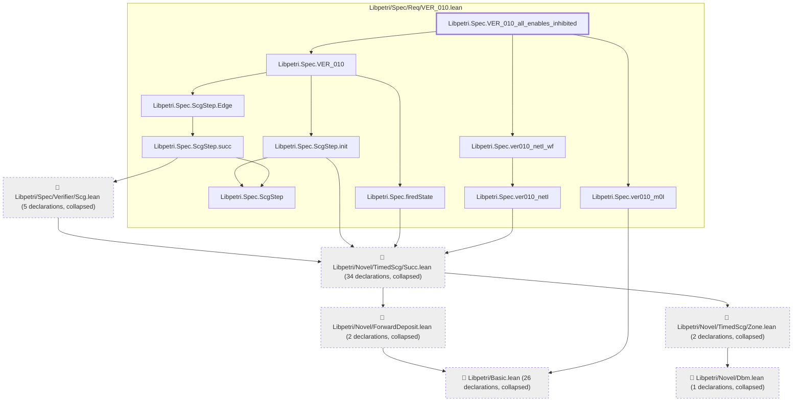
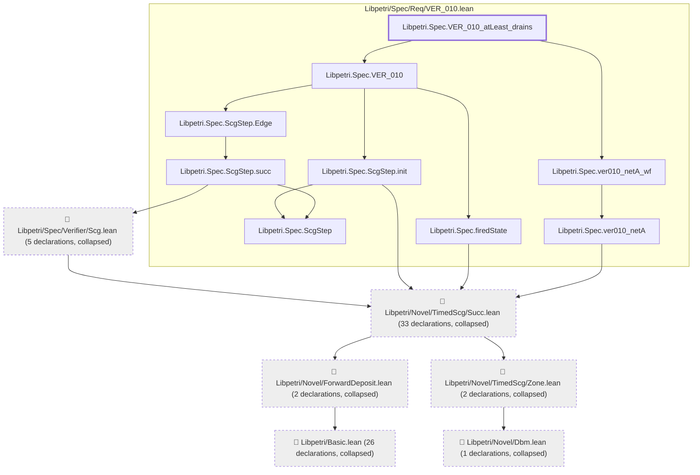
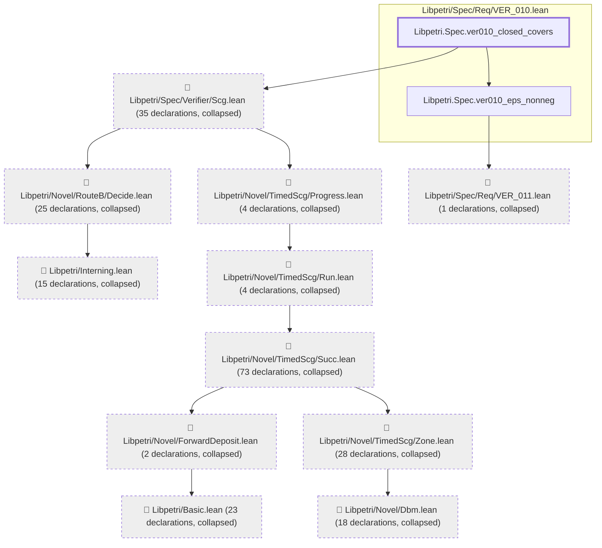
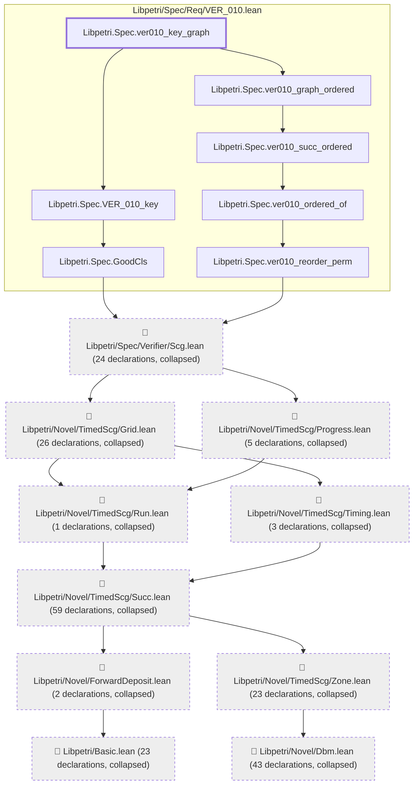
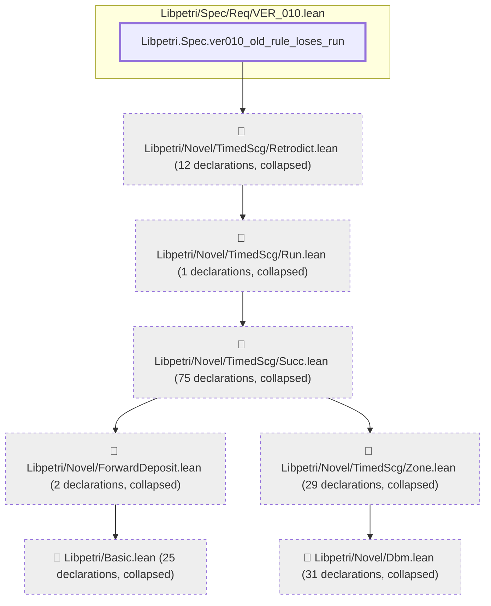
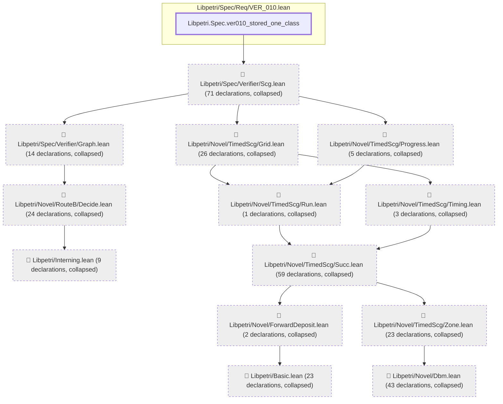
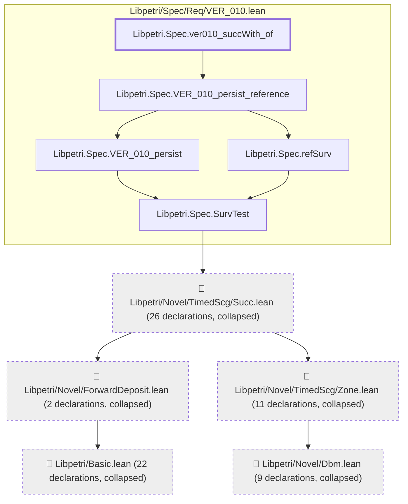

# VER-010

Generated by `scripts/proof-graph.py` from `proof-graph.json`. Do not edit.

Theorems carrying this ID:

- `Libpetri.Spec.VER_010_all_enables_inhibited` (theorem, `Libpetri/Spec/Req/VER_010.lean:645`)
- `Libpetri.Spec.VER_010_atLeast_drains` (theorem, `Libpetri/Spec/Req/VER_010.lean:606`)
- `Libpetri.Spec.ver010_closed_covers` (theorem, `Libpetri/Spec/Req/VER_010.lean:664`)
- `Libpetri.Spec.ver010_key_graph` (theorem, `Libpetri/Spec/Req/VER_010.lean:969`)
- `Libpetri.Spec.ver010_old_rule_loses_run` (theorem, `Libpetri/Spec/Req/VER_010.lean:741`)
- `Libpetri.Spec.ver010_stored_one_class` (theorem, `Libpetri/Spec/Req/VER_010.lean:990`)
- `Libpetri.Spec.ver010_succWith_of` (theorem, `Libpetri/Spec/Req/VER_010.lean:717`)

> **Note:** the full tree has 394 nodes (limit 60), so it is drawn as one diagram per theorem (7 theorems).

### `Libpetri.Spec.VER_010_all_enables_inhibited`

> Rule: this theorem's tree has 80 nodes (limit 60); every file other than its own is collapsed into one node, leaving 16.

### `Libpetri.Spec.VER_010_atLeast_drains`

> Rule: this theorem's tree has 78 nodes (limit 60); every file other than its own is collapsed into one node, leaving 15.

### `Libpetri.Spec.ver010_closed_covers`

> Rule: this theorem's tree has 230 nodes (limit 60); every file other than its own is collapsed into one node, leaving 13.

### `Libpetri.Spec.ver010_key_graph`

> Rule: this theorem's tree has 216 nodes (limit 60); every file other than its own is collapsed into one node, leaving 17.

### `Libpetri.Spec.ver010_old_rule_loses_run`

> Rule: this theorem's tree has 176 nodes (limit 60); every file other than its own is collapsed into one node, leaving 8.

### `Libpetri.Spec.ver010_stored_one_class`

> Rule: this theorem's tree has 304 nodes (limit 60); every file other than its own is collapsed into one node, leaving 14.

### `Libpetri.Spec.ver010_succWith_of`

> Rule: this theorem's tree has 75 nodes (limit 60); every file other than its own is collapsed into one node, leaving 10.

Axioms used:

- `Libpetri.Spec.VER_010_all_enables_inhibited`: `Classical.choice`, `Quot.sound`, `propext`
- `Libpetri.Spec.VER_010_atLeast_drains`: `Classical.choice`, `Quot.sound`, `propext`
- `Libpetri.Spec.ver010_closed_covers`: `Classical.choice`, `Quot.sound`, `propext`
- `Libpetri.Spec.ver010_key_graph`: `Classical.choice`, `Quot.sound`, `propext`
- `Libpetri.Spec.ver010_old_rule_loses_run`: `Classical.choice`, `Quot.sound`, `propext`
- `Libpetri.Spec.ver010_stored_one_class`: `Classical.choice`, `Quot.sound`, `propext`
- `Libpetri.Spec.ver010_succWith_of`: `Classical.choice`, `Quot.sound`, `propext`
