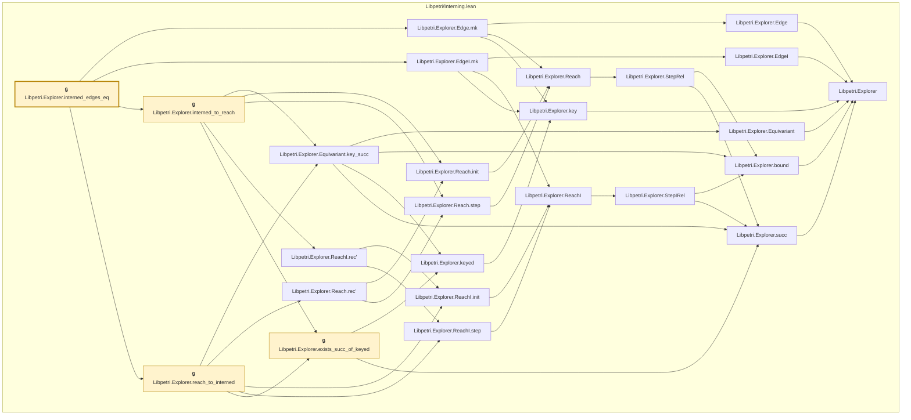
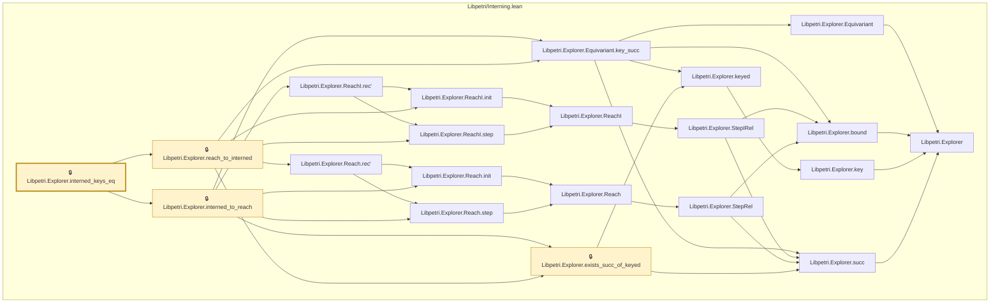
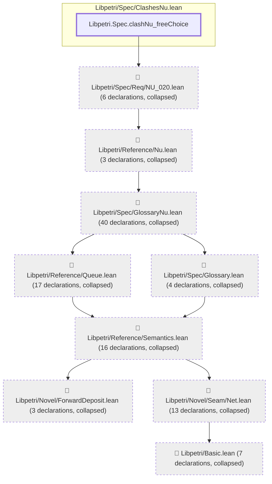
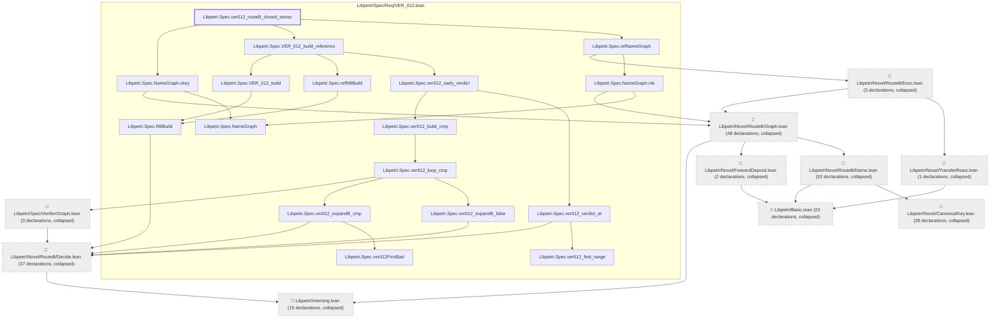
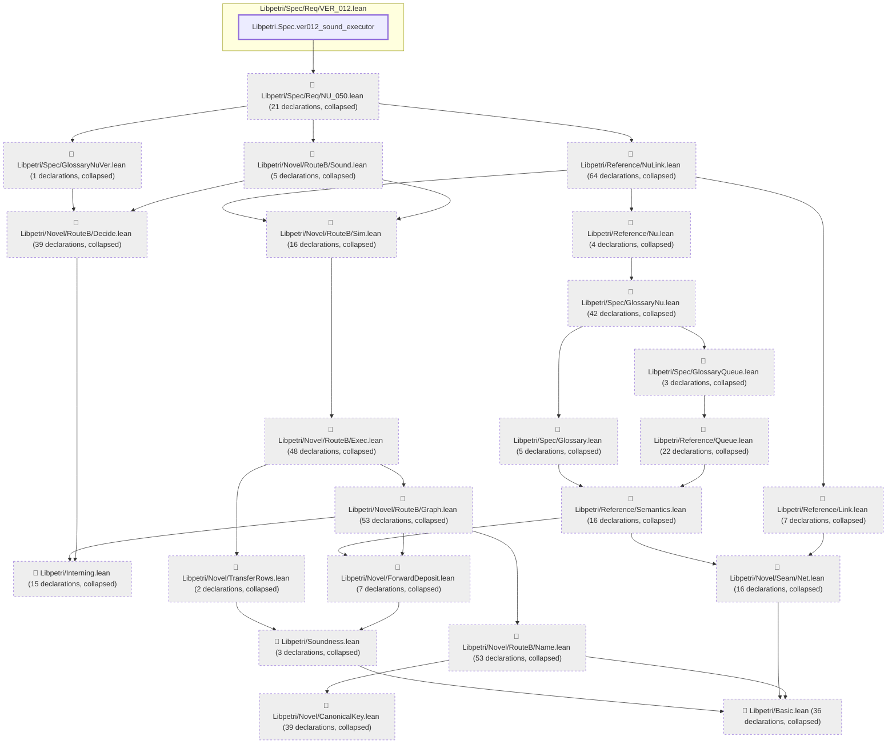
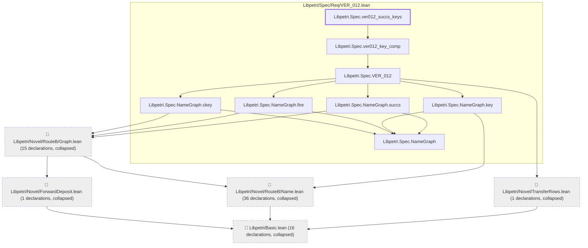
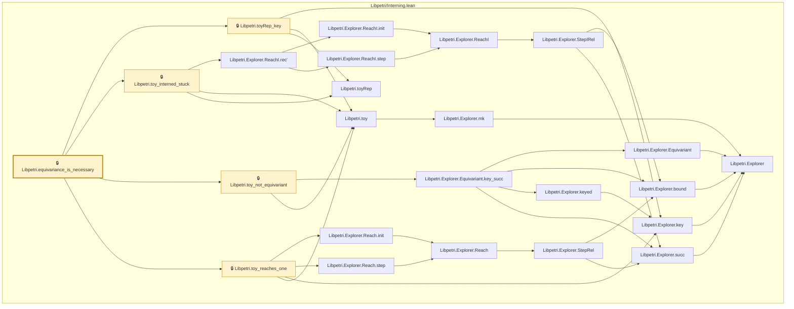

# VER-012

Generated by `scripts/proof-graph.py` from `proof-graph.json`. Do not edit.

Theorems carrying this ID:

- `Libpetri.Explorer.interned_edges_eq` (theorem, `Libpetri/Interning.lean:252`) 🔒 locked
- `Libpetri.Explorer.interned_keys_eq` (theorem, `Libpetri/Interning.lean:235`) 🔒 locked
- `Libpetri.Spec.NU_050_prefix_never_proven` (theorem, `Libpetri/Spec/Req/NU_050.lean:135`)
- `Libpetri.Spec.clashNu_freeChoice` (theorem, `Libpetri/Spec/ClashesNu.lean:353`)
- `Libpetri.Spec.ver012_build_complete_quiescence` (theorem, `Libpetri/Spec/Req/VER_012.lean:1049`)
- `Libpetri.Spec.ver012_build_complete_violated` (theorem, `Libpetri/Spec/Req/VER_012.lean:1022`)
- `Libpetri.Spec.ver012_routeB_closed_stores` (theorem, `Libpetri/Spec/Req/VER_012.lean:1088`)
- `Libpetri.Spec.ver012_sound_executor` (theorem, `Libpetri/Spec/Req/VER_012.lean:1103`)
- `Libpetri.Spec.ver012_succs_keys` (theorem, `Libpetri/Spec/Req/VER_012.lean:652`)
- `Libpetri.equivariance_is_necessary` (theorem, `Libpetri/Interning.lean:336`) 🔒 locked

> **Note:** the full tree has 584 nodes (limit 60), so it is drawn as one diagram per theorem (10 theorems).

### `Libpetri.Explorer.interned_edges_eq`

> Rule: this theorem's whole tree, 25 nodes.

### `Libpetri.Explorer.interned_keys_eq`

> Rule: this theorem's whole tree, 21 nodes.

### `Libpetri.Spec.NU_050_prefix_never_proven`

> Rule: this theorem's whole tree, 21 nodes.

```mermaid
flowchart TD
  subgraph g0["Libpetri/Interning.lean"]
    n38["Libpetri.Explorer"]
    n56["Libpetri.Explorer.bound"]
    n65["Libpetri.Explorer.succ"]
  end
  subgraph g1["Libpetri/Novel/RouteB/Decide.lean"]
    n1542["Libpetri.Novel.RouteB.Decide.Out"]
    n1543["Libpetri.Novel.RouteB.Decide.Out.cls"]
    n1544["Libpetri.Novel.RouteB.Decide.Out.complete"]
    n1546["Libpetri.Novel.RouteB.Decide.Out.exp"]
    n1548["Libpetri.Novel.RouteB.Decide.Out.stopped"]
    n1549["Libpetri.Novel.RouteB.Decide.Prop'"]
    n1550["Libpetri.Novel.RouteB.Decide.Prop'.quiescence"]
    n1551["Libpetri.Novel.RouteB.Decide.Prop'.safety"]
    n1552["Libpetri.Novel.RouteB.Decide.Verdict"]
    n1553["Libpetri.Novel.RouteB.Decide.Verdict.proven"]
    n1554["Libpetri.Novel.RouteB.Decide.Verdict.unknown"]
    n1555["Libpetri.Novel.RouteB.Decide.Verdict.violated"]
    n1576["Libpetri.Novel.RouteB.Decide.quiescentAt"]
    n1582["Libpetri.Novel.RouteB.Decide.violatesAt"]
  end
  subgraph g2["Libpetri/Spec/GlossaryNuVer.lean"]
    n10126["Libpetri.Spec.RouteBVerdict"]
  end
  subgraph g3["Libpetri/Spec/Req/NU_050.lean"]
    n9109["Libpetri.Spec.NU_050_prefix"]
    n9116["Libpetri.Spec.NU_050_prefix_never_proven"]
  end
  subgraph g4["Libpetri/Spec/Req/NU_055.lean"]
    n5975["Libpetri.Spec.ClassVerdict"]
  end
  n56 --> n38
  n65 --> n38
  n1543 --> n1542
  n1544 --> n1542
  n1546 --> n1542
  n1548 --> n1542
  n1550 --> n1549
  n1551 --> n1549
  n1553 --> n1552
  n1554 --> n1552
  n1555 --> n1552
  n1576 --> n56
  n1576 --> n65
  n1576 --> n1543
  n1576 --> n1546
  n1582 --> n1550
  n1582 --> n1551
  n1582 --> n1576
  n5975 --> n38
  n5975 --> n1542
  n5975 --> n1549
  n5975 --> n10126
  n9109 --> n1544
  n9109 --> n1548
  n9109 --> n1553
  n9109 --> n1554
  n9109 --> n1555
  n9109 --> n1582
  n9109 --> n5975
  n9116 --> n9109
  n10126 --> n1552
  classDef root stroke-width:3px
  classDef locked fill:#fff3cd,stroke:#b8860b
  classDef collapsed fill:#eeeeee,stroke-dasharray:4 4
  class n9116 root
```

### `Libpetri.Spec.clashNu_freeChoice`

> Rule: this theorem's tree has 110 nodes (limit 60); every file other than its own is collapsed into one node, leaving 10.

### `Libpetri.Spec.ver012_build_complete_quiescence`

> Rule: this theorem's whole tree, 29 nodes.

```mermaid
flowchart TD
  subgraph g0["Libpetri/Interning.lean"]
    n38["Libpetri.Explorer"]
    n43["Libpetri.Explorer.Equivariant"]
    n44["Libpetri.Explorer.Equivariant.key_succ"]
    n46["Libpetri.Explorer.Reach"]
    n55["Libpetri.Explorer.StepRel"]
    n56["Libpetri.Explorer.bound"]
    n61["Libpetri.Explorer.key"]
    n62["Libpetri.Explorer.keyed"]
    n65["Libpetri.Explorer.succ"]
  end
  subgraph g1["Libpetri/Novel/RouteB/Decide.lean"]
    n1542["Libpetri.Novel.RouteB.Decide.Out"]
    n1543["Libpetri.Novel.RouteB.Decide.Out.cls"]
    n1544["Libpetri.Novel.RouteB.Decide.Out.complete"]
    n1545["Libpetri.Novel.RouteB.Decide.Out.early"]
    n1546["Libpetri.Novel.RouteB.Decide.Out.exp"]
    n1548["Libpetri.Novel.RouteB.Decide.Out.stopped"]
    n1549["Libpetri.Novel.RouteB.Decide.Prop'"]
    n1550["Libpetri.Novel.RouteB.Decide.Prop'.quiescence"]
    n1551["Libpetri.Novel.RouteB.Decide.Prop'.safety"]
    n1552["Libpetri.Novel.RouteB.Decide.Verdict"]
    n1553["Libpetri.Novel.RouteB.Decide.Verdict.proven"]
    n1554["Libpetri.Novel.RouteB.Decide.Verdict.unknown"]
    n1555["Libpetri.Novel.RouteB.Decide.Verdict.violated"]
    n1576["Libpetri.Novel.RouteB.Decide.quiescentAt"]
    n1578["Libpetri.Novel.RouteB.Decide.rests_transfer"]
    n1581["Libpetri.Novel.RouteB.Decide.verdict"]
    n1582["Libpetri.Novel.RouteB.Decide.violatesAt"]
  end
  subgraph g2["Libpetri/Spec/Req/VER_012.lean"]
    n9762["Libpetri.Spec.RBBuild"]
    n10642["Libpetri.Spec.VER_012_build"]
    n21711["Libpetri.Spec.ver012_build_complete_quiescence"]
  end
  n43 --> n38
  n44 --> n43
  n44 --> n56
  n44 --> n62
  n44 --> n65
  n46 --> n55
  n55 --> n56
  n55 --> n65
  n56 --> n38
  n61 --> n38
  n62 --> n61
  n65 --> n38
  n1543 --> n1542
  n1544 --> n1542
  n1545 --> n1542
  n1546 --> n1542
  n1548 --> n1542
  n1550 --> n1549
  n1551 --> n1549
  n1553 --> n1552
  n1554 --> n1552
  n1555 --> n1552
  n1576 --> n56
  n1576 --> n65
  n1576 --> n1543
  n1576 --> n1546
  n1578 --> n44
  n1581 --> n1544
  n1581 --> n1548
  n1581 --> n1553
  n1581 --> n1554
  n1581 --> n1555
  n1581 --> n1582
  n1582 --> n1550
  n1582 --> n1551
  n1582 --> n1576
  n9762 --> n38
  n9762 --> n1542
  n10642 --> n43
  n10642 --> n46
  n10642 --> n61
  n10642 --> n1545
  n10642 --> n1581
  n10642 --> n9762
  n21711 --> n1578
  n21711 --> n10642
  classDef root stroke-width:3px
  classDef locked fill:#fff3cd,stroke:#b8860b
  classDef collapsed fill:#eeeeee,stroke-dasharray:4 4
  class n21711 root
```

### `Libpetri.Spec.ver012_build_complete_violated`

> Rule: this theorem's whole tree, 26 nodes.

```mermaid
flowchart TD
  subgraph g0["Libpetri/Interning.lean"]
    n38["Libpetri.Explorer"]
    n43["Libpetri.Explorer.Equivariant"]
    n46["Libpetri.Explorer.Reach"]
    n55["Libpetri.Explorer.StepRel"]
    n56["Libpetri.Explorer.bound"]
    n61["Libpetri.Explorer.key"]
    n65["Libpetri.Explorer.succ"]
  end
  subgraph g1["Libpetri/Novel/RouteB/Decide.lean"]
    n1542["Libpetri.Novel.RouteB.Decide.Out"]
    n1543["Libpetri.Novel.RouteB.Decide.Out.cls"]
    n1544["Libpetri.Novel.RouteB.Decide.Out.complete"]
    n1545["Libpetri.Novel.RouteB.Decide.Out.early"]
    n1546["Libpetri.Novel.RouteB.Decide.Out.exp"]
    n1548["Libpetri.Novel.RouteB.Decide.Out.stopped"]
    n1549["Libpetri.Novel.RouteB.Decide.Prop'"]
    n1550["Libpetri.Novel.RouteB.Decide.Prop'.quiescence"]
    n1551["Libpetri.Novel.RouteB.Decide.Prop'.safety"]
    n1552["Libpetri.Novel.RouteB.Decide.Verdict"]
    n1553["Libpetri.Novel.RouteB.Decide.Verdict.proven"]
    n1554["Libpetri.Novel.RouteB.Decide.Verdict.unknown"]
    n1555["Libpetri.Novel.RouteB.Decide.Verdict.violated"]
    n1576["Libpetri.Novel.RouteB.Decide.quiescentAt"]
    n1581["Libpetri.Novel.RouteB.Decide.verdict"]
    n1582["Libpetri.Novel.RouteB.Decide.violatesAt"]
  end
  subgraph g2["Libpetri/Spec/Req/VER_012.lean"]
    n9762["Libpetri.Spec.RBBuild"]
    n10642["Libpetri.Spec.VER_012_build"]
    n21712["Libpetri.Spec.ver012_build_complete_violated"]
  end
  n43 --> n38
  n46 --> n55
  n55 --> n56
  n55 --> n65
  n56 --> n38
  n61 --> n38
  n65 --> n38
  n1543 --> n1542
  n1544 --> n1542
  n1545 --> n1542
  n1546 --> n1542
  n1548 --> n1542
  n1550 --> n1549
  n1551 --> n1549
  n1553 --> n1552
  n1554 --> n1552
  n1555 --> n1552
  n1576 --> n56
  n1576 --> n65
  n1576 --> n1543
  n1576 --> n1546
  n1581 --> n1544
  n1581 --> n1548
  n1581 --> n1553
  n1581 --> n1554
  n1581 --> n1555
  n1581 --> n1582
  n1582 --> n1550
  n1582 --> n1551
  n1582 --> n1576
  n9762 --> n38
  n9762 --> n1542
  n10642 --> n43
  n10642 --> n46
  n10642 --> n61
  n10642 --> n1545
  n10642 --> n1581
  n10642 --> n9762
  n21712 --> n10642
  classDef root stroke-width:3px
  classDef locked fill:#fff3cd,stroke:#b8860b
  classDef collapsed fill:#eeeeee,stroke-dasharray:4 4
  class n21712 root
```

### `Libpetri.Spec.ver012_routeB_closed_stores`

> Rule: this theorem's tree has 241 nodes (limit 60); every file other than its own is collapsed into one node, leaving 27.

### `Libpetri.Spec.ver012_sound_executor`

> Rule: this theorem's tree has 518 nodes (limit 60); every file other than its own is collapsed into one node, leaving 24.

### `Libpetri.Spec.ver012_succs_keys`

> Rule: this theorem's tree has 77 nodes (limit 60); every file other than its own is collapsed into one node, leaving 13.

### `Libpetri.equivariance_is_necessary`

> Rule: this theorem's whole tree, 24 nodes.

Axioms used:

- `Libpetri.Explorer.interned_edges_eq`: `Quot.sound`, `propext`
- `Libpetri.Explorer.interned_keys_eq`: `Quot.sound`, `propext`
- `Libpetri.Spec.NU_050_prefix_never_proven`: `Classical.choice`, `Quot.sound`, `propext`
- `Libpetri.Spec.clashNu_freeChoice`: `Classical.choice`, `Quot.sound`, `propext`
- `Libpetri.Spec.ver012_build_complete_quiescence`: `Quot.sound`, `propext`
- `Libpetri.Spec.ver012_build_complete_violated`: `Quot.sound`, `propext`
- `Libpetri.Spec.ver012_routeB_closed_stores`: `Classical.choice`, `Quot.sound`, `propext`
- `Libpetri.Spec.ver012_sound_executor`: `Classical.choice`, `Quot.sound`, `propext`
- `Libpetri.Spec.ver012_succs_keys`: `Classical.choice`, `Quot.sound`, `propext`
- `Libpetri.equivariance_is_necessary`: `propext`
