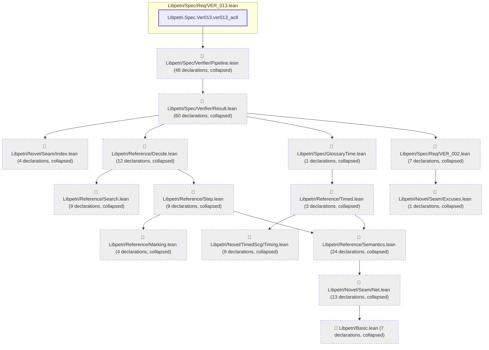

# VER-013

Generated by `scripts/proof-graph.py` from `proof-graph.json`. Do not edit.

Theorems carrying this ID:

- `Libpetri.Spec.Ver013.VER_013_stop_failing` (theorem, `Libpetri/Spec/Req/VER_013.lean:633`)
- `Libpetri.Spec.Ver013.ver013_ac8` (theorem, `Libpetri/Spec/Req/VER_013.lean:651`)

> **Note:** the full tree has 228 nodes (limit 60), so it is drawn as one diagram per theorem (2 theorems).

### `Libpetri.Spec.Ver013.VER_013_stop_failing`

> Rule: this theorem's whole tree, 49 nodes.

```mermaid
flowchart TD
  subgraph g0["Libpetri/Spec/Req/VER_013.lean"]
    n10546["Libpetri.Spec.VER_013_stop"]
    n10933["Libpetri.Spec.Ver013.FailingOracle"]
    n10934["Libpetri.Spec.Ver013.Finisher"]
    n10941["Libpetri.Spec.Ver013.Runner"]
    n10942["Libpetri.Spec.Ver013.VER_013_stop_failing"]
    n10943["Libpetri.Spec.Ver013.Yields.mono"]
    n10967["Libpetri.Spec.Ver013.stopOrWhy"]
  end
  subgraph g1["Libpetri/Spec/Verifier/Pipeline.lean"]
    n11220["Libpetri.Spec.Verifier.GStep"]
    n11221["Libpetri.Spec.Verifier.GStep.applies"]
    n11224["Libpetri.Spec.Verifier.GStep.route"]
    n11225["Libpetri.Spec.Verifier.GStep.run"]
    n11551["Libpetri.Spec.Verifier.Oracle"]
    n11562["Libpetri.Spec.Verifier.PhaseProg"]
    n11563["Libpetri.Spec.Verifier.PhaseProg.ask"]
    n11566["Libpetri.Spec.Verifier.PhaseProg.done"]
    n11567["Libpetri.Spec.Verifier.PhaseProg.poll"]
    n11708["Libpetri.Spec.Verifier.SolverFailure"]
    n11713["Libpetri.Spec.Verifier.SolverFailure.notStarted"]
    n11720["Libpetri.Spec.Verifier.SolverReply"]
    n11722["Libpetri.Spec.Verifier.SolverReply.failure"]
    n11818["Libpetri.Spec.Verifier.Stop"]
    n11819["Libpetri.Spec.Verifier.StopKind"]
    n11820["Libpetri.Spec.Verifier.StopKind.budget"]
    n11821["Libpetri.Spec.Verifier.StopKind.cancelled"]
    n11822["Libpetri.Spec.Verifier.Trail"]
    n11824["Libpetri.Spec.Verifier.Trail.entered"]
    n11826["Libpetri.Spec.Verifier.Trail.polls"]
    n11828["Libpetri.Spec.Verifier.Trail.running"]
    n11829["Libpetri.Spec.Verifier.Trail.started"]
    n11832["Libpetri.Spec.Verifier.Trail.stopped"]
    n11839["Libpetri.Spec.Verifier.Yields"]
    n11840["Libpetri.Spec.Verifier.Yields.ask"]
    n11841["Libpetri.Spec.Verifier.Yields.below.ask"]
    n11842["Libpetri.Spec.Verifier.Yields.below.done"]
    n11843["Libpetri.Spec.Verifier.Yields.below.poll"]
    n11844["Libpetri.Spec.Verifier.Yields.done"]
    n11846["Libpetri.Spec.Verifier.Yields.poll"]
    n11847["Libpetri.Spec.Verifier.byOracle"]
    n11866["Libpetri.Spec.Verifier.failing"]
    n11922["Libpetri.Spec.Verifier.noStop"]
    n11972["Libpetri.Spec.Verifier.stopReason"]
  end
  subgraph g2["Libpetri/Spec/Verifier/Result.lean"]
    n11545["Libpetri.Spec.Verifier.Options"]
    n11559["Libpetri.Spec.Verifier.PhaseOut"]
    n11560["Libpetri.Spec.Verifier.PhaseOut.aside"]
    n11561["Libpetri.Spec.Verifier.PhaseOut.decided"]
    n11587["Libpetri.Spec.Verifier.Route"]
    n11835["Libpetri.Spec.Verifier.Verdict"]
    n11836["Libpetri.Spec.Verifier.Verdict.proven"]
    n11837["Libpetri.Spec.Verifier.Verdict.unknown"]
  end
  n10546 --> n10934
  n10546 --> n10941
  n10546 --> n10967
  n10546 --> n11221
  n10546 --> n11224
  n10546 --> n11225
  n10546 --> n11560
  n10546 --> n11824
  n10546 --> n11826
  n10546 --> n11828
  n10546 --> n11829
  n10546 --> n11837
  n10546 --> n11839
  n10546 --> n11847
  n10546 --> n11922
  n10933 --> n11551
  n10933 --> n11722
  n10934 --> n11822
  n10934 --> n11835
  n10941 --> n11220
  n10941 --> n11545
  n10941 --> n11551
  n10941 --> n11559
  n10941 --> n11587
  n10941 --> n11818
  n10941 --> n11822
  n10942 --> n10546
  n10942 --> n10933
  n10942 --> n10943
  n10942 --> n11561
  n10942 --> n11836
  n10942 --> n11866
  n10943 --> n11841
  n10943 --> n11842
  n10943 --> n11843
  n10967 --> n11832
  n10967 --> n11972
  n11221 --> n11220
  n11221 --> n11545
  n11224 --> n11220
  n11224 --> n11587
  n11225 --> n11220
  n11225 --> n11545
  n11225 --> n11559
  n11225 --> n11562
  n11551 --> n11720
  n11560 --> n11559
  n11561 --> n11559
  n11561 --> n11835
  n11563 --> n11562
  n11563 --> n11720
  n11566 --> n11562
  n11567 --> n11562
  n11713 --> n11708
  n11722 --> n11708
  n11722 --> n11720
  n11818 --> n11819
  n11820 --> n11819
  n11821 --> n11819
  n11824 --> n11822
  n11826 --> n11822
  n11828 --> n11822
  n11829 --> n11822
  n11832 --> n11819
  n11832 --> n11822
  n11836 --> n11835
  n11837 --> n11835
  n11839 --> n11562
  n11839 --> n11720
  n11840 --> n11563
  n11840 --> n11839
  n11841 --> n11840
  n11842 --> n11844
  n11843 --> n11846
  n11844 --> n11566
  n11844 --> n11839
  n11846 --> n11567
  n11846 --> n11839
  n11847 --> n11551
  n11847 --> n11713
  n11847 --> n11722
  n11866 --> n11722
  n11922 --> n11818
  n11972 --> n11820
  n11972 --> n11821
  classDef root stroke-width:3px
  classDef locked fill:#fff3cd,stroke:#b8860b
  classDef collapsed fill:#eeeeee,stroke-dasharray:4 4
  class n10942 root
```

### `Libpetri.Spec.Ver013.ver013_ac8`

> Rule: this theorem's tree has 212 nodes (limit 60); every file other than its own is collapsed into one node, leaving 16.

Axioms used:

- `Libpetri.Spec.Ver013.VER_013_stop_failing`: `propext`
- `Libpetri.Spec.Ver013.ver013_ac8`: `Quot.sound`, `propext`
