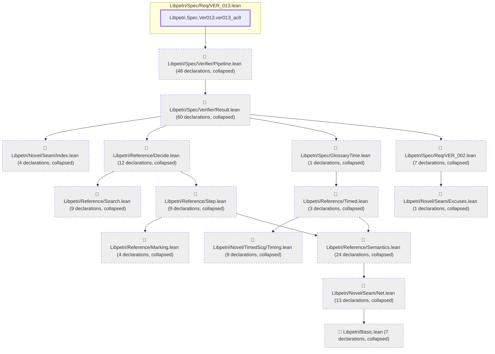

# VER-013

Generated by `scripts/proof-graph.py` from `proof-graph.json`. Do not edit.

Theorems carrying this ID:

- `Libpetri.Spec.Ver013.VER_013_stop_after` (theorem, `Libpetri/Spec/Req/VER_013.lean:792`)
- `Libpetri.Spec.Ver013.VER_013_stop_failing` (theorem, `Libpetri/Spec/Req/VER_013.lean:833`)
- `Libpetri.Spec.Ver013.VER_013_stop_noStop` (theorem, `Libpetri/Spec/Req/VER_013.lean:806`)
- `Libpetri.Spec.Ver013.ver013_ac8` (theorem, `Libpetri/Spec/Req/VER_013.lean:852`)

> **Note:** the full tree has 239 nodes (limit 60), so it is drawn as one diagram per theorem (4 theorems).

### `Libpetri.Spec.Ver013.VER_013_stop_after`

> Rule: this theorem's whole tree, 50 nodes.

```mermaid
flowchart TD
  subgraph g0["Libpetri/Spec/Req/VER_013.lean"]
    n10692["Libpetri.Spec.VER_013_stop"]
    n11093["Libpetri.Spec.Ver013.Finisher"]
    n11101["Libpetri.Spec.Ver013.Runner"]
    n11102["Libpetri.Spec.Ver013.VER_013_stop_after"]
    n11105["Libpetri.Spec.Ver013.VER_013_stop_runPipeline"]
    n11142["Libpetri.Spec.Ver013.runPipeline_stopped_entered"]
    n11145["Libpetri.Spec.Ver013.stopOrWhy"]
  end
  subgraph g1["Libpetri/Spec/Verifier/Pipeline.lean"]
    n11400["Libpetri.Spec.Verifier.GStep"]
    n11401["Libpetri.Spec.Verifier.GStep.applies"]
    n11403["Libpetri.Spec.Verifier.GStep.name"]
    n11404["Libpetri.Spec.Verifier.GStep.route"]
    n11405["Libpetri.Spec.Verifier.GStep.run"]
    n11731["Libpetri.Spec.Verifier.Oracle"]
    n11742["Libpetri.Spec.Verifier.PhaseProg"]
    n11743["Libpetri.Spec.Verifier.PhaseProg.ask"]
    n11745["Libpetri.Spec.Verifier.PhaseProg.brecOn.go"]
    n11746["Libpetri.Spec.Verifier.PhaseProg.done"]
    n11747["Libpetri.Spec.Verifier.PhaseProg.poll"]
    n11888["Libpetri.Spec.Verifier.SolverFailure"]
    n11893["Libpetri.Spec.Verifier.SolverFailure.notStarted"]
    n11900["Libpetri.Spec.Verifier.SolverReply"]
    n11902["Libpetri.Spec.Verifier.SolverReply.failure"]
    n11998["Libpetri.Spec.Verifier.Stop"]
    n11999["Libpetri.Spec.Verifier.StopKind"]
    n12000["Libpetri.Spec.Verifier.StopKind.budget"]
    n12001["Libpetri.Spec.Verifier.StopKind.cancelled"]
    n12002["Libpetri.Spec.Verifier.Trail"]
    n12003["Libpetri.Spec.Verifier.Trail.enter"]
    n12004["Libpetri.Spec.Verifier.Trail.entered"]
    n12005["Libpetri.Spec.Verifier.Trail.mk"]
    n12006["Libpetri.Spec.Verifier.Trail.polls"]
    n12007["Libpetri.Spec.Verifier.Trail.route"]
    n12008["Libpetri.Spec.Verifier.Trail.running"]
    n12009["Libpetri.Spec.Verifier.Trail.started"]
    n12012["Libpetri.Spec.Verifier.Trail.stopped"]
    n12040["Libpetri.Spec.Verifier.execProg"]
    n12110["Libpetri.Spec.Verifier.pollStop"]
    n12112["Libpetri.Spec.Verifier.pollStop_frame"]
    n12113["Libpetri.Spec.Verifier.pollStop_keeps"]
    n12132["Libpetri.Spec.Verifier.refusedReason"]
    n12143["Libpetri.Spec.Verifier.runPipeline"]
    n12144["Libpetri.Spec.Verifier.runPipeline_after_stop"]
    n12152["Libpetri.Spec.Verifier.stopReason"]
  end
  subgraph g2["Libpetri/Spec/Verifier/Result.lean"]
    n11725["Libpetri.Spec.Verifier.Options"]
    n11739["Libpetri.Spec.Verifier.PhaseOut"]
    n11740["Libpetri.Spec.Verifier.PhaseOut.aside"]
    n11741["Libpetri.Spec.Verifier.PhaseOut.decided"]
    n11767["Libpetri.Spec.Verifier.Route"]
    n12015["Libpetri.Spec.Verifier.Verdict"]
    n12017["Libpetri.Spec.Verifier.Verdict.unknown"]
  end
  n10692 --> n11093
  n10692 --> n11101
  n10692 --> n11145
  n10692 --> n11401
  n10692 --> n11405
  n10692 --> n11740
  n10692 --> n11741
  n10692 --> n12003
  n10692 --> n12017
  n10692 --> n12040
  n11093 --> n12002
  n11093 --> n12015
  n11101 --> n11400
  n11101 --> n11725
  n11101 --> n11731
  n11101 --> n11739
  n11101 --> n11767
  n11101 --> n11998
  n11101 --> n12002
  n11102 --> n11105
  n11102 --> n11142
  n11102 --> n12144
  n11105 --> n10692
  n11105 --> n12143
  n11142 --> n12112
  n11142 --> n12113
  n11142 --> n12143
  n11145 --> n12012
  n11145 --> n12152
  n11401 --> n11400
  n11401 --> n11725
  n11403 --> n11400
  n11404 --> n11400
  n11404 --> n11767
  n11405 --> n11400
  n11405 --> n11725
  n11405 --> n11739
  n11405 --> n11742
  n11731 --> n11900
  n11740 --> n11739
  n11741 --> n11739
  n11741 --> n12015
  n11743 --> n11742
  n11743 --> n11900
  n11745 --> n11743
  n11745 --> n11746
  n11745 --> n11747
  n11746 --> n11742
  n11747 --> n11742
  n11893 --> n11888
  n11902 --> n11888
  n11902 --> n11900
  n11998 --> n11999
  n12000 --> n11999
  n12001 --> n11999
  n12003 --> n11403
  n12003 --> n11404
  n12003 --> n12004
  n12003 --> n12005
  n12003 --> n12006
  n12003 --> n12009
  n12003 --> n12012
  n12004 --> n12002
  n12005 --> n11767
  n12005 --> n11999
  n12005 --> n12002
  n12006 --> n12002
  n12007 --> n11767
  n12007 --> n12002
  n12008 --> n12002
  n12009 --> n12002
  n12012 --> n11999
  n12012 --> n12002
  n12017 --> n12015
  n12040 --> n11731
  n12040 --> n11745
  n12040 --> n11893
  n12040 --> n11902
  n12040 --> n12110
  n12040 --> n12132
  n12110 --> n11998
  n12110 --> n12004
  n12110 --> n12005
  n12110 --> n12006
  n12110 --> n12007
  n12110 --> n12008
  n12110 --> n12009
  n12110 --> n12012
  n12112 --> n12110
  n12113 --> n12110
  n12132 --> n12000
  n12132 --> n12001
  n12143 --> n11401
  n12143 --> n11405
  n12143 --> n11740
  n12143 --> n11741
  n12143 --> n12003
  n12143 --> n12040
  n12144 --> n12112
  n12144 --> n12113
  n12144 --> n12143
  n12152 --> n12000
  n12152 --> n12001
  classDef root stroke-width:3px
  classDef locked fill:#fff3cd,stroke:#b8860b
  classDef collapsed fill:#eeeeee,stroke-dasharray:4 4
  class n11102 root
```

### `Libpetri.Spec.Ver013.VER_013_stop_failing`

> Rule: this theorem's whole tree, 60 nodes.

```mermaid
flowchart TD
  subgraph g0["Libpetri/Spec/Req/VER_013.lean"]
    n10692["Libpetri.Spec.VER_013_stop"]
    n11092["Libpetri.Spec.Ver013.FailingOracle"]
    n11093["Libpetri.Spec.Ver013.Finisher"]
    n11101["Libpetri.Spec.Ver013.Runner"]
    n11103["Libpetri.Spec.Ver013.VER_013_stop_failing"]
    n11105["Libpetri.Spec.Ver013.VER_013_stop_runPipeline"]
    n11106["Libpetri.Spec.Ver013.Yields.mono"]
    n11145["Libpetri.Spec.Ver013.stopOrWhy"]
  end
  subgraph g1["Libpetri/Spec/Verifier/Pipeline.lean"]
    n11400["Libpetri.Spec.Verifier.GStep"]
    n11401["Libpetri.Spec.Verifier.GStep.applies"]
    n11403["Libpetri.Spec.Verifier.GStep.name"]
    n11404["Libpetri.Spec.Verifier.GStep.route"]
    n11405["Libpetri.Spec.Verifier.GStep.run"]
    n11731["Libpetri.Spec.Verifier.Oracle"]
    n11742["Libpetri.Spec.Verifier.PhaseProg"]
    n11743["Libpetri.Spec.Verifier.PhaseProg.ask"]
    n11745["Libpetri.Spec.Verifier.PhaseProg.brecOn.go"]
    n11746["Libpetri.Spec.Verifier.PhaseProg.done"]
    n11747["Libpetri.Spec.Verifier.PhaseProg.poll"]
    n11888["Libpetri.Spec.Verifier.SolverFailure"]
    n11893["Libpetri.Spec.Verifier.SolverFailure.notStarted"]
    n11900["Libpetri.Spec.Verifier.SolverReply"]
    n11902["Libpetri.Spec.Verifier.SolverReply.failure"]
    n11998["Libpetri.Spec.Verifier.Stop"]
    n11999["Libpetri.Spec.Verifier.StopKind"]
    n12000["Libpetri.Spec.Verifier.StopKind.budget"]
    n12001["Libpetri.Spec.Verifier.StopKind.cancelled"]
    n12002["Libpetri.Spec.Verifier.Trail"]
    n12003["Libpetri.Spec.Verifier.Trail.enter"]
    n12004["Libpetri.Spec.Verifier.Trail.entered"]
    n12005["Libpetri.Spec.Verifier.Trail.mk"]
    n12006["Libpetri.Spec.Verifier.Trail.polls"]
    n12007["Libpetri.Spec.Verifier.Trail.route"]
    n12008["Libpetri.Spec.Verifier.Trail.running"]
    n12009["Libpetri.Spec.Verifier.Trail.started"]
    n12012["Libpetri.Spec.Verifier.Trail.stopped"]
    n12019["Libpetri.Spec.Verifier.Yields"]
    n12020["Libpetri.Spec.Verifier.Yields.ask"]
    n12021["Libpetri.Spec.Verifier.Yields.below.ask"]
    n12022["Libpetri.Spec.Verifier.Yields.below.done"]
    n12023["Libpetri.Spec.Verifier.Yields.below.poll"]
    n12024["Libpetri.Spec.Verifier.Yields.done"]
    n12026["Libpetri.Spec.Verifier.Yields.poll"]
    n12027["Libpetri.Spec.Verifier.byOracle"]
    n12040["Libpetri.Spec.Verifier.execProg"]
    n12045["Libpetri.Spec.Verifier.execProg_yields"]
    n12046["Libpetri.Spec.Verifier.failing"]
    n12110["Libpetri.Spec.Verifier.pollStop"]
    n12132["Libpetri.Spec.Verifier.refusedReason"]
    n12143["Libpetri.Spec.Verifier.runPipeline"]
    n12149["Libpetri.Spec.Verifier.runPipeline_step"]
    n12152["Libpetri.Spec.Verifier.stopReason"]
  end
  subgraph g2["Libpetri/Spec/Verifier/Result.lean"]
    n11725["Libpetri.Spec.Verifier.Options"]
    n11739["Libpetri.Spec.Verifier.PhaseOut"]
    n11740["Libpetri.Spec.Verifier.PhaseOut.aside"]
    n11741["Libpetri.Spec.Verifier.PhaseOut.decided"]
    n11767["Libpetri.Spec.Verifier.Route"]
    n12015["Libpetri.Spec.Verifier.Verdict"]
    n12016["Libpetri.Spec.Verifier.Verdict.proven"]
    n12017["Libpetri.Spec.Verifier.Verdict.unknown"]
  end
  n10692 --> n11093
  n10692 --> n11101
  n10692 --> n11145
  n10692 --> n11401
  n10692 --> n11405
  n10692 --> n11740
  n10692 --> n11741
  n10692 --> n12003
  n10692 --> n12017
  n10692 --> n12040
  n11092 --> n11731
  n11092 --> n11902
  n11093 --> n12002
  n11093 --> n12015
  n11101 --> n11400
  n11101 --> n11725
  n11101 --> n11731
  n11101 --> n11739
  n11101 --> n11767
  n11101 --> n11998
  n11101 --> n12002
  n11103 --> n11092
  n11103 --> n11105
  n11103 --> n11106
  n11103 --> n12016
  n11103 --> n12046
  n11103 --> n12149
  n11105 --> n10692
  n11105 --> n12143
  n11106 --> n12021
  n11106 --> n12022
  n11106 --> n12023
  n11145 --> n12012
  n11145 --> n12152
  n11401 --> n11400
  n11401 --> n11725
  n11403 --> n11400
  n11404 --> n11400
  n11404 --> n11767
  n11405 --> n11400
  n11405 --> n11725
  n11405 --> n11739
  n11405 --> n11742
  n11731 --> n11900
  n11740 --> n11739
  n11741 --> n11739
  n11741 --> n12015
  n11743 --> n11742
  n11743 --> n11900
  n11745 --> n11743
  n11745 --> n11746
  n11745 --> n11747
  n11746 --> n11742
  n11747 --> n11742
  n11893 --> n11888
  n11902 --> n11888
  n11902 --> n11900
  n11998 --> n11999
  n12000 --> n11999
  n12001 --> n11999
  n12003 --> n11403
  n12003 --> n11404
  n12003 --> n12004
  n12003 --> n12005
  n12003 --> n12006
  n12003 --> n12009
  n12003 --> n12012
  n12004 --> n12002
  n12005 --> n11767
  n12005 --> n11999
  n12005 --> n12002
  n12006 --> n12002
  n12007 --> n11767
  n12007 --> n12002
  n12008 --> n12002
  n12009 --> n12002
  n12012 --> n11999
  n12012 --> n12002
  n12016 --> n12015
  n12017 --> n12015
  n12019 --> n11742
  n12019 --> n11900
  n12020 --> n11743
  n12020 --> n12019
  n12021 --> n12020
  n12022 --> n12024
  n12023 --> n12026
  n12024 --> n11746
  n12024 --> n12019
  n12026 --> n11747
  n12026 --> n12019
  n12027 --> n11731
  n12027 --> n11893
  n12027 --> n11902
  n12040 --> n11731
  n12040 --> n11745
  n12040 --> n11893
  n12040 --> n11902
  n12040 --> n12110
  n12040 --> n12132
  n12045 --> n12020
  n12045 --> n12024
  n12045 --> n12026
  n12045 --> n12027
  n12045 --> n12040
  n12046 --> n11902
  n12110 --> n11998
  n12110 --> n12004
  n12110 --> n12005
  n12110 --> n12006
  n12110 --> n12007
  n12110 --> n12008
  n12110 --> n12009
  n12110 --> n12012
  n12132 --> n12000
  n12132 --> n12001
  n12143 --> n11401
  n12143 --> n11405
  n12143 --> n11740
  n12143 --> n11741
  n12143 --> n12003
  n12143 --> n12040
  n12149 --> n12045
  n12149 --> n12143
  n12152 --> n12000
  n12152 --> n12001
  classDef root stroke-width:3px
  classDef locked fill:#fff3cd,stroke:#b8860b
  classDef collapsed fill:#eeeeee,stroke-dasharray:4 4
  class n11103 root
```

### `Libpetri.Spec.Ver013.VER_013_stop_noStop`

> Rule: this theorem's whole tree, 52 nodes.

```mermaid
flowchart TD
  subgraph g0["Libpetri/Spec/Req/VER_013.lean"]
    n10692["Libpetri.Spec.VER_013_stop"]
    n11093["Libpetri.Spec.Ver013.Finisher"]
    n11101["Libpetri.Spec.Ver013.Runner"]
    n11104["Libpetri.Spec.Ver013.VER_013_stop_noStop"]
    n11105["Libpetri.Spec.Ver013.VER_013_stop_runPipeline"]
    n11118["Libpetri.Spec.Ver013.execProg_noStop"]
    n11141["Libpetri.Spec.Ver013.runPipeline_noStop'"]
    n11145["Libpetri.Spec.Ver013.stopOrWhy"]
  end
  subgraph g1["Libpetri/Spec/Verifier/Pipeline.lean"]
    n11400["Libpetri.Spec.Verifier.GStep"]
    n11401["Libpetri.Spec.Verifier.GStep.applies"]
    n11403["Libpetri.Spec.Verifier.GStep.name"]
    n11404["Libpetri.Spec.Verifier.GStep.route"]
    n11405["Libpetri.Spec.Verifier.GStep.run"]
    n11731["Libpetri.Spec.Verifier.Oracle"]
    n11742["Libpetri.Spec.Verifier.PhaseProg"]
    n11743["Libpetri.Spec.Verifier.PhaseProg.ask"]
    n11745["Libpetri.Spec.Verifier.PhaseProg.brecOn.go"]
    n11746["Libpetri.Spec.Verifier.PhaseProg.done"]
    n11747["Libpetri.Spec.Verifier.PhaseProg.poll"]
    n11888["Libpetri.Spec.Verifier.SolverFailure"]
    n11893["Libpetri.Spec.Verifier.SolverFailure.notStarted"]
    n11900["Libpetri.Spec.Verifier.SolverReply"]
    n11902["Libpetri.Spec.Verifier.SolverReply.failure"]
    n11998["Libpetri.Spec.Verifier.Stop"]
    n11999["Libpetri.Spec.Verifier.StopKind"]
    n12000["Libpetri.Spec.Verifier.StopKind.budget"]
    n12001["Libpetri.Spec.Verifier.StopKind.cancelled"]
    n12002["Libpetri.Spec.Verifier.Trail"]
    n12003["Libpetri.Spec.Verifier.Trail.enter"]
    n12004["Libpetri.Spec.Verifier.Trail.entered"]
    n12005["Libpetri.Spec.Verifier.Trail.mk"]
    n12006["Libpetri.Spec.Verifier.Trail.polls"]
    n12007["Libpetri.Spec.Verifier.Trail.route"]
    n12008["Libpetri.Spec.Verifier.Trail.running"]
    n12009["Libpetri.Spec.Verifier.Trail.started"]
    n12012["Libpetri.Spec.Verifier.Trail.stopped"]
    n12040["Libpetri.Spec.Verifier.execProg"]
    n12102["Libpetri.Spec.Verifier.noStop"]
    n12110["Libpetri.Spec.Verifier.pollStop"]
    n12114["Libpetri.Spec.Verifier.pollStop_noStop"]
    n12132["Libpetri.Spec.Verifier.refusedReason"]
    n12143["Libpetri.Spec.Verifier.runPipeline"]
    n12152["Libpetri.Spec.Verifier.stopReason"]
  end
  subgraph g2["Libpetri/Spec/Verifier/Result.lean"]
    n11725["Libpetri.Spec.Verifier.Options"]
    n11739["Libpetri.Spec.Verifier.PhaseOut"]
    n11740["Libpetri.Spec.Verifier.PhaseOut.aside"]
    n11741["Libpetri.Spec.Verifier.PhaseOut.decided"]
    n11767["Libpetri.Spec.Verifier.Route"]
    n12015["Libpetri.Spec.Verifier.Verdict"]
    n12016["Libpetri.Spec.Verifier.Verdict.proven"]
    n12017["Libpetri.Spec.Verifier.Verdict.unknown"]
    n12018["Libpetri.Spec.Verifier.Verdict.violated"]
  end
  n10692 --> n11093
  n10692 --> n11101
  n10692 --> n11145
  n10692 --> n11401
  n10692 --> n11405
  n10692 --> n11740
  n10692 --> n11741
  n10692 --> n12003
  n10692 --> n12017
  n10692 --> n12040
  n11093 --> n12002
  n11093 --> n12015
  n11101 --> n11400
  n11101 --> n11725
  n11101 --> n11731
  n11101 --> n11739
  n11101 --> n11767
  n11101 --> n11998
  n11101 --> n12002
  n11104 --> n11105
  n11104 --> n11141
  n11104 --> n12016
  n11104 --> n12018
  n11105 --> n10692
  n11105 --> n12143
  n11118 --> n12040
  n11118 --> n12114
  n11141 --> n11118
  n11141 --> n12143
  n11145 --> n12012
  n11145 --> n12152
  n11401 --> n11400
  n11401 --> n11725
  n11403 --> n11400
  n11404 --> n11400
  n11404 --> n11767
  n11405 --> n11400
  n11405 --> n11725
  n11405 --> n11739
  n11405 --> n11742
  n11731 --> n11900
  n11740 --> n11739
  n11741 --> n11739
  n11741 --> n12015
  n11743 --> n11742
  n11743 --> n11900
  n11745 --> n11743
  n11745 --> n11746
  n11745 --> n11747
  n11746 --> n11742
  n11747 --> n11742
  n11893 --> n11888
  n11902 --> n11888
  n11902 --> n11900
  n11998 --> n11999
  n12000 --> n11999
  n12001 --> n11999
  n12003 --> n11403
  n12003 --> n11404
  n12003 --> n12004
  n12003 --> n12005
  n12003 --> n12006
  n12003 --> n12009
  n12003 --> n12012
  n12004 --> n12002
  n12005 --> n11767
  n12005 --> n11999
  n12005 --> n12002
  n12006 --> n12002
  n12007 --> n11767
  n12007 --> n12002
  n12008 --> n12002
  n12009 --> n12002
  n12012 --> n11999
  n12012 --> n12002
  n12016 --> n12015
  n12017 --> n12015
  n12018 --> n12015
  n12040 --> n11731
  n12040 --> n11745
  n12040 --> n11893
  n12040 --> n11902
  n12040 --> n12110
  n12040 --> n12132
  n12102 --> n11998
  n12110 --> n11998
  n12110 --> n12004
  n12110 --> n12005
  n12110 --> n12006
  n12110 --> n12007
  n12110 --> n12008
  n12110 --> n12009
  n12110 --> n12012
  n12114 --> n12102
  n12114 --> n12110
  n12132 --> n12000
  n12132 --> n12001
  n12143 --> n11401
  n12143 --> n11405
  n12143 --> n11740
  n12143 --> n11741
  n12143 --> n12003
  n12143 --> n12040
  n12152 --> n12000
  n12152 --> n12001
  classDef root stroke-width:3px
  classDef locked fill:#fff3cd,stroke:#b8860b
  classDef collapsed fill:#eeeeee,stroke-dasharray:4 4
  class n11104 root
```

### `Libpetri.Spec.Ver013.ver013_ac8`

> Rule: this theorem's tree has 212 nodes (limit 60); every file other than its own is collapsed into one node, leaving 16.

Axioms used:

- `Libpetri.Spec.Ver013.VER_013_stop_after`: `propext`
- `Libpetri.Spec.Ver013.VER_013_stop_failing`: `propext`
- `Libpetri.Spec.Ver013.VER_013_stop_noStop`: `propext`
- `Libpetri.Spec.Ver013.ver013_ac8`: `Quot.sound`, `propext`
