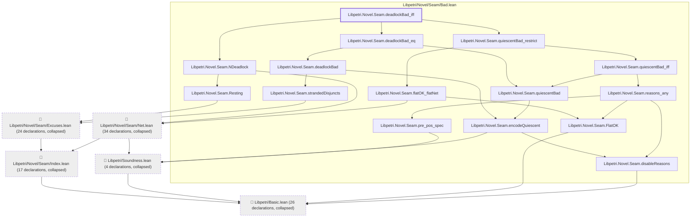
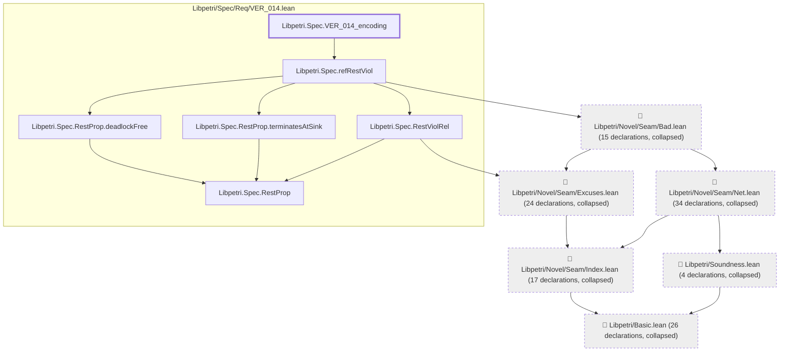

# VER-014

Generated by `scripts/proof-graph.py` from `proof-graph.json`. Do not edit.

Theorems carrying this ID:

- `Libpetri.Novel.Seam.deadlockBad_iff` (theorem, `Libpetri/Novel/Seam/Bad.lean:225`)
- `Libpetri.Novel.Seam.strandingExcuses_spec` (theorem, `Libpetri/Novel/Seam/Excuses.lean:258`)
- `Libpetri.Spec.VER_014_encoding` (theorem, `Libpetri/Spec/Req/VER_014.lean:155`)

> **Note:** the full tree has 126 nodes (limit 60), so it is drawn as one diagram per theorem (3 theorems).

### `Libpetri.Novel.Seam.deadlockBad_iff`

> Rule: this theorem's tree has 120 nodes (limit 60); every file other than its own is collapsed into one node, leaving 20.

### `Libpetri.Novel.Seam.strandingExcuses_spec`

> Rule: this theorem's whole tree, 35 nodes.

```mermaid
flowchart TD
  subgraph g0["Libpetri/Novel/Seam/Excuses.lean"]
    n1912["Libpetri.Novel.Seam.CondSinks"]
    n1913["Libpetri.Novel.Seam.CondSinks.marker"]
    n1915["Libpetri.Novel.Seam.CondSinks.places"]
    n1917["Libpetri.Novel.Seam.ExcuseSpec"]
    n1918["Libpetri.Novel.Seam.ExcuseSpec.congr_simp"]
    n1919["Libpetri.Novel.Seam.ExcuseSpec.mem_iff"]
    n1920["Libpetri.Novel.Seam.ExcuseSpec.mk"]
    n1921["Libpetri.Novel.Seam.ExcuseSpec.none_iff"]
    n1922["Libpetri.Novel.Seam.ExcusedBy"]
    n1923["Libpetri.Novel.Seam.Excuses"]
    n1931["Libpetri.Novel.Seam.IsMarker"]
    n2029["Libpetri.Novel.Seam.conds_spec"]
    n2053["Libpetri.Novel.Seam.entryStep"]
    n2055["Libpetri.Novel.Seam.entryStep_spec"]
    n2086["Libpetri.Novel.Seam.name_eq_of_idx"]
    n2099["Libpetri.Novel.Seam.placeStep"]
    n2101["Libpetri.Novel.Seam.placeStep_spec"]
    n2102["Libpetri.Novel.Seam.places_spec"]
    n2123["Libpetri.Novel.Seam.setAt"]
    n2124["Libpetri.Novel.Seam.sinkStep"]
    n2126["Libpetri.Novel.Seam.sinkStep_spec"]
    n2127["Libpetri.Novel.Seam.sinks_spec"]
    n2133["Libpetri.Novel.Seam.strandingExcuses"]
    n2135["Libpetri.Novel.Seam.strandingExcuses_spec"]
  end
  subgraph g1["Libpetri/Novel/Seam/Index.lean"]
    n1962["Libpetri.Novel.Seam.PlaceIndex"]
    n1963["Libpetri.Novel.Seam.PlaceIndex.idx"]
    n1965["Libpetri.Novel.Seam.PlaceIndex.idx_inj"]
    n1967["Libpetri.Novel.Seam.PlaceIndex.idx_of_name?"]
    n1968["Libpetri.Novel.Seam.PlaceIndex.lookup"]
    n1970["Libpetri.Novel.Seam.PlaceIndex.lookup_eq_none"]
    n1971["Libpetri.Novel.Seam.PlaceIndex.lookup_eq_some"]
    n1972["Libpetri.Novel.Seam.PlaceIndex.mem_of_name?"]
    n1974["Libpetri.Novel.Seam.PlaceIndex.name?"]
    n1977["Libpetri.Novel.Seam.PlaceIndex.names"]
    n1978["Libpetri.Novel.Seam.PlaceIndex.nodup"]
  end
  n1913 --> n1912
  n1915 --> n1912
  n1917 --> n1912
  n1917 --> n1923
  n1917 --> n1962
  n1918 --> n1917
  n1919 --> n1917
  n1919 --> n1922
  n1919 --> n1974
  n1920 --> n1917
  n1920 --> n1922
  n1920 --> n1931
  n1920 --> n1974
  n1921 --> n1917
  n1921 --> n1931
  n1921 --> n1974
  n1922 --> n1913
  n1922 --> n1915
  n1922 --> n1963
  n1931 --> n1913
  n1963 --> n1977
  n1965 --> n1963
  n1967 --> n1963
  n1967 --> n1974
  n1967 --> n1978
  n1968 --> n1963
  n1970 --> n1968
  n1971 --> n1968
  n1972 --> n1974
  n1974 --> n1977
  n1977 --> n1962
  n1978 --> n1977
  n2029 --> n1918
  n2029 --> n2055
  n2053 --> n1913
  n2053 --> n1915
  n2053 --> n2099
  n2055 --> n1919
  n2055 --> n1920
  n2055 --> n1921
  n2055 --> n1970
  n2055 --> n1971
  n2055 --> n1972
  n2055 --> n2053
  n2055 --> n2086
  n2055 --> n2102
  n2086 --> n1965
  n2086 --> n1967
  n2099 --> n1968
  n2099 --> n2123
  n2101 --> n2099
  n2102 --> n2101
  n2123 --> n1923
  n2124 --> n1968
  n2124 --> n2123
  n2126 --> n1919
  n2126 --> n1920
  n2126 --> n1921
  n2126 --> n1970
  n2126 --> n1971
  n2126 --> n1972
  n2126 --> n2086
  n2126 --> n2124
  n2127 --> n1918
  n2127 --> n2126
  n2133 --> n2053
  n2133 --> n2124
  n2135 --> n2029
  n2135 --> n2127
  n2135 --> n2133
  classDef root stroke-width:3px
  classDef locked fill:#fff3cd,stroke:#b8860b
  classDef collapsed fill:#eeeeee,stroke-dasharray:4 4
  class n2135 root
```

### `Libpetri.Spec.VER_014_encoding`

> Rule: this theorem's tree has 126 nodes (limit 60); every file other than its own is collapsed into one node, leaving 12.

Axioms used:

- `Libpetri.Novel.Seam.deadlockBad_iff`: `Classical.choice`, `Quot.sound`, `propext`
- `Libpetri.Novel.Seam.strandingExcuses_spec`: `Classical.choice`, `Quot.sound`, `propext`
- `Libpetri.Spec.VER_014_encoding`: `Classical.choice`, `Quot.sound`, `propext`
