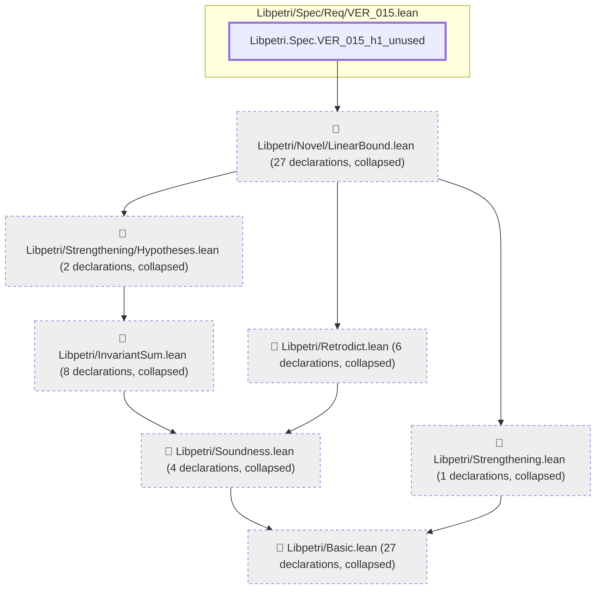

# VER-015

Generated by `scripts/proof-graph.py` from `proof-graph.json`. Do not edit.

Theorems carrying this ID:

- `Libpetri.Novel.LinearBound.linear_bound_sound` (theorem, `Libpetri/Novel/LinearBound.lean:181`)
- `Libpetri.Spec.VER_015_env_zero` (theorem, `Libpetri/Spec/Req/VER_015.lean:416`)
- `Libpetri.Spec.VER_015_h1_unused` (theorem, `Libpetri/Spec/Req/VER_015.lean:428`)
- `Libpetri.Spec.VER_015_sound` (theorem, `Libpetri/Spec/Req/VER_015.lean:356`)

> **Note:** the full tree has 149 nodes (limit 60), so it is drawn as one diagram per theorem (4 theorems).

### `Libpetri.Novel.LinearBound.linear_bound_sound`

> Rule: this theorem's whole tree, 55 nodes.

```mermaid
flowchart TD
  subgraph g0["Libpetri/Basic.lean"]
    n0["Libpetri.AMarking"]
    n8["Libpetri.Card"]
    n9["Libpetri.Card.all"]
    n10["Libpetri.Card.atLeast"]
    n11["Libpetri.Card.consumesAll"]
    n12["Libpetri.Card.exactly"]
    n13["Libpetri.Card.one"]
    n14["Libpetri.Card.required"]
    n134["Libpetri.InSpec"]
    n135["Libpetri.InSpec.card"]
    n138["Libpetri.InSpec.place"]
    n2720["Libpetri.PlaceId"]
    n13129["Libpetri.Transition"]
    n13130["Libpetri.Transition.inhibitors"]
    n13131["Libpetri.Transition.inputs"]
    n13135["Libpetri.Transition.reads"]
    n13136["Libpetri.Transition.resets"]
    n13206["Libpetri.consumeAllAt"]
    n13258["Libpetri.enabledA"]
    n13280["Libpetri.fireA"]
    n13376["Libpetri.post"]
    n13381["Libpetri.pre"]
    n13436["Libpetri.specAt"]
  end
  subgraph g1["Libpetri/InvariantSum.lean"]
    n13146["Libpetri.Weight"]
    n13245["Libpetri.dot"]
    n13246["Libpetri.dotInc"]
    n13247["Libpetri.dot_eq_isum"]
    n13325["Libpetri.isum"]
    n13326["🔒 Libpetri.isum_add"]
    n13328["🔒 Libpetri.isum_congr"]
  end
  subgraph g2["Libpetri/Novel/LinearBound.lean"]
    n1017["Libpetri.Novel.LinearBound.Covers"]
    n1022["Libpetri.Novel.LinearBound.ShippedCheck"]
    n1023["Libpetri.Novel.LinearBound.ShippedCheck.dec"]
    n1025["Libpetri.Novel.LinearBound.ShippedCheck.henv"]
    n1027["Libpetri.Novel.LinearBound.ShippedCheck.pos"]
    n1028["Libpetri.Novel.LinearBound.ShippedCheck.sep"]
    n1043["Libpetri.Novel.LinearBound.dot_fireA_le"]
    n1044["Libpetri.Novel.LinearBound.dot_inject"]
    n1045["Libpetri.Novel.LinearBound.dot_le_initial"]
    n1047["Libpetri.Novel.LinearBound.dot_le_of_covers"]
    n1050["Libpetri.Novel.LinearBound.fireA_le_linear"]
    n1052["Libpetri.Novel.LinearBound.isum_le"]
    n1057["Libpetri.Novel.LinearBound.linear_bound_sound"]
    n1058["Libpetri.Novel.LinearBound.linear_bound_sound_noH1"]
  end
  subgraph g3["Libpetri/Retrodict.lean"]
    n2872["Libpetri.ReachAInj"]
    n2873["Libpetri.ReachAInj.init"]
    n2874["Libpetri.ReachAInj.inject"]
    n2875["Libpetri.ReachAInj.rec'"]
    n2876["Libpetri.ReachAInj.step"]
    n13107["Libpetri.StepAInjRel"]
  end
  subgraph g4["Libpetri/Soundness.lean"]
    n130["Libpetri.FlatNet"]
    n131["Libpetri.FlatTransition"]
    n13110["Libpetri.StepARel"]
    n13440["🔒 Libpetri.specAt_sound"]
  end
  subgraph g5["Libpetri/Strengthening/Hypotheses.lean"]
    n13386["🔒 Libpetri.pre_le_of_enabledA"]
  end
  n0 --> n2720
  n9 --> n8
  n10 --> n8
  n11 --> n9
  n11 --> n10
  n11 --> n12
  n11 --> n13
  n12 --> n8
  n13 --> n8
  n14 --> n9
  n14 --> n10
  n14 --> n12
  n14 --> n13
  n130 --> n131
  n131 --> n2720
  n131 --> n13129
  n135 --> n8
  n135 --> n134
  n138 --> n134
  n138 --> n2720
  n1017 --> n0
  n1022 --> n0
  n1022 --> n130
  n1022 --> n13146
  n1023 --> n1022
  n1023 --> n13246
  n1025 --> n1022
  n1027 --> n1022
  n1028 --> n1022
  n1028 --> n13245
  n1043 --> n1050
  n1043 --> n1052
  n1043 --> n13246
  n1043 --> n13247
  n1043 --> n13326
  n1044 --> n13247
  n1044 --> n13328
  n1045 --> n1043
  n1045 --> n1044
  n1045 --> n2875
  n1047 --> n1017
  n1047 --> n1052
  n1047 --> n13247
  n1050 --> n13280
  n1050 --> n13386
  n1052 --> n13325
  n1057 --> n1023
  n1057 --> n1025
  n1057 --> n1027
  n1057 --> n1028
  n1057 --> n1058
  n1058 --> n1045
  n1058 --> n1047
  n2872 --> n13107
  n2873 --> n2872
  n2874 --> n2872
  n2875 --> n2873
  n2875 --> n2874
  n2875 --> n2876
  n2876 --> n2872
  n13107 --> n13110
  n13110 --> n130
  n13110 --> n13258
  n13110 --> n13280
  n13130 --> n2720
  n13130 --> n13129
  n13131 --> n134
  n13131 --> n13129
  n13135 --> n2720
  n13135 --> n13129
  n13136 --> n2720
  n13136 --> n13129
  n13146 --> n2720
  n13206 --> n11
  n13206 --> n135
  n13206 --> n13436
  n13245 --> n0
  n13245 --> n13146
  n13246 --> n131
  n13246 --> n13146
  n13246 --> n13325
  n13246 --> n13376
  n13246 --> n13381
  n13247 --> n13245
  n13247 --> n13325
  n13258 --> n0
  n13258 --> n14
  n13258 --> n135
  n13258 --> n138
  n13258 --> n13130
  n13258 --> n13131
  n13258 --> n13135
  n13280 --> n0
  n13280 --> n13136
  n13280 --> n13206
  n13280 --> n13376
  n13280 --> n13381
  n13325 --> n2720
  n13326 --> n13325
  n13328 --> n13325
  n13376 --> n2720
  n13381 --> n14
  n13381 --> n135
  n13381 --> n13436
  n13386 --> n13258
  n13386 --> n13381
  n13386 --> n13440
  n13436 --> n138
  n13436 --> n13131
  n13440 --> n13436
  classDef root stroke-width:3px
  classDef locked fill:#fff3cd,stroke:#b8860b
  classDef collapsed fill:#eeeeee,stroke-dasharray:4 4
  class n1057 root
  class n13326,n13328,n13386,n13440 locked
```

### `Libpetri.Spec.VER_015_env_zero`

> Rule: this theorem's whole tree, 55 nodes.

```mermaid
flowchart TD
  subgraph g0["Libpetri/Basic.lean"]
    n0["Libpetri.AMarking"]
    n8["Libpetri.Card"]
    n9["Libpetri.Card.all"]
    n10["Libpetri.Card.atLeast"]
    n11["Libpetri.Card.consumesAll"]
    n12["Libpetri.Card.exactly"]
    n13["Libpetri.Card.one"]
    n14["Libpetri.Card.required"]
    n21["Libpetri.Colour"]
    n132["Libpetri.Guard"]
    n134["Libpetri.InSpec"]
    n135["Libpetri.InSpec.card"]
    n137["Libpetri.InSpec.mk"]
    n138["Libpetri.InSpec.place"]
    n2720["Libpetri.PlaceId"]
    n13129["Libpetri.Transition"]
    n13130["Libpetri.Transition.inhibitors"]
    n13131["Libpetri.Transition.inputs"]
    n13132["Libpetri.Transition.mk"]
    n13135["Libpetri.Transition.reads"]
    n13136["Libpetri.Transition.resets"]
    n13206["Libpetri.consumeAllAt"]
    n13258["Libpetri.enabledA"]
    n13280["Libpetri.fireA"]
    n13376["Libpetri.post"]
    n13381["Libpetri.pre"]
    n13436["Libpetri.specAt"]
  end
  subgraph g1["Libpetri/InvariantSum.lean"]
    n13146["Libpetri.Weight"]
    n13245["Libpetri.dot"]
    n13246["Libpetri.dotInc"]
    n13325["Libpetri.isum"]
  end
  subgraph g2["Libpetri/Novel/LinearBound.lean"]
    n1017["Libpetri.Novel.LinearBound.Covers"]
    n1019["Libpetri.Novel.LinearBound.SafetyProp"]
    n1020["Libpetri.Novel.LinearBound.SafetyProp.allMarked"]
    n1021["Libpetri.Novel.LinearBound.SafetyProp.placeBound"]
    n1037["Libpetri.Novel.LinearBound.dEnv"]
    n1038["Libpetri.Novel.LinearBound.demand"]
    n1048["Libpetri.Novel.LinearBound.env_zero_is_necessary"]
    n1068["Libpetri.Novel.LinearBound.yEnv"]
  end
  subgraph g3["Libpetri/Retrodict.lean"]
    n2872["Libpetri.ReachAInj"]
    n2873["Libpetri.ReachAInj.init"]
    n2874["Libpetri.ReachAInj.inject"]
    n2876["Libpetri.ReachAInj.step"]
    n13107["Libpetri.StepAInjRel"]
    n13150["Libpetri.aInjected"]
    n13262["Libpetri.envPlace"]
    n13304["🔒 Libpetri.injection_reaches_violation"]
    n13341["Libpetri.m0A"]
    n13354["Libpetri.netEnv"]
    n13361["Libpetri.outPlace"]
    n13458["Libpetri.tConsume"]
  end
  subgraph g4["Libpetri/Soundness.lean"]
    n130["Libpetri.FlatNet"]
    n131["Libpetri.FlatTransition"]
    n13110["Libpetri.StepARel"]
  end
  subgraph g5["Libpetri/Spec/Req/VER_015.lean"]
    n7344["Libpetri.Spec.VER_015_env_zero"]
  end
  n0 --> n2720
  n9 --> n8
  n10 --> n8
  n11 --> n9
  n11 --> n10
  n11 --> n12
  n11 --> n13
  n12 --> n8
  n13 --> n8
  n14 --> n9
  n14 --> n10
  n14 --> n12
  n14 --> n13
  n130 --> n131
  n131 --> n2720
  n131 --> n13129
  n132 --> n21
  n135 --> n8
  n135 --> n134
  n137 --> n8
  n137 --> n132
  n137 --> n134
  n137 --> n2720
  n138 --> n134
  n138 --> n2720
  n1017 --> n0
  n1020 --> n1019
  n1020 --> n2720
  n1021 --> n1019
  n1021 --> n2720
  n1037 --> n1038
  n1037 --> n13361
  n1038 --> n0
  n1038 --> n1020
  n1038 --> n1021
  n1048 --> n1017
  n1048 --> n1037
  n1048 --> n1068
  n1048 --> n13245
  n1048 --> n13246
  n1048 --> n13304
  n1068 --> n13146
  n2872 --> n13107
  n2873 --> n2872
  n2874 --> n2872
  n2876 --> n2872
  n7344 --> n1048
  n13107 --> n13110
  n13110 --> n130
  n13110 --> n13258
  n13110 --> n13280
  n13130 --> n2720
  n13130 --> n13129
  n13131 --> n134
  n13131 --> n13129
  n13132 --> n134
  n13132 --> n2720
  n13132 --> n13129
  n13135 --> n2720
  n13135 --> n13129
  n13136 --> n2720
  n13136 --> n13129
  n13146 --> n2720
  n13150 --> n13262
  n13150 --> n13341
  n13206 --> n11
  n13206 --> n135
  n13206 --> n13436
  n13245 --> n0
  n13245 --> n13146
  n13246 --> n131
  n13246 --> n13146
  n13246 --> n13325
  n13246 --> n13376
  n13246 --> n13381
  n13258 --> n0
  n13258 --> n14
  n13258 --> n135
  n13258 --> n138
  n13258 --> n13130
  n13258 --> n13131
  n13258 --> n13135
  n13262 --> n2720
  n13280 --> n0
  n13280 --> n13136
  n13280 --> n13206
  n13280 --> n13376
  n13280 --> n13381
  n13304 --> n2873
  n13304 --> n2874
  n13304 --> n2876
  n13304 --> n13150
  n13304 --> n13354
  n13325 --> n2720
  n13341 --> n0
  n13354 --> n130
  n13354 --> n13361
  n13354 --> n13458
  n13361 --> n2720
  n13376 --> n2720
  n13381 --> n14
  n13381 --> n135
  n13381 --> n13436
  n13436 --> n138
  n13436 --> n13131
  n13458 --> n13
  n13458 --> n137
  n13458 --> n13132
  n13458 --> n13262
  classDef root stroke-width:3px
  classDef locked fill:#fff3cd,stroke:#b8860b
  classDef collapsed fill:#eeeeee,stroke-dasharray:4 4
  class n7344 root
  class n13304 locked
```

### `Libpetri.Spec.VER_015_h1_unused`

> Rule: this theorem's tree has 76 nodes (limit 60); every file other than its own is collapsed into one node, leaving 8.

### `Libpetri.Spec.VER_015_sound`

> Rule: this theorem's tree has 94 nodes (limit 60); every file other than its own is collapsed into one node, leaving 27.

```mermaid
flowchart TD
  subgraph g0["Libpetri/Spec/Req/VER_015.lean"]
    n3333["Libpetri.Spec.BoundAnswer"]
    n3335["Libpetri.Spec.BoundAnswer.sat"]
    n3338["Libpetri.Spec.BoundProp"]
    n3339["Libpetri.Spec.BoundProp.branchPlaceBound"]
    n3340["Libpetri.Spec.BoundProp.mutualExclusion"]
    n3341["Libpetri.Spec.BoundProp.placeBound"]
    n3342["Libpetri.Spec.BoundProp.toRef"]
    n3343["Libpetri.Spec.BoundProp.unreachable"]
    n4420["Libpetri.Spec.LinCheckRel"]
    n4421["Libpetri.Spec.LinDemandFn"]
    n4422["Libpetri.Spec.LinFits"]
    n4423["Libpetri.Spec.LinPhaseRel"]
    n4424["Libpetri.Spec.LinRows"]
    n5067["Libpetri.Spec.VER_015"]
    n5088["Libpetri.Spec.VER_015_sound"]
    n6551["Libpetri.Spec.linRange"]
    n7542["Libpetri.Spec.ver015_check_iff"]
    n7543["Libpetri.Spec.ver015_check_of"]
  end
  c0["📁 Libpetri/Basic.lean (21 declarations, collapsed)"]
  c7["📁 Libpetri/InvariantSum.lean (6 declarations, collapsed)"]
  c28["📁 Libpetri/Novel/ForwardDeposit.lean (5 declarations, collapsed)"]
  c30["📁 Libpetri/Novel/LinearBound.lean (16 declarations, collapsed)"]
  c31["📁 Libpetri/Novel/Pairwise.lean (3 declarations, collapsed)"]
  c54["📁 Libpetri/Novel/Seam/Net.lean (8 declarations, collapsed)"]
  c78["📁 Libpetri/Reference/Semantics.lean (14 declarations, collapsed)"]
  c93["📁 Libpetri/Soundness.lean (1 declarations, collapsed)"]
  c189["📁 Libpetri/Strengthening/Hypotheses.lean (2 declarations, collapsed)"]
  c7 --> c0
  c28 --> c0
  c30 --> c28
  c30 --> c189
  c54 --> c0
  c78 --> c54
  c93 --> c0
  c189 --> c7
  c189 --> c93
  n3335 --> c7
  n3335 --> n3333
  n3339 --> c0
  n3339 --> n3338
  n3340 --> c0
  n3340 --> n3338
  n3341 --> c0
  n3341 --> n3338
  n3342 --> c78
  n3342 --> n3339
  n3342 --> n3340
  n3342 --> n3341
  n3342 --> n3343
  n3343 --> c0
  n3343 --> n3338
  n4420 --> c7
  n4420 --> n4424
  n4421 --> c0
  n4421 --> n3338
  n4422 --> c7
  n4422 --> n4424
  n4423 --> n3333
  n4423 --> n3338
  n4423 --> n4424
  n4424 --> c28
  n5067 --> c30
  n5067 --> c31
  n5067 --> n3335
  n5067 --> n3339
  n5067 --> n3340
  n5067 --> n3341
  n5067 --> n3343
  n5067 --> n4420
  n5067 --> n4421
  n5067 --> n4422
  n5067 --> n4423
  n5067 --> n6551
  n5088 --> n3342
  n5088 --> n7543
  n7542 --> c30
  n7542 --> n4424
  n7543 --> n5067
  n7543 --> n7542
  classDef root stroke-width:3px
  classDef locked fill:#fff3cd,stroke:#b8860b
  classDef collapsed fill:#eeeeee,stroke-dasharray:4 4
  class n5088 root
  class c0,c7,c28,c30,c31,c54,c78,c93,c189 collapsed
```

Axioms used:

- `Libpetri.Novel.LinearBound.linear_bound_sound`: `Classical.choice`, `Quot.sound`, `propext`
- `Libpetri.Spec.VER_015_env_zero`: `Classical.choice`, `Quot.sound`, `propext`
- `Libpetri.Spec.VER_015_h1_unused`: `Classical.choice`, `Quot.sound`, `propext`
- `Libpetri.Spec.VER_015_sound`: `Classical.choice`, `Quot.sound`, `propext`
