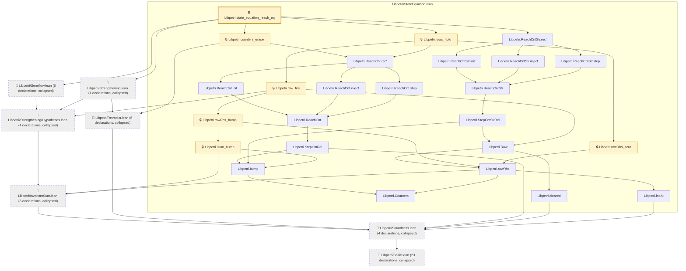

# VER-016

Generated by `scripts/proof-graph.py` from `proof-graph.json`. Do not edit.

Theorems carrying this ID:

- `Libpetri.Novel.Certificate.vc_sound_state_equation` (theorem, `Libpetri/Novel/Certificate.lean:110`)
- `Libpetri.Spec.VER_016_certificate` (theorem, `Libpetri/Spec/Req/VER_016.lean:419`)
- `Libpetri.equality_row_is_unsound_on_a_clearing_place` (theorem, `Libpetri/StateEquation.lean:314`) 🔒 locked
- `Libpetri.rows_hold` (theorem, `Libpetri/StateEquation.lean:261`) 🔒 locked
- `Libpetri.state_equation_reach_eq` (theorem, `Libpetri/StateEquation.lean:284`) 🔒 locked

> **Note:** the full tree has 105 nodes (limit 60), so it is drawn as one diagram per theorem (5 theorems).

### `Libpetri.Novel.Certificate.vc_sound_state_equation`

> Rule: this theorem's whole tree, 48 nodes.

```mermaid
flowchart TD
  subgraph g0["Libpetri/Basic.lean"]
    n0["Libpetri.AMarking"]
    n8["Libpetri.Card"]
    n9["Libpetri.Card.all"]
    n10["Libpetri.Card.atLeast"]
    n11["Libpetri.Card.consumesAll"]
    n12["Libpetri.Card.exactly"]
    n13["Libpetri.Card.one"]
    n14["Libpetri.Card.required"]
    n134["Libpetri.InSpec"]
    n135["Libpetri.InSpec.card"]
    n138["Libpetri.InSpec.place"]
    n2720["Libpetri.PlaceId"]
    n13126["Libpetri.Transition"]
    n13127["Libpetri.Transition.inhibitors"]
    n13128["Libpetri.Transition.inputs"]
    n13132["Libpetri.Transition.reads"]
    n13133["Libpetri.Transition.resets"]
    n13203["Libpetri.consumeAllAt"]
    n13255["Libpetri.enabledA"]
    n13277["Libpetri.fireA"]
    n13373["Libpetri.post"]
    n13378["Libpetri.pre"]
    n13433["Libpetri.specAt"]
  end
  subgraph g1["Libpetri/Novel/Certificate.lean"]
    n196["Libpetri.Novel.Certificate.VCs"]
    n198["Libpetri.Novel.Certificate.VCs.vc1"]
    n199["Libpetri.Novel.Certificate.VCs.vc2"]
    n200["Libpetri.Novel.Certificate.VCs.vc3"]
    n208["Libpetri.Novel.Certificate.vc_inductive"]
    n211["Libpetri.Novel.Certificate.vc_sound_rel"]
    n213["Libpetri.Novel.Certificate.vc_sound_state_equation"]
  end
  subgraph g2["Libpetri/Retrodict.lean"]
    n2872["Libpetri.ReachAInj"]
    n2873["Libpetri.ReachAInj.init"]
    n2874["Libpetri.ReachAInj.inject"]
    n2875["Libpetri.ReachAInj.rec'"]
    n2876["Libpetri.ReachAInj.step"]
    n13104["Libpetri.StepAInjRel"]
  end
  subgraph g3["Libpetri/Soundness.lean"]
    n130["Libpetri.FlatNet"]
    n131["Libpetri.FlatTransition"]
    n13107["Libpetri.StepARel"]
  end
  subgraph g4["Libpetri/StateEquation.lean"]
    n33["Libpetri.Counters"]
    n2899["Libpetri.ReachCnt"]
    n2900["Libpetri.ReachCnt.init"]
    n2901["Libpetri.ReachCnt.inject"]
    n2903["Libpetri.ReachCnt.step"]
    n13116["Libpetri.StepCntRel"]
    n13185["Libpetri.bump"]
    n13229["🔒 Libpetri.counters_exist"]
  end
  subgraph g5["Libpetri/Strengthening.lean"]
    n2867["Libpetri.ProvenFor"]
  end
  n0 --> n2720
  n9 --> n8
  n10 --> n8
  n11 --> n9
  n11 --> n10
  n11 --> n12
  n11 --> n13
  n12 --> n8
  n13 --> n8
  n14 --> n9
  n14 --> n10
  n14 --> n12
  n14 --> n13
  n130 --> n131
  n131 --> n2720
  n131 --> n13126
  n135 --> n8
  n135 --> n134
  n138 --> n134
  n138 --> n2720
  n198 --> n196
  n199 --> n196
  n200 --> n196
  n208 --> n198
  n208 --> n199
  n211 --> n200
  n211 --> n208
  n213 --> n211
  n213 --> n2867
  n213 --> n13229
  n2867 --> n0
  n2872 --> n13104
  n2873 --> n2872
  n2874 --> n2872
  n2875 --> n2873
  n2875 --> n2874
  n2875 --> n2876
  n2876 --> n2872
  n2899 --> n13116
  n2900 --> n2899
  n2901 --> n2899
  n2903 --> n2899
  n13104 --> n13107
  n13107 --> n130
  n13107 --> n13255
  n13107 --> n13277
  n13116 --> n130
  n13116 --> n13185
  n13116 --> n13255
  n13116 --> n13277
  n13127 --> n2720
  n13127 --> n13126
  n13128 --> n134
  n13128 --> n13126
  n13132 --> n2720
  n13132 --> n13126
  n13133 --> n2720
  n13133 --> n13126
  n13185 --> n33
  n13203 --> n11
  n13203 --> n135
  n13203 --> n13433
  n13229 --> n2875
  n13229 --> n2900
  n13229 --> n2901
  n13229 --> n2903
  n13255 --> n0
  n13255 --> n14
  n13255 --> n135
  n13255 --> n138
  n13255 --> n13127
  n13255 --> n13128
  n13255 --> n13132
  n13277 --> n0
  n13277 --> n13133
  n13277 --> n13203
  n13277 --> n13373
  n13277 --> n13378
  n13373 --> n2720
  n13378 --> n14
  n13378 --> n135
  n13378 --> n13433
  n13433 --> n138
  n13433 --> n13128
  classDef root stroke-width:3px
  classDef locked fill:#fff3cd,stroke:#b8860b
  classDef collapsed fill:#eeeeee,stroke-dasharray:4 4
  class n213 root
  class n13229 locked
```

### `Libpetri.Spec.VER_016_certificate`

> Rule: this theorem's whole tree, 41 nodes.

```mermaid
flowchart TD
  subgraph g0["Libpetri/Basic.lean"]
    n0["Libpetri.AMarking"]
    n8["Libpetri.Card"]
    n9["Libpetri.Card.all"]
    n10["Libpetri.Card.atLeast"]
    n11["Libpetri.Card.consumesAll"]
    n12["Libpetri.Card.exactly"]
    n13["Libpetri.Card.one"]
    n14["Libpetri.Card.required"]
    n134["Libpetri.InSpec"]
    n135["Libpetri.InSpec.card"]
    n138["Libpetri.InSpec.place"]
    n2723["Libpetri.PlaceId"]
    n22341["Libpetri.Transition"]
    n22342["Libpetri.Transition.inhibitors"]
    n22343["Libpetri.Transition.inputs"]
    n22347["Libpetri.Transition.reads"]
    n22348["Libpetri.Transition.resets"]
    n22418["Libpetri.consumeAllAt"]
    n22470["Libpetri.enabledA"]
    n22593["Libpetri.pre"]
    n22648["Libpetri.specAt"]
  end
  subgraph g1["Libpetri/Novel/Certificate.lean"]
    n196["Libpetri.Novel.Certificate.VCs"]
    n198["Libpetri.Novel.Certificate.VCs.vc1"]
    n199["Libpetri.Novel.Certificate.VCs.vc2"]
    n200["Libpetri.Novel.Certificate.VCs.vc3"]
    n208["Libpetri.Novel.Certificate.vc_inductive"]
    n211["Libpetri.Novel.Certificate.vc_sound_rel"]
  end
  subgraph g2["Libpetri/Novel/ForwardDeposit.lean"]
    n867["Libpetri.Novel.ForwardDeposit.Deposit"]
    n878["Libpetri.Novel.ForwardDeposit.ReachADInj"]
    n880["Libpetri.Novel.ForwardDeposit.StepAD"]
    n881["Libpetri.Novel.ForwardDeposit.StepADInj"]
    n895["Libpetri.Novel.ForwardDeposit.fireAD"]
  end
  subgraph g3["Libpetri/Spec/Req/VER_016.lean"]
    n6011["Libpetri.Spec.CntInit"]
    n6013["Libpetri.Spec.CntRows"]
    n6015["Libpetri.Spec.CntStep"]
    n10767["Libpetri.Spec.VER_016_certificate"]
    n19996["Libpetri.Spec.refCntInit"]
    n21813["Libpetri.Spec.ver016_counters_exist"]
  end
  subgraph g4["Libpetri/StateEquation.lean"]
    n33["Libpetri.Counters"]
    n22400["Libpetri.bump"]
  end
  subgraph g5["Libpetri/Strengthening.lean"]
    n2870["Libpetri.ProvenFor"]
  end
  n0 --> n2723
  n9 --> n8
  n10 --> n8
  n11 --> n9
  n11 --> n10
  n11 --> n12
  n11 --> n13
  n12 --> n8
  n13 --> n8
  n14 --> n9
  n14 --> n10
  n14 --> n12
  n14 --> n13
  n135 --> n8
  n135 --> n134
  n138 --> n134
  n138 --> n2723
  n198 --> n196
  n199 --> n196
  n200 --> n196
  n208 --> n198
  n208 --> n199
  n211 --> n200
  n211 --> n208
  n867 --> n2723
  n878 --> n881
  n880 --> n895
  n880 --> n22470
  n881 --> n880
  n895 --> n0
  n895 --> n867
  n895 --> n22348
  n895 --> n22418
  n895 --> n22593
  n2870 --> n0
  n6011 --> n0
  n6011 --> n33
  n6013 --> n867
  n6013 --> n22341
  n6015 --> n895
  n6015 --> n6013
  n6015 --> n22400
  n6015 --> n22470
  n10767 --> n211
  n10767 --> n2870
  n10767 --> n19996
  n10767 --> n21813
  n19996 --> n6011
  n21813 --> n878
  n21813 --> n6015
  n22342 --> n2723
  n22342 --> n22341
  n22343 --> n134
  n22343 --> n22341
  n22347 --> n2723
  n22347 --> n22341
  n22348 --> n2723
  n22348 --> n22341
  n22400 --> n33
  n22418 --> n11
  n22418 --> n135
  n22418 --> n22648
  n22470 --> n0
  n22470 --> n14
  n22470 --> n135
  n22470 --> n138
  n22470 --> n22342
  n22470 --> n22343
  n22470 --> n22347
  n22593 --> n14
  n22593 --> n135
  n22593 --> n22648
  n22648 --> n138
  n22648 --> n22343
  classDef root stroke-width:3px
  classDef locked fill:#fff3cd,stroke:#b8860b
  classDef collapsed fill:#eeeeee,stroke-dasharray:4 4
  class n10767 root
```

### `Libpetri.equality_row_is_unsound_on_a_clearing_place`

> Rule: this theorem's whole tree, 55 nodes.

```mermaid
flowchart TD
  subgraph g0["Libpetri/Basic.lean"]
    n0["Libpetri.AMarking"]
    n8["Libpetri.Card"]
    n9["Libpetri.Card.all"]
    n10["Libpetri.Card.atLeast"]
    n11["Libpetri.Card.consumesAll"]
    n12["Libpetri.Card.exactly"]
    n13["Libpetri.Card.one"]
    n14["Libpetri.Card.required"]
    n21["Libpetri.Colour"]
    n132["Libpetri.Guard"]
    n134["Libpetri.InSpec"]
    n135["Libpetri.InSpec.card"]
    n137["Libpetri.InSpec.mk"]
    n138["Libpetri.InSpec.place"]
    n2720["Libpetri.PlaceId"]
    n13126["Libpetri.Transition"]
    n13127["Libpetri.Transition.inhibitors"]
    n13128["Libpetri.Transition.inputs"]
    n13129["Libpetri.Transition.mk"]
    n13132["Libpetri.Transition.reads"]
    n13133["Libpetri.Transition.resets"]
    n13203["Libpetri.consumeAllAt"]
    n13255["Libpetri.enabledA"]
    n13277["Libpetri.fireA"]
    n13373["Libpetri.post"]
    n13378["Libpetri.pre"]
    n13433["Libpetri.specAt"]
  end
  subgraph g1["Libpetri/InvariantSum.lean"]
    n13322["Libpetri.isum"]
    n13325["🔒 Libpetri.isum_congr"]
    n13327["Libpetri.isum_succ"]
  end
  subgraph g2["Libpetri/Soundness.lean"]
    n130["Libpetri.FlatNet"]
    n131["Libpetri.FlatTransition"]
    n13437["🔒 Libpetri.specAt_sound"]
  end
  subgraph g3["Libpetri/StateEquation.lean"]
    n33["Libpetri.Counters"]
    n2899["Libpetri.ReachCnt"]
    n2900["Libpetri.ReachCnt.init"]
    n2901["Libpetri.ReachCnt.inject"]
    n2902["Libpetri.ReachCnt.rec'"]
    n2903["Libpetri.ReachCnt.step"]
    n3917["Libpetri.Row"]
    n13116["Libpetri.StepCntRel"]
    n13185["Libpetri.bump"]
    n13199["Libpetri.cleared"]
    n13262["🔒 Libpetri.equality_row_is_unsound_on_a_clearing_place"]
    n13299["Libpetri.incAt"]
    n13324["🔒 Libpetri.isum_bump"]
    n13422["Libpetri.rowRhs"]
    n13423["🔒 Libpetri.rowRhs_bump"]
    n13424["🔒 Libpetri.rowRhs_zero"]
    n13425["🔒 Libpetri.row_fire"]
    n13426["🔒 Libpetri.rows_hold"]
  end
  subgraph g4["Libpetri/Strengthening.lean"]
    n13146["Libpetri.a0All"]
    n13350["Libpetri.netAll"]
    n13454["Libpetri.tAll"]
  end
  subgraph g5["Libpetri/Strengthening/Hypotheses.lean"]
    n13383["🔒 Libpetri.pre_le_of_enabledA"]
  end
  n0 --> n2720
  n9 --> n8
  n10 --> n8
  n11 --> n9
  n11 --> n10
  n11 --> n12
  n11 --> n13
  n12 --> n8
  n13 --> n8
  n14 --> n9
  n14 --> n10
  n14 --> n12
  n14 --> n13
  n130 --> n131
  n131 --> n2720
  n131 --> n13126
  n132 --> n21
  n135 --> n8
  n135 --> n134
  n137 --> n8
  n137 --> n132
  n137 --> n134
  n137 --> n2720
  n138 --> n134
  n138 --> n2720
  n2899 --> n13116
  n2900 --> n2899
  n2901 --> n2899
  n2902 --> n2900
  n2902 --> n2901
  n2902 --> n2903
  n2903 --> n2899
  n3917 --> n13199
  n3917 --> n13422
  n13116 --> n130
  n13116 --> n13185
  n13116 --> n13255
  n13116 --> n13277
  n13127 --> n2720
  n13127 --> n13126
  n13128 --> n134
  n13128 --> n13126
  n13129 --> n134
  n13129 --> n2720
  n13129 --> n13126
  n13132 --> n2720
  n13132 --> n13126
  n13133 --> n2720
  n13133 --> n13126
  n13146 --> n0
  n13185 --> n33
  n13199 --> n130
  n13199 --> n13133
  n13199 --> n13203
  n13203 --> n11
  n13203 --> n135
  n13203 --> n13433
  n13255 --> n0
  n13255 --> n14
  n13255 --> n135
  n13255 --> n138
  n13255 --> n13127
  n13255 --> n13128
  n13255 --> n13132
  n13262 --> n13146
  n13262 --> n13350
  n13262 --> n13426
  n13277 --> n0
  n13277 --> n13133
  n13277 --> n13203
  n13277 --> n13373
  n13277 --> n13378
  n13299 --> n130
  n13299 --> n13373
  n13299 --> n13378
  n13322 --> n2720
  n13324 --> n13185
  n13324 --> n13325
  n13324 --> n13327
  n13325 --> n13322
  n13327 --> n13322
  n13350 --> n130
  n13350 --> n13454
  n13373 --> n2720
  n13378 --> n14
  n13378 --> n135
  n13378 --> n13433
  n13383 --> n13255
  n13383 --> n13378
  n13383 --> n13437
  n13422 --> n0
  n13422 --> n33
  n13422 --> n13299
  n13422 --> n13322
  n13423 --> n13324
  n13423 --> n13422
  n13424 --> n13422
  n13425 --> n3917
  n13425 --> n13277
  n13425 --> n13383
  n13425 --> n13423
  n13426 --> n2902
  n13426 --> n13424
  n13426 --> n13425
  n13433 --> n138
  n13433 --> n13128
  n13437 --> n13433
  n13454 --> n9
  n13454 --> n137
  n13454 --> n13129
  classDef root stroke-width:3px
  classDef locked fill:#fff3cd,stroke:#b8860b
  classDef collapsed fill:#eeeeee,stroke-dasharray:4 4
  class n13262 root
  class n13262,n13324,n13325,n13383,n13423,n13424,n13425,n13426,n13437 locked
```

### `Libpetri.rows_hold`

> Rule: this theorem's whole tree, 47 nodes.

```mermaid
flowchart TD
  subgraph g0["Libpetri/Basic.lean"]
    n0["Libpetri.AMarking"]
    n8["Libpetri.Card"]
    n9["Libpetri.Card.all"]
    n10["Libpetri.Card.atLeast"]
    n11["Libpetri.Card.consumesAll"]
    n12["Libpetri.Card.exactly"]
    n13["Libpetri.Card.one"]
    n14["Libpetri.Card.required"]
    n134["Libpetri.InSpec"]
    n135["Libpetri.InSpec.card"]
    n138["Libpetri.InSpec.place"]
    n2720["Libpetri.PlaceId"]
    n13126["Libpetri.Transition"]
    n13127["Libpetri.Transition.inhibitors"]
    n13128["Libpetri.Transition.inputs"]
    n13132["Libpetri.Transition.reads"]
    n13133["Libpetri.Transition.resets"]
    n13203["Libpetri.consumeAllAt"]
    n13255["Libpetri.enabledA"]
    n13277["Libpetri.fireA"]
    n13373["Libpetri.post"]
    n13378["Libpetri.pre"]
    n13433["Libpetri.specAt"]
  end
  subgraph g1["Libpetri/InvariantSum.lean"]
    n13322["Libpetri.isum"]
    n13325["🔒 Libpetri.isum_congr"]
    n13327["Libpetri.isum_succ"]
  end
  subgraph g2["Libpetri/Soundness.lean"]
    n130["Libpetri.FlatNet"]
    n131["Libpetri.FlatTransition"]
    n13437["🔒 Libpetri.specAt_sound"]
  end
  subgraph g3["Libpetri/StateEquation.lean"]
    n33["Libpetri.Counters"]
    n2899["Libpetri.ReachCnt"]
    n2900["Libpetri.ReachCnt.init"]
    n2901["Libpetri.ReachCnt.inject"]
    n2902["Libpetri.ReachCnt.rec'"]
    n2903["Libpetri.ReachCnt.step"]
    n3917["Libpetri.Row"]
    n13116["Libpetri.StepCntRel"]
    n13185["Libpetri.bump"]
    n13199["Libpetri.cleared"]
    n13299["Libpetri.incAt"]
    n13324["🔒 Libpetri.isum_bump"]
    n13422["Libpetri.rowRhs"]
    n13423["🔒 Libpetri.rowRhs_bump"]
    n13424["🔒 Libpetri.rowRhs_zero"]
    n13425["🔒 Libpetri.row_fire"]
    n13426["🔒 Libpetri.rows_hold"]
  end
  subgraph g4["Libpetri/Strengthening/Hypotheses.lean"]
    n13383["🔒 Libpetri.pre_le_of_enabledA"]
  end
  n0 --> n2720
  n9 --> n8
  n10 --> n8
  n11 --> n9
  n11 --> n10
  n11 --> n12
  n11 --> n13
  n12 --> n8
  n13 --> n8
  n14 --> n9
  n14 --> n10
  n14 --> n12
  n14 --> n13
  n130 --> n131
  n131 --> n2720
  n131 --> n13126
  n135 --> n8
  n135 --> n134
  n138 --> n134
  n138 --> n2720
  n2899 --> n13116
  n2900 --> n2899
  n2901 --> n2899
  n2902 --> n2900
  n2902 --> n2901
  n2902 --> n2903
  n2903 --> n2899
  n3917 --> n13199
  n3917 --> n13422
  n13116 --> n130
  n13116 --> n13185
  n13116 --> n13255
  n13116 --> n13277
  n13127 --> n2720
  n13127 --> n13126
  n13128 --> n134
  n13128 --> n13126
  n13132 --> n2720
  n13132 --> n13126
  n13133 --> n2720
  n13133 --> n13126
  n13185 --> n33
  n13199 --> n130
  n13199 --> n13133
  n13199 --> n13203
  n13203 --> n11
  n13203 --> n135
  n13203 --> n13433
  n13255 --> n0
  n13255 --> n14
  n13255 --> n135
  n13255 --> n138
  n13255 --> n13127
  n13255 --> n13128
  n13255 --> n13132
  n13277 --> n0
  n13277 --> n13133
  n13277 --> n13203
  n13277 --> n13373
  n13277 --> n13378
  n13299 --> n130
  n13299 --> n13373
  n13299 --> n13378
  n13322 --> n2720
  n13324 --> n13185
  n13324 --> n13325
  n13324 --> n13327
  n13325 --> n13322
  n13327 --> n13322
  n13373 --> n2720
  n13378 --> n14
  n13378 --> n135
  n13378 --> n13433
  n13383 --> n13255
  n13383 --> n13378
  n13383 --> n13437
  n13422 --> n0
  n13422 --> n33
  n13422 --> n13299
  n13422 --> n13322
  n13423 --> n13324
  n13423 --> n13422
  n13424 --> n13422
  n13425 --> n3917
  n13425 --> n13277
  n13425 --> n13383
  n13425 --> n13423
  n13426 --> n2902
  n13426 --> n13424
  n13426 --> n13425
  n13433 --> n138
  n13433 --> n13128
  n13437 --> n13433
  classDef root stroke-width:3px
  classDef locked fill:#fff3cd,stroke:#b8860b
  classDef collapsed fill:#eeeeee,stroke-dasharray:4 4
  class n13426 root
  class n13324,n13325,n13383,n13423,n13424,n13425,n13426,n13437 locked
```

### `Libpetri.state_equation_reach_eq`

> Rule: this theorem's tree has 77 nodes (limit 60); every file other than its own is collapsed into one node, leaving 32.

Axioms used:

- `Libpetri.Novel.Certificate.vc_sound_state_equation`: `Quot.sound`, `propext`
- `Libpetri.Spec.VER_016_certificate`: `Quot.sound`, `propext`
- `Libpetri.equality_row_is_unsound_on_a_clearing_place`: `Classical.choice`, `Quot.sound`, `propext`
- `Libpetri.rows_hold`: `Classical.choice`, `Quot.sound`, `propext`
- `Libpetri.state_equation_reach_eq`: `Classical.choice`, `Quot.sound`, `propext`
