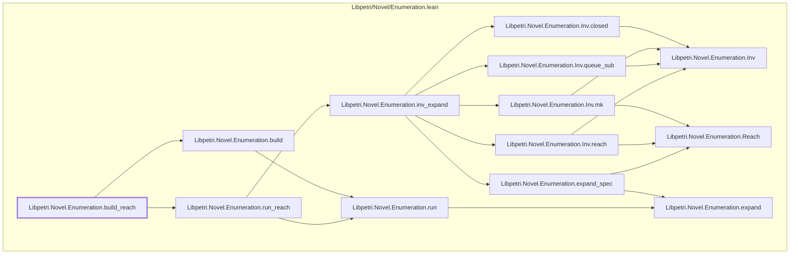
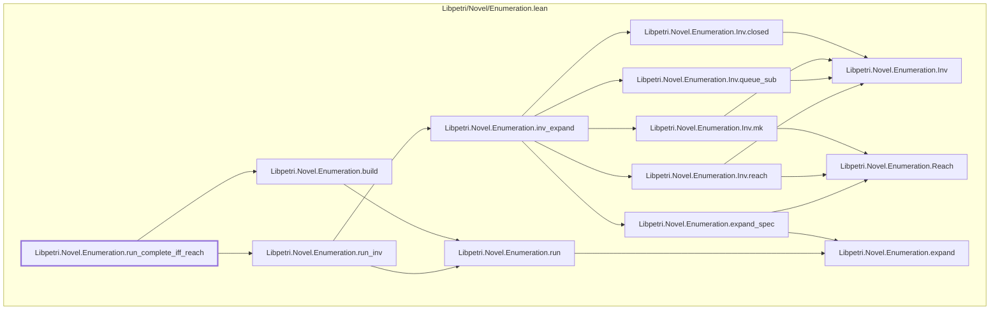

# VER-017

Generated by `scripts/proof-graph.py` from `proof-graph.json`. Do not edit.

Theorems carrying this ID:

- `Libpetri.Novel.Enumeration.build_reach` (theorem, `Libpetri/Novel/Enumeration.lean:271`)
- `Libpetri.Novel.Enumeration.net_enumeration_exact` (theorem, `Libpetri/Novel/Enumeration.lean:361`)
- `Libpetri.Novel.Enumeration.run_complete_iff_reach` (theorem, `Libpetri/Novel/Enumeration.lean:282`)
- `Libpetri.Spec.VER_017_cache_reuse` (theorem, `Libpetri/Spec/Req/VER_017.lean:1420`)
- `Libpetri.Spec.VER_017_decided_ends` (theorem, `Libpetri/Spec/Req/VER_017.lean:804`)
- `Libpetri.Spec.VER_017_firing_sequence` (theorem, `Libpetri/Spec/Req/VER_017.lean:753`)
- `Libpetri.Spec.VER_017_pipeline` (theorem, `Libpetri/Spec/Req/VER_017.lean:858`)

> **Note:** the full tree has 293 nodes (limit 60), so it is drawn as one diagram per theorem (7 theorems).

### `Libpetri.Novel.Enumeration.build_reach`

> Rule: this theorem's whole tree, 13 nodes.

### `Libpetri.Novel.Enumeration.net_enumeration_exact`

> Rule: this theorem's whole tree, 47 nodes.

```mermaid
flowchart TD
  subgraph g0["Libpetri/Basic.lean"]
    n0["Libpetri.AMarking"]
    n8["Libpetri.Card"]
    n9["Libpetri.Card.all"]
    n10["Libpetri.Card.atLeast"]
    n11["Libpetri.Card.consumesAll"]
    n12["Libpetri.Card.exactly"]
    n13["Libpetri.Card.one"]
    n14["Libpetri.Card.required"]
    n134["Libpetri.InSpec"]
    n135["Libpetri.InSpec.card"]
    n138["Libpetri.InSpec.place"]
    n2723["Libpetri.PlaceId"]
    n21910["Libpetri.Transition"]
    n21911["Libpetri.Transition.inhibitors"]
    n21912["Libpetri.Transition.inputs"]
    n21916["Libpetri.Transition.reads"]
    n21917["Libpetri.Transition.resets"]
    n21987["Libpetri.consumeAllAt"]
    n22039["Libpetri.enabledA"]
    n22061["Libpetri.fireA"]
    n22157["Libpetri.post"]
    n22162["Libpetri.pre"]
    n22217["Libpetri.specAt"]
  end
  subgraph g1["Libpetri/Novel/Enumeration.lean"]
    n285["Libpetri.Novel.Enumeration.Inv"]
    n286["Libpetri.Novel.Enumeration.Inv.closed"]
    n287["Libpetri.Novel.Enumeration.Inv.mk"]
    n288["Libpetri.Novel.Enumeration.Inv.queue_sub"]
    n289["Libpetri.Novel.Enumeration.Inv.reach"]
    n290["Libpetri.Novel.Enumeration.Reach"]
    n291["Libpetri.Novel.Enumeration.build"]
    n293["Libpetri.Novel.Enumeration.decided_exact"]
    n294["Libpetri.Novel.Enumeration.expand"]
    n295["Libpetri.Novel.Enumeration.expand_spec"]
    n297["Libpetri.Novel.Enumeration.inv_expand"]
    n298["Libpetri.Novel.Enumeration.net_enumeration_exact"]
    n299["Libpetri.Novel.Enumeration.proven"]
    n301["Libpetri.Novel.Enumeration.quiescent_iff_dead"]
    n302["Libpetri.Novel.Enumeration.reach_succNet_iff"]
    n305["Libpetri.Novel.Enumeration.run"]
    n306["Libpetri.Novel.Enumeration.run_complete_iff_reach"]
    n307["Libpetri.Novel.Enumeration.run_inv"]
    n309["Libpetri.Novel.Enumeration.succNet"]
    n311["Libpetri.Novel.Enumeration.succNet_iff_step"]
  end
  subgraph g2["Libpetri/Soundness.lean"]
    n130["Libpetri.FlatNet"]
    n131["Libpetri.FlatTransition"]
    n2871["Libpetri.ReachA"]
    n21891["Libpetri.StepARel"]
  end
  n0 --> n2723
  n9 --> n8
  n10 --> n8
  n11 --> n9
  n11 --> n10
  n11 --> n12
  n11 --> n13
  n12 --> n8
  n13 --> n8
  n14 --> n9
  n14 --> n10
  n14 --> n12
  n14 --> n13
  n130 --> n131
  n131 --> n2723
  n131 --> n21910
  n135 --> n8
  n135 --> n134
  n138 --> n134
  n138 --> n2723
  n286 --> n285
  n287 --> n285
  n287 --> n290
  n288 --> n285
  n289 --> n285
  n289 --> n290
  n291 --> n305
  n293 --> n299
  n293 --> n306
  n295 --> n290
  n295 --> n294
  n297 --> n286
  n297 --> n287
  n297 --> n288
  n297 --> n289
  n297 --> n295
  n298 --> n293
  n298 --> n301
  n298 --> n302
  n301 --> n309
  n302 --> n290
  n302 --> n311
  n302 --> n2871
  n305 --> n294
  n306 --> n291
  n306 --> n307
  n307 --> n297
  n307 --> n305
  n309 --> n130
  n309 --> n22039
  n309 --> n22061
  n311 --> n309
  n311 --> n21891
  n2871 --> n21891
  n21891 --> n130
  n21891 --> n22039
  n21891 --> n22061
  n21911 --> n2723
  n21911 --> n21910
  n21912 --> n134
  n21912 --> n21910
  n21916 --> n2723
  n21916 --> n21910
  n21917 --> n2723
  n21917 --> n21910
  n21987 --> n11
  n21987 --> n135
  n21987 --> n22217
  n22039 --> n0
  n22039 --> n14
  n22039 --> n135
  n22039 --> n138
  n22039 --> n21911
  n22039 --> n21912
  n22039 --> n21916
  n22061 --> n0
  n22061 --> n21917
  n22061 --> n21987
  n22061 --> n22157
  n22061 --> n22162
  n22157 --> n2723
  n22162 --> n14
  n22162 --> n135
  n22162 --> n22217
  n22217 --> n138
  n22217 --> n21912
  classDef root stroke-width:3px
  classDef locked fill:#fff3cd,stroke:#b8860b
  classDef collapsed fill:#eeeeee,stroke-dasharray:4 4
  class n298 root
```

### `Libpetri.Novel.Enumeration.run_complete_iff_reach`

> Rule: this theorem's whole tree, 13 nodes.

### `Libpetri.Spec.VER_017_cache_reuse`

> Rule: this theorem's whole tree, 45 nodes.

```mermaid
flowchart TD
  subgraph g0["Libpetri/Interning.lean"]
    n38["Libpetri.Explorer"]
    n56["Libpetri.Explorer.bound"]
    n61["Libpetri.Explorer.key"]
    n65["Libpetri.Explorer.succ"]
  end
  subgraph g1["Libpetri/Novel/RouteB/Decide.lean"]
    n1542["Libpetri.Novel.RouteB.Decide.Out"]
    n1543["Libpetri.Novel.RouteB.Decide.Out.cls"]
    n1544["Libpetri.Novel.RouteB.Decide.Out.complete"]
    n1545["Libpetri.Novel.RouteB.Decide.Out.early"]
    n1546["Libpetri.Novel.RouteB.Decide.Out.exp"]
    n1547["Libpetri.Novel.RouteB.Decide.Out.mk"]
    n1548["Libpetri.Novel.RouteB.Decide.Out.stopped"]
    n1549["Libpetri.Novel.RouteB.Decide.Prop'"]
    n1550["Libpetri.Novel.RouteB.Decide.Prop'.quiescence"]
    n1551["Libpetri.Novel.RouteB.Decide.Prop'.safety"]
    n1552["Libpetri.Novel.RouteB.Decide.Verdict"]
    n1553["Libpetri.Novel.RouteB.Decide.Verdict.proven"]
    n1554["Libpetri.Novel.RouteB.Decide.Verdict.unknown"]
    n1555["Libpetri.Novel.RouteB.Decide.Verdict.violated"]
    n1556["Libpetri.Novel.RouteB.Decide.build"]
    n1562["Libpetri.Novel.RouteB.Decide.expandB"]
    n1563["Libpetri.Novel.RouteB.Decide.expandB_spec"]
    n1571["Libpetri.Novel.RouteB.Decide.loop"]
    n1573["Libpetri.Novel.RouteB.Decide.nextC"]
    n1576["Libpetri.Novel.RouteB.Decide.quiescentAt"]
    n1581["Libpetri.Novel.RouteB.Decide.verdict"]
    n1582["Libpetri.Novel.RouteB.Decide.violatesAt"]
  end
  subgraph g2["Libpetri/Spec/Req/VER_017.lean"]
    n5847["Libpetri.Spec.CacheBuilds"]
    n5849["Libpetri.Spec.CacheLookupFn"]
    n5850["Libpetri.Spec.CacheQueryFn"]
    n5851["Libpetri.Spec.CacheReadFn"]
    n10631["Libpetri.Spec.VER_017_cache"]
    n10635["Libpetri.Spec.VER_017_cache_reuse"]
  end
  subgraph g3["Libpetri/Spec/Verifier/Graph.lean"]
    n11227["Libpetri.Spec.Verifier.Graph.Cache"]
    n11228["Libpetri.Spec.Verifier.Graph.CacheKey"]
    n11252["Libpetri.Spec.Verifier.Graph.Slot"]
    n11253["Libpetri.Spec.Verifier.Graph.Slot.closed"]
    n11254["Libpetri.Spec.Verifier.Graph.Slot.empty"]
    n11255["Libpetri.Spec.Verifier.Graph.Slot.truncated"]
    n11257["Libpetri.Spec.Verifier.Graph.Use"]
    n11258["Libpetri.Spec.Verifier.Graph.Use.built"]
    n11259["Libpetri.Spec.Verifier.Graph.Use.declined"]
    n11261["Libpetri.Spec.Verifier.Graph.Use.reused"]
    n11280["Libpetri.Spec.Verifier.Graph.build_budget_eq"]
    n11346["Libpetri.Spec.Verifier.Graph.loop_budget_eq"]
    n11350["Libpetri.Spec.Verifier.Graph.loop_prefix"]
  end
  n56 --> n38
  n61 --> n38
  n65 --> n38
  n1543 --> n1542
  n1544 --> n1542
  n1545 --> n1542
  n1546 --> n1542
  n1547 --> n1542
  n1548 --> n1542
  n1550 --> n1549
  n1551 --> n1549
  n1553 --> n1552
  n1554 --> n1552
  n1555 --> n1552
  n1556 --> n1571
  n1562 --> n61
  n1563 --> n1562
  n1571 --> n65
  n1571 --> n1547
  n1571 --> n1562
  n1571 --> n1573
  n1573 --> n56
  n1576 --> n56
  n1576 --> n65
  n1576 --> n1543
  n1576 --> n1546
  n1581 --> n1544
  n1581 --> n1548
  n1581 --> n1553
  n1581 --> n1554
  n1581 --> n1555
  n1581 --> n1582
  n1582 --> n1550
  n1582 --> n1551
  n1582 --> n1576
  n5847 --> n11253
  n5847 --> n11254
  n5847 --> n11255
  n5849 --> n1542
  n5849 --> n11252
  n5849 --> n11257
  n5850 --> n1542
  n5850 --> n11227
  n5850 --> n11228
  n5850 --> n11257
  n5851 --> n38
  n5851 --> n1549
  n5851 --> n1552
  n5851 --> n11257
  n10631 --> n1545
  n10631 --> n1547
  n10631 --> n1581
  n10631 --> n5847
  n10631 --> n5849
  n10631 --> n5850
  n10631 --> n5851
  n10631 --> n11258
  n10631 --> n11259
  n10631 --> n11261
  n10635 --> n10631
  n10635 --> n11280
  n11227 --> n11252
  n11253 --> n1542
  n11253 --> n11252
  n11254 --> n11252
  n11255 --> n1542
  n11255 --> n11252
  n11258 --> n1542
  n11258 --> n11257
  n11259 --> n1542
  n11259 --> n11257
  n11261 --> n1542
  n11261 --> n11257
  n11280 --> n1556
  n11280 --> n11346
  n11346 --> n1544
  n11346 --> n11350
  n11350 --> n1543
  n11350 --> n1563
  n11350 --> n1571
  classDef root stroke-width:3px
  classDef locked fill:#fff3cd,stroke:#b8860b
  classDef collapsed fill:#eeeeee,stroke-dasharray:4 4
  class n10635 root
```

### `Libpetri.Spec.VER_017_decided_ends`

> Rule: this theorem's whole tree, 41 nodes.

```mermaid
flowchart TD
  subgraph g0["Libpetri/Spec/Req/VER_017.lean"]
    n10636["Libpetri.Spec.VER_017_decided_ends"]
  end
  subgraph g1["Libpetri/Spec/Verifier/Pipeline.lean"]
    n11220["Libpetri.Spec.Verifier.GStep"]
    n11221["Libpetri.Spec.Verifier.GStep.applies"]
    n11223["Libpetri.Spec.Verifier.GStep.name"]
    n11224["Libpetri.Spec.Verifier.GStep.route"]
    n11225["Libpetri.Spec.Verifier.GStep.run"]
    n11551["Libpetri.Spec.Verifier.Oracle"]
    n11562["Libpetri.Spec.Verifier.PhaseProg"]
    n11563["Libpetri.Spec.Verifier.PhaseProg.ask"]
    n11565["Libpetri.Spec.Verifier.PhaseProg.brecOn.go"]
    n11566["Libpetri.Spec.Verifier.PhaseProg.done"]
    n11567["Libpetri.Spec.Verifier.PhaseProg.poll"]
    n11708["Libpetri.Spec.Verifier.SolverFailure"]
    n11713["Libpetri.Spec.Verifier.SolverFailure.notStarted"]
    n11720["Libpetri.Spec.Verifier.SolverReply"]
    n11722["Libpetri.Spec.Verifier.SolverReply.failure"]
    n11818["Libpetri.Spec.Verifier.Stop"]
    n11819["Libpetri.Spec.Verifier.StopKind"]
    n11820["Libpetri.Spec.Verifier.StopKind.budget"]
    n11821["Libpetri.Spec.Verifier.StopKind.cancelled"]
    n11822["Libpetri.Spec.Verifier.Trail"]
    n11823["Libpetri.Spec.Verifier.Trail.enter"]
    n11824["Libpetri.Spec.Verifier.Trail.entered"]
    n11825["Libpetri.Spec.Verifier.Trail.mk"]
    n11826["Libpetri.Spec.Verifier.Trail.polls"]
    n11827["Libpetri.Spec.Verifier.Trail.route"]
    n11828["Libpetri.Spec.Verifier.Trail.running"]
    n11829["Libpetri.Spec.Verifier.Trail.started"]
    n11832["Libpetri.Spec.Verifier.Trail.stopped"]
    n11860["Libpetri.Spec.Verifier.execProg"]
    n11863["Libpetri.Spec.Verifier.execProg_frame"]
    n11930["Libpetri.Spec.Verifier.pollStop"]
    n11932["Libpetri.Spec.Verifier.pollStop_frame"]
    n11952["Libpetri.Spec.Verifier.refusedReason"]
    n11963["Libpetri.Spec.Verifier.runPipeline"]
  end
  subgraph g2["Libpetri/Spec/Verifier/Result.lean"]
    n11545["Libpetri.Spec.Verifier.Options"]
    n11559["Libpetri.Spec.Verifier.PhaseOut"]
    n11560["Libpetri.Spec.Verifier.PhaseOut.aside"]
    n11561["Libpetri.Spec.Verifier.PhaseOut.decided"]
    n11587["Libpetri.Spec.Verifier.Route"]
    n11835["Libpetri.Spec.Verifier.Verdict"]
  end
  n10636 --> n11863
  n10636 --> n11963
  n11221 --> n11220
  n11221 --> n11545
  n11223 --> n11220
  n11224 --> n11220
  n11224 --> n11587
  n11225 --> n11220
  n11225 --> n11545
  n11225 --> n11559
  n11225 --> n11562
  n11551 --> n11720
  n11560 --> n11559
  n11561 --> n11559
  n11561 --> n11835
  n11563 --> n11562
  n11563 --> n11720
  n11565 --> n11563
  n11565 --> n11566
  n11565 --> n11567
  n11566 --> n11562
  n11567 --> n11562
  n11713 --> n11708
  n11722 --> n11708
  n11722 --> n11720
  n11818 --> n11819
  n11820 --> n11819
  n11821 --> n11819
  n11823 --> n11223
  n11823 --> n11224
  n11823 --> n11824
  n11823 --> n11825
  n11823 --> n11826
  n11823 --> n11829
  n11823 --> n11832
  n11824 --> n11822
  n11825 --> n11587
  n11825 --> n11819
  n11825 --> n11822
  n11826 --> n11822
  n11827 --> n11587
  n11827 --> n11822
  n11828 --> n11822
  n11829 --> n11822
  n11832 --> n11819
  n11832 --> n11822
  n11860 --> n11551
  n11860 --> n11565
  n11860 --> n11713
  n11860 --> n11722
  n11860 --> n11930
  n11860 --> n11952
  n11863 --> n11860
  n11863 --> n11932
  n11930 --> n11818
  n11930 --> n11824
  n11930 --> n11825
  n11930 --> n11826
  n11930 --> n11827
  n11930 --> n11828
  n11930 --> n11829
  n11930 --> n11832
  n11932 --> n11930
  n11952 --> n11820
  n11952 --> n11821
  n11963 --> n11221
  n11963 --> n11225
  n11963 --> n11560
  n11963 --> n11561
  n11963 --> n11823
  n11963 --> n11860
  classDef root stroke-width:3px
  classDef locked fill:#fff3cd,stroke:#b8860b
  classDef collapsed fill:#eeeeee,stroke-dasharray:4 4
  class n10636 root
```

### `Libpetri.Spec.VER_017_firing_sequence`

> Rule: this theorem's tree has 141 nodes (limit 60); every file other than its own is collapsed into one node, leaving 31.

```mermaid
flowchart TD
  subgraph g0["Libpetri/Spec/Req/VER_017.lean"]
    n7113["Libpetri.Spec.EnumAnswer"]
    n7114["Libpetri.Spec.EnumAnswer.proven"]
    n7115["Libpetri.Spec.EnumAnswer.unknown"]
    n7116["Libpetri.Spec.EnumAnswer.violated"]
    n7117["Libpetri.Spec.EnumCounted"]
    n7118["Libpetri.Spec.EnumDispatchFn"]
    n7119["Libpetri.Spec.EnumGateFn"]
    n7120["Libpetri.Spec.EnumInput"]
    n7123["Libpetri.Spec.EnumInput.mk"]
    n7125["Libpetri.Spec.EnumOutcome"]
    n7126["Libpetri.Spec.EnumOutcome.proven"]
    n7127["Libpetri.Spec.EnumOutcome.stopped"]
    n7128["Libpetri.Spec.EnumOutcome.truncated"]
    n7129["Libpetri.Spec.EnumOutcome.violated"]
    n7130["Libpetri.Spec.EnumViol"]
    n10629["Libpetri.Spec.VER_017"]
    n10637["Libpetri.Spec.VER_017_firing_sequence"]
    n14122["Libpetri.Spec.enumBuild"]
  end
  c0["📁 Libpetri/Basic.lean (7 declarations, collapsed)"]
  c6["📁 Libpetri/Interning.lean (7 declarations, collapsed)"]
  c28["📁 Libpetri/Novel/ForwardDeposit.lean (3 declarations, collapsed)"]
  c44["📁 Libpetri/Novel/RouteB/Decide.lean (13 declarations, collapsed)"]
  c54["📁 Libpetri/Novel/Seam/Net.lean (14 declarations, collapsed)"]
  c66["📁 Libpetri/Novel/TimedScg/Timing.lean (2 declarations, collapsed)"]
  c86["📁 Libpetri/Reference/Marking.lean (12 declarations, collapsed)"]
  c94["📁 Libpetri/Reference/Semantics.lean (22 declarations, collapsed)"]
  c96["📁 Libpetri/Reference/Step.lean (22 declarations, collapsed)"]
  c98["📁 Libpetri/Reference/Timed.lean (3 declarations, collapsed)"]
  c146["📁 Libpetri/Spec/GlossaryTime.lean (1 declarations, collapsed)"]
  c364["📁 Libpetri/Spec/Verifier/Graph.lean (16 declarations, collapsed)"]
  c367["📁 Libpetri/Spec/Verifier/Result.lean (1 declarations, collapsed)"]
  c54 --> c0
  c94 --> c28
  c94 --> c54
  c96 --> c86
  c96 --> c94
  c98 --> c66
  c98 --> c94
  c146 --> c98
  c364 --> c6
  c364 --> c44
  c364 --> c96
  c367 --> c146
  n7114 --> n7113
  n7115 --> n7113
  n7116 --> n7113
  n7117 --> n7130
  n7118 --> n7113
  n7118 --> n7125
  n7119 --> n7120
  n7123 --> c98
  n7123 --> n7120
  n7126 --> n7125
  n7127 --> n7125
  n7128 --> n7125
  n7129 --> n7125
  n7130 --> c44
  n10629 --> c367
  n10629 --> n7114
  n10629 --> n7115
  n10629 --> n7116
  n10629 --> n7117
  n10629 --> n7118
  n10629 --> n7119
  n10629 --> n7123
  n10629 --> n7126
  n10629 --> n7127
  n10629 --> n7128
  n10629 --> n7129
  n10629 --> n14122
  n10637 --> n10629
  n14122 --> c364
  classDef root stroke-width:3px
  classDef locked fill:#fff3cd,stroke:#b8860b
  classDef collapsed fill:#eeeeee,stroke-dasharray:4 4
  class n10637 root
  class c0,c6,c28,c44,c54,c66,c86,c94,c96,c98,c146,c364,c367 collapsed
```

### `Libpetri.Spec.VER_017_pipeline`

> Rule: this theorem's tree has 139 nodes (limit 60); every file other than its own is collapsed into one node, leaving 45.

```mermaid
flowchart TD
  subgraph g0["Libpetri/Spec/Req/VER_017.lean"]
    n7113["Libpetri.Spec.EnumAnswer"]
    n7114["Libpetri.Spec.EnumAnswer.proven"]
    n7115["Libpetri.Spec.EnumAnswer.unknown"]
    n7116["Libpetri.Spec.EnumAnswer.violated"]
    n7118["Libpetri.Spec.EnumDispatchFn"]
    n7119["Libpetri.Spec.EnumGateFn"]
    n7120["Libpetri.Spec.EnumInput"]
    n7121["Libpetri.Spec.EnumInput.envPlaces"]
    n7122["Libpetri.Spec.EnumInput.hasMatch"]
    n7123["Libpetri.Spec.EnumInput.mk"]
    n7124["Libpetri.Spec.EnumInput.net"]
    n7125["Libpetri.Spec.EnumOutcome"]
    n7126["Libpetri.Spec.EnumOutcome.proven"]
    n7127["Libpetri.Spec.EnumOutcome.stopped"]
    n7128["Libpetri.Spec.EnumOutcome.truncated"]
    n7129["Libpetri.Spec.EnumOutcome.violated"]
    n10665["Libpetri.Spec.VER_017_pipeline"]
    n14122["Libpetri.Spec.enumBuild"]
    n14123["Libpetri.Spec.enumOutcome"]
    n16774["Libpetri.Spec.instDecidableEqEnumAnswer"]
    n16775["Libpetri.Spec.instDecidableEqEnumAnswer.decEq"]
    n16776["Libpetri.Spec.instDecidableEqEnumOutcome"]
    n16777["Libpetri.Spec.instDecidableEqEnumOutcome.decEq"]
    n19696["Libpetri.Spec.refEnumDispatch"]
    n19697["Libpetri.Spec.refEnumGate"]
    n21424["Libpetri.Spec.ver017_deadlock"]
    n21425["Libpetri.Spec.ver017_deadlockSink"]
    n21450["Libpetri.Spec.ver017_m0"]
    n21454["Libpetri.Spec.ver017_pipe"]
    n21455["Libpetri.Spec.ver017_pipeD"]
    n21456["Libpetri.Spec.ver017_pipeX"]
    n21465["Libpetri.Spec.ver017_t0"]
    n21466["Libpetri.Spec.ver017_t1"]
  end
  c0["📁 Libpetri/Basic.lean (7 declarations, collapsed)"]
  c6["📁 Libpetri/Interning.lean (5 declarations, collapsed)"]
  c44["📁 Libpetri/Novel/RouteB/Decide.lean (18 declarations, collapsed)"]
  c54["📁 Libpetri/Novel/Seam/Net.lean (15 declarations, collapsed)"]
  c66["📁 Libpetri/Novel/TimedScg/Timing.lean (8 declarations, collapsed)"]
  c86["📁 Libpetri/Reference/Marking.lean (3 declarations, collapsed)"]
  c94["📁 Libpetri/Reference/Semantics.lean (15 declarations, collapsed)"]
  c96["📁 Libpetri/Reference/Step.lean (9 declarations, collapsed)"]
  c98["📁 Libpetri/Reference/Timed.lean (4 declarations, collapsed)"]
  c146["📁 Libpetri/Spec/GlossaryTime.lean (1 declarations, collapsed)"]
  c364["📁 Libpetri/Spec/Verifier/Graph.lean (19 declarations, collapsed)"]
  c367["📁 Libpetri/Spec/Verifier/Result.lean (2 declarations, collapsed)"]
  c44 --> c6
  c54 --> c0
  c94 --> c54
  c96 --> c86
  c96 --> c94
  c98 --> c66
  c98 --> c94
  c146 --> c98
  c364 --> c44
  c367 --> c146
  n7114 --> n7113
  n7115 --> n7113
  n7116 --> n7113
  n7118 --> n7113
  n7118 --> n7125
  n7119 --> n7120
  n7121 --> n7120
  n7122 --> n7120
  n7123 --> c98
  n7123 --> n7120
  n7124 --> c98
  n7124 --> n7120
  n7126 --> n7125
  n7127 --> n7125
  n7128 --> n7125
  n7129 --> n7125
  n10665 --> c96
  n10665 --> n7123
  n10665 --> n14123
  n10665 --> n16774
  n10665 --> n16776
  n10665 --> n19696
  n10665 --> n19697
  n10665 --> n21424
  n10665 --> n21425
  n10665 --> n21450
  n10665 --> n21455
  n10665 --> n21456
  n14122 --> c364
  n14123 --> n7126
  n14123 --> n7127
  n14123 --> n7128
  n14123 --> n7129
  n14123 --> n14122
  n16774 --> n16775
  n16775 --> n7114
  n16775 --> n7115
  n16775 --> n7116
  n16776 --> n16777
  n16777 --> n7126
  n16777 --> n7127
  n16777 --> n7128
  n16777 --> n7129
  n19696 --> n7114
  n19696 --> n7115
  n19696 --> n7116
  n19696 --> n7118
  n19696 --> n7126
  n19696 --> n7127
  n19696 --> n7128
  n19696 --> n7129
  n19697 --> c367
  n19697 --> n7119
  n19697 --> n7121
  n19697 --> n7122
  n19697 --> n7124
  n21424 --> c44
  n21424 --> c86
  n21425 --> c44
  n21425 --> c86
  n21450 --> c86
  n21454 --> n21465
  n21454 --> n21466
  n21455 --> c98
  n21455 --> n21454
  n21456 --> c98
  n21456 --> n21454
  n21465 --> c94
  n21466 --> c94
  classDef root stroke-width:3px
  classDef locked fill:#fff3cd,stroke:#b8860b
  classDef collapsed fill:#eeeeee,stroke-dasharray:4 4
  class n10665 root
  class c0,c6,c44,c54,c66,c86,c94,c96,c98,c146,c364,c367 collapsed
```

Axioms used:

- `Libpetri.Novel.Enumeration.build_reach`: `Quot.sound`, `propext`
- `Libpetri.Novel.Enumeration.net_enumeration_exact`: `Quot.sound`, `propext`
- `Libpetri.Novel.Enumeration.run_complete_iff_reach`: `Quot.sound`, `propext`
- `Libpetri.Spec.VER_017_cache_reuse`: `Classical.choice`, `Quot.sound`, `propext`
- `Libpetri.Spec.VER_017_decided_ends`: `propext`
- `Libpetri.Spec.VER_017_firing_sequence`: `Quot.sound`, `propext`
- `Libpetri.Spec.VER_017_pipeline`: `propext`
