# VER-017

Generated by `scripts/proof-graph.py` from `proof-graph.json`. Do not edit.

Theorems carrying this ID:

- `Libpetri.Novel.Enumeration.build_reach` (theorem, `Libpetri/Novel/Enumeration.lean:270`)
- `Libpetri.Novel.Enumeration.net_enumeration_exact` (theorem, `Libpetri/Novel/Enumeration.lean:360`)
- `Libpetri.Novel.Enumeration.run_complete_iff_reach` (theorem, `Libpetri/Novel/Enumeration.lean:281`)

```mermaid
flowchart TD
  subgraph g0["Libpetri/Basic.lean"]
    n0["Libpetri.AMarking"]
    n8["Libpetri.Card"]
    n9["Libpetri.Card.all"]
    n10["Libpetri.Card.atLeast"]
    n11["Libpetri.Card.consumesAll"]
    n12["Libpetri.Card.exactly"]
    n13["Libpetri.Card.one"]
    n14["Libpetri.Card.required"]
    n134["Libpetri.InSpec"]
    n135["Libpetri.InSpec.card"]
    n138["Libpetri.InSpec.place"]
    n2720["Libpetri.PlaceId"]
    n13126["Libpetri.Transition"]
    n13127["Libpetri.Transition.inhibitors"]
    n13128["Libpetri.Transition.inputs"]
    n13132["Libpetri.Transition.reads"]
    n13133["Libpetri.Transition.resets"]
    n13203["Libpetri.consumeAllAt"]
    n13255["Libpetri.enabledA"]
    n13277["Libpetri.fireA"]
    n13373["Libpetri.post"]
    n13378["Libpetri.pre"]
    n13433["Libpetri.specAt"]
  end
  subgraph g1["Libpetri/Novel/Enumeration.lean"]
    n285["Libpetri.Novel.Enumeration.Inv"]
    n286["Libpetri.Novel.Enumeration.Inv.closed"]
    n287["Libpetri.Novel.Enumeration.Inv.mk"]
    n288["Libpetri.Novel.Enumeration.Inv.queue_sub"]
    n289["Libpetri.Novel.Enumeration.Inv.reach"]
    n290["Libpetri.Novel.Enumeration.Reach"]
    n291["Libpetri.Novel.Enumeration.build"]
    n292["Libpetri.Novel.Enumeration.build_reach"]
    n293["Libpetri.Novel.Enumeration.decided_exact"]
    n294["Libpetri.Novel.Enumeration.expand"]
    n295["Libpetri.Novel.Enumeration.expand_spec"]
    n297["Libpetri.Novel.Enumeration.inv_expand"]
    n298["Libpetri.Novel.Enumeration.net_enumeration_exact"]
    n299["Libpetri.Novel.Enumeration.proven"]
    n301["Libpetri.Novel.Enumeration.quiescent_iff_dead"]
    n302["Libpetri.Novel.Enumeration.reach_succNet_iff"]
    n305["Libpetri.Novel.Enumeration.run"]
    n306["Libpetri.Novel.Enumeration.run_complete_iff_reach"]
    n307["Libpetri.Novel.Enumeration.run_inv"]
    n308["Libpetri.Novel.Enumeration.run_reach"]
    n309["Libpetri.Novel.Enumeration.succNet"]
    n311["Libpetri.Novel.Enumeration.succNet_iff_step"]
  end
  subgraph g2["Libpetri/Soundness.lean"]
    n130["Libpetri.FlatNet"]
    n131["Libpetri.FlatTransition"]
    n2868["Libpetri.ReachA"]
    n13107["Libpetri.StepARel"]
  end
  n0 --> n2720
  n9 --> n8
  n10 --> n8
  n11 --> n9
  n11 --> n10
  n11 --> n12
  n11 --> n13
  n12 --> n8
  n13 --> n8
  n14 --> n9
  n14 --> n10
  n14 --> n12
  n14 --> n13
  n130 --> n131
  n131 --> n2720
  n131 --> n13126
  n135 --> n8
  n135 --> n134
  n138 --> n134
  n138 --> n2720
  n286 --> n285
  n287 --> n285
  n287 --> n290
  n288 --> n285
  n289 --> n285
  n289 --> n290
  n291 --> n305
  n292 --> n291
  n292 --> n308
  n293 --> n299
  n293 --> n306
  n295 --> n290
  n295 --> n294
  n297 --> n286
  n297 --> n287
  n297 --> n288
  n297 --> n289
  n297 --> n295
  n298 --> n293
  n298 --> n301
  n298 --> n302
  n301 --> n309
  n302 --> n290
  n302 --> n311
  n302 --> n2868
  n305 --> n294
  n306 --> n291
  n306 --> n307
  n307 --> n297
  n307 --> n305
  n308 --> n297
  n308 --> n305
  n309 --> n130
  n309 --> n13255
  n309 --> n13277
  n311 --> n309
  n311 --> n13107
  n2868 --> n13107
  n13107 --> n130
  n13107 --> n13255
  n13107 --> n13277
  n13127 --> n2720
  n13127 --> n13126
  n13128 --> n134
  n13128 --> n13126
  n13132 --> n2720
  n13132 --> n13126
  n13133 --> n2720
  n13133 --> n13126
  n13203 --> n11
  n13203 --> n135
  n13203 --> n13433
  n13255 --> n0
  n13255 --> n14
  n13255 --> n135
  n13255 --> n138
  n13255 --> n13127
  n13255 --> n13128
  n13255 --> n13132
  n13277 --> n0
  n13277 --> n13133
  n13277 --> n13203
  n13277 --> n13373
  n13277 --> n13378
  n13373 --> n2720
  n13378 --> n14
  n13378 --> n135
  n13378 --> n13433
  n13433 --> n138
  n13433 --> n13128
  classDef root stroke-width:3px
  classDef locked fill:#fff3cd,stroke:#b8860b
  classDef collapsed fill:#eeeeee,stroke-dasharray:4 4
  class n292,n298,n306 root
```

Axioms used:

- `Libpetri.Novel.Enumeration.build_reach`: `Quot.sound`, `propext`
- `Libpetri.Novel.Enumeration.net_enumeration_exact`: `Quot.sound`, `propext`
- `Libpetri.Novel.Enumeration.run_complete_iff_reach`: `Quot.sound`, `propext`
