# VER-018

Generated by `scripts/proof-graph.py` from `proof-graph.json`. Do not edit.

Theorems carrying this ID:

- `Libpetri.Spec.VER_018_join_refinement` (theorem, `Libpetri/Spec/Req/VER_018.lean:1689`)
- `Libpetri.Spec.VER_018_limit` (theorem, `Libpetri/Spec/Req/VER_018.lean:1360`)
- `Libpetri.Spec.VER_018_order_disabled` (theorem, `Libpetri/Spec/Req/VER_018.lean:2159`)
- `Libpetri.Spec.VER_018_order_runs` (theorem, `Libpetri/Spec/Req/VER_018.lean:2139`)
- `Libpetri.Spec.VER_018_plain_trap_fails` (theorem, `Libpetri/Spec/Req/VER_018.lean:1703`)
- `Libpetri.Spec.VER_018_proven_needs_check` (theorem, `Libpetri/Spec/Req/VER_018.lean:1417`)
- `Libpetri.Spec.VER_018_proven_sound` (theorem, `Libpetri/Spec/Req/VER_018.lean:1456`)
- `Libpetri.Spec.VER_018_refinements_hold` (theorem, `Libpetri/Spec/Req/VER_018.lean:1348`)
- `Libpetri.Spec.VER_018_unsat_sound` (theorem, `Libpetri/Spec/Req/VER_018.lean:1481`)
- `Libpetri.Spec.VER_018_violated_sound` (theorem, `Libpetri/Spec/Req/VER_018.lean:1372`)

> **Note:** the full tree has 231 nodes (limit 60), so it is drawn as one diagram per theorem (10 theorems).

### `Libpetri.Spec.VER_018_join_refinement`

> Rule: this theorem's whole tree, 53 nodes.

```mermaid
flowchart TD
  subgraph g0["Libpetri/Basic.lean"]
    n0["Libpetri.AMarking"]
    n8["Libpetri.Card"]
    n9["Libpetri.Card.all"]
    n10["Libpetri.Card.atLeast"]
    n11["Libpetri.Card.consumesAll"]
    n12["Libpetri.Card.exactly"]
    n13["Libpetri.Card.one"]
    n14["Libpetri.Card.required"]
    n21["Libpetri.Colour"]
    n132["Libpetri.Guard"]
    n134["Libpetri.InSpec"]
    n135["Libpetri.InSpec.card"]
    n137["Libpetri.InSpec.mk"]
    n138["Libpetri.InSpec.place"]
    n2723["Libpetri.PlaceId"]
    n21910["Libpetri.Transition"]
    n21911["Libpetri.Transition.inhibitors"]
    n21912["Libpetri.Transition.inputs"]
    n21913["Libpetri.Transition.mk"]
    n21916["Libpetri.Transition.reads"]
    n21917["Libpetri.Transition.resets"]
    n21987["Libpetri.consumeAllAt"]
    n22157["Libpetri.post"]
    n22162["Libpetri.pre"]
    n22217["Libpetri.specAt"]
  end
  subgraph g1["Libpetri/InvariantSum.lean"]
    n21927["Libpetri.Weight"]
    n22026["Libpetri.dot"]
    n22106["Libpetri.isum"]
  end
  subgraph g2["Libpetri/Novel/FiringBound/Ranking.lean"]
    n689["Libpetri.Novel.FiringBound.canFire"]
  end
  subgraph g3["Libpetri/Soundness.lean"]
    n130["Libpetri.FlatNet"]
    n131["Libpetri.FlatTransition"]
  end
  subgraph g4["Libpetri/Spec/Req/VER_018.lean"]
    n9801["Libpetri.Spec.SEIndCheck"]
    n9803["Libpetri.Spec.SEIneq"]
    n9804["Libpetri.Spec.SEIneq.a"]
    n9805["Libpetri.Spec.SEIneq.b"]
    n9806["Libpetri.Spec.SEIneq.holds"]
    n9807["Libpetri.Spec.SEIneq.mk"]
    n9810["Libpetri.Spec.SEOrigin"]
    n9811["Libpetri.Spec.SEOrigin.inductive"]
    n10689["Libpetri.Spec.VER_018_join_refinement"]
    n19914["Libpetri.Spec.refSECheckInd"]
    n20119["Libpetri.Spec.seCleared"]
    n20126["Libpetri.Spec.seFree"]
    n20134["Libpetri.Spec.seKeepC"]
    n20136["Libpetri.Spec.seKeeps"]
    n20146["Libpetri.Spec.seLower"]
    n20152["Libpetri.Spec.seRestoreC"]
    n20154["Libpetri.Spec.seRestores"]
    n21495["Libpetri.Spec.ver018_join"]
    n21496["Libpetri.Spec.ver018_joinA0"]
    n21497["Libpetri.Spec.ver018_joinIneq"]
    n21536["Libpetri.Spec.ver018_skipCand"]
    n21538["Libpetri.Spec.ver018_tr"]
  end
  n0 --> n2723
  n9 --> n8
  n10 --> n8
  n11 --> n9
  n11 --> n10
  n11 --> n12
  n11 --> n13
  n12 --> n8
  n13 --> n8
  n14 --> n9
  n14 --> n10
  n14 --> n12
  n14 --> n13
  n130 --> n131
  n131 --> n2723
  n131 --> n21910
  n132 --> n21
  n135 --> n8
  n135 --> n134
  n137 --> n8
  n137 --> n132
  n137 --> n134
  n137 --> n2723
  n138 --> n134
  n138 --> n2723
  n689 --> n21911
  n689 --> n21916
  n689 --> n22162
  n9801 --> n0
  n9801 --> n130
  n9801 --> n9803
  n9804 --> n9803
  n9804 --> n21927
  n9805 --> n9803
  n9806 --> n9804
  n9806 --> n9805
  n9806 --> n22026
  n9807 --> n9803
  n9807 --> n9810
  n9807 --> n21927
  n9811 --> n9810
  n10689 --> n9806
  n10689 --> n19914
  n10689 --> n21495
  n10689 --> n21496
  n10689 --> n21497
  n10689 --> n21536
  n19914 --> n689
  n19914 --> n9801
  n19914 --> n20136
  n19914 --> n20154
  n19914 --> n22026
  n20119 --> n21917
  n20119 --> n21987
  n20126 --> n131
  n20126 --> n20119
  n20126 --> n21911
  n20134 --> n131
  n20134 --> n20119
  n20134 --> n20146
  n20134 --> n21911
  n20134 --> n22157
  n20136 --> n20134
  n20136 --> n21927
  n20136 --> n22106
  n20146 --> n21916
  n20146 --> n22162
  n20152 --> n131
  n20152 --> n20119
  n20152 --> n20146
  n20152 --> n21911
  n20152 --> n22157
  n20154 --> n9804
  n20154 --> n9805
  n20154 --> n20126
  n20154 --> n20152
  n20154 --> n22106
  n21495 --> n9
  n21495 --> n13
  n21495 --> n130
  n21495 --> n21538
  n21496 --> n0
  n21497 --> n9807
  n21497 --> n9811
  n21536 --> n0
  n21538 --> n137
  n21538 --> n21913
  n21911 --> n2723
  n21911 --> n21910
  n21912 --> n134
  n21912 --> n21910
  n21913 --> n134
  n21913 --> n2723
  n21913 --> n21910
  n21916 --> n2723
  n21916 --> n21910
  n21917 --> n2723
  n21917 --> n21910
  n21927 --> n2723
  n21987 --> n11
  n21987 --> n135
  n21987 --> n22217
  n22026 --> n0
  n22026 --> n21927
  n22106 --> n2723
  n22157 --> n2723
  n22162 --> n14
  n22162 --> n135
  n22162 --> n22217
  n22217 --> n138
  n22217 --> n21912
  classDef root stroke-width:3px
  classDef locked fill:#fff3cd,stroke:#b8860b
  classDef collapsed fill:#eeeeee,stroke-dasharray:4 4
  class n10689 root
```

### `Libpetri.Spec.VER_018_limit`

#### `Libpetri.Spec.VER_018_limit` → `Libpetri.FlatNet`

> Rule: this theorem's tree has 121 nodes, still 84 with other files collapsed, so it is split by direct dependency; this part has 3 nodes, other files collapsed.

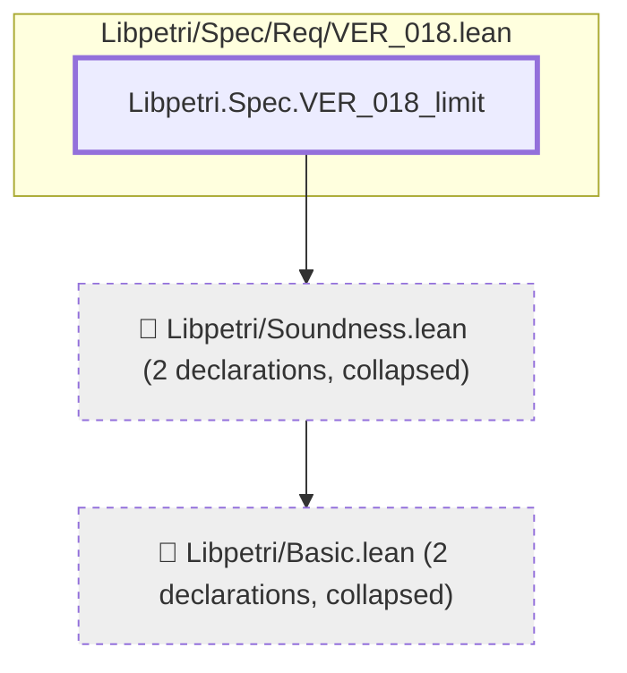

#### `Libpetri.Spec.VER_018_limit` → `Libpetri.Spec.SEAns.sat`

> Rule: this theorem's tree has 121 nodes, still 84 with other files collapsed, so it is split by direct dependency; this part has 4 nodes, other files collapsed.

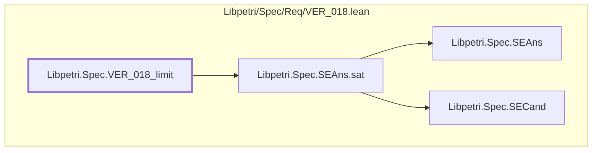

#### `Libpetri.Spec.VER_018_limit` → `Libpetri.Spec.SEAns.unsat`

> Rule: this theorem's tree has 121 nodes, still 84 with other files collapsed, so it is split by direct dependency; this part has 3 nodes, other files collapsed.

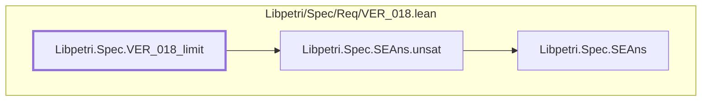

#### `Libpetri.Spec.VER_018_limit` → `Libpetri.Spec.SECand.n`

> Rule: this theorem's tree has 121 nodes, still 84 with other files collapsed, so it is split by direct dependency; this part has 4 nodes, other files collapsed.

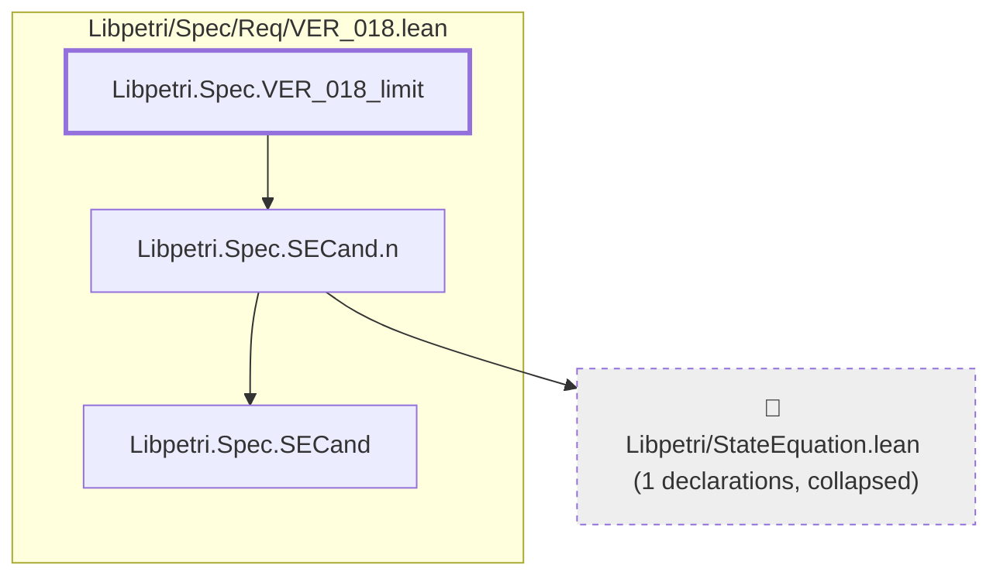

#### `Libpetri.Spec.VER_018_limit` → `Libpetri.Spec.SEIndCheck`

> Rule: this theorem's tree has 121 nodes, still 84 with other files collapsed, so it is split by direct dependency; this part has 5 nodes, other files collapsed.

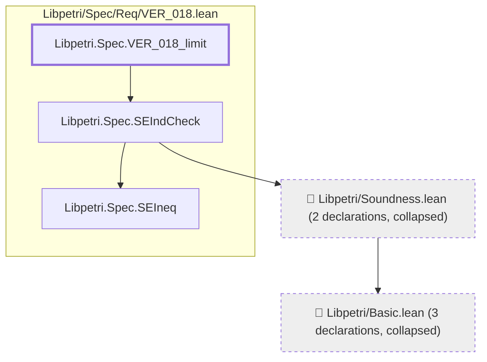

#### `Libpetri.Spec.VER_018_limit` → `Libpetri.Spec.SEOutcome.proven`

> Rule: this theorem's tree has 121 nodes, still 84 with other files collapsed, so it is split by direct dependency; this part has 4 nodes, other files collapsed.


#### `Libpetri.Spec.VER_018_limit` → `Libpetri.Spec.SEOutcome.refs`

> Rule: this theorem's tree has 121 nodes, still 84 with other files collapsed, so it is split by direct dependency; this part has 8 nodes, other files collapsed.

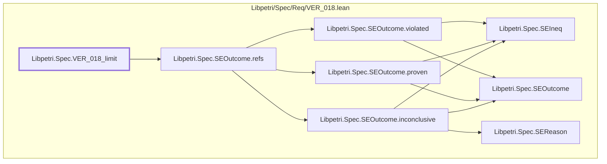

#### `Libpetri.Spec.VER_018_limit` → `Libpetri.Spec.SEOutcome.violated`

> Rule: this theorem's tree has 121 nodes, still 84 with other files collapsed, so it is split by direct dependency; this part has 4 nodes, other files collapsed.

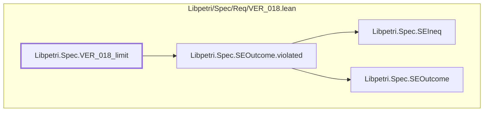

#### `Libpetri.Spec.VER_018_limit` → `Libpetri.Spec.SEPhaseFn`

> Rule: this theorem's tree has 121 nodes, still 84 with other files collapsed, so it is split by direct dependency; this part has 8 nodes, other files collapsed.

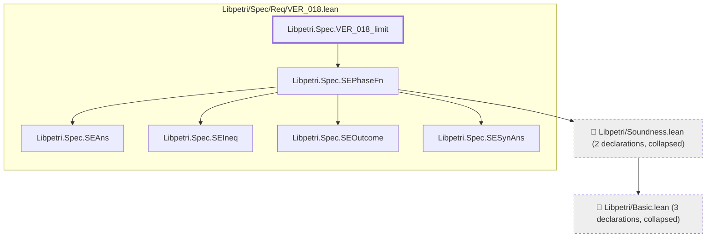

#### `Libpetri.Spec.VER_018_limit` → `Libpetri.Spec.SESearch`

> Rule: this theorem's tree has 121 nodes, still 84 with other files collapsed, so it is split by direct dependency; this part has 6 nodes, other files collapsed.

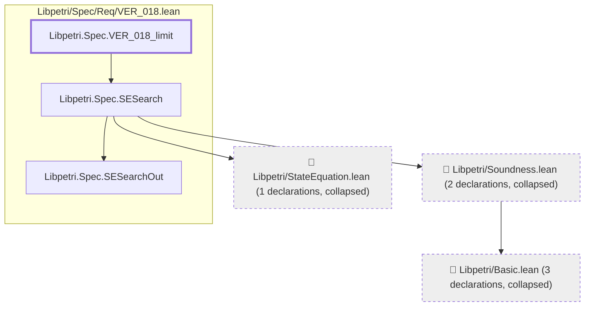

#### `Libpetri.Spec.VER_018_limit` → `Libpetri.Spec.SESearchOut.found`

> Rule: this theorem's tree has 121 nodes, still 84 with other files collapsed, so it is split by direct dependency; this part has 3 nodes, other files collapsed.

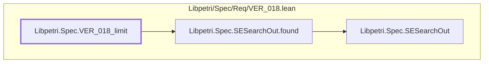

#### `Libpetri.Spec.VER_018_limit` → `Libpetri.Spec.SESound`

> Rule: this theorem's tree has 121 nodes, still 84 with other files collapsed, so it is split by direct dependency; this part has 13 nodes, other files collapsed.

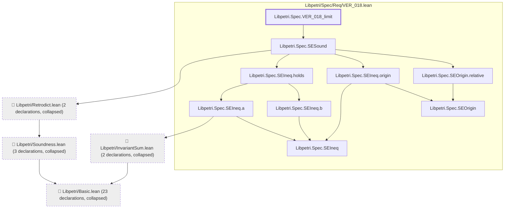

#### `Libpetri.Spec.VER_018_limit` → `Libpetri.Spec.SETrapFn`

> Rule: this theorem's tree has 121 nodes, still 84 with other files collapsed, so it is split by direct dependency; this part has 4 nodes, other files collapsed.

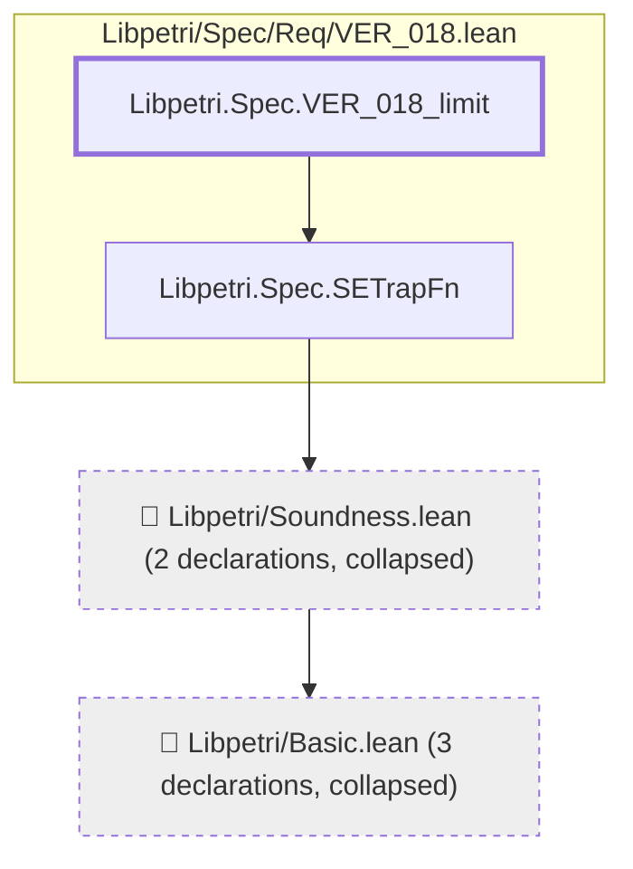

#### `Libpetri.Spec.VER_018_limit` → `Libpetri.Spec.SEWrap`

> Rule: this theorem's tree has 121 nodes, still 84 with other files collapsed, so it is split by direct dependency; this part has 5 nodes, other files collapsed.

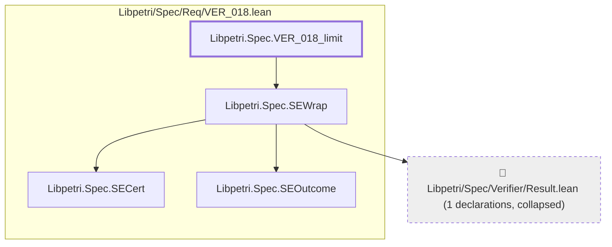

#### `Libpetri.Spec.VER_018_limit` → `Libpetri.Spec.VER_018`

> Rule: this theorem's tree has 121 nodes, still 84 with other files collapsed, so it is split by direct dependency; this part has 71 nodes, other files collapsed.

```mermaid
flowchart TD
  subgraph g0["Libpetri/Spec/Req/VER_018.lean"]
    n10000["Libpetri.Spec.SEAns"]
    n10001["Libpetri.Spec.SEAns.aside"]
    n10002["Libpetri.Spec.SEAns.sat"]
    n10003["Libpetri.Spec.SEAns.unsat"]
    n10004["Libpetri.Spec.SECand"]
    n10005["Libpetri.Spec.SECand.m"]
    n10007["Libpetri.Spec.SECand.n"]
    n10008["Libpetri.Spec.SECert"]
    n10009["Libpetri.Spec.SECert.disabled"]
    n10010["Libpetri.Spec.SECert.failed"]
    n10011["Libpetri.Spec.SECert.inconclusive"]
    n10014["Libpetri.Spec.SECert.passed"]
    n10015["Libpetri.Spec.SEGTrap"]
    n10016["Libpetri.Spec.SEIndCheck"]
    n10017["Libpetri.Spec.SEInductive"]
    n10018["Libpetri.Spec.SEIneq"]
    n10019["Libpetri.Spec.SEIneq.a"]
    n10020["Libpetri.Spec.SEIneq.b"]
    n10021["Libpetri.Spec.SEIneq.holds"]
    n10022["Libpetri.Spec.SEIneq.mk"]
    n10025["Libpetri.Spec.SEOrigin"]
    n10026["Libpetri.Spec.SEOrigin.inductive"]
    n10029["Libpetri.Spec.SEOrigin.relative"]
    n10030["Libpetri.Spec.SEOrigin.trap"]
    n10031["Libpetri.Spec.SEOutcome"]
    n10032["Libpetri.Spec.SEOutcome.inconclusive"]
    n10033["Libpetri.Spec.SEOutcome.isInconclusive"]
    n10034["Libpetri.Spec.SEOutcome.isProven"]
    n10035["Libpetri.Spec.SEOutcome.proven"]
    n10038["Libpetri.Spec.SEOutcome.violated"]
    n10039["Libpetri.Spec.SEPhaseFn"]
    n10040["Libpetri.Spec.SEReason"]
    n10041["Libpetri.Spec.SEReason.limit"]
    n10042["Libpetri.Spec.SEReason.noRefinement"]
    n10045["Libpetri.Spec.SEReason.queryAside"]
    n10046["Libpetri.Spec.SEReason.recheck"]
    n10047["Libpetri.Spec.SEReason.synthesisAside"]
    n10048["Libpetri.Spec.SESearch"]
    n10049["Libpetri.Spec.SESearchOut"]
    n10051["Libpetri.Spec.SESearchOut.found"]
    n10052["Libpetri.Spec.SESearchOut.none"]
    n10058["Libpetri.Spec.SESynAns"]
    n10059["Libpetri.Spec.SESynAns.aside"]
    n10060["Libpetri.Spec.SESynAns.found"]
    n10061["Libpetri.Spec.SESynAns.none"]
    n10062["Libpetri.Spec.SETrapFn"]
    n10063["Libpetri.Spec.SEWithin"]
    n10064["Libpetri.Spec.SEWrap"]
    n10979["Libpetri.Spec.VER_018"]
    n11002["Libpetri.Spec.VER_018_limit"]
    n20444["Libpetri.Spec.refSECheckInd"]
    n20649["Libpetri.Spec.seCleared"]
    n20651["Libpetri.Spec.seDrains"]
    n20656["Libpetri.Spec.seFree"]
    n20661["Libpetri.Spec.seHits"]
    n20664["Libpetri.Spec.seKeepC"]
    n20666["Libpetri.Spec.seKeeps"]
    n20676["Libpetri.Spec.seLower"]
    n20678["Libpetri.Spec.seRefine"]
    n20679["Libpetri.Spec.seReplay"]
    n20682["Libpetri.Spec.seRestoreC"]
    n20684["Libpetri.Spec.seRestores"]
    n20691["Libpetri.Spec.seTrapIneq"]
    n22088["Libpetri.Spec.ver018_method"]
  end
  c0["📁 Libpetri/Basic.lean (23 declarations, collapsed)"]
  c7["📁 Libpetri/InvariantSum.lean (3 declarations, collapsed)"]
  c25["📁 Libpetri/Novel/FiringBound/Ranking.lean (1 declarations, collapsed)"]
  c102["📁 Libpetri/Retrodict.lean (1 declarations, collapsed)"]
  c111["📁 Libpetri/Soundness.lean (3 declarations, collapsed)"]
  c370["📁 Libpetri/Spec/Verifier/Result.lean (6 declarations, collapsed)"]
  c373["📁 Libpetri/StateEquation.lean (1 declarations, collapsed)"]
  c7 --> c0
  c25 --> c0
  c102 --> c111
  c111 --> c0
  n10001 --> n10000
  n10002 --> n10000
  n10002 --> n10004
  n10003 --> n10000
  n10005 --> c0
  n10005 --> n10004
  n10007 --> c373
  n10007 --> n10004
  n10009 --> n10008
  n10010 --> n10008
  n10011 --> n10008
  n10014 --> n10008
  n10015 --> c111
  n10015 --> n20651
  n10016 --> c111
  n10016 --> n10018
  n10017 --> c102
  n10017 --> n10019
  n10017 --> n10020
  n10019 --> c7
  n10019 --> n10018
  n10020 --> n10018
  n10021 --> n10019
  n10021 --> n10020
  n10022 --> c7
  n10022 --> n10018
  n10022 --> n10025
  n10026 --> n10025
  n10029 --> n10025
  n10030 --> n10025
  n10032 --> n10018
  n10032 --> n10031
  n10032 --> n10040
  n10033 --> n10032
  n10033 --> n10035
  n10033 --> n10038
  n10034 --> n10032
  n10034 --> n10035
  n10034 --> n10038
  n10035 --> n10018
  n10035 --> n10031
  n10038 --> n10018
  n10038 --> n10031
  n10039 --> c111
  n10039 --> n10000
  n10039 --> n10018
  n10039 --> n10031
  n10039 --> n10058
  n10041 --> n10040
  n10042 --> n10040
  n10045 --> n10040
  n10046 --> n10040
  n10047 --> n10040
  n10048 --> c111
  n10048 --> c373
  n10048 --> n10049
  n10051 --> n10049
  n10052 --> n10049
  n10059 --> n10058
  n10060 --> c7
  n10060 --> n10058
  n10061 --> n10058
  n10062 --> c111
  n10063 --> c373
  n10064 --> c370
  n10064 --> n10008
  n10064 --> n10031
  n10979 --> n10001
  n10979 --> n10002
  n10979 --> n10003
  n10979 --> n10005
  n10979 --> n10007
  n10979 --> n10009
  n10979 --> n10010
  n10979 --> n10011
  n10979 --> n10014
  n10979 --> n10015
  n10979 --> n10017
  n10979 --> n10033
  n10979 --> n10034
  n10979 --> n10039
  n10979 --> n10041
  n10979 --> n10045
  n10979 --> n10048
  n10979 --> n10051
  n10979 --> n10052
  n10979 --> n10063
  n10979 --> n10064
  n10979 --> n20444
  n10979 --> n20661
  n10979 --> n20678
  n10979 --> n22088
  n11002 --> n10979
  n20444 --> c25
  n20444 --> n10016
  n20444 --> n20666
  n20444 --> n20684
  n20649 --> c0
  n20651 --> c0
  n20656 --> c111
  n20656 --> n20649
  n20661 --> n20679
  n20664 --> c111
  n20664 --> n20649
  n20664 --> n20676
  n20666 --> c7
  n20666 --> n20664
  n20676 --> c0
  n20678 --> n10016
  n20678 --> n10021
  n20678 --> n10026
  n20678 --> n10029
  n20678 --> n10042
  n20678 --> n10046
  n20678 --> n10047
  n20678 --> n10059
  n20678 --> n10060
  n20678 --> n10061
  n20678 --> n10062
  n20678 --> n20691
  n20679 --> c111
  n20682 --> c111
  n20682 --> n20649
  n20682 --> n20676
  n20684 --> n10019
  n20684 --> n10020
  n20684 --> n20656
  n20684 --> n20682
  n20691 --> n10022
  n20691 --> n10030
  classDef root stroke-width:3px
  classDef locked fill:#fff3cd,stroke:#b8860b
  classDef collapsed fill:#eeeeee,stroke-dasharray:4 4
  class n11002 root
  class c0,c7,c25,c102,c111,c370,c373 collapsed
```

#### `Libpetri.Spec.VER_018_limit` → `Libpetri.Spec.VER_018_start`

> Rule: this theorem's tree has 121 nodes, still 84 with other files collapsed, so it is split by direct dependency; this part has 84 nodes, other files collapsed.

```mermaid
flowchart TD
  subgraph g0["Libpetri/Spec/Req/VER_018.lean"]
    n10000["Libpetri.Spec.SEAns"]
    n10001["Libpetri.Spec.SEAns.aside"]
    n10002["Libpetri.Spec.SEAns.sat"]
    n10003["Libpetri.Spec.SEAns.unsat"]
    n10004["Libpetri.Spec.SECand"]
    n10005["Libpetri.Spec.SECand.m"]
    n10007["Libpetri.Spec.SECand.n"]
    n10008["Libpetri.Spec.SECert"]
    n10009["Libpetri.Spec.SECert.disabled"]
    n10010["Libpetri.Spec.SECert.failed"]
    n10011["Libpetri.Spec.SECert.inconclusive"]
    n10014["Libpetri.Spec.SECert.passed"]
    n10015["Libpetri.Spec.SEGTrap"]
    n10016["Libpetri.Spec.SEIndCheck"]
    n10017["Libpetri.Spec.SEInductive"]
    n10018["Libpetri.Spec.SEIneq"]
    n10019["Libpetri.Spec.SEIneq.a"]
    n10020["Libpetri.Spec.SEIneq.b"]
    n10021["Libpetri.Spec.SEIneq.holds"]
    n10022["Libpetri.Spec.SEIneq.mk"]
    n10023["Libpetri.Spec.SEIneq.origin"]
    n10024["Libpetri.Spec.SELoopInv"]
    n10025["Libpetri.Spec.SEOrigin"]
    n10026["Libpetri.Spec.SEOrigin.inductive"]
    n10029["Libpetri.Spec.SEOrigin.relative"]
    n10030["Libpetri.Spec.SEOrigin.trap"]
    n10031["Libpetri.Spec.SEOutcome"]
    n10032["Libpetri.Spec.SEOutcome.inconclusive"]
    n10033["Libpetri.Spec.SEOutcome.isInconclusive"]
    n10034["Libpetri.Spec.SEOutcome.isProven"]
    n10035["Libpetri.Spec.SEOutcome.proven"]
    n10036["Libpetri.Spec.SEOutcome.refs"]
    n10038["Libpetri.Spec.SEOutcome.violated"]
    n10039["Libpetri.Spec.SEPhaseFn"]
    n10040["Libpetri.Spec.SEReason"]
    n10041["Libpetri.Spec.SEReason.limit"]
    n10042["Libpetri.Spec.SEReason.noRefinement"]
    n10045["Libpetri.Spec.SEReason.queryAside"]
    n10046["Libpetri.Spec.SEReason.recheck"]
    n10047["Libpetri.Spec.SEReason.synthesisAside"]
    n10048["Libpetri.Spec.SESearch"]
    n10049["Libpetri.Spec.SESearchOut"]
    n10050["Libpetri.Spec.SESearchOut.exhausted"]
    n10051["Libpetri.Spec.SESearchOut.found"]
    n10052["Libpetri.Spec.SESearchOut.none"]
    n10053["Libpetri.Spec.SESound"]
    n10058["Libpetri.Spec.SESynAns"]
    n10059["Libpetri.Spec.SESynAns.aside"]
    n10060["Libpetri.Spec.SESynAns.found"]
    n10061["Libpetri.Spec.SESynAns.none"]
    n10062["Libpetri.Spec.SETrapFn"]
    n10063["Libpetri.Spec.SEWithin"]
    n10064["Libpetri.Spec.SEWrap"]
    n10979["Libpetri.Spec.VER_018"]
    n11002["Libpetri.Spec.VER_018_limit"]
    n11003["Libpetri.Spec.VER_018_loop"]
    n11023["Libpetri.Spec.VER_018_start"]
    n20444["Libpetri.Spec.refSECheckInd"]
    n20649["Libpetri.Spec.seCleared"]
    n20651["Libpetri.Spec.seDrains"]
    n20656["Libpetri.Spec.seFree"]
    n20659["Libpetri.Spec.seGTrap_stays_marked"]
    n20661["Libpetri.Spec.seHits"]
    n20663["Libpetri.Spec.seInductive_reach"]
    n20664["Libpetri.Spec.seKeepC"]
    n20666["Libpetri.Spec.seKeeps"]
    n20676["Libpetri.Spec.seLower"]
    n20678["Libpetri.Spec.seRefine"]
    n20679["Libpetri.Spec.seReplay"]
    n20682["Libpetri.Spec.seRestoreC"]
    n20684["Libpetri.Spec.seRestores"]
    n20691["Libpetri.Spec.seTrapIneq"]
    n20692["Libpetri.Spec.seTrapIneq_holds"]
    n20694["Libpetri.Spec.seTrap_holds_reach"]
    n22087["Libpetri.Spec.ver018_loop_step"]
    n22088["Libpetri.Spec.ver018_method"]
    n22108["Libpetri.Spec.ver018_refine_sound"]
  end
  c0["📁 Libpetri/Basic.lean (23 declarations, collapsed)"]
  c7["📁 Libpetri/InvariantSum.lean (4 declarations, collapsed)"]
  c25["📁 Libpetri/Novel/FiringBound/Ranking.lean (1 declarations, collapsed)"]
  c102["📁 Libpetri/Retrodict.lean (6 declarations, collapsed)"]
  c111["📁 Libpetri/Soundness.lean (3 declarations, collapsed)"]
  c370["📁 Libpetri/Spec/Verifier/Result.lean (6 declarations, collapsed)"]
  c373["📁 Libpetri/StateEquation.lean (1 declarations, collapsed)"]
  c7 --> c0
  c25 --> c0
  c102 --> c111
  c111 --> c0
  n10001 --> n10000
  n10002 --> n10000
  n10002 --> n10004
  n10003 --> n10000
  n10005 --> c0
  n10005 --> n10004
  n10007 --> c373
  n10007 --> n10004
  n10009 --> n10008
  n10010 --> n10008
  n10011 --> n10008
  n10014 --> n10008
  n10015 --> c111
  n10015 --> n20651
  n10016 --> c111
  n10016 --> n10018
  n10017 --> c102
  n10017 --> n10019
  n10017 --> n10020
  n10019 --> c7
  n10019 --> n10018
  n10020 --> n10018
  n10021 --> n10019
  n10021 --> n10020
  n10022 --> c7
  n10022 --> n10018
  n10022 --> n10025
  n10023 --> n10018
  n10023 --> n10025
  n10024 --> n10002
  n10024 --> n10003
  n10024 --> n10007
  n10024 --> n10036
  n10024 --> n10048
  n10024 --> n10051
  n10024 --> n10053
  n10026 --> n10025
  n10029 --> n10025
  n10030 --> n10025
  n10032 --> n10018
  n10032 --> n10031
  n10032 --> n10040
  n10033 --> n10032
  n10033 --> n10035
  n10033 --> n10038
  n10034 --> n10032
  n10034 --> n10035
  n10034 --> n10038
  n10035 --> n10018
  n10035 --> n10031
  n10036 --> n10032
  n10036 --> n10035
  n10036 --> n10038
  n10038 --> n10018
  n10038 --> n10031
  n10039 --> c111
  n10039 --> n10000
  n10039 --> n10018
  n10039 --> n10031
  n10039 --> n10058
  n10041 --> n10040
  n10042 --> n10040
  n10045 --> n10040
  n10046 --> n10040
  n10047 --> n10040
  n10048 --> c111
  n10048 --> c373
  n10048 --> n10049
  n10050 --> n10049
  n10051 --> n10049
  n10052 --> n10049
  n10053 --> c102
  n10053 --> n10021
  n10053 --> n10023
  n10053 --> n10029
  n10059 --> n10058
  n10060 --> c7
  n10060 --> n10058
  n10061 --> n10058
  n10062 --> c111
  n10063 --> c373
  n10064 --> c370
  n10064 --> n10008
  n10064 --> n10031
  n10979 --> n10001
  n10979 --> n10002
  n10979 --> n10003
  n10979 --> n10005
  n10979 --> n10007
  n10979 --> n10009
  n10979 --> n10010
  n10979 --> n10011
  n10979 --> n10014
  n10979 --> n10015
  n10979 --> n10017
  n10979 --> n10033
  n10979 --> n10034
  n10979 --> n10039
  n10979 --> n10041
  n10979 --> n10045
  n10979 --> n10048
  n10979 --> n10051
  n10979 --> n10052
  n10979 --> n10063
  n10979 --> n10064
  n10979 --> n20444
  n10979 --> n20661
  n10979 --> n20678
  n10979 --> n22088
  n11002 --> n11023
  n11003 --> n22087
  n11023 --> n11003
  n20444 --> c25
  n20444 --> n10016
  n20444 --> n20666
  n20444 --> n20684
  n20649 --> c0
  n20651 --> c0
  n20656 --> c111
  n20656 --> n20649
  n20659 --> c102
  n20659 --> n10015
  n20661 --> n20679
  n20663 --> n10017
  n20663 --> n10021
  n20664 --> c111
  n20664 --> n20649
  n20664 --> n20676
  n20666 --> c7
  n20666 --> n20664
  n20676 --> c0
  n20678 --> n10016
  n20678 --> n10021
  n20678 --> n10026
  n20678 --> n10029
  n20678 --> n10042
  n20678 --> n10046
  n20678 --> n10047
  n20678 --> n10059
  n20678 --> n10060
  n20678 --> n10061
  n20678 --> n10062
  n20678 --> n20691
  n20679 --> c111
  n20682 --> c111
  n20682 --> n20649
  n20682 --> n20676
  n20684 --> n10019
  n20684 --> n10020
  n20684 --> n20656
  n20684 --> n20682
  n20691 --> n10022
  n20691 --> n10030
  n20692 --> n10021
  n20692 --> n20691
  n20694 --> n20659
  n20694 --> n20692
  n22087 --> n10024
  n22087 --> n10050
  n22087 --> n22108
  n22108 --> n10053
  n22108 --> n10979
  n22108 --> n20663
  n22108 --> n20694
  classDef root stroke-width:3px
  classDef locked fill:#fff3cd,stroke:#b8860b
  classDef collapsed fill:#eeeeee,stroke-dasharray:4 4
  class n11002 root
  class c0,c7,c25,c102,c111,c370,c373 collapsed
```

Shared leaves of `Libpetri.Spec.VER_018_limit` (direct dependencies too small for a diagram of their own, fewer than 3 nodes):

- `Libpetri.AMarking` (`Libpetri/Basic.lean`)
- `Libpetri.PlaceId` (`Libpetri/Basic.lean`)
- `Libpetri.Spec.SEAns` (`Libpetri/Spec/Req/VER_018.lean`)
- `Libpetri.Spec.SECand` (`Libpetri/Spec/Req/VER_018.lean`)
- `Libpetri.Spec.SEIneq` (`Libpetri/Spec/Req/VER_018.lean`)
- `Libpetri.Spec.SEOutcome` (`Libpetri/Spec/Req/VER_018.lean`)
- `Libpetri.Spec.SESearchOut` (`Libpetri/Spec/Req/VER_018.lean`)
- `Libpetri.Spec.SESynAns` (`Libpetri/Spec/Req/VER_018.lean`)

### `Libpetri.Spec.VER_018_order_disabled`

> Rule: this theorem's whole tree, 50 nodes.

```mermaid
flowchart TD
  subgraph g0["Libpetri/Spec/Req/VER_018.lean"]
    n10693["Libpetri.Spec.VER_018_order"]
    n10695["Libpetri.Spec.VER_018_order_disabled"]
    n21498["Libpetri.Spec.ver018_lbStep"]
  end
  subgraph g1["Libpetri/Spec/Req/VER_019.lean"]
    n7478["Libpetri.Spec.FBCtx"]
    n7480["Libpetri.Spec.FBCtx.ignoreEnv"]
    n7482["Libpetri.Spec.FBCtx.nuNet"]
    n7483["Libpetri.Spec.FBCtx.seOn"]
    n7485["Libpetri.Spec.FBGate"]
    n21564["Libpetri.Spec.ver019_fixStep"]
    n21597["Libpetri.Spec.ver019_runPipeline_skip"]
    n21603["Libpetri.Spec.ver019_seStep"]
  end
  subgraph g2["Libpetri/Spec/Verifier/Pipeline.lean"]
    n11093["Libpetri.Spec.Verifier.Before"]
    n11220["Libpetri.Spec.Verifier.GStep"]
    n11221["Libpetri.Spec.Verifier.GStep.applies"]
    n11223["Libpetri.Spec.Verifier.GStep.name"]
    n11224["Libpetri.Spec.Verifier.GStep.route"]
    n11225["Libpetri.Spec.Verifier.GStep.run"]
    n11551["Libpetri.Spec.Verifier.Oracle"]
    n11562["Libpetri.Spec.Verifier.PhaseProg"]
    n11563["Libpetri.Spec.Verifier.PhaseProg.ask"]
    n11565["Libpetri.Spec.Verifier.PhaseProg.brecOn.go"]
    n11566["Libpetri.Spec.Verifier.PhaseProg.done"]
    n11567["Libpetri.Spec.Verifier.PhaseProg.poll"]
    n11708["Libpetri.Spec.Verifier.SolverFailure"]
    n11713["Libpetri.Spec.Verifier.SolverFailure.notStarted"]
    n11720["Libpetri.Spec.Verifier.SolverReply"]
    n11722["Libpetri.Spec.Verifier.SolverReply.failure"]
    n11818["Libpetri.Spec.Verifier.Stop"]
    n11819["Libpetri.Spec.Verifier.StopKind"]
    n11820["Libpetri.Spec.Verifier.StopKind.budget"]
    n11821["Libpetri.Spec.Verifier.StopKind.cancelled"]
    n11822["Libpetri.Spec.Verifier.Trail"]
    n11823["Libpetri.Spec.Verifier.Trail.enter"]
    n11824["Libpetri.Spec.Verifier.Trail.entered"]
    n11825["Libpetri.Spec.Verifier.Trail.mk"]
    n11826["Libpetri.Spec.Verifier.Trail.polls"]
    n11827["Libpetri.Spec.Verifier.Trail.route"]
    n11828["Libpetri.Spec.Verifier.Trail.running"]
    n11829["Libpetri.Spec.Verifier.Trail.started"]
    n11832["Libpetri.Spec.Verifier.Trail.stopped"]
    n11860["Libpetri.Spec.Verifier.execProg"]
    n11930["Libpetri.Spec.Verifier.pollStop"]
    n11952["Libpetri.Spec.Verifier.refusedReason"]
    n11963["Libpetri.Spec.Verifier.runPipeline"]
  end
  subgraph g3["Libpetri/Spec/Verifier/Result.lean"]
    n11545["Libpetri.Spec.Verifier.Options"]
    n11559["Libpetri.Spec.Verifier.PhaseOut"]
    n11560["Libpetri.Spec.Verifier.PhaseOut.aside"]
    n11561["Libpetri.Spec.Verifier.PhaseOut.decided"]
    n11587["Libpetri.Spec.Verifier.Route"]
    n11835["Libpetri.Spec.Verifier.Verdict"]
  end
  n7480 --> n7478
  n7482 --> n7478
  n7483 --> n7478
  n7485 --> n7478
  n10693 --> n7480
  n10693 --> n7482
  n10693 --> n7483
  n10693 --> n7485
  n10693 --> n11093
  n10693 --> n21498
  n10693 --> n21564
  n10693 --> n21603
  n10695 --> n10693
  n10695 --> n21597
  n11221 --> n11220
  n11221 --> n11545
  n11223 --> n11220
  n11224 --> n11220
  n11224 --> n11587
  n11225 --> n11220
  n11225 --> n11545
  n11225 --> n11559
  n11225 --> n11562
  n11551 --> n11720
  n11560 --> n11559
  n11561 --> n11559
  n11561 --> n11835
  n11563 --> n11562
  n11563 --> n11720
  n11565 --> n11563
  n11565 --> n11566
  n11565 --> n11567
  n11566 --> n11562
  n11567 --> n11562
  n11713 --> n11708
  n11722 --> n11708
  n11722 --> n11720
  n11818 --> n11819
  n11820 --> n11819
  n11821 --> n11819
  n11823 --> n11223
  n11823 --> n11224
  n11823 --> n11824
  n11823 --> n11825
  n11823 --> n11826
  n11823 --> n11829
  n11823 --> n11832
  n11824 --> n11822
  n11825 --> n11587
  n11825 --> n11819
  n11825 --> n11822
  n11826 --> n11822
  n11827 --> n11587
  n11827 --> n11822
  n11828 --> n11822
  n11829 --> n11822
  n11832 --> n11819
  n11832 --> n11822
  n11860 --> n11551
  n11860 --> n11565
  n11860 --> n11713
  n11860 --> n11722
  n11860 --> n11930
  n11860 --> n11952
  n11930 --> n11818
  n11930 --> n11824
  n11930 --> n11825
  n11930 --> n11826
  n11930 --> n11827
  n11930 --> n11828
  n11930 --> n11829
  n11930 --> n11832
  n11952 --> n11820
  n11952 --> n11821
  n11963 --> n11221
  n11963 --> n11225
  n11963 --> n11560
  n11963 --> n11561
  n11963 --> n11823
  n11963 --> n11860
  n21597 --> n11963
  classDef root stroke-width:3px
  classDef locked fill:#fff3cd,stroke:#b8860b
  classDef collapsed fill:#eeeeee,stroke-dasharray:4 4
  class n10695 root
```

### `Libpetri.Spec.VER_018_order_runs`

> Rule: this theorem's whole tree, 55 nodes.

```mermaid
flowchart TD
  subgraph g0["Libpetri/Spec/Req/VER_018.lean"]
    n10693["Libpetri.Spec.VER_018_order"]
    n10705["Libpetri.Spec.VER_018_order_runs"]
    n21498["Libpetri.Spec.ver018_lbStep"]
  end
  subgraph g1["Libpetri/Spec/Req/VER_019.lean"]
    n7478["Libpetri.Spec.FBCtx"]
    n7480["Libpetri.Spec.FBCtx.ignoreEnv"]
    n7482["Libpetri.Spec.FBCtx.nuNet"]
    n7483["Libpetri.Spec.FBCtx.seOn"]
    n7485["Libpetri.Spec.FBGate"]
    n21564["Libpetri.Spec.ver019_fixStep"]
    n21603["Libpetri.Spec.ver019_seStep"]
  end
  subgraph g2["Libpetri/Spec/Verifier/Pipeline.lean"]
    n11093["Libpetri.Spec.Verifier.Before"]
    n11094["Libpetri.Spec.Verifier.Before.ordered"]
    n11220["Libpetri.Spec.Verifier.GStep"]
    n11221["Libpetri.Spec.Verifier.GStep.applies"]
    n11223["Libpetri.Spec.Verifier.GStep.name"]
    n11224["Libpetri.Spec.Verifier.GStep.route"]
    n11225["Libpetri.Spec.Verifier.GStep.run"]
    n11551["Libpetri.Spec.Verifier.Oracle"]
    n11552["Libpetri.Spec.Verifier.Ordered"]
    n11562["Libpetri.Spec.Verifier.PhaseProg"]
    n11563["Libpetri.Spec.Verifier.PhaseProg.ask"]
    n11565["Libpetri.Spec.Verifier.PhaseProg.brecOn.go"]
    n11566["Libpetri.Spec.Verifier.PhaseProg.done"]
    n11567["Libpetri.Spec.Verifier.PhaseProg.poll"]
    n11708["Libpetri.Spec.Verifier.SolverFailure"]
    n11713["Libpetri.Spec.Verifier.SolverFailure.notStarted"]
    n11720["Libpetri.Spec.Verifier.SolverReply"]
    n11722["Libpetri.Spec.Verifier.SolverReply.failure"]
    n11818["Libpetri.Spec.Verifier.Stop"]
    n11819["Libpetri.Spec.Verifier.StopKind"]
    n11820["Libpetri.Spec.Verifier.StopKind.budget"]
    n11821["Libpetri.Spec.Verifier.StopKind.cancelled"]
    n11822["Libpetri.Spec.Verifier.Trail"]
    n11823["Libpetri.Spec.Verifier.Trail.enter"]
    n11824["Libpetri.Spec.Verifier.Trail.entered"]
    n11825["Libpetri.Spec.Verifier.Trail.mk"]
    n11826["Libpetri.Spec.Verifier.Trail.polls"]
    n11827["Libpetri.Spec.Verifier.Trail.route"]
    n11828["Libpetri.Spec.Verifier.Trail.running"]
    n11829["Libpetri.Spec.Verifier.Trail.started"]
    n11832["Libpetri.Spec.Verifier.Trail.stopped"]
    n11860["Libpetri.Spec.Verifier.execProg"]
    n11863["Libpetri.Spec.Verifier.execProg_frame"]
    n11930["Libpetri.Spec.Verifier.pollStop"]
    n11932["Libpetri.Spec.Verifier.pollStop_frame"]
    n11952["Libpetri.Spec.Verifier.refusedReason"]
    n11963["Libpetri.Spec.Verifier.runPipeline"]
    n11965["Libpetri.Spec.Verifier.runPipeline_entered"]
    n11968["Libpetri.Spec.Verifier.runPipeline_ordered"]
  end
  subgraph g3["Libpetri/Spec/Verifier/Result.lean"]
    n11545["Libpetri.Spec.Verifier.Options"]
    n11559["Libpetri.Spec.Verifier.PhaseOut"]
    n11560["Libpetri.Spec.Verifier.PhaseOut.aside"]
    n11561["Libpetri.Spec.Verifier.PhaseOut.decided"]
    n11587["Libpetri.Spec.Verifier.Route"]
    n11835["Libpetri.Spec.Verifier.Verdict"]
  end
  n7480 --> n7478
  n7482 --> n7478
  n7483 --> n7478
  n7485 --> n7478
  n10693 --> n7480
  n10693 --> n7482
  n10693 --> n7483
  n10693 --> n7485
  n10693 --> n11093
  n10693 --> n21498
  n10693 --> n21564
  n10693 --> n21603
  n10705 --> n10693
  n10705 --> n11968
  n11094 --> n11093
  n11094 --> n11552
  n11221 --> n11220
  n11221 --> n11545
  n11223 --> n11220
  n11224 --> n11220
  n11224 --> n11587
  n11225 --> n11220
  n11225 --> n11545
  n11225 --> n11559
  n11225 --> n11562
  n11551 --> n11720
  n11560 --> n11559
  n11561 --> n11559
  n11561 --> n11835
  n11563 --> n11562
  n11563 --> n11720
  n11565 --> n11563
  n11565 --> n11566
  n11565 --> n11567
  n11566 --> n11562
  n11567 --> n11562
  n11713 --> n11708
  n11722 --> n11708
  n11722 --> n11720
  n11818 --> n11819
  n11820 --> n11819
  n11821 --> n11819
  n11823 --> n11223
  n11823 --> n11224
  n11823 --> n11824
  n11823 --> n11825
  n11823 --> n11826
  n11823 --> n11829
  n11823 --> n11832
  n11824 --> n11822
  n11825 --> n11587
  n11825 --> n11819
  n11825 --> n11822
  n11826 --> n11822
  n11827 --> n11587
  n11827 --> n11822
  n11828 --> n11822
  n11829 --> n11822
  n11832 --> n11819
  n11832 --> n11822
  n11860 --> n11551
  n11860 --> n11565
  n11860 --> n11713
  n11860 --> n11722
  n11860 --> n11930
  n11860 --> n11952
  n11863 --> n11860
  n11863 --> n11932
  n11930 --> n11818
  n11930 --> n11824
  n11930 --> n11825
  n11930 --> n11826
  n11930 --> n11827
  n11930 --> n11828
  n11930 --> n11829
  n11930 --> n11832
  n11932 --> n11930
  n11952 --> n11820
  n11952 --> n11821
  n11963 --> n11221
  n11963 --> n11225
  n11963 --> n11560
  n11963 --> n11561
  n11963 --> n11823
  n11963 --> n11860
  n11965 --> n11863
  n11965 --> n11963
  n11968 --> n11094
  n11968 --> n11965
  classDef root stroke-width:3px
  classDef locked fill:#fff3cd,stroke:#b8860b
  classDef collapsed fill:#eeeeee,stroke-dasharray:4 4
  class n10705 root
```

### `Libpetri.Spec.VER_018_plain_trap_fails`

> Rule: this theorem's whole tree, 44 nodes.

```mermaid
flowchart TD
  subgraph g0["Libpetri/Basic.lean"]
    n0["Libpetri.AMarking"]
    n8["Libpetri.Card"]
    n9["Libpetri.Card.all"]
    n10["Libpetri.Card.atLeast"]
    n11["Libpetri.Card.consumesAll"]
    n12["Libpetri.Card.exactly"]
    n13["Libpetri.Card.one"]
    n14["Libpetri.Card.required"]
    n21["Libpetri.Colour"]
    n132["Libpetri.Guard"]
    n134["Libpetri.InSpec"]
    n135["Libpetri.InSpec.card"]
    n137["Libpetri.InSpec.mk"]
    n138["Libpetri.InSpec.place"]
    n2723["Libpetri.PlaceId"]
    n21910["Libpetri.Transition"]
    n21911["Libpetri.Transition.inhibitors"]
    n21912["Libpetri.Transition.inputs"]
    n21913["Libpetri.Transition.mk"]
    n21916["Libpetri.Transition.reads"]
    n21917["Libpetri.Transition.resets"]
    n21987["Libpetri.consumeAllAt"]
    n22039["Libpetri.enabledA"]
    n22061["Libpetri.fireA"]
    n22157["Libpetri.post"]
    n22162["Libpetri.pre"]
    n22217["Libpetri.specAt"]
  end
  subgraph g1["Libpetri/Novel/Commoner.lean"]
    n215["Libpetri.Novel.Commoner.Consumes"]
    n220["Libpetri.Novel.Commoner.Trap"]
  end
  subgraph g2["Libpetri/Retrodict.lean"]
    n2875["Libpetri.ReachAInj"]
    n2876["Libpetri.ReachAInj.init"]
    n2879["Libpetri.ReachAInj.step"]
    n21888["Libpetri.StepAInjRel"]
  end
  subgraph g3["Libpetri/Soundness.lean"]
    n130["Libpetri.FlatNet"]
    n131["Libpetri.FlatTransition"]
    n21891["Libpetri.StepARel"]
  end
  subgraph g4["Libpetri/Spec/Req/VER_018.lean"]
    n9800["Libpetri.Spec.SEGTrap"]
    n10706["Libpetri.Spec.VER_018_plain_trap_fails"]
    n20121["Libpetri.Spec.seDrains"]
    n20127["Libpetri.Spec.seGTrapB"]
    n20128["Libpetri.Spec.seGTrapB_iff"]
    n21485["Libpetri.Spec.ver018_clear"]
    n21509["Libpetri.Spec.ver018_one0"]
    n21538["Libpetri.Spec.ver018_tr"]
  end
  n0 --> n2723
  n9 --> n8
  n10 --> n8
  n11 --> n9
  n11 --> n10
  n11 --> n12
  n11 --> n13
  n12 --> n8
  n13 --> n8
  n14 --> n9
  n14 --> n10
  n14 --> n12
  n14 --> n13
  n130 --> n131
  n131 --> n2723
  n131 --> n21910
  n132 --> n21
  n135 --> n8
  n135 --> n134
  n137 --> n8
  n137 --> n132
  n137 --> n134
  n137 --> n2723
  n138 --> n134
  n138 --> n2723
  n215 --> n14
  n215 --> n135
  n215 --> n138
  n215 --> n21912
  n220 --> n130
  n220 --> n215
  n2875 --> n21888
  n2876 --> n2875
  n2879 --> n2875
  n9800 --> n130
  n9800 --> n20121
  n10706 --> n220
  n10706 --> n2876
  n10706 --> n2879
  n10706 --> n20128
  n10706 --> n21485
  n10706 --> n21509
  n20121 --> n21917
  n20121 --> n21987
  n20121 --> n22162
  n20127 --> n130
  n20127 --> n20121
  n20128 --> n9800
  n20128 --> n20127
  n21485 --> n130
  n21485 --> n21538
  n21509 --> n0
  n21538 --> n137
  n21538 --> n21913
  n21888 --> n21891
  n21891 --> n130
  n21891 --> n22039
  n21891 --> n22061
  n21911 --> n2723
  n21911 --> n21910
  n21912 --> n134
  n21912 --> n21910
  n21913 --> n134
  n21913 --> n2723
  n21913 --> n21910
  n21916 --> n2723
  n21916 --> n21910
  n21917 --> n2723
  n21917 --> n21910
  n21987 --> n11
  n21987 --> n135
  n21987 --> n22217
  n22039 --> n0
  n22039 --> n14
  n22039 --> n135
  n22039 --> n138
  n22039 --> n21911
  n22039 --> n21912
  n22039 --> n21916
  n22061 --> n0
  n22061 --> n21917
  n22061 --> n21987
  n22061 --> n22157
  n22061 --> n22162
  n22157 --> n2723
  n22162 --> n14
  n22162 --> n135
  n22162 --> n22217
  n22217 --> n138
  n22217 --> n21912
  classDef root stroke-width:3px
  classDef locked fill:#fff3cd,stroke:#b8860b
  classDef collapsed fill:#eeeeee,stroke-dasharray:4 4
  class n10706 root
```

### `Libpetri.Spec.VER_018_proven_needs_check`

#### `Libpetri.Spec.VER_018_proven_needs_check` → `Libpetri.FlatNet`

> Rule: this theorem's tree has 122 nodes, still 84 with other files collapsed, so it is split by direct dependency; this part has 3 nodes, other files collapsed.

```mermaid
flowchart TD
  subgraph g0["Libpetri/Spec/Req/VER_018.lean"]
    n10920["Libpetri.Spec.VER_018_proven_needs_check"]
  end
  c0["📁 Libpetri/Basic.lean (2 declarations, collapsed)"]
  c111["📁 Libpetri/Soundness.lean (2 declarations, collapsed)"]
  c111 --> c0
  n10920 --> c111
  classDef root stroke-width:3px
  classDef locked fill:#fff3cd,stroke:#b8860b
  classDef collapsed fill:#eeeeee,stroke-dasharray:4 4
  class n10920 root
  class c0,c111 collapsed
```

#### `Libpetri.Spec.VER_018_proven_needs_check` → `Libpetri.Spec.SEAns.aside`

> Rule: this theorem's tree has 122 nodes, still 84 with other files collapsed, so it is split by direct dependency; this part has 3 nodes, other files collapsed.

```mermaid
flowchart TD
  subgraph g0["Libpetri/Spec/Req/VER_018.lean"]
    n9907["Libpetri.Spec.SEAns"]
    n9908["Libpetri.Spec.SEAns.aside"]
    n10920["Libpetri.Spec.VER_018_proven_needs_check"]
  end
  n9908 --> n9907
  n10920 --> n9908
  classDef root stroke-width:3px
  classDef locked fill:#fff3cd,stroke:#b8860b
  classDef collapsed fill:#eeeeee,stroke-dasharray:4 4
  class n10920 root
```

#### `Libpetri.Spec.VER_018_proven_needs_check` → `Libpetri.Spec.SEAns.sat`

> Rule: this theorem's tree has 122 nodes, still 84 with other files collapsed, so it is split by direct dependency; this part has 4 nodes, other files collapsed.

```mermaid
flowchart TD
  subgraph g0["Libpetri/Spec/Req/VER_018.lean"]
    n9907["Libpetri.Spec.SEAns"]
    n9909["Libpetri.Spec.SEAns.sat"]
    n9911["Libpetri.Spec.SECand"]
    n10920["Libpetri.Spec.VER_018_proven_needs_check"]
  end
  n9909 --> n9907
  n9909 --> n9911
  n10920 --> n9909
  classDef root stroke-width:3px
  classDef locked fill:#fff3cd,stroke:#b8860b
  classDef collapsed fill:#eeeeee,stroke-dasharray:4 4
  class n10920 root
```

#### `Libpetri.Spec.VER_018_proven_needs_check` → `Libpetri.Spec.SEAns.unsat`

> Rule: this theorem's tree has 122 nodes, still 84 with other files collapsed, so it is split by direct dependency; this part has 3 nodes, other files collapsed.

```mermaid
flowchart TD
  subgraph g0["Libpetri/Spec/Req/VER_018.lean"]
    n9907["Libpetri.Spec.SEAns"]
    n9910["Libpetri.Spec.SEAns.unsat"]
    n10920["Libpetri.Spec.VER_018_proven_needs_check"]
  end
  n9910 --> n9907
  n10920 --> n9910
  classDef root stroke-width:3px
  classDef locked fill:#fff3cd,stroke:#b8860b
  classDef collapsed fill:#eeeeee,stroke-dasharray:4 4
  class n10920 root
```

#### `Libpetri.Spec.VER_018_proven_needs_check` → `Libpetri.Spec.SECand.m`

> Rule: this theorem's tree has 122 nodes, still 84 with other files collapsed, so it is split by direct dependency; this part has 4 nodes, other files collapsed.

```mermaid
flowchart TD
  subgraph g0["Libpetri/Spec/Req/VER_018.lean"]
    n9911["Libpetri.Spec.SECand"]
    n9912["Libpetri.Spec.SECand.m"]
    n10920["Libpetri.Spec.VER_018_proven_needs_check"]
  end
  c0["📁 Libpetri/Basic.lean (2 declarations, collapsed)"]
  n9912 --> c0
  n9912 --> n9911
  n10920 --> n9912
  classDef root stroke-width:3px
  classDef locked fill:#fff3cd,stroke:#b8860b
  classDef collapsed fill:#eeeeee,stroke-dasharray:4 4
  class n10920 root
  class c0 collapsed
```

#### `Libpetri.Spec.VER_018_proven_needs_check` → `Libpetri.Spec.SECand.n`

> Rule: this theorem's tree has 122 nodes, still 84 with other files collapsed, so it is split by direct dependency; this part has 4 nodes, other files collapsed.

```mermaid
flowchart TD
  subgraph g0["Libpetri/Spec/Req/VER_018.lean"]
    n9911["Libpetri.Spec.SECand"]
    n9914["Libpetri.Spec.SECand.n"]
    n10920["Libpetri.Spec.VER_018_proven_needs_check"]
  end
  c371["📁 Libpetri/StateEquation.lean (1 declarations, collapsed)"]
  n9914 --> c371
  n9914 --> n9911
  n10920 --> n9914
  classDef root stroke-width:3px
  classDef locked fill:#fff3cd,stroke:#b8860b
  classDef collapsed fill:#eeeeee,stroke-dasharray:4 4
  class n10920 root
  class c371 collapsed
```

#### `Libpetri.Spec.VER_018_proven_needs_check` → `Libpetri.Spec.SECert.disabled`

> Rule: this theorem's tree has 122 nodes, still 84 with other files collapsed, so it is split by direct dependency; this part has 3 nodes, other files collapsed.

```mermaid
flowchart TD
  subgraph g0["Libpetri/Spec/Req/VER_018.lean"]
    n9915["Libpetri.Spec.SECert"]
    n9916["Libpetri.Spec.SECert.disabled"]
    n10920["Libpetri.Spec.VER_018_proven_needs_check"]
  end
  n9916 --> n9915
  n10920 --> n9916
  classDef root stroke-width:3px
  classDef locked fill:#fff3cd,stroke:#b8860b
  classDef collapsed fill:#eeeeee,stroke-dasharray:4 4
  class n10920 root
```

#### `Libpetri.Spec.VER_018_proven_needs_check` → `Libpetri.Spec.SECert.failed`

> Rule: this theorem's tree has 122 nodes, still 84 with other files collapsed, so it is split by direct dependency; this part has 3 nodes, other files collapsed.

```mermaid
flowchart TD
  subgraph g0["Libpetri/Spec/Req/VER_018.lean"]
    n9915["Libpetri.Spec.SECert"]
    n9917["Libpetri.Spec.SECert.failed"]
    n10920["Libpetri.Spec.VER_018_proven_needs_check"]
  end
  n9917 --> n9915
  n10920 --> n9917
  classDef root stroke-width:3px
  classDef locked fill:#fff3cd,stroke:#b8860b
  classDef collapsed fill:#eeeeee,stroke-dasharray:4 4
  class n10920 root
```

#### `Libpetri.Spec.VER_018_proven_needs_check` → `Libpetri.Spec.SECert.inconclusive`

> Rule: this theorem's tree has 122 nodes, still 84 with other files collapsed, so it is split by direct dependency; this part has 3 nodes, other files collapsed.

```mermaid
flowchart TD
  subgraph g0["Libpetri/Spec/Req/VER_018.lean"]
    n9915["Libpetri.Spec.SECert"]
    n9918["Libpetri.Spec.SECert.inconclusive"]
    n10920["Libpetri.Spec.VER_018_proven_needs_check"]
  end
  n9918 --> n9915
  n10920 --> n9918
  classDef root stroke-width:3px
  classDef locked fill:#fff3cd,stroke:#b8860b
  classDef collapsed fill:#eeeeee,stroke-dasharray:4 4
  class n10920 root
```

#### `Libpetri.Spec.VER_018_proven_needs_check` → `Libpetri.Spec.SECert.passed`

> Rule: this theorem's tree has 122 nodes, still 84 with other files collapsed, so it is split by direct dependency; this part has 3 nodes, other files collapsed.

```mermaid
flowchart TD
  subgraph g0["Libpetri/Spec/Req/VER_018.lean"]
    n9915["Libpetri.Spec.SECert"]
    n9921["Libpetri.Spec.SECert.passed"]
    n10920["Libpetri.Spec.VER_018_proven_needs_check"]
  end
  n9921 --> n9915
  n10920 --> n9921
  classDef root stroke-width:3px
  classDef locked fill:#fff3cd,stroke:#b8860b
  classDef collapsed fill:#eeeeee,stroke-dasharray:4 4
  class n10920 root
```

#### `Libpetri.Spec.VER_018_proven_needs_check` → `Libpetri.Spec.SEGTrap`

> Rule: this theorem's tree has 122 nodes, still 84 with other files collapsed, so it is split by direct dependency; this part has 5 nodes, other files collapsed.

```mermaid
flowchart TD
  subgraph g0["Libpetri/Spec/Req/VER_018.lean"]
    n9922["Libpetri.Spec.SEGTrap"]
    n10920["Libpetri.Spec.VER_018_proven_needs_check"]
    n20552["Libpetri.Spec.seDrains"]
  end
  c0["📁 Libpetri/Basic.lean (17 declarations, collapsed)"]
  c111["📁 Libpetri/Soundness.lean (2 declarations, collapsed)"]
  c111 --> c0
  n9922 --> c111
  n9922 --> n20552
  n10920 --> n9922
  n20552 --> c0
  classDef root stroke-width:3px
  classDef locked fill:#fff3cd,stroke:#b8860b
  classDef collapsed fill:#eeeeee,stroke-dasharray:4 4
  class n10920 root
  class c0,c111 collapsed
```

#### `Libpetri.Spec.VER_018_proven_needs_check` → `Libpetri.Spec.SEIndCheck`

> Rule: this theorem's tree has 122 nodes, still 84 with other files collapsed, so it is split by direct dependency; this part has 5 nodes, other files collapsed.

```mermaid
flowchart TD
  subgraph g0["Libpetri/Spec/Req/VER_018.lean"]
    n9923["Libpetri.Spec.SEIndCheck"]
    n9925["Libpetri.Spec.SEIneq"]
    n10920["Libpetri.Spec.VER_018_proven_needs_check"]
  end
  c0["📁 Libpetri/Basic.lean (3 declarations, collapsed)"]
  c111["📁 Libpetri/Soundness.lean (2 declarations, collapsed)"]
  c111 --> c0
  n9923 --> c111
  n9923 --> n9925
  n10920 --> n9923
  classDef root stroke-width:3px
  classDef locked fill:#fff3cd,stroke:#b8860b
  classDef collapsed fill:#eeeeee,stroke-dasharray:4 4
  class n10920 root
  class c0,c111 collapsed
```

#### `Libpetri.Spec.VER_018_proven_needs_check` → `Libpetri.Spec.SEInductive`

> Rule: this theorem's tree has 122 nodes, still 84 with other files collapsed, so it is split by direct dependency; this part has 9 nodes, other files collapsed.

```mermaid
flowchart TD
  subgraph g0["Libpetri/Spec/Req/VER_018.lean"]
    n9924["Libpetri.Spec.SEInductive"]
    n9925["Libpetri.Spec.SEIneq"]
    n9926["Libpetri.Spec.SEIneq.a"]
    n9927["Libpetri.Spec.SEIneq.b"]
    n10920["Libpetri.Spec.VER_018_proven_needs_check"]
  end
  c0["📁 Libpetri/Basic.lean (23 declarations, collapsed)"]
  c7["📁 Libpetri/InvariantSum.lean (2 declarations, collapsed)"]
  c102["📁 Libpetri/Retrodict.lean (1 declarations, collapsed)"]
  c111["📁 Libpetri/Soundness.lean (3 declarations, collapsed)"]
  c7 --> c0
  c102 --> c111
  c111 --> c0
  n9924 --> c102
  n9924 --> n9926
  n9924 --> n9927
  n9926 --> c7
  n9926 --> n9925
  n9927 --> n9925
  n10920 --> n9924
  classDef root stroke-width:3px
  classDef locked fill:#fff3cd,stroke:#b8860b
  classDef collapsed fill:#eeeeee,stroke-dasharray:4 4
  class n10920 root
  class c0,c7,c102,c111 collapsed
```

#### `Libpetri.Spec.VER_018_proven_needs_check` → `Libpetri.Spec.SELoopInv`

> Rule: this theorem's tree has 122 nodes, still 84 with other files collapsed, so it is split by direct dependency; this part has 29 nodes, other files collapsed.

```mermaid
flowchart TD
  subgraph g0["Libpetri/Spec/Req/VER_018.lean"]
    n9907["Libpetri.Spec.SEAns"]
    n9909["Libpetri.Spec.SEAns.sat"]
    n9910["Libpetri.Spec.SEAns.unsat"]
    n9911["Libpetri.Spec.SECand"]
    n9914["Libpetri.Spec.SECand.n"]
    n9925["Libpetri.Spec.SEIneq"]
    n9926["Libpetri.Spec.SEIneq.a"]
    n9927["Libpetri.Spec.SEIneq.b"]
    n9928["Libpetri.Spec.SEIneq.holds"]
    n9930["Libpetri.Spec.SEIneq.origin"]
    n9931["Libpetri.Spec.SELoopInv"]
    n9932["Libpetri.Spec.SEOrigin"]
    n9936["Libpetri.Spec.SEOrigin.relative"]
    n9938["Libpetri.Spec.SEOutcome"]
    n9939["Libpetri.Spec.SEOutcome.inconclusive"]
    n9942["Libpetri.Spec.SEOutcome.proven"]
    n9943["Libpetri.Spec.SEOutcome.refs"]
    n9945["Libpetri.Spec.SEOutcome.violated"]
    n9947["Libpetri.Spec.SEReason"]
    n9955["Libpetri.Spec.SESearch"]
    n9956["Libpetri.Spec.SESearchOut"]
    n9958["Libpetri.Spec.SESearchOut.found"]
    n9960["Libpetri.Spec.SESound"]
    n10920["Libpetri.Spec.VER_018_proven_needs_check"]
  end
  c0["📁 Libpetri/Basic.lean (23 declarations, collapsed)"]
  c7["📁 Libpetri/InvariantSum.lean (2 declarations, collapsed)"]
  c102["📁 Libpetri/Retrodict.lean (2 declarations, collapsed)"]
  c111["📁 Libpetri/Soundness.lean (3 declarations, collapsed)"]
  c371["📁 Libpetri/StateEquation.lean (1 declarations, collapsed)"]
  c7 --> c0
  c102 --> c111
  c111 --> c0
  n9909 --> n9907
  n9909 --> n9911
  n9910 --> n9907
  n9914 --> c371
  n9914 --> n9911
  n9926 --> c7
  n9926 --> n9925
  n9927 --> n9925
  n9928 --> n9926
  n9928 --> n9927
  n9930 --> n9925
  n9930 --> n9932
  n9931 --> n9909
  n9931 --> n9910
  n9931 --> n9914
  n9931 --> n9943
  n9931 --> n9955
  n9931 --> n9958
  n9931 --> n9960
  n9936 --> n9932
  n9939 --> n9925
  n9939 --> n9938
  n9939 --> n9947
  n9942 --> n9925
  n9942 --> n9938
  n9943 --> n9939
  n9943 --> n9942
  n9943 --> n9945
  n9945 --> n9925
  n9945 --> n9938
  n9955 --> c111
  n9955 --> c371
  n9955 --> n9956
  n9958 --> n9956
  n9960 --> c102
  n9960 --> n9928
  n9960 --> n9930
  n9960 --> n9936
  n10920 --> n9931
  classDef root stroke-width:3px
  classDef locked fill:#fff3cd,stroke:#b8860b
  classDef collapsed fill:#eeeeee,stroke-dasharray:4 4
  class n10920 root
  class c0,c7,c102,c111,c371 collapsed
```

#### `Libpetri.Spec.VER_018_proven_needs_check` → `Libpetri.Spec.SEOutcome.inconclusive`

> Rule: this theorem's tree has 122 nodes, still 84 with other files collapsed, so it is split by direct dependency; this part has 5 nodes, other files collapsed.

```mermaid
flowchart TD
  subgraph g0["Libpetri/Spec/Req/VER_018.lean"]
    n9925["Libpetri.Spec.SEIneq"]
    n9938["Libpetri.Spec.SEOutcome"]
    n9939["Libpetri.Spec.SEOutcome.inconclusive"]
    n9947["Libpetri.Spec.SEReason"]
    n10920["Libpetri.Spec.VER_018_proven_needs_check"]
  end
  n9939 --> n9925
  n9939 --> n9938
  n9939 --> n9947
  n10920 --> n9939
  classDef root stroke-width:3px
  classDef locked fill:#fff3cd,stroke:#b8860b
  classDef collapsed fill:#eeeeee,stroke-dasharray:4 4
  class n10920 root
```

#### `Libpetri.Spec.VER_018_proven_needs_check` → `Libpetri.Spec.SEOutcome.isInconclusive`

> Rule: this theorem's tree has 122 nodes, still 84 with other files collapsed, so it is split by direct dependency; this part has 8 nodes, other files collapsed.

```mermaid
flowchart TD
  subgraph g0["Libpetri/Spec/Req/VER_018.lean"]
    n9925["Libpetri.Spec.SEIneq"]
    n9938["Libpetri.Spec.SEOutcome"]
    n9939["Libpetri.Spec.SEOutcome.inconclusive"]
    n9940["Libpetri.Spec.SEOutcome.isInconclusive"]
    n9942["Libpetri.Spec.SEOutcome.proven"]
    n9945["Libpetri.Spec.SEOutcome.violated"]
    n9947["Libpetri.Spec.SEReason"]
    n10920["Libpetri.Spec.VER_018_proven_needs_check"]
  end
  n9939 --> n9925
  n9939 --> n9938
  n9939 --> n9947
  n9940 --> n9939
  n9940 --> n9942
  n9940 --> n9945
  n9942 --> n9925
  n9942 --> n9938
  n9945 --> n9925
  n9945 --> n9938
  n10920 --> n9940
  classDef root stroke-width:3px
  classDef locked fill:#fff3cd,stroke:#b8860b
  classDef collapsed fill:#eeeeee,stroke-dasharray:4 4
  class n10920 root
```

#### `Libpetri.Spec.VER_018_proven_needs_check` → `Libpetri.Spec.SEOutcome.isProven`

> Rule: this theorem's tree has 122 nodes, still 84 with other files collapsed, so it is split by direct dependency; this part has 8 nodes, other files collapsed.

```mermaid
flowchart TD
  subgraph g0["Libpetri/Spec/Req/VER_018.lean"]
    n9925["Libpetri.Spec.SEIneq"]
    n9938["Libpetri.Spec.SEOutcome"]
    n9939["Libpetri.Spec.SEOutcome.inconclusive"]
    n9941["Libpetri.Spec.SEOutcome.isProven"]
    n9942["Libpetri.Spec.SEOutcome.proven"]
    n9945["Libpetri.Spec.SEOutcome.violated"]
    n9947["Libpetri.Spec.SEReason"]
    n10920["Libpetri.Spec.VER_018_proven_needs_check"]
  end
  n9939 --> n9925
  n9939 --> n9938
  n9939 --> n9947
  n9941 --> n9939
  n9941 --> n9942
  n9941 --> n9945
  n9942 --> n9925
  n9942 --> n9938
  n9945 --> n9925
  n9945 --> n9938
  n10920 --> n9941
  classDef root stroke-width:3px
  classDef locked fill:#fff3cd,stroke:#b8860b
  classDef collapsed fill:#eeeeee,stroke-dasharray:4 4
  class n10920 root
```

#### `Libpetri.Spec.VER_018_proven_needs_check` → `Libpetri.Spec.SEOutcome.proven`

> Rule: this theorem's tree has 122 nodes, still 84 with other files collapsed, so it is split by direct dependency; this part has 4 nodes, other files collapsed.

```mermaid
flowchart TD
  subgraph g0["Libpetri/Spec/Req/VER_018.lean"]
    n9925["Libpetri.Spec.SEIneq"]
    n9938["Libpetri.Spec.SEOutcome"]
    n9942["Libpetri.Spec.SEOutcome.proven"]
    n10920["Libpetri.Spec.VER_018_proven_needs_check"]
  end
  n9942 --> n9925
  n9942 --> n9938
  n10920 --> n9942
  classDef root stroke-width:3px
  classDef locked fill:#fff3cd,stroke:#b8860b
  classDef collapsed fill:#eeeeee,stroke-dasharray:4 4
  class n10920 root
```

#### `Libpetri.Spec.VER_018_proven_needs_check` → `Libpetri.Spec.SEOutcome.refs`

> Rule: this theorem's tree has 122 nodes, still 84 with other files collapsed, so it is split by direct dependency; this part has 8 nodes, other files collapsed.

```mermaid
flowchart TD
  subgraph g0["Libpetri/Spec/Req/VER_018.lean"]
    n9925["Libpetri.Spec.SEIneq"]
    n9938["Libpetri.Spec.SEOutcome"]
    n9939["Libpetri.Spec.SEOutcome.inconclusive"]
    n9942["Libpetri.Spec.SEOutcome.proven"]
    n9943["Libpetri.Spec.SEOutcome.refs"]
    n9945["Libpetri.Spec.SEOutcome.violated"]
    n9947["Libpetri.Spec.SEReason"]
    n10920["Libpetri.Spec.VER_018_proven_needs_check"]
  end
  n9939 --> n9925
  n9939 --> n9938
  n9939 --> n9947
  n9942 --> n9925
  n9942 --> n9938
  n9943 --> n9939
  n9943 --> n9942
  n9943 --> n9945
  n9945 --> n9925
  n9945 --> n9938
  n10920 --> n9943
  classDef root stroke-width:3px
  classDef locked fill:#fff3cd,stroke:#b8860b
  classDef collapsed fill:#eeeeee,stroke-dasharray:4 4
  class n10920 root
```

#### `Libpetri.Spec.VER_018_proven_needs_check` → `Libpetri.Spec.SEOutcome.violated`

> Rule: this theorem's tree has 122 nodes, still 84 with other files collapsed, so it is split by direct dependency; this part has 4 nodes, other files collapsed.

```mermaid
flowchart TD
  subgraph g0["Libpetri/Spec/Req/VER_018.lean"]
    n9925["Libpetri.Spec.SEIneq"]
    n9938["Libpetri.Spec.SEOutcome"]
    n9945["Libpetri.Spec.SEOutcome.violated"]
    n10920["Libpetri.Spec.VER_018_proven_needs_check"]
  end
  n9945 --> n9925
  n9945 --> n9938
  n10920 --> n9945
  classDef root stroke-width:3px
  classDef locked fill:#fff3cd,stroke:#b8860b
  classDef collapsed fill:#eeeeee,stroke-dasharray:4 4
  class n10920 root
```

#### `Libpetri.Spec.VER_018_proven_needs_check` → `Libpetri.Spec.SEPhaseFn`

> Rule: this theorem's tree has 122 nodes, still 84 with other files collapsed, so it is split by direct dependency; this part has 8 nodes, other files collapsed.

```mermaid
flowchart TD
  subgraph g0["Libpetri/Spec/Req/VER_018.lean"]
    n9907["Libpetri.Spec.SEAns"]
    n9925["Libpetri.Spec.SEIneq"]
    n9938["Libpetri.Spec.SEOutcome"]
    n9946["Libpetri.Spec.SEPhaseFn"]
    n9965["Libpetri.Spec.SESynAns"]
    n10920["Libpetri.Spec.VER_018_proven_needs_check"]
  end
  c0["📁 Libpetri/Basic.lean (3 declarations, collapsed)"]
  c111["📁 Libpetri/Soundness.lean (2 declarations, collapsed)"]
  c111 --> c0
  n9946 --> c111
  n9946 --> n9907
  n9946 --> n9925
  n9946 --> n9938
  n9946 --> n9965
  n10920 --> n9946
  classDef root stroke-width:3px
  classDef locked fill:#fff3cd,stroke:#b8860b
  classDef collapsed fill:#eeeeee,stroke-dasharray:4 4
  class n10920 root
  class c0,c111 collapsed
```

#### `Libpetri.Spec.VER_018_proven_needs_check` → `Libpetri.Spec.SEReason.limit`

> Rule: this theorem's tree has 122 nodes, still 84 with other files collapsed, so it is split by direct dependency; this part has 3 nodes, other files collapsed.

```mermaid
flowchart TD
  subgraph g0["Libpetri/Spec/Req/VER_018.lean"]
    n9947["Libpetri.Spec.SEReason"]
    n9948["Libpetri.Spec.SEReason.limit"]
    n10920["Libpetri.Spec.VER_018_proven_needs_check"]
  end
  n9948 --> n9947
  n10920 --> n9948
  classDef root stroke-width:3px
  classDef locked fill:#fff3cd,stroke:#b8860b
  classDef collapsed fill:#eeeeee,stroke-dasharray:4 4
  class n10920 root
```

#### `Libpetri.Spec.VER_018_proven_needs_check` → `Libpetri.Spec.SEReason.queryAside`

> Rule: this theorem's tree has 122 nodes, still 84 with other files collapsed, so it is split by direct dependency; this part has 3 nodes, other files collapsed.

```mermaid
flowchart TD
  subgraph g0["Libpetri/Spec/Req/VER_018.lean"]
    n9947["Libpetri.Spec.SEReason"]
    n9952["Libpetri.Spec.SEReason.queryAside"]
    n10920["Libpetri.Spec.VER_018_proven_needs_check"]
  end
  n9952 --> n9947
  n10920 --> n9952
  classDef root stroke-width:3px
  classDef locked fill:#fff3cd,stroke:#b8860b
  classDef collapsed fill:#eeeeee,stroke-dasharray:4 4
  class n10920 root
```

#### `Libpetri.Spec.VER_018_proven_needs_check` → `Libpetri.Spec.SESearch`

> Rule: this theorem's tree has 122 nodes, still 84 with other files collapsed, so it is split by direct dependency; this part has 6 nodes, other files collapsed.

```mermaid
flowchart TD
  subgraph g0["Libpetri/Spec/Req/VER_018.lean"]
    n9955["Libpetri.Spec.SESearch"]
    n9956["Libpetri.Spec.SESearchOut"]
    n10920["Libpetri.Spec.VER_018_proven_needs_check"]
  end
  c0["📁 Libpetri/Basic.lean (3 declarations, collapsed)"]
  c111["📁 Libpetri/Soundness.lean (2 declarations, collapsed)"]
  c371["📁 Libpetri/StateEquation.lean (1 declarations, collapsed)"]
  c111 --> c0
  n9955 --> c111
  n9955 --> c371
  n9955 --> n9956
  n10920 --> n9955
  classDef root stroke-width:3px
  classDef locked fill:#fff3cd,stroke:#b8860b
  classDef collapsed fill:#eeeeee,stroke-dasharray:4 4
  class n10920 root
  class c0,c111,c371 collapsed
```

#### `Libpetri.Spec.VER_018_proven_needs_check` → `Libpetri.Spec.SESearchOut.found`

> Rule: this theorem's tree has 122 nodes, still 84 with other files collapsed, so it is split by direct dependency; this part has 3 nodes, other files collapsed.

```mermaid
flowchart TD
  subgraph g0["Libpetri/Spec/Req/VER_018.lean"]
    n9956["Libpetri.Spec.SESearchOut"]
    n9958["Libpetri.Spec.SESearchOut.found"]
    n10920["Libpetri.Spec.VER_018_proven_needs_check"]
  end
  n9958 --> n9956
  n10920 --> n9958
  classDef root stroke-width:3px
  classDef locked fill:#fff3cd,stroke:#b8860b
  classDef collapsed fill:#eeeeee,stroke-dasharray:4 4
  class n10920 root
```

#### `Libpetri.Spec.VER_018_proven_needs_check` → `Libpetri.Spec.SESearchOut.none`

> Rule: this theorem's tree has 122 nodes, still 84 with other files collapsed, so it is split by direct dependency; this part has 3 nodes, other files collapsed.

```mermaid
flowchart TD
  subgraph g0["Libpetri/Spec/Req/VER_018.lean"]
    n9956["Libpetri.Spec.SESearchOut"]
    n9959["Libpetri.Spec.SESearchOut.none"]
    n10920["Libpetri.Spec.VER_018_proven_needs_check"]
  end
  n9959 --> n9956
  n10920 --> n9959
  classDef root stroke-width:3px
  classDef locked fill:#fff3cd,stroke:#b8860b
  classDef collapsed fill:#eeeeee,stroke-dasharray:4 4
  class n10920 root
```

#### `Libpetri.Spec.VER_018_proven_needs_check` → `Libpetri.Spec.SESound`

> Rule: this theorem's tree has 122 nodes, still 84 with other files collapsed, so it is split by direct dependency; this part has 13 nodes, other files collapsed.

```mermaid
flowchart TD
  subgraph g0["Libpetri/Spec/Req/VER_018.lean"]
    n9925["Libpetri.Spec.SEIneq"]
    n9926["Libpetri.Spec.SEIneq.a"]
    n9927["Libpetri.Spec.SEIneq.b"]
    n9928["Libpetri.Spec.SEIneq.holds"]
    n9930["Libpetri.Spec.SEIneq.origin"]
    n9932["Libpetri.Spec.SEOrigin"]
    n9936["Libpetri.Spec.SEOrigin.relative"]
    n9960["Libpetri.Spec.SESound"]
    n10920["Libpetri.Spec.VER_018_proven_needs_check"]
  end
  c0["📁 Libpetri/Basic.lean (23 declarations, collapsed)"]
  c7["📁 Libpetri/InvariantSum.lean (2 declarations, collapsed)"]
  c102["📁 Libpetri/Retrodict.lean (2 declarations, collapsed)"]
  c111["📁 Libpetri/Soundness.lean (3 declarations, collapsed)"]
  c7 --> c0
  c102 --> c111
  c111 --> c0
  n9926 --> c7
  n9926 --> n9925
  n9927 --> n9925
  n9928 --> n9926
  n9928 --> n9927
  n9930 --> n9925
  n9930 --> n9932
  n9936 --> n9932
  n9960 --> c102
  n9960 --> n9928
  n9960 --> n9930
  n9960 --> n9936
  n10920 --> n9960
  classDef root stroke-width:3px
  classDef locked fill:#fff3cd,stroke:#b8860b
  classDef collapsed fill:#eeeeee,stroke-dasharray:4 4
  class n10920 root
  class c0,c7,c102,c111 collapsed
```

#### `Libpetri.Spec.VER_018_proven_needs_check` → `Libpetri.Spec.SETrapFn`

> Rule: this theorem's tree has 122 nodes, still 84 with other files collapsed, so it is split by direct dependency; this part has 4 nodes, other files collapsed.

```mermaid
flowchart TD
  subgraph g0["Libpetri/Spec/Req/VER_018.lean"]
    n9969["Libpetri.Spec.SETrapFn"]
    n10920["Libpetri.Spec.VER_018_proven_needs_check"]
  end
  c0["📁 Libpetri/Basic.lean (3 declarations, collapsed)"]
  c111["📁 Libpetri/Soundness.lean (2 declarations, collapsed)"]
  c111 --> c0
  n9969 --> c111
  n10920 --> n9969
  classDef root stroke-width:3px
  classDef locked fill:#fff3cd,stroke:#b8860b
  classDef collapsed fill:#eeeeee,stroke-dasharray:4 4
  class n10920 root
  class c0,c111 collapsed
```

#### `Libpetri.Spec.VER_018_proven_needs_check` → `Libpetri.Spec.SEWithin`

> Rule: this theorem's tree has 122 nodes, still 84 with other files collapsed, so it is split by direct dependency; this part has 3 nodes, other files collapsed.

```mermaid
flowchart TD
  subgraph g0["Libpetri/Spec/Req/VER_018.lean"]
    n9970["Libpetri.Spec.SEWithin"]
    n10920["Libpetri.Spec.VER_018_proven_needs_check"]
  end
  c371["📁 Libpetri/StateEquation.lean (1 declarations, collapsed)"]
  n9970 --> c371
  n10920 --> n9970
  classDef root stroke-width:3px
  classDef locked fill:#fff3cd,stroke:#b8860b
  classDef collapsed fill:#eeeeee,stroke-dasharray:4 4
  class n10920 root
  class c371 collapsed
```

#### `Libpetri.Spec.VER_018_proven_needs_check` → `Libpetri.Spec.SEWrap`

> Rule: this theorem's tree has 122 nodes, still 84 with other files collapsed, so it is split by direct dependency; this part has 5 nodes, other files collapsed.

```mermaid
flowchart TD
  subgraph g0["Libpetri/Spec/Req/VER_018.lean"]
    n9915["Libpetri.Spec.SECert"]
    n9938["Libpetri.Spec.SEOutcome"]
    n9971["Libpetri.Spec.SEWrap"]
    n10920["Libpetri.Spec.VER_018_proven_needs_check"]
  end
  c368["📁 Libpetri/Spec/Verifier/Result.lean (1 declarations, collapsed)"]
  n9971 --> c368
  n9971 --> n9915
  n9971 --> n9938
  n10920 --> n9971
  classDef root stroke-width:3px
  classDef locked fill:#fff3cd,stroke:#b8860b
  classDef collapsed fill:#eeeeee,stroke-dasharray:4 4
  class n10920 root
  class c368 collapsed
```

#### `Libpetri.Spec.VER_018_proven_needs_check` → `Libpetri.Spec.VER_018`

> Rule: this theorem's tree has 122 nodes, still 84 with other files collapsed, so it is split by direct dependency; this part has 71 nodes, other files collapsed.

```mermaid
flowchart TD
  subgraph g0["Libpetri/Spec/Req/VER_018.lean"]
    n9907["Libpetri.Spec.SEAns"]
    n9908["Libpetri.Spec.SEAns.aside"]
    n9909["Libpetri.Spec.SEAns.sat"]
    n9910["Libpetri.Spec.SEAns.unsat"]
    n9911["Libpetri.Spec.SECand"]
    n9912["Libpetri.Spec.SECand.m"]
    n9914["Libpetri.Spec.SECand.n"]
    n9915["Libpetri.Spec.SECert"]
    n9916["Libpetri.Spec.SECert.disabled"]
    n9917["Libpetri.Spec.SECert.failed"]
    n9918["Libpetri.Spec.SECert.inconclusive"]
    n9921["Libpetri.Spec.SECert.passed"]
    n9922["Libpetri.Spec.SEGTrap"]
    n9923["Libpetri.Spec.SEIndCheck"]
    n9924["Libpetri.Spec.SEInductive"]
    n9925["Libpetri.Spec.SEIneq"]
    n9926["Libpetri.Spec.SEIneq.a"]
    n9927["Libpetri.Spec.SEIneq.b"]
    n9928["Libpetri.Spec.SEIneq.holds"]
    n9929["Libpetri.Spec.SEIneq.mk"]
    n9932["Libpetri.Spec.SEOrigin"]
    n9933["Libpetri.Spec.SEOrigin.inductive"]
    n9936["Libpetri.Spec.SEOrigin.relative"]
    n9937["Libpetri.Spec.SEOrigin.trap"]
    n9938["Libpetri.Spec.SEOutcome"]
    n9939["Libpetri.Spec.SEOutcome.inconclusive"]
    n9940["Libpetri.Spec.SEOutcome.isInconclusive"]
    n9941["Libpetri.Spec.SEOutcome.isProven"]
    n9942["Libpetri.Spec.SEOutcome.proven"]
    n9945["Libpetri.Spec.SEOutcome.violated"]
    n9946["Libpetri.Spec.SEPhaseFn"]
    n9947["Libpetri.Spec.SEReason"]
    n9948["Libpetri.Spec.SEReason.limit"]
    n9949["Libpetri.Spec.SEReason.noRefinement"]
    n9952["Libpetri.Spec.SEReason.queryAside"]
    n9953["Libpetri.Spec.SEReason.recheck"]
    n9954["Libpetri.Spec.SEReason.synthesisAside"]
    n9955["Libpetri.Spec.SESearch"]
    n9956["Libpetri.Spec.SESearchOut"]
    n9958["Libpetri.Spec.SESearchOut.found"]
    n9959["Libpetri.Spec.SESearchOut.none"]
    n9965["Libpetri.Spec.SESynAns"]
    n9966["Libpetri.Spec.SESynAns.aside"]
    n9967["Libpetri.Spec.SESynAns.found"]
    n9968["Libpetri.Spec.SESynAns.none"]
    n9969["Libpetri.Spec.SETrapFn"]
    n9970["Libpetri.Spec.SEWithin"]
    n9971["Libpetri.Spec.SEWrap"]
    n10880["Libpetri.Spec.VER_018"]
    n10920["Libpetri.Spec.VER_018_proven_needs_check"]
    n20345["Libpetri.Spec.refSECheckInd"]
    n20550["Libpetri.Spec.seCleared"]
    n20552["Libpetri.Spec.seDrains"]
    n20557["Libpetri.Spec.seFree"]
    n20562["Libpetri.Spec.seHits"]
    n20565["Libpetri.Spec.seKeepC"]
    n20567["Libpetri.Spec.seKeeps"]
    n20577["Libpetri.Spec.seLower"]
    n20579["Libpetri.Spec.seRefine"]
    n20580["Libpetri.Spec.seReplay"]
    n20583["Libpetri.Spec.seRestoreC"]
    n20585["Libpetri.Spec.seRestores"]
    n20592["Libpetri.Spec.seTrapIneq"]
    n21989["Libpetri.Spec.ver018_method"]
  end
  c0["📁 Libpetri/Basic.lean (23 declarations, collapsed)"]
  c7["📁 Libpetri/InvariantSum.lean (3 declarations, collapsed)"]
  c25["📁 Libpetri/Novel/FiringBound/Ranking.lean (1 declarations, collapsed)"]
  c102["📁 Libpetri/Retrodict.lean (1 declarations, collapsed)"]
  c111["📁 Libpetri/Soundness.lean (3 declarations, collapsed)"]
  c368["📁 Libpetri/Spec/Verifier/Result.lean (6 declarations, collapsed)"]
  c371["📁 Libpetri/StateEquation.lean (1 declarations, collapsed)"]
  c7 --> c0
  c25 --> c0
  c102 --> c111
  c111 --> c0
  n9908 --> n9907
  n9909 --> n9907
  n9909 --> n9911
  n9910 --> n9907
  n9912 --> c0
  n9912 --> n9911
  n9914 --> c371
  n9914 --> n9911
  n9916 --> n9915
  n9917 --> n9915
  n9918 --> n9915
  n9921 --> n9915
  n9922 --> c111
  n9922 --> n20552
  n9923 --> c111
  n9923 --> n9925
  n9924 --> c102
  n9924 --> n9926
  n9924 --> n9927
  n9926 --> c7
  n9926 --> n9925
  n9927 --> n9925
  n9928 --> n9926
  n9928 --> n9927
  n9929 --> c7
  n9929 --> n9925
  n9929 --> n9932
  n9933 --> n9932
  n9936 --> n9932
  n9937 --> n9932
  n9939 --> n9925
  n9939 --> n9938
  n9939 --> n9947
  n9940 --> n9939
  n9940 --> n9942
  n9940 --> n9945
  n9941 --> n9939
  n9941 --> n9942
  n9941 --> n9945
  n9942 --> n9925
  n9942 --> n9938
  n9945 --> n9925
  n9945 --> n9938
  n9946 --> c111
  n9946 --> n9907
  n9946 --> n9925
  n9946 --> n9938
  n9946 --> n9965
  n9948 --> n9947
  n9949 --> n9947
  n9952 --> n9947
  n9953 --> n9947
  n9954 --> n9947
  n9955 --> c111
  n9955 --> c371
  n9955 --> n9956
  n9958 --> n9956
  n9959 --> n9956
  n9966 --> n9965
  n9967 --> c7
  n9967 --> n9965
  n9968 --> n9965
  n9969 --> c111
  n9970 --> c371
  n9971 --> c368
  n9971 --> n9915
  n9971 --> n9938
  n10880 --> n9908
  n10880 --> n9909
  n10880 --> n9910
  n10880 --> n9912
  n10880 --> n9914
  n10880 --> n9916
  n10880 --> n9917
  n10880 --> n9918
  n10880 --> n9921
  n10880 --> n9922
  n10880 --> n9924
  n10880 --> n9940
  n10880 --> n9941
  n10880 --> n9946
  n10880 --> n9948
  n10880 --> n9952
  n10880 --> n9955
  n10880 --> n9958
  n10880 --> n9959
  n10880 --> n9970
  n10880 --> n9971
  n10880 --> n20345
  n10880 --> n20562
  n10880 --> n20579
  n10880 --> n21989
  n10920 --> n10880
  n20345 --> c25
  n20345 --> n9923
  n20345 --> n20567
  n20345 --> n20585
  n20550 --> c0
  n20552 --> c0
  n20557 --> c111
  n20557 --> n20550
  n20562 --> n20580
  n20565 --> c111
  n20565 --> n20550
  n20565 --> n20577
  n20567 --> c7
  n20567 --> n20565
  n20577 --> c0
  n20579 --> n9923
  n20579 --> n9928
  n20579 --> n9933
  n20579 --> n9936
  n20579 --> n9949
  n20579 --> n9953
  n20579 --> n9954
  n20579 --> n9966
  n20579 --> n9967
  n20579 --> n9968
  n20579 --> n9969
  n20579 --> n20592
  n20580 --> c111
  n20583 --> c111
  n20583 --> n20550
  n20583 --> n20577
  n20585 --> n9926
  n20585 --> n9927
  n20585 --> n20557
  n20585 --> n20583
  n20592 --> n9929
  n20592 --> n9937
  classDef root stroke-width:3px
  classDef locked fill:#fff3cd,stroke:#b8860b
  classDef collapsed fill:#eeeeee,stroke-dasharray:4 4
  class n10920 root
  class c0,c7,c25,c102,c111,c368,c371 collapsed
```

#### `Libpetri.Spec.VER_018_proven_needs_check` → `Libpetri.Spec.VER_018_start`

> Rule: this theorem's tree has 122 nodes, still 84 with other files collapsed, so it is split by direct dependency; this part has 84 nodes, other files collapsed.

```mermaid
flowchart TD
  subgraph g0["Libpetri/Spec/Req/VER_018.lean"]
    n9907["Libpetri.Spec.SEAns"]
    n9908["Libpetri.Spec.SEAns.aside"]
    n9909["Libpetri.Spec.SEAns.sat"]
    n9910["Libpetri.Spec.SEAns.unsat"]
    n9911["Libpetri.Spec.SECand"]
    n9912["Libpetri.Spec.SECand.m"]
    n9914["Libpetri.Spec.SECand.n"]
    n9915["Libpetri.Spec.SECert"]
    n9916["Libpetri.Spec.SECert.disabled"]
    n9917["Libpetri.Spec.SECert.failed"]
    n9918["Libpetri.Spec.SECert.inconclusive"]
    n9921["Libpetri.Spec.SECert.passed"]
    n9922["Libpetri.Spec.SEGTrap"]
    n9923["Libpetri.Spec.SEIndCheck"]
    n9924["Libpetri.Spec.SEInductive"]
    n9925["Libpetri.Spec.SEIneq"]
    n9926["Libpetri.Spec.SEIneq.a"]
    n9927["Libpetri.Spec.SEIneq.b"]
    n9928["Libpetri.Spec.SEIneq.holds"]
    n9929["Libpetri.Spec.SEIneq.mk"]
    n9930["Libpetri.Spec.SEIneq.origin"]
    n9931["Libpetri.Spec.SELoopInv"]
    n9932["Libpetri.Spec.SEOrigin"]
    n9933["Libpetri.Spec.SEOrigin.inductive"]
    n9936["Libpetri.Spec.SEOrigin.relative"]
    n9937["Libpetri.Spec.SEOrigin.trap"]
    n9938["Libpetri.Spec.SEOutcome"]
    n9939["Libpetri.Spec.SEOutcome.inconclusive"]
    n9940["Libpetri.Spec.SEOutcome.isInconclusive"]
    n9941["Libpetri.Spec.SEOutcome.isProven"]
    n9942["Libpetri.Spec.SEOutcome.proven"]
    n9943["Libpetri.Spec.SEOutcome.refs"]
    n9945["Libpetri.Spec.SEOutcome.violated"]
    n9946["Libpetri.Spec.SEPhaseFn"]
    n9947["Libpetri.Spec.SEReason"]
    n9948["Libpetri.Spec.SEReason.limit"]
    n9949["Libpetri.Spec.SEReason.noRefinement"]
    n9952["Libpetri.Spec.SEReason.queryAside"]
    n9953["Libpetri.Spec.SEReason.recheck"]
    n9954["Libpetri.Spec.SEReason.synthesisAside"]
    n9955["Libpetri.Spec.SESearch"]
    n9956["Libpetri.Spec.SESearchOut"]
    n9957["Libpetri.Spec.SESearchOut.exhausted"]
    n9958["Libpetri.Spec.SESearchOut.found"]
    n9959["Libpetri.Spec.SESearchOut.none"]
    n9960["Libpetri.Spec.SESound"]
    n9965["Libpetri.Spec.SESynAns"]
    n9966["Libpetri.Spec.SESynAns.aside"]
    n9967["Libpetri.Spec.SESynAns.found"]
    n9968["Libpetri.Spec.SESynAns.none"]
    n9969["Libpetri.Spec.SETrapFn"]
    n9970["Libpetri.Spec.SEWithin"]
    n9971["Libpetri.Spec.SEWrap"]
    n10880["Libpetri.Spec.VER_018"]
    n10904["Libpetri.Spec.VER_018_loop"]
    n10920["Libpetri.Spec.VER_018_proven_needs_check"]
    n10924["Libpetri.Spec.VER_018_start"]
    n20345["Libpetri.Spec.refSECheckInd"]
    n20550["Libpetri.Spec.seCleared"]
    n20552["Libpetri.Spec.seDrains"]
    n20557["Libpetri.Spec.seFree"]
    n20560["Libpetri.Spec.seGTrap_stays_marked"]
    n20562["Libpetri.Spec.seHits"]
    n20564["Libpetri.Spec.seInductive_reach"]
    n20565["Libpetri.Spec.seKeepC"]
    n20567["Libpetri.Spec.seKeeps"]
    n20577["Libpetri.Spec.seLower"]
    n20579["Libpetri.Spec.seRefine"]
    n20580["Libpetri.Spec.seReplay"]
    n20583["Libpetri.Spec.seRestoreC"]
    n20585["Libpetri.Spec.seRestores"]
    n20592["Libpetri.Spec.seTrapIneq"]
    n20593["Libpetri.Spec.seTrapIneq_holds"]
    n20595["Libpetri.Spec.seTrap_holds_reach"]
    n21988["Libpetri.Spec.ver018_loop_step"]
    n21989["Libpetri.Spec.ver018_method"]
    n22009["Libpetri.Spec.ver018_refine_sound"]
  end
  c0["📁 Libpetri/Basic.lean (23 declarations, collapsed)"]
  c7["📁 Libpetri/InvariantSum.lean (4 declarations, collapsed)"]
  c25["📁 Libpetri/Novel/FiringBound/Ranking.lean (1 declarations, collapsed)"]
  c102["📁 Libpetri/Retrodict.lean (6 declarations, collapsed)"]
  c111["📁 Libpetri/Soundness.lean (3 declarations, collapsed)"]
  c368["📁 Libpetri/Spec/Verifier/Result.lean (6 declarations, collapsed)"]
  c371["📁 Libpetri/StateEquation.lean (1 declarations, collapsed)"]
  c7 --> c0
  c25 --> c0
  c102 --> c111
  c111 --> c0
  n9908 --> n9907
  n9909 --> n9907
  n9909 --> n9911
  n9910 --> n9907
  n9912 --> c0
  n9912 --> n9911
  n9914 --> c371
  n9914 --> n9911
  n9916 --> n9915
  n9917 --> n9915
  n9918 --> n9915
  n9921 --> n9915
  n9922 --> c111
  n9922 --> n20552
  n9923 --> c111
  n9923 --> n9925
  n9924 --> c102
  n9924 --> n9926
  n9924 --> n9927
  n9926 --> c7
  n9926 --> n9925
  n9927 --> n9925
  n9928 --> n9926
  n9928 --> n9927
  n9929 --> c7
  n9929 --> n9925
  n9929 --> n9932
  n9930 --> n9925
  n9930 --> n9932
  n9931 --> n9909
  n9931 --> n9910
  n9931 --> n9914
  n9931 --> n9943
  n9931 --> n9955
  n9931 --> n9958
  n9931 --> n9960
  n9933 --> n9932
  n9936 --> n9932
  n9937 --> n9932
  n9939 --> n9925
  n9939 --> n9938
  n9939 --> n9947
  n9940 --> n9939
  n9940 --> n9942
  n9940 --> n9945
  n9941 --> n9939
  n9941 --> n9942
  n9941 --> n9945
  n9942 --> n9925
  n9942 --> n9938
  n9943 --> n9939
  n9943 --> n9942
  n9943 --> n9945
  n9945 --> n9925
  n9945 --> n9938
  n9946 --> c111
  n9946 --> n9907
  n9946 --> n9925
  n9946 --> n9938
  n9946 --> n9965
  n9948 --> n9947
  n9949 --> n9947
  n9952 --> n9947
  n9953 --> n9947
  n9954 --> n9947
  n9955 --> c111
  n9955 --> c371
  n9955 --> n9956
  n9957 --> n9956
  n9958 --> n9956
  n9959 --> n9956
  n9960 --> c102
  n9960 --> n9928
  n9960 --> n9930
  n9960 --> n9936
  n9966 --> n9965
  n9967 --> c7
  n9967 --> n9965
  n9968 --> n9965
  n9969 --> c111
  n9970 --> c371
  n9971 --> c368
  n9971 --> n9915
  n9971 --> n9938
  n10880 --> n9908
  n10880 --> n9909
  n10880 --> n9910
  n10880 --> n9912
  n10880 --> n9914
  n10880 --> n9916
  n10880 --> n9917
  n10880 --> n9918
  n10880 --> n9921
  n10880 --> n9922
  n10880 --> n9924
  n10880 --> n9940
  n10880 --> n9941
  n10880 --> n9946
  n10880 --> n9948
  n10880 --> n9952
  n10880 --> n9955
  n10880 --> n9958
  n10880 --> n9959
  n10880 --> n9970
  n10880 --> n9971
  n10880 --> n20345
  n10880 --> n20562
  n10880 --> n20579
  n10880 --> n21989
  n10904 --> n21988
  n10920 --> n10924
  n10924 --> n10904
  n20345 --> c25
  n20345 --> n9923
  n20345 --> n20567
  n20345 --> n20585
  n20550 --> c0
  n20552 --> c0
  n20557 --> c111
  n20557 --> n20550
  n20560 --> c102
  n20560 --> n9922
  n20562 --> n20580
  n20564 --> n9924
  n20564 --> n9928
  n20565 --> c111
  n20565 --> n20550
  n20565 --> n20577
  n20567 --> c7
  n20567 --> n20565
  n20577 --> c0
  n20579 --> n9923
  n20579 --> n9928
  n20579 --> n9933
  n20579 --> n9936
  n20579 --> n9949
  n20579 --> n9953
  n20579 --> n9954
  n20579 --> n9966
  n20579 --> n9967
  n20579 --> n9968
  n20579 --> n9969
  n20579 --> n20592
  n20580 --> c111
  n20583 --> c111
  n20583 --> n20550
  n20583 --> n20577
  n20585 --> n9926
  n20585 --> n9927
  n20585 --> n20557
  n20585 --> n20583
  n20592 --> n9929
  n20592 --> n9937
  n20593 --> n9928
  n20593 --> n20592
  n20595 --> n20560
  n20595 --> n20593
  n21988 --> n9931
  n21988 --> n9957
  n21988 --> n22009
  n22009 --> n9960
  n22009 --> n10880
  n22009 --> n20564
  n22009 --> n20595
  classDef root stroke-width:3px
  classDef locked fill:#fff3cd,stroke:#b8860b
  classDef collapsed fill:#eeeeee,stroke-dasharray:4 4
  class n10920 root
  class c0,c7,c25,c102,c111,c368,c371 collapsed
```

#### `Libpetri.Spec.VER_018_proven_needs_check` → `Libpetri.Spec.refSECheckInd`

> Rule: this theorem's tree has 122 nodes, still 84 with other files collapsed, so it is split by direct dependency; this part has 17 nodes, other files collapsed.

```mermaid
flowchart TD
  subgraph g0["Libpetri/Spec/Req/VER_018.lean"]
    n9923["Libpetri.Spec.SEIndCheck"]
    n9925["Libpetri.Spec.SEIneq"]
    n9926["Libpetri.Spec.SEIneq.a"]
    n9927["Libpetri.Spec.SEIneq.b"]
    n10920["Libpetri.Spec.VER_018_proven_needs_check"]
    n20345["Libpetri.Spec.refSECheckInd"]
    n20550["Libpetri.Spec.seCleared"]
    n20557["Libpetri.Spec.seFree"]
    n20565["Libpetri.Spec.seKeepC"]
    n20567["Libpetri.Spec.seKeeps"]
    n20577["Libpetri.Spec.seLower"]
    n20583["Libpetri.Spec.seRestoreC"]
    n20585["Libpetri.Spec.seRestores"]
  end
  c0["📁 Libpetri/Basic.lean (21 declarations, collapsed)"]
  c7["📁 Libpetri/InvariantSum.lean (3 declarations, collapsed)"]
  c25["📁 Libpetri/Novel/FiringBound/Ranking.lean (1 declarations, collapsed)"]
  c111["📁 Libpetri/Soundness.lean (2 declarations, collapsed)"]
  c7 --> c0
  c25 --> c0
  c111 --> c0
  n9923 --> c111
  n9923 --> n9925
  n9926 --> c7
  n9926 --> n9925
  n9927 --> n9925
  n10920 --> n20345
  n20345 --> c25
  n20345 --> n9923
  n20345 --> n20567
  n20345 --> n20585
  n20550 --> c0
  n20557 --> c111
  n20557 --> n20550
  n20565 --> c111
  n20565 --> n20550
  n20565 --> n20577
  n20567 --> c7
  n20567 --> n20565
  n20577 --> c0
  n20583 --> c111
  n20583 --> n20550
  n20583 --> n20577
  n20585 --> n9926
  n20585 --> n9927
  n20585 --> n20557
  n20585 --> n20583
  classDef root stroke-width:3px
  classDef locked fill:#fff3cd,stroke:#b8860b
  classDef collapsed fill:#eeeeee,stroke-dasharray:4 4
  class n10920 root
  class c0,c7,c25,c111 collapsed
```

#### `Libpetri.Spec.VER_018_proven_needs_check` → `Libpetri.Spec.seHits`

> Rule: this theorem's tree has 122 nodes, still 84 with other files collapsed, so it is split by direct dependency; this part has 5 nodes, other files collapsed.

```mermaid
flowchart TD
  subgraph g0["Libpetri/Spec/Req/VER_018.lean"]
    n10920["Libpetri.Spec.VER_018_proven_needs_check"]
    n20562["Libpetri.Spec.seHits"]
    n20580["Libpetri.Spec.seReplay"]
  end
  c0["📁 Libpetri/Basic.lean (23 declarations, collapsed)"]
  c111["📁 Libpetri/Soundness.lean (2 declarations, collapsed)"]
  c111 --> c0
  n10920 --> n20562
  n20562 --> n20580
  n20580 --> c111
  classDef root stroke-width:3px
  classDef locked fill:#fff3cd,stroke:#b8860b
  classDef collapsed fill:#eeeeee,stroke-dasharray:4 4
  class n10920 root
  class c0,c111 collapsed
```

#### `Libpetri.Spec.VER_018_proven_needs_check` → `Libpetri.Spec.seRefine`

> Rule: this theorem's tree has 122 nodes, still 84 with other files collapsed, so it is split by direct dependency; this part has 25 nodes, other files collapsed.

```mermaid
flowchart TD
  subgraph g0["Libpetri/Spec/Req/VER_018.lean"]
    n9923["Libpetri.Spec.SEIndCheck"]
    n9925["Libpetri.Spec.SEIneq"]
    n9926["Libpetri.Spec.SEIneq.a"]
    n9927["Libpetri.Spec.SEIneq.b"]
    n9928["Libpetri.Spec.SEIneq.holds"]
    n9929["Libpetri.Spec.SEIneq.mk"]
    n9932["Libpetri.Spec.SEOrigin"]
    n9933["Libpetri.Spec.SEOrigin.inductive"]
    n9936["Libpetri.Spec.SEOrigin.relative"]
    n9937["Libpetri.Spec.SEOrigin.trap"]
    n9947["Libpetri.Spec.SEReason"]
    n9949["Libpetri.Spec.SEReason.noRefinement"]
    n9953["Libpetri.Spec.SEReason.recheck"]
    n9954["Libpetri.Spec.SEReason.synthesisAside"]
    n9965["Libpetri.Spec.SESynAns"]
    n9966["Libpetri.Spec.SESynAns.aside"]
    n9967["Libpetri.Spec.SESynAns.found"]
    n9968["Libpetri.Spec.SESynAns.none"]
    n9969["Libpetri.Spec.SETrapFn"]
    n10920["Libpetri.Spec.VER_018_proven_needs_check"]
    n20579["Libpetri.Spec.seRefine"]
    n20592["Libpetri.Spec.seTrapIneq"]
  end
  c0["📁 Libpetri/Basic.lean (3 declarations, collapsed)"]
  c7["📁 Libpetri/InvariantSum.lean (2 declarations, collapsed)"]
  c111["📁 Libpetri/Soundness.lean (2 declarations, collapsed)"]
  c7 --> c0
  c111 --> c0
  n9923 --> c111
  n9923 --> n9925
  n9926 --> c7
  n9926 --> n9925
  n9927 --> n9925
  n9928 --> n9926
  n9928 --> n9927
  n9929 --> c7
  n9929 --> n9925
  n9929 --> n9932
  n9933 --> n9932
  n9936 --> n9932
  n9937 --> n9932
  n9949 --> n9947
  n9953 --> n9947
  n9954 --> n9947
  n9966 --> n9965
  n9967 --> c7
  n9967 --> n9965
  n9968 --> n9965
  n9969 --> c111
  n10920 --> n20579
  n20579 --> n9923
  n20579 --> n9928
  n20579 --> n9933
  n20579 --> n9936
  n20579 --> n9949
  n20579 --> n9953
  n20579 --> n9954
  n20579 --> n9966
  n20579 --> n9967
  n20579 --> n9968
  n20579 --> n9969
  n20579 --> n20592
  n20592 --> n9929
  n20592 --> n9937
  classDef root stroke-width:3px
  classDef locked fill:#fff3cd,stroke:#b8860b
  classDef collapsed fill:#eeeeee,stroke-dasharray:4 4
  class n10920 root
  class c0,c7,c111 collapsed
```

Shared leaves of `Libpetri.Spec.VER_018_proven_needs_check` (direct dependencies too small for a diagram of their own, fewer than 3 nodes):

- `Libpetri.AMarking` (`Libpetri/Basic.lean`)
- `Libpetri.Counters` (`Libpetri/StateEquation.lean`)
- `Libpetri.PlaceId` (`Libpetri/Basic.lean`)
- `Libpetri.Spec.SEAns` (`Libpetri/Spec/Req/VER_018.lean`)
- `Libpetri.Spec.SECand` (`Libpetri/Spec/Req/VER_018.lean`)
- `Libpetri.Spec.SECert` (`Libpetri/Spec/Req/VER_018.lean`)
- `Libpetri.Spec.SEIneq` (`Libpetri/Spec/Req/VER_018.lean`)
- `Libpetri.Spec.SEOutcome` (`Libpetri/Spec/Req/VER_018.lean`)
- `Libpetri.Spec.SEReason` (`Libpetri/Spec/Req/VER_018.lean`)
- `Libpetri.Spec.SESearchOut` (`Libpetri/Spec/Req/VER_018.lean`)
- `Libpetri.Spec.SESynAns` (`Libpetri/Spec/Req/VER_018.lean`)
- `Libpetri.Spec.Verifier.PhaseOut` (`Libpetri/Spec/Verifier/Result.lean`)
- `Libpetri.Spec.Verifier.PhaseOut.aside` (`Libpetri/Spec/Verifier/Result.lean`)
- `Libpetri.Spec.Verifier.PhaseOut.decided` (`Libpetri/Spec/Verifier/Result.lean`)
- `Libpetri.Spec.Verifier.Verdict` (`Libpetri/Spec/Verifier/Result.lean`)
- `Libpetri.Spec.Verifier.Verdict.proven` (`Libpetri/Spec/Verifier/Result.lean`)
- `Libpetri.Spec.Verifier.Verdict.unknown` (`Libpetri/Spec/Verifier/Result.lean`)
- `Libpetri.Spec.Verifier.Verdict.violated` (`Libpetri/Spec/Verifier/Result.lean`)
- `Libpetri.Spec.ver018_method` (`Libpetri/Spec/Req/VER_018.lean`)

### `Libpetri.Spec.VER_018_proven_sound`

#### `Libpetri.Spec.VER_018_proven_sound` → `Libpetri.FlatNet`

> Rule: this theorem's tree has 143 nodes, still 88 with other files collapsed, so it is split by direct dependency; this part has 3 nodes, other files collapsed.

```mermaid
flowchart TD
  subgraph g0["Libpetri/Spec/Req/VER_018.lean"]
    n10921["Libpetri.Spec.VER_018_proven_sound"]
  end
  c0["📁 Libpetri/Basic.lean (2 declarations, collapsed)"]
  c111["📁 Libpetri/Soundness.lean (2 declarations, collapsed)"]
  c111 --> c0
  n10921 --> c111
  classDef root stroke-width:3px
  classDef locked fill:#fff3cd,stroke:#b8860b
  classDef collapsed fill:#eeeeee,stroke-dasharray:4 4
  class n10921 root
  class c0,c111 collapsed
```

#### `Libpetri.Spec.VER_018_proven_sound` → `Libpetri.Novel.Certificate.vc_sound_state_equation`

> Rule: this theorem's tree has 143 nodes, still 88 with other files collapsed, so it is split by direct dependency; this part has 7 nodes, other files collapsed.

```mermaid
flowchart TD
  subgraph g0["Libpetri/Spec/Req/VER_018.lean"]
    n10921["Libpetri.Spec.VER_018_proven_sound"]
  end
  c0["📁 Libpetri/Basic.lean (23 declarations, collapsed)"]
  c13["📁 Libpetri/Novel/Certificate.lean (7 declarations, collapsed)"]
  c102["📁 Libpetri/Retrodict.lean (6 declarations, collapsed)"]
  c111["📁 Libpetri/Soundness.lean (3 declarations, collapsed)"]
  c371["📁 Libpetri/StateEquation.lean (8 declarations, collapsed)"]
  c372["📁 Libpetri/Strengthening.lean (1 declarations, collapsed)"]
  c13 --> c371
  c13 --> c372
  c102 --> c111
  c111 --> c0
  c371 --> c102
  c372 --> c0
  n10921 --> c13
  classDef root stroke-width:3px
  classDef locked fill:#fff3cd,stroke:#b8860b
  classDef collapsed fill:#eeeeee,stroke-dasharray:4 4
  class n10921 root
  class c0,c13,c102,c111,c371,c372 collapsed
```

#### `Libpetri.Spec.VER_018_proven_sound` → `Libpetri.ProvenFor`

> Rule: this theorem's tree has 143 nodes, still 88 with other files collapsed, so it is split by direct dependency; this part has 3 nodes, other files collapsed.

```mermaid
flowchart TD
  subgraph g0["Libpetri/Spec/Req/VER_018.lean"]
    n10921["Libpetri.Spec.VER_018_proven_sound"]
  end
  c0["📁 Libpetri/Basic.lean (2 declarations, collapsed)"]
  c372["📁 Libpetri/Strengthening.lean (1 declarations, collapsed)"]
  c372 --> c0
  n10921 --> c372
  classDef root stroke-width:3px
  classDef locked fill:#fff3cd,stroke:#b8860b
  classDef collapsed fill:#eeeeee,stroke-dasharray:4 4
  class n10921 root
  class c0,c372 collapsed
```

#### `Libpetri.Spec.VER_018_proven_sound` → `Libpetri.ReachAInj`

> Rule: this theorem's tree has 143 nodes, still 88 with other files collapsed, so it is split by direct dependency; this part has 4 nodes, other files collapsed.

```mermaid
flowchart TD
  subgraph g0["Libpetri/Spec/Req/VER_018.lean"]
    n10921["Libpetri.Spec.VER_018_proven_sound"]
  end
  c0["📁 Libpetri/Basic.lean (23 declarations, collapsed)"]
  c102["📁 Libpetri/Retrodict.lean (2 declarations, collapsed)"]
  c111["📁 Libpetri/Soundness.lean (3 declarations, collapsed)"]
  c102 --> c111
  c111 --> c0
  n10921 --> c102
  classDef root stroke-width:3px
  classDef locked fill:#fff3cd,stroke:#b8860b
  classDef collapsed fill:#eeeeee,stroke-dasharray:4 4
  class n10921 root
  class c0,c102,c111 collapsed
```

#### `Libpetri.Spec.VER_018_proven_sound` → `Libpetri.Spec.SEAns.unsat`

> Rule: this theorem's tree has 143 nodes, still 88 with other files collapsed, so it is split by direct dependency; this part has 3 nodes, other files collapsed.

```mermaid
flowchart TD
  subgraph g0["Libpetri/Spec/Req/VER_018.lean"]
    n9907["Libpetri.Spec.SEAns"]
    n9910["Libpetri.Spec.SEAns.unsat"]
    n10921["Libpetri.Spec.VER_018_proven_sound"]
  end
  n9910 --> n9907
  n10921 --> n9910
  classDef root stroke-width:3px
  classDef locked fill:#fff3cd,stroke:#b8860b
  classDef collapsed fill:#eeeeee,stroke-dasharray:4 4
  class n10921 root
```

#### `Libpetri.Spec.VER_018_proven_sound` → `Libpetri.Spec.SECert.disabled`

> Rule: this theorem's tree has 143 nodes, still 88 with other files collapsed, so it is split by direct dependency; this part has 3 nodes, other files collapsed.

```mermaid
flowchart TD
  subgraph g0["Libpetri/Spec/Req/VER_018.lean"]
    n9915["Libpetri.Spec.SECert"]
    n9916["Libpetri.Spec.SECert.disabled"]
    n10921["Libpetri.Spec.VER_018_proven_sound"]
  end
  n9916 --> n9915
  n10921 --> n9916
  classDef root stroke-width:3px
  classDef locked fill:#fff3cd,stroke:#b8860b
  classDef collapsed fill:#eeeeee,stroke-dasharray:4 4
  class n10921 root
```

#### `Libpetri.Spec.VER_018_proven_sound` → `Libpetri.Spec.SECert.passed`

> Rule: this theorem's tree has 143 nodes, still 88 with other files collapsed, so it is split by direct dependency; this part has 3 nodes, other files collapsed.

```mermaid
flowchart TD
  subgraph g0["Libpetri/Spec/Req/VER_018.lean"]
    n9915["Libpetri.Spec.SECert"]
    n9921["Libpetri.Spec.SECert.passed"]
    n10921["Libpetri.Spec.VER_018_proven_sound"]
  end
  n9921 --> n9915
  n10921 --> n9921
  classDef root stroke-width:3px
  classDef locked fill:#fff3cd,stroke:#b8860b
  classDef collapsed fill:#eeeeee,stroke-dasharray:4 4
  class n10921 root
```

#### `Libpetri.Spec.VER_018_proven_sound` → `Libpetri.Spec.SEIndCheck`

> Rule: this theorem's tree has 143 nodes, still 88 with other files collapsed, so it is split by direct dependency; this part has 5 nodes, other files collapsed.

```mermaid
flowchart TD
  subgraph g0["Libpetri/Spec/Req/VER_018.lean"]
    n9923["Libpetri.Spec.SEIndCheck"]
    n9925["Libpetri.Spec.SEIneq"]
    n10921["Libpetri.Spec.VER_018_proven_sound"]
  end
  c0["📁 Libpetri/Basic.lean (3 declarations, collapsed)"]
  c111["📁 Libpetri/Soundness.lean (2 declarations, collapsed)"]
  c111 --> c0
  n9923 --> c111
  n9923 --> n9925
  n10921 --> n9923
  classDef root stroke-width:3px
  classDef locked fill:#fff3cd,stroke:#b8860b
  classDef collapsed fill:#eeeeee,stroke-dasharray:4 4
  class n10921 root
  class c0,c111 collapsed
```

#### `Libpetri.Spec.VER_018_proven_sound` → `Libpetri.Spec.SEOutcome.proven`

> Rule: this theorem's tree has 143 nodes, still 88 with other files collapsed, so it is split by direct dependency; this part has 4 nodes, other files collapsed.

```mermaid
flowchart TD
  subgraph g0["Libpetri/Spec/Req/VER_018.lean"]
    n9925["Libpetri.Spec.SEIneq"]
    n9938["Libpetri.Spec.SEOutcome"]
    n9942["Libpetri.Spec.SEOutcome.proven"]
    n10921["Libpetri.Spec.VER_018_proven_sound"]
  end
  n9942 --> n9925
  n9942 --> n9938
  n10921 --> n9942
  classDef root stroke-width:3px
  classDef locked fill:#fff3cd,stroke:#b8860b
  classDef collapsed fill:#eeeeee,stroke-dasharray:4 4
  class n10921 root
```

#### `Libpetri.Spec.VER_018_proven_sound` → `Libpetri.Spec.SEPhaseFn`

> Rule: this theorem's tree has 143 nodes, still 88 with other files collapsed, so it is split by direct dependency; this part has 8 nodes, other files collapsed.

```mermaid
flowchart TD
  subgraph g0["Libpetri/Spec/Req/VER_018.lean"]
    n9907["Libpetri.Spec.SEAns"]
    n9925["Libpetri.Spec.SEIneq"]
    n9938["Libpetri.Spec.SEOutcome"]
    n9946["Libpetri.Spec.SEPhaseFn"]
    n9965["Libpetri.Spec.SESynAns"]
    n10921["Libpetri.Spec.VER_018_proven_sound"]
  end
  c0["📁 Libpetri/Basic.lean (3 declarations, collapsed)"]
  c111["📁 Libpetri/Soundness.lean (2 declarations, collapsed)"]
  c111 --> c0
  n9946 --> c111
  n9946 --> n9907
  n9946 --> n9925
  n9946 --> n9938
  n9946 --> n9965
  n10921 --> n9946
  classDef root stroke-width:3px
  classDef locked fill:#fff3cd,stroke:#b8860b
  classDef collapsed fill:#eeeeee,stroke-dasharray:4 4
  class n10921 root
  class c0,c111 collapsed
```

#### `Libpetri.Spec.VER_018_proven_sound` → `Libpetri.Spec.SESearch`

> Rule: this theorem's tree has 143 nodes, still 88 with other files collapsed, so it is split by direct dependency; this part has 6 nodes, other files collapsed.

```mermaid
flowchart TD
  subgraph g0["Libpetri/Spec/Req/VER_018.lean"]
    n9955["Libpetri.Spec.SESearch"]
    n9956["Libpetri.Spec.SESearchOut"]
    n10921["Libpetri.Spec.VER_018_proven_sound"]
  end
  c0["📁 Libpetri/Basic.lean (3 declarations, collapsed)"]
  c111["📁 Libpetri/Soundness.lean (2 declarations, collapsed)"]
  c371["📁 Libpetri/StateEquation.lean (1 declarations, collapsed)"]
  c111 --> c0
  n9955 --> c111
  n9955 --> c371
  n9955 --> n9956
  n10921 --> n9955
  classDef root stroke-width:3px
  classDef locked fill:#fff3cd,stroke:#b8860b
  classDef collapsed fill:#eeeeee,stroke-dasharray:4 4
  class n10921 root
  class c0,c111,c371 collapsed
```

#### `Libpetri.Spec.VER_018_proven_sound` → `Libpetri.Spec.SETrapFn`

> Rule: this theorem's tree has 143 nodes, still 88 with other files collapsed, so it is split by direct dependency; this part has 4 nodes, other files collapsed.

```mermaid
flowchart TD
  subgraph g0["Libpetri/Spec/Req/VER_018.lean"]
    n9969["Libpetri.Spec.SETrapFn"]
    n10921["Libpetri.Spec.VER_018_proven_sound"]
  end
  c0["📁 Libpetri/Basic.lean (3 declarations, collapsed)"]
  c111["📁 Libpetri/Soundness.lean (2 declarations, collapsed)"]
  c111 --> c0
  n9969 --> c111
  n10921 --> n9969
  classDef root stroke-width:3px
  classDef locked fill:#fff3cd,stroke:#b8860b
  classDef collapsed fill:#eeeeee,stroke-dasharray:4 4
  class n10921 root
  class c0,c111 collapsed
```

#### `Libpetri.Spec.VER_018_proven_sound` → `Libpetri.Spec.SEWrap`

> Rule: this theorem's tree has 143 nodes, still 88 with other files collapsed, so it is split by direct dependency; this part has 5 nodes, other files collapsed.

```mermaid
flowchart TD
  subgraph g0["Libpetri/Spec/Req/VER_018.lean"]
    n9915["Libpetri.Spec.SECert"]
    n9938["Libpetri.Spec.SEOutcome"]
    n9971["Libpetri.Spec.SEWrap"]
    n10921["Libpetri.Spec.VER_018_proven_sound"]
  end
  c368["📁 Libpetri/Spec/Verifier/Result.lean (1 declarations, collapsed)"]
  n9971 --> c368
  n9971 --> n9915
  n9971 --> n9938
  n10921 --> n9971
  classDef root stroke-width:3px
  classDef locked fill:#fff3cd,stroke:#b8860b
  classDef collapsed fill:#eeeeee,stroke-dasharray:4 4
  class n10921 root
  class c368 collapsed
```

#### `Libpetri.Spec.VER_018_proven_sound` → `Libpetri.Spec.VER_018`

> Rule: this theorem's tree has 143 nodes, still 88 with other files collapsed, so it is split by direct dependency; this part has 71 nodes, other files collapsed.

```mermaid
flowchart TD
  subgraph g0["Libpetri/Spec/Req/VER_018.lean"]
    n9907["Libpetri.Spec.SEAns"]
    n9908["Libpetri.Spec.SEAns.aside"]
    n9909["Libpetri.Spec.SEAns.sat"]
    n9910["Libpetri.Spec.SEAns.unsat"]
    n9911["Libpetri.Spec.SECand"]
    n9912["Libpetri.Spec.SECand.m"]
    n9914["Libpetri.Spec.SECand.n"]
    n9915["Libpetri.Spec.SECert"]
    n9916["Libpetri.Spec.SECert.disabled"]
    n9917["Libpetri.Spec.SECert.failed"]
    n9918["Libpetri.Spec.SECert.inconclusive"]
    n9921["Libpetri.Spec.SECert.passed"]
    n9922["Libpetri.Spec.SEGTrap"]
    n9923["Libpetri.Spec.SEIndCheck"]
    n9924["Libpetri.Spec.SEInductive"]
    n9925["Libpetri.Spec.SEIneq"]
    n9926["Libpetri.Spec.SEIneq.a"]
    n9927["Libpetri.Spec.SEIneq.b"]
    n9928["Libpetri.Spec.SEIneq.holds"]
    n9929["Libpetri.Spec.SEIneq.mk"]
    n9932["Libpetri.Spec.SEOrigin"]
    n9933["Libpetri.Spec.SEOrigin.inductive"]
    n9936["Libpetri.Spec.SEOrigin.relative"]
    n9937["Libpetri.Spec.SEOrigin.trap"]
    n9938["Libpetri.Spec.SEOutcome"]
    n9939["Libpetri.Spec.SEOutcome.inconclusive"]
    n9940["Libpetri.Spec.SEOutcome.isInconclusive"]
    n9941["Libpetri.Spec.SEOutcome.isProven"]
    n9942["Libpetri.Spec.SEOutcome.proven"]
    n9945["Libpetri.Spec.SEOutcome.violated"]
    n9946["Libpetri.Spec.SEPhaseFn"]
    n9947["Libpetri.Spec.SEReason"]
    n9948["Libpetri.Spec.SEReason.limit"]
    n9949["Libpetri.Spec.SEReason.noRefinement"]
    n9952["Libpetri.Spec.SEReason.queryAside"]
    n9953["Libpetri.Spec.SEReason.recheck"]
    n9954["Libpetri.Spec.SEReason.synthesisAside"]
    n9955["Libpetri.Spec.SESearch"]
    n9956["Libpetri.Spec.SESearchOut"]
    n9958["Libpetri.Spec.SESearchOut.found"]
    n9959["Libpetri.Spec.SESearchOut.none"]
    n9965["Libpetri.Spec.SESynAns"]
    n9966["Libpetri.Spec.SESynAns.aside"]
    n9967["Libpetri.Spec.SESynAns.found"]
    n9968["Libpetri.Spec.SESynAns.none"]
    n9969["Libpetri.Spec.SETrapFn"]
    n9970["Libpetri.Spec.SEWithin"]
    n9971["Libpetri.Spec.SEWrap"]
    n10880["Libpetri.Spec.VER_018"]
    n10921["Libpetri.Spec.VER_018_proven_sound"]
    n20345["Libpetri.Spec.refSECheckInd"]
    n20550["Libpetri.Spec.seCleared"]
    n20552["Libpetri.Spec.seDrains"]
    n20557["Libpetri.Spec.seFree"]
    n20562["Libpetri.Spec.seHits"]
    n20565["Libpetri.Spec.seKeepC"]
    n20567["Libpetri.Spec.seKeeps"]
    n20577["Libpetri.Spec.seLower"]
    n20579["Libpetri.Spec.seRefine"]
    n20580["Libpetri.Spec.seReplay"]
    n20583["Libpetri.Spec.seRestoreC"]
    n20585["Libpetri.Spec.seRestores"]
    n20592["Libpetri.Spec.seTrapIneq"]
    n21989["Libpetri.Spec.ver018_method"]
  end
  c0["📁 Libpetri/Basic.lean (23 declarations, collapsed)"]
  c7["📁 Libpetri/InvariantSum.lean (3 declarations, collapsed)"]
  c25["📁 Libpetri/Novel/FiringBound/Ranking.lean (1 declarations, collapsed)"]
  c102["📁 Libpetri/Retrodict.lean (1 declarations, collapsed)"]
  c111["📁 Libpetri/Soundness.lean (3 declarations, collapsed)"]
  c368["📁 Libpetri/Spec/Verifier/Result.lean (6 declarations, collapsed)"]
  c371["📁 Libpetri/StateEquation.lean (1 declarations, collapsed)"]
  c7 --> c0
  c25 --> c0
  c102 --> c111
  c111 --> c0
  n9908 --> n9907
  n9909 --> n9907
  n9909 --> n9911
  n9910 --> n9907
  n9912 --> c0
  n9912 --> n9911
  n9914 --> c371
  n9914 --> n9911
  n9916 --> n9915
  n9917 --> n9915
  n9918 --> n9915
  n9921 --> n9915
  n9922 --> c111
  n9922 --> n20552
  n9923 --> c111
  n9923 --> n9925
  n9924 --> c102
  n9924 --> n9926
  n9924 --> n9927
  n9926 --> c7
  n9926 --> n9925
  n9927 --> n9925
  n9928 --> n9926
  n9928 --> n9927
  n9929 --> c7
  n9929 --> n9925
  n9929 --> n9932
  n9933 --> n9932
  n9936 --> n9932
  n9937 --> n9932
  n9939 --> n9925
  n9939 --> n9938
  n9939 --> n9947
  n9940 --> n9939
  n9940 --> n9942
  n9940 --> n9945
  n9941 --> n9939
  n9941 --> n9942
  n9941 --> n9945
  n9942 --> n9925
  n9942 --> n9938
  n9945 --> n9925
  n9945 --> n9938
  n9946 --> c111
  n9946 --> n9907
  n9946 --> n9925
  n9946 --> n9938
  n9946 --> n9965
  n9948 --> n9947
  n9949 --> n9947
  n9952 --> n9947
  n9953 --> n9947
  n9954 --> n9947
  n9955 --> c111
  n9955 --> c371
  n9955 --> n9956
  n9958 --> n9956
  n9959 --> n9956
  n9966 --> n9965
  n9967 --> c7
  n9967 --> n9965
  n9968 --> n9965
  n9969 --> c111
  n9970 --> c371
  n9971 --> c368
  n9971 --> n9915
  n9971 --> n9938
  n10880 --> n9908
  n10880 --> n9909
  n10880 --> n9910
  n10880 --> n9912
  n10880 --> n9914
  n10880 --> n9916
  n10880 --> n9917
  n10880 --> n9918
  n10880 --> n9921
  n10880 --> n9922
  n10880 --> n9924
  n10880 --> n9940
  n10880 --> n9941
  n10880 --> n9946
  n10880 --> n9948
  n10880 --> n9952
  n10880 --> n9955
  n10880 --> n9958
  n10880 --> n9959
  n10880 --> n9970
  n10880 --> n9971
  n10880 --> n20345
  n10880 --> n20562
  n10880 --> n20579
  n10880 --> n21989
  n10921 --> n10880
  n20345 --> c25
  n20345 --> n9923
  n20345 --> n20567
  n20345 --> n20585
  n20550 --> c0
  n20552 --> c0
  n20557 --> c111
  n20557 --> n20550
  n20562 --> n20580
  n20565 --> c111
  n20565 --> n20550
  n20565 --> n20577
  n20567 --> c7
  n20567 --> n20565
  n20577 --> c0
  n20579 --> n9923
  n20579 --> n9928
  n20579 --> n9933
  n20579 --> n9936
  n20579 --> n9949
  n20579 --> n9953
  n20579 --> n9954
  n20579 --> n9966
  n20579 --> n9967
  n20579 --> n9968
  n20579 --> n9969
  n20579 --> n20592
  n20580 --> c111
  n20583 --> c111
  n20583 --> n20550
  n20583 --> n20577
  n20585 --> n9926
  n20585 --> n9927
  n20585 --> n20557
  n20585 --> n20583
  n20592 --> n9929
  n20592 --> n9937
  classDef root stroke-width:3px
  classDef locked fill:#fff3cd,stroke:#b8860b
  classDef collapsed fill:#eeeeee,stroke-dasharray:4 4
  class n10921 root
  class c0,c7,c25,c102,c111,c368,c371 collapsed
```

#### `Libpetri.Spec.VER_018_proven_sound` → `Libpetri.Spec.VER_018_proven_needs_check`

> Rule: this theorem's tree has 143 nodes, still 88 with other files collapsed, so it is split by direct dependency; this part has 85 nodes, other files collapsed.

```mermaid
flowchart TD
  subgraph g0["Libpetri/Spec/Req/VER_018.lean"]
    n9907["Libpetri.Spec.SEAns"]
    n9908["Libpetri.Spec.SEAns.aside"]
    n9909["Libpetri.Spec.SEAns.sat"]
    n9910["Libpetri.Spec.SEAns.unsat"]
    n9911["Libpetri.Spec.SECand"]
    n9912["Libpetri.Spec.SECand.m"]
    n9914["Libpetri.Spec.SECand.n"]
    n9915["Libpetri.Spec.SECert"]
    n9916["Libpetri.Spec.SECert.disabled"]
    n9917["Libpetri.Spec.SECert.failed"]
    n9918["Libpetri.Spec.SECert.inconclusive"]
    n9921["Libpetri.Spec.SECert.passed"]
    n9922["Libpetri.Spec.SEGTrap"]
    n9923["Libpetri.Spec.SEIndCheck"]
    n9924["Libpetri.Spec.SEInductive"]
    n9925["Libpetri.Spec.SEIneq"]
    n9926["Libpetri.Spec.SEIneq.a"]
    n9927["Libpetri.Spec.SEIneq.b"]
    n9928["Libpetri.Spec.SEIneq.holds"]
    n9929["Libpetri.Spec.SEIneq.mk"]
    n9930["Libpetri.Spec.SEIneq.origin"]
    n9931["Libpetri.Spec.SELoopInv"]
    n9932["Libpetri.Spec.SEOrigin"]
    n9933["Libpetri.Spec.SEOrigin.inductive"]
    n9936["Libpetri.Spec.SEOrigin.relative"]
    n9937["Libpetri.Spec.SEOrigin.trap"]
    n9938["Libpetri.Spec.SEOutcome"]
    n9939["Libpetri.Spec.SEOutcome.inconclusive"]
    n9940["Libpetri.Spec.SEOutcome.isInconclusive"]
    n9941["Libpetri.Spec.SEOutcome.isProven"]
    n9942["Libpetri.Spec.SEOutcome.proven"]
    n9943["Libpetri.Spec.SEOutcome.refs"]
    n9945["Libpetri.Spec.SEOutcome.violated"]
    n9946["Libpetri.Spec.SEPhaseFn"]
    n9947["Libpetri.Spec.SEReason"]
    n9948["Libpetri.Spec.SEReason.limit"]
    n9949["Libpetri.Spec.SEReason.noRefinement"]
    n9952["Libpetri.Spec.SEReason.queryAside"]
    n9953["Libpetri.Spec.SEReason.recheck"]
    n9954["Libpetri.Spec.SEReason.synthesisAside"]
    n9955["Libpetri.Spec.SESearch"]
    n9956["Libpetri.Spec.SESearchOut"]
    n9957["Libpetri.Spec.SESearchOut.exhausted"]
    n9958["Libpetri.Spec.SESearchOut.found"]
    n9959["Libpetri.Spec.SESearchOut.none"]
    n9960["Libpetri.Spec.SESound"]
    n9965["Libpetri.Spec.SESynAns"]
    n9966["Libpetri.Spec.SESynAns.aside"]
    n9967["Libpetri.Spec.SESynAns.found"]
    n9968["Libpetri.Spec.SESynAns.none"]
    n9969["Libpetri.Spec.SETrapFn"]
    n9970["Libpetri.Spec.SEWithin"]
    n9971["Libpetri.Spec.SEWrap"]
    n10880["Libpetri.Spec.VER_018"]
    n10904["Libpetri.Spec.VER_018_loop"]
    n10920["Libpetri.Spec.VER_018_proven_needs_check"]
    n10921["Libpetri.Spec.VER_018_proven_sound"]
    n10924["Libpetri.Spec.VER_018_start"]
    n20345["Libpetri.Spec.refSECheckInd"]
    n20550["Libpetri.Spec.seCleared"]
    n20552["Libpetri.Spec.seDrains"]
    n20557["Libpetri.Spec.seFree"]
    n20560["Libpetri.Spec.seGTrap_stays_marked"]
    n20562["Libpetri.Spec.seHits"]
    n20564["Libpetri.Spec.seInductive_reach"]
    n20565["Libpetri.Spec.seKeepC"]
    n20567["Libpetri.Spec.seKeeps"]
    n20577["Libpetri.Spec.seLower"]
    n20579["Libpetri.Spec.seRefine"]
    n20580["Libpetri.Spec.seReplay"]
    n20583["Libpetri.Spec.seRestoreC"]
    n20585["Libpetri.Spec.seRestores"]
    n20592["Libpetri.Spec.seTrapIneq"]
    n20593["Libpetri.Spec.seTrapIneq_holds"]
    n20595["Libpetri.Spec.seTrap_holds_reach"]
    n21988["Libpetri.Spec.ver018_loop_step"]
    n21989["Libpetri.Spec.ver018_method"]
    n22009["Libpetri.Spec.ver018_refine_sound"]
  end
  c0["📁 Libpetri/Basic.lean (23 declarations, collapsed)"]
  c7["📁 Libpetri/InvariantSum.lean (4 declarations, collapsed)"]
  c25["📁 Libpetri/Novel/FiringBound/Ranking.lean (1 declarations, collapsed)"]
  c102["📁 Libpetri/Retrodict.lean (6 declarations, collapsed)"]
  c111["📁 Libpetri/Soundness.lean (3 declarations, collapsed)"]
  c368["📁 Libpetri/Spec/Verifier/Result.lean (7 declarations, collapsed)"]
  c371["📁 Libpetri/StateEquation.lean (1 declarations, collapsed)"]
  c7 --> c0
  c25 --> c0
  c102 --> c111
  c111 --> c0
  n9908 --> n9907
  n9909 --> n9907
  n9909 --> n9911
  n9910 --> n9907
  n9912 --> c0
  n9912 --> n9911
  n9914 --> c371
  n9914 --> n9911
  n9916 --> n9915
  n9917 --> n9915
  n9918 --> n9915
  n9921 --> n9915
  n9922 --> c111
  n9922 --> n20552
  n9923 --> c111
  n9923 --> n9925
  n9924 --> c102
  n9924 --> n9926
  n9924 --> n9927
  n9926 --> c7
  n9926 --> n9925
  n9927 --> n9925
  n9928 --> n9926
  n9928 --> n9927
  n9929 --> c7
  n9929 --> n9925
  n9929 --> n9932
  n9930 --> n9925
  n9930 --> n9932
  n9931 --> n9909
  n9931 --> n9910
  n9931 --> n9914
  n9931 --> n9943
  n9931 --> n9955
  n9931 --> n9958
  n9931 --> n9960
  n9933 --> n9932
  n9936 --> n9932
  n9937 --> n9932
  n9939 --> n9925
  n9939 --> n9938
  n9939 --> n9947
  n9940 --> n9939
  n9940 --> n9942
  n9940 --> n9945
  n9941 --> n9939
  n9941 --> n9942
  n9941 --> n9945
  n9942 --> n9925
  n9942 --> n9938
  n9943 --> n9939
  n9943 --> n9942
  n9943 --> n9945
  n9945 --> n9925
  n9945 --> n9938
  n9946 --> c111
  n9946 --> n9907
  n9946 --> n9925
  n9946 --> n9938
  n9946 --> n9965
  n9948 --> n9947
  n9949 --> n9947
  n9952 --> n9947
  n9953 --> n9947
  n9954 --> n9947
  n9955 --> c111
  n9955 --> c371
  n9955 --> n9956
  n9957 --> n9956
  n9958 --> n9956
  n9959 --> n9956
  n9960 --> c102
  n9960 --> n9928
  n9960 --> n9930
  n9960 --> n9936
  n9966 --> n9965
  n9967 --> c7
  n9967 --> n9965
  n9968 --> n9965
  n9969 --> c111
  n9970 --> c371
  n9971 --> c368
  n9971 --> n9915
  n9971 --> n9938
  n10880 --> n9908
  n10880 --> n9909
  n10880 --> n9910
  n10880 --> n9912
  n10880 --> n9914
  n10880 --> n9916
  n10880 --> n9917
  n10880 --> n9918
  n10880 --> n9921
  n10880 --> n9922
  n10880 --> n9924
  n10880 --> n9940
  n10880 --> n9941
  n10880 --> n9946
  n10880 --> n9948
  n10880 --> n9952
  n10880 --> n9955
  n10880 --> n9958
  n10880 --> n9959
  n10880 --> n9970
  n10880 --> n9971
  n10880 --> n20345
  n10880 --> n20562
  n10880 --> n20579
  n10880 --> n21989
  n10904 --> n21988
  n10920 --> n10924
  n10921 --> n10920
  n10924 --> n10904
  n20345 --> c25
  n20345 --> n9923
  n20345 --> n20567
  n20345 --> n20585
  n20550 --> c0
  n20552 --> c0
  n20557 --> c111
  n20557 --> n20550
  n20560 --> c102
  n20560 --> n9922
  n20562 --> n20580
  n20564 --> n9924
  n20564 --> n9928
  n20565 --> c111
  n20565 --> n20550
  n20565 --> n20577
  n20567 --> c7
  n20567 --> n20565
  n20577 --> c0
  n20579 --> n9923
  n20579 --> n9928
  n20579 --> n9933
  n20579 --> n9936
  n20579 --> n9949
  n20579 --> n9953
  n20579 --> n9954
  n20579 --> n9966
  n20579 --> n9967
  n20579 --> n9968
  n20579 --> n9969
  n20579 --> n20592
  n20580 --> c111
  n20583 --> c111
  n20583 --> n20550
  n20583 --> n20577
  n20585 --> n9926
  n20585 --> n9927
  n20585 --> n20557
  n20585 --> n20583
  n20592 --> n9929
  n20592 --> n9937
  n20593 --> n9928
  n20593 --> n20592
  n20595 --> n20560
  n20595 --> n20593
  n21988 --> n9931
  n21988 --> n9957
  n21988 --> n22009
  n22009 --> n9960
  n22009 --> n10880
  n22009 --> n20564
  n22009 --> n20595
  classDef root stroke-width:3px
  classDef locked fill:#fff3cd,stroke:#b8860b
  classDef collapsed fill:#eeeeee,stroke-dasharray:4 4
  class n10921 root
  class c0,c7,c25,c102,c111,c368,c371 collapsed
```

#### `Libpetri.Spec.VER_018_proven_sound` → `Libpetri.Spec.seCert`

> Rule: this theorem's tree has 143 nodes, still 88 with other files collapsed, so it is split by direct dependency; this part has 10 nodes, other files collapsed.

```mermaid
flowchart TD
  subgraph g0["Libpetri/Spec/Req/VER_018.lean"]
    n9925["Libpetri.Spec.SEIneq"]
    n9926["Libpetri.Spec.SEIneq.a"]
    n9927["Libpetri.Spec.SEIneq.b"]
    n9928["Libpetri.Spec.SEIneq.holds"]
    n10921["Libpetri.Spec.VER_018_proven_sound"]
    n20549["Libpetri.Spec.seCert"]
  end
  c0["📁 Libpetri/Basic.lean (19 declarations, collapsed)"]
  c7["📁 Libpetri/InvariantSum.lean (3 declarations, collapsed)"]
  c111["📁 Libpetri/Soundness.lean (2 declarations, collapsed)"]
  c371["📁 Libpetri/StateEquation.lean (5 declarations, collapsed)"]
  c7 --> c0
  c111 --> c0
  c371 --> c7
  c371 --> c111
  n9926 --> c7
  n9926 --> n9925
  n9927 --> n9925
  n9928 --> n9926
  n9928 --> n9927
  n10921 --> n20549
  n20549 --> c371
  n20549 --> n9928
  classDef root stroke-width:3px
  classDef locked fill:#fff3cd,stroke:#b8860b
  classDef collapsed fill:#eeeeee,stroke-dasharray:4 4
  class n10921 root
  class c0,c7,c111,c371 collapsed
```

#### `Libpetri.Spec.VER_018_proven_sound` → `Libpetri.StepCntRel`

> Rule: this theorem's tree has 143 nodes, still 88 with other files collapsed, so it is split by direct dependency; this part has 4 nodes, other files collapsed.

```mermaid
flowchart TD
  subgraph g0["Libpetri/Spec/Req/VER_018.lean"]
    n10921["Libpetri.Spec.VER_018_proven_sound"]
  end
  c0["📁 Libpetri/Basic.lean (23 declarations, collapsed)"]
  c111["📁 Libpetri/Soundness.lean (2 declarations, collapsed)"]
  c371["📁 Libpetri/StateEquation.lean (3 declarations, collapsed)"]
  c111 --> c0
  c371 --> c111
  n10921 --> c371
  classDef root stroke-width:3px
  classDef locked fill:#fff3cd,stroke:#b8860b
  classDef collapsed fill:#eeeeee,stroke-dasharray:4 4
  class n10921 root
  class c0,c111,c371 collapsed
```

Shared leaves of `Libpetri.Spec.VER_018_proven_sound` (direct dependencies too small for a diagram of their own, fewer than 3 nodes):

- `Libpetri.AMarking` (`Libpetri/Basic.lean`)
- `Libpetri.Counters` (`Libpetri/StateEquation.lean`)
- `Libpetri.Novel.Certificate.VCs` (`Libpetri/Novel/Certificate.lean`)
- `Libpetri.PlaceId` (`Libpetri/Basic.lean`)
- `Libpetri.Spec.SEAns` (`Libpetri/Spec/Req/VER_018.lean`)
- `Libpetri.Spec.SECert` (`Libpetri/Spec/Req/VER_018.lean`)
- `Libpetri.Spec.SEIneq` (`Libpetri/Spec/Req/VER_018.lean`)
- `Libpetri.Spec.SEOutcome` (`Libpetri/Spec/Req/VER_018.lean`)
- `Libpetri.Spec.SESynAns` (`Libpetri/Spec/Req/VER_018.lean`)
- `Libpetri.Spec.Verifier.PhaseOut` (`Libpetri/Spec/Verifier/Result.lean`)
- `Libpetri.Spec.Verifier.PhaseOut.decided` (`Libpetri/Spec/Verifier/Result.lean`)
- `Libpetri.Spec.Verifier.Verdict.proven` (`Libpetri/Spec/Verifier/Result.lean`)
- `Libpetri.Spec.ver018_method` (`Libpetri/Spec/Req/VER_018.lean`)

### `Libpetri.Spec.VER_018_refinements_hold`

#### `Libpetri.Spec.VER_018_refinements_hold` → `Libpetri.FlatNet`

> Rule: this theorem's tree has 121 nodes, still 84 with other files collapsed, so it is split by direct dependency; this part has 3 nodes, other files collapsed.

```mermaid
flowchart TD
  subgraph g0["Libpetri/Spec/Req/VER_018.lean"]
    n10923["Libpetri.Spec.VER_018_refinements_hold"]
  end
  c0["📁 Libpetri/Basic.lean (2 declarations, collapsed)"]
  c111["📁 Libpetri/Soundness.lean (2 declarations, collapsed)"]
  c111 --> c0
  n10923 --> c111
  classDef root stroke-width:3px
  classDef locked fill:#fff3cd,stroke:#b8860b
  classDef collapsed fill:#eeeeee,stroke-dasharray:4 4
  class n10923 root
  class c0,c111 collapsed
```

#### `Libpetri.Spec.VER_018_refinements_hold` → `Libpetri.ReachAInj`

> Rule: this theorem's tree has 121 nodes, still 84 with other files collapsed, so it is split by direct dependency; this part has 4 nodes, other files collapsed.

```mermaid
flowchart TD
  subgraph g0["Libpetri/Spec/Req/VER_018.lean"]
    n10923["Libpetri.Spec.VER_018_refinements_hold"]
  end
  c0["📁 Libpetri/Basic.lean (23 declarations, collapsed)"]
  c102["📁 Libpetri/Retrodict.lean (2 declarations, collapsed)"]
  c111["📁 Libpetri/Soundness.lean (3 declarations, collapsed)"]
  c102 --> c111
  c111 --> c0
  n10923 --> c102
  classDef root stroke-width:3px
  classDef locked fill:#fff3cd,stroke:#b8860b
  classDef collapsed fill:#eeeeee,stroke-dasharray:4 4
  class n10923 root
  class c0,c102,c111 collapsed
```

#### `Libpetri.Spec.VER_018_refinements_hold` → `Libpetri.Spec.SEAns.sat`

> Rule: this theorem's tree has 121 nodes, still 84 with other files collapsed, so it is split by direct dependency; this part has 4 nodes, other files collapsed.

```mermaid
flowchart TD
  subgraph g0["Libpetri/Spec/Req/VER_018.lean"]
    n9907["Libpetri.Spec.SEAns"]
    n9909["Libpetri.Spec.SEAns.sat"]
    n9911["Libpetri.Spec.SECand"]
    n10923["Libpetri.Spec.VER_018_refinements_hold"]
  end
  n9909 --> n9907
  n9909 --> n9911
  n10923 --> n9909
  classDef root stroke-width:3px
  classDef locked fill:#fff3cd,stroke:#b8860b
  classDef collapsed fill:#eeeeee,stroke-dasharray:4 4
  class n10923 root
```

#### `Libpetri.Spec.VER_018_refinements_hold` → `Libpetri.Spec.SEAns.unsat`

> Rule: this theorem's tree has 121 nodes, still 84 with other files collapsed, so it is split by direct dependency; this part has 3 nodes, other files collapsed.

```mermaid
flowchart TD
  subgraph g0["Libpetri/Spec/Req/VER_018.lean"]
    n9907["Libpetri.Spec.SEAns"]
    n9910["Libpetri.Spec.SEAns.unsat"]
    n10923["Libpetri.Spec.VER_018_refinements_hold"]
  end
  n9910 --> n9907
  n10923 --> n9910
  classDef root stroke-width:3px
  classDef locked fill:#fff3cd,stroke:#b8860b
  classDef collapsed fill:#eeeeee,stroke-dasharray:4 4
  class n10923 root
```

#### `Libpetri.Spec.VER_018_refinements_hold` → `Libpetri.Spec.SECand.n`

> Rule: this theorem's tree has 121 nodes, still 84 with other files collapsed, so it is split by direct dependency; this part has 4 nodes, other files collapsed.

```mermaid
flowchart TD
  subgraph g0["Libpetri/Spec/Req/VER_018.lean"]
    n9911["Libpetri.Spec.SECand"]
    n9914["Libpetri.Spec.SECand.n"]
    n10923["Libpetri.Spec.VER_018_refinements_hold"]
  end
  c371["📁 Libpetri/StateEquation.lean (1 declarations, collapsed)"]
  n9914 --> c371
  n9914 --> n9911
  n10923 --> n9914
  classDef root stroke-width:3px
  classDef locked fill:#fff3cd,stroke:#b8860b
  classDef collapsed fill:#eeeeee,stroke-dasharray:4 4
  class n10923 root
  class c371 collapsed
```

#### `Libpetri.Spec.VER_018_refinements_hold` → `Libpetri.Spec.SEIndCheck`

> Rule: this theorem's tree has 121 nodes, still 84 with other files collapsed, so it is split by direct dependency; this part has 5 nodes, other files collapsed.

```mermaid
flowchart TD
  subgraph g0["Libpetri/Spec/Req/VER_018.lean"]
    n9923["Libpetri.Spec.SEIndCheck"]
    n9925["Libpetri.Spec.SEIneq"]
    n10923["Libpetri.Spec.VER_018_refinements_hold"]
  end
  c0["📁 Libpetri/Basic.lean (3 declarations, collapsed)"]
  c111["📁 Libpetri/Soundness.lean (2 declarations, collapsed)"]
  c111 --> c0
  n9923 --> c111
  n9923 --> n9925
  n10923 --> n9923
  classDef root stroke-width:3px
  classDef locked fill:#fff3cd,stroke:#b8860b
  classDef collapsed fill:#eeeeee,stroke-dasharray:4 4
  class n10923 root
  class c0,c111 collapsed
```

#### `Libpetri.Spec.VER_018_refinements_hold` → `Libpetri.Spec.SEIneq.holds`

> Rule: this theorem's tree has 121 nodes, still 84 with other files collapsed, so it is split by direct dependency; this part has 7 nodes, other files collapsed.

```mermaid
flowchart TD
  subgraph g0["Libpetri/Spec/Req/VER_018.lean"]
    n9925["Libpetri.Spec.SEIneq"]
    n9926["Libpetri.Spec.SEIneq.a"]
    n9927["Libpetri.Spec.SEIneq.b"]
    n9928["Libpetri.Spec.SEIneq.holds"]
    n10923["Libpetri.Spec.VER_018_refinements_hold"]
  end
  c0["📁 Libpetri/Basic.lean (2 declarations, collapsed)"]
  c7["📁 Libpetri/InvariantSum.lean (2 declarations, collapsed)"]
  c7 --> c0
  n9926 --> c7
  n9926 --> n9925
  n9927 --> n9925
  n9928 --> n9926
  n9928 --> n9927
  n10923 --> n9928
  classDef root stroke-width:3px
  classDef locked fill:#fff3cd,stroke:#b8860b
  classDef collapsed fill:#eeeeee,stroke-dasharray:4 4
  class n10923 root
  class c0,c7 collapsed
```

#### `Libpetri.Spec.VER_018_refinements_hold` → `Libpetri.Spec.SEIneq.origin`

> Rule: this theorem's tree has 121 nodes, still 84 with other files collapsed, so it is split by direct dependency; this part has 4 nodes, other files collapsed.

```mermaid
flowchart TD
  subgraph g0["Libpetri/Spec/Req/VER_018.lean"]
    n9925["Libpetri.Spec.SEIneq"]
    n9930["Libpetri.Spec.SEIneq.origin"]
    n9932["Libpetri.Spec.SEOrigin"]
    n10923["Libpetri.Spec.VER_018_refinements_hold"]
  end
  n9930 --> n9925
  n9930 --> n9932
  n10923 --> n9930
  classDef root stroke-width:3px
  classDef locked fill:#fff3cd,stroke:#b8860b
  classDef collapsed fill:#eeeeee,stroke-dasharray:4 4
  class n10923 root
```

#### `Libpetri.Spec.VER_018_refinements_hold` → `Libpetri.Spec.SEOrigin.relative`

> Rule: this theorem's tree has 121 nodes, still 84 with other files collapsed, so it is split by direct dependency; this part has 3 nodes, other files collapsed.

```mermaid
flowchart TD
  subgraph g0["Libpetri/Spec/Req/VER_018.lean"]
    n9932["Libpetri.Spec.SEOrigin"]
    n9936["Libpetri.Spec.SEOrigin.relative"]
    n10923["Libpetri.Spec.VER_018_refinements_hold"]
  end
  n9936 --> n9932
  n10923 --> n9936
  classDef root stroke-width:3px
  classDef locked fill:#fff3cd,stroke:#b8860b
  classDef collapsed fill:#eeeeee,stroke-dasharray:4 4
  class n10923 root
```

#### `Libpetri.Spec.VER_018_refinements_hold` → `Libpetri.Spec.SEOutcome.proven`

> Rule: this theorem's tree has 121 nodes, still 84 with other files collapsed, so it is split by direct dependency; this part has 4 nodes, other files collapsed.

```mermaid
flowchart TD
  subgraph g0["Libpetri/Spec/Req/VER_018.lean"]
    n9925["Libpetri.Spec.SEIneq"]
    n9938["Libpetri.Spec.SEOutcome"]
    n9942["Libpetri.Spec.SEOutcome.proven"]
    n10923["Libpetri.Spec.VER_018_refinements_hold"]
  end
  n9942 --> n9925
  n9942 --> n9938
  n10923 --> n9942
  classDef root stroke-width:3px
  classDef locked fill:#fff3cd,stroke:#b8860b
  classDef collapsed fill:#eeeeee,stroke-dasharray:4 4
  class n10923 root
```

#### `Libpetri.Spec.VER_018_refinements_hold` → `Libpetri.Spec.SEOutcome.refs`

> Rule: this theorem's tree has 121 nodes, still 84 with other files collapsed, so it is split by direct dependency; this part has 8 nodes, other files collapsed.

```mermaid
flowchart TD
  subgraph g0["Libpetri/Spec/Req/VER_018.lean"]
    n9925["Libpetri.Spec.SEIneq"]
    n9938["Libpetri.Spec.SEOutcome"]
    n9939["Libpetri.Spec.SEOutcome.inconclusive"]
    n9942["Libpetri.Spec.SEOutcome.proven"]
    n9943["Libpetri.Spec.SEOutcome.refs"]
    n9945["Libpetri.Spec.SEOutcome.violated"]
    n9947["Libpetri.Spec.SEReason"]
    n10923["Libpetri.Spec.VER_018_refinements_hold"]
  end
  n9939 --> n9925
  n9939 --> n9938
  n9939 --> n9947
  n9942 --> n9925
  n9942 --> n9938
  n9943 --> n9939
  n9943 --> n9942
  n9943 --> n9945
  n9945 --> n9925
  n9945 --> n9938
  n10923 --> n9943
  classDef root stroke-width:3px
  classDef locked fill:#fff3cd,stroke:#b8860b
  classDef collapsed fill:#eeeeee,stroke-dasharray:4 4
  class n10923 root
```

#### `Libpetri.Spec.VER_018_refinements_hold` → `Libpetri.Spec.SEOutcome.violated`

> Rule: this theorem's tree has 121 nodes, still 84 with other files collapsed, so it is split by direct dependency; this part has 4 nodes, other files collapsed.

```mermaid
flowchart TD
  subgraph g0["Libpetri/Spec/Req/VER_018.lean"]
    n9925["Libpetri.Spec.SEIneq"]
    n9938["Libpetri.Spec.SEOutcome"]
    n9945["Libpetri.Spec.SEOutcome.violated"]
    n10923["Libpetri.Spec.VER_018_refinements_hold"]
  end
  n9945 --> n9925
  n9945 --> n9938
  n10923 --> n9945
  classDef root stroke-width:3px
  classDef locked fill:#fff3cd,stroke:#b8860b
  classDef collapsed fill:#eeeeee,stroke-dasharray:4 4
  class n10923 root
```

#### `Libpetri.Spec.VER_018_refinements_hold` → `Libpetri.Spec.SEPhaseFn`

> Rule: this theorem's tree has 121 nodes, still 84 with other files collapsed, so it is split by direct dependency; this part has 8 nodes, other files collapsed.

```mermaid
flowchart TD
  subgraph g0["Libpetri/Spec/Req/VER_018.lean"]
    n9907["Libpetri.Spec.SEAns"]
    n9925["Libpetri.Spec.SEIneq"]
    n9938["Libpetri.Spec.SEOutcome"]
    n9946["Libpetri.Spec.SEPhaseFn"]
    n9965["Libpetri.Spec.SESynAns"]
    n10923["Libpetri.Spec.VER_018_refinements_hold"]
  end
  c0["📁 Libpetri/Basic.lean (3 declarations, collapsed)"]
  c111["📁 Libpetri/Soundness.lean (2 declarations, collapsed)"]
  c111 --> c0
  n9946 --> c111
  n9946 --> n9907
  n9946 --> n9925
  n9946 --> n9938
  n9946 --> n9965
  n10923 --> n9946
  classDef root stroke-width:3px
  classDef locked fill:#fff3cd,stroke:#b8860b
  classDef collapsed fill:#eeeeee,stroke-dasharray:4 4
  class n10923 root
  class c0,c111 collapsed
```

#### `Libpetri.Spec.VER_018_refinements_hold` → `Libpetri.Spec.SESearch`

> Rule: this theorem's tree has 121 nodes, still 84 with other files collapsed, so it is split by direct dependency; this part has 6 nodes, other files collapsed.

```mermaid
flowchart TD
  subgraph g0["Libpetri/Spec/Req/VER_018.lean"]
    n9955["Libpetri.Spec.SESearch"]
    n9956["Libpetri.Spec.SESearchOut"]
    n10923["Libpetri.Spec.VER_018_refinements_hold"]
  end
  c0["📁 Libpetri/Basic.lean (3 declarations, collapsed)"]
  c111["📁 Libpetri/Soundness.lean (2 declarations, collapsed)"]
  c371["📁 Libpetri/StateEquation.lean (1 declarations, collapsed)"]
  c111 --> c0
  n9955 --> c111
  n9955 --> c371
  n9955 --> n9956
  n10923 --> n9955
  classDef root stroke-width:3px
  classDef locked fill:#fff3cd,stroke:#b8860b
  classDef collapsed fill:#eeeeee,stroke-dasharray:4 4
  class n10923 root
  class c0,c111,c371 collapsed
```

#### `Libpetri.Spec.VER_018_refinements_hold` → `Libpetri.Spec.SESearchOut.found`

> Rule: this theorem's tree has 121 nodes, still 84 with other files collapsed, so it is split by direct dependency; this part has 3 nodes, other files collapsed.

```mermaid
flowchart TD
  subgraph g0["Libpetri/Spec/Req/VER_018.lean"]
    n9956["Libpetri.Spec.SESearchOut"]
    n9958["Libpetri.Spec.SESearchOut.found"]
    n10923["Libpetri.Spec.VER_018_refinements_hold"]
  end
  n9958 --> n9956
  n10923 --> n9958
  classDef root stroke-width:3px
  classDef locked fill:#fff3cd,stroke:#b8860b
  classDef collapsed fill:#eeeeee,stroke-dasharray:4 4
  class n10923 root
```

#### `Libpetri.Spec.VER_018_refinements_hold` → `Libpetri.Spec.SESound`

> Rule: this theorem's tree has 121 nodes, still 84 with other files collapsed, so it is split by direct dependency; this part has 13 nodes, other files collapsed.

```mermaid
flowchart TD
  subgraph g0["Libpetri/Spec/Req/VER_018.lean"]
    n9925["Libpetri.Spec.SEIneq"]
    n9926["Libpetri.Spec.SEIneq.a"]
    n9927["Libpetri.Spec.SEIneq.b"]
    n9928["Libpetri.Spec.SEIneq.holds"]
    n9930["Libpetri.Spec.SEIneq.origin"]
    n9932["Libpetri.Spec.SEOrigin"]
    n9936["Libpetri.Spec.SEOrigin.relative"]
    n9960["Libpetri.Spec.SESound"]
    n10923["Libpetri.Spec.VER_018_refinements_hold"]
  end
  c0["📁 Libpetri/Basic.lean (23 declarations, collapsed)"]
  c7["📁 Libpetri/InvariantSum.lean (2 declarations, collapsed)"]
  c102["📁 Libpetri/Retrodict.lean (2 declarations, collapsed)"]
  c111["📁 Libpetri/Soundness.lean (3 declarations, collapsed)"]
  c7 --> c0
  c102 --> c111
  c111 --> c0
  n9926 --> c7
  n9926 --> n9925
  n9927 --> n9925
  n9928 --> n9926
  n9928 --> n9927
  n9930 --> n9925
  n9930 --> n9932
  n9936 --> n9932
  n9960 --> c102
  n9960 --> n9928
  n9960 --> n9930
  n9960 --> n9936
  n10923 --> n9960
  classDef root stroke-width:3px
  classDef locked fill:#fff3cd,stroke:#b8860b
  classDef collapsed fill:#eeeeee,stroke-dasharray:4 4
  class n10923 root
  class c0,c7,c102,c111 collapsed
```

#### `Libpetri.Spec.VER_018_refinements_hold` → `Libpetri.Spec.SETrapFn`

> Rule: this theorem's tree has 121 nodes, still 84 with other files collapsed, so it is split by direct dependency; this part has 4 nodes, other files collapsed.

```mermaid
flowchart TD
  subgraph g0["Libpetri/Spec/Req/VER_018.lean"]
    n9969["Libpetri.Spec.SETrapFn"]
    n10923["Libpetri.Spec.VER_018_refinements_hold"]
  end
  c0["📁 Libpetri/Basic.lean (3 declarations, collapsed)"]
  c111["📁 Libpetri/Soundness.lean (2 declarations, collapsed)"]
  c111 --> c0
  n9969 --> c111
  n10923 --> n9969
  classDef root stroke-width:3px
  classDef locked fill:#fff3cd,stroke:#b8860b
  classDef collapsed fill:#eeeeee,stroke-dasharray:4 4
  class n10923 root
  class c0,c111 collapsed
```

#### `Libpetri.Spec.VER_018_refinements_hold` → `Libpetri.Spec.SEWrap`

> Rule: this theorem's tree has 121 nodes, still 84 with other files collapsed, so it is split by direct dependency; this part has 5 nodes, other files collapsed.

```mermaid
flowchart TD
  subgraph g0["Libpetri/Spec/Req/VER_018.lean"]
    n9915["Libpetri.Spec.SECert"]
    n9938["Libpetri.Spec.SEOutcome"]
    n9971["Libpetri.Spec.SEWrap"]
    n10923["Libpetri.Spec.VER_018_refinements_hold"]
  end
  c368["📁 Libpetri/Spec/Verifier/Result.lean (1 declarations, collapsed)"]
  n9971 --> c368
  n9971 --> n9915
  n9971 --> n9938
  n10923 --> n9971
  classDef root stroke-width:3px
  classDef locked fill:#fff3cd,stroke:#b8860b
  classDef collapsed fill:#eeeeee,stroke-dasharray:4 4
  class n10923 root
  class c368 collapsed
```

#### `Libpetri.Spec.VER_018_refinements_hold` → `Libpetri.Spec.VER_018`

> Rule: this theorem's tree has 121 nodes, still 84 with other files collapsed, so it is split by direct dependency; this part has 71 nodes, other files collapsed.

```mermaid
flowchart TD
  subgraph g0["Libpetri/Spec/Req/VER_018.lean"]
    n9907["Libpetri.Spec.SEAns"]
    n9908["Libpetri.Spec.SEAns.aside"]
    n9909["Libpetri.Spec.SEAns.sat"]
    n9910["Libpetri.Spec.SEAns.unsat"]
    n9911["Libpetri.Spec.SECand"]
    n9912["Libpetri.Spec.SECand.m"]
    n9914["Libpetri.Spec.SECand.n"]
    n9915["Libpetri.Spec.SECert"]
    n9916["Libpetri.Spec.SECert.disabled"]
    n9917["Libpetri.Spec.SECert.failed"]
    n9918["Libpetri.Spec.SECert.inconclusive"]
    n9921["Libpetri.Spec.SECert.passed"]
    n9922["Libpetri.Spec.SEGTrap"]
    n9923["Libpetri.Spec.SEIndCheck"]
    n9924["Libpetri.Spec.SEInductive"]
    n9925["Libpetri.Spec.SEIneq"]
    n9926["Libpetri.Spec.SEIneq.a"]
    n9927["Libpetri.Spec.SEIneq.b"]
    n9928["Libpetri.Spec.SEIneq.holds"]
    n9929["Libpetri.Spec.SEIneq.mk"]
    n9932["Libpetri.Spec.SEOrigin"]
    n9933["Libpetri.Spec.SEOrigin.inductive"]
    n9936["Libpetri.Spec.SEOrigin.relative"]
    n9937["Libpetri.Spec.SEOrigin.trap"]
    n9938["Libpetri.Spec.SEOutcome"]
    n9939["Libpetri.Spec.SEOutcome.inconclusive"]
    n9940["Libpetri.Spec.SEOutcome.isInconclusive"]
    n9941["Libpetri.Spec.SEOutcome.isProven"]
    n9942["Libpetri.Spec.SEOutcome.proven"]
    n9945["Libpetri.Spec.SEOutcome.violated"]
    n9946["Libpetri.Spec.SEPhaseFn"]
    n9947["Libpetri.Spec.SEReason"]
    n9948["Libpetri.Spec.SEReason.limit"]
    n9949["Libpetri.Spec.SEReason.noRefinement"]
    n9952["Libpetri.Spec.SEReason.queryAside"]
    n9953["Libpetri.Spec.SEReason.recheck"]
    n9954["Libpetri.Spec.SEReason.synthesisAside"]
    n9955["Libpetri.Spec.SESearch"]
    n9956["Libpetri.Spec.SESearchOut"]
    n9958["Libpetri.Spec.SESearchOut.found"]
    n9959["Libpetri.Spec.SESearchOut.none"]
    n9965["Libpetri.Spec.SESynAns"]
    n9966["Libpetri.Spec.SESynAns.aside"]
    n9967["Libpetri.Spec.SESynAns.found"]
    n9968["Libpetri.Spec.SESynAns.none"]
    n9969["Libpetri.Spec.SETrapFn"]
    n9970["Libpetri.Spec.SEWithin"]
    n9971["Libpetri.Spec.SEWrap"]
    n10880["Libpetri.Spec.VER_018"]
    n10923["Libpetri.Spec.VER_018_refinements_hold"]
    n20345["Libpetri.Spec.refSECheckInd"]
    n20550["Libpetri.Spec.seCleared"]
    n20552["Libpetri.Spec.seDrains"]
    n20557["Libpetri.Spec.seFree"]
    n20562["Libpetri.Spec.seHits"]
    n20565["Libpetri.Spec.seKeepC"]
    n20567["Libpetri.Spec.seKeeps"]
    n20577["Libpetri.Spec.seLower"]
    n20579["Libpetri.Spec.seRefine"]
    n20580["Libpetri.Spec.seReplay"]
    n20583["Libpetri.Spec.seRestoreC"]
    n20585["Libpetri.Spec.seRestores"]
    n20592["Libpetri.Spec.seTrapIneq"]
    n21989["Libpetri.Spec.ver018_method"]
  end
  c0["📁 Libpetri/Basic.lean (23 declarations, collapsed)"]
  c7["📁 Libpetri/InvariantSum.lean (3 declarations, collapsed)"]
  c25["📁 Libpetri/Novel/FiringBound/Ranking.lean (1 declarations, collapsed)"]
  c102["📁 Libpetri/Retrodict.lean (1 declarations, collapsed)"]
  c111["📁 Libpetri/Soundness.lean (3 declarations, collapsed)"]
  c368["📁 Libpetri/Spec/Verifier/Result.lean (6 declarations, collapsed)"]
  c371["📁 Libpetri/StateEquation.lean (1 declarations, collapsed)"]
  c7 --> c0
  c25 --> c0
  c102 --> c111
  c111 --> c0
  n9908 --> n9907
  n9909 --> n9907
  n9909 --> n9911
  n9910 --> n9907
  n9912 --> c0
  n9912 --> n9911
  n9914 --> c371
  n9914 --> n9911
  n9916 --> n9915
  n9917 --> n9915
  n9918 --> n9915
  n9921 --> n9915
  n9922 --> c111
  n9922 --> n20552
  n9923 --> c111
  n9923 --> n9925
  n9924 --> c102
  n9924 --> n9926
  n9924 --> n9927
  n9926 --> c7
  n9926 --> n9925
  n9927 --> n9925
  n9928 --> n9926
  n9928 --> n9927
  n9929 --> c7
  n9929 --> n9925
  n9929 --> n9932
  n9933 --> n9932
  n9936 --> n9932
  n9937 --> n9932
  n9939 --> n9925
  n9939 --> n9938
  n9939 --> n9947
  n9940 --> n9939
  n9940 --> n9942
  n9940 --> n9945
  n9941 --> n9939
  n9941 --> n9942
  n9941 --> n9945
  n9942 --> n9925
  n9942 --> n9938
  n9945 --> n9925
  n9945 --> n9938
  n9946 --> c111
  n9946 --> n9907
  n9946 --> n9925
  n9946 --> n9938
  n9946 --> n9965
  n9948 --> n9947
  n9949 --> n9947
  n9952 --> n9947
  n9953 --> n9947
  n9954 --> n9947
  n9955 --> c111
  n9955 --> c371
  n9955 --> n9956
  n9958 --> n9956
  n9959 --> n9956
  n9966 --> n9965
  n9967 --> c7
  n9967 --> n9965
  n9968 --> n9965
  n9969 --> c111
  n9970 --> c371
  n9971 --> c368
  n9971 --> n9915
  n9971 --> n9938
  n10880 --> n9908
  n10880 --> n9909
  n10880 --> n9910
  n10880 --> n9912
  n10880 --> n9914
  n10880 --> n9916
  n10880 --> n9917
  n10880 --> n9918
  n10880 --> n9921
  n10880 --> n9922
  n10880 --> n9924
  n10880 --> n9940
  n10880 --> n9941
  n10880 --> n9946
  n10880 --> n9948
  n10880 --> n9952
  n10880 --> n9955
  n10880 --> n9958
  n10880 --> n9959
  n10880 --> n9970
  n10880 --> n9971
  n10880 --> n20345
  n10880 --> n20562
  n10880 --> n20579
  n10880 --> n21989
  n10923 --> n10880
  n20345 --> c25
  n20345 --> n9923
  n20345 --> n20567
  n20345 --> n20585
  n20550 --> c0
  n20552 --> c0
  n20557 --> c111
  n20557 --> n20550
  n20562 --> n20580
  n20565 --> c111
  n20565 --> n20550
  n20565 --> n20577
  n20567 --> c7
  n20567 --> n20565
  n20577 --> c0
  n20579 --> n9923
  n20579 --> n9928
  n20579 --> n9933
  n20579 --> n9936
  n20579 --> n9949
  n20579 --> n9953
  n20579 --> n9954
  n20579 --> n9966
  n20579 --> n9967
  n20579 --> n9968
  n20579 --> n9969
  n20579 --> n20592
  n20580 --> c111
  n20583 --> c111
  n20583 --> n20550
  n20583 --> n20577
  n20585 --> n9926
  n20585 --> n9927
  n20585 --> n20557
  n20585 --> n20583
  n20592 --> n9929
  n20592 --> n9937
  classDef root stroke-width:3px
  classDef locked fill:#fff3cd,stroke:#b8860b
  classDef collapsed fill:#eeeeee,stroke-dasharray:4 4
  class n10923 root
  class c0,c7,c25,c102,c111,c368,c371 collapsed
```

#### `Libpetri.Spec.VER_018_refinements_hold` → `Libpetri.Spec.VER_018_start`

> Rule: this theorem's tree has 121 nodes, still 84 with other files collapsed, so it is split by direct dependency; this part has 84 nodes, other files collapsed.

```mermaid
flowchart TD
  subgraph g0["Libpetri/Spec/Req/VER_018.lean"]
    n9907["Libpetri.Spec.SEAns"]
    n9908["Libpetri.Spec.SEAns.aside"]
    n9909["Libpetri.Spec.SEAns.sat"]
    n9910["Libpetri.Spec.SEAns.unsat"]
    n9911["Libpetri.Spec.SECand"]
    n9912["Libpetri.Spec.SECand.m"]
    n9914["Libpetri.Spec.SECand.n"]
    n9915["Libpetri.Spec.SECert"]
    n9916["Libpetri.Spec.SECert.disabled"]
    n9917["Libpetri.Spec.SECert.failed"]
    n9918["Libpetri.Spec.SECert.inconclusive"]
    n9921["Libpetri.Spec.SECert.passed"]
    n9922["Libpetri.Spec.SEGTrap"]
    n9923["Libpetri.Spec.SEIndCheck"]
    n9924["Libpetri.Spec.SEInductive"]
    n9925["Libpetri.Spec.SEIneq"]
    n9926["Libpetri.Spec.SEIneq.a"]
    n9927["Libpetri.Spec.SEIneq.b"]
    n9928["Libpetri.Spec.SEIneq.holds"]
    n9929["Libpetri.Spec.SEIneq.mk"]
    n9930["Libpetri.Spec.SEIneq.origin"]
    n9931["Libpetri.Spec.SELoopInv"]
    n9932["Libpetri.Spec.SEOrigin"]
    n9933["Libpetri.Spec.SEOrigin.inductive"]
    n9936["Libpetri.Spec.SEOrigin.relative"]
    n9937["Libpetri.Spec.SEOrigin.trap"]
    n9938["Libpetri.Spec.SEOutcome"]
    n9939["Libpetri.Spec.SEOutcome.inconclusive"]
    n9940["Libpetri.Spec.SEOutcome.isInconclusive"]
    n9941["Libpetri.Spec.SEOutcome.isProven"]
    n9942["Libpetri.Spec.SEOutcome.proven"]
    n9943["Libpetri.Spec.SEOutcome.refs"]
    n9945["Libpetri.Spec.SEOutcome.violated"]
    n9946["Libpetri.Spec.SEPhaseFn"]
    n9947["Libpetri.Spec.SEReason"]
    n9948["Libpetri.Spec.SEReason.limit"]
    n9949["Libpetri.Spec.SEReason.noRefinement"]
    n9952["Libpetri.Spec.SEReason.queryAside"]
    n9953["Libpetri.Spec.SEReason.recheck"]
    n9954["Libpetri.Spec.SEReason.synthesisAside"]
    n9955["Libpetri.Spec.SESearch"]
    n9956["Libpetri.Spec.SESearchOut"]
    n9957["Libpetri.Spec.SESearchOut.exhausted"]
    n9958["Libpetri.Spec.SESearchOut.found"]
    n9959["Libpetri.Spec.SESearchOut.none"]
    n9960["Libpetri.Spec.SESound"]
    n9965["Libpetri.Spec.SESynAns"]
    n9966["Libpetri.Spec.SESynAns.aside"]
    n9967["Libpetri.Spec.SESynAns.found"]
    n9968["Libpetri.Spec.SESynAns.none"]
    n9969["Libpetri.Spec.SETrapFn"]
    n9970["Libpetri.Spec.SEWithin"]
    n9971["Libpetri.Spec.SEWrap"]
    n10880["Libpetri.Spec.VER_018"]
    n10904["Libpetri.Spec.VER_018_loop"]
    n10923["Libpetri.Spec.VER_018_refinements_hold"]
    n10924["Libpetri.Spec.VER_018_start"]
    n20345["Libpetri.Spec.refSECheckInd"]
    n20550["Libpetri.Spec.seCleared"]
    n20552["Libpetri.Spec.seDrains"]
    n20557["Libpetri.Spec.seFree"]
    n20560["Libpetri.Spec.seGTrap_stays_marked"]
    n20562["Libpetri.Spec.seHits"]
    n20564["Libpetri.Spec.seInductive_reach"]
    n20565["Libpetri.Spec.seKeepC"]
    n20567["Libpetri.Spec.seKeeps"]
    n20577["Libpetri.Spec.seLower"]
    n20579["Libpetri.Spec.seRefine"]
    n20580["Libpetri.Spec.seReplay"]
    n20583["Libpetri.Spec.seRestoreC"]
    n20585["Libpetri.Spec.seRestores"]
    n20592["Libpetri.Spec.seTrapIneq"]
    n20593["Libpetri.Spec.seTrapIneq_holds"]
    n20595["Libpetri.Spec.seTrap_holds_reach"]
    n21988["Libpetri.Spec.ver018_loop_step"]
    n21989["Libpetri.Spec.ver018_method"]
    n22009["Libpetri.Spec.ver018_refine_sound"]
  end
  c0["📁 Libpetri/Basic.lean (23 declarations, collapsed)"]
  c7["📁 Libpetri/InvariantSum.lean (4 declarations, collapsed)"]
  c25["📁 Libpetri/Novel/FiringBound/Ranking.lean (1 declarations, collapsed)"]
  c102["📁 Libpetri/Retrodict.lean (6 declarations, collapsed)"]
  c111["📁 Libpetri/Soundness.lean (3 declarations, collapsed)"]
  c368["📁 Libpetri/Spec/Verifier/Result.lean (6 declarations, collapsed)"]
  c371["📁 Libpetri/StateEquation.lean (1 declarations, collapsed)"]
  c7 --> c0
  c25 --> c0
  c102 --> c111
  c111 --> c0
  n9908 --> n9907
  n9909 --> n9907
  n9909 --> n9911
  n9910 --> n9907
  n9912 --> c0
  n9912 --> n9911
  n9914 --> c371
  n9914 --> n9911
  n9916 --> n9915
  n9917 --> n9915
  n9918 --> n9915
  n9921 --> n9915
  n9922 --> c111
  n9922 --> n20552
  n9923 --> c111
  n9923 --> n9925
  n9924 --> c102
  n9924 --> n9926
  n9924 --> n9927
  n9926 --> c7
  n9926 --> n9925
  n9927 --> n9925
  n9928 --> n9926
  n9928 --> n9927
  n9929 --> c7
  n9929 --> n9925
  n9929 --> n9932
  n9930 --> n9925
  n9930 --> n9932
  n9931 --> n9909
  n9931 --> n9910
  n9931 --> n9914
  n9931 --> n9943
  n9931 --> n9955
  n9931 --> n9958
  n9931 --> n9960
  n9933 --> n9932
  n9936 --> n9932
  n9937 --> n9932
  n9939 --> n9925
  n9939 --> n9938
  n9939 --> n9947
  n9940 --> n9939
  n9940 --> n9942
  n9940 --> n9945
  n9941 --> n9939
  n9941 --> n9942
  n9941 --> n9945
  n9942 --> n9925
  n9942 --> n9938
  n9943 --> n9939
  n9943 --> n9942
  n9943 --> n9945
  n9945 --> n9925
  n9945 --> n9938
  n9946 --> c111
  n9946 --> n9907
  n9946 --> n9925
  n9946 --> n9938
  n9946 --> n9965
  n9948 --> n9947
  n9949 --> n9947
  n9952 --> n9947
  n9953 --> n9947
  n9954 --> n9947
  n9955 --> c111
  n9955 --> c371
  n9955 --> n9956
  n9957 --> n9956
  n9958 --> n9956
  n9959 --> n9956
  n9960 --> c102
  n9960 --> n9928
  n9960 --> n9930
  n9960 --> n9936
  n9966 --> n9965
  n9967 --> c7
  n9967 --> n9965
  n9968 --> n9965
  n9969 --> c111
  n9970 --> c371
  n9971 --> c368
  n9971 --> n9915
  n9971 --> n9938
  n10880 --> n9908
  n10880 --> n9909
  n10880 --> n9910
  n10880 --> n9912
  n10880 --> n9914
  n10880 --> n9916
  n10880 --> n9917
  n10880 --> n9918
  n10880 --> n9921
  n10880 --> n9922
  n10880 --> n9924
  n10880 --> n9940
  n10880 --> n9941
  n10880 --> n9946
  n10880 --> n9948
  n10880 --> n9952
  n10880 --> n9955
  n10880 --> n9958
  n10880 --> n9959
  n10880 --> n9970
  n10880 --> n9971
  n10880 --> n20345
  n10880 --> n20562
  n10880 --> n20579
  n10880 --> n21989
  n10904 --> n21988
  n10923 --> n10924
  n10924 --> n10904
  n20345 --> c25
  n20345 --> n9923
  n20345 --> n20567
  n20345 --> n20585
  n20550 --> c0
  n20552 --> c0
  n20557 --> c111
  n20557 --> n20550
  n20560 --> c102
  n20560 --> n9922
  n20562 --> n20580
  n20564 --> n9924
  n20564 --> n9928
  n20565 --> c111
  n20565 --> n20550
  n20565 --> n20577
  n20567 --> c7
  n20567 --> n20565
  n20577 --> c0
  n20579 --> n9923
  n20579 --> n9928
  n20579 --> n9933
  n20579 --> n9936
  n20579 --> n9949
  n20579 --> n9953
  n20579 --> n9954
  n20579 --> n9966
  n20579 --> n9967
  n20579 --> n9968
  n20579 --> n9969
  n20579 --> n20592
  n20580 --> c111
  n20583 --> c111
  n20583 --> n20550
  n20583 --> n20577
  n20585 --> n9926
  n20585 --> n9927
  n20585 --> n20557
  n20585 --> n20583
  n20592 --> n9929
  n20592 --> n9937
  n20593 --> n9928
  n20593 --> n20592
  n20595 --> n20560
  n20595 --> n20593
  n21988 --> n9931
  n21988 --> n9957
  n21988 --> n22009
  n22009 --> n9960
  n22009 --> n10880
  n22009 --> n20564
  n22009 --> n20595
  classDef root stroke-width:3px
  classDef locked fill:#fff3cd,stroke:#b8860b
  classDef collapsed fill:#eeeeee,stroke-dasharray:4 4
  class n10923 root
  class c0,c7,c25,c102,c111,c368,c371 collapsed
```

Shared leaves of `Libpetri.Spec.VER_018_refinements_hold` (direct dependencies too small for a diagram of their own, fewer than 3 nodes):

- `Libpetri.AMarking` (`Libpetri/Basic.lean`)
- `Libpetri.PlaceId` (`Libpetri/Basic.lean`)
- `Libpetri.Spec.SEAns` (`Libpetri/Spec/Req/VER_018.lean`)
- `Libpetri.Spec.SECand` (`Libpetri/Spec/Req/VER_018.lean`)
- `Libpetri.Spec.SEIneq` (`Libpetri/Spec/Req/VER_018.lean`)
- `Libpetri.Spec.SEOrigin` (`Libpetri/Spec/Req/VER_018.lean`)
- `Libpetri.Spec.SEOutcome` (`Libpetri/Spec/Req/VER_018.lean`)
- `Libpetri.Spec.SESearchOut` (`Libpetri/Spec/Req/VER_018.lean`)
- `Libpetri.Spec.SESynAns` (`Libpetri/Spec/Req/VER_018.lean`)

### `Libpetri.Spec.VER_018_unsat_sound`

#### `Libpetri.Spec.VER_018_unsat_sound` → `Libpetri.FlatNet`

> Rule: this theorem's tree has 146 nodes, still 89 with other files collapsed, so it is split by direct dependency; this part has 3 nodes, other files collapsed.

```mermaid
flowchart TD
  subgraph g0["Libpetri/Spec/Req/VER_018.lean"]
    n10925["Libpetri.Spec.VER_018_unsat_sound"]
  end
  c0["📁 Libpetri/Basic.lean (2 declarations, collapsed)"]
  c111["📁 Libpetri/Soundness.lean (2 declarations, collapsed)"]
  c111 --> c0
  n10925 --> c111
  classDef root stroke-width:3px
  classDef locked fill:#fff3cd,stroke:#b8860b
  classDef collapsed fill:#eeeeee,stroke-dasharray:4 4
  class n10925 root
  class c0,c111 collapsed
```

#### `Libpetri.Spec.VER_018_unsat_sound` → `Libpetri.ProvenFor`

> Rule: this theorem's tree has 146 nodes, still 89 with other files collapsed, so it is split by direct dependency; this part has 3 nodes, other files collapsed.

```mermaid
flowchart TD
  subgraph g0["Libpetri/Spec/Req/VER_018.lean"]
    n10925["Libpetri.Spec.VER_018_unsat_sound"]
  end
  c0["📁 Libpetri/Basic.lean (2 declarations, collapsed)"]
  c372["📁 Libpetri/Strengthening.lean (1 declarations, collapsed)"]
  c372 --> c0
  n10925 --> c372
  classDef root stroke-width:3px
  classDef locked fill:#fff3cd,stroke:#b8860b
  classDef collapsed fill:#eeeeee,stroke-dasharray:4 4
  class n10925 root
  class c0,c372 collapsed
```

#### `Libpetri.Spec.VER_018_unsat_sound` → `Libpetri.ReachAInj`

> Rule: this theorem's tree has 146 nodes, still 89 with other files collapsed, so it is split by direct dependency; this part has 4 nodes, other files collapsed.

```mermaid
flowchart TD
  subgraph g0["Libpetri/Spec/Req/VER_018.lean"]
    n10925["Libpetri.Spec.VER_018_unsat_sound"]
  end
  c0["📁 Libpetri/Basic.lean (23 declarations, collapsed)"]
  c102["📁 Libpetri/Retrodict.lean (2 declarations, collapsed)"]
  c111["📁 Libpetri/Soundness.lean (3 declarations, collapsed)"]
  c102 --> c111
  c111 --> c0
  n10925 --> c102
  classDef root stroke-width:3px
  classDef locked fill:#fff3cd,stroke:#b8860b
  classDef collapsed fill:#eeeeee,stroke-dasharray:4 4
  class n10925 root
  class c0,c102,c111 collapsed
```

#### `Libpetri.Spec.VER_018_unsat_sound` → `Libpetri.ReachCnt`

> Rule: this theorem's tree has 146 nodes, still 89 with other files collapsed, so it is split by direct dependency; this part has 4 nodes, other files collapsed.

```mermaid
flowchart TD
  subgraph g0["Libpetri/Spec/Req/VER_018.lean"]
    n10925["Libpetri.Spec.VER_018_unsat_sound"]
  end
  c0["📁 Libpetri/Basic.lean (23 declarations, collapsed)"]
  c111["📁 Libpetri/Soundness.lean (2 declarations, collapsed)"]
  c371["📁 Libpetri/StateEquation.lean (4 declarations, collapsed)"]
  c111 --> c0
  c371 --> c111
  n10925 --> c371
  classDef root stroke-width:3px
  classDef locked fill:#fff3cd,stroke:#b8860b
  classDef collapsed fill:#eeeeee,stroke-dasharray:4 4
  class n10925 root
  class c0,c111,c371 collapsed
```

#### `Libpetri.Spec.VER_018_unsat_sound` → `Libpetri.Row`

> Rule: this theorem's tree has 146 nodes, still 89 with other files collapsed, so it is split by direct dependency; this part has 5 nodes, other files collapsed.

```mermaid
flowchart TD
  subgraph g0["Libpetri/Spec/Req/VER_018.lean"]
    n10925["Libpetri.Spec.VER_018_unsat_sound"]
  end
  c0["📁 Libpetri/Basic.lean (19 declarations, collapsed)"]
  c7["📁 Libpetri/InvariantSum.lean (1 declarations, collapsed)"]
  c111["📁 Libpetri/Soundness.lean (2 declarations, collapsed)"]
  c371["📁 Libpetri/StateEquation.lean (5 declarations, collapsed)"]
  c7 --> c0
  c111 --> c0
  c371 --> c7
  c371 --> c111
  n10925 --> c371
  classDef root stroke-width:3px
  classDef locked fill:#fff3cd,stroke:#b8860b
  classDef collapsed fill:#eeeeee,stroke-dasharray:4 4
  class n10925 root
  class c0,c7,c111,c371 collapsed
```

#### `Libpetri.Spec.VER_018_unsat_sound` → `Libpetri.Spec.SEAns.sat`

> Rule: this theorem's tree has 146 nodes, still 89 with other files collapsed, so it is split by direct dependency; this part has 4 nodes, other files collapsed.

```mermaid
flowchart TD
  subgraph g0["Libpetri/Spec/Req/VER_018.lean"]
    n9907["Libpetri.Spec.SEAns"]
    n9909["Libpetri.Spec.SEAns.sat"]
    n9911["Libpetri.Spec.SECand"]
    n10925["Libpetri.Spec.VER_018_unsat_sound"]
  end
  n9909 --> n9907
  n9909 --> n9911
  n10925 --> n9909
  classDef root stroke-width:3px
  classDef locked fill:#fff3cd,stroke:#b8860b
  classDef collapsed fill:#eeeeee,stroke-dasharray:4 4
  class n10925 root
```

#### `Libpetri.Spec.VER_018_unsat_sound` → `Libpetri.Spec.SEAns.unsat`

> Rule: this theorem's tree has 146 nodes, still 89 with other files collapsed, so it is split by direct dependency; this part has 3 nodes, other files collapsed.

```mermaid
flowchart TD
  subgraph g0["Libpetri/Spec/Req/VER_018.lean"]
    n9907["Libpetri.Spec.SEAns"]
    n9910["Libpetri.Spec.SEAns.unsat"]
    n10925["Libpetri.Spec.VER_018_unsat_sound"]
  end
  n9910 --> n9907
  n10925 --> n9910
  classDef root stroke-width:3px
  classDef locked fill:#fff3cd,stroke:#b8860b
  classDef collapsed fill:#eeeeee,stroke-dasharray:4 4
  class n10925 root
```

#### `Libpetri.Spec.VER_018_unsat_sound` → `Libpetri.Spec.SECand.n`

> Rule: this theorem's tree has 146 nodes, still 89 with other files collapsed, so it is split by direct dependency; this part has 4 nodes, other files collapsed.

```mermaid
flowchart TD
  subgraph g0["Libpetri/Spec/Req/VER_018.lean"]
    n9911["Libpetri.Spec.SECand"]
    n9914["Libpetri.Spec.SECand.n"]
    n10925["Libpetri.Spec.VER_018_unsat_sound"]
  end
  c371["📁 Libpetri/StateEquation.lean (1 declarations, collapsed)"]
  n9914 --> c371
  n9914 --> n9911
  n10925 --> n9914
  classDef root stroke-width:3px
  classDef locked fill:#fff3cd,stroke:#b8860b
  classDef collapsed fill:#eeeeee,stroke-dasharray:4 4
  class n10925 root
  class c371 collapsed
```

#### `Libpetri.Spec.VER_018_unsat_sound` → `Libpetri.Spec.SEIndCheck`

> Rule: this theorem's tree has 146 nodes, still 89 with other files collapsed, so it is split by direct dependency; this part has 5 nodes, other files collapsed.

```mermaid
flowchart TD
  subgraph g0["Libpetri/Spec/Req/VER_018.lean"]
    n9923["Libpetri.Spec.SEIndCheck"]
    n9925["Libpetri.Spec.SEIneq"]
    n10925["Libpetri.Spec.VER_018_unsat_sound"]
  end
  c0["📁 Libpetri/Basic.lean (3 declarations, collapsed)"]
  c111["📁 Libpetri/Soundness.lean (2 declarations, collapsed)"]
  c111 --> c0
  n9923 --> c111
  n9923 --> n9925
  n10925 --> n9923
  classDef root stroke-width:3px
  classDef locked fill:#fff3cd,stroke:#b8860b
  classDef collapsed fill:#eeeeee,stroke-dasharray:4 4
  class n10925 root
  class c0,c111 collapsed
```

#### `Libpetri.Spec.VER_018_unsat_sound` → `Libpetri.Spec.SEIneq.holds`

> Rule: this theorem's tree has 146 nodes, still 89 with other files collapsed, so it is split by direct dependency; this part has 7 nodes, other files collapsed.

```mermaid
flowchart TD
  subgraph g0["Libpetri/Spec/Req/VER_018.lean"]
    n9925["Libpetri.Spec.SEIneq"]
    n9926["Libpetri.Spec.SEIneq.a"]
    n9927["Libpetri.Spec.SEIneq.b"]
    n9928["Libpetri.Spec.SEIneq.holds"]
    n10925["Libpetri.Spec.VER_018_unsat_sound"]
  end
  c0["📁 Libpetri/Basic.lean (2 declarations, collapsed)"]
  c7["📁 Libpetri/InvariantSum.lean (2 declarations, collapsed)"]
  c7 --> c0
  n9926 --> c7
  n9926 --> n9925
  n9927 --> n9925
  n9928 --> n9926
  n9928 --> n9927
  n10925 --> n9928
  classDef root stroke-width:3px
  classDef locked fill:#fff3cd,stroke:#b8860b
  classDef collapsed fill:#eeeeee,stroke-dasharray:4 4
  class n10925 root
  class c0,c7 collapsed
```

#### `Libpetri.Spec.VER_018_unsat_sound` → `Libpetri.Spec.SEIneq.origin`

> Rule: this theorem's tree has 146 nodes, still 89 with other files collapsed, so it is split by direct dependency; this part has 4 nodes, other files collapsed.

```mermaid
flowchart TD
  subgraph g0["Libpetri/Spec/Req/VER_018.lean"]
    n9925["Libpetri.Spec.SEIneq"]
    n9930["Libpetri.Spec.SEIneq.origin"]
    n9932["Libpetri.Spec.SEOrigin"]
    n10925["Libpetri.Spec.VER_018_unsat_sound"]
  end
  n9930 --> n9925
  n9930 --> n9932
  n10925 --> n9930
  classDef root stroke-width:3px
  classDef locked fill:#fff3cd,stroke:#b8860b
  classDef collapsed fill:#eeeeee,stroke-dasharray:4 4
  class n10925 root
```

#### `Libpetri.Spec.VER_018_unsat_sound` → `Libpetri.Spec.SELoopInv`

> Rule: this theorem's tree has 146 nodes, still 89 with other files collapsed, so it is split by direct dependency; this part has 29 nodes, other files collapsed.

```mermaid
flowchart TD
  subgraph g0["Libpetri/Spec/Req/VER_018.lean"]
    n9907["Libpetri.Spec.SEAns"]
    n9909["Libpetri.Spec.SEAns.sat"]
    n9910["Libpetri.Spec.SEAns.unsat"]
    n9911["Libpetri.Spec.SECand"]
    n9914["Libpetri.Spec.SECand.n"]
    n9925["Libpetri.Spec.SEIneq"]
    n9926["Libpetri.Spec.SEIneq.a"]
    n9927["Libpetri.Spec.SEIneq.b"]
    n9928["Libpetri.Spec.SEIneq.holds"]
    n9930["Libpetri.Spec.SEIneq.origin"]
    n9931["Libpetri.Spec.SELoopInv"]
    n9932["Libpetri.Spec.SEOrigin"]
    n9936["Libpetri.Spec.SEOrigin.relative"]
    n9938["Libpetri.Spec.SEOutcome"]
    n9939["Libpetri.Spec.SEOutcome.inconclusive"]
    n9942["Libpetri.Spec.SEOutcome.proven"]
    n9943["Libpetri.Spec.SEOutcome.refs"]
    n9945["Libpetri.Spec.SEOutcome.violated"]
    n9947["Libpetri.Spec.SEReason"]
    n9955["Libpetri.Spec.SESearch"]
    n9956["Libpetri.Spec.SESearchOut"]
    n9958["Libpetri.Spec.SESearchOut.found"]
    n9960["Libpetri.Spec.SESound"]
    n10925["Libpetri.Spec.VER_018_unsat_sound"]
  end
  c0["📁 Libpetri/Basic.lean (23 declarations, collapsed)"]
  c7["📁 Libpetri/InvariantSum.lean (2 declarations, collapsed)"]
  c102["📁 Libpetri/Retrodict.lean (2 declarations, collapsed)"]
  c111["📁 Libpetri/Soundness.lean (3 declarations, collapsed)"]
  c371["📁 Libpetri/StateEquation.lean (1 declarations, collapsed)"]
  c7 --> c0
  c102 --> c111
  c111 --> c0
  n9909 --> n9907
  n9909 --> n9911
  n9910 --> n9907
  n9914 --> c371
  n9914 --> n9911
  n9926 --> c7
  n9926 --> n9925
  n9927 --> n9925
  n9928 --> n9926
  n9928 --> n9927
  n9930 --> n9925
  n9930 --> n9932
  n9931 --> n9909
  n9931 --> n9910
  n9931 --> n9914
  n9931 --> n9943
  n9931 --> n9955
  n9931 --> n9958
  n9931 --> n9960
  n9936 --> n9932
  n9939 --> n9925
  n9939 --> n9938
  n9939 --> n9947
  n9942 --> n9925
  n9942 --> n9938
  n9943 --> n9939
  n9943 --> n9942
  n9943 --> n9945
  n9945 --> n9925
  n9945 --> n9938
  n9955 --> c111
  n9955 --> c371
  n9955 --> n9956
  n9958 --> n9956
  n9960 --> c102
  n9960 --> n9928
  n9960 --> n9930
  n9960 --> n9936
  n10925 --> n9931
  classDef root stroke-width:3px
  classDef locked fill:#fff3cd,stroke:#b8860b
  classDef collapsed fill:#eeeeee,stroke-dasharray:4 4
  class n10925 root
  class c0,c7,c102,c111,c371 collapsed
```

#### `Libpetri.Spec.VER_018_unsat_sound` → `Libpetri.Spec.SEOrigin.relative`

> Rule: this theorem's tree has 146 nodes, still 89 with other files collapsed, so it is split by direct dependency; this part has 3 nodes, other files collapsed.

```mermaid
flowchart TD
  subgraph g0["Libpetri/Spec/Req/VER_018.lean"]
    n9932["Libpetri.Spec.SEOrigin"]
    n9936["Libpetri.Spec.SEOrigin.relative"]
    n10925["Libpetri.Spec.VER_018_unsat_sound"]
  end
  n9936 --> n9932
  n10925 --> n9936
  classDef root stroke-width:3px
  classDef locked fill:#fff3cd,stroke:#b8860b
  classDef collapsed fill:#eeeeee,stroke-dasharray:4 4
  class n10925 root
```

#### `Libpetri.Spec.VER_018_unsat_sound` → `Libpetri.Spec.SEOutcome.proven`

> Rule: this theorem's tree has 146 nodes, still 89 with other files collapsed, so it is split by direct dependency; this part has 4 nodes, other files collapsed.

```mermaid
flowchart TD
  subgraph g0["Libpetri/Spec/Req/VER_018.lean"]
    n9925["Libpetri.Spec.SEIneq"]
    n9938["Libpetri.Spec.SEOutcome"]
    n9942["Libpetri.Spec.SEOutcome.proven"]
    n10925["Libpetri.Spec.VER_018_unsat_sound"]
  end
  n9942 --> n9925
  n9942 --> n9938
  n10925 --> n9942
  classDef root stroke-width:3px
  classDef locked fill:#fff3cd,stroke:#b8860b
  classDef collapsed fill:#eeeeee,stroke-dasharray:4 4
  class n10925 root
```

#### `Libpetri.Spec.VER_018_unsat_sound` → `Libpetri.Spec.SEOutcome.refs`

> Rule: this theorem's tree has 146 nodes, still 89 with other files collapsed, so it is split by direct dependency; this part has 8 nodes, other files collapsed.

```mermaid
flowchart TD
  subgraph g0["Libpetri/Spec/Req/VER_018.lean"]
    n9925["Libpetri.Spec.SEIneq"]
    n9938["Libpetri.Spec.SEOutcome"]
    n9939["Libpetri.Spec.SEOutcome.inconclusive"]
    n9942["Libpetri.Spec.SEOutcome.proven"]
    n9943["Libpetri.Spec.SEOutcome.refs"]
    n9945["Libpetri.Spec.SEOutcome.violated"]
    n9947["Libpetri.Spec.SEReason"]
    n10925["Libpetri.Spec.VER_018_unsat_sound"]
  end
  n9939 --> n9925
  n9939 --> n9938
  n9939 --> n9947
  n9942 --> n9925
  n9942 --> n9938
  n9943 --> n9939
  n9943 --> n9942
  n9943 --> n9945
  n9945 --> n9925
  n9945 --> n9938
  n10925 --> n9943
  classDef root stroke-width:3px
  classDef locked fill:#fff3cd,stroke:#b8860b
  classDef collapsed fill:#eeeeee,stroke-dasharray:4 4
  class n10925 root
```

#### `Libpetri.Spec.VER_018_unsat_sound` → `Libpetri.Spec.SEOutcome.violated`

> Rule: this theorem's tree has 146 nodes, still 89 with other files collapsed, so it is split by direct dependency; this part has 4 nodes, other files collapsed.

```mermaid
flowchart TD
  subgraph g0["Libpetri/Spec/Req/VER_018.lean"]
    n9925["Libpetri.Spec.SEIneq"]
    n9938["Libpetri.Spec.SEOutcome"]
    n9945["Libpetri.Spec.SEOutcome.violated"]
    n10925["Libpetri.Spec.VER_018_unsat_sound"]
  end
  n9945 --> n9925
  n9945 --> n9938
  n10925 --> n9945
  classDef root stroke-width:3px
  classDef locked fill:#fff3cd,stroke:#b8860b
  classDef collapsed fill:#eeeeee,stroke-dasharray:4 4
  class n10925 root
```

#### `Libpetri.Spec.VER_018_unsat_sound` → `Libpetri.Spec.SEPhaseFn`

> Rule: this theorem's tree has 146 nodes, still 89 with other files collapsed, so it is split by direct dependency; this part has 8 nodes, other files collapsed.

```mermaid
flowchart TD
  subgraph g0["Libpetri/Spec/Req/VER_018.lean"]
    n9907["Libpetri.Spec.SEAns"]
    n9925["Libpetri.Spec.SEIneq"]
    n9938["Libpetri.Spec.SEOutcome"]
    n9946["Libpetri.Spec.SEPhaseFn"]
    n9965["Libpetri.Spec.SESynAns"]
    n10925["Libpetri.Spec.VER_018_unsat_sound"]
  end
  c0["📁 Libpetri/Basic.lean (3 declarations, collapsed)"]
  c111["📁 Libpetri/Soundness.lean (2 declarations, collapsed)"]
  c111 --> c0
  n9946 --> c111
  n9946 --> n9907
  n9946 --> n9925
  n9946 --> n9938
  n9946 --> n9965
  n10925 --> n9946
  classDef root stroke-width:3px
  classDef locked fill:#fff3cd,stroke:#b8860b
  classDef collapsed fill:#eeeeee,stroke-dasharray:4 4
  class n10925 root
  class c0,c111 collapsed
```

#### `Libpetri.Spec.VER_018_unsat_sound` → `Libpetri.Spec.SESearch`

> Rule: this theorem's tree has 146 nodes, still 89 with other files collapsed, so it is split by direct dependency; this part has 6 nodes, other files collapsed.

```mermaid
flowchart TD
  subgraph g0["Libpetri/Spec/Req/VER_018.lean"]
    n9955["Libpetri.Spec.SESearch"]
    n9956["Libpetri.Spec.SESearchOut"]
    n10925["Libpetri.Spec.VER_018_unsat_sound"]
  end
  c0["📁 Libpetri/Basic.lean (3 declarations, collapsed)"]
  c111["📁 Libpetri/Soundness.lean (2 declarations, collapsed)"]
  c371["📁 Libpetri/StateEquation.lean (1 declarations, collapsed)"]
  c111 --> c0
  n9955 --> c111
  n9955 --> c371
  n9955 --> n9956
  n10925 --> n9955
  classDef root stroke-width:3px
  classDef locked fill:#fff3cd,stroke:#b8860b
  classDef collapsed fill:#eeeeee,stroke-dasharray:4 4
  class n10925 root
  class c0,c111,c371 collapsed
```

#### `Libpetri.Spec.VER_018_unsat_sound` → `Libpetri.Spec.SESearchOut.found`

> Rule: this theorem's tree has 146 nodes, still 89 with other files collapsed, so it is split by direct dependency; this part has 3 nodes, other files collapsed.

```mermaid
flowchart TD
  subgraph g0["Libpetri/Spec/Req/VER_018.lean"]
    n9956["Libpetri.Spec.SESearchOut"]
    n9958["Libpetri.Spec.SESearchOut.found"]
    n10925["Libpetri.Spec.VER_018_unsat_sound"]
  end
  n9958 --> n9956
  n10925 --> n9958
  classDef root stroke-width:3px
  classDef locked fill:#fff3cd,stroke:#b8860b
  classDef collapsed fill:#eeeeee,stroke-dasharray:4 4
  class n10925 root
```

#### `Libpetri.Spec.VER_018_unsat_sound` → `Libpetri.Spec.SESound`

> Rule: this theorem's tree has 146 nodes, still 89 with other files collapsed, so it is split by direct dependency; this part has 13 nodes, other files collapsed.

```mermaid
flowchart TD
  subgraph g0["Libpetri/Spec/Req/VER_018.lean"]
    n9925["Libpetri.Spec.SEIneq"]
    n9926["Libpetri.Spec.SEIneq.a"]
    n9927["Libpetri.Spec.SEIneq.b"]
    n9928["Libpetri.Spec.SEIneq.holds"]
    n9930["Libpetri.Spec.SEIneq.origin"]
    n9932["Libpetri.Spec.SEOrigin"]
    n9936["Libpetri.Spec.SEOrigin.relative"]
    n9960["Libpetri.Spec.SESound"]
    n10925["Libpetri.Spec.VER_018_unsat_sound"]
  end
  c0["📁 Libpetri/Basic.lean (23 declarations, collapsed)"]
  c7["📁 Libpetri/InvariantSum.lean (2 declarations, collapsed)"]
  c102["📁 Libpetri/Retrodict.lean (2 declarations, collapsed)"]
  c111["📁 Libpetri/Soundness.lean (3 declarations, collapsed)"]
  c7 --> c0
  c102 --> c111
  c111 --> c0
  n9926 --> c7
  n9926 --> n9925
  n9927 --> n9925
  n9928 --> n9926
  n9928 --> n9927
  n9930 --> n9925
  n9930 --> n9932
  n9936 --> n9932
  n9960 --> c102
  n9960 --> n9928
  n9960 --> n9930
  n9960 --> n9936
  n10925 --> n9960
  classDef root stroke-width:3px
  classDef locked fill:#fff3cd,stroke:#b8860b
  classDef collapsed fill:#eeeeee,stroke-dasharray:4 4
  class n10925 root
  class c0,c7,c102,c111 collapsed
```

#### `Libpetri.Spec.VER_018_unsat_sound` → `Libpetri.Spec.SETrapFn`

> Rule: this theorem's tree has 146 nodes, still 89 with other files collapsed, so it is split by direct dependency; this part has 4 nodes, other files collapsed.

```mermaid
flowchart TD
  subgraph g0["Libpetri/Spec/Req/VER_018.lean"]
    n9969["Libpetri.Spec.SETrapFn"]
    n10925["Libpetri.Spec.VER_018_unsat_sound"]
  end
  c0["📁 Libpetri/Basic.lean (3 declarations, collapsed)"]
  c111["📁 Libpetri/Soundness.lean (2 declarations, collapsed)"]
  c111 --> c0
  n9969 --> c111
  n10925 --> n9969
  classDef root stroke-width:3px
  classDef locked fill:#fff3cd,stroke:#b8860b
  classDef collapsed fill:#eeeeee,stroke-dasharray:4 4
  class n10925 root
  class c0,c111 collapsed
```

#### `Libpetri.Spec.VER_018_unsat_sound` → `Libpetri.Spec.SEWrap`

> Rule: this theorem's tree has 146 nodes, still 89 with other files collapsed, so it is split by direct dependency; this part has 5 nodes, other files collapsed.

```mermaid
flowchart TD
  subgraph g0["Libpetri/Spec/Req/VER_018.lean"]
    n9915["Libpetri.Spec.SECert"]
    n9938["Libpetri.Spec.SEOutcome"]
    n9971["Libpetri.Spec.SEWrap"]
    n10925["Libpetri.Spec.VER_018_unsat_sound"]
  end
  c368["📁 Libpetri/Spec/Verifier/Result.lean (1 declarations, collapsed)"]
  n9971 --> c368
  n9971 --> n9915
  n9971 --> n9938
  n10925 --> n9971
  classDef root stroke-width:3px
  classDef locked fill:#fff3cd,stroke:#b8860b
  classDef collapsed fill:#eeeeee,stroke-dasharray:4 4
  class n10925 root
  class c368 collapsed
```

#### `Libpetri.Spec.VER_018_unsat_sound` → `Libpetri.Spec.VER_018`

> Rule: this theorem's tree has 146 nodes, still 89 with other files collapsed, so it is split by direct dependency; this part has 71 nodes, other files collapsed.

```mermaid
flowchart TD
  subgraph g0["Libpetri/Spec/Req/VER_018.lean"]
    n9907["Libpetri.Spec.SEAns"]
    n9908["Libpetri.Spec.SEAns.aside"]
    n9909["Libpetri.Spec.SEAns.sat"]
    n9910["Libpetri.Spec.SEAns.unsat"]
    n9911["Libpetri.Spec.SECand"]
    n9912["Libpetri.Spec.SECand.m"]
    n9914["Libpetri.Spec.SECand.n"]
    n9915["Libpetri.Spec.SECert"]
    n9916["Libpetri.Spec.SECert.disabled"]
    n9917["Libpetri.Spec.SECert.failed"]
    n9918["Libpetri.Spec.SECert.inconclusive"]
    n9921["Libpetri.Spec.SECert.passed"]
    n9922["Libpetri.Spec.SEGTrap"]
    n9923["Libpetri.Spec.SEIndCheck"]
    n9924["Libpetri.Spec.SEInductive"]
    n9925["Libpetri.Spec.SEIneq"]
    n9926["Libpetri.Spec.SEIneq.a"]
    n9927["Libpetri.Spec.SEIneq.b"]
    n9928["Libpetri.Spec.SEIneq.holds"]
    n9929["Libpetri.Spec.SEIneq.mk"]
    n9932["Libpetri.Spec.SEOrigin"]
    n9933["Libpetri.Spec.SEOrigin.inductive"]
    n9936["Libpetri.Spec.SEOrigin.relative"]
    n9937["Libpetri.Spec.SEOrigin.trap"]
    n9938["Libpetri.Spec.SEOutcome"]
    n9939["Libpetri.Spec.SEOutcome.inconclusive"]
    n9940["Libpetri.Spec.SEOutcome.isInconclusive"]
    n9941["Libpetri.Spec.SEOutcome.isProven"]
    n9942["Libpetri.Spec.SEOutcome.proven"]
    n9945["Libpetri.Spec.SEOutcome.violated"]
    n9946["Libpetri.Spec.SEPhaseFn"]
    n9947["Libpetri.Spec.SEReason"]
    n9948["Libpetri.Spec.SEReason.limit"]
    n9949["Libpetri.Spec.SEReason.noRefinement"]
    n9952["Libpetri.Spec.SEReason.queryAside"]
    n9953["Libpetri.Spec.SEReason.recheck"]
    n9954["Libpetri.Spec.SEReason.synthesisAside"]
    n9955["Libpetri.Spec.SESearch"]
    n9956["Libpetri.Spec.SESearchOut"]
    n9958["Libpetri.Spec.SESearchOut.found"]
    n9959["Libpetri.Spec.SESearchOut.none"]
    n9965["Libpetri.Spec.SESynAns"]
    n9966["Libpetri.Spec.SESynAns.aside"]
    n9967["Libpetri.Spec.SESynAns.found"]
    n9968["Libpetri.Spec.SESynAns.none"]
    n9969["Libpetri.Spec.SETrapFn"]
    n9970["Libpetri.Spec.SEWithin"]
    n9971["Libpetri.Spec.SEWrap"]
    n10880["Libpetri.Spec.VER_018"]
    n10925["Libpetri.Spec.VER_018_unsat_sound"]
    n20345["Libpetri.Spec.refSECheckInd"]
    n20550["Libpetri.Spec.seCleared"]
    n20552["Libpetri.Spec.seDrains"]
    n20557["Libpetri.Spec.seFree"]
    n20562["Libpetri.Spec.seHits"]
    n20565["Libpetri.Spec.seKeepC"]
    n20567["Libpetri.Spec.seKeeps"]
    n20577["Libpetri.Spec.seLower"]
    n20579["Libpetri.Spec.seRefine"]
    n20580["Libpetri.Spec.seReplay"]
    n20583["Libpetri.Spec.seRestoreC"]
    n20585["Libpetri.Spec.seRestores"]
    n20592["Libpetri.Spec.seTrapIneq"]
    n21989["Libpetri.Spec.ver018_method"]
  end
  c0["📁 Libpetri/Basic.lean (23 declarations, collapsed)"]
  c7["📁 Libpetri/InvariantSum.lean (3 declarations, collapsed)"]
  c25["📁 Libpetri/Novel/FiringBound/Ranking.lean (1 declarations, collapsed)"]
  c102["📁 Libpetri/Retrodict.lean (1 declarations, collapsed)"]
  c111["📁 Libpetri/Soundness.lean (3 declarations, collapsed)"]
  c368["📁 Libpetri/Spec/Verifier/Result.lean (6 declarations, collapsed)"]
  c371["📁 Libpetri/StateEquation.lean (1 declarations, collapsed)"]
  c7 --> c0
  c25 --> c0
  c102 --> c111
  c111 --> c0
  n9908 --> n9907
  n9909 --> n9907
  n9909 --> n9911
  n9910 --> n9907
  n9912 --> c0
  n9912 --> n9911
  n9914 --> c371
  n9914 --> n9911
  n9916 --> n9915
  n9917 --> n9915
  n9918 --> n9915
  n9921 --> n9915
  n9922 --> c111
  n9922 --> n20552
  n9923 --> c111
  n9923 --> n9925
  n9924 --> c102
  n9924 --> n9926
  n9924 --> n9927
  n9926 --> c7
  n9926 --> n9925
  n9927 --> n9925
  n9928 --> n9926
  n9928 --> n9927
  n9929 --> c7
  n9929 --> n9925
  n9929 --> n9932
  n9933 --> n9932
  n9936 --> n9932
  n9937 --> n9932
  n9939 --> n9925
  n9939 --> n9938
  n9939 --> n9947
  n9940 --> n9939
  n9940 --> n9942
  n9940 --> n9945
  n9941 --> n9939
  n9941 --> n9942
  n9941 --> n9945
  n9942 --> n9925
  n9942 --> n9938
  n9945 --> n9925
  n9945 --> n9938
  n9946 --> c111
  n9946 --> n9907
  n9946 --> n9925
  n9946 --> n9938
  n9946 --> n9965
  n9948 --> n9947
  n9949 --> n9947
  n9952 --> n9947
  n9953 --> n9947
  n9954 --> n9947
  n9955 --> c111
  n9955 --> c371
  n9955 --> n9956
  n9958 --> n9956
  n9959 --> n9956
  n9966 --> n9965
  n9967 --> c7
  n9967 --> n9965
  n9968 --> n9965
  n9969 --> c111
  n9970 --> c371
  n9971 --> c368
  n9971 --> n9915
  n9971 --> n9938
  n10880 --> n9908
  n10880 --> n9909
  n10880 --> n9910
  n10880 --> n9912
  n10880 --> n9914
  n10880 --> n9916
  n10880 --> n9917
  n10880 --> n9918
  n10880 --> n9921
  n10880 --> n9922
  n10880 --> n9924
  n10880 --> n9940
  n10880 --> n9941
  n10880 --> n9946
  n10880 --> n9948
  n10880 --> n9952
  n10880 --> n9955
  n10880 --> n9958
  n10880 --> n9959
  n10880 --> n9970
  n10880 --> n9971
  n10880 --> n20345
  n10880 --> n20562
  n10880 --> n20579
  n10880 --> n21989
  n10925 --> n10880
  n20345 --> c25
  n20345 --> n9923
  n20345 --> n20567
  n20345 --> n20585
  n20550 --> c0
  n20552 --> c0
  n20557 --> c111
  n20557 --> n20550
  n20562 --> n20580
  n20565 --> c111
  n20565 --> n20550
  n20565 --> n20577
  n20567 --> c7
  n20567 --> n20565
  n20577 --> c0
  n20579 --> n9923
  n20579 --> n9928
  n20579 --> n9933
  n20579 --> n9936
  n20579 --> n9949
  n20579 --> n9953
  n20579 --> n9954
  n20579 --> n9966
  n20579 --> n9967
  n20579 --> n9968
  n20579 --> n9969
  n20579 --> n20592
  n20580 --> c111
  n20583 --> c111
  n20583 --> n20550
  n20583 --> n20577
  n20585 --> n9926
  n20585 --> n9927
  n20585 --> n20557
  n20585 --> n20583
  n20592 --> n9929
  n20592 --> n9937
  classDef root stroke-width:3px
  classDef locked fill:#fff3cd,stroke:#b8860b
  classDef collapsed fill:#eeeeee,stroke-dasharray:4 4
  class n10925 root
  class c0,c7,c25,c102,c111,c368,c371 collapsed
```

#### `Libpetri.Spec.VER_018_unsat_sound` → `Libpetri.Spec.VER_018_start`

> Rule: this theorem's tree has 146 nodes, still 89 with other files collapsed, so it is split by direct dependency; this part has 84 nodes, other files collapsed.

```mermaid
flowchart TD
  subgraph g0["Libpetri/Spec/Req/VER_018.lean"]
    n9907["Libpetri.Spec.SEAns"]
    n9908["Libpetri.Spec.SEAns.aside"]
    n9909["Libpetri.Spec.SEAns.sat"]
    n9910["Libpetri.Spec.SEAns.unsat"]
    n9911["Libpetri.Spec.SECand"]
    n9912["Libpetri.Spec.SECand.m"]
    n9914["Libpetri.Spec.SECand.n"]
    n9915["Libpetri.Spec.SECert"]
    n9916["Libpetri.Spec.SECert.disabled"]
    n9917["Libpetri.Spec.SECert.failed"]
    n9918["Libpetri.Spec.SECert.inconclusive"]
    n9921["Libpetri.Spec.SECert.passed"]
    n9922["Libpetri.Spec.SEGTrap"]
    n9923["Libpetri.Spec.SEIndCheck"]
    n9924["Libpetri.Spec.SEInductive"]
    n9925["Libpetri.Spec.SEIneq"]
    n9926["Libpetri.Spec.SEIneq.a"]
    n9927["Libpetri.Spec.SEIneq.b"]
    n9928["Libpetri.Spec.SEIneq.holds"]
    n9929["Libpetri.Spec.SEIneq.mk"]
    n9930["Libpetri.Spec.SEIneq.origin"]
    n9931["Libpetri.Spec.SELoopInv"]
    n9932["Libpetri.Spec.SEOrigin"]
    n9933["Libpetri.Spec.SEOrigin.inductive"]
    n9936["Libpetri.Spec.SEOrigin.relative"]
    n9937["Libpetri.Spec.SEOrigin.trap"]
    n9938["Libpetri.Spec.SEOutcome"]
    n9939["Libpetri.Spec.SEOutcome.inconclusive"]
    n9940["Libpetri.Spec.SEOutcome.isInconclusive"]
    n9941["Libpetri.Spec.SEOutcome.isProven"]
    n9942["Libpetri.Spec.SEOutcome.proven"]
    n9943["Libpetri.Spec.SEOutcome.refs"]
    n9945["Libpetri.Spec.SEOutcome.violated"]
    n9946["Libpetri.Spec.SEPhaseFn"]
    n9947["Libpetri.Spec.SEReason"]
    n9948["Libpetri.Spec.SEReason.limit"]
    n9949["Libpetri.Spec.SEReason.noRefinement"]
    n9952["Libpetri.Spec.SEReason.queryAside"]
    n9953["Libpetri.Spec.SEReason.recheck"]
    n9954["Libpetri.Spec.SEReason.synthesisAside"]
    n9955["Libpetri.Spec.SESearch"]
    n9956["Libpetri.Spec.SESearchOut"]
    n9957["Libpetri.Spec.SESearchOut.exhausted"]
    n9958["Libpetri.Spec.SESearchOut.found"]
    n9959["Libpetri.Spec.SESearchOut.none"]
    n9960["Libpetri.Spec.SESound"]
    n9965["Libpetri.Spec.SESynAns"]
    n9966["Libpetri.Spec.SESynAns.aside"]
    n9967["Libpetri.Spec.SESynAns.found"]
    n9968["Libpetri.Spec.SESynAns.none"]
    n9969["Libpetri.Spec.SETrapFn"]
    n9970["Libpetri.Spec.SEWithin"]
    n9971["Libpetri.Spec.SEWrap"]
    n10880["Libpetri.Spec.VER_018"]
    n10904["Libpetri.Spec.VER_018_loop"]
    n10924["Libpetri.Spec.VER_018_start"]
    n10925["Libpetri.Spec.VER_018_unsat_sound"]
    n20345["Libpetri.Spec.refSECheckInd"]
    n20550["Libpetri.Spec.seCleared"]
    n20552["Libpetri.Spec.seDrains"]
    n20557["Libpetri.Spec.seFree"]
    n20560["Libpetri.Spec.seGTrap_stays_marked"]
    n20562["Libpetri.Spec.seHits"]
    n20564["Libpetri.Spec.seInductive_reach"]
    n20565["Libpetri.Spec.seKeepC"]
    n20567["Libpetri.Spec.seKeeps"]
    n20577["Libpetri.Spec.seLower"]
    n20579["Libpetri.Spec.seRefine"]
    n20580["Libpetri.Spec.seReplay"]
    n20583["Libpetri.Spec.seRestoreC"]
    n20585["Libpetri.Spec.seRestores"]
    n20592["Libpetri.Spec.seTrapIneq"]
    n20593["Libpetri.Spec.seTrapIneq_holds"]
    n20595["Libpetri.Spec.seTrap_holds_reach"]
    n21988["Libpetri.Spec.ver018_loop_step"]
    n21989["Libpetri.Spec.ver018_method"]
    n22009["Libpetri.Spec.ver018_refine_sound"]
  end
  c0["📁 Libpetri/Basic.lean (23 declarations, collapsed)"]
  c7["📁 Libpetri/InvariantSum.lean (4 declarations, collapsed)"]
  c25["📁 Libpetri/Novel/FiringBound/Ranking.lean (1 declarations, collapsed)"]
  c102["📁 Libpetri/Retrodict.lean (6 declarations, collapsed)"]
  c111["📁 Libpetri/Soundness.lean (3 declarations, collapsed)"]
  c368["📁 Libpetri/Spec/Verifier/Result.lean (6 declarations, collapsed)"]
  c371["📁 Libpetri/StateEquation.lean (1 declarations, collapsed)"]
  c7 --> c0
  c25 --> c0
  c102 --> c111
  c111 --> c0
  n9908 --> n9907
  n9909 --> n9907
  n9909 --> n9911
  n9910 --> n9907
  n9912 --> c0
  n9912 --> n9911
  n9914 --> c371
  n9914 --> n9911
  n9916 --> n9915
  n9917 --> n9915
  n9918 --> n9915
  n9921 --> n9915
  n9922 --> c111
  n9922 --> n20552
  n9923 --> c111
  n9923 --> n9925
  n9924 --> c102
  n9924 --> n9926
  n9924 --> n9927
  n9926 --> c7
  n9926 --> n9925
  n9927 --> n9925
  n9928 --> n9926
  n9928 --> n9927
  n9929 --> c7
  n9929 --> n9925
  n9929 --> n9932
  n9930 --> n9925
  n9930 --> n9932
  n9931 --> n9909
  n9931 --> n9910
  n9931 --> n9914
  n9931 --> n9943
  n9931 --> n9955
  n9931 --> n9958
  n9931 --> n9960
  n9933 --> n9932
  n9936 --> n9932
  n9937 --> n9932
  n9939 --> n9925
  n9939 --> n9938
  n9939 --> n9947
  n9940 --> n9939
  n9940 --> n9942
  n9940 --> n9945
  n9941 --> n9939
  n9941 --> n9942
  n9941 --> n9945
  n9942 --> n9925
  n9942 --> n9938
  n9943 --> n9939
  n9943 --> n9942
  n9943 --> n9945
  n9945 --> n9925
  n9945 --> n9938
  n9946 --> c111
  n9946 --> n9907
  n9946 --> n9925
  n9946 --> n9938
  n9946 --> n9965
  n9948 --> n9947
  n9949 --> n9947
  n9952 --> n9947
  n9953 --> n9947
  n9954 --> n9947
  n9955 --> c111
  n9955 --> c371
  n9955 --> n9956
  n9957 --> n9956
  n9958 --> n9956
  n9959 --> n9956
  n9960 --> c102
  n9960 --> n9928
  n9960 --> n9930
  n9960 --> n9936
  n9966 --> n9965
  n9967 --> c7
  n9967 --> n9965
  n9968 --> n9965
  n9969 --> c111
  n9970 --> c371
  n9971 --> c368
  n9971 --> n9915
  n9971 --> n9938
  n10880 --> n9908
  n10880 --> n9909
  n10880 --> n9910
  n10880 --> n9912
  n10880 --> n9914
  n10880 --> n9916
  n10880 --> n9917
  n10880 --> n9918
  n10880 --> n9921
  n10880 --> n9922
  n10880 --> n9924
  n10880 --> n9940
  n10880 --> n9941
  n10880 --> n9946
  n10880 --> n9948
  n10880 --> n9952
  n10880 --> n9955
  n10880 --> n9958
  n10880 --> n9959
  n10880 --> n9970
  n10880 --> n9971
  n10880 --> n20345
  n10880 --> n20562
  n10880 --> n20579
  n10880 --> n21989
  n10904 --> n21988
  n10924 --> n10904
  n10925 --> n10924
  n20345 --> c25
  n20345 --> n9923
  n20345 --> n20567
  n20345 --> n20585
  n20550 --> c0
  n20552 --> c0
  n20557 --> c111
  n20557 --> n20550
  n20560 --> c102
  n20560 --> n9922
  n20562 --> n20580
  n20564 --> n9924
  n20564 --> n9928
  n20565 --> c111
  n20565 --> n20550
  n20565 --> n20577
  n20567 --> c7
  n20567 --> n20565
  n20577 --> c0
  n20579 --> n9923
  n20579 --> n9928
  n20579 --> n9933
  n20579 --> n9936
  n20579 --> n9949
  n20579 --> n9953
  n20579 --> n9954
  n20579 --> n9966
  n20579 --> n9967
  n20579 --> n9968
  n20579 --> n9969
  n20579 --> n20592
  n20580 --> c111
  n20583 --> c111
  n20583 --> n20550
  n20583 --> n20577
  n20585 --> n9926
  n20585 --> n9927
  n20585 --> n20557
  n20585 --> n20583
  n20592 --> n9929
  n20592 --> n9937
  n20593 --> n9928
  n20593 --> n20592
  n20595 --> n20560
  n20595 --> n20593
  n21988 --> n9931
  n21988 --> n9957
  n21988 --> n22009
  n22009 --> n9960
  n22009 --> n10880
  n22009 --> n20564
  n22009 --> n20595
  classDef root stroke-width:3px
  classDef locked fill:#fff3cd,stroke:#b8860b
  classDef collapsed fill:#eeeeee,stroke-dasharray:4 4
  class n10925 root
  class c0,c7,c25,c102,c111,c368,c371 collapsed
```

#### `Libpetri.Spec.VER_018_unsat_sound` → `Libpetri.Spec.instDecidableEqSEOrigin`

> Rule: this theorem's tree has 146 nodes, still 89 with other files collapsed, so it is split by direct dependency; this part has 8 nodes, other files collapsed.

```mermaid
flowchart TD
  subgraph g0["Libpetri/Spec/Req/VER_018.lean"]
    n9932["Libpetri.Spec.SEOrigin"]
    n9933["Libpetri.Spec.SEOrigin.inductive"]
    n9934["Libpetri.Spec.SEOrigin.ofNat"]
    n9935["Libpetri.Spec.SEOrigin.ofNat_ctorIdx"]
    n9936["Libpetri.Spec.SEOrigin.relative"]
    n9937["Libpetri.Spec.SEOrigin.trap"]
    n10925["Libpetri.Spec.VER_018_unsat_sound"]
    n17170["Libpetri.Spec.instDecidableEqSEOrigin"]
  end
  n9933 --> n9932
  n9934 --> n9933
  n9934 --> n9936
  n9934 --> n9937
  n9935 --> n9934
  n9936 --> n9932
  n9937 --> n9932
  n10925 --> n17170
  n17170 --> n9935
  classDef root stroke-width:3px
  classDef locked fill:#fff3cd,stroke:#b8860b
  classDef collapsed fill:#eeeeee,stroke-dasharray:4 4
  class n10925 root
```

#### `Libpetri.Spec.VER_018_unsat_sound` → `Libpetri.counters_exist`

> Rule: this theorem's tree has 146 nodes, still 89 with other files collapsed, so it is split by direct dependency; this part has 5 nodes, other files collapsed.

```mermaid
flowchart TD
  subgraph g0["Libpetri/Spec/Req/VER_018.lean"]
    n10925["Libpetri.Spec.VER_018_unsat_sound"]
  end
  c0["📁 Libpetri/Basic.lean (23 declarations, collapsed)"]
  c102["📁 Libpetri/Retrodict.lean (6 declarations, collapsed)"]
  c111["📁 Libpetri/Soundness.lean (3 declarations, collapsed)"]
  c371["📁 Libpetri/StateEquation.lean (8 declarations, collapsed)"]
  c102 --> c111
  c111 --> c0
  c371 --> c102
  n10925 --> c371
  classDef root stroke-width:3px
  classDef locked fill:#fff3cd,stroke:#b8860b
  classDef collapsed fill:#eeeeee,stroke-dasharray:4 4
  class n10925 root
  class c0,c102,c111,c371 collapsed
```

#### `Libpetri.Spec.VER_018_unsat_sound` → `Libpetri.rows_hold`

> Rule: this theorem's tree has 146 nodes, still 89 with other files collapsed, so it is split by direct dependency; this part has 6 nodes, other files collapsed.

```mermaid
flowchart TD
  subgraph g0["Libpetri/Spec/Req/VER_018.lean"]
    n10925["Libpetri.Spec.VER_018_unsat_sound"]
  end
  c0["📁 Libpetri/Basic.lean (23 declarations, collapsed)"]
  c7["📁 Libpetri/InvariantSum.lean (3 declarations, collapsed)"]
  c111["📁 Libpetri/Soundness.lean (3 declarations, collapsed)"]
  c371["📁 Libpetri/StateEquation.lean (17 declarations, collapsed)"]
  c373["📁 Libpetri/Strengthening/Hypotheses.lean (1 declarations, collapsed)"]
  c7 --> c0
  c111 --> c0
  c371 --> c7
  c371 --> c373
  c373 --> c111
  n10925 --> c371
  classDef root stroke-width:3px
  classDef locked fill:#fff3cd,stroke:#b8860b
  classDef collapsed fill:#eeeeee,stroke-dasharray:4 4
  class n10925 root
  class c0,c7,c111,c371,c373 collapsed
```

Shared leaves of `Libpetri.Spec.VER_018_unsat_sound` (direct dependencies too small for a diagram of their own, fewer than 3 nodes):

- `Libpetri.AMarking` (`Libpetri/Basic.lean`)
- `Libpetri.Counters` (`Libpetri/StateEquation.lean`)
- `Libpetri.PlaceId` (`Libpetri/Basic.lean`)
- `Libpetri.Spec.SEAns` (`Libpetri/Spec/Req/VER_018.lean`)
- `Libpetri.Spec.SECand` (`Libpetri/Spec/Req/VER_018.lean`)
- `Libpetri.Spec.SEIneq` (`Libpetri/Spec/Req/VER_018.lean`)
- `Libpetri.Spec.SEOrigin` (`Libpetri/Spec/Req/VER_018.lean`)
- `Libpetri.Spec.SEOutcome` (`Libpetri/Spec/Req/VER_018.lean`)
- `Libpetri.Spec.SESearchOut` (`Libpetri/Spec/Req/VER_018.lean`)
- `Libpetri.Spec.SESynAns` (`Libpetri/Spec/Req/VER_018.lean`)

### `Libpetri.Spec.VER_018_violated_sound`

#### `Libpetri.Spec.VER_018_violated_sound` → `Libpetri.FlatNet`

> Rule: this theorem's tree has 123 nodes, still 85 with other files collapsed, so it is split by direct dependency; this part has 3 nodes, other files collapsed.

```mermaid
flowchart TD
  subgraph g0["Libpetri/Spec/Req/VER_018.lean"]
    n10926["Libpetri.Spec.VER_018_violated_sound"]
  end
  c0["📁 Libpetri/Basic.lean (2 declarations, collapsed)"]
  c111["📁 Libpetri/Soundness.lean (2 declarations, collapsed)"]
  c111 --> c0
  n10926 --> c111
  classDef root stroke-width:3px
  classDef locked fill:#fff3cd,stroke:#b8860b
  classDef collapsed fill:#eeeeee,stroke-dasharray:4 4
  class n10926 root
  class c0,c111 collapsed
```

#### `Libpetri.Spec.VER_018_violated_sound` → `Libpetri.ReachAInj`

> Rule: this theorem's tree has 123 nodes, still 85 with other files collapsed, so it is split by direct dependency; this part has 4 nodes, other files collapsed.

```mermaid
flowchart TD
  subgraph g0["Libpetri/Spec/Req/VER_018.lean"]
    n10926["Libpetri.Spec.VER_018_violated_sound"]
  end
  c0["📁 Libpetri/Basic.lean (23 declarations, collapsed)"]
  c102["📁 Libpetri/Retrodict.lean (2 declarations, collapsed)"]
  c111["📁 Libpetri/Soundness.lean (3 declarations, collapsed)"]
  c102 --> c111
  c111 --> c0
  n10926 --> c102
  classDef root stroke-width:3px
  classDef locked fill:#fff3cd,stroke:#b8860b
  classDef collapsed fill:#eeeeee,stroke-dasharray:4 4
  class n10926 root
  class c0,c102,c111 collapsed
```

#### `Libpetri.Spec.VER_018_violated_sound` → `Libpetri.Spec.SEAns.aside`

> Rule: this theorem's tree has 123 nodes, still 85 with other files collapsed, so it is split by direct dependency; this part has 3 nodes, other files collapsed.

```mermaid
flowchart TD
  subgraph g0["Libpetri/Spec/Req/VER_018.lean"]
    n9907["Libpetri.Spec.SEAns"]
    n9908["Libpetri.Spec.SEAns.aside"]
    n10926["Libpetri.Spec.VER_018_violated_sound"]
  end
  n9908 --> n9907
  n10926 --> n9908
  classDef root stroke-width:3px
  classDef locked fill:#fff3cd,stroke:#b8860b
  classDef collapsed fill:#eeeeee,stroke-dasharray:4 4
  class n10926 root
```

#### `Libpetri.Spec.VER_018_violated_sound` → `Libpetri.Spec.SEAns.sat`

> Rule: this theorem's tree has 123 nodes, still 85 with other files collapsed, so it is split by direct dependency; this part has 4 nodes, other files collapsed.

```mermaid
flowchart TD
  subgraph g0["Libpetri/Spec/Req/VER_018.lean"]
    n9907["Libpetri.Spec.SEAns"]
    n9909["Libpetri.Spec.SEAns.sat"]
    n9911["Libpetri.Spec.SECand"]
    n10926["Libpetri.Spec.VER_018_violated_sound"]
  end
  n9909 --> n9907
  n9909 --> n9911
  n10926 --> n9909
  classDef root stroke-width:3px
  classDef locked fill:#fff3cd,stroke:#b8860b
  classDef collapsed fill:#eeeeee,stroke-dasharray:4 4
  class n10926 root
```

#### `Libpetri.Spec.VER_018_violated_sound` → `Libpetri.Spec.SEAns.unsat`

> Rule: this theorem's tree has 123 nodes, still 85 with other files collapsed, so it is split by direct dependency; this part has 3 nodes, other files collapsed.

```mermaid
flowchart TD
  subgraph g0["Libpetri/Spec/Req/VER_018.lean"]
    n9907["Libpetri.Spec.SEAns"]
    n9910["Libpetri.Spec.SEAns.unsat"]
    n10926["Libpetri.Spec.VER_018_violated_sound"]
  end
  n9910 --> n9907
  n10926 --> n9910
  classDef root stroke-width:3px
  classDef locked fill:#fff3cd,stroke:#b8860b
  classDef collapsed fill:#eeeeee,stroke-dasharray:4 4
  class n10926 root
```

#### `Libpetri.Spec.VER_018_violated_sound` → `Libpetri.Spec.SECand.m`

> Rule: this theorem's tree has 123 nodes, still 85 with other files collapsed, so it is split by direct dependency; this part has 4 nodes, other files collapsed.

```mermaid
flowchart TD
  subgraph g0["Libpetri/Spec/Req/VER_018.lean"]
    n9911["Libpetri.Spec.SECand"]
    n9912["Libpetri.Spec.SECand.m"]
    n10926["Libpetri.Spec.VER_018_violated_sound"]
  end
  c0["📁 Libpetri/Basic.lean (2 declarations, collapsed)"]
  n9912 --> c0
  n9912 --> n9911
  n10926 --> n9912
  classDef root stroke-width:3px
  classDef locked fill:#fff3cd,stroke:#b8860b
  classDef collapsed fill:#eeeeee,stroke-dasharray:4 4
  class n10926 root
  class c0 collapsed
```

#### `Libpetri.Spec.VER_018_violated_sound` → `Libpetri.Spec.SECand.n`

> Rule: this theorem's tree has 123 nodes, still 85 with other files collapsed, so it is split by direct dependency; this part has 4 nodes, other files collapsed.

```mermaid
flowchart TD
  subgraph g0["Libpetri/Spec/Req/VER_018.lean"]
    n9911["Libpetri.Spec.SECand"]
    n9914["Libpetri.Spec.SECand.n"]
    n10926["Libpetri.Spec.VER_018_violated_sound"]
  end
  c371["📁 Libpetri/StateEquation.lean (1 declarations, collapsed)"]
  n9914 --> c371
  n9914 --> n9911
  n10926 --> n9914
  classDef root stroke-width:3px
  classDef locked fill:#fff3cd,stroke:#b8860b
  classDef collapsed fill:#eeeeee,stroke-dasharray:4 4
  class n10926 root
  class c371 collapsed
```

#### `Libpetri.Spec.VER_018_violated_sound` → `Libpetri.Spec.SECert.disabled`

> Rule: this theorem's tree has 123 nodes, still 85 with other files collapsed, so it is split by direct dependency; this part has 3 nodes, other files collapsed.

```mermaid
flowchart TD
  subgraph g0["Libpetri/Spec/Req/VER_018.lean"]
    n9915["Libpetri.Spec.SECert"]
    n9916["Libpetri.Spec.SECert.disabled"]
    n10926["Libpetri.Spec.VER_018_violated_sound"]
  end
  n9916 --> n9915
  n10926 --> n9916
  classDef root stroke-width:3px
  classDef locked fill:#fff3cd,stroke:#b8860b
  classDef collapsed fill:#eeeeee,stroke-dasharray:4 4
  class n10926 root
```

#### `Libpetri.Spec.VER_018_violated_sound` → `Libpetri.Spec.SECert.failed`

> Rule: this theorem's tree has 123 nodes, still 85 with other files collapsed, so it is split by direct dependency; this part has 3 nodes, other files collapsed.

```mermaid
flowchart TD
  subgraph g0["Libpetri/Spec/Req/VER_018.lean"]
    n9915["Libpetri.Spec.SECert"]
    n9917["Libpetri.Spec.SECert.failed"]
    n10926["Libpetri.Spec.VER_018_violated_sound"]
  end
  n9917 --> n9915
  n10926 --> n9917
  classDef root stroke-width:3px
  classDef locked fill:#fff3cd,stroke:#b8860b
  classDef collapsed fill:#eeeeee,stroke-dasharray:4 4
  class n10926 root
```

#### `Libpetri.Spec.VER_018_violated_sound` → `Libpetri.Spec.SECert.inconclusive`

> Rule: this theorem's tree has 123 nodes, still 85 with other files collapsed, so it is split by direct dependency; this part has 3 nodes, other files collapsed.

```mermaid
flowchart TD
  subgraph g0["Libpetri/Spec/Req/VER_018.lean"]
    n9915["Libpetri.Spec.SECert"]
    n9918["Libpetri.Spec.SECert.inconclusive"]
    n10926["Libpetri.Spec.VER_018_violated_sound"]
  end
  n9918 --> n9915
  n10926 --> n9918
  classDef root stroke-width:3px
  classDef locked fill:#fff3cd,stroke:#b8860b
  classDef collapsed fill:#eeeeee,stroke-dasharray:4 4
  class n10926 root
```

#### `Libpetri.Spec.VER_018_violated_sound` → `Libpetri.Spec.SECert.passed`

> Rule: this theorem's tree has 123 nodes, still 85 with other files collapsed, so it is split by direct dependency; this part has 3 nodes, other files collapsed.

```mermaid
flowchart TD
  subgraph g0["Libpetri/Spec/Req/VER_018.lean"]
    n9915["Libpetri.Spec.SECert"]
    n9921["Libpetri.Spec.SECert.passed"]
    n10926["Libpetri.Spec.VER_018_violated_sound"]
  end
  n9921 --> n9915
  n10926 --> n9921
  classDef root stroke-width:3px
  classDef locked fill:#fff3cd,stroke:#b8860b
  classDef collapsed fill:#eeeeee,stroke-dasharray:4 4
  class n10926 root
```

#### `Libpetri.Spec.VER_018_violated_sound` → `Libpetri.Spec.SEGTrap`

> Rule: this theorem's tree has 123 nodes, still 85 with other files collapsed, so it is split by direct dependency; this part has 5 nodes, other files collapsed.

```mermaid
flowchart TD
  subgraph g0["Libpetri/Spec/Req/VER_018.lean"]
    n9922["Libpetri.Spec.SEGTrap"]
    n10926["Libpetri.Spec.VER_018_violated_sound"]
    n20552["Libpetri.Spec.seDrains"]
  end
  c0["📁 Libpetri/Basic.lean (17 declarations, collapsed)"]
  c111["📁 Libpetri/Soundness.lean (2 declarations, collapsed)"]
  c111 --> c0
  n9922 --> c111
  n9922 --> n20552
  n10926 --> n9922
  n20552 --> c0
  classDef root stroke-width:3px
  classDef locked fill:#fff3cd,stroke:#b8860b
  classDef collapsed fill:#eeeeee,stroke-dasharray:4 4
  class n10926 root
  class c0,c111 collapsed
```

#### `Libpetri.Spec.VER_018_violated_sound` → `Libpetri.Spec.SEIndCheck`

> Rule: this theorem's tree has 123 nodes, still 85 with other files collapsed, so it is split by direct dependency; this part has 5 nodes, other files collapsed.

```mermaid
flowchart TD
  subgraph g0["Libpetri/Spec/Req/VER_018.lean"]
    n9923["Libpetri.Spec.SEIndCheck"]
    n9925["Libpetri.Spec.SEIneq"]
    n10926["Libpetri.Spec.VER_018_violated_sound"]
  end
  c0["📁 Libpetri/Basic.lean (3 declarations, collapsed)"]
  c111["📁 Libpetri/Soundness.lean (2 declarations, collapsed)"]
  c111 --> c0
  n9923 --> c111
  n9923 --> n9925
  n10926 --> n9923
  classDef root stroke-width:3px
  classDef locked fill:#fff3cd,stroke:#b8860b
  classDef collapsed fill:#eeeeee,stroke-dasharray:4 4
  class n10926 root
  class c0,c111 collapsed
```

#### `Libpetri.Spec.VER_018_violated_sound` → `Libpetri.Spec.SEInductive`

> Rule: this theorem's tree has 123 nodes, still 85 with other files collapsed, so it is split by direct dependency; this part has 9 nodes, other files collapsed.

```mermaid
flowchart TD
  subgraph g0["Libpetri/Spec/Req/VER_018.lean"]
    n9924["Libpetri.Spec.SEInductive"]
    n9925["Libpetri.Spec.SEIneq"]
    n9926["Libpetri.Spec.SEIneq.a"]
    n9927["Libpetri.Spec.SEIneq.b"]
    n10926["Libpetri.Spec.VER_018_violated_sound"]
  end
  c0["📁 Libpetri/Basic.lean (23 declarations, collapsed)"]
  c7["📁 Libpetri/InvariantSum.lean (2 declarations, collapsed)"]
  c102["📁 Libpetri/Retrodict.lean (1 declarations, collapsed)"]
  c111["📁 Libpetri/Soundness.lean (3 declarations, collapsed)"]
  c7 --> c0
  c102 --> c111
  c111 --> c0
  n9924 --> c102
  n9924 --> n9926
  n9924 --> n9927
  n9926 --> c7
  n9926 --> n9925
  n9927 --> n9925
  n10926 --> n9924
  classDef root stroke-width:3px
  classDef locked fill:#fff3cd,stroke:#b8860b
  classDef collapsed fill:#eeeeee,stroke-dasharray:4 4
  class n10926 root
  class c0,c7,c102,c111 collapsed
```

#### `Libpetri.Spec.VER_018_violated_sound` → `Libpetri.Spec.SELoopInv`

> Rule: this theorem's tree has 123 nodes, still 85 with other files collapsed, so it is split by direct dependency; this part has 29 nodes, other files collapsed.

```mermaid
flowchart TD
  subgraph g0["Libpetri/Spec/Req/VER_018.lean"]
    n9907["Libpetri.Spec.SEAns"]
    n9909["Libpetri.Spec.SEAns.sat"]
    n9910["Libpetri.Spec.SEAns.unsat"]
    n9911["Libpetri.Spec.SECand"]
    n9914["Libpetri.Spec.SECand.n"]
    n9925["Libpetri.Spec.SEIneq"]
    n9926["Libpetri.Spec.SEIneq.a"]
    n9927["Libpetri.Spec.SEIneq.b"]
    n9928["Libpetri.Spec.SEIneq.holds"]
    n9930["Libpetri.Spec.SEIneq.origin"]
    n9931["Libpetri.Spec.SELoopInv"]
    n9932["Libpetri.Spec.SEOrigin"]
    n9936["Libpetri.Spec.SEOrigin.relative"]
    n9938["Libpetri.Spec.SEOutcome"]
    n9939["Libpetri.Spec.SEOutcome.inconclusive"]
    n9942["Libpetri.Spec.SEOutcome.proven"]
    n9943["Libpetri.Spec.SEOutcome.refs"]
    n9945["Libpetri.Spec.SEOutcome.violated"]
    n9947["Libpetri.Spec.SEReason"]
    n9955["Libpetri.Spec.SESearch"]
    n9956["Libpetri.Spec.SESearchOut"]
    n9958["Libpetri.Spec.SESearchOut.found"]
    n9960["Libpetri.Spec.SESound"]
    n10926["Libpetri.Spec.VER_018_violated_sound"]
  end
  c0["📁 Libpetri/Basic.lean (23 declarations, collapsed)"]
  c7["📁 Libpetri/InvariantSum.lean (2 declarations, collapsed)"]
  c102["📁 Libpetri/Retrodict.lean (2 declarations, collapsed)"]
  c111["📁 Libpetri/Soundness.lean (3 declarations, collapsed)"]
  c371["📁 Libpetri/StateEquation.lean (1 declarations, collapsed)"]
  c7 --> c0
  c102 --> c111
  c111 --> c0
  n9909 --> n9907
  n9909 --> n9911
  n9910 --> n9907
  n9914 --> c371
  n9914 --> n9911
  n9926 --> c7
  n9926 --> n9925
  n9927 --> n9925
  n9928 --> n9926
  n9928 --> n9927
  n9930 --> n9925
  n9930 --> n9932
  n9931 --> n9909
  n9931 --> n9910
  n9931 --> n9914
  n9931 --> n9943
  n9931 --> n9955
  n9931 --> n9958
  n9931 --> n9960
  n9936 --> n9932
  n9939 --> n9925
  n9939 --> n9938
  n9939 --> n9947
  n9942 --> n9925
  n9942 --> n9938
  n9943 --> n9939
  n9943 --> n9942
  n9943 --> n9945
  n9945 --> n9925
  n9945 --> n9938
  n9955 --> c111
  n9955 --> c371
  n9955 --> n9956
  n9958 --> n9956
  n9960 --> c102
  n9960 --> n9928
  n9960 --> n9930
  n9960 --> n9936
  n10926 --> n9931
  classDef root stroke-width:3px
  classDef locked fill:#fff3cd,stroke:#b8860b
  classDef collapsed fill:#eeeeee,stroke-dasharray:4 4
  class n10926 root
  class c0,c7,c102,c111,c371 collapsed
```

#### `Libpetri.Spec.VER_018_violated_sound` → `Libpetri.Spec.SEOutcome.inconclusive`

> Rule: this theorem's tree has 123 nodes, still 85 with other files collapsed, so it is split by direct dependency; this part has 5 nodes, other files collapsed.

```mermaid
flowchart TD
  subgraph g0["Libpetri/Spec/Req/VER_018.lean"]
    n9925["Libpetri.Spec.SEIneq"]
    n9938["Libpetri.Spec.SEOutcome"]
    n9939["Libpetri.Spec.SEOutcome.inconclusive"]
    n9947["Libpetri.Spec.SEReason"]
    n10926["Libpetri.Spec.VER_018_violated_sound"]
  end
  n9939 --> n9925
  n9939 --> n9938
  n9939 --> n9947
  n10926 --> n9939
  classDef root stroke-width:3px
  classDef locked fill:#fff3cd,stroke:#b8860b
  classDef collapsed fill:#eeeeee,stroke-dasharray:4 4
  class n10926 root
```

#### `Libpetri.Spec.VER_018_violated_sound` → `Libpetri.Spec.SEOutcome.isInconclusive`

> Rule: this theorem's tree has 123 nodes, still 85 with other files collapsed, so it is split by direct dependency; this part has 8 nodes, other files collapsed.

```mermaid
flowchart TD
  subgraph g0["Libpetri/Spec/Req/VER_018.lean"]
    n9925["Libpetri.Spec.SEIneq"]
    n9938["Libpetri.Spec.SEOutcome"]
    n9939["Libpetri.Spec.SEOutcome.inconclusive"]
    n9940["Libpetri.Spec.SEOutcome.isInconclusive"]
    n9942["Libpetri.Spec.SEOutcome.proven"]
    n9945["Libpetri.Spec.SEOutcome.violated"]
    n9947["Libpetri.Spec.SEReason"]
    n10926["Libpetri.Spec.VER_018_violated_sound"]
  end
  n9939 --> n9925
  n9939 --> n9938
  n9939 --> n9947
  n9940 --> n9939
  n9940 --> n9942
  n9940 --> n9945
  n9942 --> n9925
  n9942 --> n9938
  n9945 --> n9925
  n9945 --> n9938
  n10926 --> n9940
  classDef root stroke-width:3px
  classDef locked fill:#fff3cd,stroke:#b8860b
  classDef collapsed fill:#eeeeee,stroke-dasharray:4 4
  class n10926 root
```

#### `Libpetri.Spec.VER_018_violated_sound` → `Libpetri.Spec.SEOutcome.isProven`

> Rule: this theorem's tree has 123 nodes, still 85 with other files collapsed, so it is split by direct dependency; this part has 8 nodes, other files collapsed.

```mermaid
flowchart TD
  subgraph g0["Libpetri/Spec/Req/VER_018.lean"]
    n9925["Libpetri.Spec.SEIneq"]
    n9938["Libpetri.Spec.SEOutcome"]
    n9939["Libpetri.Spec.SEOutcome.inconclusive"]
    n9941["Libpetri.Spec.SEOutcome.isProven"]
    n9942["Libpetri.Spec.SEOutcome.proven"]
    n9945["Libpetri.Spec.SEOutcome.violated"]
    n9947["Libpetri.Spec.SEReason"]
    n10926["Libpetri.Spec.VER_018_violated_sound"]
  end
  n9939 --> n9925
  n9939 --> n9938
  n9939 --> n9947
  n9941 --> n9939
  n9941 --> n9942
  n9941 --> n9945
  n9942 --> n9925
  n9942 --> n9938
  n9945 --> n9925
  n9945 --> n9938
  n10926 --> n9941
  classDef root stroke-width:3px
  classDef locked fill:#fff3cd,stroke:#b8860b
  classDef collapsed fill:#eeeeee,stroke-dasharray:4 4
  class n10926 root
```

#### `Libpetri.Spec.VER_018_violated_sound` → `Libpetri.Spec.SEOutcome.proven`

> Rule: this theorem's tree has 123 nodes, still 85 with other files collapsed, so it is split by direct dependency; this part has 4 nodes, other files collapsed.

```mermaid
flowchart TD
  subgraph g0["Libpetri/Spec/Req/VER_018.lean"]
    n9925["Libpetri.Spec.SEIneq"]
    n9938["Libpetri.Spec.SEOutcome"]
    n9942["Libpetri.Spec.SEOutcome.proven"]
    n10926["Libpetri.Spec.VER_018_violated_sound"]
  end
  n9942 --> n9925
  n9942 --> n9938
  n10926 --> n9942
  classDef root stroke-width:3px
  classDef locked fill:#fff3cd,stroke:#b8860b
  classDef collapsed fill:#eeeeee,stroke-dasharray:4 4
  class n10926 root
```

#### `Libpetri.Spec.VER_018_violated_sound` → `Libpetri.Spec.SEOutcome.refs`

> Rule: this theorem's tree has 123 nodes, still 85 with other files collapsed, so it is split by direct dependency; this part has 8 nodes, other files collapsed.

```mermaid
flowchart TD
  subgraph g0["Libpetri/Spec/Req/VER_018.lean"]
    n9925["Libpetri.Spec.SEIneq"]
    n9938["Libpetri.Spec.SEOutcome"]
    n9939["Libpetri.Spec.SEOutcome.inconclusive"]
    n9942["Libpetri.Spec.SEOutcome.proven"]
    n9943["Libpetri.Spec.SEOutcome.refs"]
    n9945["Libpetri.Spec.SEOutcome.violated"]
    n9947["Libpetri.Spec.SEReason"]
    n10926["Libpetri.Spec.VER_018_violated_sound"]
  end
  n9939 --> n9925
  n9939 --> n9938
  n9939 --> n9947
  n9942 --> n9925
  n9942 --> n9938
  n9943 --> n9939
  n9943 --> n9942
  n9943 --> n9945
  n9945 --> n9925
  n9945 --> n9938
  n10926 --> n9943
  classDef root stroke-width:3px
  classDef locked fill:#fff3cd,stroke:#b8860b
  classDef collapsed fill:#eeeeee,stroke-dasharray:4 4
  class n10926 root
```

#### `Libpetri.Spec.VER_018_violated_sound` → `Libpetri.Spec.SEOutcome.violated`

> Rule: this theorem's tree has 123 nodes, still 85 with other files collapsed, so it is split by direct dependency; this part has 4 nodes, other files collapsed.

```mermaid
flowchart TD
  subgraph g0["Libpetri/Spec/Req/VER_018.lean"]
    n9925["Libpetri.Spec.SEIneq"]
    n9938["Libpetri.Spec.SEOutcome"]
    n9945["Libpetri.Spec.SEOutcome.violated"]
    n10926["Libpetri.Spec.VER_018_violated_sound"]
  end
  n9945 --> n9925
  n9945 --> n9938
  n10926 --> n9945
  classDef root stroke-width:3px
  classDef locked fill:#fff3cd,stroke:#b8860b
  classDef collapsed fill:#eeeeee,stroke-dasharray:4 4
  class n10926 root
```

#### `Libpetri.Spec.VER_018_violated_sound` → `Libpetri.Spec.SEPhaseFn`

> Rule: this theorem's tree has 123 nodes, still 85 with other files collapsed, so it is split by direct dependency; this part has 8 nodes, other files collapsed.

```mermaid
flowchart TD
  subgraph g0["Libpetri/Spec/Req/VER_018.lean"]
    n9907["Libpetri.Spec.SEAns"]
    n9925["Libpetri.Spec.SEIneq"]
    n9938["Libpetri.Spec.SEOutcome"]
    n9946["Libpetri.Spec.SEPhaseFn"]
    n9965["Libpetri.Spec.SESynAns"]
    n10926["Libpetri.Spec.VER_018_violated_sound"]
  end
  c0["📁 Libpetri/Basic.lean (3 declarations, collapsed)"]
  c111["📁 Libpetri/Soundness.lean (2 declarations, collapsed)"]
  c111 --> c0
  n9946 --> c111
  n9946 --> n9907
  n9946 --> n9925
  n9946 --> n9938
  n9946 --> n9965
  n10926 --> n9946
  classDef root stroke-width:3px
  classDef locked fill:#fff3cd,stroke:#b8860b
  classDef collapsed fill:#eeeeee,stroke-dasharray:4 4
  class n10926 root
  class c0,c111 collapsed
```

#### `Libpetri.Spec.VER_018_violated_sound` → `Libpetri.Spec.SEReason.limit`

> Rule: this theorem's tree has 123 nodes, still 85 with other files collapsed, so it is split by direct dependency; this part has 3 nodes, other files collapsed.

```mermaid
flowchart TD
  subgraph g0["Libpetri/Spec/Req/VER_018.lean"]
    n9947["Libpetri.Spec.SEReason"]
    n9948["Libpetri.Spec.SEReason.limit"]
    n10926["Libpetri.Spec.VER_018_violated_sound"]
  end
  n9948 --> n9947
  n10926 --> n9948
  classDef root stroke-width:3px
  classDef locked fill:#fff3cd,stroke:#b8860b
  classDef collapsed fill:#eeeeee,stroke-dasharray:4 4
  class n10926 root
```

#### `Libpetri.Spec.VER_018_violated_sound` → `Libpetri.Spec.SEReason.queryAside`

> Rule: this theorem's tree has 123 nodes, still 85 with other files collapsed, so it is split by direct dependency; this part has 3 nodes, other files collapsed.

```mermaid
flowchart TD
  subgraph g0["Libpetri/Spec/Req/VER_018.lean"]
    n9947["Libpetri.Spec.SEReason"]
    n9952["Libpetri.Spec.SEReason.queryAside"]
    n10926["Libpetri.Spec.VER_018_violated_sound"]
  end
  n9952 --> n9947
  n10926 --> n9952
  classDef root stroke-width:3px
  classDef locked fill:#fff3cd,stroke:#b8860b
  classDef collapsed fill:#eeeeee,stroke-dasharray:4 4
  class n10926 root
```

#### `Libpetri.Spec.VER_018_violated_sound` → `Libpetri.Spec.SESearch`

> Rule: this theorem's tree has 123 nodes, still 85 with other files collapsed, so it is split by direct dependency; this part has 6 nodes, other files collapsed.

```mermaid
flowchart TD
  subgraph g0["Libpetri/Spec/Req/VER_018.lean"]
    n9955["Libpetri.Spec.SESearch"]
    n9956["Libpetri.Spec.SESearchOut"]
    n10926["Libpetri.Spec.VER_018_violated_sound"]
  end
  c0["📁 Libpetri/Basic.lean (3 declarations, collapsed)"]
  c111["📁 Libpetri/Soundness.lean (2 declarations, collapsed)"]
  c371["📁 Libpetri/StateEquation.lean (1 declarations, collapsed)"]
  c111 --> c0
  n9955 --> c111
  n9955 --> c371
  n9955 --> n9956
  n10926 --> n9955
  classDef root stroke-width:3px
  classDef locked fill:#fff3cd,stroke:#b8860b
  classDef collapsed fill:#eeeeee,stroke-dasharray:4 4
  class n10926 root
  class c0,c111,c371 collapsed
```

#### `Libpetri.Spec.VER_018_violated_sound` → `Libpetri.Spec.SESearchOut.found`

> Rule: this theorem's tree has 123 nodes, still 85 with other files collapsed, so it is split by direct dependency; this part has 3 nodes, other files collapsed.

```mermaid
flowchart TD
  subgraph g0["Libpetri/Spec/Req/VER_018.lean"]
    n9956["Libpetri.Spec.SESearchOut"]
    n9958["Libpetri.Spec.SESearchOut.found"]
    n10926["Libpetri.Spec.VER_018_violated_sound"]
  end
  n9958 --> n9956
  n10926 --> n9958
  classDef root stroke-width:3px
  classDef locked fill:#fff3cd,stroke:#b8860b
  classDef collapsed fill:#eeeeee,stroke-dasharray:4 4
  class n10926 root
```

#### `Libpetri.Spec.VER_018_violated_sound` → `Libpetri.Spec.SESearchOut.none`

> Rule: this theorem's tree has 123 nodes, still 85 with other files collapsed, so it is split by direct dependency; this part has 3 nodes, other files collapsed.

```mermaid
flowchart TD
  subgraph g0["Libpetri/Spec/Req/VER_018.lean"]
    n9956["Libpetri.Spec.SESearchOut"]
    n9959["Libpetri.Spec.SESearchOut.none"]
    n10926["Libpetri.Spec.VER_018_violated_sound"]
  end
  n9959 --> n9956
  n10926 --> n9959
  classDef root stroke-width:3px
  classDef locked fill:#fff3cd,stroke:#b8860b
  classDef collapsed fill:#eeeeee,stroke-dasharray:4 4
  class n10926 root
```

#### `Libpetri.Spec.VER_018_violated_sound` → `Libpetri.Spec.SESound`

> Rule: this theorem's tree has 123 nodes, still 85 with other files collapsed, so it is split by direct dependency; this part has 13 nodes, other files collapsed.

```mermaid
flowchart TD
  subgraph g0["Libpetri/Spec/Req/VER_018.lean"]
    n9925["Libpetri.Spec.SEIneq"]
    n9926["Libpetri.Spec.SEIneq.a"]
    n9927["Libpetri.Spec.SEIneq.b"]
    n9928["Libpetri.Spec.SEIneq.holds"]
    n9930["Libpetri.Spec.SEIneq.origin"]
    n9932["Libpetri.Spec.SEOrigin"]
    n9936["Libpetri.Spec.SEOrigin.relative"]
    n9960["Libpetri.Spec.SESound"]
    n10926["Libpetri.Spec.VER_018_violated_sound"]
  end
  c0["📁 Libpetri/Basic.lean (23 declarations, collapsed)"]
  c7["📁 Libpetri/InvariantSum.lean (2 declarations, collapsed)"]
  c102["📁 Libpetri/Retrodict.lean (2 declarations, collapsed)"]
  c111["📁 Libpetri/Soundness.lean (3 declarations, collapsed)"]
  c7 --> c0
  c102 --> c111
  c111 --> c0
  n9926 --> c7
  n9926 --> n9925
  n9927 --> n9925
  n9928 --> n9926
  n9928 --> n9927
  n9930 --> n9925
  n9930 --> n9932
  n9936 --> n9932
  n9960 --> c102
  n9960 --> n9928
  n9960 --> n9930
  n9960 --> n9936
  n10926 --> n9960
  classDef root stroke-width:3px
  classDef locked fill:#fff3cd,stroke:#b8860b
  classDef collapsed fill:#eeeeee,stroke-dasharray:4 4
  class n10926 root
  class c0,c7,c102,c111 collapsed
```

#### `Libpetri.Spec.VER_018_violated_sound` → `Libpetri.Spec.SETrapFn`

> Rule: this theorem's tree has 123 nodes, still 85 with other files collapsed, so it is split by direct dependency; this part has 4 nodes, other files collapsed.

```mermaid
flowchart TD
  subgraph g0["Libpetri/Spec/Req/VER_018.lean"]
    n9969["Libpetri.Spec.SETrapFn"]
    n10926["Libpetri.Spec.VER_018_violated_sound"]
  end
  c0["📁 Libpetri/Basic.lean (3 declarations, collapsed)"]
  c111["📁 Libpetri/Soundness.lean (2 declarations, collapsed)"]
  c111 --> c0
  n9969 --> c111
  n10926 --> n9969
  classDef root stroke-width:3px
  classDef locked fill:#fff3cd,stroke:#b8860b
  classDef collapsed fill:#eeeeee,stroke-dasharray:4 4
  class n10926 root
  class c0,c111 collapsed
```

#### `Libpetri.Spec.VER_018_violated_sound` → `Libpetri.Spec.SEWithin`

> Rule: this theorem's tree has 123 nodes, still 85 with other files collapsed, so it is split by direct dependency; this part has 3 nodes, other files collapsed.

```mermaid
flowchart TD
  subgraph g0["Libpetri/Spec/Req/VER_018.lean"]
    n9970["Libpetri.Spec.SEWithin"]
    n10926["Libpetri.Spec.VER_018_violated_sound"]
  end
  c371["📁 Libpetri/StateEquation.lean (1 declarations, collapsed)"]
  n9970 --> c371
  n10926 --> n9970
  classDef root stroke-width:3px
  classDef locked fill:#fff3cd,stroke:#b8860b
  classDef collapsed fill:#eeeeee,stroke-dasharray:4 4
  class n10926 root
  class c371 collapsed
```

#### `Libpetri.Spec.VER_018_violated_sound` → `Libpetri.Spec.SEWrap`

> Rule: this theorem's tree has 123 nodes, still 85 with other files collapsed, so it is split by direct dependency; this part has 5 nodes, other files collapsed.

```mermaid
flowchart TD
  subgraph g0["Libpetri/Spec/Req/VER_018.lean"]
    n9915["Libpetri.Spec.SECert"]
    n9938["Libpetri.Spec.SEOutcome"]
    n9971["Libpetri.Spec.SEWrap"]
    n10926["Libpetri.Spec.VER_018_violated_sound"]
  end
  c368["📁 Libpetri/Spec/Verifier/Result.lean (1 declarations, collapsed)"]
  n9971 --> c368
  n9971 --> n9915
  n9971 --> n9938
  n10926 --> n9971
  classDef root stroke-width:3px
  classDef locked fill:#fff3cd,stroke:#b8860b
  classDef collapsed fill:#eeeeee,stroke-dasharray:4 4
  class n10926 root
  class c368 collapsed
```

#### `Libpetri.Spec.VER_018_violated_sound` → `Libpetri.Spec.VER_018`

> Rule: this theorem's tree has 123 nodes, still 85 with other files collapsed, so it is split by direct dependency; this part has 71 nodes, other files collapsed.

```mermaid
flowchart TD
  subgraph g0["Libpetri/Spec/Req/VER_018.lean"]
    n9907["Libpetri.Spec.SEAns"]
    n9908["Libpetri.Spec.SEAns.aside"]
    n9909["Libpetri.Spec.SEAns.sat"]
    n9910["Libpetri.Spec.SEAns.unsat"]
    n9911["Libpetri.Spec.SECand"]
    n9912["Libpetri.Spec.SECand.m"]
    n9914["Libpetri.Spec.SECand.n"]
    n9915["Libpetri.Spec.SECert"]
    n9916["Libpetri.Spec.SECert.disabled"]
    n9917["Libpetri.Spec.SECert.failed"]
    n9918["Libpetri.Spec.SECert.inconclusive"]
    n9921["Libpetri.Spec.SECert.passed"]
    n9922["Libpetri.Spec.SEGTrap"]
    n9923["Libpetri.Spec.SEIndCheck"]
    n9924["Libpetri.Spec.SEInductive"]
    n9925["Libpetri.Spec.SEIneq"]
    n9926["Libpetri.Spec.SEIneq.a"]
    n9927["Libpetri.Spec.SEIneq.b"]
    n9928["Libpetri.Spec.SEIneq.holds"]
    n9929["Libpetri.Spec.SEIneq.mk"]
    n9932["Libpetri.Spec.SEOrigin"]
    n9933["Libpetri.Spec.SEOrigin.inductive"]
    n9936["Libpetri.Spec.SEOrigin.relative"]
    n9937["Libpetri.Spec.SEOrigin.trap"]
    n9938["Libpetri.Spec.SEOutcome"]
    n9939["Libpetri.Spec.SEOutcome.inconclusive"]
    n9940["Libpetri.Spec.SEOutcome.isInconclusive"]
    n9941["Libpetri.Spec.SEOutcome.isProven"]
    n9942["Libpetri.Spec.SEOutcome.proven"]
    n9945["Libpetri.Spec.SEOutcome.violated"]
    n9946["Libpetri.Spec.SEPhaseFn"]
    n9947["Libpetri.Spec.SEReason"]
    n9948["Libpetri.Spec.SEReason.limit"]
    n9949["Libpetri.Spec.SEReason.noRefinement"]
    n9952["Libpetri.Spec.SEReason.queryAside"]
    n9953["Libpetri.Spec.SEReason.recheck"]
    n9954["Libpetri.Spec.SEReason.synthesisAside"]
    n9955["Libpetri.Spec.SESearch"]
    n9956["Libpetri.Spec.SESearchOut"]
    n9958["Libpetri.Spec.SESearchOut.found"]
    n9959["Libpetri.Spec.SESearchOut.none"]
    n9965["Libpetri.Spec.SESynAns"]
    n9966["Libpetri.Spec.SESynAns.aside"]
    n9967["Libpetri.Spec.SESynAns.found"]
    n9968["Libpetri.Spec.SESynAns.none"]
    n9969["Libpetri.Spec.SETrapFn"]
    n9970["Libpetri.Spec.SEWithin"]
    n9971["Libpetri.Spec.SEWrap"]
    n10880["Libpetri.Spec.VER_018"]
    n10926["Libpetri.Spec.VER_018_violated_sound"]
    n20345["Libpetri.Spec.refSECheckInd"]
    n20550["Libpetri.Spec.seCleared"]
    n20552["Libpetri.Spec.seDrains"]
    n20557["Libpetri.Spec.seFree"]
    n20562["Libpetri.Spec.seHits"]
    n20565["Libpetri.Spec.seKeepC"]
    n20567["Libpetri.Spec.seKeeps"]
    n20577["Libpetri.Spec.seLower"]
    n20579["Libpetri.Spec.seRefine"]
    n20580["Libpetri.Spec.seReplay"]
    n20583["Libpetri.Spec.seRestoreC"]
    n20585["Libpetri.Spec.seRestores"]
    n20592["Libpetri.Spec.seTrapIneq"]
    n21989["Libpetri.Spec.ver018_method"]
  end
  c0["📁 Libpetri/Basic.lean (23 declarations, collapsed)"]
  c7["📁 Libpetri/InvariantSum.lean (3 declarations, collapsed)"]
  c25["📁 Libpetri/Novel/FiringBound/Ranking.lean (1 declarations, collapsed)"]
  c102["📁 Libpetri/Retrodict.lean (1 declarations, collapsed)"]
  c111["📁 Libpetri/Soundness.lean (3 declarations, collapsed)"]
  c368["📁 Libpetri/Spec/Verifier/Result.lean (6 declarations, collapsed)"]
  c371["📁 Libpetri/StateEquation.lean (1 declarations, collapsed)"]
  c7 --> c0
  c25 --> c0
  c102 --> c111
  c111 --> c0
  n9908 --> n9907
  n9909 --> n9907
  n9909 --> n9911
  n9910 --> n9907
  n9912 --> c0
  n9912 --> n9911
  n9914 --> c371
  n9914 --> n9911
  n9916 --> n9915
  n9917 --> n9915
  n9918 --> n9915
  n9921 --> n9915
  n9922 --> c111
  n9922 --> n20552
  n9923 --> c111
  n9923 --> n9925
  n9924 --> c102
  n9924 --> n9926
  n9924 --> n9927
  n9926 --> c7
  n9926 --> n9925
  n9927 --> n9925
  n9928 --> n9926
  n9928 --> n9927
  n9929 --> c7
  n9929 --> n9925
  n9929 --> n9932
  n9933 --> n9932
  n9936 --> n9932
  n9937 --> n9932
  n9939 --> n9925
  n9939 --> n9938
  n9939 --> n9947
  n9940 --> n9939
  n9940 --> n9942
  n9940 --> n9945
  n9941 --> n9939
  n9941 --> n9942
  n9941 --> n9945
  n9942 --> n9925
  n9942 --> n9938
  n9945 --> n9925
  n9945 --> n9938
  n9946 --> c111
  n9946 --> n9907
  n9946 --> n9925
  n9946 --> n9938
  n9946 --> n9965
  n9948 --> n9947
  n9949 --> n9947
  n9952 --> n9947
  n9953 --> n9947
  n9954 --> n9947
  n9955 --> c111
  n9955 --> c371
  n9955 --> n9956
  n9958 --> n9956
  n9959 --> n9956
  n9966 --> n9965
  n9967 --> c7
  n9967 --> n9965
  n9968 --> n9965
  n9969 --> c111
  n9970 --> c371
  n9971 --> c368
  n9971 --> n9915
  n9971 --> n9938
  n10880 --> n9908
  n10880 --> n9909
  n10880 --> n9910
  n10880 --> n9912
  n10880 --> n9914
  n10880 --> n9916
  n10880 --> n9917
  n10880 --> n9918
  n10880 --> n9921
  n10880 --> n9922
  n10880 --> n9924
  n10880 --> n9940
  n10880 --> n9941
  n10880 --> n9946
  n10880 --> n9948
  n10880 --> n9952
  n10880 --> n9955
  n10880 --> n9958
  n10880 --> n9959
  n10880 --> n9970
  n10880 --> n9971
  n10880 --> n20345
  n10880 --> n20562
  n10880 --> n20579
  n10880 --> n21989
  n10926 --> n10880
  n20345 --> c25
  n20345 --> n9923
  n20345 --> n20567
  n20345 --> n20585
  n20550 --> c0
  n20552 --> c0
  n20557 --> c111
  n20557 --> n20550
  n20562 --> n20580
  n20565 --> c111
  n20565 --> n20550
  n20565 --> n20577
  n20567 --> c7
  n20567 --> n20565
  n20577 --> c0
  n20579 --> n9923
  n20579 --> n9928
  n20579 --> n9933
  n20579 --> n9936
  n20579 --> n9949
  n20579 --> n9953
  n20579 --> n9954
  n20579 --> n9966
  n20579 --> n9967
  n20579 --> n9968
  n20579 --> n9969
  n20579 --> n20592
  n20580 --> c111
  n20583 --> c111
  n20583 --> n20550
  n20583 --> n20577
  n20585 --> n9926
  n20585 --> n9927
  n20585 --> n20557
  n20585 --> n20583
  n20592 --> n9929
  n20592 --> n9937
  classDef root stroke-width:3px
  classDef locked fill:#fff3cd,stroke:#b8860b
  classDef collapsed fill:#eeeeee,stroke-dasharray:4 4
  class n10926 root
  class c0,c7,c25,c102,c111,c368,c371 collapsed
```

#### `Libpetri.Spec.VER_018_violated_sound` → `Libpetri.Spec.VER_018_start`

> Rule: this theorem's tree has 123 nodes, still 85 with other files collapsed, so it is split by direct dependency; this part has 84 nodes, other files collapsed.

```mermaid
flowchart TD
  subgraph g0["Libpetri/Spec/Req/VER_018.lean"]
    n9907["Libpetri.Spec.SEAns"]
    n9908["Libpetri.Spec.SEAns.aside"]
    n9909["Libpetri.Spec.SEAns.sat"]
    n9910["Libpetri.Spec.SEAns.unsat"]
    n9911["Libpetri.Spec.SECand"]
    n9912["Libpetri.Spec.SECand.m"]
    n9914["Libpetri.Spec.SECand.n"]
    n9915["Libpetri.Spec.SECert"]
    n9916["Libpetri.Spec.SECert.disabled"]
    n9917["Libpetri.Spec.SECert.failed"]
    n9918["Libpetri.Spec.SECert.inconclusive"]
    n9921["Libpetri.Spec.SECert.passed"]
    n9922["Libpetri.Spec.SEGTrap"]
    n9923["Libpetri.Spec.SEIndCheck"]
    n9924["Libpetri.Spec.SEInductive"]
    n9925["Libpetri.Spec.SEIneq"]
    n9926["Libpetri.Spec.SEIneq.a"]
    n9927["Libpetri.Spec.SEIneq.b"]
    n9928["Libpetri.Spec.SEIneq.holds"]
    n9929["Libpetri.Spec.SEIneq.mk"]
    n9930["Libpetri.Spec.SEIneq.origin"]
    n9931["Libpetri.Spec.SELoopInv"]
    n9932["Libpetri.Spec.SEOrigin"]
    n9933["Libpetri.Spec.SEOrigin.inductive"]
    n9936["Libpetri.Spec.SEOrigin.relative"]
    n9937["Libpetri.Spec.SEOrigin.trap"]
    n9938["Libpetri.Spec.SEOutcome"]
    n9939["Libpetri.Spec.SEOutcome.inconclusive"]
    n9940["Libpetri.Spec.SEOutcome.isInconclusive"]
    n9941["Libpetri.Spec.SEOutcome.isProven"]
    n9942["Libpetri.Spec.SEOutcome.proven"]
    n9943["Libpetri.Spec.SEOutcome.refs"]
    n9945["Libpetri.Spec.SEOutcome.violated"]
    n9946["Libpetri.Spec.SEPhaseFn"]
    n9947["Libpetri.Spec.SEReason"]
    n9948["Libpetri.Spec.SEReason.limit"]
    n9949["Libpetri.Spec.SEReason.noRefinement"]
    n9952["Libpetri.Spec.SEReason.queryAside"]
    n9953["Libpetri.Spec.SEReason.recheck"]
    n9954["Libpetri.Spec.SEReason.synthesisAside"]
    n9955["Libpetri.Spec.SESearch"]
    n9956["Libpetri.Spec.SESearchOut"]
    n9957["Libpetri.Spec.SESearchOut.exhausted"]
    n9958["Libpetri.Spec.SESearchOut.found"]
    n9959["Libpetri.Spec.SESearchOut.none"]
    n9960["Libpetri.Spec.SESound"]
    n9965["Libpetri.Spec.SESynAns"]
    n9966["Libpetri.Spec.SESynAns.aside"]
    n9967["Libpetri.Spec.SESynAns.found"]
    n9968["Libpetri.Spec.SESynAns.none"]
    n9969["Libpetri.Spec.SETrapFn"]
    n9970["Libpetri.Spec.SEWithin"]
    n9971["Libpetri.Spec.SEWrap"]
    n10880["Libpetri.Spec.VER_018"]
    n10904["Libpetri.Spec.VER_018_loop"]
    n10924["Libpetri.Spec.VER_018_start"]
    n10926["Libpetri.Spec.VER_018_violated_sound"]
    n20345["Libpetri.Spec.refSECheckInd"]
    n20550["Libpetri.Spec.seCleared"]
    n20552["Libpetri.Spec.seDrains"]
    n20557["Libpetri.Spec.seFree"]
    n20560["Libpetri.Spec.seGTrap_stays_marked"]
    n20562["Libpetri.Spec.seHits"]
    n20564["Libpetri.Spec.seInductive_reach"]
    n20565["Libpetri.Spec.seKeepC"]
    n20567["Libpetri.Spec.seKeeps"]
    n20577["Libpetri.Spec.seLower"]
    n20579["Libpetri.Spec.seRefine"]
    n20580["Libpetri.Spec.seReplay"]
    n20583["Libpetri.Spec.seRestoreC"]
    n20585["Libpetri.Spec.seRestores"]
    n20592["Libpetri.Spec.seTrapIneq"]
    n20593["Libpetri.Spec.seTrapIneq_holds"]
    n20595["Libpetri.Spec.seTrap_holds_reach"]
    n21988["Libpetri.Spec.ver018_loop_step"]
    n21989["Libpetri.Spec.ver018_method"]
    n22009["Libpetri.Spec.ver018_refine_sound"]
  end
  c0["📁 Libpetri/Basic.lean (23 declarations, collapsed)"]
  c7["📁 Libpetri/InvariantSum.lean (4 declarations, collapsed)"]
  c25["📁 Libpetri/Novel/FiringBound/Ranking.lean (1 declarations, collapsed)"]
  c102["📁 Libpetri/Retrodict.lean (6 declarations, collapsed)"]
  c111["📁 Libpetri/Soundness.lean (3 declarations, collapsed)"]
  c368["📁 Libpetri/Spec/Verifier/Result.lean (6 declarations, collapsed)"]
  c371["📁 Libpetri/StateEquation.lean (1 declarations, collapsed)"]
  c7 --> c0
  c25 --> c0
  c102 --> c111
  c111 --> c0
  n9908 --> n9907
  n9909 --> n9907
  n9909 --> n9911
  n9910 --> n9907
  n9912 --> c0
  n9912 --> n9911
  n9914 --> c371
  n9914 --> n9911
  n9916 --> n9915
  n9917 --> n9915
  n9918 --> n9915
  n9921 --> n9915
  n9922 --> c111
  n9922 --> n20552
  n9923 --> c111
  n9923 --> n9925
  n9924 --> c102
  n9924 --> n9926
  n9924 --> n9927
  n9926 --> c7
  n9926 --> n9925
  n9927 --> n9925
  n9928 --> n9926
  n9928 --> n9927
  n9929 --> c7
  n9929 --> n9925
  n9929 --> n9932
  n9930 --> n9925
  n9930 --> n9932
  n9931 --> n9909
  n9931 --> n9910
  n9931 --> n9914
  n9931 --> n9943
  n9931 --> n9955
  n9931 --> n9958
  n9931 --> n9960
  n9933 --> n9932
  n9936 --> n9932
  n9937 --> n9932
  n9939 --> n9925
  n9939 --> n9938
  n9939 --> n9947
  n9940 --> n9939
  n9940 --> n9942
  n9940 --> n9945
  n9941 --> n9939
  n9941 --> n9942
  n9941 --> n9945
  n9942 --> n9925
  n9942 --> n9938
  n9943 --> n9939
  n9943 --> n9942
  n9943 --> n9945
  n9945 --> n9925
  n9945 --> n9938
  n9946 --> c111
  n9946 --> n9907
  n9946 --> n9925
  n9946 --> n9938
  n9946 --> n9965
  n9948 --> n9947
  n9949 --> n9947
  n9952 --> n9947
  n9953 --> n9947
  n9954 --> n9947
  n9955 --> c111
  n9955 --> c371
  n9955 --> n9956
  n9957 --> n9956
  n9958 --> n9956
  n9959 --> n9956
  n9960 --> c102
  n9960 --> n9928
  n9960 --> n9930
  n9960 --> n9936
  n9966 --> n9965
  n9967 --> c7
  n9967 --> n9965
  n9968 --> n9965
  n9969 --> c111
  n9970 --> c371
  n9971 --> c368
  n9971 --> n9915
  n9971 --> n9938
  n10880 --> n9908
  n10880 --> n9909
  n10880 --> n9910
  n10880 --> n9912
  n10880 --> n9914
  n10880 --> n9916
  n10880 --> n9917
  n10880 --> n9918
  n10880 --> n9921
  n10880 --> n9922
  n10880 --> n9924
  n10880 --> n9940
  n10880 --> n9941
  n10880 --> n9946
  n10880 --> n9948
  n10880 --> n9952
  n10880 --> n9955
  n10880 --> n9958
  n10880 --> n9959
  n10880 --> n9970
  n10880 --> n9971
  n10880 --> n20345
  n10880 --> n20562
  n10880 --> n20579
  n10880 --> n21989
  n10904 --> n21988
  n10924 --> n10904
  n10926 --> n10924
  n20345 --> c25
  n20345 --> n9923
  n20345 --> n20567
  n20345 --> n20585
  n20550 --> c0
  n20552 --> c0
  n20557 --> c111
  n20557 --> n20550
  n20560 --> c102
  n20560 --> n9922
  n20562 --> n20580
  n20564 --> n9924
  n20564 --> n9928
  n20565 --> c111
  n20565 --> n20550
  n20565 --> n20577
  n20567 --> c7
  n20567 --> n20565
  n20577 --> c0
  n20579 --> n9923
  n20579 --> n9928
  n20579 --> n9933
  n20579 --> n9936
  n20579 --> n9949
  n20579 --> n9953
  n20579 --> n9954
  n20579 --> n9966
  n20579 --> n9967
  n20579 --> n9968
  n20579 --> n9969
  n20579 --> n20592
  n20580 --> c111
  n20583 --> c111
  n20583 --> n20550
  n20583 --> n20577
  n20585 --> n9926
  n20585 --> n9927
  n20585 --> n20557
  n20585 --> n20583
  n20592 --> n9929
  n20592 --> n9937
  n20593 --> n9928
  n20593 --> n20592
  n20595 --> n20560
  n20595 --> n20593
  n21988 --> n9931
  n21988 --> n9957
  n21988 --> n22009
  n22009 --> n9960
  n22009 --> n10880
  n22009 --> n20564
  n22009 --> n20595
  classDef root stroke-width:3px
  classDef locked fill:#fff3cd,stroke:#b8860b
  classDef collapsed fill:#eeeeee,stroke-dasharray:4 4
  class n10926 root
  class c0,c7,c25,c102,c111,c368,c371 collapsed
```

#### `Libpetri.Spec.VER_018_violated_sound` → `Libpetri.Spec.refSECheckInd`

> Rule: this theorem's tree has 123 nodes, still 85 with other files collapsed, so it is split by direct dependency; this part has 17 nodes, other files collapsed.

```mermaid
flowchart TD
  subgraph g0["Libpetri/Spec/Req/VER_018.lean"]
    n9923["Libpetri.Spec.SEIndCheck"]
    n9925["Libpetri.Spec.SEIneq"]
    n9926["Libpetri.Spec.SEIneq.a"]
    n9927["Libpetri.Spec.SEIneq.b"]
    n10926["Libpetri.Spec.VER_018_violated_sound"]
    n20345["Libpetri.Spec.refSECheckInd"]
    n20550["Libpetri.Spec.seCleared"]
    n20557["Libpetri.Spec.seFree"]
    n20565["Libpetri.Spec.seKeepC"]
    n20567["Libpetri.Spec.seKeeps"]
    n20577["Libpetri.Spec.seLower"]
    n20583["Libpetri.Spec.seRestoreC"]
    n20585["Libpetri.Spec.seRestores"]
  end
  c0["📁 Libpetri/Basic.lean (21 declarations, collapsed)"]
  c7["📁 Libpetri/InvariantSum.lean (3 declarations, collapsed)"]
  c25["📁 Libpetri/Novel/FiringBound/Ranking.lean (1 declarations, collapsed)"]
  c111["📁 Libpetri/Soundness.lean (2 declarations, collapsed)"]
  c7 --> c0
  c25 --> c0
  c111 --> c0
  n9923 --> c111
  n9923 --> n9925
  n9926 --> c7
  n9926 --> n9925
  n9927 --> n9925
  n10926 --> n20345
  n20345 --> c25
  n20345 --> n9923
  n20345 --> n20567
  n20345 --> n20585
  n20550 --> c0
  n20557 --> c111
  n20557 --> n20550
  n20565 --> c111
  n20565 --> n20550
  n20565 --> n20577
  n20567 --> c7
  n20567 --> n20565
  n20577 --> c0
  n20583 --> c111
  n20583 --> n20550
  n20583 --> n20577
  n20585 --> n9926
  n20585 --> n9927
  n20585 --> n20557
  n20585 --> n20583
  classDef root stroke-width:3px
  classDef locked fill:#fff3cd,stroke:#b8860b
  classDef collapsed fill:#eeeeee,stroke-dasharray:4 4
  class n10926 root
  class c0,c7,c25,c111 collapsed
```

#### `Libpetri.Spec.VER_018_violated_sound` → `Libpetri.Spec.seHits`

> Rule: this theorem's tree has 123 nodes, still 85 with other files collapsed, so it is split by direct dependency; this part has 5 nodes, other files collapsed.

```mermaid
flowchart TD
  subgraph g0["Libpetri/Spec/Req/VER_018.lean"]
    n10926["Libpetri.Spec.VER_018_violated_sound"]
    n20562["Libpetri.Spec.seHits"]
    n20580["Libpetri.Spec.seReplay"]
  end
  c0["📁 Libpetri/Basic.lean (23 declarations, collapsed)"]
  c111["📁 Libpetri/Soundness.lean (2 declarations, collapsed)"]
  c111 --> c0
  n10926 --> n20562
  n20562 --> n20580
  n20580 --> c111
  classDef root stroke-width:3px
  classDef locked fill:#fff3cd,stroke:#b8860b
  classDef collapsed fill:#eeeeee,stroke-dasharray:4 4
  class n10926 root
  class c0,c111 collapsed
```

#### `Libpetri.Spec.VER_018_violated_sound` → `Libpetri.Spec.seRefine`

> Rule: this theorem's tree has 123 nodes, still 85 with other files collapsed, so it is split by direct dependency; this part has 25 nodes, other files collapsed.

```mermaid
flowchart TD
  subgraph g0["Libpetri/Spec/Req/VER_018.lean"]
    n9923["Libpetri.Spec.SEIndCheck"]
    n9925["Libpetri.Spec.SEIneq"]
    n9926["Libpetri.Spec.SEIneq.a"]
    n9927["Libpetri.Spec.SEIneq.b"]
    n9928["Libpetri.Spec.SEIneq.holds"]
    n9929["Libpetri.Spec.SEIneq.mk"]
    n9932["Libpetri.Spec.SEOrigin"]
    n9933["Libpetri.Spec.SEOrigin.inductive"]
    n9936["Libpetri.Spec.SEOrigin.relative"]
    n9937["Libpetri.Spec.SEOrigin.trap"]
    n9947["Libpetri.Spec.SEReason"]
    n9949["Libpetri.Spec.SEReason.noRefinement"]
    n9953["Libpetri.Spec.SEReason.recheck"]
    n9954["Libpetri.Spec.SEReason.synthesisAside"]
    n9965["Libpetri.Spec.SESynAns"]
    n9966["Libpetri.Spec.SESynAns.aside"]
    n9967["Libpetri.Spec.SESynAns.found"]
    n9968["Libpetri.Spec.SESynAns.none"]
    n9969["Libpetri.Spec.SETrapFn"]
    n10926["Libpetri.Spec.VER_018_violated_sound"]
    n20579["Libpetri.Spec.seRefine"]
    n20592["Libpetri.Spec.seTrapIneq"]
  end
  c0["📁 Libpetri/Basic.lean (3 declarations, collapsed)"]
  c7["📁 Libpetri/InvariantSum.lean (2 declarations, collapsed)"]
  c111["📁 Libpetri/Soundness.lean (2 declarations, collapsed)"]
  c7 --> c0
  c111 --> c0
  n9923 --> c111
  n9923 --> n9925
  n9926 --> c7
  n9926 --> n9925
  n9927 --> n9925
  n9928 --> n9926
  n9928 --> n9927
  n9929 --> c7
  n9929 --> n9925
  n9929 --> n9932
  n9933 --> n9932
  n9936 --> n9932
  n9937 --> n9932
  n9949 --> n9947
  n9953 --> n9947
  n9954 --> n9947
  n9966 --> n9965
  n9967 --> c7
  n9967 --> n9965
  n9968 --> n9965
  n9969 --> c111
  n10926 --> n20579
  n20579 --> n9923
  n20579 --> n9928
  n20579 --> n9933
  n20579 --> n9936
  n20579 --> n9949
  n20579 --> n9953
  n20579 --> n9954
  n20579 --> n9966
  n20579 --> n9967
  n20579 --> n9968
  n20579 --> n9969
  n20579 --> n20592
  n20592 --> n9929
  n20592 --> n9937
  classDef root stroke-width:3px
  classDef locked fill:#fff3cd,stroke:#b8860b
  classDef collapsed fill:#eeeeee,stroke-dasharray:4 4
  class n10926 root
  class c0,c7,c111 collapsed
```

#### `Libpetri.Spec.VER_018_violated_sound` → `Libpetri.Spec.seReplay`

> Rule: this theorem's tree has 123 nodes, still 85 with other files collapsed, so it is split by direct dependency; this part has 4 nodes, other files collapsed.

```mermaid
flowchart TD
  subgraph g0["Libpetri/Spec/Req/VER_018.lean"]
    n10926["Libpetri.Spec.VER_018_violated_sound"]
    n20580["Libpetri.Spec.seReplay"]
  end
  c0["📁 Libpetri/Basic.lean (23 declarations, collapsed)"]
  c111["📁 Libpetri/Soundness.lean (2 declarations, collapsed)"]
  c111 --> c0
  n10926 --> n20580
  n20580 --> c111
  classDef root stroke-width:3px
  classDef locked fill:#fff3cd,stroke:#b8860b
  classDef collapsed fill:#eeeeee,stroke-dasharray:4 4
  class n10926 root
  class c0,c111 collapsed
```

#### `Libpetri.Spec.VER_018_violated_sound` → `Libpetri.Spec.seReplay_reach`

> Rule: this theorem's tree has 123 nodes, still 85 with other files collapsed, so it is split by direct dependency; this part has 6 nodes, other files collapsed.

```mermaid
flowchart TD
  subgraph g0["Libpetri/Spec/Req/VER_018.lean"]
    n10926["Libpetri.Spec.VER_018_violated_sound"]
    n20580["Libpetri.Spec.seReplay"]
    n20582["Libpetri.Spec.seReplay_reach"]
  end
  c0["📁 Libpetri/Basic.lean (23 declarations, collapsed)"]
  c102["📁 Libpetri/Retrodict.lean (3 declarations, collapsed)"]
  c111["📁 Libpetri/Soundness.lean (3 declarations, collapsed)"]
  c102 --> c111
  c111 --> c0
  n10926 --> n20582
  n20580 --> c111
  n20582 --> c102
  n20582 --> n20580
  classDef root stroke-width:3px
  classDef locked fill:#fff3cd,stroke:#b8860b
  classDef collapsed fill:#eeeeee,stroke-dasharray:4 4
  class n10926 root
  class c0,c102,c111 collapsed
```

Shared leaves of `Libpetri.Spec.VER_018_violated_sound` (direct dependencies too small for a diagram of their own, fewer than 3 nodes):

- `Libpetri.AMarking` (`Libpetri/Basic.lean`)
- `Libpetri.Counters` (`Libpetri/StateEquation.lean`)
- `Libpetri.PlaceId` (`Libpetri/Basic.lean`)
- `Libpetri.Spec.SEAns` (`Libpetri/Spec/Req/VER_018.lean`)
- `Libpetri.Spec.SECand` (`Libpetri/Spec/Req/VER_018.lean`)
- `Libpetri.Spec.SECert` (`Libpetri/Spec/Req/VER_018.lean`)
- `Libpetri.Spec.SEIneq` (`Libpetri/Spec/Req/VER_018.lean`)
- `Libpetri.Spec.SEOutcome` (`Libpetri/Spec/Req/VER_018.lean`)
- `Libpetri.Spec.SEReason` (`Libpetri/Spec/Req/VER_018.lean`)
- `Libpetri.Spec.SESearchOut` (`Libpetri/Spec/Req/VER_018.lean`)
- `Libpetri.Spec.SESynAns` (`Libpetri/Spec/Req/VER_018.lean`)
- `Libpetri.Spec.Verifier.PhaseOut` (`Libpetri/Spec/Verifier/Result.lean`)
- `Libpetri.Spec.Verifier.PhaseOut.aside` (`Libpetri/Spec/Verifier/Result.lean`)
- `Libpetri.Spec.Verifier.PhaseOut.decided` (`Libpetri/Spec/Verifier/Result.lean`)
- `Libpetri.Spec.Verifier.Verdict` (`Libpetri/Spec/Verifier/Result.lean`)
- `Libpetri.Spec.Verifier.Verdict.proven` (`Libpetri/Spec/Verifier/Result.lean`)
- `Libpetri.Spec.Verifier.Verdict.unknown` (`Libpetri/Spec/Verifier/Result.lean`)
- `Libpetri.Spec.Verifier.Verdict.violated` (`Libpetri/Spec/Verifier/Result.lean`)
- `Libpetri.Spec.ver018_method` (`Libpetri/Spec/Req/VER_018.lean`)

Axioms used:

- `Libpetri.Spec.VER_018_join_refinement`: `Classical.choice`, `Quot.sound`, `propext`
- `Libpetri.Spec.VER_018_limit`: `Classical.choice`, `Quot.sound`, `propext`
- `Libpetri.Spec.VER_018_order_disabled`: `Quot.sound`, `propext`
- `Libpetri.Spec.VER_018_order_runs`: `Quot.sound`, `propext`
- `Libpetri.Spec.VER_018_plain_trap_fails`: `Quot.sound`, `propext`
- `Libpetri.Spec.VER_018_proven_needs_check`: `Classical.choice`, `Quot.sound`, `propext`
- `Libpetri.Spec.VER_018_proven_sound`: `Classical.choice`, `Quot.sound`, `propext`
- `Libpetri.Spec.VER_018_refinements_hold`: `Classical.choice`, `Quot.sound`, `propext`
- `Libpetri.Spec.VER_018_unsat_sound`: `Classical.choice`, `Quot.sound`, `propext`
- `Libpetri.Spec.VER_018_violated_sound`: `Classical.choice`, `Quot.sound`, `propext`
