# VER-019

Generated by `scripts/proof-graph.py` from `proof-graph.json`. Do not edit.

Theorems carrying this ID:

- `Libpetri.Novel.FiringBound.bmc_complete` (theorem, `Libpetri/Novel/FiringBound/Bmc.lean:1185`)
- `Libpetri.Novel.FiringBound.bmc_sat_replays` (theorem, `Libpetri/Novel/FiringBound/Bmc.lean:1196`)

> **Note:** the full tree has 120 nodes (limit 60), so it is drawn as one diagram per theorem (2 theorems).

### `Libpetri.Novel.FiringBound.bmc_complete`

#### `Libpetri.Novel.FiringBound.bmc_complete` → `Libpetri.Novel.FiringBound.BadAgrees`

> Rule: this theorem's tree has 114 nodes, still 90 with other files collapsed, so it is split by direct dependency; this part has 3 nodes, other files collapsed.

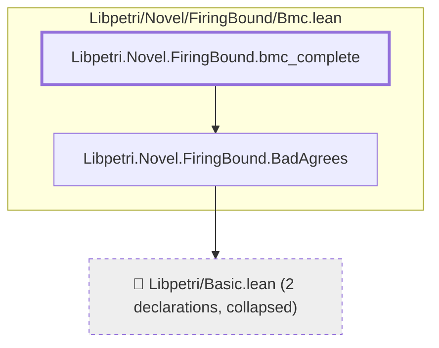

#### `Libpetri.Novel.FiringBound.bmc_complete` → `Libpetri.Novel.FiringBound.BmcSat`

> Rule: this theorem's tree has 114 nodes, still 90 with other files collapsed, so it is split by direct dependency; this part has 6 nodes, other files collapsed.

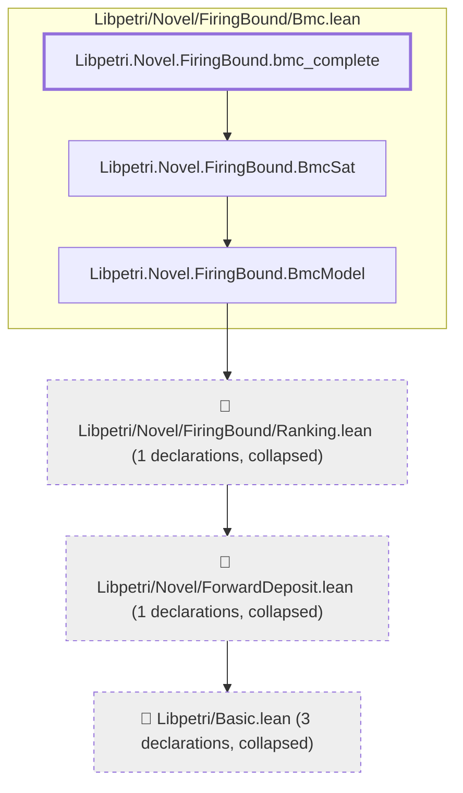

#### `Libpetri.Novel.FiringBound.bmc_complete` → `Libpetri.Novel.FiringBound.BmcSatEnv`

> Rule: this theorem's tree has 114 nodes, still 90 with other files collapsed, so it is split by direct dependency; this part has 7 nodes, other files collapsed.

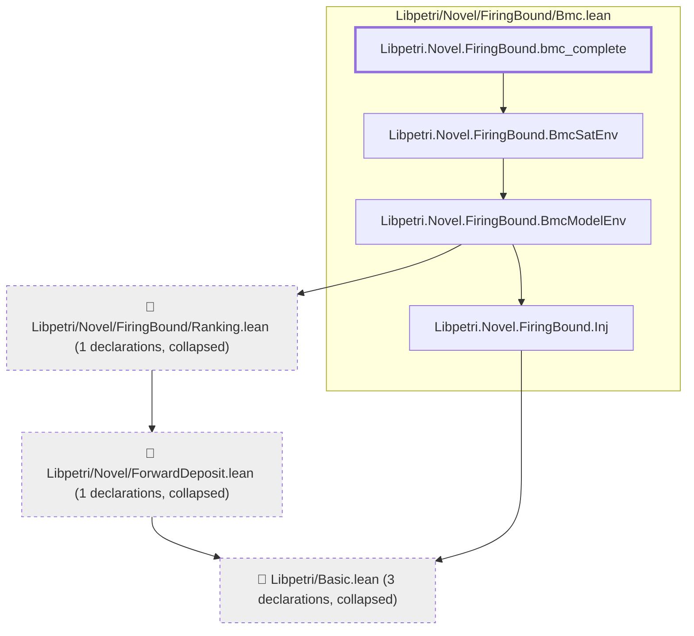

#### `Libpetri.Novel.FiringBound.bmc_complete` → `Libpetri.Novel.FiringBound.Inj`

> Rule: this theorem's tree has 114 nodes, still 90 with other files collapsed, so it is split by direct dependency; this part has 3 nodes, other files collapsed.

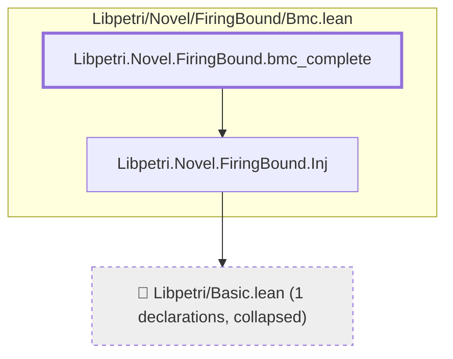

#### `Libpetri.Novel.FiringBound.bmc_complete` → `Libpetri.Novel.FiringBound.Row`

> Rule: this theorem's tree has 114 nodes, still 90 with other files collapsed, so it is split by direct dependency; this part has 4 nodes, other files collapsed.

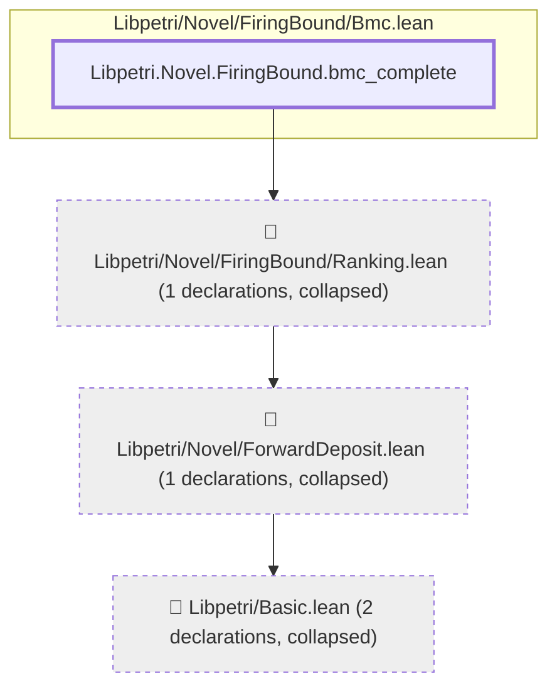

#### `Libpetri.Novel.FiringBound.bmc_complete` → `Libpetri.Novel.FiringBound.WellFormedRows`

> Rule: this theorem's tree has 114 nodes, still 90 with other files collapsed, so it is split by direct dependency; this part has 6 nodes, other files collapsed.

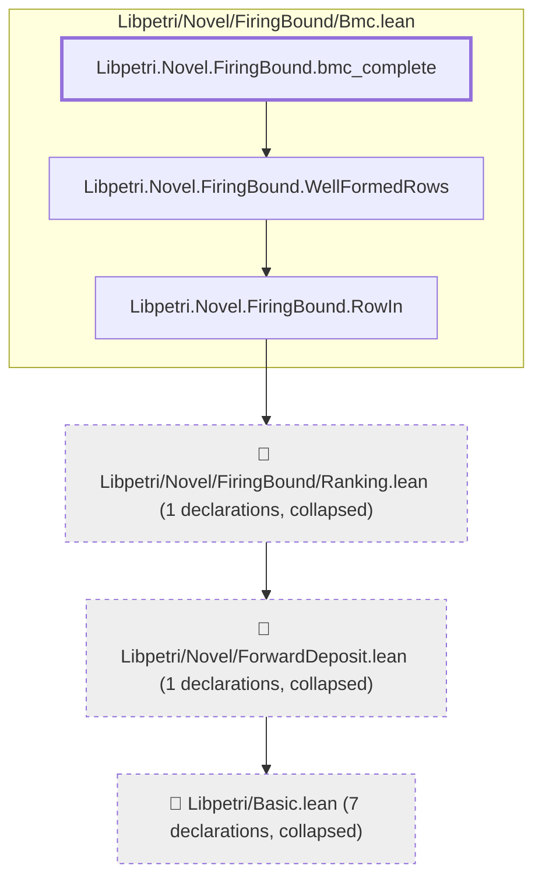

#### `Libpetri.Novel.FiringBound.bmc_complete` → `Libpetri.Novel.FiringBound.bmcEnv_complete`

> Rule: this theorem's tree has 114 nodes, still 90 with other files collapsed, so it is split by direct dependency; this part has 77 nodes, other files collapsed.

```mermaid
flowchart TD
  subgraph g0["Libpetri/Novel/FiringBound/Bmc.lean"]
    n526["Libpetri.Novel.FiringBound.BadAgrees"]
    n534["Libpetri.Novel.FiringBound.BmcModelEnv"]
    n535["Libpetri.Novel.FiringBound.BmcModelEnv.bad"]
    n536["Libpetri.Novel.FiringBound.BmcModelEnv.caps"]
    n537["Libpetri.Novel.FiringBound.BmcModelEnv.guard"]
    n538["Libpetri.Novel.FiringBound.BmcModelEnv.idle_final"]
    n539["Libpetri.Novel.FiringBound.BmcModelEnv.inj_guard"]
    n540["Libpetri.Novel.FiringBound.BmcModelEnv.mk"]
    n541["Libpetri.Novel.FiringBound.BmcModelEnv.sel_range"]
    n542["Libpetri.Novel.FiringBound.BmcModelEnv.update"]
    n544["Libpetri.Novel.FiringBound.BmcSatEnv"]
    n550["Libpetri.Novel.FiringBound.Inj"]
    n551["Libpetri.Novel.FiringBound.InjsDistinct"]
    n552["Libpetri.Novel.FiringBound.InjsIn"]
    n565["Libpetri.Novel.FiringBound.RowIn"]
    n566["Libpetri.Novel.FiringBound.RowIn.deposit"]
    n568["Libpetri.Novel.FiringBound.RowIn.inputs"]
    n571["Libpetri.Novel.FiringBound.RowIn.resets"]
    n572["Libpetri.Novel.FiringBound.StepEnv"]
    n583["Libpetri.Novel.FiringBound.WellFormedRows"]
    n618["Libpetri.Novel.FiringBound.bmcEnv_complete"]
    n619["Libpetri.Novel.FiringBound.bmcEnv_model_replays"]
    n620["Libpetri.Novel.FiringBound.bmcEnv_of_run"]
    n625["Libpetri.Novel.FiringBound.bmc_complete"]
    n634["Libpetri.Novel.FiringBound.capOk"]
    n635["Libpetri.Novel.FiringBound.capsOk"]
    n636["Libpetri.Novel.FiringBound.chain"]
    n637["Libpetri.Novel.FiringBound.chain_append_miss"]
    n638["Libpetri.Novel.FiringBound.chain_congr"]
    n639["Libpetri.Novel.FiringBound.chain_cons"]
    n640["Libpetri.Novel.FiringBound.chain_hit"]
    n642["Libpetri.Novel.FiringBound.chain_idle_env"]
    n643["Libpetri.Novel.FiringBound.chain_inject_env"]
    n644["Libpetri.Novel.FiringBound.chain_miss"]
    n645["Libpetri.Novel.FiringBound.chain_step"]
    n646["Libpetri.Novel.FiringBound.chain_step_env"]
    n649["Libpetri.Novel.FiringBound.clears"]
    n650["Libpetri.Novel.FiringBound.column"]
    n652["Libpetri.Novel.FiringBound.decode"]
    n658["Libpetri.Novel.FiringBound.decodeSel"]
    n659["Libpetri.Novel.FiringBound.decode_length_le"]
    n668["Libpetri.Novel.FiringBound.fireAD_frame"]
    n677["Libpetri.Novel.FiringBound.guardI"]
    n678["Libpetri.Novel.FiringBound.guardI_iff_enabledA"]
    n679["Libpetri.Novel.FiringBound.injAt"]
    n681["Libpetri.Novel.FiringBound.injOk"]
    n682["Libpetri.Novel.FiringBound.injTouching"]
    n693["Libpetri.Novel.FiringBound.mAt"]
    n695["Libpetri.Novel.FiringBound.mem_injTouching"]
    n696["Libpetri.Novel.FiringBound.mem_touching"]
    n699["Libpetri.Novel.FiringBound.nextVal"]
    n700["Libpetri.Novel.FiringBound.nextValEnv"]
    n740["Libpetri.Novel.FiringBound.replayEnv"]
    n741["Libpetri.Novel.FiringBound.replayEnv_append"]
    n742["Libpetri.Novel.FiringBound.replayEnv_frame"]
    n743["Libpetri.Novel.FiringBound.replayEnv_lt"]
    n745["Libpetri.Novel.FiringBound.replayEnv_singleton"]
    n746["Libpetri.Novel.FiringBound.replayEnv_snoc"]
    n748["Libpetri.Novel.FiringBound.replayEnv_take"]
    n758["Libpetri.Novel.FiringBound.stAtEnv"]
    n761["Libpetri.Novel.FiringBound.stepIdx"]
    n762["Libpetri.Novel.FiringBound.stepIdx_caps"]
    n763["Libpetri.Novel.FiringBound.stepIdx_frame"]
    n764["Libpetri.Novel.FiringBound.stepIdx_inj"]
    n765["Libpetri.Novel.FiringBound.stepIdx_lt"]
    n766["Libpetri.Novel.FiringBound.stepIdx_row"]
    n767["Libpetri.Novel.FiringBound.stepIdx_sound"]
    n772["Libpetri.Novel.FiringBound.touches"]
    n773["Libpetri.Novel.FiringBound.touching"]
    n774["Libpetri.Novel.FiringBound.touchingEnv"]
    n775["Libpetri.Novel.FiringBound.touchingEnv_bounds"]
    n776["Libpetri.Novel.FiringBound.touching_lt"]
  end
  c0["📁 Libpetri/Basic.lean (22 declarations, collapsed)"]
  c24["📁 Libpetri/Novel/FiringBound/Ranking.lean (1 declarations, collapsed)"]
  c27["📁 Libpetri/Novel/ForwardDeposit.lean (3 declarations, collapsed)"]
  c84["📁 Libpetri/Soundness.lean (1 declarations, collapsed)"]
  c154["📁 Libpetri/Strengthening/Hypotheses.lean (1 declarations, collapsed)"]
  c24 --> c27
  c27 --> c0
  c84 --> c0
  c154 --> c84
  n526 --> c0
  n534 --> c24
  n534 --> n550
  n535 --> n534
  n535 --> n693
  n536 --> n534
  n536 --> n693
  n537 --> n534
  n537 --> n677
  n537 --> n693
  n538 --> n534
  n539 --> n534
  n539 --> n693
  n540 --> n534
  n540 --> n636
  n540 --> n677
  n540 --> n693
  n540 --> n700
  n540 --> n774
  n541 --> n534
  n542 --> n534
  n542 --> n636
  n542 --> n693
  n542 --> n700
  n542 --> n774
  n544 --> n534
  n550 --> c0
  n551 --> n550
  n552 --> n550
  n565 --> c24
  n566 --> n565
  n568 --> n565
  n571 --> n565
  n572 --> c24
  n572 --> n635
  n572 --> n679
  n572 --> n681
  n583 --> n565
  n618 --> n535
  n618 --> n619
  n618 --> n620
  n618 --> n659
  n619 --> n536
  n619 --> n537
  n619 --> n538
  n619 --> n539
  n619 --> n541
  n619 --> n542
  n619 --> n552
  n619 --> n583
  n619 --> n642
  n619 --> n643
  n619 --> n646
  n619 --> n652
  n619 --> n668
  n619 --> n678
  n619 --> n746
  n620 --> n526
  n620 --> n540
  n620 --> n544
  n620 --> n642
  n620 --> n643
  n620 --> n646
  n620 --> n678
  n620 --> n742
  n620 --> n743
  n620 --> n745
  n620 --> n748
  n620 --> n762
  n625 --> n618
  n634 --> n550
  n635 --> n634
  n637 --> n644
  n638 --> n639
  n639 --> n636
  n640 --> n639
  n642 --> n644
  n642 --> n775
  n643 --> n640
  n643 --> n644
  n643 --> n695
  n643 --> n700
  n643 --> n774
  n643 --> n776
  n644 --> n639
  n645 --> c154
  n645 --> n640
  n645 --> n644
  n645 --> n696
  n645 --> n699
  n646 --> n637
  n646 --> n638
  n646 --> n645
  n646 --> n695
  n646 --> n700
  n646 --> n774
  n646 --> n776
  n649 --> c24
  n650 --> c24
  n652 --> n658
  n659 --> n652
  n668 --> c84
  n668 --> n566
  n668 --> n568
  n668 --> n571
  n677 --> c0
  n678 --> c154
  n678 --> n568
  n678 --> n677
  n679 --> c0
  n681 --> n550
  n682 --> n550
  n693 --> c0
  n695 --> n682
  n696 --> n773
  n699 --> n649
  n699 --> n650
  n700 --> n699
  n740 --> n761
  n741 --> n740
  n742 --> n740
  n742 --> n763
  n743 --> n740
  n743 --> n765
  n745 --> n740
  n746 --> n741
  n746 --> n745
  n748 --> n741
  n748 --> n758
  n758 --> n740
  n761 --> c24
  n761 --> n635
  n761 --> n679
  n761 --> n681
  n762 --> n551
  n762 --> n767
  n763 --> n552
  n763 --> n583
  n763 --> n668
  n763 --> n767
  n764 --> n761
  n765 --> n761
  n766 --> n761
  n767 --> n572
  n767 --> n764
  n767 --> n765
  n767 --> n766
  n772 --> n649
  n772 --> n650
  n773 --> n772
  n774 --> n682
  n774 --> n773
  n775 --> n695
  n775 --> n774
  n775 --> n776
  n776 --> n696
  classDef root stroke-width:3px
  classDef locked fill:#fff3cd,stroke:#b8860b
  classDef collapsed fill:#eeeeee,stroke-dasharray:4 4
  class n625 root
  class c0,c24,c27,c84,c154 collapsed
```

#### `Libpetri.Novel.FiringBound.bmc_complete` → `Libpetri.Novel.FiringBound.bmcSatEnv_nil`

> Rule: this theorem's tree has 114 nodes, still 90 with other files collapsed, so it is split by direct dependency; this part has 38 nodes, other files collapsed.

```mermaid
flowchart TD
  subgraph g0["Libpetri/Novel/FiringBound/Bmc.lean"]
    n527["Libpetri.Novel.FiringBound.BmcModel"]
    n528["Libpetri.Novel.FiringBound.BmcModel.bad"]
    n529["Libpetri.Novel.FiringBound.BmcModel.guard"]
    n530["Libpetri.Novel.FiringBound.BmcModel.idle_final"]
    n531["Libpetri.Novel.FiringBound.BmcModel.mk"]
    n532["Libpetri.Novel.FiringBound.BmcModel.sel_range"]
    n533["Libpetri.Novel.FiringBound.BmcModel.update"]
    n534["Libpetri.Novel.FiringBound.BmcModelEnv"]
    n535["Libpetri.Novel.FiringBound.BmcModelEnv.bad"]
    n537["Libpetri.Novel.FiringBound.BmcModelEnv.guard"]
    n538["Libpetri.Novel.FiringBound.BmcModelEnv.idle_final"]
    n540["Libpetri.Novel.FiringBound.BmcModelEnv.mk"]
    n541["Libpetri.Novel.FiringBound.BmcModelEnv.sel_range"]
    n542["Libpetri.Novel.FiringBound.BmcModelEnv.update"]
    n543["Libpetri.Novel.FiringBound.BmcSat"]
    n544["Libpetri.Novel.FiringBound.BmcSatEnv"]
    n550["Libpetri.Novel.FiringBound.Inj"]
    n622["Libpetri.Novel.FiringBound.bmcModelEnv_nil"]
    n623["Libpetri.Novel.FiringBound.bmcSatEnv_nil"]
    n625["Libpetri.Novel.FiringBound.bmc_complete"]
    n636["Libpetri.Novel.FiringBound.chain"]
    n638["Libpetri.Novel.FiringBound.chain_congr"]
    n639["Libpetri.Novel.FiringBound.chain_cons"]
    n649["Libpetri.Novel.FiringBound.clears"]
    n650["Libpetri.Novel.FiringBound.column"]
    n677["Libpetri.Novel.FiringBound.guardI"]
    n682["Libpetri.Novel.FiringBound.injTouching"]
    n693["Libpetri.Novel.FiringBound.mAt"]
    n696["Libpetri.Novel.FiringBound.mem_touching"]
    n699["Libpetri.Novel.FiringBound.nextVal"]
    n700["Libpetri.Novel.FiringBound.nextValEnv"]
    n772["Libpetri.Novel.FiringBound.touches"]
    n773["Libpetri.Novel.FiringBound.touching"]
    n774["Libpetri.Novel.FiringBound.touchingEnv"]
    n776["Libpetri.Novel.FiringBound.touching_lt"]
  end
  c0["📁 Libpetri/Basic.lean (20 declarations, collapsed)"]
  c24["📁 Libpetri/Novel/FiringBound/Ranking.lean (1 declarations, collapsed)"]
  c27["📁 Libpetri/Novel/ForwardDeposit.lean (1 declarations, collapsed)"]
  c24 --> c27
  c27 --> c0
  n527 --> c24
  n528 --> n527
  n528 --> n693
  n529 --> n527
  n529 --> n677
  n529 --> n693
  n530 --> n527
  n531 --> n527
  n531 --> n636
  n531 --> n677
  n531 --> n693
  n531 --> n699
  n531 --> n773
  n532 --> n527
  n533 --> n527
  n533 --> n636
  n533 --> n693
  n533 --> n699
  n533 --> n773
  n534 --> c24
  n534 --> n550
  n535 --> n534
  n535 --> n693
  n537 --> n534
  n537 --> n677
  n537 --> n693
  n538 --> n534
  n540 --> n534
  n540 --> n636
  n540 --> n677
  n540 --> n693
  n540 --> n700
  n540 --> n774
  n541 --> n534
  n542 --> n534
  n542 --> n636
  n542 --> n693
  n542 --> n700
  n542 --> n774
  n543 --> n527
  n544 --> n534
  n550 --> c0
  n622 --> n528
  n622 --> n529
  n622 --> n530
  n622 --> n531
  n622 --> n532
  n622 --> n533
  n622 --> n535
  n622 --> n537
  n622 --> n538
  n622 --> n540
  n622 --> n541
  n622 --> n542
  n622 --> n638
  n622 --> n776
  n623 --> n543
  n623 --> n544
  n623 --> n622
  n625 --> n623
  n638 --> n639
  n639 --> n636
  n649 --> c24
  n650 --> c24
  n677 --> c0
  n682 --> n550
  n693 --> c0
  n696 --> n773
  n699 --> n649
  n699 --> n650
  n700 --> n699
  n772 --> n649
  n772 --> n650
  n773 --> n772
  n774 --> n682
  n774 --> n773
  n776 --> n696
  classDef root stroke-width:3px
  classDef locked fill:#fff3cd,stroke:#b8860b
  classDef collapsed fill:#eeeeee,stroke-dasharray:4 4
  class n625 root
  class c0,c24,c27 collapsed
```

#### `Libpetri.Novel.FiringBound.bmc_complete` → `Libpetri.Novel.FiringBound.capsOk`

> Rule: this theorem's tree has 114 nodes, still 90 with other files collapsed, so it is split by direct dependency; this part has 5 nodes, other files collapsed.

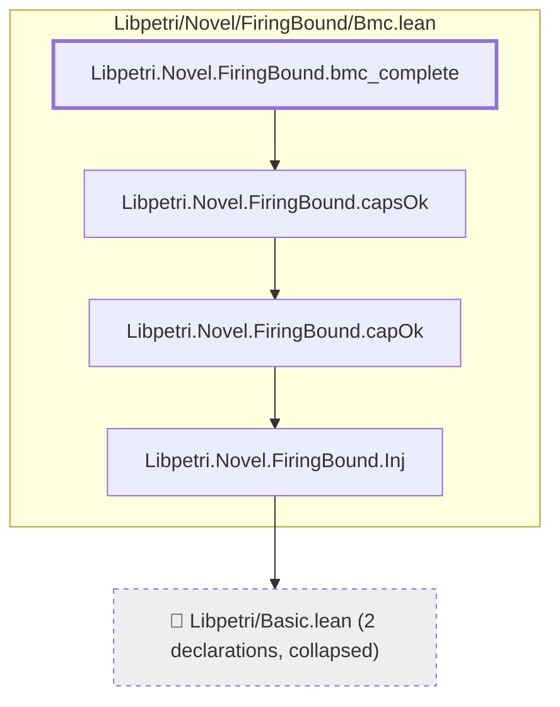

#### `Libpetri.Novel.FiringBound.bmc_complete` → `Libpetri.Novel.FiringBound.injsDistinct_nil`

> Rule: this theorem's tree has 114 nodes, still 90 with other files collapsed, so it is split by direct dependency; this part has 5 nodes, other files collapsed.

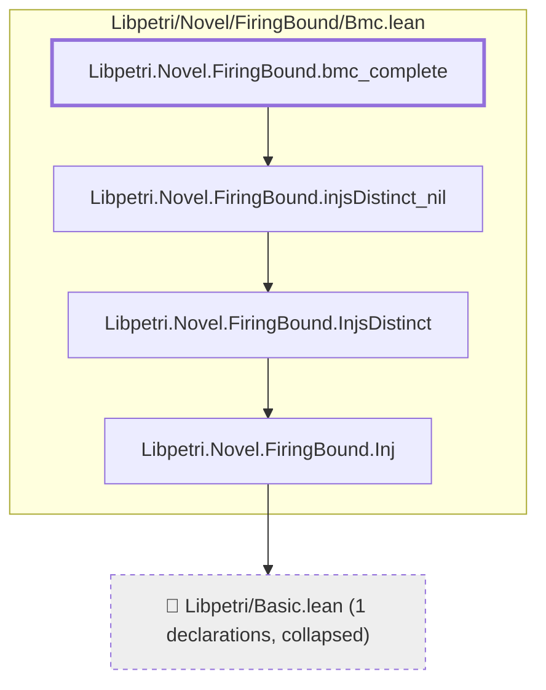

#### `Libpetri.Novel.FiringBound.bmc_complete` → `Libpetri.Novel.FiringBound.injsIn_nil`

> Rule: this theorem's tree has 114 nodes, still 90 with other files collapsed, so it is split by direct dependency; this part has 5 nodes, other files collapsed.

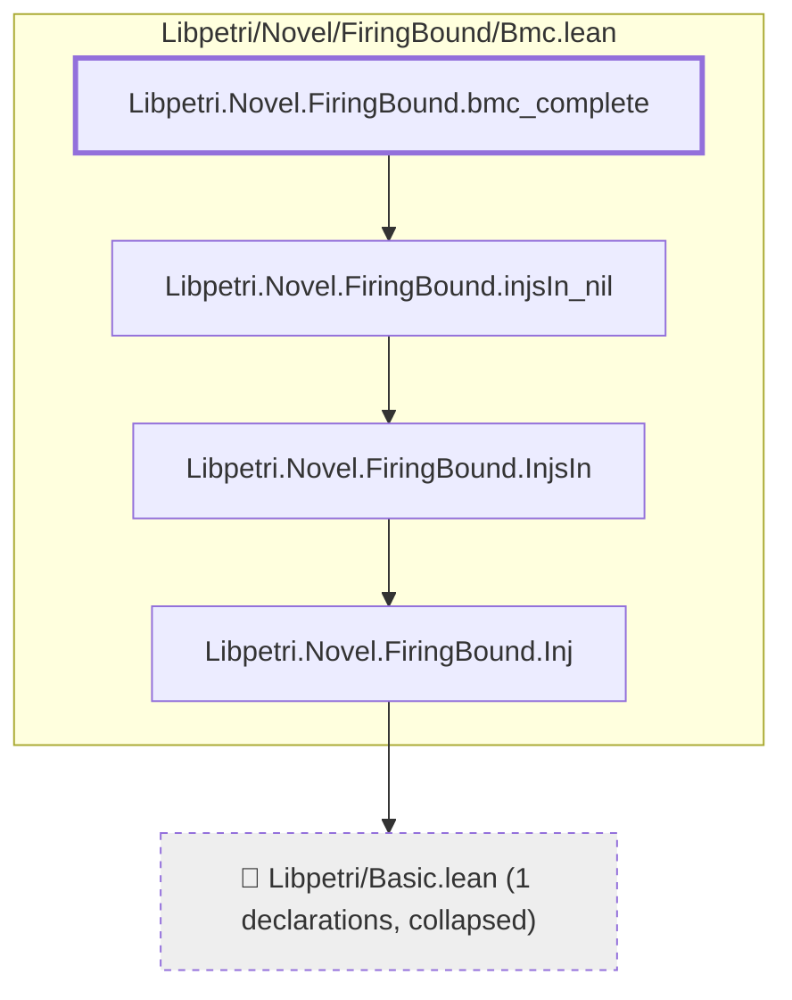

#### `Libpetri.Novel.FiringBound.bmc_complete` → `Libpetri.Novel.FiringBound.replay`

> Rule: this theorem's tree has 114 nodes, still 90 with other files collapsed, so it is split by direct dependency; this part has 4 nodes, other files collapsed.


#### `Libpetri.Novel.FiringBound.bmc_complete` → `Libpetri.Novel.FiringBound.replayEnv`

> Rule: this theorem's tree has 114 nodes, still 90 with other files collapsed, so it is split by direct dependency; this part has 11 nodes, other files collapsed.

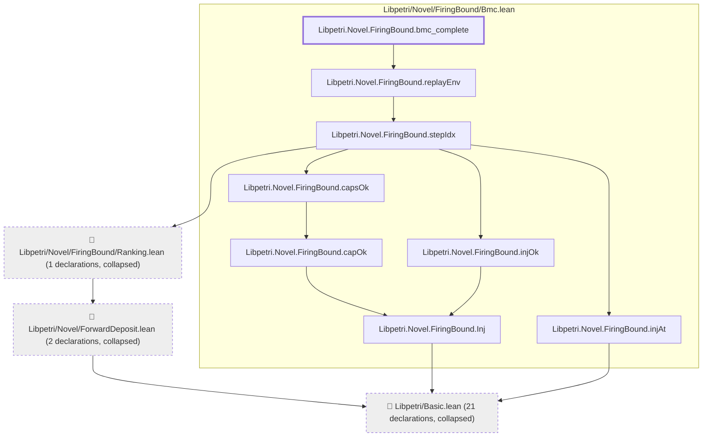

#### `Libpetri.Novel.FiringBound.bmc_complete` → `Libpetri.Novel.FiringBound.replayEnv_nil`

> Rule: this theorem's tree has 114 nodes, still 90 with other files collapsed, so it is split by direct dependency; this part has 12 nodes, other files collapsed.

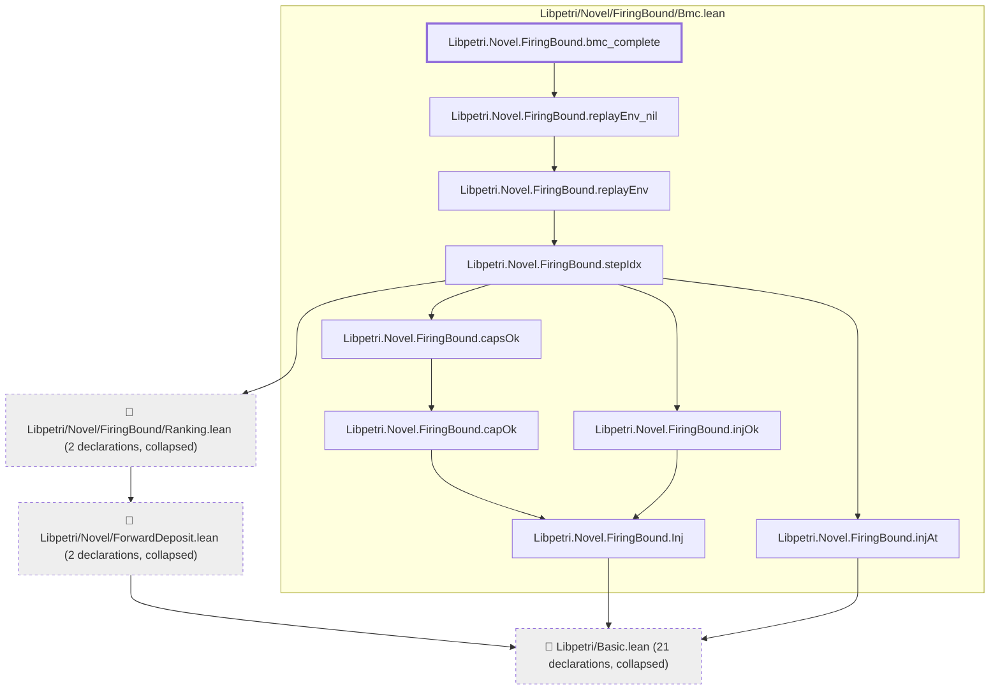

Shared leaves of `Libpetri.Novel.FiringBound.bmc_complete` (direct dependencies too small for a diagram of their own, fewer than 3 nodes):

- `Libpetri.AMarking` (`Libpetri/Basic.lean`)
- `Libpetri.PlaceId` (`Libpetri/Basic.lean`)

### `Libpetri.Novel.FiringBound.bmc_sat_replays`

#### `Libpetri.Novel.FiringBound.bmc_sat_replays` → `Libpetri.Novel.FiringBound.BadAgrees`

> Rule: this theorem's tree has 99 nodes, still 76 with other files collapsed, so it is split by direct dependency; this part has 3 nodes, other files collapsed.

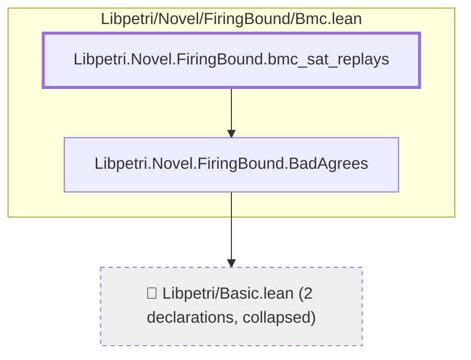

#### `Libpetri.Novel.FiringBound.bmc_sat_replays` → `Libpetri.Novel.FiringBound.BmcModel`

> Rule: this theorem's tree has 99 nodes, still 76 with other files collapsed, so it is split by direct dependency; this part has 5 nodes, other files collapsed.

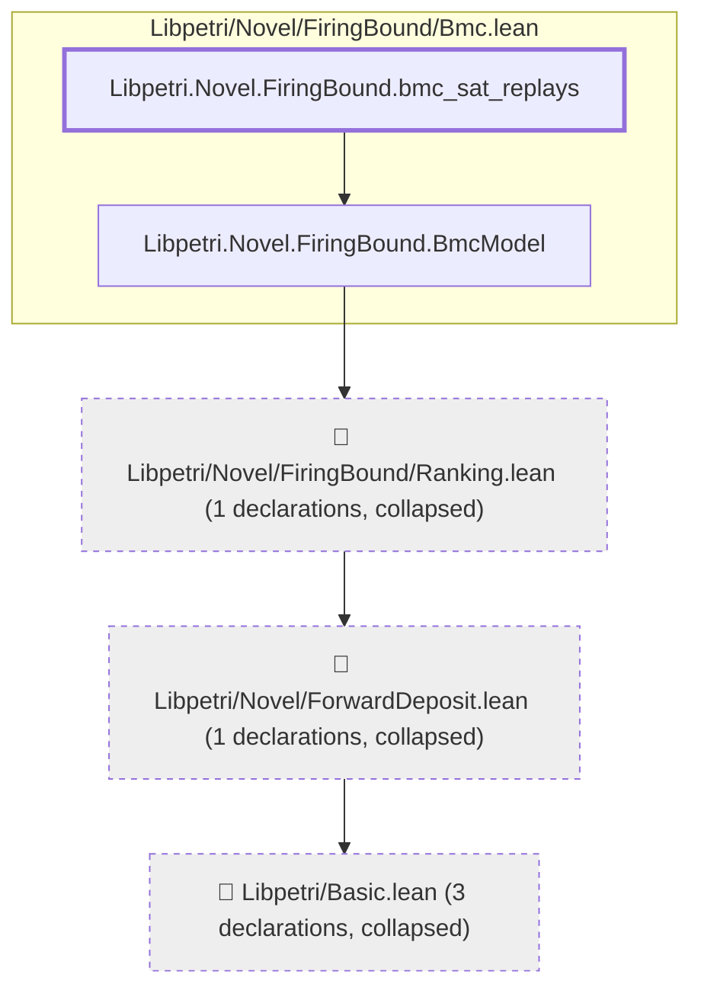

#### `Libpetri.Novel.FiringBound.bmc_sat_replays` → `Libpetri.Novel.FiringBound.BmcModelEnv`

> Rule: this theorem's tree has 99 nodes, still 76 with other files collapsed, so it is split by direct dependency; this part has 6 nodes, other files collapsed.

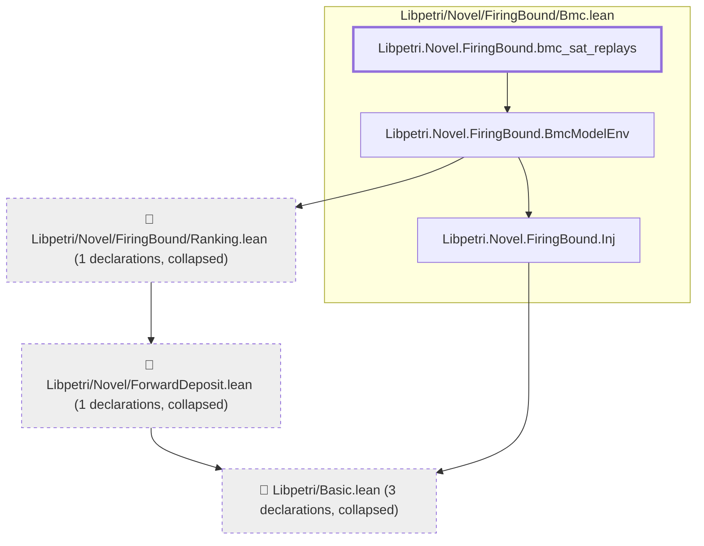

#### `Libpetri.Novel.FiringBound.bmc_sat_replays` → `Libpetri.Novel.FiringBound.Inj`

> Rule: this theorem's tree has 99 nodes, still 76 with other files collapsed, so it is split by direct dependency; this part has 3 nodes, other files collapsed.

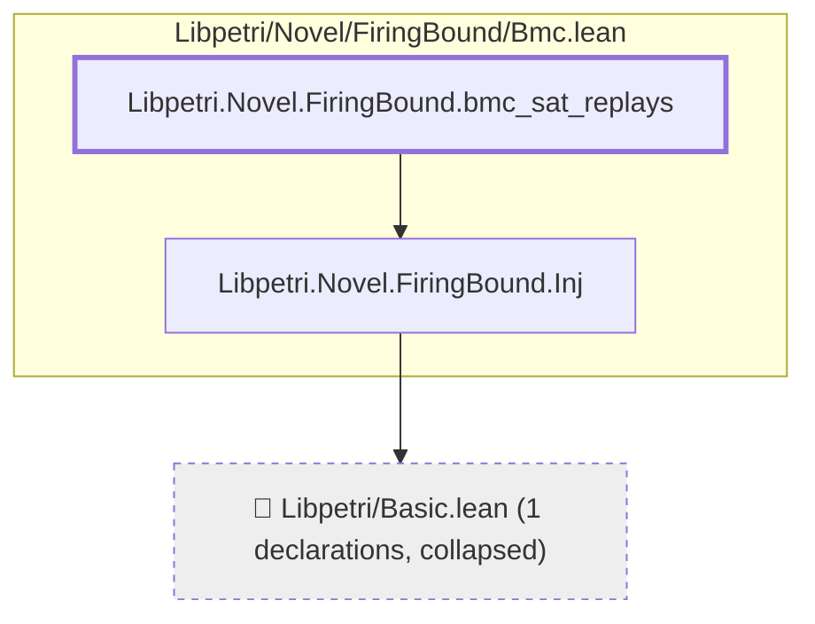

#### `Libpetri.Novel.FiringBound.bmc_sat_replays` → `Libpetri.Novel.FiringBound.Row`

> Rule: this theorem's tree has 99 nodes, still 76 with other files collapsed, so it is split by direct dependency; this part has 4 nodes, other files collapsed.

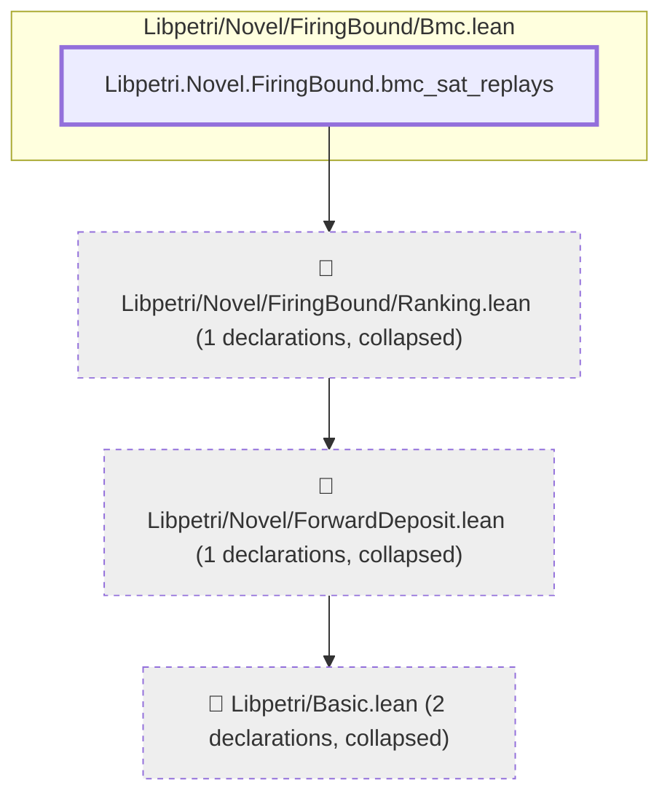

#### `Libpetri.Novel.FiringBound.bmc_sat_replays` → `Libpetri.Novel.FiringBound.WellFormedRows`

> Rule: this theorem's tree has 99 nodes, still 76 with other files collapsed, so it is split by direct dependency; this part has 6 nodes, other files collapsed.

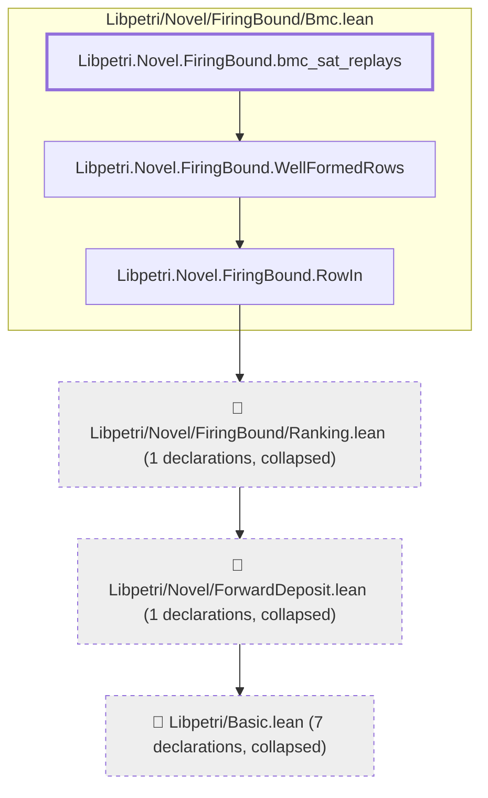

#### `Libpetri.Novel.FiringBound.bmc_sat_replays` → `Libpetri.Novel.FiringBound.bmcEnv_sat_replays`

> Rule: this theorem's tree has 99 nodes, still 76 with other files collapsed, so it is split by direct dependency; this part has 65 nodes, other files collapsed.

```mermaid
flowchart TD
  subgraph g0["Libpetri/Novel/FiringBound/Bmc.lean"]
    n526["Libpetri.Novel.FiringBound.BadAgrees"]
    n534["Libpetri.Novel.FiringBound.BmcModelEnv"]
    n535["Libpetri.Novel.FiringBound.BmcModelEnv.bad"]
    n536["Libpetri.Novel.FiringBound.BmcModelEnv.caps"]
    n537["Libpetri.Novel.FiringBound.BmcModelEnv.guard"]
    n538["Libpetri.Novel.FiringBound.BmcModelEnv.idle_final"]
    n539["Libpetri.Novel.FiringBound.BmcModelEnv.inj_guard"]
    n541["Libpetri.Novel.FiringBound.BmcModelEnv.sel_range"]
    n542["Libpetri.Novel.FiringBound.BmcModelEnv.update"]
    n550["Libpetri.Novel.FiringBound.Inj"]
    n552["Libpetri.Novel.FiringBound.InjsIn"]
    n565["Libpetri.Novel.FiringBound.RowIn"]
    n566["Libpetri.Novel.FiringBound.RowIn.deposit"]
    n568["Libpetri.Novel.FiringBound.RowIn.inputs"]
    n571["Libpetri.Novel.FiringBound.RowIn.resets"]
    n583["Libpetri.Novel.FiringBound.WellFormedRows"]
    n619["Libpetri.Novel.FiringBound.bmcEnv_model_replays"]
    n621["Libpetri.Novel.FiringBound.bmcEnv_sat_replays"]
    n630["Libpetri.Novel.FiringBound.bmc_sat_replays"]
    n634["Libpetri.Novel.FiringBound.capOk"]
    n635["Libpetri.Novel.FiringBound.capsOk"]
    n636["Libpetri.Novel.FiringBound.chain"]
    n637["Libpetri.Novel.FiringBound.chain_append_miss"]
    n638["Libpetri.Novel.FiringBound.chain_congr"]
    n639["Libpetri.Novel.FiringBound.chain_cons"]
    n640["Libpetri.Novel.FiringBound.chain_hit"]
    n642["Libpetri.Novel.FiringBound.chain_idle_env"]
    n643["Libpetri.Novel.FiringBound.chain_inject_env"]
    n644["Libpetri.Novel.FiringBound.chain_miss"]
    n645["Libpetri.Novel.FiringBound.chain_step"]
    n646["Libpetri.Novel.FiringBound.chain_step_env"]
    n649["Libpetri.Novel.FiringBound.clears"]
    n650["Libpetri.Novel.FiringBound.column"]
    n652["Libpetri.Novel.FiringBound.decode"]
    n656["Libpetri.Novel.FiringBound.decodeRust"]
    n657["Libpetri.Novel.FiringBound.decodeRust_eq_decode"]
    n658["Libpetri.Novel.FiringBound.decodeSel"]
    n668["Libpetri.Novel.FiringBound.fireAD_frame"]
    n677["Libpetri.Novel.FiringBound.guardI"]
    n678["Libpetri.Novel.FiringBound.guardI_iff_enabledA"]
    n679["Libpetri.Novel.FiringBound.injAt"]
    n681["Libpetri.Novel.FiringBound.injOk"]
    n682["Libpetri.Novel.FiringBound.injTouching"]
    n693["Libpetri.Novel.FiringBound.mAt"]
    n695["Libpetri.Novel.FiringBound.mem_injTouching"]
    n696["Libpetri.Novel.FiringBound.mem_touching"]
    n699["Libpetri.Novel.FiringBound.nextVal"]
    n700["Libpetri.Novel.FiringBound.nextValEnv"]
    n740["Libpetri.Novel.FiringBound.replayEnv"]
    n741["Libpetri.Novel.FiringBound.replayEnv_append"]
    n745["Libpetri.Novel.FiringBound.replayEnv_singleton"]
    n746["Libpetri.Novel.FiringBound.replayEnv_snoc"]
    n761["Libpetri.Novel.FiringBound.stepIdx"]
    n768["Libpetri.Novel.FiringBound.takeSome"]
    n770["Libpetri.Novel.FiringBound.takeSome_snoc"]
    n772["Libpetri.Novel.FiringBound.touches"]
    n773["Libpetri.Novel.FiringBound.touching"]
    n774["Libpetri.Novel.FiringBound.touchingEnv"]
    n775["Libpetri.Novel.FiringBound.touchingEnv_bounds"]
    n776["Libpetri.Novel.FiringBound.touching_lt"]
  end
  c0["📁 Libpetri/Basic.lean (22 declarations, collapsed)"]
  c24["📁 Libpetri/Novel/FiringBound/Ranking.lean (1 declarations, collapsed)"]
  c27["📁 Libpetri/Novel/ForwardDeposit.lean (2 declarations, collapsed)"]
  c84["📁 Libpetri/Soundness.lean (1 declarations, collapsed)"]
  c154["📁 Libpetri/Strengthening/Hypotheses.lean (1 declarations, collapsed)"]
  c24 --> c27
  c27 --> c0
  c84 --> c0
  c154 --> c84
  n526 --> c0
  n534 --> c24
  n534 --> n550
  n535 --> n534
  n535 --> n693
  n536 --> n534
  n536 --> n693
  n537 --> n534
  n537 --> n677
  n537 --> n693
  n538 --> n534
  n539 --> n534
  n539 --> n693
  n541 --> n534
  n542 --> n534
  n542 --> n636
  n542 --> n693
  n542 --> n700
  n542 --> n774
  n550 --> c0
  n552 --> n550
  n565 --> c24
  n566 --> n565
  n568 --> n565
  n571 --> n565
  n583 --> n565
  n619 --> n536
  n619 --> n537
  n619 --> n538
  n619 --> n539
  n619 --> n541
  n619 --> n542
  n619 --> n552
  n619 --> n583
  n619 --> n642
  n619 --> n643
  n619 --> n646
  n619 --> n652
  n619 --> n668
  n619 --> n678
  n619 --> n746
  n621 --> n526
  n621 --> n535
  n621 --> n619
  n621 --> n657
  n630 --> n621
  n634 --> n550
  n635 --> n634
  n637 --> n644
  n638 --> n639
  n639 --> n636
  n640 --> n639
  n642 --> n644
  n642 --> n775
  n643 --> n640
  n643 --> n644
  n643 --> n695
  n643 --> n700
  n643 --> n774
  n643 --> n776
  n644 --> n639
  n645 --> c154
  n645 --> n640
  n645 --> n644
  n645 --> n696
  n645 --> n699
  n646 --> n637
  n646 --> n638
  n646 --> n645
  n646 --> n695
  n646 --> n700
  n646 --> n774
  n646 --> n776
  n649 --> c24
  n650 --> c24
  n652 --> n658
  n656 --> n658
  n656 --> n768
  n657 --> n652
  n657 --> n656
  n657 --> n770
  n668 --> c84
  n668 --> n566
  n668 --> n568
  n668 --> n571
  n677 --> c0
  n678 --> c154
  n678 --> n568
  n678 --> n677
  n679 --> c0
  n681 --> n550
  n682 --> n550
  n693 --> c0
  n695 --> n682
  n696 --> n773
  n699 --> n649
  n699 --> n650
  n700 --> n699
  n740 --> n761
  n741 --> n740
  n745 --> n740
  n746 --> n741
  n746 --> n745
  n761 --> c24
  n761 --> n635
  n761 --> n679
  n761 --> n681
  n770 --> n768
  n772 --> n649
  n772 --> n650
  n773 --> n772
  n774 --> n682
  n774 --> n773
  n775 --> n695
  n775 --> n774
  n775 --> n776
  n776 --> n696
  classDef root stroke-width:3px
  classDef locked fill:#fff3cd,stroke:#b8860b
  classDef collapsed fill:#eeeeee,stroke-dasharray:4 4
  class n630 root
  class c0,c24,c27,c84,c154 collapsed
```

#### `Libpetri.Novel.FiringBound.bmc_sat_replays` → `Libpetri.Novel.FiringBound.bmcModelEnv_nil`

> Rule: this theorem's tree has 99 nodes, still 76 with other files collapsed, so it is split by direct dependency; this part has 35 nodes, other files collapsed.

```mermaid
flowchart TD
  subgraph g0["Libpetri/Novel/FiringBound/Bmc.lean"]
    n527["Libpetri.Novel.FiringBound.BmcModel"]
    n528["Libpetri.Novel.FiringBound.BmcModel.bad"]
    n529["Libpetri.Novel.FiringBound.BmcModel.guard"]
    n530["Libpetri.Novel.FiringBound.BmcModel.idle_final"]
    n531["Libpetri.Novel.FiringBound.BmcModel.mk"]
    n532["Libpetri.Novel.FiringBound.BmcModel.sel_range"]
    n533["Libpetri.Novel.FiringBound.BmcModel.update"]
    n534["Libpetri.Novel.FiringBound.BmcModelEnv"]
    n535["Libpetri.Novel.FiringBound.BmcModelEnv.bad"]
    n537["Libpetri.Novel.FiringBound.BmcModelEnv.guard"]
    n538["Libpetri.Novel.FiringBound.BmcModelEnv.idle_final"]
    n540["Libpetri.Novel.FiringBound.BmcModelEnv.mk"]
    n541["Libpetri.Novel.FiringBound.BmcModelEnv.sel_range"]
    n542["Libpetri.Novel.FiringBound.BmcModelEnv.update"]
    n550["Libpetri.Novel.FiringBound.Inj"]
    n622["Libpetri.Novel.FiringBound.bmcModelEnv_nil"]
    n630["Libpetri.Novel.FiringBound.bmc_sat_replays"]
    n636["Libpetri.Novel.FiringBound.chain"]
    n638["Libpetri.Novel.FiringBound.chain_congr"]
    n639["Libpetri.Novel.FiringBound.chain_cons"]
    n649["Libpetri.Novel.FiringBound.clears"]
    n650["Libpetri.Novel.FiringBound.column"]
    n677["Libpetri.Novel.FiringBound.guardI"]
    n682["Libpetri.Novel.FiringBound.injTouching"]
    n693["Libpetri.Novel.FiringBound.mAt"]
    n696["Libpetri.Novel.FiringBound.mem_touching"]
    n699["Libpetri.Novel.FiringBound.nextVal"]
    n700["Libpetri.Novel.FiringBound.nextValEnv"]
    n772["Libpetri.Novel.FiringBound.touches"]
    n773["Libpetri.Novel.FiringBound.touching"]
    n774["Libpetri.Novel.FiringBound.touchingEnv"]
    n776["Libpetri.Novel.FiringBound.touching_lt"]
  end
  c0["📁 Libpetri/Basic.lean (20 declarations, collapsed)"]
  c24["📁 Libpetri/Novel/FiringBound/Ranking.lean (1 declarations, collapsed)"]
  c27["📁 Libpetri/Novel/ForwardDeposit.lean (1 declarations, collapsed)"]
  c24 --> c27
  c27 --> c0
  n527 --> c24
  n528 --> n527
  n528 --> n693
  n529 --> n527
  n529 --> n677
  n529 --> n693
  n530 --> n527
  n531 --> n527
  n531 --> n636
  n531 --> n677
  n531 --> n693
  n531 --> n699
  n531 --> n773
  n532 --> n527
  n533 --> n527
  n533 --> n636
  n533 --> n693
  n533 --> n699
  n533 --> n773
  n534 --> c24
  n534 --> n550
  n535 --> n534
  n535 --> n693
  n537 --> n534
  n537 --> n677
  n537 --> n693
  n538 --> n534
  n540 --> n534
  n540 --> n636
  n540 --> n677
  n540 --> n693
  n540 --> n700
  n540 --> n774
  n541 --> n534
  n542 --> n534
  n542 --> n636
  n542 --> n693
  n542 --> n700
  n542 --> n774
  n550 --> c0
  n622 --> n528
  n622 --> n529
  n622 --> n530
  n622 --> n531
  n622 --> n532
  n622 --> n533
  n622 --> n535
  n622 --> n537
  n622 --> n538
  n622 --> n540
  n622 --> n541
  n622 --> n542
  n622 --> n638
  n622 --> n776
  n630 --> n622
  n638 --> n639
  n639 --> n636
  n649 --> c24
  n650 --> c24
  n677 --> c0
  n682 --> n550
  n693 --> c0
  n696 --> n773
  n699 --> n649
  n699 --> n650
  n700 --> n699
  n772 --> n649
  n772 --> n650
  n773 --> n772
  n774 --> n682
  n774 --> n773
  n776 --> n696
  classDef root stroke-width:3px
  classDef locked fill:#fff3cd,stroke:#b8860b
  classDef collapsed fill:#eeeeee,stroke-dasharray:4 4
  class n630 root
  class c0,c24,c27 collapsed
```

#### `Libpetri.Novel.FiringBound.bmc_sat_replays` → `Libpetri.Novel.FiringBound.decodeRust`

> Rule: this theorem's tree has 99 nodes, still 76 with other files collapsed, so it is split by direct dependency; this part has 4 nodes, other files collapsed.

```mermaid
flowchart TD
  subgraph g0["Libpetri/Novel/FiringBound/Bmc.lean"]
    n630["Libpetri.Novel.FiringBound.bmc_sat_replays"]
    n656["Libpetri.Novel.FiringBound.decodeRust"]
    n658["Libpetri.Novel.FiringBound.decodeSel"]
    n768["Libpetri.Novel.FiringBound.takeSome"]
  end
  n630 --> n656
  n656 --> n658
  n656 --> n768
  classDef root stroke-width:3px
  classDef locked fill:#fff3cd,stroke:#b8860b
  classDef collapsed fill:#eeeeee,stroke-dasharray:4 4
  class n630 root
```

#### `Libpetri.Novel.FiringBound.bmc_sat_replays` → `Libpetri.Novel.FiringBound.injsIn_nil`

> Rule: this theorem's tree has 99 nodes, still 76 with other files collapsed, so it is split by direct dependency; this part has 5 nodes, other files collapsed.

```mermaid
flowchart TD
  subgraph g0["Libpetri/Novel/FiringBound/Bmc.lean"]
    n550["Libpetri.Novel.FiringBound.Inj"]
    n552["Libpetri.Novel.FiringBound.InjsIn"]
    n630["Libpetri.Novel.FiringBound.bmc_sat_replays"]
    n684["Libpetri.Novel.FiringBound.injsIn_nil"]
  end
  c0["📁 Libpetri/Basic.lean (1 declarations, collapsed)"]
  n550 --> c0
  n552 --> n550
  n630 --> n684
  n684 --> n552
  classDef root stroke-width:3px
  classDef locked fill:#fff3cd,stroke:#b8860b
  classDef collapsed fill:#eeeeee,stroke-dasharray:4 4
  class n630 root
  class c0 collapsed
```

#### `Libpetri.Novel.FiringBound.bmc_sat_replays` → `Libpetri.Novel.FiringBound.replay`

> Rule: this theorem's tree has 99 nodes, still 76 with other files collapsed, so it is split by direct dependency; this part has 4 nodes, other files collapsed.

```mermaid
flowchart TD
  subgraph g0["Libpetri/Novel/FiringBound/Bmc.lean"]
    n630["Libpetri.Novel.FiringBound.bmc_sat_replays"]
  end
  c0["📁 Libpetri/Basic.lean (21 declarations, collapsed)"]
  c24["📁 Libpetri/Novel/FiringBound/Ranking.lean (2 declarations, collapsed)"]
  c27["📁 Libpetri/Novel/ForwardDeposit.lean (2 declarations, collapsed)"]
  c24 --> c27
  c27 --> c0
  n630 --> c24
  classDef root stroke-width:3px
  classDef locked fill:#fff3cd,stroke:#b8860b
  classDef collapsed fill:#eeeeee,stroke-dasharray:4 4
  class n630 root
  class c0,c24,c27 collapsed
```

#### `Libpetri.Novel.FiringBound.bmc_sat_replays` → `Libpetri.Novel.FiringBound.replayEnv`

> Rule: this theorem's tree has 99 nodes, still 76 with other files collapsed, so it is split by direct dependency; this part has 11 nodes, other files collapsed.

```mermaid
flowchart TD
  subgraph g0["Libpetri/Novel/FiringBound/Bmc.lean"]
    n550["Libpetri.Novel.FiringBound.Inj"]
    n630["Libpetri.Novel.FiringBound.bmc_sat_replays"]
    n634["Libpetri.Novel.FiringBound.capOk"]
    n635["Libpetri.Novel.FiringBound.capsOk"]
    n679["Libpetri.Novel.FiringBound.injAt"]
    n681["Libpetri.Novel.FiringBound.injOk"]
    n740["Libpetri.Novel.FiringBound.replayEnv"]
    n761["Libpetri.Novel.FiringBound.stepIdx"]
  end
  c0["📁 Libpetri/Basic.lean (21 declarations, collapsed)"]
  c24["📁 Libpetri/Novel/FiringBound/Ranking.lean (1 declarations, collapsed)"]
  c27["📁 Libpetri/Novel/ForwardDeposit.lean (2 declarations, collapsed)"]
  c24 --> c27
  c27 --> c0
  n550 --> c0
  n630 --> n740
  n634 --> n550
  n635 --> n634
  n679 --> c0
  n681 --> n550
  n740 --> n761
  n761 --> c24
  n761 --> n635
  n761 --> n679
  n761 --> n681
  classDef root stroke-width:3px
  classDef locked fill:#fff3cd,stroke:#b8860b
  classDef collapsed fill:#eeeeee,stroke-dasharray:4 4
  class n630 root
  class c0,c24,c27 collapsed
```

#### `Libpetri.Novel.FiringBound.bmc_sat_replays` → `Libpetri.Novel.FiringBound.replayEnv_nil`

> Rule: this theorem's tree has 99 nodes, still 76 with other files collapsed, so it is split by direct dependency; this part has 12 nodes, other files collapsed.

```mermaid
flowchart TD
  subgraph g0["Libpetri/Novel/FiringBound/Bmc.lean"]
    n550["Libpetri.Novel.FiringBound.Inj"]
    n630["Libpetri.Novel.FiringBound.bmc_sat_replays"]
    n634["Libpetri.Novel.FiringBound.capOk"]
    n635["Libpetri.Novel.FiringBound.capsOk"]
    n679["Libpetri.Novel.FiringBound.injAt"]
    n681["Libpetri.Novel.FiringBound.injOk"]
    n740["Libpetri.Novel.FiringBound.replayEnv"]
    n744["Libpetri.Novel.FiringBound.replayEnv_nil"]
    n761["Libpetri.Novel.FiringBound.stepIdx"]
  end
  c0["📁 Libpetri/Basic.lean (21 declarations, collapsed)"]
  c24["📁 Libpetri/Novel/FiringBound/Ranking.lean (2 declarations, collapsed)"]
  c27["📁 Libpetri/Novel/ForwardDeposit.lean (2 declarations, collapsed)"]
  c24 --> c27
  c27 --> c0
  n550 --> c0
  n630 --> n744
  n634 --> n550
  n635 --> n634
  n679 --> c0
  n681 --> n550
  n740 --> n761
  n744 --> n740
  n761 --> c24
  n761 --> n635
  n761 --> n679
  n761 --> n681
  classDef root stroke-width:3px
  classDef locked fill:#fff3cd,stroke:#b8860b
  classDef collapsed fill:#eeeeee,stroke-dasharray:4 4
  class n630 root
  class c0,c24,c27 collapsed
```

Shared leaves of `Libpetri.Novel.FiringBound.bmc_sat_replays` (direct dependencies too small for a diagram of their own, fewer than 3 nodes):

- `Libpetri.AMarking` (`Libpetri/Basic.lean`)
- `Libpetri.PlaceId` (`Libpetri/Basic.lean`)

Axioms used:

- `Libpetri.Novel.FiringBound.bmc_complete`: `Classical.choice`, `Quot.sound`, `propext`
- `Libpetri.Novel.FiringBound.bmc_sat_replays`: `Classical.choice`, `Quot.sound`, `propext`
