# VER-019

Generated by `scripts/proof-graph.py` from `proof-graph.json`. Do not edit.

Theorems carrying this ID:

- `Libpetri.Novel.FiringBound.bmc_complete` (theorem, `Libpetri/Novel/FiringBound/Bmc.lean:1185`)
- `Libpetri.Novel.FiringBound.bmc_sat_replays` (theorem, `Libpetri/Novel/FiringBound/Bmc.lean:1196`)
- `Libpetri.Novel.FiringBound.checkRankingExact_sound` (theorem, `Libpetri/Novel/FiringBound/Ranking.lean:195`)
- `Libpetri.Novel.FiringBound.not_canFire_never_enabled` (theorem, `Libpetri/Novel/FiringBound/Ranking.lean:45`)
- `Libpetri.Novel.FiringBound.ranking_bounds_length` (theorem, `Libpetri/Novel/FiringBound/Ranking.lean:251`)
- `Libpetri.Spec.VER_018_order_fb_gate` (theorem, `Libpetri/Spec/Req/VER_018.lean:2193`)
- `Libpetri.Spec.VER_019_order_continues` (theorem, `Libpetri/Spec/Req/VER_019.lean:1223`)
- `Libpetri.Spec.VER_019_order_disabled` (theorem, `Libpetri/Spec/Req/VER_019.lean:1208`)
- `Libpetri.Spec.VER_019_order_flat_gate` (theorem, `Libpetri/Spec/Req/VER_019.lean:1180`)
- `Libpetri.Spec.VER_019_order_runs` (theorem, `Libpetri/Spec/Req/VER_019.lean:1144`)
- `Libpetri.Spec.VER_019_order_se_free` (theorem, `Libpetri/Spec/Req/VER_019.lean:1168`)

> **Note:** the full tree has 216 nodes (limit 60), so it is drawn as one diagram per theorem (11 theorems).

### `Libpetri.Novel.FiringBound.bmc_complete`

#### `Libpetri.Novel.FiringBound.bmc_complete` → `Libpetri.Novel.FiringBound.BadAgrees`

> Rule: this theorem's tree has 114 nodes, still 90 with other files collapsed, so it is split by direct dependency; this part has 3 nodes, other files collapsed.

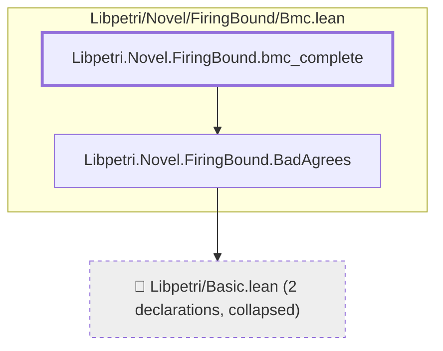

#### `Libpetri.Novel.FiringBound.bmc_complete` → `Libpetri.Novel.FiringBound.BmcSat`

> Rule: this theorem's tree has 114 nodes, still 90 with other files collapsed, so it is split by direct dependency; this part has 6 nodes, other files collapsed.

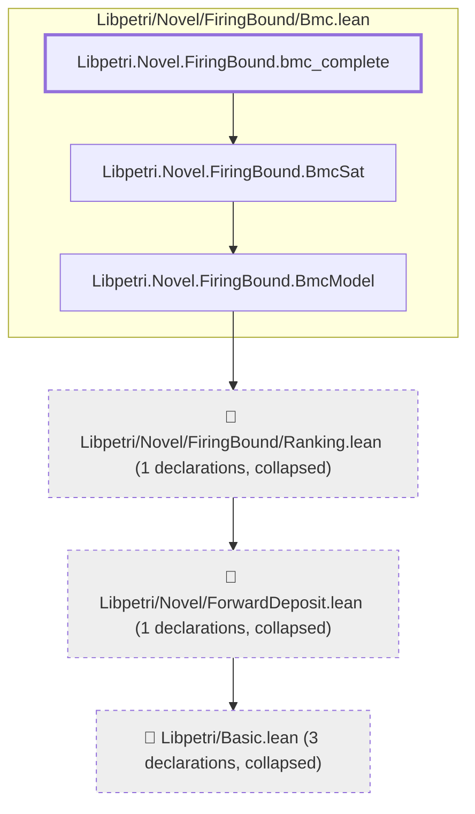

#### `Libpetri.Novel.FiringBound.bmc_complete` → `Libpetri.Novel.FiringBound.BmcSatEnv`

> Rule: this theorem's tree has 114 nodes, still 90 with other files collapsed, so it is split by direct dependency; this part has 7 nodes, other files collapsed.

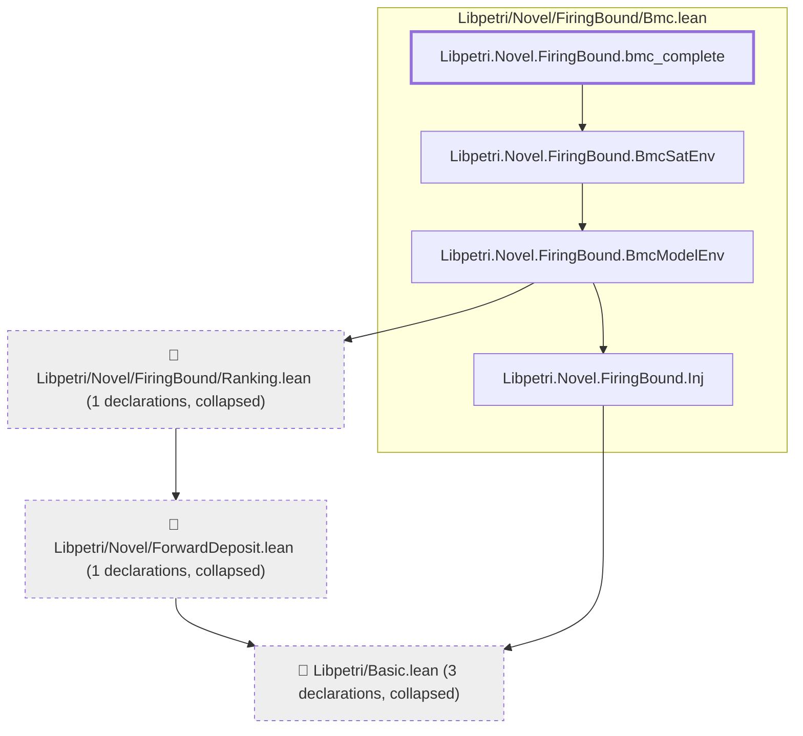

#### `Libpetri.Novel.FiringBound.bmc_complete` → `Libpetri.Novel.FiringBound.Inj`

> Rule: this theorem's tree has 114 nodes, still 90 with other files collapsed, so it is split by direct dependency; this part has 3 nodes, other files collapsed.

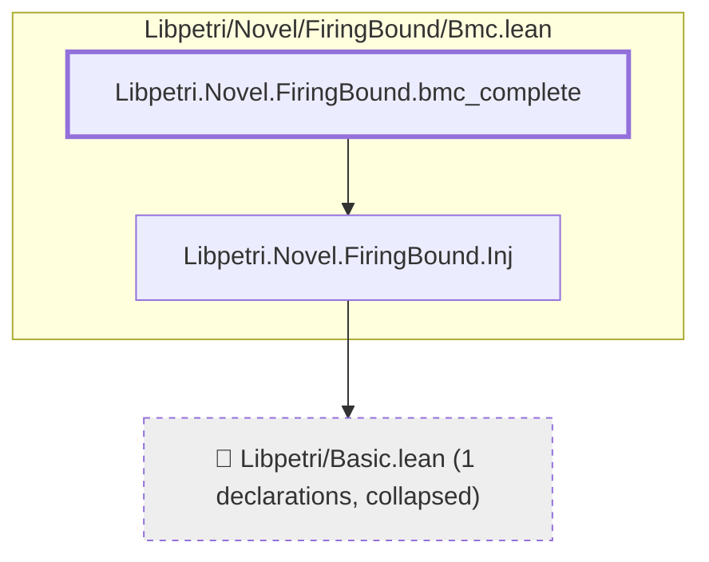

#### `Libpetri.Novel.FiringBound.bmc_complete` → `Libpetri.Novel.FiringBound.Row`

> Rule: this theorem's tree has 114 nodes, still 90 with other files collapsed, so it is split by direct dependency; this part has 4 nodes, other files collapsed.

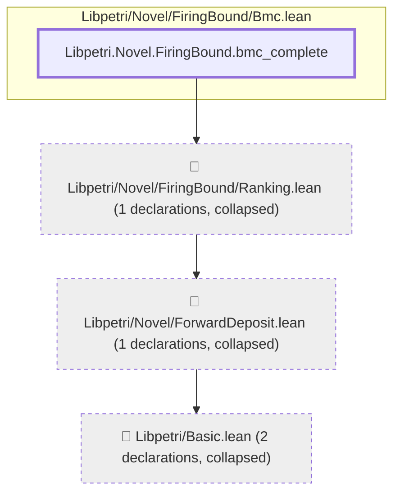

#### `Libpetri.Novel.FiringBound.bmc_complete` → `Libpetri.Novel.FiringBound.WellFormedRows`

> Rule: this theorem's tree has 114 nodes, still 90 with other files collapsed, so it is split by direct dependency; this part has 6 nodes, other files collapsed.

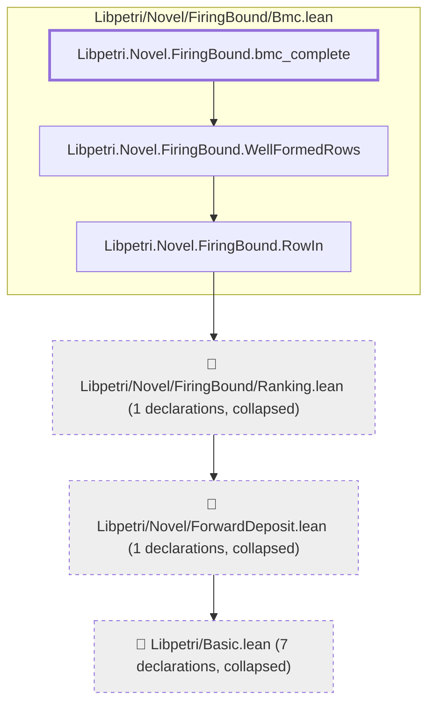

#### `Libpetri.Novel.FiringBound.bmc_complete` → `Libpetri.Novel.FiringBound.bmcEnv_complete`

> Rule: this theorem's tree has 114 nodes, still 90 with other files collapsed, so it is split by direct dependency; this part has 77 nodes, other files collapsed.

```mermaid
flowchart TD
  subgraph g0["Libpetri/Novel/FiringBound/Bmc.lean"]
    n526["Libpetri.Novel.FiringBound.BadAgrees"]
    n534["Libpetri.Novel.FiringBound.BmcModelEnv"]
    n535["Libpetri.Novel.FiringBound.BmcModelEnv.bad"]
    n536["Libpetri.Novel.FiringBound.BmcModelEnv.caps"]
    n537["Libpetri.Novel.FiringBound.BmcModelEnv.guard"]
    n538["Libpetri.Novel.FiringBound.BmcModelEnv.idle_final"]
    n539["Libpetri.Novel.FiringBound.BmcModelEnv.inj_guard"]
    n540["Libpetri.Novel.FiringBound.BmcModelEnv.mk"]
    n541["Libpetri.Novel.FiringBound.BmcModelEnv.sel_range"]
    n542["Libpetri.Novel.FiringBound.BmcModelEnv.update"]
    n544["Libpetri.Novel.FiringBound.BmcSatEnv"]
    n550["Libpetri.Novel.FiringBound.Inj"]
    n551["Libpetri.Novel.FiringBound.InjsDistinct"]
    n552["Libpetri.Novel.FiringBound.InjsIn"]
    n565["Libpetri.Novel.FiringBound.RowIn"]
    n566["Libpetri.Novel.FiringBound.RowIn.deposit"]
    n568["Libpetri.Novel.FiringBound.RowIn.inputs"]
    n571["Libpetri.Novel.FiringBound.RowIn.resets"]
    n572["Libpetri.Novel.FiringBound.StepEnv"]
    n583["Libpetri.Novel.FiringBound.WellFormedRows"]
    n618["Libpetri.Novel.FiringBound.bmcEnv_complete"]
    n619["Libpetri.Novel.FiringBound.bmcEnv_model_replays"]
    n620["Libpetri.Novel.FiringBound.bmcEnv_of_run"]
    n625["Libpetri.Novel.FiringBound.bmc_complete"]
    n634["Libpetri.Novel.FiringBound.capOk"]
    n635["Libpetri.Novel.FiringBound.capsOk"]
    n636["Libpetri.Novel.FiringBound.chain"]
    n637["Libpetri.Novel.FiringBound.chain_append_miss"]
    n638["Libpetri.Novel.FiringBound.chain_congr"]
    n639["Libpetri.Novel.FiringBound.chain_cons"]
    n640["Libpetri.Novel.FiringBound.chain_hit"]
    n642["Libpetri.Novel.FiringBound.chain_idle_env"]
    n643["Libpetri.Novel.FiringBound.chain_inject_env"]
    n644["Libpetri.Novel.FiringBound.chain_miss"]
    n645["Libpetri.Novel.FiringBound.chain_step"]
    n646["Libpetri.Novel.FiringBound.chain_step_env"]
    n649["Libpetri.Novel.FiringBound.clears"]
    n650["Libpetri.Novel.FiringBound.column"]
    n652["Libpetri.Novel.FiringBound.decode"]
    n658["Libpetri.Novel.FiringBound.decodeSel"]
    n659["Libpetri.Novel.FiringBound.decode_length_le"]
    n668["Libpetri.Novel.FiringBound.fireAD_frame"]
    n677["Libpetri.Novel.FiringBound.guardI"]
    n678["Libpetri.Novel.FiringBound.guardI_iff_enabledA"]
    n679["Libpetri.Novel.FiringBound.injAt"]
    n681["Libpetri.Novel.FiringBound.injOk"]
    n682["Libpetri.Novel.FiringBound.injTouching"]
    n693["Libpetri.Novel.FiringBound.mAt"]
    n695["Libpetri.Novel.FiringBound.mem_injTouching"]
    n696["Libpetri.Novel.FiringBound.mem_touching"]
    n699["Libpetri.Novel.FiringBound.nextVal"]
    n700["Libpetri.Novel.FiringBound.nextValEnv"]
    n740["Libpetri.Novel.FiringBound.replayEnv"]
    n741["Libpetri.Novel.FiringBound.replayEnv_append"]
    n742["Libpetri.Novel.FiringBound.replayEnv_frame"]
    n743["Libpetri.Novel.FiringBound.replayEnv_lt"]
    n745["Libpetri.Novel.FiringBound.replayEnv_singleton"]
    n746["Libpetri.Novel.FiringBound.replayEnv_snoc"]
    n748["Libpetri.Novel.FiringBound.replayEnv_take"]
    n758["Libpetri.Novel.FiringBound.stAtEnv"]
    n761["Libpetri.Novel.FiringBound.stepIdx"]
    n762["Libpetri.Novel.FiringBound.stepIdx_caps"]
    n763["Libpetri.Novel.FiringBound.stepIdx_frame"]
    n764["Libpetri.Novel.FiringBound.stepIdx_inj"]
    n765["Libpetri.Novel.FiringBound.stepIdx_lt"]
    n766["Libpetri.Novel.FiringBound.stepIdx_row"]
    n767["Libpetri.Novel.FiringBound.stepIdx_sound"]
    n772["Libpetri.Novel.FiringBound.touches"]
    n773["Libpetri.Novel.FiringBound.touching"]
    n774["Libpetri.Novel.FiringBound.touchingEnv"]
    n775["Libpetri.Novel.FiringBound.touchingEnv_bounds"]
    n776["Libpetri.Novel.FiringBound.touching_lt"]
  end
  c0["📁 Libpetri/Basic.lean (22 declarations, collapsed)"]
  c24["📁 Libpetri/Novel/FiringBound/Ranking.lean (1 declarations, collapsed)"]
  c27["📁 Libpetri/Novel/ForwardDeposit.lean (3 declarations, collapsed)"]
  c84["📁 Libpetri/Soundness.lean (1 declarations, collapsed)"]
  c154["📁 Libpetri/Strengthening/Hypotheses.lean (1 declarations, collapsed)"]
  c24 --> c27
  c27 --> c0
  c84 --> c0
  c154 --> c84
  n526 --> c0
  n534 --> c24
  n534 --> n550
  n535 --> n534
  n535 --> n693
  n536 --> n534
  n536 --> n693
  n537 --> n534
  n537 --> n677
  n537 --> n693
  n538 --> n534
  n539 --> n534
  n539 --> n693
  n540 --> n534
  n540 --> n636
  n540 --> n677
  n540 --> n693
  n540 --> n700
  n540 --> n774
  n541 --> n534
  n542 --> n534
  n542 --> n636
  n542 --> n693
  n542 --> n700
  n542 --> n774
  n544 --> n534
  n550 --> c0
  n551 --> n550
  n552 --> n550
  n565 --> c24
  n566 --> n565
  n568 --> n565
  n571 --> n565
  n572 --> c24
  n572 --> n635
  n572 --> n679
  n572 --> n681
  n583 --> n565
  n618 --> n535
  n618 --> n619
  n618 --> n620
  n618 --> n659
  n619 --> n536
  n619 --> n537
  n619 --> n538
  n619 --> n539
  n619 --> n541
  n619 --> n542
  n619 --> n552
  n619 --> n583
  n619 --> n642
  n619 --> n643
  n619 --> n646
  n619 --> n652
  n619 --> n668
  n619 --> n678
  n619 --> n746
  n620 --> n526
  n620 --> n540
  n620 --> n544
  n620 --> n642
  n620 --> n643
  n620 --> n646
  n620 --> n678
  n620 --> n742
  n620 --> n743
  n620 --> n745
  n620 --> n748
  n620 --> n762
  n625 --> n618
  n634 --> n550
  n635 --> n634
  n637 --> n644
  n638 --> n639
  n639 --> n636
  n640 --> n639
  n642 --> n644
  n642 --> n775
  n643 --> n640
  n643 --> n644
  n643 --> n695
  n643 --> n700
  n643 --> n774
  n643 --> n776
  n644 --> n639
  n645 --> c154
  n645 --> n640
  n645 --> n644
  n645 --> n696
  n645 --> n699
  n646 --> n637
  n646 --> n638
  n646 --> n645
  n646 --> n695
  n646 --> n700
  n646 --> n774
  n646 --> n776
  n649 --> c24
  n650 --> c24
  n652 --> n658
  n659 --> n652
  n668 --> c84
  n668 --> n566
  n668 --> n568
  n668 --> n571
  n677 --> c0
  n678 --> c154
  n678 --> n568
  n678 --> n677
  n679 --> c0
  n681 --> n550
  n682 --> n550
  n693 --> c0
  n695 --> n682
  n696 --> n773
  n699 --> n649
  n699 --> n650
  n700 --> n699
  n740 --> n761
  n741 --> n740
  n742 --> n740
  n742 --> n763
  n743 --> n740
  n743 --> n765
  n745 --> n740
  n746 --> n741
  n746 --> n745
  n748 --> n741
  n748 --> n758
  n758 --> n740
  n761 --> c24
  n761 --> n635
  n761 --> n679
  n761 --> n681
  n762 --> n551
  n762 --> n767
  n763 --> n552
  n763 --> n583
  n763 --> n668
  n763 --> n767
  n764 --> n761
  n765 --> n761
  n766 --> n761
  n767 --> n572
  n767 --> n764
  n767 --> n765
  n767 --> n766
  n772 --> n649
  n772 --> n650
  n773 --> n772
  n774 --> n682
  n774 --> n773
  n775 --> n695
  n775 --> n774
  n775 --> n776
  n776 --> n696
  classDef root stroke-width:3px
  classDef locked fill:#fff3cd,stroke:#b8860b
  classDef collapsed fill:#eeeeee,stroke-dasharray:4 4
  class n625 root
  class c0,c24,c27,c84,c154 collapsed
```

#### `Libpetri.Novel.FiringBound.bmc_complete` → `Libpetri.Novel.FiringBound.bmcSatEnv_nil`

> Rule: this theorem's tree has 114 nodes, still 90 with other files collapsed, so it is split by direct dependency; this part has 38 nodes, other files collapsed.

```mermaid
flowchart TD
  subgraph g0["Libpetri/Novel/FiringBound/Bmc.lean"]
    n527["Libpetri.Novel.FiringBound.BmcModel"]
    n528["Libpetri.Novel.FiringBound.BmcModel.bad"]
    n529["Libpetri.Novel.FiringBound.BmcModel.guard"]
    n530["Libpetri.Novel.FiringBound.BmcModel.idle_final"]
    n531["Libpetri.Novel.FiringBound.BmcModel.mk"]
    n532["Libpetri.Novel.FiringBound.BmcModel.sel_range"]
    n533["Libpetri.Novel.FiringBound.BmcModel.update"]
    n534["Libpetri.Novel.FiringBound.BmcModelEnv"]
    n535["Libpetri.Novel.FiringBound.BmcModelEnv.bad"]
    n537["Libpetri.Novel.FiringBound.BmcModelEnv.guard"]
    n538["Libpetri.Novel.FiringBound.BmcModelEnv.idle_final"]
    n540["Libpetri.Novel.FiringBound.BmcModelEnv.mk"]
    n541["Libpetri.Novel.FiringBound.BmcModelEnv.sel_range"]
    n542["Libpetri.Novel.FiringBound.BmcModelEnv.update"]
    n543["Libpetri.Novel.FiringBound.BmcSat"]
    n544["Libpetri.Novel.FiringBound.BmcSatEnv"]
    n550["Libpetri.Novel.FiringBound.Inj"]
    n622["Libpetri.Novel.FiringBound.bmcModelEnv_nil"]
    n623["Libpetri.Novel.FiringBound.bmcSatEnv_nil"]
    n625["Libpetri.Novel.FiringBound.bmc_complete"]
    n636["Libpetri.Novel.FiringBound.chain"]
    n638["Libpetri.Novel.FiringBound.chain_congr"]
    n639["Libpetri.Novel.FiringBound.chain_cons"]
    n649["Libpetri.Novel.FiringBound.clears"]
    n650["Libpetri.Novel.FiringBound.column"]
    n677["Libpetri.Novel.FiringBound.guardI"]
    n682["Libpetri.Novel.FiringBound.injTouching"]
    n693["Libpetri.Novel.FiringBound.mAt"]
    n696["Libpetri.Novel.FiringBound.mem_touching"]
    n699["Libpetri.Novel.FiringBound.nextVal"]
    n700["Libpetri.Novel.FiringBound.nextValEnv"]
    n772["Libpetri.Novel.FiringBound.touches"]
    n773["Libpetri.Novel.FiringBound.touching"]
    n774["Libpetri.Novel.FiringBound.touchingEnv"]
    n776["Libpetri.Novel.FiringBound.touching_lt"]
  end
  c0["📁 Libpetri/Basic.lean (20 declarations, collapsed)"]
  c24["📁 Libpetri/Novel/FiringBound/Ranking.lean (1 declarations, collapsed)"]
  c27["📁 Libpetri/Novel/ForwardDeposit.lean (1 declarations, collapsed)"]
  c24 --> c27
  c27 --> c0
  n527 --> c24
  n528 --> n527
  n528 --> n693
  n529 --> n527
  n529 --> n677
  n529 --> n693
  n530 --> n527
  n531 --> n527
  n531 --> n636
  n531 --> n677
  n531 --> n693
  n531 --> n699
  n531 --> n773
  n532 --> n527
  n533 --> n527
  n533 --> n636
  n533 --> n693
  n533 --> n699
  n533 --> n773
  n534 --> c24
  n534 --> n550
  n535 --> n534
  n535 --> n693
  n537 --> n534
  n537 --> n677
  n537 --> n693
  n538 --> n534
  n540 --> n534
  n540 --> n636
  n540 --> n677
  n540 --> n693
  n540 --> n700
  n540 --> n774
  n541 --> n534
  n542 --> n534
  n542 --> n636
  n542 --> n693
  n542 --> n700
  n542 --> n774
  n543 --> n527
  n544 --> n534
  n550 --> c0
  n622 --> n528
  n622 --> n529
  n622 --> n530
  n622 --> n531
  n622 --> n532
  n622 --> n533
  n622 --> n535
  n622 --> n537
  n622 --> n538
  n622 --> n540
  n622 --> n541
  n622 --> n542
  n622 --> n638
  n622 --> n776
  n623 --> n543
  n623 --> n544
  n623 --> n622
  n625 --> n623
  n638 --> n639
  n639 --> n636
  n649 --> c24
  n650 --> c24
  n677 --> c0
  n682 --> n550
  n693 --> c0
  n696 --> n773
  n699 --> n649
  n699 --> n650
  n700 --> n699
  n772 --> n649
  n772 --> n650
  n773 --> n772
  n774 --> n682
  n774 --> n773
  n776 --> n696
  classDef root stroke-width:3px
  classDef locked fill:#fff3cd,stroke:#b8860b
  classDef collapsed fill:#eeeeee,stroke-dasharray:4 4
  class n625 root
  class c0,c24,c27 collapsed
```

#### `Libpetri.Novel.FiringBound.bmc_complete` → `Libpetri.Novel.FiringBound.capsOk`

> Rule: this theorem's tree has 114 nodes, still 90 with other files collapsed, so it is split by direct dependency; this part has 5 nodes, other files collapsed.

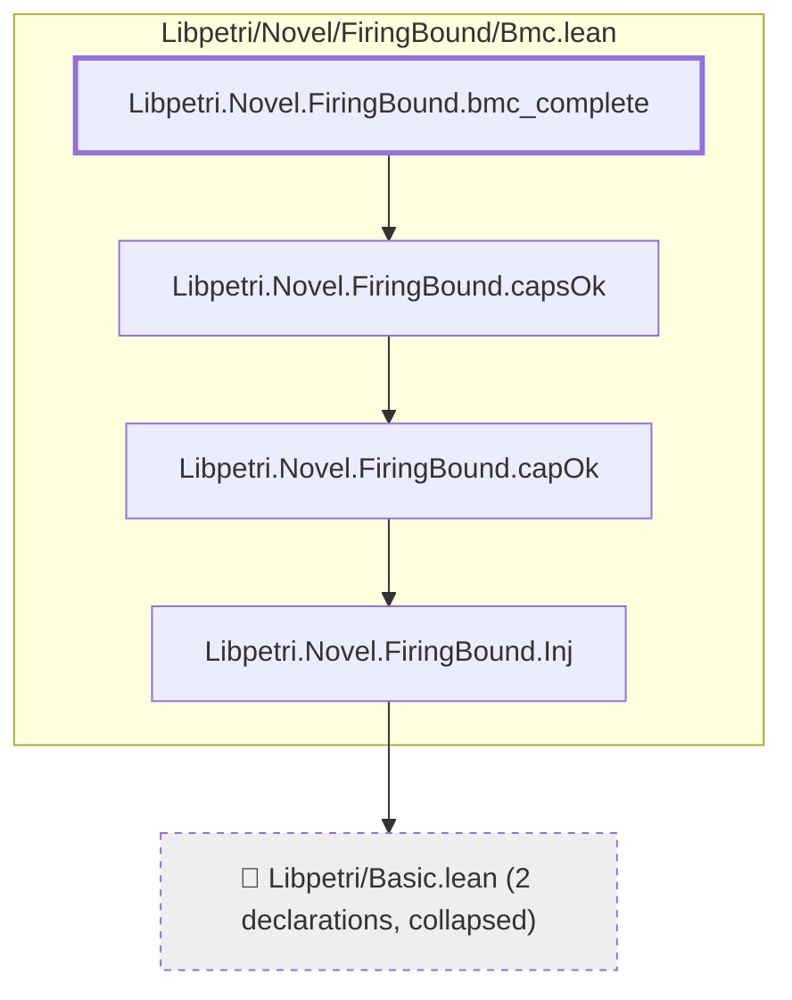

#### `Libpetri.Novel.FiringBound.bmc_complete` → `Libpetri.Novel.FiringBound.injsDistinct_nil`

> Rule: this theorem's tree has 114 nodes, still 90 with other files collapsed, so it is split by direct dependency; this part has 5 nodes, other files collapsed.

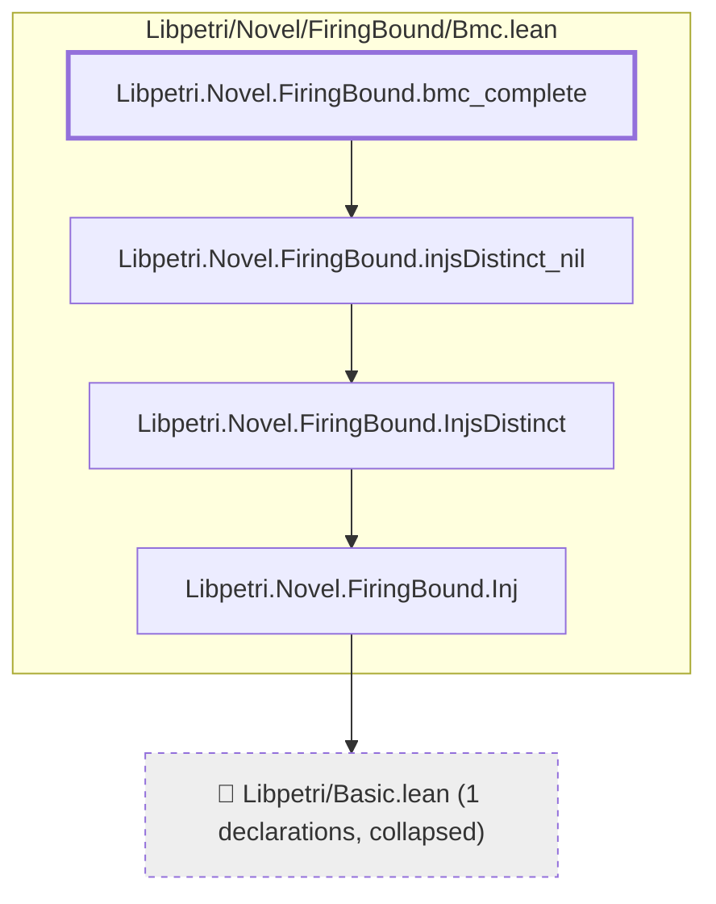

#### `Libpetri.Novel.FiringBound.bmc_complete` → `Libpetri.Novel.FiringBound.injsIn_nil`

> Rule: this theorem's tree has 114 nodes, still 90 with other files collapsed, so it is split by direct dependency; this part has 5 nodes, other files collapsed.

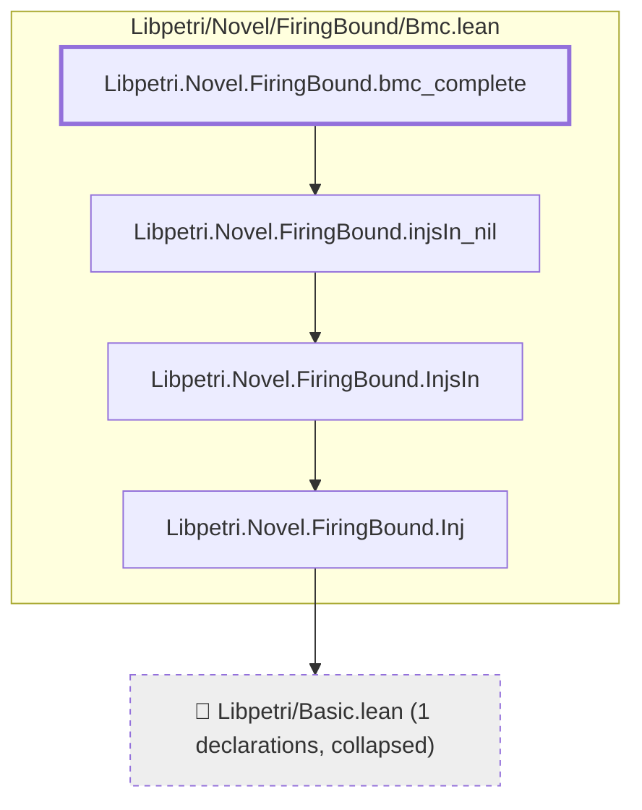

#### `Libpetri.Novel.FiringBound.bmc_complete` → `Libpetri.Novel.FiringBound.replay`

> Rule: this theorem's tree has 114 nodes, still 90 with other files collapsed, so it is split by direct dependency; this part has 4 nodes, other files collapsed.


#### `Libpetri.Novel.FiringBound.bmc_complete` → `Libpetri.Novel.FiringBound.replayEnv`

> Rule: this theorem's tree has 114 nodes, still 90 with other files collapsed, so it is split by direct dependency; this part has 11 nodes, other files collapsed.

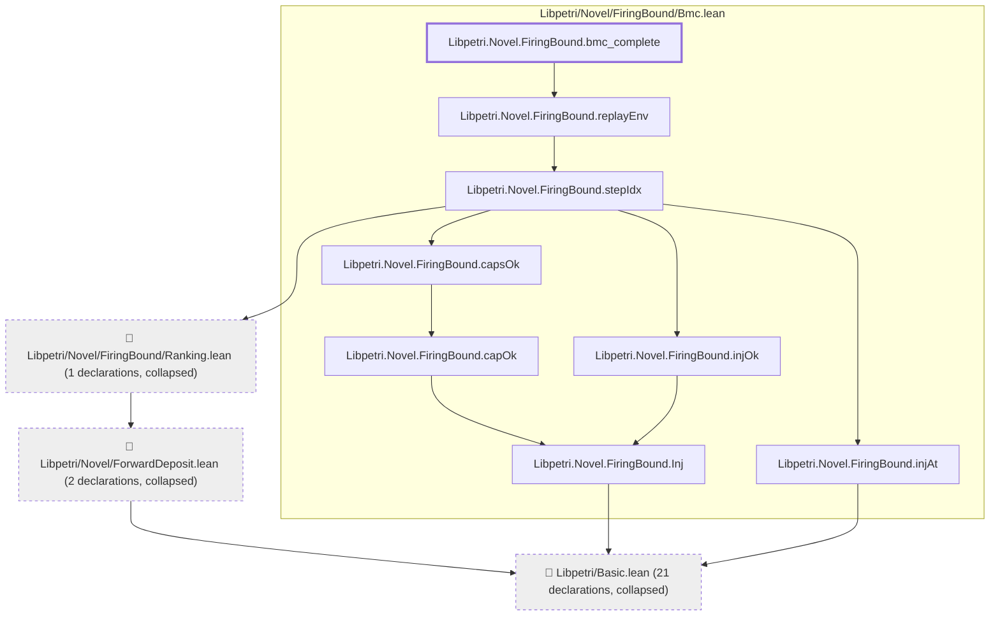

#### `Libpetri.Novel.FiringBound.bmc_complete` → `Libpetri.Novel.FiringBound.replayEnv_nil`

> Rule: this theorem's tree has 114 nodes, still 90 with other files collapsed, so it is split by direct dependency; this part has 12 nodes, other files collapsed.

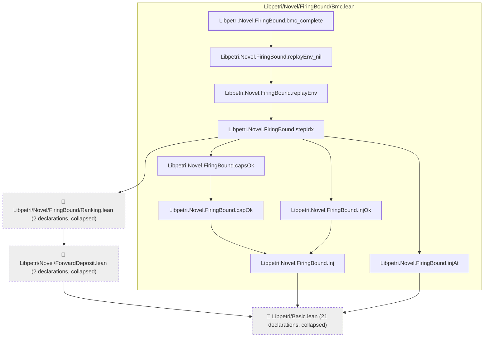

Shared leaves of `Libpetri.Novel.FiringBound.bmc_complete` (direct dependencies too small for a diagram of their own, fewer than 3 nodes):

- `Libpetri.AMarking` (`Libpetri/Basic.lean`)
- `Libpetri.PlaceId` (`Libpetri/Basic.lean`)

### `Libpetri.Novel.FiringBound.bmc_sat_replays`

#### `Libpetri.Novel.FiringBound.bmc_sat_replays` → `Libpetri.Novel.FiringBound.BadAgrees`

> Rule: this theorem's tree has 99 nodes, still 76 with other files collapsed, so it is split by direct dependency; this part has 3 nodes, other files collapsed.

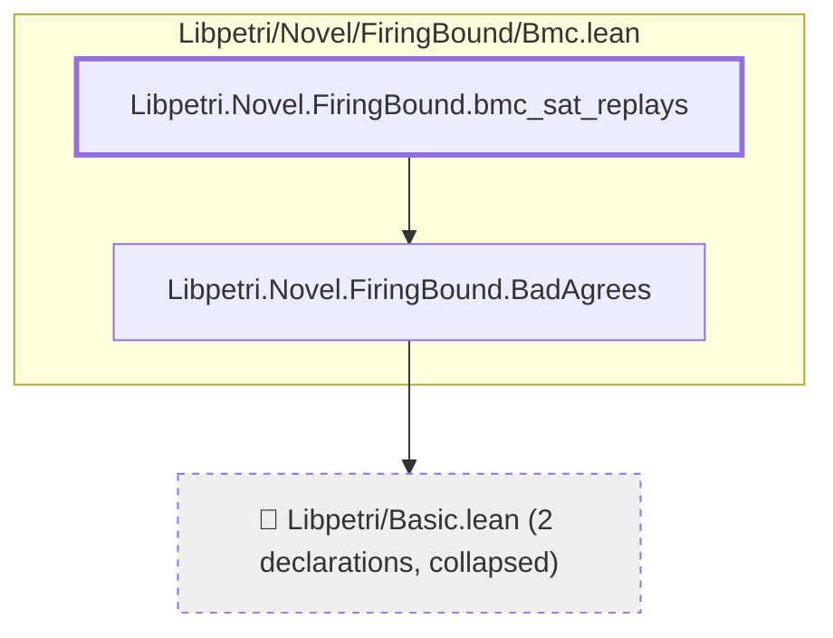

#### `Libpetri.Novel.FiringBound.bmc_sat_replays` → `Libpetri.Novel.FiringBound.BmcModel`

> Rule: this theorem's tree has 99 nodes, still 76 with other files collapsed, so it is split by direct dependency; this part has 5 nodes, other files collapsed.

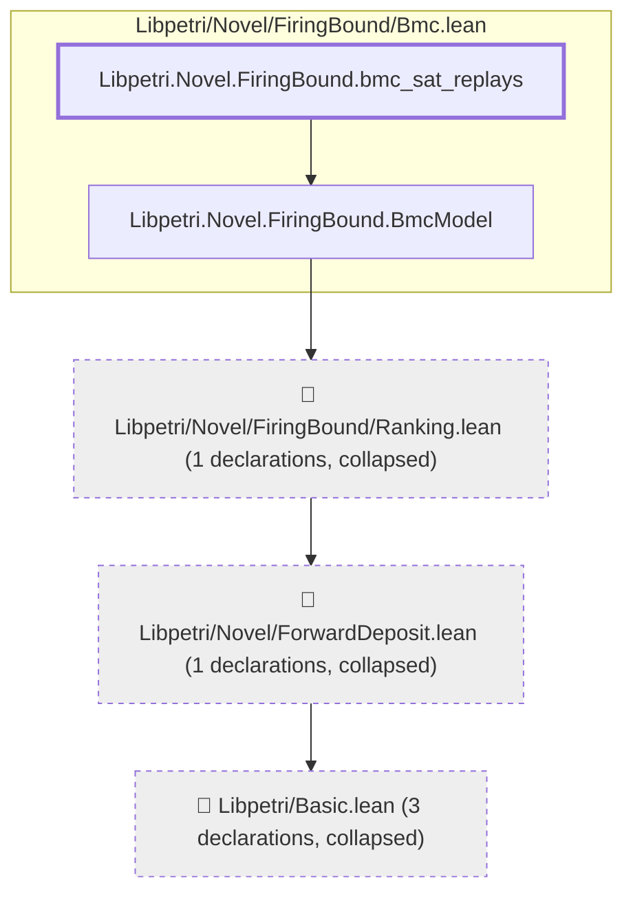

#### `Libpetri.Novel.FiringBound.bmc_sat_replays` → `Libpetri.Novel.FiringBound.BmcModelEnv`

> Rule: this theorem's tree has 99 nodes, still 76 with other files collapsed, so it is split by direct dependency; this part has 6 nodes, other files collapsed.

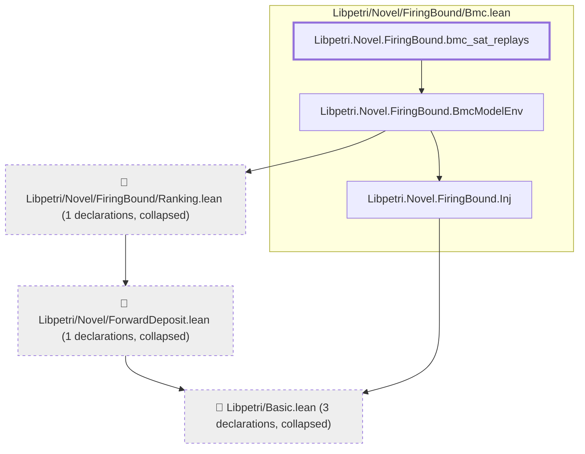

#### `Libpetri.Novel.FiringBound.bmc_sat_replays` → `Libpetri.Novel.FiringBound.Inj`

> Rule: this theorem's tree has 99 nodes, still 76 with other files collapsed, so it is split by direct dependency; this part has 3 nodes, other files collapsed.

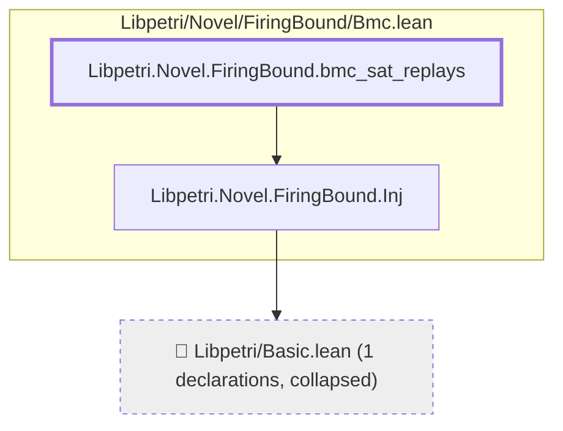

#### `Libpetri.Novel.FiringBound.bmc_sat_replays` → `Libpetri.Novel.FiringBound.Row`

> Rule: this theorem's tree has 99 nodes, still 76 with other files collapsed, so it is split by direct dependency; this part has 4 nodes, other files collapsed.

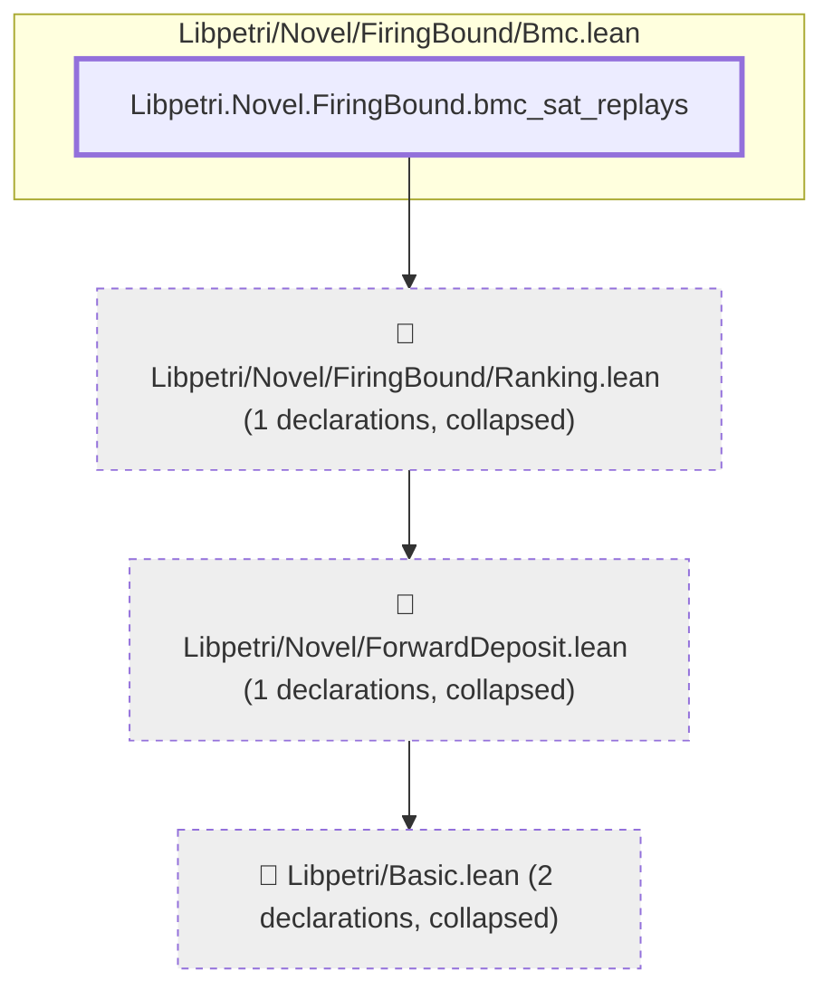

#### `Libpetri.Novel.FiringBound.bmc_sat_replays` → `Libpetri.Novel.FiringBound.WellFormedRows`

> Rule: this theorem's tree has 99 nodes, still 76 with other files collapsed, so it is split by direct dependency; this part has 6 nodes, other files collapsed.

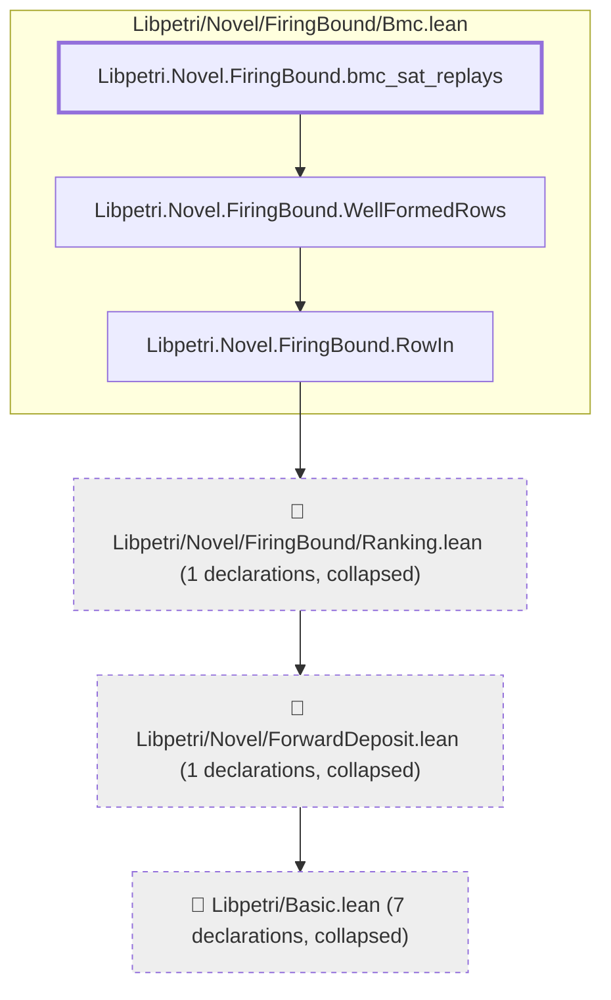

#### `Libpetri.Novel.FiringBound.bmc_sat_replays` → `Libpetri.Novel.FiringBound.bmcEnv_sat_replays`

> Rule: this theorem's tree has 99 nodes, still 76 with other files collapsed, so it is split by direct dependency; this part has 65 nodes, other files collapsed.

```mermaid
flowchart TD
  subgraph g0["Libpetri/Novel/FiringBound/Bmc.lean"]
    n584["Libpetri.Novel.FiringBound.BadAgrees"]
    n592["Libpetri.Novel.FiringBound.BmcModelEnv"]
    n593["Libpetri.Novel.FiringBound.BmcModelEnv.bad"]
    n594["Libpetri.Novel.FiringBound.BmcModelEnv.caps"]
    n595["Libpetri.Novel.FiringBound.BmcModelEnv.guard"]
    n596["Libpetri.Novel.FiringBound.BmcModelEnv.idle_final"]
    n597["Libpetri.Novel.FiringBound.BmcModelEnv.inj_guard"]
    n599["Libpetri.Novel.FiringBound.BmcModelEnv.sel_range"]
    n600["Libpetri.Novel.FiringBound.BmcModelEnv.update"]
    n608["Libpetri.Novel.FiringBound.Inj"]
    n610["Libpetri.Novel.FiringBound.InjsIn"]
    n623["Libpetri.Novel.FiringBound.RowIn"]
    n624["Libpetri.Novel.FiringBound.RowIn.deposit"]
    n626["Libpetri.Novel.FiringBound.RowIn.inputs"]
    n629["Libpetri.Novel.FiringBound.RowIn.resets"]
    n641["Libpetri.Novel.FiringBound.WellFormedRows"]
    n677["Libpetri.Novel.FiringBound.bmcEnv_model_replays"]
    n679["Libpetri.Novel.FiringBound.bmcEnv_sat_replays"]
    n688["Libpetri.Novel.FiringBound.bmc_sat_replays"]
    n692["Libpetri.Novel.FiringBound.capOk"]
    n693["Libpetri.Novel.FiringBound.capsOk"]
    n694["Libpetri.Novel.FiringBound.chain"]
    n695["Libpetri.Novel.FiringBound.chain_append_miss"]
    n696["Libpetri.Novel.FiringBound.chain_congr"]
    n697["Libpetri.Novel.FiringBound.chain_cons"]
    n698["Libpetri.Novel.FiringBound.chain_hit"]
    n700["Libpetri.Novel.FiringBound.chain_idle_env"]
    n701["Libpetri.Novel.FiringBound.chain_inject_env"]
    n702["Libpetri.Novel.FiringBound.chain_miss"]
    n703["Libpetri.Novel.FiringBound.chain_step"]
    n704["Libpetri.Novel.FiringBound.chain_step_env"]
    n707["Libpetri.Novel.FiringBound.clears"]
    n708["Libpetri.Novel.FiringBound.column"]
    n710["Libpetri.Novel.FiringBound.decode"]
    n714["Libpetri.Novel.FiringBound.decodeRust"]
    n715["Libpetri.Novel.FiringBound.decodeRust_eq_decode"]
    n716["Libpetri.Novel.FiringBound.decodeSel"]
    n726["Libpetri.Novel.FiringBound.fireAD_frame"]
    n735["Libpetri.Novel.FiringBound.guardI"]
    n736["Libpetri.Novel.FiringBound.guardI_iff_enabledA"]
    n737["Libpetri.Novel.FiringBound.injAt"]
    n739["Libpetri.Novel.FiringBound.injOk"]
    n740["Libpetri.Novel.FiringBound.injTouching"]
    n751["Libpetri.Novel.FiringBound.mAt"]
    n753["Libpetri.Novel.FiringBound.mem_injTouching"]
    n754["Libpetri.Novel.FiringBound.mem_touching"]
    n757["Libpetri.Novel.FiringBound.nextVal"]
    n758["Libpetri.Novel.FiringBound.nextValEnv"]
    n798["Libpetri.Novel.FiringBound.replayEnv"]
    n799["Libpetri.Novel.FiringBound.replayEnv_append"]
    n803["Libpetri.Novel.FiringBound.replayEnv_singleton"]
    n804["Libpetri.Novel.FiringBound.replayEnv_snoc"]
    n819["Libpetri.Novel.FiringBound.stepIdx"]
    n826["Libpetri.Novel.FiringBound.takeSome"]
    n828["Libpetri.Novel.FiringBound.takeSome_snoc"]
    n830["Libpetri.Novel.FiringBound.touches"]
    n831["Libpetri.Novel.FiringBound.touching"]
    n832["Libpetri.Novel.FiringBound.touchingEnv"]
    n833["Libpetri.Novel.FiringBound.touchingEnv_bounds"]
    n834["Libpetri.Novel.FiringBound.touching_lt"]
  end
  c0["📁 Libpetri/Basic.lean (22 declarations, collapsed)"]
  c25["📁 Libpetri/Novel/FiringBound/Ranking.lean (1 declarations, collapsed)"]
  c28["📁 Libpetri/Novel/ForwardDeposit.lean (2 declarations, collapsed)"]
  c111["📁 Libpetri/Soundness.lean (1 declarations, collapsed)"]
  c372["📁 Libpetri/Strengthening/Hypotheses.lean (1 declarations, collapsed)"]
  c25 --> c28
  c28 --> c0
  c111 --> c0
  c372 --> c111
  n584 --> c0
  n592 --> c25
  n592 --> n608
  n593 --> n592
  n593 --> n751
  n594 --> n592
  n594 --> n751
  n595 --> n592
  n595 --> n735
  n595 --> n751
  n596 --> n592
  n597 --> n592
  n597 --> n751
  n599 --> n592
  n600 --> n592
  n600 --> n694
  n600 --> n751
  n600 --> n758
  n600 --> n832
  n608 --> c0
  n610 --> n608
  n623 --> c25
  n624 --> n623
  n626 --> n623
  n629 --> n623
  n641 --> n623
  n677 --> n594
  n677 --> n595
  n677 --> n596
  n677 --> n597
  n677 --> n599
  n677 --> n600
  n677 --> n610
  n677 --> n641
  n677 --> n700
  n677 --> n701
  n677 --> n704
  n677 --> n710
  n677 --> n726
  n677 --> n736
  n677 --> n804
  n679 --> n584
  n679 --> n593
  n679 --> n677
  n679 --> n715
  n688 --> n679
  n692 --> n608
  n693 --> n692
  n695 --> n702
  n696 --> n697
  n697 --> n694
  n698 --> n697
  n700 --> n702
  n700 --> n833
  n701 --> n698
  n701 --> n702
  n701 --> n753
  n701 --> n758
  n701 --> n832
  n701 --> n834
  n702 --> n697
  n703 --> c372
  n703 --> n698
  n703 --> n702
  n703 --> n754
  n703 --> n757
  n704 --> n695
  n704 --> n696
  n704 --> n703
  n704 --> n753
  n704 --> n758
  n704 --> n832
  n704 --> n834
  n707 --> c25
  n708 --> c25
  n710 --> n716
  n714 --> n716
  n714 --> n826
  n715 --> n710
  n715 --> n714
  n715 --> n828
  n726 --> c111
  n726 --> n624
  n726 --> n626
  n726 --> n629
  n735 --> c0
  n736 --> c372
  n736 --> n626
  n736 --> n735
  n737 --> c0
  n739 --> n608
  n740 --> n608
  n751 --> c0
  n753 --> n740
  n754 --> n831
  n757 --> n707
  n757 --> n708
  n758 --> n757
  n798 --> n819
  n799 --> n798
  n803 --> n798
  n804 --> n799
  n804 --> n803
  n819 --> c25
  n819 --> n693
  n819 --> n737
  n819 --> n739
  n828 --> n826
  n830 --> n707
  n830 --> n708
  n831 --> n830
  n832 --> n740
  n832 --> n831
  n833 --> n753
  n833 --> n832
  n833 --> n834
  n834 --> n754
  classDef root stroke-width:3px
  classDef locked fill:#fff3cd,stroke:#b8860b
  classDef collapsed fill:#eeeeee,stroke-dasharray:4 4
  class n688 root
  class c0,c25,c28,c111,c372 collapsed
```

#### `Libpetri.Novel.FiringBound.bmc_sat_replays` → `Libpetri.Novel.FiringBound.bmcModelEnv_nil`

> Rule: this theorem's tree has 99 nodes, still 76 with other files collapsed, so it is split by direct dependency; this part has 35 nodes, other files collapsed.

```mermaid
flowchart TD
  subgraph g0["Libpetri/Novel/FiringBound/Bmc.lean"]
    n585["Libpetri.Novel.FiringBound.BmcModel"]
    n586["Libpetri.Novel.FiringBound.BmcModel.bad"]
    n587["Libpetri.Novel.FiringBound.BmcModel.guard"]
    n588["Libpetri.Novel.FiringBound.BmcModel.idle_final"]
    n589["Libpetri.Novel.FiringBound.BmcModel.mk"]
    n590["Libpetri.Novel.FiringBound.BmcModel.sel_range"]
    n591["Libpetri.Novel.FiringBound.BmcModel.update"]
    n592["Libpetri.Novel.FiringBound.BmcModelEnv"]
    n593["Libpetri.Novel.FiringBound.BmcModelEnv.bad"]
    n595["Libpetri.Novel.FiringBound.BmcModelEnv.guard"]
    n596["Libpetri.Novel.FiringBound.BmcModelEnv.idle_final"]
    n598["Libpetri.Novel.FiringBound.BmcModelEnv.mk"]
    n599["Libpetri.Novel.FiringBound.BmcModelEnv.sel_range"]
    n600["Libpetri.Novel.FiringBound.BmcModelEnv.update"]
    n608["Libpetri.Novel.FiringBound.Inj"]
    n680["Libpetri.Novel.FiringBound.bmcModelEnv_nil"]
    n688["Libpetri.Novel.FiringBound.bmc_sat_replays"]
    n694["Libpetri.Novel.FiringBound.chain"]
    n696["Libpetri.Novel.FiringBound.chain_congr"]
    n697["Libpetri.Novel.FiringBound.chain_cons"]
    n707["Libpetri.Novel.FiringBound.clears"]
    n708["Libpetri.Novel.FiringBound.column"]
    n735["Libpetri.Novel.FiringBound.guardI"]
    n740["Libpetri.Novel.FiringBound.injTouching"]
    n751["Libpetri.Novel.FiringBound.mAt"]
    n754["Libpetri.Novel.FiringBound.mem_touching"]
    n757["Libpetri.Novel.FiringBound.nextVal"]
    n758["Libpetri.Novel.FiringBound.nextValEnv"]
    n830["Libpetri.Novel.FiringBound.touches"]
    n831["Libpetri.Novel.FiringBound.touching"]
    n832["Libpetri.Novel.FiringBound.touchingEnv"]
    n834["Libpetri.Novel.FiringBound.touching_lt"]
  end
  c0["📁 Libpetri/Basic.lean (20 declarations, collapsed)"]
  c25["📁 Libpetri/Novel/FiringBound/Ranking.lean (1 declarations, collapsed)"]
  c28["📁 Libpetri/Novel/ForwardDeposit.lean (1 declarations, collapsed)"]
  c25 --> c28
  c28 --> c0
  n585 --> c25
  n586 --> n585
  n586 --> n751
  n587 --> n585
  n587 --> n735
  n587 --> n751
  n588 --> n585
  n589 --> n585
  n589 --> n694
  n589 --> n735
  n589 --> n751
  n589 --> n757
  n589 --> n831
  n590 --> n585
  n591 --> n585
  n591 --> n694
  n591 --> n751
  n591 --> n757
  n591 --> n831
  n592 --> c25
  n592 --> n608
  n593 --> n592
  n593 --> n751
  n595 --> n592
  n595 --> n735
  n595 --> n751
  n596 --> n592
  n598 --> n592
  n598 --> n694
  n598 --> n735
  n598 --> n751
  n598 --> n758
  n598 --> n832
  n599 --> n592
  n600 --> n592
  n600 --> n694
  n600 --> n751
  n600 --> n758
  n600 --> n832
  n608 --> c0
  n680 --> n586
  n680 --> n587
  n680 --> n588
  n680 --> n589
  n680 --> n590
  n680 --> n591
  n680 --> n593
  n680 --> n595
  n680 --> n596
  n680 --> n598
  n680 --> n599
  n680 --> n600
  n680 --> n696
  n680 --> n834
  n688 --> n680
  n696 --> n697
  n697 --> n694
  n707 --> c25
  n708 --> c25
  n735 --> c0
  n740 --> n608
  n751 --> c0
  n754 --> n831
  n757 --> n707
  n757 --> n708
  n758 --> n757
  n830 --> n707
  n830 --> n708
  n831 --> n830
  n832 --> n740
  n832 --> n831
  n834 --> n754
  classDef root stroke-width:3px
  classDef locked fill:#fff3cd,stroke:#b8860b
  classDef collapsed fill:#eeeeee,stroke-dasharray:4 4
  class n688 root
  class c0,c25,c28 collapsed
```

#### `Libpetri.Novel.FiringBound.bmc_sat_replays` → `Libpetri.Novel.FiringBound.decodeRust`

> Rule: this theorem's tree has 99 nodes, still 76 with other files collapsed, so it is split by direct dependency; this part has 4 nodes, other files collapsed.

```mermaid
flowchart TD
  subgraph g0["Libpetri/Novel/FiringBound/Bmc.lean"]
    n688["Libpetri.Novel.FiringBound.bmc_sat_replays"]
    n714["Libpetri.Novel.FiringBound.decodeRust"]
    n716["Libpetri.Novel.FiringBound.decodeSel"]
    n826["Libpetri.Novel.FiringBound.takeSome"]
  end
  n688 --> n714
  n714 --> n716
  n714 --> n826
  classDef root stroke-width:3px
  classDef locked fill:#fff3cd,stroke:#b8860b
  classDef collapsed fill:#eeeeee,stroke-dasharray:4 4
  class n688 root
```

#### `Libpetri.Novel.FiringBound.bmc_sat_replays` → `Libpetri.Novel.FiringBound.injsIn_nil`

> Rule: this theorem's tree has 99 nodes, still 76 with other files collapsed, so it is split by direct dependency; this part has 5 nodes, other files collapsed.

```mermaid
flowchart TD
  subgraph g0["Libpetri/Novel/FiringBound/Bmc.lean"]
    n608["Libpetri.Novel.FiringBound.Inj"]
    n610["Libpetri.Novel.FiringBound.InjsIn"]
    n688["Libpetri.Novel.FiringBound.bmc_sat_replays"]
    n742["Libpetri.Novel.FiringBound.injsIn_nil"]
  end
  c0["📁 Libpetri/Basic.lean (1 declarations, collapsed)"]
  n608 --> c0
  n610 --> n608
  n688 --> n742
  n742 --> n610
  classDef root stroke-width:3px
  classDef locked fill:#fff3cd,stroke:#b8860b
  classDef collapsed fill:#eeeeee,stroke-dasharray:4 4
  class n688 root
  class c0 collapsed
```

#### `Libpetri.Novel.FiringBound.bmc_sat_replays` → `Libpetri.Novel.FiringBound.replay`

> Rule: this theorem's tree has 99 nodes, still 76 with other files collapsed, so it is split by direct dependency; this part has 4 nodes, other files collapsed.

```mermaid
flowchart TD
  subgraph g0["Libpetri/Novel/FiringBound/Bmc.lean"]
    n688["Libpetri.Novel.FiringBound.bmc_sat_replays"]
  end
  c0["📁 Libpetri/Basic.lean (21 declarations, collapsed)"]
  c25["📁 Libpetri/Novel/FiringBound/Ranking.lean (2 declarations, collapsed)"]
  c28["📁 Libpetri/Novel/ForwardDeposit.lean (2 declarations, collapsed)"]
  c25 --> c28
  c28 --> c0
  n688 --> c25
  classDef root stroke-width:3px
  classDef locked fill:#fff3cd,stroke:#b8860b
  classDef collapsed fill:#eeeeee,stroke-dasharray:4 4
  class n688 root
  class c0,c25,c28 collapsed
```

#### `Libpetri.Novel.FiringBound.bmc_sat_replays` → `Libpetri.Novel.FiringBound.replayEnv`

> Rule: this theorem's tree has 99 nodes, still 76 with other files collapsed, so it is split by direct dependency; this part has 11 nodes, other files collapsed.

```mermaid
flowchart TD
  subgraph g0["Libpetri/Novel/FiringBound/Bmc.lean"]
    n608["Libpetri.Novel.FiringBound.Inj"]
    n688["Libpetri.Novel.FiringBound.bmc_sat_replays"]
    n692["Libpetri.Novel.FiringBound.capOk"]
    n693["Libpetri.Novel.FiringBound.capsOk"]
    n737["Libpetri.Novel.FiringBound.injAt"]
    n739["Libpetri.Novel.FiringBound.injOk"]
    n798["Libpetri.Novel.FiringBound.replayEnv"]
    n819["Libpetri.Novel.FiringBound.stepIdx"]
  end
  c0["📁 Libpetri/Basic.lean (21 declarations, collapsed)"]
  c25["📁 Libpetri/Novel/FiringBound/Ranking.lean (1 declarations, collapsed)"]
  c28["📁 Libpetri/Novel/ForwardDeposit.lean (2 declarations, collapsed)"]
  c25 --> c28
  c28 --> c0
  n608 --> c0
  n688 --> n798
  n692 --> n608
  n693 --> n692
  n737 --> c0
  n739 --> n608
  n798 --> n819
  n819 --> c25
  n819 --> n693
  n819 --> n737
  n819 --> n739
  classDef root stroke-width:3px
  classDef locked fill:#fff3cd,stroke:#b8860b
  classDef collapsed fill:#eeeeee,stroke-dasharray:4 4
  class n688 root
  class c0,c25,c28 collapsed
```

#### `Libpetri.Novel.FiringBound.bmc_sat_replays` → `Libpetri.Novel.FiringBound.replayEnv_nil`

> Rule: this theorem's tree has 99 nodes, still 76 with other files collapsed, so it is split by direct dependency; this part has 12 nodes, other files collapsed.

```mermaid
flowchart TD
  subgraph g0["Libpetri/Novel/FiringBound/Bmc.lean"]
    n608["Libpetri.Novel.FiringBound.Inj"]
    n688["Libpetri.Novel.FiringBound.bmc_sat_replays"]
    n692["Libpetri.Novel.FiringBound.capOk"]
    n693["Libpetri.Novel.FiringBound.capsOk"]
    n737["Libpetri.Novel.FiringBound.injAt"]
    n739["Libpetri.Novel.FiringBound.injOk"]
    n798["Libpetri.Novel.FiringBound.replayEnv"]
    n802["Libpetri.Novel.FiringBound.replayEnv_nil"]
    n819["Libpetri.Novel.FiringBound.stepIdx"]
  end
  c0["📁 Libpetri/Basic.lean (21 declarations, collapsed)"]
  c25["📁 Libpetri/Novel/FiringBound/Ranking.lean (2 declarations, collapsed)"]
  c28["📁 Libpetri/Novel/ForwardDeposit.lean (2 declarations, collapsed)"]
  c25 --> c28
  c28 --> c0
  n608 --> c0
  n688 --> n802
  n692 --> n608
  n693 --> n692
  n737 --> c0
  n739 --> n608
  n798 --> n819
  n802 --> n798
  n819 --> c25
  n819 --> n693
  n819 --> n737
  n819 --> n739
  classDef root stroke-width:3px
  classDef locked fill:#fff3cd,stroke:#b8860b
  classDef collapsed fill:#eeeeee,stroke-dasharray:4 4
  class n688 root
  class c0,c25,c28 collapsed
```

Shared leaves of `Libpetri.Novel.FiringBound.bmc_sat_replays` (direct dependencies too small for a diagram of their own, fewer than 3 nodes):

- `Libpetri.AMarking` (`Libpetri/Basic.lean`)
- `Libpetri.PlaceId` (`Libpetri/Basic.lean`)

### `Libpetri.Novel.FiringBound.checkRankingExact_sound`

> Rule: this theorem's whole tree, 27 nodes.

```mermaid
flowchart TD
  subgraph g0["Libpetri/Basic.lean"]
    n0["Libpetri.AMarking"]
    n8["Libpetri.Card"]
    n9["Libpetri.Card.all"]
    n10["Libpetri.Card.atLeast"]
    n12["Libpetri.Card.exactly"]
    n13["Libpetri.Card.one"]
    n14["Libpetri.Card.required"]
    n134["Libpetri.InSpec"]
    n135["Libpetri.InSpec.card"]
    n138["Libpetri.InSpec.place"]
    n2723["Libpetri.PlaceId"]
    n22345["Libpetri.Transition"]
    n22346["Libpetri.Transition.inhibitors"]
    n22347["Libpetri.Transition.inputs"]
    n22351["Libpetri.Transition.reads"]
    n22597["Libpetri.pre"]
    n22652["Libpetri.specAt"]
  end
  subgraph g1["Libpetri/InvariantSum.lean"]
    n22362["Libpetri.Weight"]
    n22461["Libpetri.dot"]
    n22541["Libpetri.isum"]
  end
  subgraph g2["Libpetri/Novel/FiringBound/Ranking.lean"]
    n611["Libpetri.Novel.FiringBound.IsRanking"]
    n622["Libpetri.Novel.FiringBound.Row"]
    n689["Libpetri.Novel.FiringBound.canFire"]
    n705["Libpetri.Novel.FiringBound.checkRankingExact"]
    n706["Libpetri.Novel.FiringBound.checkRankingExact_sound"]
  end
  subgraph g3["Libpetri/Novel/ForwardDeposit.lean"]
    n867["Libpetri.Novel.ForwardDeposit.Deposit"]
  end
  subgraph g4["Libpetri/Novel/LinearBound.lean"]
    n1039["Libpetri.Novel.LinearBound.dotIncD"]
  end
  n0 --> n2723
  n9 --> n8
  n10 --> n8
  n12 --> n8
  n13 --> n8
  n14 --> n9
  n14 --> n10
  n14 --> n12
  n14 --> n13
  n135 --> n8
  n135 --> n134
  n138 --> n134
  n138 --> n2723
  n611 --> n622
  n611 --> n689
  n611 --> n1039
  n622 --> n867
  n622 --> n22345
  n689 --> n22346
  n689 --> n22351
  n689 --> n22597
  n705 --> n622
  n705 --> n689
  n705 --> n1039
  n705 --> n22461
  n706 --> n611
  n706 --> n705
  n867 --> n2723
  n1039 --> n867
  n1039 --> n22362
  n1039 --> n22541
  n1039 --> n22597
  n22346 --> n2723
  n22346 --> n22345
  n22347 --> n134
  n22347 --> n22345
  n22351 --> n2723
  n22351 --> n22345
  n22362 --> n2723
  n22461 --> n0
  n22461 --> n22362
  n22541 --> n2723
  n22597 --> n14
  n22597 --> n135
  n22597 --> n22652
  n22652 --> n138
  n22652 --> n22347
  classDef root stroke-width:3px
  classDef locked fill:#fff3cd,stroke:#b8860b
  classDef collapsed fill:#eeeeee,stroke-dasharray:4 4
  class n706 root
```

### `Libpetri.Novel.FiringBound.not_canFire_never_enabled`

> Rule: this theorem's whole tree, 23 nodes.

```mermaid
flowchart TD
  subgraph g0["Libpetri/Basic.lean"]
    n0["Libpetri.AMarking"]
    n8["Libpetri.Card"]
    n9["Libpetri.Card.all"]
    n10["Libpetri.Card.atLeast"]
    n12["Libpetri.Card.exactly"]
    n13["Libpetri.Card.one"]
    n14["Libpetri.Card.required"]
    n134["Libpetri.InSpec"]
    n135["Libpetri.InSpec.card"]
    n138["Libpetri.InSpec.place"]
    n2723["Libpetri.PlaceId"]
    n22345["Libpetri.Transition"]
    n22346["Libpetri.Transition.inhibitors"]
    n22347["Libpetri.Transition.inputs"]
    n22351["Libpetri.Transition.reads"]
    n22474["Libpetri.enabledA"]
    n22597["Libpetri.pre"]
    n22652["Libpetri.specAt"]
  end
  subgraph g1["Libpetri/Novel/FiringBound/Ranking.lean"]
    n689["Libpetri.Novel.FiringBound.canFire"]
    n691["Libpetri.Novel.FiringBound.canFire_of_enabled"]
    n761["Libpetri.Novel.FiringBound.not_canFire_never_enabled"]
  end
  subgraph g2["Libpetri/Soundness.lean"]
    n22656["🔒 Libpetri.specAt_sound"]
  end
  subgraph g3["Libpetri/Strengthening/Hypotheses.lean"]
    n22602["🔒 Libpetri.pre_le_of_enabledA"]
  end
  n0 --> n2723
  n9 --> n8
  n10 --> n8
  n12 --> n8
  n13 --> n8
  n14 --> n9
  n14 --> n10
  n14 --> n12
  n14 --> n13
  n135 --> n8
  n135 --> n134
  n138 --> n134
  n138 --> n2723
  n689 --> n22346
  n689 --> n22351
  n689 --> n22597
  n691 --> n689
  n691 --> n22602
  n761 --> n691
  n22346 --> n2723
  n22346 --> n22345
  n22347 --> n134
  n22347 --> n22345
  n22351 --> n2723
  n22351 --> n22345
  n22474 --> n0
  n22474 --> n14
  n22474 --> n135
  n22474 --> n138
  n22474 --> n22346
  n22474 --> n22347
  n22474 --> n22351
  n22597 --> n14
  n22597 --> n135
  n22597 --> n22652
  n22602 --> n22474
  n22602 --> n22597
  n22602 --> n22656
  n22652 --> n138
  n22652 --> n22347
  n22656 --> n22652
  classDef root stroke-width:3px
  classDef locked fill:#fff3cd,stroke:#b8860b
  classDef collapsed fill:#eeeeee,stroke-dasharray:4 4
  class n761 root
  class n22602,n22656 locked
```

### `Libpetri.Novel.FiringBound.ranking_bounds_length`

> Rule: this theorem's whole tree, 43 nodes.

```mermaid
flowchart TD
  subgraph g0["Libpetri/Basic.lean"]
    n0["Libpetri.AMarking"]
    n8["Libpetri.Card"]
    n9["Libpetri.Card.all"]
    n10["Libpetri.Card.atLeast"]
    n11["Libpetri.Card.consumesAll"]
    n12["Libpetri.Card.exactly"]
    n13["Libpetri.Card.one"]
    n14["Libpetri.Card.required"]
    n134["Libpetri.InSpec"]
    n135["Libpetri.InSpec.card"]
    n138["Libpetri.InSpec.place"]
    n2723["Libpetri.PlaceId"]
    n22345["Libpetri.Transition"]
    n22346["Libpetri.Transition.inhibitors"]
    n22347["Libpetri.Transition.inputs"]
    n22351["Libpetri.Transition.reads"]
    n22352["Libpetri.Transition.resets"]
    n22422["Libpetri.consumeAllAt"]
    n22474["Libpetri.enabledA"]
    n22597["Libpetri.pre"]
    n22652["Libpetri.specAt"]
  end
  subgraph g1["Libpetri/InvariantSum.lean"]
    n22362["Libpetri.Weight"]
    n22461["Libpetri.dot"]
    n22463["Libpetri.dot_eq_isum"]
    n22541["Libpetri.isum"]
    n22542["🔒 Libpetri.isum_add"]
  end
  subgraph g2["Libpetri/Novel/FiringBound/Ranking.lean"]
    n611["Libpetri.Novel.FiringBound.IsRanking"]
    n622["Libpetri.Novel.FiringBound.Row"]
    n689["Libpetri.Novel.FiringBound.canFire"]
    n691["Libpetri.Novel.FiringBound.canFire_of_enabled"]
    n721["Libpetri.Novel.FiringBound.dot_nonneg"]
    n781["Libpetri.Novel.FiringBound.ranking_bounds_length"]
    n782["Libpetri.Novel.FiringBound.ranking_bounds_runs"]
    n786["Libpetri.Novel.FiringBound.ranking_step"]
    n797["Libpetri.Novel.FiringBound.replay"]
  end
  subgraph g3["Libpetri/Novel/ForwardDeposit.lean"]
    n867["Libpetri.Novel.ForwardDeposit.Deposit"]
    n895["Libpetri.Novel.ForwardDeposit.fireAD"]
  end
  subgraph g4["Libpetri/Novel/LinearBound.lean"]
    n1039["Libpetri.Novel.LinearBound.dotIncD"]
    n1042["Libpetri.Novel.LinearBound.dot_fireAD_le"]
    n1049["Libpetri.Novel.LinearBound.fireAD_le_linear"]
    n1052["Libpetri.Novel.LinearBound.isum_le"]
  end
  subgraph g5["Libpetri/Soundness.lean"]
    n22656["🔒 Libpetri.specAt_sound"]
  end
  subgraph g6["Libpetri/Strengthening/Hypotheses.lean"]
    n22602["🔒 Libpetri.pre_le_of_enabledA"]
  end
  n0 --> n2723
  n9 --> n8
  n10 --> n8
  n11 --> n9
  n11 --> n10
  n11 --> n12
  n11 --> n13
  n12 --> n8
  n13 --> n8
  n14 --> n9
  n14 --> n10
  n14 --> n12
  n14 --> n13
  n135 --> n8
  n135 --> n134
  n138 --> n134
  n138 --> n2723
  n611 --> n622
  n611 --> n689
  n611 --> n1039
  n622 --> n867
  n622 --> n22345
  n689 --> n22346
  n689 --> n22351
  n689 --> n22597
  n691 --> n689
  n691 --> n22602
  n721 --> n22463
  n781 --> n721
  n781 --> n782
  n782 --> n786
  n782 --> n797
  n786 --> n611
  n786 --> n691
  n786 --> n1042
  n797 --> n622
  n797 --> n895
  n797 --> n22474
  n867 --> n2723
  n895 --> n0
  n895 --> n867
  n895 --> n22352
  n895 --> n22422
  n895 --> n22597
  n1039 --> n867
  n1039 --> n22362
  n1039 --> n22541
  n1039 --> n22597
  n1042 --> n1039
  n1042 --> n1049
  n1042 --> n1052
  n1042 --> n22463
  n1042 --> n22542
  n1049 --> n895
  n1049 --> n22602
  n1052 --> n22541
  n22346 --> n2723
  n22346 --> n22345
  n22347 --> n134
  n22347 --> n22345
  n22351 --> n2723
  n22351 --> n22345
  n22352 --> n2723
  n22352 --> n22345
  n22362 --> n2723
  n22422 --> n11
  n22422 --> n135
  n22422 --> n22652
  n22461 --> n0
  n22461 --> n22362
  n22463 --> n22461
  n22463 --> n22541
  n22474 --> n0
  n22474 --> n14
  n22474 --> n135
  n22474 --> n138
  n22474 --> n22346
  n22474 --> n22347
  n22474 --> n22351
  n22541 --> n2723
  n22542 --> n22541
  n22597 --> n14
  n22597 --> n135
  n22597 --> n22652
  n22602 --> n22474
  n22602 --> n22597
  n22602 --> n22656
  n22652 --> n138
  n22652 --> n22347
  n22656 --> n22652
  classDef root stroke-width:3px
  classDef locked fill:#fff3cd,stroke:#b8860b
  classDef collapsed fill:#eeeeee,stroke-dasharray:4 4
  class n781 root
  class n22542,n22602,n22656 locked
```

### `Libpetri.Spec.VER_018_order_fb_gate`

> Rule: this theorem's whole tree, 32 nodes.

```mermaid
flowchart TD
  subgraph g0["Libpetri/Spec/Req/VER_018.lean"]
    n10852["Libpetri.Spec.VER_018_order"]
    n10855["Libpetri.Spec.VER_018_order_fb_gate"]
    n21931["Libpetri.Spec.ver018_lbStep"]
  end
  subgraph g1["Libpetri/Spec/Req/VER_019.lean"]
    n7545["Libpetri.Spec.FBCtx"]
    n7546["Libpetri.Spec.FBCtx.fbOn"]
    n7547["Libpetri.Spec.FBCtx.ignoreEnv"]
    n7548["Libpetri.Spec.FBCtx.mk"]
    n7549["Libpetri.Spec.FBCtx.nuNet"]
    n7550["Libpetri.Spec.FBCtx.seOn"]
    n7552["Libpetri.Spec.FBGate"]
    n7553["Libpetri.Spec.FBOutcome"]
    n7554["Libpetri.Spec.FBOutcome.inconclusive"]
    n7555["Libpetri.Spec.FBOutcome.proven"]
    n7556["Libpetri.Spec.FBOutcome.unbounded"]
    n7557["Libpetri.Spec.FBOutcome.violated"]
    n7564["Libpetri.Spec.FBReason"]
    n7573["Libpetri.Spec.FBWrap"]
    n10891["Libpetri.Spec.VER_019_order"]
    n10895["Libpetri.Spec.VER_019_order_flat_gate"]
    n20122["Libpetri.Spec.refFbGate"]
    n21995["Libpetri.Spec.ver019_fbStep"]
    n21997["Libpetri.Spec.ver019_fixStep"]
    n22007["Libpetri.Spec.ver019_method"]
    n22036["Libpetri.Spec.ver019_seStep"]
    n22041["Libpetri.Spec.ver019_witStep"]
  end
  subgraph g2["Libpetri/Spec/Verifier/Pipeline.lean"]
    n11274["Libpetri.Spec.Verifier.Before"]
  end
  subgraph g3["Libpetri/Spec/Verifier/Result.lean"]
    n11740["Libpetri.Spec.Verifier.PhaseOut"]
    n11741["Libpetri.Spec.Verifier.PhaseOut.aside"]
    n11742["Libpetri.Spec.Verifier.PhaseOut.decided"]
    n12016["Libpetri.Spec.Verifier.Verdict"]
    n12017["Libpetri.Spec.Verifier.Verdict.proven"]
    n12019["Libpetri.Spec.Verifier.Verdict.violated"]
  end
  n7546 --> n7545
  n7547 --> n7545
  n7548 --> n7545
  n7549 --> n7545
  n7550 --> n7545
  n7552 --> n7545
  n7554 --> n7553
  n7554 --> n7564
  n7555 --> n7553
  n7556 --> n7553
  n7557 --> n7553
  n7573 --> n7553
  n7573 --> n11740
  n10852 --> n7547
  n10852 --> n7549
  n10852 --> n7550
  n10852 --> n7552
  n10852 --> n11274
  n10852 --> n21931
  n10852 --> n21997
  n10852 --> n22036
  n10855 --> n10852
  n10855 --> n10895
  n10891 --> n7546
  n10891 --> n7547
  n10891 --> n7548
  n10891 --> n7549
  n10891 --> n7552
  n10891 --> n7554
  n10891 --> n7555
  n10891 --> n7556
  n10891 --> n7557
  n10891 --> n7573
  n10891 --> n11274
  n10891 --> n11741
  n10891 --> n11742
  n10891 --> n12017
  n10891 --> n12019
  n10891 --> n21995
  n10891 --> n21997
  n10891 --> n22007
  n10891 --> n22036
  n10891 --> n22041
  n10895 --> n7550
  n10895 --> n10891
  n10895 --> n20122
  n11741 --> n11740
  n11742 --> n11740
  n11742 --> n12016
  n12017 --> n12016
  n12019 --> n12016
  n20122 --> n7546
  n20122 --> n7547
  n20122 --> n7549
  n20122 --> n7552
  classDef root stroke-width:3px
  classDef locked fill:#fff3cd,stroke:#b8860b
  classDef collapsed fill:#eeeeee,stroke-dasharray:4 4
  class n10855 root
```

### `Libpetri.Spec.VER_019_order_continues`

> Rule: this theorem's tree has 61 nodes (limit 60); every file other than its own is collapsed into one node, leaving 22.

```mermaid
flowchart TD
  subgraph g0["Libpetri/Spec/Req/VER_019.lean"]
    n7545["Libpetri.Spec.FBCtx"]
    n7546["Libpetri.Spec.FBCtx.fbOn"]
    n7547["Libpetri.Spec.FBCtx.ignoreEnv"]
    n7548["Libpetri.Spec.FBCtx.mk"]
    n7549["Libpetri.Spec.FBCtx.nuNet"]
    n7552["Libpetri.Spec.FBGate"]
    n7553["Libpetri.Spec.FBOutcome"]
    n7554["Libpetri.Spec.FBOutcome.inconclusive"]
    n7555["Libpetri.Spec.FBOutcome.proven"]
    n7556["Libpetri.Spec.FBOutcome.unbounded"]
    n7557["Libpetri.Spec.FBOutcome.violated"]
    n7564["Libpetri.Spec.FBReason"]
    n7573["Libpetri.Spec.FBWrap"]
    n10891["Libpetri.Spec.VER_019_order"]
    n10893["Libpetri.Spec.VER_019_order_continues"]
    n21995["Libpetri.Spec.ver019_fbStep"]
    n21997["Libpetri.Spec.ver019_fixStep"]
    n22007["Libpetri.Spec.ver019_method"]
    n22036["Libpetri.Spec.ver019_seStep"]
    n22041["Libpetri.Spec.ver019_witStep"]
  end
  c366["📁 Libpetri/Spec/Verifier/Pipeline.lean (33 declarations, collapsed)"]
  c367["📁 Libpetri/Spec/Verifier/Result.lean (8 declarations, collapsed)"]
  c366 --> c367
  n7546 --> n7545
  n7547 --> n7545
  n7548 --> n7545
  n7549 --> n7545
  n7552 --> n7545
  n7554 --> n7553
  n7554 --> n7564
  n7555 --> n7553
  n7556 --> n7553
  n7557 --> n7553
  n7573 --> c367
  n7573 --> n7553
  n10891 --> c366
  n10891 --> n7546
  n10891 --> n7547
  n10891 --> n7548
  n10891 --> n7549
  n10891 --> n7552
  n10891 --> n7554
  n10891 --> n7555
  n10891 --> n7556
  n10891 --> n7557
  n10891 --> n7573
  n10891 --> n21995
  n10891 --> n21997
  n10891 --> n22007
  n10891 --> n22036
  n10891 --> n22041
  n10893 --> n10891
  classDef root stroke-width:3px
  classDef locked fill:#fff3cd,stroke:#b8860b
  classDef collapsed fill:#eeeeee,stroke-dasharray:4 4
  class n10893 root
  class c366,c367 collapsed
```

### `Libpetri.Spec.VER_019_order_disabled`

> Rule: this theorem's tree has 62 nodes (limit 60); every file other than its own is collapsed into one node, leaving 23.

```mermaid
flowchart TD
  subgraph g0["Libpetri/Spec/Req/VER_019.lean"]
    n7545["Libpetri.Spec.FBCtx"]
    n7546["Libpetri.Spec.FBCtx.fbOn"]
    n7547["Libpetri.Spec.FBCtx.ignoreEnv"]
    n7548["Libpetri.Spec.FBCtx.mk"]
    n7549["Libpetri.Spec.FBCtx.nuNet"]
    n7552["Libpetri.Spec.FBGate"]
    n7553["Libpetri.Spec.FBOutcome"]
    n7554["Libpetri.Spec.FBOutcome.inconclusive"]
    n7555["Libpetri.Spec.FBOutcome.proven"]
    n7556["Libpetri.Spec.FBOutcome.unbounded"]
    n7557["Libpetri.Spec.FBOutcome.violated"]
    n7564["Libpetri.Spec.FBReason"]
    n7573["Libpetri.Spec.FBWrap"]
    n10891["Libpetri.Spec.VER_019_order"]
    n10894["Libpetri.Spec.VER_019_order_disabled"]
    n21995["Libpetri.Spec.ver019_fbStep"]
    n21997["Libpetri.Spec.ver019_fixStep"]
    n22007["Libpetri.Spec.ver019_method"]
    n22030["Libpetri.Spec.ver019_runPipeline_skip"]
    n22036["Libpetri.Spec.ver019_seStep"]
    n22041["Libpetri.Spec.ver019_witStep"]
  end
  c366["📁 Libpetri/Spec/Verifier/Pipeline.lean (33 declarations, collapsed)"]
  c367["📁 Libpetri/Spec/Verifier/Result.lean (8 declarations, collapsed)"]
  c366 --> c367
  n7546 --> n7545
  n7547 --> n7545
  n7548 --> n7545
  n7549 --> n7545
  n7552 --> n7545
  n7554 --> n7553
  n7554 --> n7564
  n7555 --> n7553
  n7556 --> n7553
  n7557 --> n7553
  n7573 --> c367
  n7573 --> n7553
  n10891 --> c366
  n10891 --> n7546
  n10891 --> n7547
  n10891 --> n7548
  n10891 --> n7549
  n10891 --> n7552
  n10891 --> n7554
  n10891 --> n7555
  n10891 --> n7556
  n10891 --> n7557
  n10891 --> n7573
  n10891 --> n21995
  n10891 --> n21997
  n10891 --> n22007
  n10891 --> n22036
  n10891 --> n22041
  n10894 --> n10891
  n10894 --> n22030
  n22030 --> c366
  classDef root stroke-width:3px
  classDef locked fill:#fff3cd,stroke:#b8860b
  classDef collapsed fill:#eeeeee,stroke-dasharray:4 4
  class n10894 root
  class c366,c367 collapsed
```

### `Libpetri.Spec.VER_019_order_flat_gate`

> Rule: this theorem's whole tree, 29 nodes.

```mermaid
flowchart TD
  subgraph g0["Libpetri/Spec/Req/VER_019.lean"]
    n7545["Libpetri.Spec.FBCtx"]
    n7546["Libpetri.Spec.FBCtx.fbOn"]
    n7547["Libpetri.Spec.FBCtx.ignoreEnv"]
    n7548["Libpetri.Spec.FBCtx.mk"]
    n7549["Libpetri.Spec.FBCtx.nuNet"]
    n7550["Libpetri.Spec.FBCtx.seOn"]
    n7552["Libpetri.Spec.FBGate"]
    n7553["Libpetri.Spec.FBOutcome"]
    n7554["Libpetri.Spec.FBOutcome.inconclusive"]
    n7555["Libpetri.Spec.FBOutcome.proven"]
    n7556["Libpetri.Spec.FBOutcome.unbounded"]
    n7557["Libpetri.Spec.FBOutcome.violated"]
    n7564["Libpetri.Spec.FBReason"]
    n7573["Libpetri.Spec.FBWrap"]
    n10891["Libpetri.Spec.VER_019_order"]
    n10895["Libpetri.Spec.VER_019_order_flat_gate"]
    n20122["Libpetri.Spec.refFbGate"]
    n21995["Libpetri.Spec.ver019_fbStep"]
    n21997["Libpetri.Spec.ver019_fixStep"]
    n22007["Libpetri.Spec.ver019_method"]
    n22036["Libpetri.Spec.ver019_seStep"]
    n22041["Libpetri.Spec.ver019_witStep"]
  end
  subgraph g1["Libpetri/Spec/Verifier/Pipeline.lean"]
    n11274["Libpetri.Spec.Verifier.Before"]
  end
  subgraph g2["Libpetri/Spec/Verifier/Result.lean"]
    n11740["Libpetri.Spec.Verifier.PhaseOut"]
    n11741["Libpetri.Spec.Verifier.PhaseOut.aside"]
    n11742["Libpetri.Spec.Verifier.PhaseOut.decided"]
    n12016["Libpetri.Spec.Verifier.Verdict"]
    n12017["Libpetri.Spec.Verifier.Verdict.proven"]
    n12019["Libpetri.Spec.Verifier.Verdict.violated"]
  end
  n7546 --> n7545
  n7547 --> n7545
  n7548 --> n7545
  n7549 --> n7545
  n7550 --> n7545
  n7552 --> n7545
  n7554 --> n7553
  n7554 --> n7564
  n7555 --> n7553
  n7556 --> n7553
  n7557 --> n7553
  n7573 --> n7553
  n7573 --> n11740
  n10891 --> n7546
  n10891 --> n7547
  n10891 --> n7548
  n10891 --> n7549
  n10891 --> n7552
  n10891 --> n7554
  n10891 --> n7555
  n10891 --> n7556
  n10891 --> n7557
  n10891 --> n7573
  n10891 --> n11274
  n10891 --> n11741
  n10891 --> n11742
  n10891 --> n12017
  n10891 --> n12019
  n10891 --> n21995
  n10891 --> n21997
  n10891 --> n22007
  n10891 --> n22036
  n10891 --> n22041
  n10895 --> n7550
  n10895 --> n10891
  n10895 --> n20122
  n11741 --> n11740
  n11742 --> n11740
  n11742 --> n12016
  n12017 --> n12016
  n12019 --> n12016
  n20122 --> n7546
  n20122 --> n7547
  n20122 --> n7549
  n20122 --> n7552
  classDef root stroke-width:3px
  classDef locked fill:#fff3cd,stroke:#b8860b
  classDef collapsed fill:#eeeeee,stroke-dasharray:4 4
  class n10895 root
```

### `Libpetri.Spec.VER_019_order_runs`

> Rule: this theorem's tree has 67 nodes (limit 60); every file other than its own is collapsed into one node, leaving 22.

```mermaid
flowchart TD
  subgraph g0["Libpetri/Spec/Req/VER_019.lean"]
    n7545["Libpetri.Spec.FBCtx"]
    n7546["Libpetri.Spec.FBCtx.fbOn"]
    n7547["Libpetri.Spec.FBCtx.ignoreEnv"]
    n7548["Libpetri.Spec.FBCtx.mk"]
    n7549["Libpetri.Spec.FBCtx.nuNet"]
    n7552["Libpetri.Spec.FBGate"]
    n7553["Libpetri.Spec.FBOutcome"]
    n7554["Libpetri.Spec.FBOutcome.inconclusive"]
    n7555["Libpetri.Spec.FBOutcome.proven"]
    n7556["Libpetri.Spec.FBOutcome.unbounded"]
    n7557["Libpetri.Spec.FBOutcome.violated"]
    n7564["Libpetri.Spec.FBReason"]
    n7573["Libpetri.Spec.FBWrap"]
    n10891["Libpetri.Spec.VER_019_order"]
    n10910["Libpetri.Spec.VER_019_order_runs"]
    n21995["Libpetri.Spec.ver019_fbStep"]
    n21997["Libpetri.Spec.ver019_fixStep"]
    n22007["Libpetri.Spec.ver019_method"]
    n22036["Libpetri.Spec.ver019_seStep"]
    n22041["Libpetri.Spec.ver019_witStep"]
  end
  c366["📁 Libpetri/Spec/Verifier/Pipeline.lean (39 declarations, collapsed)"]
  c367["📁 Libpetri/Spec/Verifier/Result.lean (8 declarations, collapsed)"]
  c366 --> c367
  n7546 --> n7545
  n7547 --> n7545
  n7548 --> n7545
  n7549 --> n7545
  n7552 --> n7545
  n7554 --> n7553
  n7554 --> n7564
  n7555 --> n7553
  n7556 --> n7553
  n7557 --> n7553
  n7573 --> c367
  n7573 --> n7553
  n10891 --> c366
  n10891 --> n7546
  n10891 --> n7547
  n10891 --> n7548
  n10891 --> n7549
  n10891 --> n7552
  n10891 --> n7554
  n10891 --> n7555
  n10891 --> n7556
  n10891 --> n7557
  n10891 --> n7573
  n10891 --> n21995
  n10891 --> n21997
  n10891 --> n22007
  n10891 --> n22036
  n10891 --> n22041
  n10910 --> n10891
  classDef root stroke-width:3px
  classDef locked fill:#fff3cd,stroke:#b8860b
  classDef collapsed fill:#eeeeee,stroke-dasharray:4 4
  class n10910 root
  class c366,c367 collapsed
```

### `Libpetri.Spec.VER_019_order_se_free`

> Rule: this theorem's whole tree, 27 nodes.

```mermaid
flowchart TD
  subgraph g0["Libpetri/Spec/Req/VER_019.lean"]
    n7545["Libpetri.Spec.FBCtx"]
    n7546["Libpetri.Spec.FBCtx.fbOn"]
    n7547["Libpetri.Spec.FBCtx.ignoreEnv"]
    n7548["Libpetri.Spec.FBCtx.mk"]
    n7549["Libpetri.Spec.FBCtx.nuNet"]
    n7552["Libpetri.Spec.FBGate"]
    n7553["Libpetri.Spec.FBOutcome"]
    n7554["Libpetri.Spec.FBOutcome.inconclusive"]
    n7555["Libpetri.Spec.FBOutcome.proven"]
    n7556["Libpetri.Spec.FBOutcome.unbounded"]
    n7557["Libpetri.Spec.FBOutcome.violated"]
    n7564["Libpetri.Spec.FBReason"]
    n7573["Libpetri.Spec.FBWrap"]
    n10891["Libpetri.Spec.VER_019_order"]
    n10911["Libpetri.Spec.VER_019_order_se_free"]
    n21995["Libpetri.Spec.ver019_fbStep"]
    n21997["Libpetri.Spec.ver019_fixStep"]
    n22007["Libpetri.Spec.ver019_method"]
    n22036["Libpetri.Spec.ver019_seStep"]
    n22041["Libpetri.Spec.ver019_witStep"]
  end
  subgraph g1["Libpetri/Spec/Verifier/Pipeline.lean"]
    n11274["Libpetri.Spec.Verifier.Before"]
  end
  subgraph g2["Libpetri/Spec/Verifier/Result.lean"]
    n11740["Libpetri.Spec.Verifier.PhaseOut"]
    n11741["Libpetri.Spec.Verifier.PhaseOut.aside"]
    n11742["Libpetri.Spec.Verifier.PhaseOut.decided"]
    n12016["Libpetri.Spec.Verifier.Verdict"]
    n12017["Libpetri.Spec.Verifier.Verdict.proven"]
    n12019["Libpetri.Spec.Verifier.Verdict.violated"]
  end
  n7546 --> n7545
  n7547 --> n7545
  n7548 --> n7545
  n7549 --> n7545
  n7552 --> n7545
  n7554 --> n7553
  n7554 --> n7564
  n7555 --> n7553
  n7556 --> n7553
  n7557 --> n7553
  n7573 --> n7553
  n7573 --> n11740
  n10891 --> n7546
  n10891 --> n7547
  n10891 --> n7548
  n10891 --> n7549
  n10891 --> n7552
  n10891 --> n7554
  n10891 --> n7555
  n10891 --> n7556
  n10891 --> n7557
  n10891 --> n7573
  n10891 --> n11274
  n10891 --> n11741
  n10891 --> n11742
  n10891 --> n12017
  n10891 --> n12019
  n10891 --> n21995
  n10891 --> n21997
  n10891 --> n22007
  n10891 --> n22036
  n10891 --> n22041
  n10911 --> n10891
  n11741 --> n11740
  n11742 --> n11740
  n11742 --> n12016
  n12017 --> n12016
  n12019 --> n12016
  classDef root stroke-width:3px
  classDef locked fill:#fff3cd,stroke:#b8860b
  classDef collapsed fill:#eeeeee,stroke-dasharray:4 4
  class n10911 root
```

Axioms used:

- `Libpetri.Novel.FiringBound.bmc_complete`: `Classical.choice`, `Quot.sound`, `propext`
- `Libpetri.Novel.FiringBound.bmc_sat_replays`: `Classical.choice`, `Quot.sound`, `propext`
- `Libpetri.Novel.FiringBound.checkRankingExact_sound`: `Classical.choice`, `Quot.sound`, `propext`
- `Libpetri.Novel.FiringBound.not_canFire_never_enabled`: `Quot.sound`, `propext`
- `Libpetri.Novel.FiringBound.ranking_bounds_length`: `Classical.choice`, `Quot.sound`, `propext`
- `Libpetri.Spec.VER_018_order_fb_gate`: `Quot.sound`, `propext`
- `Libpetri.Spec.VER_019_order_continues`: `propext`
- `Libpetri.Spec.VER_019_order_disabled`: `Quot.sound`, `propext`
- `Libpetri.Spec.VER_019_order_flat_gate`: `Quot.sound`, `propext`
- `Libpetri.Spec.VER_019_order_runs`: `Quot.sound`, `propext`
- `Libpetri.Spec.VER_019_order_se_free`: none
