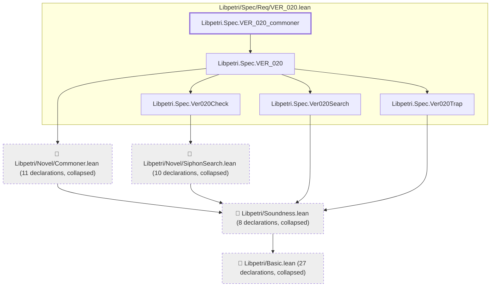

# VER-020

Generated by `scripts/proof-graph.py` from `proof-graph.json`. Do not edit.

Theorems carrying this ID:

- `Libpetri.Novel.Commoner.commoner` (theorem, `Libpetri/Novel/Commoner.lean:200`)
- `Libpetri.Novel.Commoner.marked_trap_is_necessary` (theorem, `Libpetri/Novel/Commoner.lean:276`)
- `Libpetri.Novel.Commoner.ordinary_is_necessary` (theorem, `Libpetri/Novel/Commoner.lean:228`)
- `Libpetri.Spec.VER_020_commoner` (theorem, `Libpetri/Spec/Req/VER_020.lean:204`)
- `Libpetri.Spec.VER_020_finds_ac4` (theorem, `Libpetri/Spec/Req/VER_020.lean:258`)
- `Libpetri.Spec.VER_020_guard_arrivals` (theorem, `Libpetri/Spec/Req/VER_020.lean:829`)
- `Libpetri.Spec.VER_020_guard_match` (theorem, `Libpetri/Spec/Req/VER_020.lean:737`)
- `Libpetri.Spec.VER_020_guard_sound` (theorem, `Libpetri/Spec/Req/VER_020.lean:676`)

> **Note:** the full tree has 283 nodes (limit 60), so it is drawn as one diagram per theorem (8 theorems).

### `Libpetri.Novel.Commoner.commoner`

> Rule: this theorem's whole tree, 42 nodes.

```mermaid
flowchart TD
  subgraph g0["Libpetri/Basic.lean"]
    n0["Libpetri.AMarking"]
    n8["Libpetri.Card"]
    n9["Libpetri.Card.all"]
    n10["Libpetri.Card.atLeast"]
    n11["Libpetri.Card.consumesAll"]
    n12["Libpetri.Card.exactly"]
    n13["Libpetri.Card.one"]
    n14["Libpetri.Card.required"]
    n134["Libpetri.InSpec"]
    n135["Libpetri.InSpec.card"]
    n138["Libpetri.InSpec.place"]
    n2720["Libpetri.PlaceId"]
    n13126["Libpetri.Transition"]
    n13127["Libpetri.Transition.inhibitors"]
    n13128["Libpetri.Transition.inputs"]
    n13132["Libpetri.Transition.reads"]
    n13133["Libpetri.Transition.resets"]
    n13203["Libpetri.consumeAllAt"]
    n13255["Libpetri.enabledA"]
    n13277["Libpetri.fireA"]
    n13373["Libpetri.post"]
    n13378["Libpetri.pre"]
    n13433["Libpetri.specAt"]
  end
  subgraph g1["Libpetri/Novel/Commoner.lean"]
    n214["Libpetri.Novel.Commoner.CommonerCond"]
    n215["Libpetri.Novel.Commoner.Consumes"]
    n216["Libpetri.Novel.Commoner.Dead"]
    n217["Libpetri.Novel.Commoner.InputsBelow"]
    n218["Libpetri.Novel.Commoner.Ordinary"]
    n219["Libpetri.Novel.Commoner.Siphon"]
    n220["Libpetri.Novel.Commoner.Trap"]
    n222["Libpetri.Novel.Commoner.commoner"]
    n226["Libpetri.Novel.Commoner.dead_consumes_unmarked"]
    n231["Libpetri.Novel.Commoner.ordinary_no_drain"]
    n236["Libpetri.Novel.Commoner.trap_stays_marked"]
  end
  subgraph g2["Libpetri/Soundness.lean"]
    n130["Libpetri.FlatNet"]
    n131["Libpetri.FlatTransition"]
    n2868["Libpetri.ReachA"]
    n2869["Libpetri.ReachA.init"]
    n2870["Libpetri.ReachA.rec'"]
    n2871["Libpetri.ReachA.step"]
    n13107["Libpetri.StepARel"]
    n13437["🔒 Libpetri.specAt_sound"]
  end
  n0 --> n2720
  n9 --> n8
  n10 --> n8
  n11 --> n9
  n11 --> n10
  n11 --> n12
  n11 --> n13
  n12 --> n8
  n13 --> n8
  n14 --> n9
  n14 --> n10
  n14 --> n12
  n14 --> n13
  n130 --> n131
  n131 --> n2720
  n131 --> n13126
  n135 --> n8
  n135 --> n134
  n138 --> n134
  n138 --> n2720
  n214 --> n0
  n214 --> n219
  n214 --> n220
  n215 --> n14
  n215 --> n135
  n215 --> n138
  n215 --> n13128
  n216 --> n130
  n216 --> n13255
  n217 --> n130
  n217 --> n138
  n217 --> n13128
  n218 --> n11
  n218 --> n14
  n218 --> n130
  n218 --> n135
  n218 --> n13127
  n218 --> n13128
  n218 --> n13132
  n218 --> n13133
  n219 --> n130
  n219 --> n215
  n220 --> n130
  n220 --> n215
  n222 --> n214
  n222 --> n226
  n222 --> n231
  n222 --> n236
  n226 --> n215
  n226 --> n216
  n226 --> n217
  n226 --> n218
  n231 --> n218
  n231 --> n13203
  n231 --> n13437
  n236 --> n220
  n236 --> n2870
  n236 --> n13437
  n2868 --> n13107
  n2869 --> n2868
  n2870 --> n2869
  n2870 --> n2871
  n2871 --> n2868
  n13107 --> n130
  n13107 --> n13255
  n13107 --> n13277
  n13127 --> n2720
  n13127 --> n13126
  n13128 --> n134
  n13128 --> n13126
  n13132 --> n2720
  n13132 --> n13126
  n13133 --> n2720
  n13133 --> n13126
  n13203 --> n11
  n13203 --> n135
  n13203 --> n13433
  n13255 --> n0
  n13255 --> n14
  n13255 --> n135
  n13255 --> n138
  n13255 --> n13127
  n13255 --> n13128
  n13255 --> n13132
  n13277 --> n0
  n13277 --> n13133
  n13277 --> n13203
  n13277 --> n13373
  n13277 --> n13378
  n13373 --> n2720
  n13378 --> n14
  n13378 --> n135
  n13378 --> n13433
  n13433 --> n138
  n13433 --> n13128
  n13437 --> n13433
  classDef root stroke-width:3px
  classDef locked fill:#fff3cd,stroke:#b8860b
  classDef collapsed fill:#eeeeee,stroke-dasharray:4 4
  class n222 root
  class n13437 locked
```

### `Libpetri.Novel.Commoner.marked_trap_is_necessary`

> Rule: this theorem's whole tree, 35 nodes.

```mermaid
flowchart TD
  subgraph g0["Libpetri/Basic.lean"]
    n0["Libpetri.AMarking"]
    n8["Libpetri.Card"]
    n9["Libpetri.Card.all"]
    n10["Libpetri.Card.atLeast"]
    n11["Libpetri.Card.consumesAll"]
    n12["Libpetri.Card.exactly"]
    n13["Libpetri.Card.one"]
    n14["Libpetri.Card.required"]
    n21["Libpetri.Colour"]
    n132["Libpetri.Guard"]
    n134["Libpetri.InSpec"]
    n135["Libpetri.InSpec.card"]
    n137["Libpetri.InSpec.mk"]
    n138["Libpetri.InSpec.place"]
    n2720["Libpetri.PlaceId"]
    n13126["Libpetri.Transition"]
    n13127["Libpetri.Transition.inhibitors"]
    n13128["Libpetri.Transition.inputs"]
    n13129["Libpetri.Transition.mk"]
    n13132["Libpetri.Transition.reads"]
    n13133["Libpetri.Transition.resets"]
    n13255["Libpetri.enabledA"]
  end
  subgraph g1["Libpetri/Novel/Commoner.lean"]
    n215["Libpetri.Novel.Commoner.Consumes"]
    n216["Libpetri.Novel.Commoner.Dead"]
    n218["Libpetri.Novel.Commoner.Ordinary"]
    n219["Libpetri.Novel.Commoner.Siphon"]
    n220["Libpetri.Novel.Commoner.Trap"]
    n224["Libpetri.Novel.Commoner.consumes_tAB"]
    n225["Libpetri.Novel.Commoner.consumes_tBA"]
    n227["Libpetri.Novel.Commoner.marked_trap_is_necessary"]
    n228["Libpetri.Novel.Commoner.netCyc"]
    n233["Libpetri.Novel.Commoner.tAB"]
    n234["Libpetri.Novel.Commoner.tBA"]
  end
  subgraph g2["Libpetri/Soundness.lean"]
    n130["Libpetri.FlatNet"]
    n131["Libpetri.FlatTransition"]
  end
  n0 --> n2720
  n9 --> n8
  n10 --> n8
  n11 --> n9
  n11 --> n10
  n11 --> n12
  n11 --> n13
  n12 --> n8
  n13 --> n8
  n14 --> n9
  n14 --> n10
  n14 --> n12
  n14 --> n13
  n130 --> n131
  n131 --> n2720
  n131 --> n13126
  n132 --> n21
  n135 --> n8
  n135 --> n134
  n137 --> n8
  n137 --> n132
  n137 --> n134
  n137 --> n2720
  n138 --> n134
  n138 --> n2720
  n215 --> n14
  n215 --> n135
  n215 --> n138
  n215 --> n13128
  n216 --> n130
  n216 --> n13255
  n218 --> n11
  n218 --> n14
  n218 --> n130
  n218 --> n135
  n218 --> n13127
  n218 --> n13128
  n218 --> n13132
  n218 --> n13133
  n219 --> n130
  n219 --> n215
  n220 --> n130
  n220 --> n215
  n224 --> n215
  n224 --> n233
  n225 --> n215
  n225 --> n234
  n227 --> n216
  n227 --> n218
  n227 --> n219
  n227 --> n220
  n227 --> n224
  n227 --> n225
  n227 --> n228
  n228 --> n130
  n228 --> n233
  n228 --> n234
  n233 --> n13
  n233 --> n137
  n233 --> n13129
  n234 --> n13
  n234 --> n137
  n234 --> n13129
  n13127 --> n2720
  n13127 --> n13126
  n13128 --> n134
  n13128 --> n13126
  n13129 --> n134
  n13129 --> n2720
  n13129 --> n13126
  n13132 --> n2720
  n13132 --> n13126
  n13133 --> n2720
  n13133 --> n13126
  n13255 --> n0
  n13255 --> n14
  n13255 --> n135
  n13255 --> n138
  n13255 --> n13127
  n13255 --> n13128
  n13255 --> n13132
  classDef root stroke-width:3px
  classDef locked fill:#fff3cd,stroke:#b8860b
  classDef collapsed fill:#eeeeee,stroke-dasharray:4 4
  class n227 root
```

### `Libpetri.Novel.Commoner.ordinary_is_necessary`

> Rule: this theorem's whole tree, 32 nodes.

```mermaid
flowchart TD
  subgraph g0["Libpetri/Basic.lean"]
    n0["Libpetri.AMarking"]
    n8["Libpetri.Card"]
    n9["Libpetri.Card.all"]
    n10["Libpetri.Card.atLeast"]
    n12["Libpetri.Card.exactly"]
    n13["Libpetri.Card.one"]
    n14["Libpetri.Card.required"]
    n21["Libpetri.Colour"]
    n132["Libpetri.Guard"]
    n134["Libpetri.InSpec"]
    n135["Libpetri.InSpec.card"]
    n137["Libpetri.InSpec.mk"]
    n138["Libpetri.InSpec.place"]
    n2720["Libpetri.PlaceId"]
    n13126["Libpetri.Transition"]
    n13127["Libpetri.Transition.inhibitors"]
    n13128["Libpetri.Transition.inputs"]
    n13129["Libpetri.Transition.mk"]
    n13132["Libpetri.Transition.reads"]
    n13255["Libpetri.enabledA"]
  end
  subgraph g1["Libpetri/Novel/Commoner.lean"]
    n214["Libpetri.Novel.Commoner.CommonerCond"]
    n215["Libpetri.Novel.Commoner.Consumes"]
    n216["Libpetri.Novel.Commoner.Dead"]
    n217["Libpetri.Novel.Commoner.InputsBelow"]
    n219["Libpetri.Novel.Commoner.Siphon"]
    n220["Libpetri.Novel.Commoner.Trap"]
    n221["Libpetri.Novel.Commoner.a0Ex"]
    n229["Libpetri.Novel.Commoner.netEx"]
    n230["Libpetri.Novel.Commoner.ordinary_is_necessary"]
    n235["Libpetri.Novel.Commoner.tEx"]
  end
  subgraph g2["Libpetri/Soundness.lean"]
    n130["Libpetri.FlatNet"]
    n131["Libpetri.FlatTransition"]
  end
  n0 --> n2720
  n9 --> n8
  n10 --> n8
  n12 --> n8
  n13 --> n8
  n14 --> n9
  n14 --> n10
  n14 --> n12
  n14 --> n13
  n130 --> n131
  n131 --> n2720
  n131 --> n13126
  n132 --> n21
  n135 --> n8
  n135 --> n134
  n137 --> n8
  n137 --> n132
  n137 --> n134
  n137 --> n2720
  n138 --> n134
  n138 --> n2720
  n214 --> n0
  n214 --> n219
  n214 --> n220
  n215 --> n14
  n215 --> n135
  n215 --> n138
  n215 --> n13128
  n216 --> n130
  n216 --> n13255
  n217 --> n130
  n217 --> n138
  n217 --> n13128
  n219 --> n130
  n219 --> n215
  n220 --> n130
  n220 --> n215
  n221 --> n0
  n229 --> n130
  n229 --> n235
  n230 --> n214
  n230 --> n216
  n230 --> n217
  n230 --> n221
  n230 --> n229
  n235 --> n12
  n235 --> n137
  n235 --> n13129
  n13127 --> n2720
  n13127 --> n13126
  n13128 --> n134
  n13128 --> n13126
  n13129 --> n134
  n13129 --> n2720
  n13129 --> n13126
  n13132 --> n2720
  n13132 --> n13126
  n13255 --> n0
  n13255 --> n14
  n13255 --> n135
  n13255 --> n138
  n13255 --> n13127
  n13255 --> n13128
  n13255 --> n13132
  classDef root stroke-width:3px
  classDef locked fill:#fff3cd,stroke:#b8860b
  classDef collapsed fill:#eeeeee,stroke-dasharray:4 4
  class n230 root
```

### `Libpetri.Spec.VER_020_commoner`

> Rule: this theorem's tree has 61 nodes (limit 60); every file other than its own is collapsed into one node, leaving 9.

### `Libpetri.Spec.VER_020_finds_ac4`

> Rule: this theorem's whole tree, 38 nodes.

```mermaid
flowchart TD
  subgraph g0["Libpetri/Basic.lean"]
    n0["Libpetri.AMarking"]
    n8["Libpetri.Card"]
    n9["Libpetri.Card.all"]
    n10["Libpetri.Card.atLeast"]
    n12["Libpetri.Card.exactly"]
    n13["Libpetri.Card.one"]
    n14["Libpetri.Card.required"]
    n21["Libpetri.Colour"]
    n132["Libpetri.Guard"]
    n134["Libpetri.InSpec"]
    n135["Libpetri.InSpec.card"]
    n137["Libpetri.InSpec.mk"]
    n138["Libpetri.InSpec.place"]
    n2720["Libpetri.PlaceId"]
    n13126["Libpetri.Transition"]
    n13128["Libpetri.Transition.inputs"]
    n13129["Libpetri.Transition.mk"]
  end
  subgraph g1["Libpetri/Novel/Commoner.lean"]
    n215["Libpetri.Novel.Commoner.Consumes"]
    n219["Libpetri.Novel.Commoner.Siphon"]
    n220["Libpetri.Novel.Commoner.Trap"]
  end
  subgraph g2["Libpetri/Novel/SiphonSearch.lean"]
    n2145["Libpetri.Novel.SiphonSearch.Verdict"]
    n2146["Libpetri.Novel.SiphonSearch.Verdict.inconclusive"]
    n2147["Libpetri.Novel.SiphonSearch.Verdict.noPotentialDeadlock"]
    n2150["Libpetri.Novel.SiphonSearch.Verdict.potentialDeadlock"]
    n2193["Libpetri.Novel.SiphonSearch.netPad"]
    n2194["Libpetri.Novel.SiphonSearch.netRing"]
    n2238["Libpetri.Novel.SiphonSearch.tP1"]
    n2239["Libpetri.Novel.SiphonSearch.tP2"]
    n2240["Libpetri.Novel.SiphonSearch.tR1"]
    n2241["Libpetri.Novel.SiphonSearch.tR2"]
  end
  subgraph g3["Libpetri/Soundness.lean"]
    n130["Libpetri.FlatNet"]
    n131["Libpetri.FlatTransition"]
  end
  subgraph g4["Libpetri/Spec/Req/VER_020.lean"]
    n7404["Libpetri.Spec.VER_020"]
    n7406["Libpetri.Spec.VER_020_finds_ac4"]
    n7442["Libpetri.Spec.Ver020Check"]
    n7443["Libpetri.Spec.Ver020Search"]
    n7444["Libpetri.Spec.Ver020Trap"]
    n13014["Libpetri.Spec.ver020_pair_closed"]
  end
  n0 --> n2720
  n9 --> n8
  n10 --> n8
  n12 --> n8
  n13 --> n8
  n14 --> n9
  n14 --> n10
  n14 --> n12
  n14 --> n13
  n130 --> n131
  n131 --> n2720
  n131 --> n13126
  n132 --> n21
  n135 --> n8
  n135 --> n134
  n137 --> n8
  n137 --> n132
  n137 --> n134
  n137 --> n2720
  n138 --> n134
  n138 --> n2720
  n215 --> n14
  n215 --> n135
  n215 --> n138
  n215 --> n13128
  n219 --> n130
  n219 --> n215
  n220 --> n130
  n220 --> n215
  n2146 --> n2145
  n2147 --> n2145
  n2150 --> n2145
  n2193 --> n130
  n2193 --> n2238
  n2193 --> n2239
  n2194 --> n130
  n2194 --> n2240
  n2194 --> n2241
  n2238 --> n13
  n2238 --> n137
  n2238 --> n13129
  n2239 --> n13
  n2239 --> n137
  n2239 --> n13129
  n2240 --> n13
  n2240 --> n137
  n2240 --> n13129
  n2241 --> n13
  n2241 --> n137
  n2241 --> n13129
  n7404 --> n219
  n7404 --> n220
  n7404 --> n2146
  n7404 --> n2147
  n7404 --> n2150
  n7404 --> n2193
  n7404 --> n2194
  n7404 --> n7442
  n7404 --> n7443
  n7404 --> n7444
  n7406 --> n7404
  n7406 --> n13014
  n7442 --> n0
  n7442 --> n130
  n7442 --> n2145
  n7443 --> n130
  n7444 --> n130
  n13014 --> n219
  n13128 --> n134
  n13128 --> n13126
  n13129 --> n134
  n13129 --> n2720
  n13129 --> n13126
  classDef root stroke-width:3px
  classDef locked fill:#fff3cd,stroke:#b8860b
  classDef collapsed fill:#eeeeee,stroke-dasharray:4 4
  class n7406 root
```

### `Libpetri.Spec.VER_020_guard_arrivals`

> Rule: this theorem's tree has 88 nodes (limit 60); every file other than its own is collapsed into one node, leaving 27.

```mermaid
flowchart TD
  subgraph g0["Libpetri/Spec/Req/VER_020.lean"]
    n10049["Libpetri.Spec.StructInput"]
    n10050["Libpetri.Spec.StructInput.assumeNoReaping"]
    n10051["Libpetri.Spec.StructInput.condSinks"]
    n10052["Libpetri.Spec.StructInput.deadlockFree"]
    n10053["Libpetri.Spec.StructInput.envPlaces"]
    n10054["Libpetri.Spec.StructInput.flat"]
    n10055["Libpetri.Spec.StructInput.hasMatch"]
    n10056["Libpetri.Spec.StructInput.mk"]
    n10057["Libpetri.Spec.StructInput.n"]
    n10058["Libpetri.Spec.StructInput.reapable"]
    n10059["Libpetri.Spec.StructInput.sinks"]
    n10060["Libpetri.Spec.StructRouteFn"]
    n10930["Libpetri.Spec.VER_020_guard_arrivals"]
    n11152["Libpetri.Spec.Ver020Check"]
    n12611["Libpetri.Spec.commonerApplies"]
    n20312["Libpetri.Spec.refStructCheck"]
    n20313["Libpetri.Spec.refStructGate"]
    n20314["Libpetri.Spec.refStructRoute"]
    n22053["Libpetri.Spec.ver020_netLoop"]
    n22081["Libpetri.Spec.ver020_tLoop"]
    n22086["Libpetri.Spec.ver020_x0"]
  end
  c0["📁 Libpetri/Basic.lean (21 declarations, collapsed)"]
  c17["📁 Libpetri/Novel/EnvSemantics/Arrivals.lean (7 declarations, collapsed)"]
  c20["📁 Libpetri/Novel/EnvSemantics/Step.lean (1 declarations, collapsed)"]
  c28["📁 Libpetri/Novel/ForwardDeposit.lean (1 declarations, collapsed)"]
  c57["📁 Libpetri/Novel/SiphonSearch.lean (35 declarations, collapsed)"]
  c111["📁 Libpetri/Soundness.lean (2 declarations, collapsed)"]
  c17 --> c20
  c20 --> c28
  c28 --> c0
  c57 --> c111
  c111 --> c0
  n10050 --> n10049
  n10051 --> n10049
  n10052 --> n10049
  n10053 --> n10049
  n10054 --> c111
  n10054 --> n10049
  n10055 --> n10049
  n10056 --> c111
  n10056 --> n10049
  n10057 --> n10049
  n10058 --> n10049
  n10059 --> n10049
  n10060 --> n10049
  n10060 --> n11152
  n10930 --> c17
  n10930 --> n20312
  n10930 --> n20314
  n10930 --> n22086
  n11152 --> c57
  n12611 --> c111
  n20312 --> n11152
  n20313 --> n10050
  n20313 --> n10051
  n20313 --> n10052
  n20313 --> n10053
  n20313 --> n10054
  n20313 --> n10055
  n20313 --> n10058
  n20313 --> n10059
  n20313 --> n12611
  n20314 --> n10057
  n20314 --> n10060
  n20314 --> n20313
  n22053 --> c111
  n22053 --> n22081
  n22081 --> c0
  n22086 --> n10056
  n22086 --> n22053
  classDef root stroke-width:3px
  classDef locked fill:#fff3cd,stroke:#b8860b
  classDef collapsed fill:#eeeeee,stroke-dasharray:4 4
  class n10930 root
  class c0,c17,c20,c28,c57,c111 collapsed
```

### `Libpetri.Spec.VER_020_guard_match`

> Rule: this theorem's tree has 242 nodes (limit 60); every file other than its own is collapsed into one node, leaving 35.

```mermaid
flowchart TD
  subgraph g0["Libpetri/Spec/Req/VER_020.lean"]
    n10758["Libpetri.Spec.VER_020"]
    n10759["Libpetri.Spec.VER_020_commoner"]
    n10782["Libpetri.Spec.VER_020_guard_match"]
    n10787["Libpetri.Spec.VER_020_reference"]
    n10972["Libpetri.Spec.Ver020Check"]
    n10974["Libpetri.Spec.Ver020Search"]
    n10975["Libpetri.Spec.Ver020Trap"]
    n12427["Libpetri.Spec.commonerApplies"]
    n12428["Libpetri.Spec.commonerApplies_iff"]
    n19800["Libpetri.Spec.refMaxTrap"]
    n19931["Libpetri.Spec.refSiphonSearch"]
    n19932["Libpetri.Spec.refSiphonSearch_stopped"]
    n19941["Libpetri.Spec.refStructCheck"]
    n21615["Libpetri.Spec.ver020_a0Join"]
    n21623["Libpetri.Spec.ver020_netJoin"]
    n21627["Libpetri.Spec.ver020_nuFork"]
    n21628["Libpetri.Spec.ver020_nuJoin"]
    n21629["Libpetri.Spec.ver020_nuKey"]
    n21630["Libpetri.Spec.ver020_nuM0"]
    n21632["Libpetri.Spec.ver020_nuMs"]
    n21633["Libpetri.Spec.ver020_nuNet"]
    n21649["Libpetri.Spec.ver020_tFork"]
    n21651["Libpetri.Spec.ver020_tJoin"]
  end
  c0["📁 Libpetri/Basic.lean (27 declarations, collapsed)"]
  c14["📁 Libpetri/Novel/Commoner.lean (11 declarations, collapsed)"]
  c28["📁 Libpetri/Novel/ForwardDeposit.lean (3 declarations, collapsed)"]
  c54["📁 Libpetri/Novel/Seam/Net.lean (13 declarations, collapsed)"]
  c57["📁 Libpetri/Novel/SiphonSearch.lean (70 declarations, collapsed)"]
  c87["📁 Libpetri/Reference/Nu.lean (5 declarations, collapsed)"]
  c91["📁 Libpetri/Reference/Queue.lean (17 declarations, collapsed)"]
  c94["📁 Libpetri/Reference/Semantics.lean (16 declarations, collapsed)"]
  c111["📁 Libpetri/Soundness.lean (8 declarations, collapsed)"]
  c132["📁 Libpetri/Spec/Glossary.lean (4 declarations, collapsed)"]
  c142["📁 Libpetri/Spec/GlossaryNu.lean (42 declarations, collapsed)"]
  c144["📁 Libpetri/Spec/GlossaryQueue.lean (3 declarations, collapsed)"]
  c14 --> c111
  c54 --> c0
  c57 --> c14
  c87 --> c142
  c91 --> c94
  c94 --> c28
  c94 --> c54
  c111 --> c0
  c132 --> c94
  c142 --> c132
  c142 --> c144
  c144 --> c91
  n10758 --> n10972
  n10758 --> n10974
  n10758 --> n10975
  n10759 --> n10758
  n10782 --> c87
  n10782 --> n10759
  n10782 --> n10787
  n10782 --> n12428
  n10782 --> n21615
  n10782 --> n21623
  n10782 --> n21630
  n10782 --> n21633
  n10787 --> n10758
  n10787 --> n19800
  n10787 --> n19932
  n10787 --> n19941
  n10972 --> c57
  n10974 --> c111
  n10975 --> c111
  n12427 --> c111
  n12428 --> c14
  n12428 --> n12427
  n19800 --> c57
  n19800 --> n10975
  n19931 --> c57
  n19931 --> n10974
  n19932 --> n19931
  n19941 --> n10972
  n21615 --> c0
  n21623 --> c111
  n21623 --> n21649
  n21623 --> n21651
  n21627 --> c142
  n21628 --> n21632
  n21629 --> c142
  n21630 --> c142
  n21632 --> n21629
  n21633 --> n21627
  n21633 --> n21628
  n21649 --> c0
  n21651 --> c0
  classDef root stroke-width:3px
  classDef locked fill:#fff3cd,stroke:#b8860b
  classDef collapsed fill:#eeeeee,stroke-dasharray:4 4
  class n10782 root
  class c0,c14,c28,c54,c57,c87,c91,c94,c111,c132,c142,c144 collapsed
```

### `Libpetri.Spec.VER_020_guard_sound`

> Rule: this theorem's tree has 74 nodes (limit 60); every file other than its own is collapsed into one node, leaving 22.

```mermaid
flowchart TD
  subgraph g0["Libpetri/Spec/Req/VER_020.lean"]
    n10049["Libpetri.Spec.StructInput"]
    n10050["Libpetri.Spec.StructInput.assumeNoReaping"]
    n10051["Libpetri.Spec.StructInput.condSinks"]
    n10052["Libpetri.Spec.StructInput.deadlockFree"]
    n10053["Libpetri.Spec.StructInput.envPlaces"]
    n10054["Libpetri.Spec.StructInput.flat"]
    n10055["Libpetri.Spec.StructInput.hasMatch"]
    n10057["Libpetri.Spec.StructInput.n"]
    n10058["Libpetri.Spec.StructInput.reapable"]
    n10059["Libpetri.Spec.StructInput.sinks"]
    n10060["Libpetri.Spec.StructRouteFn"]
    n10916["Libpetri.Spec.VER_020"]
    n10917["Libpetri.Spec.VER_020_commoner"]
    n10928["Libpetri.Spec.VER_020_guard"]
    n10943["Libpetri.Spec.VER_020_guard_sound"]
    n11152["Libpetri.Spec.Ver020Check"]
    n11154["Libpetri.Spec.Ver020Search"]
    n11155["Libpetri.Spec.Ver020Trap"]
  end
  c0["📁 Libpetri/Basic.lean (27 declarations, collapsed)"]
  c14["📁 Libpetri/Novel/Commoner.lean (11 declarations, collapsed)"]
  c57["📁 Libpetri/Novel/SiphonSearch.lean (10 declarations, collapsed)"]
  c111["📁 Libpetri/Soundness.lean (8 declarations, collapsed)"]
  c14 --> c111
  c57 --> c111
  c111 --> c0
  n10050 --> n10049
  n10051 --> n10049
  n10052 --> n10049
  n10053 --> n10049
  n10054 --> c111
  n10054 --> n10049
  n10055 --> n10049
  n10057 --> n10049
  n10058 --> n10049
  n10059 --> n10049
  n10060 --> n10049
  n10060 --> n11152
  n10916 --> c14
  n10916 --> n11152
  n10916 --> n11154
  n10916 --> n11155
  n10917 --> n10916
  n10928 --> c14
  n10928 --> n10050
  n10928 --> n10051
  n10928 --> n10052
  n10928 --> n10053
  n10928 --> n10054
  n10928 --> n10055
  n10928 --> n10057
  n10928 --> n10058
  n10928 --> n10059
  n10928 --> n10060
  n10943 --> n10917
  n10943 --> n10928
  n11152 --> c57
  n11154 --> c111
  n11155 --> c111
  classDef root stroke-width:3px
  classDef locked fill:#fff3cd,stroke:#b8860b
  classDef collapsed fill:#eeeeee,stroke-dasharray:4 4
  class n10943 root
  class c0,c14,c57,c111 collapsed
```

Axioms used:

- `Libpetri.Novel.Commoner.commoner`: `Classical.choice`, `Quot.sound`, `propext`
- `Libpetri.Novel.Commoner.marked_trap_is_necessary`: `propext`
- `Libpetri.Novel.Commoner.ordinary_is_necessary`: `propext`
- `Libpetri.Spec.VER_020_commoner`: `Classical.choice`, `Quot.sound`, `propext`
- `Libpetri.Spec.VER_020_finds_ac4`: `Quot.sound`, `propext`
- `Libpetri.Spec.VER_020_guard_arrivals`: `Quot.sound`, `propext`
- `Libpetri.Spec.VER_020_guard_match`: `Classical.choice`, `Quot.sound`, `propext`
- `Libpetri.Spec.VER_020_guard_sound`: `Classical.choice`, `Quot.sound`, `propext`
