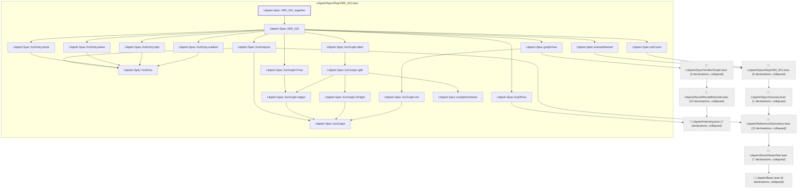

# VER-021

Generated by `scripts/proof-graph.py` from `proof-graph.json`. Do not edit.

Theorems carrying this ID:

- `Libpetri.Spec.VER_021_outCount_of_VER_001` (theorem, `Libpetri/Spec/Req/VER_021.lean:610`)
- `Libpetri.Spec.VER_021_together` (theorem, `Libpetri/Spec/Req/VER_021.lean:627`)

> **Note:** the full tree has 102 nodes (limit 60), so it is drawn as one diagram per theorem (2 theorems).

### `Libpetri.Spec.VER_021_outCount_of_VER_001`

> Rule: this theorem's whole tree, 59 nodes.

```mermaid
flowchart TD
  subgraph g0["Libpetri/Basic.lean"]
    n8["Libpetri.Card"]
    n9["Libpetri.Card.all"]
    n10["Libpetri.Card.atLeast"]
    n11["Libpetri.Card.consumesAll"]
    n12["Libpetri.Card.exactly"]
    n13["Libpetri.Card.one"]
    n14["Libpetri.Card.required"]
  end
  subgraph g1["Libpetri/Novel/ForwardDeposit.lean"]
    n864["Libpetri.Novel.ForwardDeposit.Choice"]
    n865["Libpetri.Novel.ForwardDeposit.Choice.action"]
    n866["Libpetri.Novel.ForwardDeposit.Choice.timedOut"]
  end
  subgraph g2["Libpetri/Novel/Seam/Index.lean"]
    n1940["Libpetri.Novel.Seam.NMarking"]
    n1944["Libpetri.Novel.Seam.NMarking.entries"]
    n1948["Libpetri.Novel.Seam.NMarking.places"]
  end
  subgraph g3["Libpetri/Novel/Seam/Net.lean"]
    n1936["Libpetri.Novel.Seam.NInSpec"]
    n1937["Libpetri.Novel.Seam.NInSpec.card"]
    n1939["Libpetri.Novel.Seam.NInSpec.place"]
    n1955["Libpetri.Novel.Seam.NTransition"]
    n1957["Libpetri.Novel.Seam.NTransition.inputs"]
    n1959["Libpetri.Novel.Seam.NTransition.name"]
    n2045["Libpetri.Novel.Seam.depProd"]
    n2093["Libpetri.Novel.Seam.nspecAt"]
  end
  subgraph g4["Libpetri/Reference/Semantics.lean"]
    n3103["Libpetri.Reference.Net"]
    n3105["Libpetri.Reference.Net.places"]
    n3106["Libpetri.Reference.Net.transitions"]
    n3288["Libpetri.Reference.Out"]
    n3289["Libpetri.Reference.Out.and"]
    n3290["Libpetri.Reference.Out.branches"]
    n3292["Libpetri.Reference.Out.brecOn.go"]
    n3293["Libpetri.Reference.Out.findTimeout"]
    n3294["Libpetri.Reference.Out.forward"]
    n3295["Libpetri.Reference.Out.place"]
    n3296["Libpetri.Reference.Out.timeout"]
    n3297["Libpetri.Reference.Out.timeoutDeposits"]
    n3298["Libpetri.Reference.Out.xor"]
    n3454["Libpetri.Reference.Trans"]
    n3455["Libpetri.Reference.Trans.core"]
    n3457["Libpetri.Reference.Trans.out"]
    n3677["Libpetri.Reference.cross"]
    n3690["Libpetri.Reference.deposit"]
  end
  subgraph g5["Libpetri/Spec/Glossary.lean"]
    n6082["Libpetri.Spec.Deposits"]
    n9856["Libpetri.Spec.SamePerPlace"]
    n16661["Libpetri.Spec.forwardSources"]
    n20069["Libpetri.Spec.requiredCount"]
  end
  subgraph g6["Libpetri/Spec/Req/VER_001.lean"]
    n6099["Libpetri.Spec.DrainedForward"]
    n7426["Libpetri.Spec.ExpandFn"]
    n10287["Libpetri.Spec.VER_001"]
    n10305["Libpetri.Spec.VER_001_rows_unique"]
    n11091["Libpetri.Spec.VerifiedNetFn"]
    n11986["Libpetri.Spec.VirtualRow"]
    n20007["Libpetri.Spec.refVirtualRows"]
    n20815["Libpetri.Spec.timeoutRequired"]
    n20869["Libpetri.Spec.ver001_actionRows"]
    n20870["Libpetri.Spec.ver001_actionRows_getElem?"]
    n20894["Libpetri.Spec.ver001_samePerPlace_iff"]
    n20908["Libpetri.Spec.ver001_timeoutRows"]
    n20909["Libpetri.Spec.ver001_timeoutRows_spec"]
    n21849["Libpetri.Spec.virtualName"]
  end
  subgraph g7["Libpetri/Spec/Req/VER_021.lean"]
    n10799["Libpetri.Spec.VER_021_outCount_of_VER_001"]
    n19399["Libpetri.Spec.outCount"]
  end
  n9 --> n8
  n10 --> n8
  n11 --> n9
  n11 --> n10
  n11 --> n12
  n11 --> n13
  n12 --> n8
  n13 --> n8
  n14 --> n9
  n14 --> n10
  n14 --> n12
  n14 --> n13
  n865 --> n864
  n866 --> n864
  n1937 --> n8
  n1937 --> n1936
  n1939 --> n1936
  n1944 --> n1940
  n1948 --> n1944
  n1957 --> n1936
  n1957 --> n1955
  n1959 --> n1955
  n2093 --> n1939
  n2093 --> n1957
  n3105 --> n3103
  n3106 --> n3103
  n3106 --> n3454
  n3289 --> n3288
  n3290 --> n3292
  n3290 --> n3677
  n3292 --> n3289
  n3292 --> n3294
  n3292 --> n3295
  n3292 --> n3296
  n3292 --> n3298
  n3293 --> n3292
  n3294 --> n3288
  n3295 --> n3288
  n3296 --> n3288
  n3297 --> n3292
  n3297 --> n3677
  n3298 --> n3288
  n3455 --> n1955
  n3455 --> n3454
  n3457 --> n3288
  n3457 --> n3454
  n3690 --> n865
  n3690 --> n866
  n3690 --> n3290
  n3690 --> n3293
  n3690 --> n3297
  n6082 --> n2045
  n6099 --> n11
  n6099 --> n1937
  n6099 --> n2093
  n6099 --> n3293
  n6099 --> n3455
  n6099 --> n3457
  n6099 --> n16661
  n7426 --> n3454
  n7426 --> n11986
  n9856 --> n6082
  n10287 --> n1948
  n10287 --> n1959
  n10287 --> n3105
  n10287 --> n3106
  n10287 --> n3690
  n10287 --> n6099
  n10287 --> n7426
  n10287 --> n9856
  n10287 --> n11091
  n10287 --> n20815
  n10287 --> n21849
  n10305 --> n11986
  n10305 --> n20007
  n10305 --> n20870
  n10305 --> n20909
  n10799 --> n10287
  n10799 --> n10305
  n10799 --> n19399
  n11091 --> n1940
  n11091 --> n3103
  n16661 --> n3292
  n19399 --> n7426
  n20007 --> n20908
  n20069 --> n14
  n20815 --> n1937
  n20815 --> n2093
  n20815 --> n3455
  n20815 --> n20069
  n20869 --> n3290
  n20869 --> n3457
  n20870 --> n3690
  n20870 --> n20869
  n20894 --> n9856
  n20908 --> n3690
  n20908 --> n20815
  n20908 --> n20869
  n20909 --> n20894
  n20909 --> n20908
  classDef root stroke-width:3px
  classDef locked fill:#fff3cd,stroke:#b8860b
  classDef collapsed fill:#eeeeee,stroke-dasharray:4 4
  class n10799 root
```

### `Libpetri.Spec.VER_021_together`

> Rule: this theorem's tree has 74 nodes (limit 60); every file other than its own is collapsed into one node, leaving 28.

Axioms used:

- `Libpetri.Spec.VER_021_outCount_of_VER_001`: `Classical.choice`, `Quot.sound`, `propext`
- `Libpetri.Spec.VER_021_together`: `Classical.choice`, `Quot.sound`, `propext`
