# VER-022

Generated by `scripts/proof-graph.py` from `proof-graph.json`. Do not edit.

Theorems carrying this ID:

- `Libpetri.Spec.VER_022_covers_hideViolated` (theorem, `Libpetri/Spec/Req/VER_022.lean:2844`)
- `Libpetri.Spec.VER_022_covers_refuse` (theorem, `Libpetri/Spec/Req/VER_022.lean:2824`)
- `Libpetri.Spec.VER_022_covers_unknown` (theorem, `Libpetri/Spec/Req/VER_022.lean:2803`)
- `Libpetri.Spec.VER_022_meets_plain` (theorem, `Libpetri/Spec/Req/VER_022.lean:2176`)
- `Libpetri.Spec.VER_022_quiescent_sources` (theorem, `Libpetri/Spec/Req/VER_022.lean:2419`)

> **Note:** the full tree has 316 nodes (limit 60), so it is drawn as one diagram per theorem (5 theorems).

### `Libpetri.Spec.VER_022_covers_hideViolated`

#### `Libpetri.Spec.VER_022_covers_hideViolated` → `Libpetri.Spec.LStepF`

> Rule: this theorem's tree has 299 nodes, still 192 with other files collapsed, so it is split by direct dependency; this part has 5 nodes, other files collapsed.

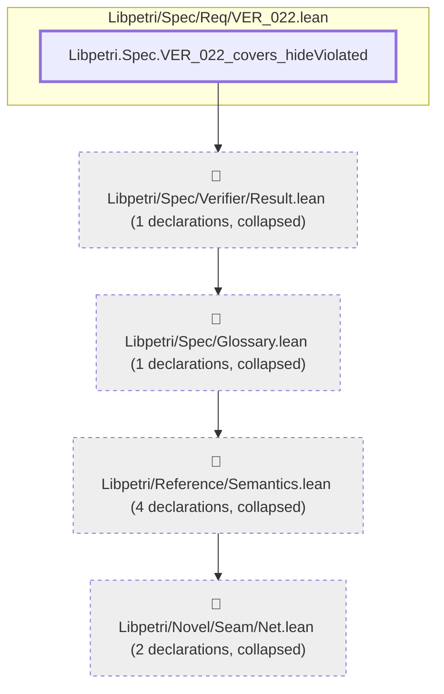

#### `Libpetri.Spec.VER_022_covers_hideViolated` → `Libpetri.Spec.OpenNet.Clause.name`

> Rule: this theorem's tree has 299 nodes, still 192 with other files collapsed, so it is split by direct dependency; this part has 3 nodes, other files collapsed.

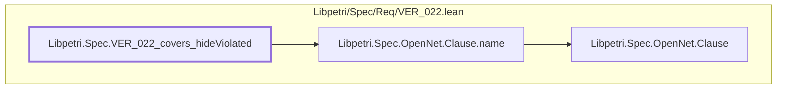

#### `Libpetri.Spec.VER_022_covers_hideViolated` → `Libpetri.Spec.OpenNet.ClauseHolds`

> Rule: this theorem's tree has 299 nodes, still 192 with other files collapsed, so it is split by direct dependency; this part has 11 nodes, other files collapsed.

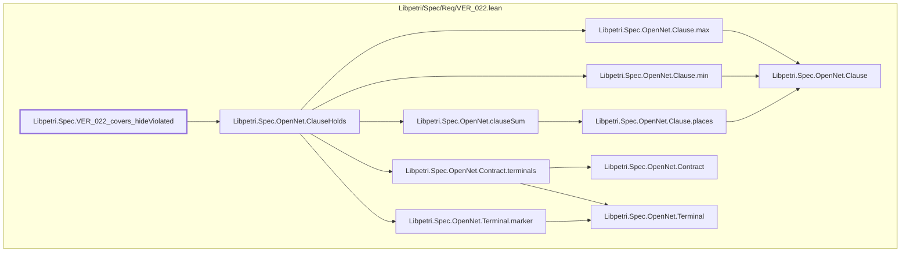

#### `Libpetri.Spec.VER_022_covers_hideViolated` → `Libpetri.Spec.OpenNet.Closed.envPlaces`

> Rule: this theorem's tree has 299 nodes, still 192 with other files collapsed, so it is split by direct dependency; this part has 3 nodes, other files collapsed.


#### `Libpetri.Spec.VER_022_covers_hideViolated` → `Libpetri.Spec.OpenNet.Closed.m0`

> Rule: this theorem's tree has 299 nodes, still 192 with other files collapsed, so it is split by direct dependency; this part has 4 nodes, other files collapsed.

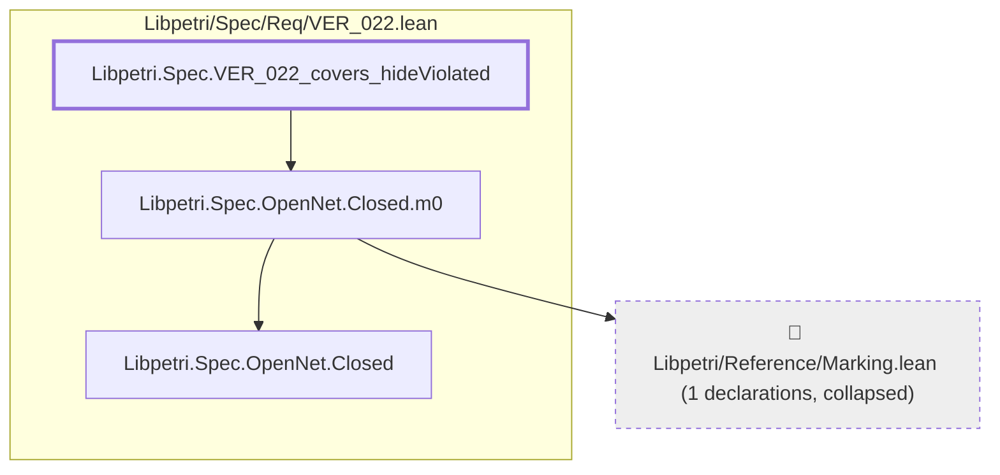

#### `Libpetri.Spec.VER_022_covers_hideViolated` → `Libpetri.Spec.OpenNet.Closed.net`

> Rule: this theorem's tree has 299 nodes, still 192 with other files collapsed, so it is split by direct dependency; this part has 4 nodes, other files collapsed.

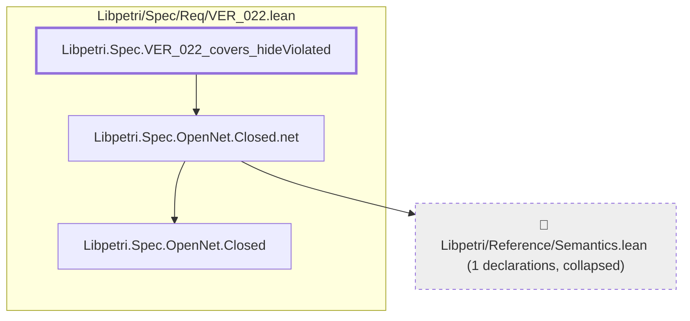

#### `Libpetri.Spec.VER_022_covers_hideViolated` → `Libpetri.Spec.OpenNet.Contract.clauses`

> Rule: this theorem's tree has 299 nodes, still 192 with other files collapsed, so it is split by direct dependency; this part has 4 nodes, other files collapsed.

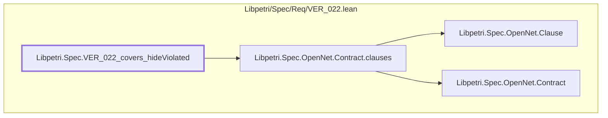

#### `Libpetri.Spec.VER_022_covers_hideViolated` → `Libpetri.Spec.OpenNet.Contract.env`

> Rule: this theorem's tree has 299 nodes, still 192 with other files collapsed, so it is split by direct dependency; this part has 4 nodes, other files collapsed.

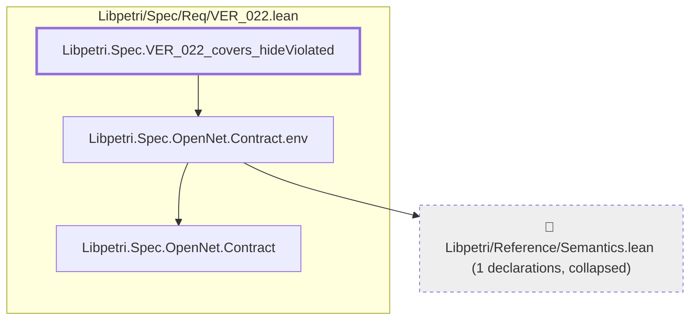

#### `Libpetri.Spec.VER_022_covers_hideViolated` → `Libpetri.Spec.OpenNet.Contract.groups`

> Rule: this theorem's tree has 299 nodes, still 192 with other files collapsed, so it is split by direct dependency; this part has 4 nodes, other files collapsed.

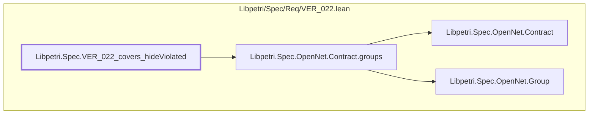

#### `Libpetri.Spec.VER_022_covers_hideViolated` → `Libpetri.Spec.OpenNet.Contract.init`

> Rule: this theorem's tree has 299 nodes, still 192 with other files collapsed, so it is split by direct dependency; this part has 3 nodes, other files collapsed.

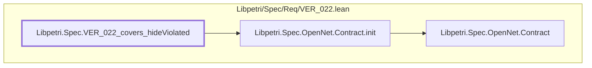

#### `Libpetri.Spec.VER_022_covers_hideViolated` → `Libpetri.Spec.OpenNet.Contract.mk`

> Rule: this theorem's tree has 299 nodes, still 192 with other files collapsed, so it is split by direct dependency; this part has 7 nodes, other files collapsed.

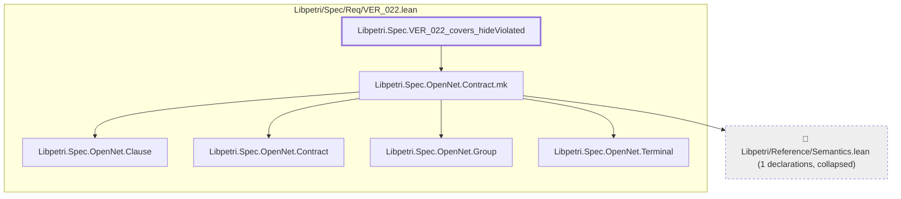

#### `Libpetri.Spec.VER_022_covers_hideViolated` → `Libpetri.Spec.OpenNet.Contract.rest`

> Rule: this theorem's tree has 299 nodes, still 192 with other files collapsed, so it is split by direct dependency; this part has 3 nodes, other files collapsed.

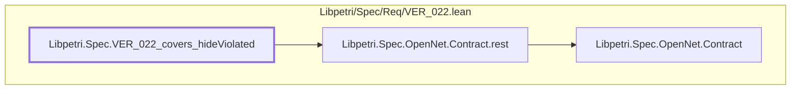

#### `Libpetri.Spec.VER_022_covers_hideViolated` → `Libpetri.Spec.OpenNet.Contract.terminals`

> Rule: this theorem's tree has 299 nodes, still 192 with other files collapsed, so it is split by direct dependency; this part has 4 nodes, other files collapsed.

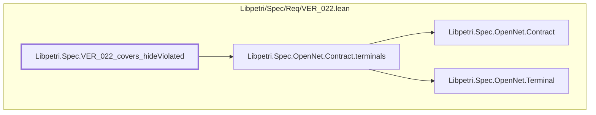

#### `Libpetri.Spec.VER_022_covers_hideViolated` → `Libpetri.Spec.OpenNet.Contract.terminate`

> Rule: this theorem's tree has 299 nodes, still 192 with other files collapsed, so it is split by direct dependency; this part has 3 nodes, other files collapsed.

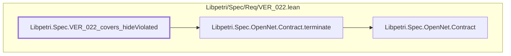

#### `Libpetri.Spec.VER_022_covers_hideViolated` → `Libpetri.Spec.OpenNet.GraphCloses`

> Rule: this theorem's tree has 299 nodes, still 192 with other files collapsed, so it is split by direct dependency; this part has 18 nodes, other files collapsed.

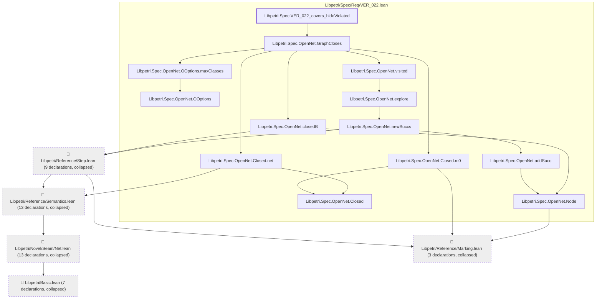

#### `Libpetri.Spec.VER_022_covers_hideViolated` → `Libpetri.Spec.OpenNet.OOptions.assumeNoReaping`

> Rule: this theorem's tree has 299 nodes, still 192 with other files collapsed, so it is split by direct dependency; this part has 3 nodes, other files collapsed.

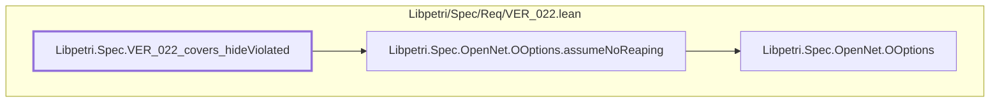

#### `Libpetri.Spec.VER_022_covers_hideViolated` → `Libpetri.Spec.OpenNet.OOptions.maxClasses`

> Rule: this theorem's tree has 299 nodes, still 192 with other files collapsed, so it is split by direct dependency; this part has 3 nodes, other files collapsed.

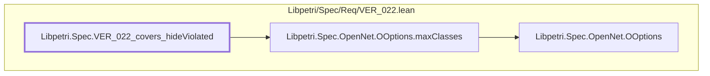

#### `Libpetri.Spec.VER_022_covers_hideViolated` → `Libpetri.Spec.OpenNet.OOptions.mk`

> Rule: this theorem's tree has 299 nodes, still 192 with other files collapsed, so it is split by direct dependency; this part has 3 nodes, other files collapsed.

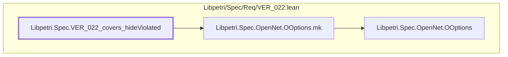

#### `Libpetri.Spec.VER_022_covers_hideViolated` → `Libpetri.Spec.OpenNet.OResult.mk`

> Rule: this theorem's tree has 299 nodes, still 192 with other files collapsed, so it is split by direct dependency; this part has 5 nodes, other files collapsed.

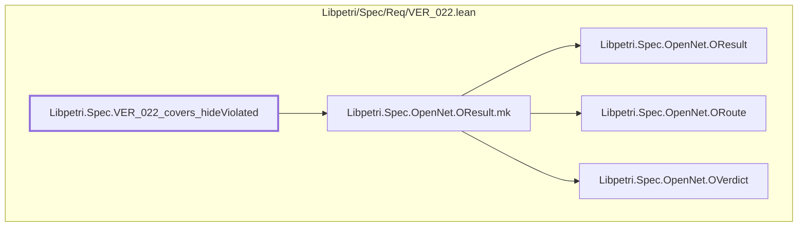

#### `Libpetri.Spec.VER_022_covers_hideViolated` → `Libpetri.Spec.OpenNet.OResult.route`

> Rule: this theorem's tree has 299 nodes, still 192 with other files collapsed, so it is split by direct dependency; this part has 4 nodes, other files collapsed.

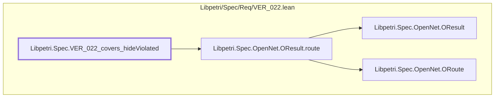

#### `Libpetri.Spec.VER_022_covers_hideViolated` → `Libpetri.Spec.OpenNet.OResult.verdict`

> Rule: this theorem's tree has 299 nodes, still 192 with other files collapsed, so it is split by direct dependency; this part has 4 nodes, other files collapsed.

```mermaid
flowchart TD
  subgraph g0["Libpetri/Spec/Req/VER_022.lean"]
    n9443["Libpetri.Spec.OpenNet.OResult"]
    n9446["Libpetri.Spec.OpenNet.OResult.verdict"]
    n9452["Libpetri.Spec.OpenNet.OVerdict"]
    n10974["Libpetri.Spec.VER_022_covers_hideViolated"]
  end
  n9446 --> n9443
  n9446 --> n9452
  n10974 --> n9446
  classDef root stroke-width:3px
  classDef locked fill:#fff3cd,stroke:#b8860b
  classDef collapsed fill:#eeeeee,stroke-dasharray:4 4
  class n10974 root
```

#### `Libpetri.Spec.VER_022_covers_hideViolated` → `Libpetri.Spec.OpenNet.ORoute.enumeration`

> Rule: this theorem's tree has 299 nodes, still 192 with other files collapsed, so it is split by direct dependency; this part has 3 nodes, other files collapsed.

```mermaid
flowchart TD
  subgraph g0["Libpetri/Spec/Req/VER_022.lean"]
    n9447["Libpetri.Spec.OpenNet.ORoute"]
    n9448["Libpetri.Spec.OpenNet.ORoute.enumeration"]
    n10974["Libpetri.Spec.VER_022_covers_hideViolated"]
  end
  n9448 --> n9447
  n10974 --> n9448
  classDef root stroke-width:3px
  classDef locked fill:#fff3cd,stroke:#b8860b
  classDef collapsed fill:#eeeeee,stroke-dasharray:4 4
  class n10974 root
```

#### `Libpetri.Spec.VER_022_covers_hideViolated` → `Libpetri.Spec.OpenNet.ORoute.smt`

> Rule: this theorem's tree has 299 nodes, still 192 with other files collapsed, so it is split by direct dependency; this part has 3 nodes, other files collapsed.

```mermaid
flowchart TD
  subgraph g0["Libpetri/Spec/Req/VER_022.lean"]
    n9447["Libpetri.Spec.OpenNet.ORoute"]
    n9451["Libpetri.Spec.OpenNet.ORoute.smt"]
    n10974["Libpetri.Spec.VER_022_covers_hideViolated"]
  end
  n9451 --> n9447
  n10974 --> n9451
  classDef root stroke-width:3px
  classDef locked fill:#fff3cd,stroke:#b8860b
  classDef collapsed fill:#eeeeee,stroke-dasharray:4 4
  class n10974 root
```

#### `Libpetri.Spec.VER_022_covers_hideViolated` → `Libpetri.Spec.OpenNet.OVerdict.proven`

> Rule: this theorem's tree has 299 nodes, still 192 with other files collapsed, so it is split by direct dependency; this part has 3 nodes, other files collapsed.

```mermaid
flowchart TD
  subgraph g0["Libpetri/Spec/Req/VER_022.lean"]
    n9452["Libpetri.Spec.OpenNet.OVerdict"]
    n9453["Libpetri.Spec.OpenNet.OVerdict.proven"]
    n10974["Libpetri.Spec.VER_022_covers_hideViolated"]
  end
  n9453 --> n9452
  n10974 --> n9453
  classDef root stroke-width:3px
  classDef locked fill:#fff3cd,stroke:#b8860b
  classDef collapsed fill:#eeeeee,stroke-dasharray:4 4
  class n10974 root
```

#### `Libpetri.Spec.VER_022_covers_hideViolated` → `Libpetri.Spec.OpenNet.OVerdict.unknown`

> Rule: this theorem's tree has 299 nodes, still 192 with other files collapsed, so it is split by direct dependency; this part has 3 nodes, other files collapsed.

```mermaid
flowchart TD
  subgraph g0["Libpetri/Spec/Req/VER_022.lean"]
    n9452["Libpetri.Spec.OpenNet.OVerdict"]
    n9454["Libpetri.Spec.OpenNet.OVerdict.unknown"]
    n10974["Libpetri.Spec.VER_022_covers_hideViolated"]
  end
  n9454 --> n9452
  n10974 --> n9454
  classDef root stroke-width:3px
  classDef locked fill:#fff3cd,stroke:#b8860b
  classDef collapsed fill:#eeeeee,stroke-dasharray:4 4
  class n10974 root
```

#### `Libpetri.Spec.VER_022_covers_hideViolated` → `Libpetri.Spec.OpenNet.OVerdict.violated`

> Rule: this theorem's tree has 299 nodes, still 192 with other files collapsed, so it is split by direct dependency; this part has 4 nodes, other files collapsed.

```mermaid
flowchart TD
  subgraph g0["Libpetri/Spec/Req/VER_022.lean"]
    n9452["Libpetri.Spec.OpenNet.OVerdict"]
    n9455["Libpetri.Spec.OpenNet.OVerdict.violated"]
    n9471["Libpetri.Spec.OpenNet.Witness"]
    n10974["Libpetri.Spec.VER_022_covers_hideViolated"]
  end
  n9455 --> n9452
  n9455 --> n9471
  n10974 --> n9455
  classDef root stroke-width:3px
  classDef locked fill:#fff3cd,stroke:#b8860b
  classDef collapsed fill:#eeeeee,stroke-dasharray:4 4
  class n10974 root
```

#### `Libpetri.Spec.VER_022_covers_hideViolated` → `Libpetri.Spec.OpenNet.OpenSubnet.hasMatch`

> Rule: this theorem's tree has 299 nodes, still 192 with other files collapsed, so it is split by direct dependency; this part has 3 nodes, other files collapsed.

```mermaid
flowchart TD
  subgraph g0["Libpetri/Spec/Req/VER_022.lean"]
    n9456["Libpetri.Spec.OpenNet.OpenSubnet"]
    n9457["Libpetri.Spec.OpenNet.OpenSubnet.hasMatch"]
    n10974["Libpetri.Spec.VER_022_covers_hideViolated"]
  end
  n9457 --> n9456
  n10974 --> n9457
  classDef root stroke-width:3px
  classDef locked fill:#fff3cd,stroke:#b8860b
  classDef collapsed fill:#eeeeee,stroke-dasharray:4 4
  class n10974 root
```

#### `Libpetri.Spec.VER_022_covers_hideViolated` → `Libpetri.Spec.OpenNet.OpenSubnet.mk`

> Rule: this theorem's tree has 299 nodes, still 192 with other files collapsed, so it is split by direct dependency; this part has 4 nodes, other files collapsed.

```mermaid
flowchart TD
  subgraph g0["Libpetri/Spec/Req/VER_022.lean"]
    n9456["Libpetri.Spec.OpenNet.OpenSubnet"]
    n9458["Libpetri.Spec.OpenNet.OpenSubnet.mk"]
    n10974["Libpetri.Spec.VER_022_covers_hideViolated"]
  end
  c94["📁 Libpetri/Reference/Semantics.lean (1 declarations, collapsed)"]
  n9458 --> c94
  n9458 --> n9456
  n10974 --> n9458
  classDef root stroke-width:3px
  classDef locked fill:#fff3cd,stroke:#b8860b
  classDef collapsed fill:#eeeeee,stroke-dasharray:4 4
  class n10974 root
  class c94 collapsed
```

#### `Libpetri.Spec.VER_022_covers_hideViolated` → `Libpetri.Spec.OpenNet.OpenSubnet.net`

> Rule: this theorem's tree has 299 nodes, still 192 with other files collapsed, so it is split by direct dependency; this part has 4 nodes, other files collapsed.

```mermaid
flowchart TD
  subgraph g0["Libpetri/Spec/Req/VER_022.lean"]
    n9456["Libpetri.Spec.OpenNet.OpenSubnet"]
    n9459["Libpetri.Spec.OpenNet.OpenSubnet.net"]
    n10974["Libpetri.Spec.VER_022_covers_hideViolated"]
  end
  c94["📁 Libpetri/Reference/Semantics.lean (1 declarations, collapsed)"]
  n9459 --> c94
  n9459 --> n9456
  n10974 --> n9459
  classDef root stroke-width:3px
  classDef locked fill:#fff3cd,stroke:#b8860b
  classDef collapsed fill:#eeeeee,stroke-dasharray:4 4
  class n10974 root
  class c94 collapsed
```

#### `Libpetri.Spec.VER_022_covers_hideViolated` → `Libpetri.Spec.OpenNet.Part.clause`

> Rule: this theorem's tree has 299 nodes, still 192 with other files collapsed, so it is split by direct dependency; this part has 3 nodes, other files collapsed.

```mermaid
flowchart TD
  subgraph g0["Libpetri/Spec/Req/VER_022.lean"]
    n9462["Libpetri.Spec.OpenNet.Part"]
    n9463["Libpetri.Spec.OpenNet.Part.clause"]
    n10974["Libpetri.Spec.VER_022_covers_hideViolated"]
  end
  n9463 --> n9462
  n10974 --> n9463
  classDef root stroke-width:3px
  classDef locked fill:#fff3cd,stroke:#b8860b
  classDef collapsed fill:#eeeeee,stroke-dasharray:4 4
  class n10974 root
```

#### `Libpetri.Spec.VER_022_covers_hideViolated` → `Libpetri.Spec.OpenNet.Part.stranded`

> Rule: this theorem's tree has 299 nodes, still 192 with other files collapsed, so it is split by direct dependency; this part has 3 nodes, other files collapsed.

```mermaid
flowchart TD
  subgraph g0["Libpetri/Spec/Req/VER_022.lean"]
    n9462["Libpetri.Spec.OpenNet.Part"]
    n9464["Libpetri.Spec.OpenNet.Part.stranded"]
    n10974["Libpetri.Spec.VER_022_covers_hideViolated"]
  end
  n9464 --> n9462
  n10974 --> n9464
  classDef root stroke-width:3px
  classDef locked fill:#fff3cd,stroke:#b8860b
  classDef collapsed fill:#eeeeee,stroke-dasharray:4 4
  class n10974 root
```

#### `Libpetri.Spec.VER_022_covers_hideViolated` → `Libpetri.Spec.OpenNet.Part.termination`

> Rule: this theorem's tree has 299 nodes, still 192 with other files collapsed, so it is split by direct dependency; this part has 3 nodes, other files collapsed.

```mermaid
flowchart TD
  subgraph g0["Libpetri/Spec/Req/VER_022.lean"]
    n9462["Libpetri.Spec.OpenNet.Part"]
    n9465["Libpetri.Spec.OpenNet.Part.termination"]
    n10974["Libpetri.Spec.VER_022_covers_hideViolated"]
  end
  n9465 --> n9462
  n10974 --> n9465
  classDef root stroke-width:3px
  classDef locked fill:#fff3cd,stroke:#b8860b
  classDef collapsed fill:#eeeeee,stroke-dasharray:4 4
  class n10974 root
```

#### `Libpetri.Spec.VER_022_covers_hideViolated` → `Libpetri.Spec.OpenNet.Quiet`

> Rule: this theorem's tree has 299 nodes, still 192 with other files collapsed, so it is split by direct dependency; this part has 7 nodes, other files collapsed.

```mermaid
flowchart TD
  subgraph g0["Libpetri/Spec/Req/VER_022.lean"]
    n9438["Libpetri.Spec.OpenNet.OOptions"]
    n9439["Libpetri.Spec.OpenNet.OOptions.assumeNoReaping"]
    n9466["Libpetri.Spec.OpenNet.Quiet"]
    n10974["Libpetri.Spec.VER_022_covers_hideViolated"]
  end
  c0["📁 Libpetri/Basic.lean (6 declarations, collapsed)"]
  c54["📁 Libpetri/Novel/Seam/Net.lean (8 declarations, collapsed)"]
  c94["📁 Libpetri/Reference/Semantics.lean (5 declarations, collapsed)"]
  c54 --> c0
  c94 --> c54
  n9439 --> n9438
  n9466 --> c94
  n9466 --> n9439
  n10974 --> n9466
  classDef root stroke-width:3px
  classDef locked fill:#fff3cd,stroke:#b8860b
  classDef collapsed fill:#eeeeee,stroke-dasharray:4 4
  class n10974 root
  class c0,c54,c94 collapsed
```

#### `Libpetri.Spec.VER_022_covers_hideViolated` → `Libpetri.Spec.OpenNet.Witness.confirmed`

> Rule: this theorem's tree has 299 nodes, still 192 with other files collapsed, so it is split by direct dependency; this part has 3 nodes, other files collapsed.

```mermaid
flowchart TD
  subgraph g0["Libpetri/Spec/Req/VER_022.lean"]
    n9471["Libpetri.Spec.OpenNet.Witness"]
    n9472["Libpetri.Spec.OpenNet.Witness.confirmed"]
    n10974["Libpetri.Spec.VER_022_covers_hideViolated"]
  end
  n9472 --> n9471
  n10974 --> n9472
  classDef root stroke-width:3px
  classDef locked fill:#fff3cd,stroke:#b8860b
  classDef collapsed fill:#eeeeee,stroke-dasharray:4 4
  class n10974 root
```

#### `Libpetri.Spec.VER_022_covers_hideViolated` → `Libpetri.Spec.OpenNet.Witness.cycleStart`

> Rule: this theorem's tree has 299 nodes, still 192 with other files collapsed, so it is split by direct dependency; this part has 3 nodes, other files collapsed.

```mermaid
flowchart TD
  subgraph g0["Libpetri/Spec/Req/VER_022.lean"]
    n9471["Libpetri.Spec.OpenNet.Witness"]
    n9473["Libpetri.Spec.OpenNet.Witness.cycleStart"]
    n10974["Libpetri.Spec.VER_022_covers_hideViolated"]
  end
  n9473 --> n9471
  n10974 --> n9473
  classDef root stroke-width:3px
  classDef locked fill:#fff3cd,stroke:#b8860b
  classDef collapsed fill:#eeeeee,stroke-dasharray:4 4
  class n10974 root
```

#### `Libpetri.Spec.VER_022_covers_hideViolated` → `Libpetri.Spec.OpenNet.Witness.endM`

> Rule: this theorem's tree has 299 nodes, still 192 with other files collapsed, so it is split by direct dependency; this part has 4 nodes, other files collapsed.

```mermaid
flowchart TD
  subgraph g0["Libpetri/Spec/Req/VER_022.lean"]
    n9471["Libpetri.Spec.OpenNet.Witness"]
    n9474["Libpetri.Spec.OpenNet.Witness.endM"]
    n10974["Libpetri.Spec.VER_022_covers_hideViolated"]
  end
  c86["📁 Libpetri/Reference/Marking.lean (1 declarations, collapsed)"]
  n9474 --> c86
  n9474 --> n9471
  n10974 --> n9474
  classDef root stroke-width:3px
  classDef locked fill:#fff3cd,stroke:#b8860b
  classDef collapsed fill:#eeeeee,stroke-dasharray:4 4
  class n10974 root
  class c86 collapsed
```

#### `Libpetri.Spec.VER_022_covers_hideViolated` → `Libpetri.Spec.OpenNet.Witness.mk`

> Rule: this theorem's tree has 299 nodes, still 192 with other files collapsed, so it is split by direct dependency; this part has 5 nodes, other files collapsed.

```mermaid
flowchart TD
  subgraph g0["Libpetri/Spec/Req/VER_022.lean"]
    n9462["Libpetri.Spec.OpenNet.Part"]
    n9471["Libpetri.Spec.OpenNet.Witness"]
    n9475["Libpetri.Spec.OpenNet.Witness.mk"]
    n10974["Libpetri.Spec.VER_022_covers_hideViolated"]
  end
  c86["📁 Libpetri/Reference/Marking.lean (1 declarations, collapsed)"]
  n9475 --> c86
  n9475 --> n9462
  n9475 --> n9471
  n10974 --> n9475
  classDef root stroke-width:3px
  classDef locked fill:#fff3cd,stroke:#b8860b
  classDef collapsed fill:#eeeeee,stroke-dasharray:4 4
  class n10974 root
  class c86 collapsed
```

#### `Libpetri.Spec.VER_022_covers_hideViolated` → `Libpetri.Spec.OpenNet.Witness.part`

> Rule: this theorem's tree has 299 nodes, still 192 with other files collapsed, so it is split by direct dependency; this part has 4 nodes, other files collapsed.

```mermaid
flowchart TD
  subgraph g0["Libpetri/Spec/Req/VER_022.lean"]
    n9462["Libpetri.Spec.OpenNet.Part"]
    n9471["Libpetri.Spec.OpenNet.Witness"]
    n9476["Libpetri.Spec.OpenNet.Witness.part"]
    n10974["Libpetri.Spec.VER_022_covers_hideViolated"]
  end
  n9476 --> n9462
  n9476 --> n9471
  n10974 --> n9476
  classDef root stroke-width:3px
  classDef locked fill:#fff3cd,stroke:#b8860b
  classDef collapsed fill:#eeeeee,stroke-dasharray:4 4
  class n10974 root
```

#### `Libpetri.Spec.VER_022_covers_hideViolated` → `Libpetri.Spec.OpenNet.Witness.trace`

> Rule: this theorem's tree has 299 nodes, still 192 with other files collapsed, so it is split by direct dependency; this part has 3 nodes, other files collapsed.

```mermaid
flowchart TD
  subgraph g0["Libpetri/Spec/Req/VER_022.lean"]
    n9471["Libpetri.Spec.OpenNet.Witness"]
    n9477["Libpetri.Spec.OpenNet.Witness.trace"]
    n10974["Libpetri.Spec.VER_022_covers_hideViolated"]
  end
  n9477 --> n9471
  n10974 --> n9477
  classDef root stroke-width:3px
  classDef locked fill:#fff3cd,stroke:#b8860b
  classDef collapsed fill:#eeeeee,stroke-dasharray:4 4
  class n10974 root
```

#### `Libpetri.Spec.VER_022_covers_hideViolated` → `Libpetri.Spec.OpenNet.arrC`

> Rule: this theorem's tree has 299 nodes, still 192 with other files collapsed, so it is split by direct dependency; this part has 10 nodes, other files collapsed.

```mermaid
flowchart TD
  subgraph g0["Libpetri/Spec/Req/VER_022.lean"]
    n9404["Libpetri.Spec.OpenNet.Clause"]
    n9407["Libpetri.Spec.OpenNet.Clause.mk"]
    n9419["Libpetri.Spec.OpenNet.Contract"]
    n9424["Libpetri.Spec.OpenNet.Contract.mk"]
    n9431["Libpetri.Spec.OpenNet.Group"]
    n9434["Libpetri.Spec.OpenNet.Group.mk"]
    n9467["Libpetri.Spec.OpenNet.Terminal"]
    n9481["Libpetri.Spec.OpenNet.arrC"]
    n10974["Libpetri.Spec.VER_022_covers_hideViolated"]
  end
  c94["📁 Libpetri/Reference/Semantics.lean (1 declarations, collapsed)"]
  n9407 --> n9404
  n9424 --> c94
  n9424 --> n9404
  n9424 --> n9419
  n9424 --> n9431
  n9424 --> n9467
  n9434 --> n9431
  n9481 --> n9407
  n9481 --> n9424
  n9481 --> n9434
  n10974 --> n9481
  classDef root stroke-width:3px
  classDef locked fill:#fff3cd,stroke:#b8860b
  classDef collapsed fill:#eeeeee,stroke-dasharray:4 4
  class n10974 root
  class c94 collapsed
```

#### `Libpetri.Spec.VER_022_covers_hideViolated` → `Libpetri.Spec.OpenNet.closedB`

> Rule: this theorem's tree has 299 nodes, still 192 with other files collapsed, so it is split by direct dependency; this part has 8 nodes, other files collapsed.

```mermaid
flowchart TD
  subgraph g0["Libpetri/Spec/Req/VER_022.lean"]
    n9437["Libpetri.Spec.OpenNet.Node"]
    n9497["Libpetri.Spec.OpenNet.closedB"]
    n10974["Libpetri.Spec.VER_022_covers_hideViolated"]
  end
  c0["📁 Libpetri/Basic.lean (7 declarations, collapsed)"]
  c54["📁 Libpetri/Novel/Seam/Net.lean (13 declarations, collapsed)"]
  c86["📁 Libpetri/Reference/Marking.lean (3 declarations, collapsed)"]
  c94["📁 Libpetri/Reference/Semantics.lean (13 declarations, collapsed)"]
  c96["📁 Libpetri/Reference/Step.lean (9 declarations, collapsed)"]
  c54 --> c0
  c94 --> c54
  c96 --> c86
  c96 --> c94
  n9437 --> c86
  n9497 --> c96
  n9497 --> n9437
  n10974 --> n9497
  classDef root stroke-width:3px
  classDef locked fill:#fff3cd,stroke:#b8860b
  classDef collapsed fill:#eeeeee,stroke-dasharray:4 4
  class n10974 root
  class c0,c54,c86,c94,c96 collapsed
```

#### `Libpetri.Spec.VER_022_covers_hideViolated` → `Libpetri.Spec.OpenNet.idleNet`

> Rule: this theorem's tree has 299 nodes, still 192 with other files collapsed, so it is split by direct dependency; this part has 3 nodes, other files collapsed.

```mermaid
flowchart TD
  subgraph g0["Libpetri/Spec/Req/VER_022.lean"]
    n9537["Libpetri.Spec.OpenNet.idleNet"]
    n10974["Libpetri.Spec.VER_022_covers_hideViolated"]
  end
  c94["📁 Libpetri/Reference/Semantics.lean (3 declarations, collapsed)"]
  n9537 --> c94
  n10974 --> n9537
  classDef root stroke-width:3px
  classDef locked fill:#fff3cd,stroke:#b8860b
  classDef collapsed fill:#eeeeee,stroke-dasharray:4 4
  class n10974 root
  class c94 collapsed
```

#### `Libpetri.Spec.VER_022_covers_hideViolated` → `Libpetri.Spec.OpenNet.ok_of_toOption`

> Rule: this theorem's tree has 299 nodes, still 192 with other files collapsed, so it is split by direct dependency; this part has 3 nodes, other files collapsed.

```mermaid
flowchart TD
  subgraph g0["Libpetri/Spec/Req/VER_022.lean"]
    n9443["Libpetri.Spec.OpenNet.OResult"]
    n9577["Libpetri.Spec.OpenNet.ok_of_toOption"]
    n10974["Libpetri.Spec.VER_022_covers_hideViolated"]
  end
  n9577 --> n9443
  n10974 --> n9577
  classDef root stroke-width:3px
  classDef locked fill:#fff3cd,stroke:#b8860b
  classDef collapsed fill:#eeeeee,stroke-dasharray:4 4
  class n10974 root
```

#### `Libpetri.Spec.VER_022_covers_hideViolated` → `Libpetri.Spec.OpenNet.orderC`

> Rule: this theorem's tree has 299 nodes, still 192 with other files collapsed, so it is split by direct dependency; this part has 8 nodes, other files collapsed.

```mermaid
flowchart TD
  subgraph g0["Libpetri/Spec/Req/VER_022.lean"]
    n9404["Libpetri.Spec.OpenNet.Clause"]
    n9419["Libpetri.Spec.OpenNet.Contract"]
    n9424["Libpetri.Spec.OpenNet.Contract.mk"]
    n9431["Libpetri.Spec.OpenNet.Group"]
    n9467["Libpetri.Spec.OpenNet.Terminal"]
    n9580["Libpetri.Spec.OpenNet.orderC"]
    n10974["Libpetri.Spec.VER_022_covers_hideViolated"]
  end
  c94["📁 Libpetri/Reference/Semantics.lean (1 declarations, collapsed)"]
  n9424 --> c94
  n9424 --> n9404
  n9424 --> n9419
  n9424 --> n9431
  n9424 --> n9467
  n9580 --> n9424
  n10974 --> n9580
  classDef root stroke-width:3px
  classDef locked fill:#fff3cd,stroke:#b8860b
  classDef collapsed fill:#eeeeee,stroke-dasharray:4 4
  class n10974 root
  class c94 collapsed
```

#### `Libpetri.Spec.VER_022_covers_hideViolated` → `Libpetri.Spec.OpenNet.refClose`

> Rule: this theorem's tree has 299 nodes, still 192 with other files collapsed, so it is split by direct dependency; this part has 52 nodes, other files collapsed.

```mermaid
flowchart TD
  subgraph g0["Libpetri/Spec/Req/VER_022.lean"]
    n9404["Libpetri.Spec.OpenNet.Clause"]
    n9409["Libpetri.Spec.OpenNet.Clause.places"]
    n9412["Libpetri.Spec.OpenNet.CloseFn"]
    n9413["Libpetri.Spec.OpenNet.Closed"]
    n9417["Libpetri.Spec.OpenNet.Closed.mk"]
    n9419["Libpetri.Spec.OpenNet.Contract"]
    n9420["Libpetri.Spec.OpenNet.Contract.clauses"]
    n9421["Libpetri.Spec.OpenNet.Contract.env"]
    n9422["Libpetri.Spec.OpenNet.Contract.groups"]
    n9423["Libpetri.Spec.OpenNet.Contract.init"]
    n9425["Libpetri.Spec.OpenNet.Contract.rest"]
    n9426["Libpetri.Spec.OpenNet.Contract.terminals"]
    n9431["Libpetri.Spec.OpenNet.Group"]
    n9432["Libpetri.Spec.OpenNet.Group.max"]
    n9433["Libpetri.Spec.OpenNet.Group.min"]
    n9435["Libpetri.Spec.OpenNet.Group.places"]
    n9467["Libpetri.Spec.OpenNet.Terminal"]
    n9468["Libpetri.Spec.OpenNet.Terminal.excused"]
    n9469["Libpetri.Spec.OpenNet.Terminal.marker"]
    n9482["Libpetri.Spec.OpenNet.arrName"]
    n9486["Libpetri.Spec.OpenNet.claims"]
    n9495["Libpetri.Spec.OpenNet.closeNet"]
    n9499["Libpetri.Spec.OpenNet.closureNames"]
    n9500["Libpetri.Spec.OpenNet.closureSources"]
    n9501["Libpetri.Spec.OpenNet.closureTrans"]
    n9505["Libpetri.Spec.OpenNet.contractNamed"]
    n9509["Libpetri.Spec.OpenNet.declName"]
    n9510["Libpetri.Spec.OpenNet.envNames"]
    n9511["Libpetri.Spec.OpenNet.envPlacesOf"]
    n9518["Libpetri.Spec.OpenNet.freshFails"]
    n9532["Libpetri.Spec.OpenNet.groupNames"]
    n9533["Libpetri.Spec.OpenNet.groupSources"]
    n9534["Libpetri.Spec.OpenNet.groupTrans"]
    n9562["Libpetri.Spec.OpenNet.manSrc"]
    n9568["Libpetri.Spec.OpenNet.moveT"]
    n9569["Libpetri.Spec.OpenNet.namesFrom"]
    n9570["Libpetri.Spec.OpenNet.netNames"]
    n9571["Libpetri.Spec.OpenNet.netPlaceNames"]
    n9576["Libpetri.Spec.OpenNet.nub"]
    n9578["Libpetri.Spec.OpenNet.optName"]
    n9579["Libpetri.Spec.OpenNet.optSrc"]
    n9581["Libpetri.Spec.OpenNet.outNames"]
    n9586["Libpetri.Spec.OpenNet.refClose"]
    n9605["Libpetri.Spec.OpenNet.sourcesFrom"]
    n9626["Libpetri.Spec.OpenNet.transFrom"]
    n9628["Libpetri.Spec.OpenNet.transPlaces"]
    n9631["Libpetri.Spec.OpenNet.undeclaredOf"]
    n10974["Libpetri.Spec.VER_022_covers_hideViolated"]
  end
  c0["📁 Libpetri/Basic.lean (2 declarations, collapsed)"]
  c54["📁 Libpetri/Novel/Seam/Net.lean (10 declarations, collapsed)"]
  c86["📁 Libpetri/Reference/Marking.lean (3 declarations, collapsed)"]
  c94["📁 Libpetri/Reference/Semantics.lean (15 declarations, collapsed)"]
  c54 --> c0
  c94 --> c54
  n9409 --> n9404
  n9412 --> c94
  n9412 --> n9413
  n9412 --> n9419
  n9417 --> c86
  n9417 --> c94
  n9417 --> n9413
  n9420 --> n9404
  n9420 --> n9419
  n9421 --> c94
  n9421 --> n9419
  n9422 --> n9419
  n9422 --> n9431
  n9423 --> n9419
  n9425 --> n9419
  n9426 --> n9419
  n9426 --> n9467
  n9432 --> n9431
  n9433 --> n9431
  n9435 --> n9431
  n9468 --> n9467
  n9469 --> n9467
  n9486 --> n9499
  n9486 --> n9510
  n9486 --> n9511
  n9495 --> n9417
  n9495 --> n9500
  n9495 --> n9501
  n9495 --> n9510
  n9495 --> n9631
  n9499 --> n9422
  n9499 --> n9569
  n9500 --> n9422
  n9500 --> n9605
  n9501 --> n9422
  n9501 --> n9626
  n9505 --> n9409
  n9505 --> n9420
  n9505 --> n9422
  n9505 --> n9423
  n9505 --> n9425
  n9505 --> n9426
  n9505 --> n9435
  n9505 --> n9468
  n9505 --> n9469
  n9510 --> n9421
  n9511 --> n9421
  n9511 --> n9571
  n9511 --> n9576
  n9532 --> n9432
  n9532 --> n9433
  n9532 --> n9435
  n9532 --> n9482
  n9532 --> n9509
  n9532 --> n9562
  n9532 --> n9578
  n9532 --> n9579
  n9533 --> n9432
  n9533 --> n9433
  n9533 --> n9562
  n9533 --> n9579
  n9534 --> n9432
  n9534 --> n9433
  n9534 --> n9435
  n9534 --> n9482
  n9534 --> n9509
  n9534 --> n9562
  n9534 --> n9568
  n9534 --> n9578
  n9534 --> n9579
  n9568 --> c94
  n9569 --> n9532
  n9570 --> n9571
  n9571 --> n9628
  n9581 --> c94
  n9586 --> n9412
  n9586 --> n9486
  n9586 --> n9495
  n9586 --> n9518
  n9586 --> n9570
  n9605 --> n9533
  n9626 --> n9534
  n9628 --> n9581
  n9631 --> n9505
  n9631 --> n9511
  n10974 --> n9586
  classDef root stroke-width:3px
  classDef locked fill:#fff3cd,stroke:#b8860b
  classDef collapsed fill:#eeeeee,stroke-dasharray:4 4
  class n10974 root
  class c0,c54,c86,c94 collapsed
```

#### `Libpetri.Spec.VER_022_covers_hideViolated` → `Libpetri.Spec.OpenNet.refMeets`

> Rule: this theorem's tree has 299 nodes, still 192 with other files collapsed, so it is split by direct dependency; this part has 21 nodes, other files collapsed.

```mermaid
flowchart TD
  subgraph g0["Libpetri/Spec/Req/VER_022.lean"]
    n9404["Libpetri.Spec.OpenNet.Clause"]
    n9405["Libpetri.Spec.OpenNet.Clause.max"]
    n9406["Libpetri.Spec.OpenNet.Clause.min"]
    n9409["Libpetri.Spec.OpenNet.Clause.places"]
    n9410["Libpetri.Spec.OpenNet.ClauseHolds"]
    n9419["Libpetri.Spec.OpenNet.Contract"]
    n9420["Libpetri.Spec.OpenNet.Contract.clauses"]
    n9425["Libpetri.Spec.OpenNet.Contract.rest"]
    n9426["Libpetri.Spec.OpenNet.Contract.terminals"]
    n9436["Libpetri.Spec.OpenNet.MeetsRel"]
    n9467["Libpetri.Spec.OpenNet.Terminal"]
    n9468["Libpetri.Spec.OpenNet.Terminal.excused"]
    n9469["Libpetri.Spec.OpenNet.Terminal.marker"]
    n9490["Libpetri.Spec.OpenNet.clauseSum"]
    n9588["Libpetri.Spec.OpenNet.refMeets"]
    n9600["Libpetri.Spec.OpenNet.restCond"]
    n9601["Libpetri.Spec.OpenNet.restSinks"]
    n10974["Libpetri.Spec.VER_022_covers_hideViolated"]
  end
  c51["📁 Libpetri/Novel/Seam/Bad.lean (1 declarations, collapsed)"]
  c52["📁 Libpetri/Novel/Seam/Excuses.lean (5 declarations, collapsed)"]
  c351["📁 Libpetri/Spec/Req/VER_014.lean (2 declarations, collapsed)"]
  c51 --> c52
  c351 --> c51
  n9405 --> n9404
  n9406 --> n9404
  n9409 --> n9404
  n9410 --> n9405
  n9410 --> n9406
  n9410 --> n9426
  n9410 --> n9469
  n9410 --> n9490
  n9420 --> n9404
  n9420 --> n9419
  n9425 --> n9419
  n9426 --> n9419
  n9426 --> n9467
  n9436 --> n9419
  n9468 --> n9467
  n9469 --> n9467
  n9490 --> n9409
  n9588 --> c351
  n9588 --> n9410
  n9588 --> n9436
  n9588 --> n9600
  n9588 --> n9601
  n9600 --> c52
  n9600 --> n9426
  n9600 --> n9468
  n9600 --> n9469
  n9601 --> n9409
  n9601 --> n9420
  n9601 --> n9425
  n10974 --> n9588
  classDef root stroke-width:3px
  classDef locked fill:#fff3cd,stroke:#b8860b
  classDef collapsed fill:#eeeeee,stroke-dasharray:4 4
  class n10974 root
  class c51,c52,c351 collapsed
```

#### `Libpetri.Spec.VER_022_covers_hideViolated` → `Libpetri.Spec.OpenNet.refOpenVerify`

> Rule: this theorem's tree has 299 nodes, still 192 with other files collapsed, so it is split by direct dependency; this part has 118 nodes, other files collapsed.

```mermaid
flowchart TD
  subgraph g0["Libpetri/Spec/Req/VER_022.lean"]
    n9404["Libpetri.Spec.OpenNet.Clause"]
    n9405["Libpetri.Spec.OpenNet.Clause.max"]
    n9406["Libpetri.Spec.OpenNet.Clause.min"]
    n9408["Libpetri.Spec.OpenNet.Clause.name"]
    n9409["Libpetri.Spec.OpenNet.Clause.places"]
    n9412["Libpetri.Spec.OpenNet.CloseFn"]
    n9413["Libpetri.Spec.OpenNet.Closed"]
    n9414["Libpetri.Spec.OpenNet.Closed.envPlaces"]
    n9416["Libpetri.Spec.OpenNet.Closed.m0"]
    n9417["Libpetri.Spec.OpenNet.Closed.mk"]
    n9418["Libpetri.Spec.OpenNet.Closed.net"]
    n9419["Libpetri.Spec.OpenNet.Contract"]
    n9420["Libpetri.Spec.OpenNet.Contract.clauses"]
    n9421["Libpetri.Spec.OpenNet.Contract.env"]
    n9422["Libpetri.Spec.OpenNet.Contract.groups"]
    n9423["Libpetri.Spec.OpenNet.Contract.init"]
    n9425["Libpetri.Spec.OpenNet.Contract.rest"]
    n9426["Libpetri.Spec.OpenNet.Contract.terminals"]
    n9427["Libpetri.Spec.OpenNet.Contract.terminate"]
    n9431["Libpetri.Spec.OpenNet.Group"]
    n9432["Libpetri.Spec.OpenNet.Group.max"]
    n9433["Libpetri.Spec.OpenNet.Group.min"]
    n9435["Libpetri.Spec.OpenNet.Group.places"]
    n9437["Libpetri.Spec.OpenNet.Node"]
    n9438["Libpetri.Spec.OpenNet.OOptions"]
    n9439["Libpetri.Spec.OpenNet.OOptions.assumeNoReaping"]
    n9440["Libpetri.Spec.OpenNet.OOptions.maxClasses"]
    n9442["Libpetri.Spec.OpenNet.OOptions.smt"]
    n9443["Libpetri.Spec.OpenNet.OResult"]
    n9444["Libpetri.Spec.OpenNet.OResult.mk"]
    n9447["Libpetri.Spec.OpenNet.ORoute"]
    n9448["Libpetri.Spec.OpenNet.ORoute.enumeration"]
    n9451["Libpetri.Spec.OpenNet.ORoute.smt"]
    n9452["Libpetri.Spec.OpenNet.OVerdict"]
    n9453["Libpetri.Spec.OpenNet.OVerdict.proven"]
    n9454["Libpetri.Spec.OpenNet.OVerdict.unknown"]
    n9455["Libpetri.Spec.OpenNet.OVerdict.violated"]
    n9456["Libpetri.Spec.OpenNet.OpenSubnet"]
    n9457["Libpetri.Spec.OpenNet.OpenSubnet.hasMatch"]
    n9459["Libpetri.Spec.OpenNet.OpenSubnet.net"]
    n9460["Libpetri.Spec.OpenNet.OpenVerifier"]
    n9461["Libpetri.Spec.OpenNet.PNode"]
    n9462["Libpetri.Spec.OpenNet.Part"]
    n9463["Libpetri.Spec.OpenNet.Part.clause"]
    n9464["Libpetri.Spec.OpenNet.Part.stranded"]
    n9465["Libpetri.Spec.OpenNet.Part.termination"]
    n9467["Libpetri.Spec.OpenNet.Terminal"]
    n9468["Libpetri.Spec.OpenNet.Terminal.excused"]
    n9469["Libpetri.Spec.OpenNet.Terminal.marker"]
    n9471["Libpetri.Spec.OpenNet.Witness"]
    n9475["Libpetri.Spec.OpenNet.Witness.mk"]
    n9478["Libpetri.Spec.OpenNet.addSucc"]
    n9482["Libpetri.Spec.OpenNet.arrName"]
    n9483["Libpetri.Spec.OpenNet.canonB"]
    n9486["Libpetri.Spec.OpenNet.claims"]
    n9488["Libpetri.Spec.OpenNet.clauseHoldsB"]
    n9490["Libpetri.Spec.OpenNet.clauseSum"]
    n9492["Libpetri.Spec.OpenNet.clauseWit"]
    n9495["Libpetri.Spec.OpenNet.closeNet"]
    n9497["Libpetri.Spec.OpenNet.closedB"]
    n9499["Libpetri.Spec.OpenNet.closureNames"]
    n9500["Libpetri.Spec.OpenNet.closureSources"]
    n9501["Libpetri.Spec.OpenNet.closureTrans"]
    n9502["Libpetri.Spec.OpenNet.confirmB"]
    n9505["Libpetri.Spec.OpenNet.contractNamed"]
    n9506["Libpetri.Spec.OpenNet.ddAdd"]
    n9509["Libpetri.Spec.OpenNet.declName"]
    n9510["Libpetri.Spec.OpenNet.envNames"]
    n9511["Libpetri.Spec.OpenNet.envPlacesOf"]
    n9512["Libpetri.Spec.OpenNet.explore"]
    n9516["Libpetri.Spec.OpenNet.firstRepeat"]
    n9518["Libpetri.Spec.OpenNet.freshFails"]
    n9523["Libpetri.Spec.OpenNet.graphJudge"]
    n9527["Libpetri.Spec.OpenNet.graphWits"]
    n9532["Libpetri.Spec.OpenNet.groupNames"]
    n9533["Libpetri.Spec.OpenNet.groupSources"]
    n9534["Libpetri.Spec.OpenNet.groupTrans"]
    n9557["Libpetri.Spec.OpenNet.lassoOf"]
    n9562["Libpetri.Spec.OpenNet.manSrc"]
    n9563["Libpetri.Spec.OpenNet.meetsB"]
    n9568["Libpetri.Spec.OpenNet.moveT"]
    n9569["Libpetri.Spec.OpenNet.namesFrom"]
    n9570["Libpetri.Spec.OpenNet.netNames"]
    n9571["Libpetri.Spec.OpenNet.netPlaceNames"]
    n9572["Libpetri.Spec.OpenNet.newSuccs"]
    n9575["Libpetri.Spec.OpenNet.nextT"]
    n9576["Libpetri.Spec.OpenNet.nub"]
    n9578["Libpetri.Spec.OpenNet.optName"]
    n9579["Libpetri.Spec.OpenNet.optSrc"]
    n9581["Libpetri.Spec.OpenNet.outNames"]
    n9582["Libpetri.Spec.OpenNet.provenB"]
    n9584["Libpetri.Spec.OpenNet.quietB"]
    n9586["Libpetri.Spec.OpenNet.refClose"]
    n9587["Libpetri.Spec.OpenNet.refJudge"]
    n9589["Libpetri.Spec.OpenNet.refOpenVerify"]
    n9600["Libpetri.Spec.OpenNet.restCond"]
    n9601["Libpetri.Spec.OpenNet.restSinks"]
    n9603["Libpetri.Spec.OpenNet.skipBudget"]
    n9604["Libpetri.Spec.OpenNet.skipMatch"]
    n9605["Libpetri.Spec.OpenNet.sourcesFrom"]
    n9612["Libpetri.Spec.OpenNet.strandB"]
    n9614["Libpetri.Spec.OpenNet.strandCands"]
    n9616["Libpetri.Spec.OpenNet.strandWit"]
    n9618["Libpetri.Spec.OpenNet.termWit"]
    n9620["Libpetri.Spec.OpenNet.tlayer"]
    n9626["Libpetri.Spec.OpenNet.transFrom"]
    n9628["Libpetri.Spec.OpenNet.transPlaces"]
    n9629["Libpetri.Spec.OpenNet.undecided"]
    n9631["Libpetri.Spec.OpenNet.undeclaredOf"]
    n9632["Libpetri.Spec.OpenNet.visited"]
    n10974["Libpetri.Spec.VER_022_covers_hideViolated"]
  end
  c0["📁 Libpetri/Basic.lean (7 declarations, collapsed)"]
  c52["📁 Libpetri/Novel/Seam/Excuses.lean (4 declarations, collapsed)"]
  c54["📁 Libpetri/Novel/Seam/Net.lean (15 declarations, collapsed)"]
  c77["📁 Libpetri/Reference/Decide.lean (3 declarations, collapsed)"]
  c86["📁 Libpetri/Reference/Marking.lean (4 declarations, collapsed)"]
  c94["📁 Libpetri/Reference/Semantics.lean (17 declarations, collapsed)"]
  c96["📁 Libpetri/Reference/Step.lean (9 declarations, collapsed)"]
  c54 --> c0
  c77 --> c96
  c94 --> c54
  c96 --> c86
  c96 --> c94
  n9405 --> n9404
  n9406 --> n9404
  n9408 --> n9404
  n9409 --> n9404
  n9412 --> c94
  n9412 --> n9413
  n9412 --> n9419
  n9414 --> n9413
  n9416 --> c86
  n9416 --> n9413
  n9417 --> c86
  n9417 --> c94
  n9417 --> n9413
  n9418 --> c94
  n9418 --> n9413
  n9420 --> n9404
  n9420 --> n9419
  n9421 --> c94
  n9421 --> n9419
  n9422 --> n9419
  n9422 --> n9431
  n9423 --> n9419
  n9425 --> n9419
  n9426 --> n9419
  n9426 --> n9467
  n9427 --> n9419
  n9432 --> n9431
  n9433 --> n9431
  n9435 --> n9431
  n9437 --> c86
  n9439 --> n9438
  n9440 --> n9438
  n9442 --> n9438
  n9444 --> n9443
  n9444 --> n9447
  n9444 --> n9452
  n9448 --> n9447
  n9451 --> n9447
  n9453 --> n9452
  n9454 --> n9452
  n9455 --> n9452
  n9455 --> n9471
  n9457 --> n9456
  n9459 --> c94
  n9459 --> n9456
  n9460 --> n9419
  n9460 --> n9438
  n9460 --> n9443
  n9460 --> n9456
  n9461 --> c86
  n9463 --> n9462
  n9464 --> n9462
  n9465 --> n9462
  n9468 --> n9467
  n9469 --> n9467
  n9475 --> c86
  n9475 --> n9462
  n9475 --> n9471
  n9478 --> n9437
  n9483 --> c86
  n9486 --> n9499
  n9486 --> n9510
  n9486 --> n9511
  n9488 --> c86
  n9488 --> n9405
  n9488 --> n9406
  n9488 --> n9426
  n9488 --> n9469
  n9488 --> n9490
  n9490 --> n9409
  n9492 --> n9408
  n9492 --> n9416
  n9492 --> n9418
  n9492 --> n9437
  n9492 --> n9463
  n9492 --> n9475
  n9492 --> n9488
  n9492 --> n9502
  n9492 --> n9584
  n9495 --> n9417
  n9495 --> n9500
  n9495 --> n9501
  n9495 --> n9510
  n9495 --> n9631
  n9497 --> c96
  n9497 --> n9437
  n9499 --> n9422
  n9499 --> n9569
  n9500 --> n9422
  n9500 --> n9605
  n9501 --> n9422
  n9501 --> n9626
  n9502 --> c77
  n9502 --> n9483
  n9505 --> n9409
  n9505 --> n9420
  n9505 --> n9422
  n9505 --> n9423
  n9505 --> n9425
  n9505 --> n9426
  n9505 --> n9435
  n9505 --> n9468
  n9505 --> n9469
  n9506 --> n9461
  n9510 --> n9421
  n9511 --> n9421
  n9511 --> n9571
  n9511 --> n9576
  n9512 --> n9572
  n9516 --> c86
  n9523 --> n9440
  n9523 --> n9453
  n9523 --> n9455
  n9523 --> n9527
  n9523 --> n9582
  n9523 --> n9629
  n9523 --> n9632
  n9527 --> n9427
  n9527 --> n9492
  n9527 --> n9614
  n9527 --> n9616
  n9527 --> n9618
  n9532 --> n9432
  n9532 --> n9433
  n9532 --> n9435
  n9532 --> n9482
  n9532 --> n9509
  n9532 --> n9562
  n9532 --> n9578
  n9532 --> n9579
  n9533 --> n9432
  n9533 --> n9433
  n9533 --> n9562
  n9533 --> n9579
  n9534 --> n9432
  n9534 --> n9433
  n9534 --> n9435
  n9534 --> n9482
  n9534 --> n9509
  n9534 --> n9562
  n9534 --> n9568
  n9534 --> n9578
  n9534 --> n9579
  n9557 --> c77
  n9557 --> n9461
  n9557 --> n9465
  n9557 --> n9475
  n9557 --> n9483
  n9557 --> n9516
  n9563 --> n9488
  n9563 --> n9612
  n9568 --> c94
  n9569 --> n9532
  n9570 --> n9571
  n9571 --> n9628
  n9572 --> c96
  n9572 --> n9478
  n9575 --> c96
  n9575 --> n9506
  n9581 --> c94
  n9582 --> n9414
  n9582 --> n9416
  n9582 --> n9418
  n9582 --> n9427
  n9582 --> n9483
  n9582 --> n9497
  n9582 --> n9563
  n9582 --> n9584
  n9582 --> n9620
  n9584 --> c86
  n9584 --> c94
  n9584 --> n9439
  n9586 --> n9412
  n9586 --> n9486
  n9586 --> n9495
  n9586 --> n9518
  n9586 --> n9570
  n9587 --> n9457
  n9587 --> n9523
  n9587 --> n9603
  n9587 --> n9604
  n9589 --> n9459
  n9589 --> n9460
  n9589 --> n9586
  n9589 --> n9587
  n9600 --> c52
  n9600 --> n9426
  n9600 --> n9468
  n9600 --> n9469
  n9601 --> n9409
  n9601 --> n9420
  n9601 --> n9425
  n9603 --> n9442
  n9603 --> n9444
  n9603 --> n9448
  n9603 --> n9451
  n9603 --> n9454
  n9604 --> n9442
  n9604 --> n9444
  n9604 --> n9448
  n9604 --> n9451
  n9604 --> n9454
  n9605 --> n9533
  n9612 --> c86
  n9612 --> n9600
  n9612 --> n9601
  n9614 --> n9414
  n9614 --> n9418
  n9614 --> n9437
  n9614 --> n9576
  n9614 --> n9584
  n9614 --> n9612
  n9616 --> n9414
  n9616 --> n9416
  n9616 --> n9418
  n9616 --> n9437
  n9616 --> n9464
  n9616 --> n9475
  n9616 --> n9502
  n9616 --> n9584
  n9616 --> n9612
  n9618 --> n9557
  n9618 --> n9620
  n9620 --> n9575
  n9626 --> n9534
  n9628 --> n9581
  n9629 --> n9442
  n9629 --> n9444
  n9629 --> n9448
  n9629 --> n9451
  n9629 --> n9454
  n9631 --> n9505
  n9631 --> n9511
  n9632 --> n9512
  n10974 --> n9589
  classDef root stroke-width:3px
  classDef locked fill:#fff3cd,stroke:#b8860b
  classDef collapsed fill:#eeeeee,stroke-dasharray:4 4
  class n10974 root
  class c0,c52,c54,c77,c86,c94,c96 collapsed
```

#### `Libpetri.Spec.VER_022_covers_hideViolated` → `Libpetri.Spec.OpenNet.relayC`

> Rule: this theorem's tree has 299 nodes, still 192 with other files collapsed, so it is split by direct dependency; this part has 10 nodes, other files collapsed.

```mermaid
flowchart TD
  subgraph g0["Libpetri/Spec/Req/VER_022.lean"]
    n9404["Libpetri.Spec.OpenNet.Clause"]
    n9407["Libpetri.Spec.OpenNet.Clause.mk"]
    n9419["Libpetri.Spec.OpenNet.Contract"]
    n9424["Libpetri.Spec.OpenNet.Contract.mk"]
    n9431["Libpetri.Spec.OpenNet.Group"]
    n9434["Libpetri.Spec.OpenNet.Group.mk"]
    n9467["Libpetri.Spec.OpenNet.Terminal"]
    n9590["Libpetri.Spec.OpenNet.relayC"]
    n10974["Libpetri.Spec.VER_022_covers_hideViolated"]
  end
  c94["📁 Libpetri/Reference/Semantics.lean (1 declarations, collapsed)"]
  n9407 --> n9404
  n9424 --> c94
  n9424 --> n9404
  n9424 --> n9419
  n9424 --> n9431
  n9424 --> n9467
  n9434 --> n9431
  n9590 --> n9407
  n9590 --> n9424
  n9590 --> n9434
  n10974 --> n9590
  classDef root stroke-width:3px
  classDef locked fill:#fff3cd,stroke:#b8860b
  classDef collapsed fill:#eeeeee,stroke-dasharray:4 4
  class n10974 root
  class c94 collapsed
```

#### `Libpetri.Spec.VER_022_covers_hideViolated` → `Libpetri.Spec.OpenNet.relayNet`

> Rule: this theorem's tree has 299 nodes, still 192 with other files collapsed, so it is split by direct dependency; this part has 6 nodes, other files collapsed.

```mermaid
flowchart TD
  subgraph g0["Libpetri/Spec/Req/VER_022.lean"]
    n9591["Libpetri.Spec.OpenNet.relayNet"]
    n9594["Libpetri.Spec.OpenNet.relayT"]
    n10974["Libpetri.Spec.VER_022_covers_hideViolated"]
  end
  c0["📁 Libpetri/Basic.lean (2 declarations, collapsed)"]
  c54["📁 Libpetri/Novel/Seam/Net.lean (4 declarations, collapsed)"]
  c94["📁 Libpetri/Reference/Semantics.lean (6 declarations, collapsed)"]
  c54 --> c0
  c94 --> c54
  n9591 --> n9594
  n9594 --> c94
  n10974 --> n9591
  classDef root stroke-width:3px
  classDef locked fill:#fff3cd,stroke:#b8860b
  classDef collapsed fill:#eeeeee,stroke-dasharray:4 4
  class n10974 root
  class c0,c54,c94 collapsed
```

#### `Libpetri.Spec.VER_022_covers_hideViolated` → `Libpetri.Spec.OpenNet.relayQ`

> Rule: this theorem's tree has 299 nodes, still 192 with other files collapsed, so it is split by direct dependency; this part has 3 nodes, other files collapsed.

```mermaid
flowchart TD
  subgraph g0["Libpetri/Spec/Req/VER_022.lean"]
    n9593["Libpetri.Spec.OpenNet.relayQ"]
    n10974["Libpetri.Spec.VER_022_covers_hideViolated"]
  end
  c86["📁 Libpetri/Reference/Marking.lean (1 declarations, collapsed)"]
  n9593 --> c86
  n10974 --> n9593
  classDef root stroke-width:3px
  classDef locked fill:#fff3cd,stroke:#b8860b
  classDef collapsed fill:#eeeeee,stroke-dasharray:4 4
  class n10974 root
  class c86 collapsed
```

#### `Libpetri.Spec.VER_022_covers_hideViolated` → `Libpetri.Spec.OpenNet.relayX`

> Rule: this theorem's tree has 299 nodes, still 192 with other files collapsed, so it is split by direct dependency; this part has 51 nodes, other files collapsed.

```mermaid
flowchart TD
  subgraph g0["Libpetri/Spec/Req/VER_022.lean"]
    n9404["Libpetri.Spec.OpenNet.Clause"]
    n9407["Libpetri.Spec.OpenNet.Clause.mk"]
    n9409["Libpetri.Spec.OpenNet.Clause.places"]
    n9413["Libpetri.Spec.OpenNet.Closed"]
    n9417["Libpetri.Spec.OpenNet.Closed.mk"]
    n9419["Libpetri.Spec.OpenNet.Contract"]
    n9420["Libpetri.Spec.OpenNet.Contract.clauses"]
    n9421["Libpetri.Spec.OpenNet.Contract.env"]
    n9422["Libpetri.Spec.OpenNet.Contract.groups"]
    n9423["Libpetri.Spec.OpenNet.Contract.init"]
    n9424["Libpetri.Spec.OpenNet.Contract.mk"]
    n9425["Libpetri.Spec.OpenNet.Contract.rest"]
    n9426["Libpetri.Spec.OpenNet.Contract.terminals"]
    n9431["Libpetri.Spec.OpenNet.Group"]
    n9432["Libpetri.Spec.OpenNet.Group.max"]
    n9433["Libpetri.Spec.OpenNet.Group.min"]
    n9434["Libpetri.Spec.OpenNet.Group.mk"]
    n9435["Libpetri.Spec.OpenNet.Group.places"]
    n9467["Libpetri.Spec.OpenNet.Terminal"]
    n9468["Libpetri.Spec.OpenNet.Terminal.excused"]
    n9469["Libpetri.Spec.OpenNet.Terminal.marker"]
    n9482["Libpetri.Spec.OpenNet.arrName"]
    n9495["Libpetri.Spec.OpenNet.closeNet"]
    n9500["Libpetri.Spec.OpenNet.closureSources"]
    n9501["Libpetri.Spec.OpenNet.closureTrans"]
    n9505["Libpetri.Spec.OpenNet.contractNamed"]
    n9509["Libpetri.Spec.OpenNet.declName"]
    n9510["Libpetri.Spec.OpenNet.envNames"]
    n9511["Libpetri.Spec.OpenNet.envPlacesOf"]
    n9533["Libpetri.Spec.OpenNet.groupSources"]
    n9534["Libpetri.Spec.OpenNet.groupTrans"]
    n9562["Libpetri.Spec.OpenNet.manSrc"]
    n9568["Libpetri.Spec.OpenNet.moveT"]
    n9571["Libpetri.Spec.OpenNet.netPlaceNames"]
    n9576["Libpetri.Spec.OpenNet.nub"]
    n9578["Libpetri.Spec.OpenNet.optName"]
    n9579["Libpetri.Spec.OpenNet.optSrc"]
    n9581["Libpetri.Spec.OpenNet.outNames"]
    n9590["Libpetri.Spec.OpenNet.relayC"]
    n9591["Libpetri.Spec.OpenNet.relayNet"]
    n9594["Libpetri.Spec.OpenNet.relayT"]
    n9595["Libpetri.Spec.OpenNet.relayX"]
    n9605["Libpetri.Spec.OpenNet.sourcesFrom"]
    n9626["Libpetri.Spec.OpenNet.transFrom"]
    n9628["Libpetri.Spec.OpenNet.transPlaces"]
    n9631["Libpetri.Spec.OpenNet.undeclaredOf"]
    n10974["Libpetri.Spec.VER_022_covers_hideViolated"]
  end
  c0["📁 Libpetri/Basic.lean (2 declarations, collapsed)"]
  c54["📁 Libpetri/Novel/Seam/Net.lean (10 declarations, collapsed)"]
  c86["📁 Libpetri/Reference/Marking.lean (3 declarations, collapsed)"]
  c94["📁 Libpetri/Reference/Semantics.lean (15 declarations, collapsed)"]
  c54 --> c0
  c94 --> c54
  n9407 --> n9404
  n9409 --> n9404
  n9417 --> c86
  n9417 --> c94
  n9417 --> n9413
  n9420 --> n9404
  n9420 --> n9419
  n9421 --> c94
  n9421 --> n9419
  n9422 --> n9419
  n9422 --> n9431
  n9423 --> n9419
  n9424 --> c94
  n9424 --> n9404
  n9424 --> n9419
  n9424 --> n9431
  n9424 --> n9467
  n9425 --> n9419
  n9426 --> n9419
  n9426 --> n9467
  n9432 --> n9431
  n9433 --> n9431
  n9434 --> n9431
  n9435 --> n9431
  n9468 --> n9467
  n9469 --> n9467
  n9495 --> n9417
  n9495 --> n9500
  n9495 --> n9501
  n9495 --> n9510
  n9495 --> n9631
  n9500 --> n9422
  n9500 --> n9605
  n9501 --> n9422
  n9501 --> n9626
  n9505 --> n9409
  n9505 --> n9420
  n9505 --> n9422
  n9505 --> n9423
  n9505 --> n9425
  n9505 --> n9426
  n9505 --> n9435
  n9505 --> n9468
  n9505 --> n9469
  n9510 --> n9421
  n9511 --> n9421
  n9511 --> n9571
  n9511 --> n9576
  n9533 --> n9432
  n9533 --> n9433
  n9533 --> n9562
  n9533 --> n9579
  n9534 --> n9432
  n9534 --> n9433
  n9534 --> n9435
  n9534 --> n9482
  n9534 --> n9509
  n9534 --> n9562
  n9534 --> n9568
  n9534 --> n9578
  n9534 --> n9579
  n9568 --> c94
  n9571 --> n9628
  n9581 --> c94
  n9590 --> n9407
  n9590 --> n9424
  n9590 --> n9434
  n9591 --> n9594
  n9594 --> c94
  n9595 --> n9495
  n9595 --> n9590
  n9595 --> n9591
  n9605 --> n9533
  n9626 --> n9534
  n9628 --> n9581
  n9631 --> n9505
  n9631 --> n9511
  n10974 --> n9595
  classDef root stroke-width:3px
  classDef locked fill:#fff3cd,stroke:#b8860b
  classDef collapsed fill:#eeeeee,stroke-dasharray:4 4
  class n10974 root
  class c0,c54,c86,c94 collapsed
```

#### `Libpetri.Spec.VER_022_covers_hideViolated` → `Libpetri.Spec.OpenNet.relay_breaks`

> Rule: this theorem's tree has 299 nodes, still 192 with other files collapsed, so it is split by direct dependency; this part has 73 nodes, other files collapsed.

```mermaid
flowchart TD
  subgraph g0["Libpetri/Spec/Req/VER_022.lean"]
    n9404["Libpetri.Spec.OpenNet.Clause"]
    n9405["Libpetri.Spec.OpenNet.Clause.max"]
    n9406["Libpetri.Spec.OpenNet.Clause.min"]
    n9407["Libpetri.Spec.OpenNet.Clause.mk"]
    n9409["Libpetri.Spec.OpenNet.Clause.places"]
    n9410["Libpetri.Spec.OpenNet.ClauseHolds"]
    n9413["Libpetri.Spec.OpenNet.Closed"]
    n9414["Libpetri.Spec.OpenNet.Closed.envPlaces"]
    n9417["Libpetri.Spec.OpenNet.Closed.mk"]
    n9419["Libpetri.Spec.OpenNet.Contract"]
    n9420["Libpetri.Spec.OpenNet.Contract.clauses"]
    n9421["Libpetri.Spec.OpenNet.Contract.env"]
    n9422["Libpetri.Spec.OpenNet.Contract.groups"]
    n9423["Libpetri.Spec.OpenNet.Contract.init"]
    n9424["Libpetri.Spec.OpenNet.Contract.mk"]
    n9425["Libpetri.Spec.OpenNet.Contract.rest"]
    n9426["Libpetri.Spec.OpenNet.Contract.terminals"]
    n9431["Libpetri.Spec.OpenNet.Group"]
    n9432["Libpetri.Spec.OpenNet.Group.max"]
    n9433["Libpetri.Spec.OpenNet.Group.min"]
    n9434["Libpetri.Spec.OpenNet.Group.mk"]
    n9435["Libpetri.Spec.OpenNet.Group.places"]
    n9436["Libpetri.Spec.OpenNet.MeetsRel"]
    n9467["Libpetri.Spec.OpenNet.Terminal"]
    n9468["Libpetri.Spec.OpenNet.Terminal.excused"]
    n9469["Libpetri.Spec.OpenNet.Terminal.marker"]
    n9482["Libpetri.Spec.OpenNet.arrName"]
    n9483["Libpetri.Spec.OpenNet.canonB"]
    n9484["Libpetri.Spec.OpenNet.canonB_canon"]
    n9488["Libpetri.Spec.OpenNet.clauseHoldsB"]
    n9489["Libpetri.Spec.OpenNet.clauseHoldsB_iff"]
    n9490["Libpetri.Spec.OpenNet.clauseSum"]
    n9495["Libpetri.Spec.OpenNet.closeNet"]
    n9500["Libpetri.Spec.OpenNet.closureSources"]
    n9501["Libpetri.Spec.OpenNet.closureTrans"]
    n9505["Libpetri.Spec.OpenNet.contractNamed"]
    n9509["Libpetri.Spec.OpenNet.declName"]
    n9510["Libpetri.Spec.OpenNet.envNames"]
    n9511["Libpetri.Spec.OpenNet.envPlacesOf"]
    n9533["Libpetri.Spec.OpenNet.groupSources"]
    n9534["Libpetri.Spec.OpenNet.groupTrans"]
    n9562["Libpetri.Spec.OpenNet.manSrc"]
    n9563["Libpetri.Spec.OpenNet.meetsB"]
    n9564["Libpetri.Spec.OpenNet.meetsB_iff"]
    n9568["Libpetri.Spec.OpenNet.moveT"]
    n9571["Libpetri.Spec.OpenNet.netPlaceNames"]
    n9576["Libpetri.Spec.OpenNet.nub"]
    n9578["Libpetri.Spec.OpenNet.optName"]
    n9579["Libpetri.Spec.OpenNet.optSrc"]
    n9581["Libpetri.Spec.OpenNet.outNames"]
    n9588["Libpetri.Spec.OpenNet.refMeets"]
    n9590["Libpetri.Spec.OpenNet.relayC"]
    n9591["Libpetri.Spec.OpenNet.relayNet"]
    n9593["Libpetri.Spec.OpenNet.relayQ"]
    n9594["Libpetri.Spec.OpenNet.relayT"]
    n9595["Libpetri.Spec.OpenNet.relayX"]
    n9596["Libpetri.Spec.OpenNet.relay_breaks"]
    n9600["Libpetri.Spec.OpenNet.restCond"]
    n9601["Libpetri.Spec.OpenNet.restSinks"]
    n9605["Libpetri.Spec.OpenNet.sourcesFrom"]
    n9612["Libpetri.Spec.OpenNet.strandB"]
    n9613["Libpetri.Spec.OpenNet.strandB_iff"]
    n9626["Libpetri.Spec.OpenNet.transFrom"]
    n9628["Libpetri.Spec.OpenNet.transPlaces"]
    n9631["Libpetri.Spec.OpenNet.undeclaredOf"]
    n10974["Libpetri.Spec.VER_022_covers_hideViolated"]
  end
  c0["📁 Libpetri/Basic.lean (2 declarations, collapsed)"]
  c51["📁 Libpetri/Novel/Seam/Bad.lean (1 declarations, collapsed)"]
  c52["📁 Libpetri/Novel/Seam/Excuses.lean (5 declarations, collapsed)"]
  c54["📁 Libpetri/Novel/Seam/Net.lean (10 declarations, collapsed)"]
  c86["📁 Libpetri/Reference/Marking.lean (8 declarations, collapsed)"]
  c94["📁 Libpetri/Reference/Semantics.lean (15 declarations, collapsed)"]
  c351["📁 Libpetri/Spec/Req/VER_014.lean (2 declarations, collapsed)"]
  c51 --> c52
  c54 --> c0
  c94 --> c54
  c351 --> c51
  n9405 --> n9404
  n9406 --> n9404
  n9407 --> n9404
  n9409 --> n9404
  n9410 --> n9405
  n9410 --> n9406
  n9410 --> n9426
  n9410 --> n9469
  n9410 --> n9490
  n9414 --> n9413
  n9417 --> c86
  n9417 --> c94
  n9417 --> n9413
  n9420 --> n9404
  n9420 --> n9419
  n9421 --> c94
  n9421 --> n9419
  n9422 --> n9419
  n9422 --> n9431
  n9423 --> n9419
  n9424 --> c94
  n9424 --> n9404
  n9424 --> n9419
  n9424 --> n9431
  n9424 --> n9467
  n9425 --> n9419
  n9426 --> n9419
  n9426 --> n9467
  n9432 --> n9431
  n9433 --> n9431
  n9434 --> n9431
  n9435 --> n9431
  n9436 --> n9419
  n9468 --> n9467
  n9469 --> n9467
  n9483 --> c86
  n9484 --> n9483
  n9488 --> c86
  n9488 --> n9405
  n9488 --> n9406
  n9488 --> n9426
  n9488 --> n9469
  n9488 --> n9490
  n9489 --> n9410
  n9489 --> n9488
  n9490 --> n9409
  n9495 --> n9417
  n9495 --> n9500
  n9495 --> n9501
  n9495 --> n9510
  n9495 --> n9631
  n9500 --> n9422
  n9500 --> n9605
  n9501 --> n9422
  n9501 --> n9626
  n9505 --> n9409
  n9505 --> n9420
  n9505 --> n9422
  n9505 --> n9423
  n9505 --> n9425
  n9505 --> n9426
  n9505 --> n9435
  n9505 --> n9468
  n9505 --> n9469
  n9510 --> n9421
  n9511 --> n9421
  n9511 --> n9571
  n9511 --> n9576
  n9533 --> n9432
  n9533 --> n9433
  n9533 --> n9562
  n9533 --> n9579
  n9534 --> n9432
  n9534 --> n9433
  n9534 --> n9435
  n9534 --> n9482
  n9534 --> n9509
  n9534 --> n9562
  n9534 --> n9568
  n9534 --> n9578
  n9534 --> n9579
  n9563 --> n9488
  n9563 --> n9612
  n9564 --> n9489
  n9564 --> n9563
  n9564 --> n9588
  n9564 --> n9613
  n9568 --> c94
  n9571 --> n9628
  n9581 --> c94
  n9588 --> c351
  n9588 --> n9410
  n9588 --> n9436
  n9588 --> n9600
  n9588 --> n9601
  n9590 --> n9407
  n9590 --> n9424
  n9590 --> n9434
  n9591 --> n9594
  n9593 --> c86
  n9594 --> c94
  n9595 --> n9495
  n9595 --> n9590
  n9595 --> n9591
  n9596 --> n9414
  n9596 --> n9484
  n9596 --> n9564
  n9596 --> n9593
  n9596 --> n9595
  n9600 --> c52
  n9600 --> n9426
  n9600 --> n9468
  n9600 --> n9469
  n9601 --> n9409
  n9601 --> n9420
  n9601 --> n9425
  n9605 --> n9533
  n9612 --> c86
  n9612 --> n9600
  n9612 --> n9601
  n9613 --> c351
  n9613 --> n9612
  n9626 --> n9534
  n9628 --> n9581
  n9631 --> n9505
  n9631 --> n9511
  n10974 --> n9596
  classDef root stroke-width:3px
  classDef locked fill:#fff3cd,stroke:#b8860b
  classDef collapsed fill:#eeeeee,stroke-dasharray:4 4
  class n10974 root
  class c0,c51,c52,c54,c86,c94,c351 collapsed
```

#### `Libpetri.Spec.VER_022_covers_hideViolated` → `Libpetri.Spec.OpenNet.relay_close`

> Rule: this theorem's tree has 299 nodes, still 192 with other files collapsed, so it is split by direct dependency; this part has 60 nodes, other files collapsed.

```mermaid
flowchart TD
  subgraph g0["Libpetri/Spec/Req/VER_022.lean"]
    n9404["Libpetri.Spec.OpenNet.Clause"]
    n9407["Libpetri.Spec.OpenNet.Clause.mk"]
    n9409["Libpetri.Spec.OpenNet.Clause.places"]
    n9412["Libpetri.Spec.OpenNet.CloseFn"]
    n9413["Libpetri.Spec.OpenNet.Closed"]
    n9417["Libpetri.Spec.OpenNet.Closed.mk"]
    n9419["Libpetri.Spec.OpenNet.Contract"]
    n9420["Libpetri.Spec.OpenNet.Contract.clauses"]
    n9421["Libpetri.Spec.OpenNet.Contract.env"]
    n9422["Libpetri.Spec.OpenNet.Contract.groups"]
    n9423["Libpetri.Spec.OpenNet.Contract.init"]
    n9424["Libpetri.Spec.OpenNet.Contract.mk"]
    n9425["Libpetri.Spec.OpenNet.Contract.rest"]
    n9426["Libpetri.Spec.OpenNet.Contract.terminals"]
    n9431["Libpetri.Spec.OpenNet.Group"]
    n9432["Libpetri.Spec.OpenNet.Group.max"]
    n9433["Libpetri.Spec.OpenNet.Group.min"]
    n9434["Libpetri.Spec.OpenNet.Group.mk"]
    n9435["Libpetri.Spec.OpenNet.Group.places"]
    n9467["Libpetri.Spec.OpenNet.Terminal"]
    n9468["Libpetri.Spec.OpenNet.Terminal.excused"]
    n9469["Libpetri.Spec.OpenNet.Terminal.marker"]
    n9482["Libpetri.Spec.OpenNet.arrName"]
    n9486["Libpetri.Spec.OpenNet.claims"]
    n9495["Libpetri.Spec.OpenNet.closeNet"]
    n9499["Libpetri.Spec.OpenNet.closureNames"]
    n9500["Libpetri.Spec.OpenNet.closureSources"]
    n9501["Libpetri.Spec.OpenNet.closureTrans"]
    n9505["Libpetri.Spec.OpenNet.contractNamed"]
    n9509["Libpetri.Spec.OpenNet.declName"]
    n9510["Libpetri.Spec.OpenNet.envNames"]
    n9511["Libpetri.Spec.OpenNet.envPlacesOf"]
    n9518["Libpetri.Spec.OpenNet.freshFails"]
    n9532["Libpetri.Spec.OpenNet.groupNames"]
    n9533["Libpetri.Spec.OpenNet.groupSources"]
    n9534["Libpetri.Spec.OpenNet.groupTrans"]
    n9562["Libpetri.Spec.OpenNet.manSrc"]
    n9568["Libpetri.Spec.OpenNet.moveT"]
    n9569["Libpetri.Spec.OpenNet.namesFrom"]
    n9570["Libpetri.Spec.OpenNet.netNames"]
    n9571["Libpetri.Spec.OpenNet.netPlaceNames"]
    n9576["Libpetri.Spec.OpenNet.nub"]
    n9578["Libpetri.Spec.OpenNet.optName"]
    n9579["Libpetri.Spec.OpenNet.optSrc"]
    n9581["Libpetri.Spec.OpenNet.outNames"]
    n9586["Libpetri.Spec.OpenNet.refClose"]
    n9590["Libpetri.Spec.OpenNet.relayC"]
    n9591["Libpetri.Spec.OpenNet.relayNet"]
    n9594["Libpetri.Spec.OpenNet.relayT"]
    n9595["Libpetri.Spec.OpenNet.relayX"]
    n9597["Libpetri.Spec.OpenNet.relay_close"]
    n9605["Libpetri.Spec.OpenNet.sourcesFrom"]
    n9626["Libpetri.Spec.OpenNet.transFrom"]
    n9628["Libpetri.Spec.OpenNet.transPlaces"]
    n9631["Libpetri.Spec.OpenNet.undeclaredOf"]
    n10974["Libpetri.Spec.VER_022_covers_hideViolated"]
  end
  c0["📁 Libpetri/Basic.lean (2 declarations, collapsed)"]
  c54["📁 Libpetri/Novel/Seam/Net.lean (10 declarations, collapsed)"]
  c86["📁 Libpetri/Reference/Marking.lean (3 declarations, collapsed)"]
  c94["📁 Libpetri/Reference/Semantics.lean (15 declarations, collapsed)"]
  c54 --> c0
  c94 --> c54
  n9407 --> n9404
  n9409 --> n9404
  n9412 --> c94
  n9412 --> n9413
  n9412 --> n9419
  n9417 --> c86
  n9417 --> c94
  n9417 --> n9413
  n9420 --> n9404
  n9420 --> n9419
  n9421 --> c94
  n9421 --> n9419
  n9422 --> n9419
  n9422 --> n9431
  n9423 --> n9419
  n9424 --> c94
  n9424 --> n9404
  n9424 --> n9419
  n9424 --> n9431
  n9424 --> n9467
  n9425 --> n9419
  n9426 --> n9419
  n9426 --> n9467
  n9432 --> n9431
  n9433 --> n9431
  n9434 --> n9431
  n9435 --> n9431
  n9468 --> n9467
  n9469 --> n9467
  n9486 --> n9499
  n9486 --> n9510
  n9486 --> n9511
  n9495 --> n9417
  n9495 --> n9500
  n9495 --> n9501
  n9495 --> n9510
  n9495 --> n9631
  n9499 --> n9422
  n9499 --> n9569
  n9500 --> n9422
  n9500 --> n9605
  n9501 --> n9422
  n9501 --> n9626
  n9505 --> n9409
  n9505 --> n9420
  n9505 --> n9422
  n9505 --> n9423
  n9505 --> n9425
  n9505 --> n9426
  n9505 --> n9435
  n9505 --> n9468
  n9505 --> n9469
  n9510 --> n9421
  n9511 --> n9421
  n9511 --> n9571
  n9511 --> n9576
  n9532 --> n9432
  n9532 --> n9433
  n9532 --> n9435
  n9532 --> n9482
  n9532 --> n9509
  n9532 --> n9562
  n9532 --> n9578
  n9532 --> n9579
  n9533 --> n9432
  n9533 --> n9433
  n9533 --> n9562
  n9533 --> n9579
  n9534 --> n9432
  n9534 --> n9433
  n9534 --> n9435
  n9534 --> n9482
  n9534 --> n9509
  n9534 --> n9562
  n9534 --> n9568
  n9534 --> n9578
  n9534 --> n9579
  n9568 --> c94
  n9569 --> n9532
  n9570 --> n9571
  n9571 --> n9628
  n9581 --> c94
  n9586 --> n9412
  n9586 --> n9486
  n9586 --> n9495
  n9586 --> n9518
  n9586 --> n9570
  n9590 --> n9407
  n9590 --> n9424
  n9590 --> n9434
  n9591 --> n9594
  n9594 --> c94
  n9595 --> n9495
  n9595 --> n9590
  n9595 --> n9591
  n9597 --> n9586
  n9597 --> n9595
  n9605 --> n9533
  n9626 --> n9534
  n9628 --> n9581
  n9631 --> n9505
  n9631 --> n9511
  n10974 --> n9597
  classDef root stroke-width:3px
  classDef locked fill:#fff3cd,stroke:#b8860b
  classDef collapsed fill:#eeeeee,stroke-dasharray:4 4
  class n10974 root
  class c0,c54,c86,c94 collapsed
```

#### `Libpetri.Spec.VER_022_covers_hideViolated` → `Libpetri.Spec.OpenNet.relay_quiet`

> Rule: this theorem's tree has 299 nodes, still 192 with other files collapsed, so it is split by direct dependency; this part has 59 nodes, other files collapsed.

```mermaid
flowchart TD
  subgraph g0["Libpetri/Spec/Req/VER_022.lean"]
    n9404["Libpetri.Spec.OpenNet.Clause"]
    n9407["Libpetri.Spec.OpenNet.Clause.mk"]
    n9409["Libpetri.Spec.OpenNet.Clause.places"]
    n9413["Libpetri.Spec.OpenNet.Closed"]
    n9417["Libpetri.Spec.OpenNet.Closed.mk"]
    n9418["Libpetri.Spec.OpenNet.Closed.net"]
    n9419["Libpetri.Spec.OpenNet.Contract"]
    n9420["Libpetri.Spec.OpenNet.Contract.clauses"]
    n9421["Libpetri.Spec.OpenNet.Contract.env"]
    n9422["Libpetri.Spec.OpenNet.Contract.groups"]
    n9423["Libpetri.Spec.OpenNet.Contract.init"]
    n9424["Libpetri.Spec.OpenNet.Contract.mk"]
    n9425["Libpetri.Spec.OpenNet.Contract.rest"]
    n9426["Libpetri.Spec.OpenNet.Contract.terminals"]
    n9431["Libpetri.Spec.OpenNet.Group"]
    n9432["Libpetri.Spec.OpenNet.Group.max"]
    n9433["Libpetri.Spec.OpenNet.Group.min"]
    n9434["Libpetri.Spec.OpenNet.Group.mk"]
    n9435["Libpetri.Spec.OpenNet.Group.places"]
    n9438["Libpetri.Spec.OpenNet.OOptions"]
    n9439["Libpetri.Spec.OpenNet.OOptions.assumeNoReaping"]
    n9466["Libpetri.Spec.OpenNet.Quiet"]
    n9467["Libpetri.Spec.OpenNet.Terminal"]
    n9468["Libpetri.Spec.OpenNet.Terminal.excused"]
    n9469["Libpetri.Spec.OpenNet.Terminal.marker"]
    n9482["Libpetri.Spec.OpenNet.arrName"]
    n9495["Libpetri.Spec.OpenNet.closeNet"]
    n9500["Libpetri.Spec.OpenNet.closureSources"]
    n9501["Libpetri.Spec.OpenNet.closureTrans"]
    n9505["Libpetri.Spec.OpenNet.contractNamed"]
    n9509["Libpetri.Spec.OpenNet.declName"]
    n9510["Libpetri.Spec.OpenNet.envNames"]
    n9511["Libpetri.Spec.OpenNet.envPlacesOf"]
    n9533["Libpetri.Spec.OpenNet.groupSources"]
    n9534["Libpetri.Spec.OpenNet.groupTrans"]
    n9562["Libpetri.Spec.OpenNet.manSrc"]
    n9568["Libpetri.Spec.OpenNet.moveT"]
    n9571["Libpetri.Spec.OpenNet.netPlaceNames"]
    n9576["Libpetri.Spec.OpenNet.nub"]
    n9578["Libpetri.Spec.OpenNet.optName"]
    n9579["Libpetri.Spec.OpenNet.optSrc"]
    n9581["Libpetri.Spec.OpenNet.outNames"]
    n9584["Libpetri.Spec.OpenNet.quietB"]
    n9585["Libpetri.Spec.OpenNet.quietB_iff"]
    n9590["Libpetri.Spec.OpenNet.relayC"]
    n9591["Libpetri.Spec.OpenNet.relayNet"]
    n9593["Libpetri.Spec.OpenNet.relayQ"]
    n9594["Libpetri.Spec.OpenNet.relayT"]
    n9595["Libpetri.Spec.OpenNet.relayX"]
    n9598["Libpetri.Spec.OpenNet.relay_quiet"]
    n9605["Libpetri.Spec.OpenNet.sourcesFrom"]
    n9626["Libpetri.Spec.OpenNet.transFrom"]
    n9628["Libpetri.Spec.OpenNet.transPlaces"]
    n9631["Libpetri.Spec.OpenNet.undeclaredOf"]
    n10974["Libpetri.Spec.VER_022_covers_hideViolated"]
  end
  c0["📁 Libpetri/Basic.lean (6 declarations, collapsed)"]
  c54["📁 Libpetri/Novel/Seam/Net.lean (12 declarations, collapsed)"]
  c86["📁 Libpetri/Reference/Marking.lean (4 declarations, collapsed)"]
  c94["📁 Libpetri/Reference/Semantics.lean (16 declarations, collapsed)"]
  c54 --> c0
  c94 --> c54
  n9407 --> n9404
  n9409 --> n9404
  n9417 --> c86
  n9417 --> c94
  n9417 --> n9413
  n9418 --> c94
  n9418 --> n9413
  n9420 --> n9404
  n9420 --> n9419
  n9421 --> c94
  n9421 --> n9419
  n9422 --> n9419
  n9422 --> n9431
  n9423 --> n9419
  n9424 --> c94
  n9424 --> n9404
  n9424 --> n9419
  n9424 --> n9431
  n9424 --> n9467
  n9425 --> n9419
  n9426 --> n9419
  n9426 --> n9467
  n9432 --> n9431
  n9433 --> n9431
  n9434 --> n9431
  n9435 --> n9431
  n9439 --> n9438
  n9466 --> c94
  n9466 --> n9439
  n9468 --> n9467
  n9469 --> n9467
  n9495 --> n9417
  n9495 --> n9500
  n9495 --> n9501
  n9495 --> n9510
  n9495 --> n9631
  n9500 --> n9422
  n9500 --> n9605
  n9501 --> n9422
  n9501 --> n9626
  n9505 --> n9409
  n9505 --> n9420
  n9505 --> n9422
  n9505 --> n9423
  n9505 --> n9425
  n9505 --> n9426
  n9505 --> n9435
  n9505 --> n9468
  n9505 --> n9469
  n9510 --> n9421
  n9511 --> n9421
  n9511 --> n9571
  n9511 --> n9576
  n9533 --> n9432
  n9533 --> n9433
  n9533 --> n9562
  n9533 --> n9579
  n9534 --> n9432
  n9534 --> n9433
  n9534 --> n9435
  n9534 --> n9482
  n9534 --> n9509
  n9534 --> n9562
  n9534 --> n9568
  n9534 --> n9578
  n9534 --> n9579
  n9568 --> c94
  n9571 --> n9628
  n9581 --> c94
  n9584 --> c86
  n9584 --> c94
  n9584 --> n9439
  n9585 --> n9466
  n9585 --> n9584
  n9590 --> n9407
  n9590 --> n9424
  n9590 --> n9434
  n9591 --> n9594
  n9593 --> c86
  n9594 --> c94
  n9595 --> n9495
  n9595 --> n9590
  n9595 --> n9591
  n9598 --> n9418
  n9598 --> n9585
  n9598 --> n9593
  n9598 --> n9595
  n9605 --> n9533
  n9626 --> n9534
  n9628 --> n9581
  n9631 --> n9505
  n9631 --> n9511
  n10974 --> n9598
  classDef root stroke-width:3px
  classDef locked fill:#fff3cd,stroke:#b8860b
  classDef collapsed fill:#eeeeee,stroke-dasharray:4 4
  class n10974 root
  class c0,c54,c86,c94 collapsed
```

#### `Libpetri.Spec.VER_022_covers_hideViolated` → `Libpetri.Spec.OpenNet.relay_reach`

> Rule: this theorem's tree has 299 nodes, still 192 with other files collapsed, so it is split by direct dependency; this part has 61 nodes, other files collapsed.

```mermaid
flowchart TD
  subgraph g0["Libpetri/Spec/Req/VER_022.lean"]
    n9404["Libpetri.Spec.OpenNet.Clause"]
    n9407["Libpetri.Spec.OpenNet.Clause.mk"]
    n9409["Libpetri.Spec.OpenNet.Clause.places"]
    n9413["Libpetri.Spec.OpenNet.Closed"]
    n9416["Libpetri.Spec.OpenNet.Closed.m0"]
    n9417["Libpetri.Spec.OpenNet.Closed.mk"]
    n9418["Libpetri.Spec.OpenNet.Closed.net"]
    n9419["Libpetri.Spec.OpenNet.Contract"]
    n9420["Libpetri.Spec.OpenNet.Contract.clauses"]
    n9421["Libpetri.Spec.OpenNet.Contract.env"]
    n9422["Libpetri.Spec.OpenNet.Contract.groups"]
    n9423["Libpetri.Spec.OpenNet.Contract.init"]
    n9424["Libpetri.Spec.OpenNet.Contract.mk"]
    n9425["Libpetri.Spec.OpenNet.Contract.rest"]
    n9426["Libpetri.Spec.OpenNet.Contract.terminals"]
    n9431["Libpetri.Spec.OpenNet.Group"]
    n9432["Libpetri.Spec.OpenNet.Group.max"]
    n9433["Libpetri.Spec.OpenNet.Group.min"]
    n9434["Libpetri.Spec.OpenNet.Group.mk"]
    n9435["Libpetri.Spec.OpenNet.Group.places"]
    n9467["Libpetri.Spec.OpenNet.Terminal"]
    n9468["Libpetri.Spec.OpenNet.Terminal.excused"]
    n9469["Libpetri.Spec.OpenNet.Terminal.marker"]
    n9482["Libpetri.Spec.OpenNet.arrName"]
    n9483["Libpetri.Spec.OpenNet.canonB"]
    n9484["Libpetri.Spec.OpenNet.canonB_canon"]
    n9495["Libpetri.Spec.OpenNet.closeNet"]
    n9500["Libpetri.Spec.OpenNet.closureSources"]
    n9501["Libpetri.Spec.OpenNet.closureTrans"]
    n9505["Libpetri.Spec.OpenNet.contractNamed"]
    n9509["Libpetri.Spec.OpenNet.declName"]
    n9510["Libpetri.Spec.OpenNet.envNames"]
    n9511["Libpetri.Spec.OpenNet.envPlacesOf"]
    n9533["Libpetri.Spec.OpenNet.groupSources"]
    n9534["Libpetri.Spec.OpenNet.groupTrans"]
    n9562["Libpetri.Spec.OpenNet.manSrc"]
    n9568["Libpetri.Spec.OpenNet.moveT"]
    n9571["Libpetri.Spec.OpenNet.netPlaceNames"]
    n9576["Libpetri.Spec.OpenNet.nub"]
    n9578["Libpetri.Spec.OpenNet.optName"]
    n9579["Libpetri.Spec.OpenNet.optSrc"]
    n9581["Libpetri.Spec.OpenNet.outNames"]
    n9590["Libpetri.Spec.OpenNet.relayC"]
    n9591["Libpetri.Spec.OpenNet.relayNet"]
    n9593["Libpetri.Spec.OpenNet.relayQ"]
    n9594["Libpetri.Spec.OpenNet.relayT"]
    n9595["Libpetri.Spec.OpenNet.relayX"]
    n9599["Libpetri.Spec.OpenNet.relay_reach"]
    n9605["Libpetri.Spec.OpenNet.sourcesFrom"]
    n9626["Libpetri.Spec.OpenNet.transFrom"]
    n9628["Libpetri.Spec.OpenNet.transPlaces"]
    n9631["Libpetri.Spec.OpenNet.undeclaredOf"]
    n10974["Libpetri.Spec.VER_022_covers_hideViolated"]
  end
  c0["📁 Libpetri/Basic.lean (7 declarations, collapsed)"]
  c28["📁 Libpetri/Novel/ForwardDeposit.lean (3 declarations, collapsed)"]
  c54["📁 Libpetri/Novel/Seam/Net.lean (16 declarations, collapsed)"]
  c86["📁 Libpetri/Reference/Marking.lean (13 declarations, collapsed)"]
  c94["📁 Libpetri/Reference/Semantics.lean (22 declarations, collapsed)"]
  c96["📁 Libpetri/Reference/Step.lean (22 declarations, collapsed)"]
  c132["📁 Libpetri/Spec/Glossary.lean (2 declarations, collapsed)"]
  c367["📁 Libpetri/Spec/Verifier/Result.lean (2 declarations, collapsed)"]
  c54 --> c0
  c94 --> c28
  c94 --> c54
  c96 --> c86
  c96 --> c94
  c132 --> c94
  c367 --> c132
  n9407 --> n9404
  n9409 --> n9404
  n9416 --> c86
  n9416 --> n9413
  n9417 --> c86
  n9417 --> c94
  n9417 --> n9413
  n9418 --> c94
  n9418 --> n9413
  n9420 --> n9404
  n9420 --> n9419
  n9421 --> c94
  n9421 --> n9419
  n9422 --> n9419
  n9422 --> n9431
  n9423 --> n9419
  n9424 --> c94
  n9424 --> n9404
  n9424 --> n9419
  n9424 --> n9431
  n9424 --> n9467
  n9425 --> n9419
  n9426 --> n9419
  n9426 --> n9467
  n9432 --> n9431
  n9433 --> n9431
  n9434 --> n9431
  n9435 --> n9431
  n9468 --> n9467
  n9469 --> n9467
  n9483 --> c86
  n9484 --> n9483
  n9495 --> n9417
  n9495 --> n9500
  n9495 --> n9501
  n9495 --> n9510
  n9495 --> n9631
  n9500 --> n9422
  n9500 --> n9605
  n9501 --> n9422
  n9501 --> n9626
  n9505 --> n9409
  n9505 --> n9420
  n9505 --> n9422
  n9505 --> n9423
  n9505 --> n9425
  n9505 --> n9426
  n9505 --> n9435
  n9505 --> n9468
  n9505 --> n9469
  n9510 --> n9421
  n9511 --> n9421
  n9511 --> n9571
  n9511 --> n9576
  n9533 --> n9432
  n9533 --> n9433
  n9533 --> n9562
  n9533 --> n9579
  n9534 --> n9432
  n9534 --> n9433
  n9534 --> n9435
  n9534 --> n9482
  n9534 --> n9509
  n9534 --> n9562
  n9534 --> n9568
  n9534 --> n9578
  n9534 --> n9579
  n9568 --> c94
  n9571 --> n9628
  n9581 --> c94
  n9590 --> n9407
  n9590 --> n9424
  n9590 --> n9434
  n9591 --> n9594
  n9593 --> c86
  n9594 --> c94
  n9595 --> n9495
  n9595 --> n9590
  n9595 --> n9591
  n9599 --> c96
  n9599 --> c367
  n9599 --> n9416
  n9599 --> n9418
  n9599 --> n9484
  n9599 --> n9593
  n9599 --> n9595
  n9605 --> n9533
  n9626 --> n9534
  n9628 --> n9581
  n9631 --> n9505
  n9631 --> n9511
  n10974 --> n9599
  classDef root stroke-width:3px
  classDef locked fill:#fff3cd,stroke:#b8860b
  classDef collapsed fill:#eeeeee,stroke-dasharray:4 4
  class n10974 root
  class c0,c28,c54,c86,c94,c96,c132,c367 collapsed
```

#### `Libpetri.Spec.VER_022_covers_hideViolated` → `Libpetri.Spec.OpenNet.restCond`

> Rule: this theorem's tree has 299 nodes, still 192 with other files collapsed, so it is split by direct dependency; this part has 8 nodes, other files collapsed.

```mermaid
flowchart TD
  subgraph g0["Libpetri/Spec/Req/VER_022.lean"]
    n9419["Libpetri.Spec.OpenNet.Contract"]
    n9426["Libpetri.Spec.OpenNet.Contract.terminals"]
    n9467["Libpetri.Spec.OpenNet.Terminal"]
    n9468["Libpetri.Spec.OpenNet.Terminal.excused"]
    n9469["Libpetri.Spec.OpenNet.Terminal.marker"]
    n9600["Libpetri.Spec.OpenNet.restCond"]
    n10974["Libpetri.Spec.VER_022_covers_hideViolated"]
  end
  c52["📁 Libpetri/Novel/Seam/Excuses.lean (2 declarations, collapsed)"]
  n9426 --> n9419
  n9426 --> n9467
  n9468 --> n9467
  n9469 --> n9467
  n9600 --> c52
  n9600 --> n9426
  n9600 --> n9468
  n9600 --> n9469
  n10974 --> n9600
  classDef root stroke-width:3px
  classDef locked fill:#fff3cd,stroke:#b8860b
  classDef collapsed fill:#eeeeee,stroke-dasharray:4 4
  class n10974 root
  class c52 collapsed
```

#### `Libpetri.Spec.VER_022_covers_hideViolated` → `Libpetri.Spec.OpenNet.restSinks`

> Rule: this theorem's tree has 299 nodes, still 192 with other files collapsed, so it is split by direct dependency; this part has 7 nodes, other files collapsed.

```mermaid
flowchart TD
  subgraph g0["Libpetri/Spec/Req/VER_022.lean"]
    n9404["Libpetri.Spec.OpenNet.Clause"]
    n9409["Libpetri.Spec.OpenNet.Clause.places"]
    n9419["Libpetri.Spec.OpenNet.Contract"]
    n9420["Libpetri.Spec.OpenNet.Contract.clauses"]
    n9425["Libpetri.Spec.OpenNet.Contract.rest"]
    n9601["Libpetri.Spec.OpenNet.restSinks"]
    n10974["Libpetri.Spec.VER_022_covers_hideViolated"]
  end
  n9409 --> n9404
  n9420 --> n9404
  n9420 --> n9419
  n9425 --> n9419
  n9601 --> n9409
  n9601 --> n9420
  n9601 --> n9425
  n10974 --> n9601
  classDef root stroke-width:3px
  classDef locked fill:#fff3cd,stroke:#b8860b
  classDef collapsed fill:#eeeeee,stroke-dasharray:4 4
  class n10974 root
```

#### `Libpetri.Spec.VER_022_covers_hideViolated` → `Libpetri.Spec.OpenNet.spinC`

> Rule: this theorem's tree has 299 nodes, still 192 with other files collapsed, so it is split by direct dependency; this part has 8 nodes, other files collapsed.

```mermaid
flowchart TD
  subgraph g0["Libpetri/Spec/Req/VER_022.lean"]
    n9404["Libpetri.Spec.OpenNet.Clause"]
    n9419["Libpetri.Spec.OpenNet.Contract"]
    n9424["Libpetri.Spec.OpenNet.Contract.mk"]
    n9431["Libpetri.Spec.OpenNet.Group"]
    n9467["Libpetri.Spec.OpenNet.Terminal"]
    n9606["Libpetri.Spec.OpenNet.spinC"]
    n10974["Libpetri.Spec.VER_022_covers_hideViolated"]
  end
  c94["📁 Libpetri/Reference/Semantics.lean (1 declarations, collapsed)"]
  n9424 --> c94
  n9424 --> n9404
  n9424 --> n9419
  n9424 --> n9431
  n9424 --> n9467
  n9606 --> n9424
  n10974 --> n9606
  classDef root stroke-width:3px
  classDef locked fill:#fff3cd,stroke:#b8860b
  classDef collapsed fill:#eeeeee,stroke-dasharray:4 4
  class n10974 root
  class c94 collapsed
```

#### `Libpetri.Spec.VER_022_covers_hideViolated` → `Libpetri.Spec.OpenNet.spinNet`

> Rule: this theorem's tree has 299 nodes, still 192 with other files collapsed, so it is split by direct dependency; this part has 6 nodes, other files collapsed.

```mermaid
flowchart TD
  subgraph g0["Libpetri/Spec/Req/VER_022.lean"]
    n9607["Libpetri.Spec.OpenNet.spinNet"]
    n9608["Libpetri.Spec.OpenNet.spinT"]
    n10974["Libpetri.Spec.VER_022_covers_hideViolated"]
  end
  c0["📁 Libpetri/Basic.lean (2 declarations, collapsed)"]
  c54["📁 Libpetri/Novel/Seam/Net.lean (4 declarations, collapsed)"]
  c94["📁 Libpetri/Reference/Semantics.lean (6 declarations, collapsed)"]
  c54 --> c0
  c94 --> c54
  n9607 --> n9608
  n9608 --> c94
  n10974 --> n9607
  classDef root stroke-width:3px
  classDef locked fill:#fff3cd,stroke:#b8860b
  classDef collapsed fill:#eeeeee,stroke-dasharray:4 4
  class n10974 root
  class c0,c54,c94 collapsed
```

#### `Libpetri.Spec.VER_022_covers_hideViolated` → `Libpetri.Spec.OpenNet.visited`

> Rule: this theorem's tree has 299 nodes, still 192 with other files collapsed, so it is split by direct dependency; this part has 11 nodes, other files collapsed.

```mermaid
flowchart TD
  subgraph g0["Libpetri/Spec/Req/VER_022.lean"]
    n9437["Libpetri.Spec.OpenNet.Node"]
    n9478["Libpetri.Spec.OpenNet.addSucc"]
    n9512["Libpetri.Spec.OpenNet.explore"]
    n9572["Libpetri.Spec.OpenNet.newSuccs"]
    n9632["Libpetri.Spec.OpenNet.visited"]
    n10974["Libpetri.Spec.VER_022_covers_hideViolated"]
  end
  c0["📁 Libpetri/Basic.lean (7 declarations, collapsed)"]
  c54["📁 Libpetri/Novel/Seam/Net.lean (13 declarations, collapsed)"]
  c86["📁 Libpetri/Reference/Marking.lean (3 declarations, collapsed)"]
  c94["📁 Libpetri/Reference/Semantics.lean (13 declarations, collapsed)"]
  c96["📁 Libpetri/Reference/Step.lean (9 declarations, collapsed)"]
  c54 --> c0
  c94 --> c54
  c96 --> c86
  c96 --> c94
  n9437 --> c86
  n9478 --> n9437
  n9512 --> n9572
  n9572 --> c96
  n9572 --> n9478
  n9632 --> n9512
  n10974 --> n9632
  classDef root stroke-width:3px
  classDef locked fill:#fff3cd,stroke:#b8860b
  classDef collapsed fill:#eeeeee,stroke-dasharray:4 4
  class n10974 root
  class c0,c54,c86,c94,c96 collapsed
```

#### `Libpetri.Spec.VER_022_covers_hideViolated` → `Libpetri.Spec.ReachF`

> Rule: this theorem's tree has 299 nodes, still 192 with other files collapsed, so it is split by direct dependency; this part has 5 nodes, other files collapsed.

```mermaid
flowchart TD
  subgraph g0["Libpetri/Spec/Req/VER_022.lean"]
    n10974["Libpetri.Spec.VER_022_covers_hideViolated"]
  end
  c54["📁 Libpetri/Novel/Seam/Net.lean (2 declarations, collapsed)"]
  c94["📁 Libpetri/Reference/Semantics.lean (4 declarations, collapsed)"]
  c132["📁 Libpetri/Spec/Glossary.lean (1 declarations, collapsed)"]
  c367["📁 Libpetri/Spec/Verifier/Result.lean (2 declarations, collapsed)"]
  c94 --> c54
  c132 --> c94
  c367 --> c132
  n10974 --> c367
  classDef root stroke-width:3px
  classDef locked fill:#fff3cd,stroke:#b8860b
  classDef collapsed fill:#eeeeee,stroke-dasharray:4 4
  class n10974 root
  class c54,c94,c132,c367 collapsed
```

#### `Libpetri.Spec.VER_022_covers_hideViolated` → `Libpetri.Spec.RefFire`

> Rule: this theorem's tree has 299 nodes, still 192 with other files collapsed, so it is split by direct dependency; this part has 6 nodes, other files collapsed.

```mermaid
flowchart TD
  subgraph g0["Libpetri/Spec/Req/VER_022.lean"]
    n10974["Libpetri.Spec.VER_022_covers_hideViolated"]
  end
  c0["📁 Libpetri/Basic.lean (7 declarations, collapsed)"]
  c28["📁 Libpetri/Novel/ForwardDeposit.lean (3 declarations, collapsed)"]
  c54["📁 Libpetri/Novel/Seam/Net.lean (13 declarations, collapsed)"]
  c94["📁 Libpetri/Reference/Semantics.lean (16 declarations, collapsed)"]
  c132["📁 Libpetri/Spec/Glossary.lean (2 declarations, collapsed)"]
  c54 --> c0
  c94 --> c28
  c94 --> c54
  c132 --> c94
  n10974 --> c132
  classDef root stroke-width:3px
  classDef locked fill:#fff3cd,stroke:#b8860b
  classDef collapsed fill:#eeeeee,stroke-dasharray:4 4
  class n10974 root
  class c0,c28,c54,c94,c132 collapsed
```

#### `Libpetri.Spec.VER_022_covers_hideViolated` → `Libpetri.Spec.RunF`

> Rule: this theorem's tree has 299 nodes, still 192 with other files collapsed, so it is split by direct dependency; this part has 5 nodes, other files collapsed.

```mermaid
flowchart TD
  subgraph g0["Libpetri/Spec/Req/VER_022.lean"]
    n10974["Libpetri.Spec.VER_022_covers_hideViolated"]
  end
  c54["📁 Libpetri/Novel/Seam/Net.lean (2 declarations, collapsed)"]
  c94["📁 Libpetri/Reference/Semantics.lean (4 declarations, collapsed)"]
  c132["📁 Libpetri/Spec/Glossary.lean (1 declarations, collapsed)"]
  c367["📁 Libpetri/Spec/Verifier/Result.lean (2 declarations, collapsed)"]
  c94 --> c54
  c132 --> c94
  c367 --> c132
  n10974 --> c367
  classDef root stroke-width:3px
  classDef locked fill:#fff3cd,stroke:#b8860b
  classDef collapsed fill:#eeeeee,stroke-dasharray:4 4
  class n10974 root
  class c54,c94,c132,c367 collapsed
```

#### `Libpetri.Spec.VER_022_covers_hideViolated` → `Libpetri.Spec.VER_022`

> Rule: this theorem's tree has 299 nodes, still 192 with other files collapsed, so it is split by direct dependency; this part has 59 nodes, other files collapsed.

```mermaid
flowchart TD
  subgraph g0["Libpetri/Spec/Req/VER_022.lean"]
    n9404["Libpetri.Spec.OpenNet.Clause"]
    n9405["Libpetri.Spec.OpenNet.Clause.max"]
    n9406["Libpetri.Spec.OpenNet.Clause.min"]
    n9408["Libpetri.Spec.OpenNet.Clause.name"]
    n9409["Libpetri.Spec.OpenNet.Clause.places"]
    n9410["Libpetri.Spec.OpenNet.ClauseHolds"]
    n9412["Libpetri.Spec.OpenNet.CloseFn"]
    n9413["Libpetri.Spec.OpenNet.Closed"]
    n9414["Libpetri.Spec.OpenNet.Closed.envPlaces"]
    n9416["Libpetri.Spec.OpenNet.Closed.m0"]
    n9418["Libpetri.Spec.OpenNet.Closed.net"]
    n9419["Libpetri.Spec.OpenNet.Contract"]
    n9420["Libpetri.Spec.OpenNet.Contract.clauses"]
    n9425["Libpetri.Spec.OpenNet.Contract.rest"]
    n9426["Libpetri.Spec.OpenNet.Contract.terminals"]
    n9427["Libpetri.Spec.OpenNet.Contract.terminate"]
    n9436["Libpetri.Spec.OpenNet.MeetsRel"]
    n9438["Libpetri.Spec.OpenNet.OOptions"]
    n9439["Libpetri.Spec.OpenNet.OOptions.assumeNoReaping"]
    n9443["Libpetri.Spec.OpenNet.OResult"]
    n9445["Libpetri.Spec.OpenNet.OResult.route"]
    n9446["Libpetri.Spec.OpenNet.OResult.verdict"]
    n9447["Libpetri.Spec.OpenNet.ORoute"]
    n9451["Libpetri.Spec.OpenNet.ORoute.smt"]
    n9452["Libpetri.Spec.OpenNet.OVerdict"]
    n9453["Libpetri.Spec.OpenNet.OVerdict.proven"]
    n9454["Libpetri.Spec.OpenNet.OVerdict.unknown"]
    n9455["Libpetri.Spec.OpenNet.OVerdict.violated"]
    n9456["Libpetri.Spec.OpenNet.OpenSubnet"]
    n9457["Libpetri.Spec.OpenNet.OpenSubnet.hasMatch"]
    n9459["Libpetri.Spec.OpenNet.OpenSubnet.net"]
    n9460["Libpetri.Spec.OpenNet.OpenVerifier"]
    n9462["Libpetri.Spec.OpenNet.Part"]
    n9463["Libpetri.Spec.OpenNet.Part.clause"]
    n9464["Libpetri.Spec.OpenNet.Part.stranded"]
    n9465["Libpetri.Spec.OpenNet.Part.termination"]
    n9466["Libpetri.Spec.OpenNet.Quiet"]
    n9467["Libpetri.Spec.OpenNet.Terminal"]
    n9468["Libpetri.Spec.OpenNet.Terminal.excused"]
    n9469["Libpetri.Spec.OpenNet.Terminal.marker"]
    n9471["Libpetri.Spec.OpenNet.Witness"]
    n9472["Libpetri.Spec.OpenNet.Witness.confirmed"]
    n9473["Libpetri.Spec.OpenNet.Witness.cycleStart"]
    n9474["Libpetri.Spec.OpenNet.Witness.endM"]
    n9476["Libpetri.Spec.OpenNet.Witness.part"]
    n9477["Libpetri.Spec.OpenNet.Witness.trace"]
    n9490["Libpetri.Spec.OpenNet.clauseSum"]
    n9600["Libpetri.Spec.OpenNet.restCond"]
    n9601["Libpetri.Spec.OpenNet.restSinks"]
    n10961["Libpetri.Spec.VER_022"]
    n10974["Libpetri.Spec.VER_022_covers_hideViolated"]
  end
  c0["📁 Libpetri/Basic.lean (6 declarations, collapsed)"]
  c52["📁 Libpetri/Novel/Seam/Excuses.lean (2 declarations, collapsed)"]
  c54["📁 Libpetri/Novel/Seam/Net.lean (9 declarations, collapsed)"]
  c86["📁 Libpetri/Reference/Marking.lean (2 declarations, collapsed)"]
  c94["📁 Libpetri/Reference/Semantics.lean (5 declarations, collapsed)"]
  c132["📁 Libpetri/Spec/Glossary.lean (1 declarations, collapsed)"]
  c351["📁 Libpetri/Spec/Req/VER_014.lean (1 declarations, collapsed)"]
  c367["📁 Libpetri/Spec/Verifier/Result.lean (3 declarations, collapsed)"]
  c54 --> c0
  c94 --> c54
  c132 --> c94
  c351 --> c52
  c367 --> c132
  n9405 --> n9404
  n9406 --> n9404
  n9408 --> n9404
  n9409 --> n9404
  n9410 --> n9405
  n9410 --> n9406
  n9410 --> n9426
  n9410 --> n9469
  n9410 --> n9490
  n9412 --> c94
  n9412 --> n9413
  n9412 --> n9419
  n9414 --> n9413
  n9416 --> c86
  n9416 --> n9413
  n9418 --> c94
  n9418 --> n9413
  n9420 --> n9404
  n9420 --> n9419
  n9425 --> n9419
  n9426 --> n9419
  n9426 --> n9467
  n9427 --> n9419
  n9436 --> n9419
  n9439 --> n9438
  n9445 --> n9443
  n9445 --> n9447
  n9446 --> n9443
  n9446 --> n9452
  n9451 --> n9447
  n9453 --> n9452
  n9454 --> n9452
  n9455 --> n9452
  n9455 --> n9471
  n9457 --> n9456
  n9459 --> c94
  n9459 --> n9456
  n9460 --> n9419
  n9460 --> n9438
  n9460 --> n9443
  n9460 --> n9456
  n9463 --> n9462
  n9464 --> n9462
  n9465 --> n9462
  n9466 --> c94
  n9466 --> n9439
  n9468 --> n9467
  n9469 --> n9467
  n9472 --> n9471
  n9473 --> n9471
  n9474 --> c86
  n9474 --> n9471
  n9476 --> n9462
  n9476 --> n9471
  n9477 --> n9471
  n9490 --> n9409
  n9600 --> c52
  n9600 --> n9426
  n9600 --> n9468
  n9600 --> n9469
  n9601 --> n9409
  n9601 --> n9420
  n9601 --> n9425
  n10961 --> c351
  n10961 --> c367
  n10961 --> n9408
  n10961 --> n9410
  n10961 --> n9412
  n10961 --> n9414
  n10961 --> n9416
  n10961 --> n9418
  n10961 --> n9427
  n10961 --> n9436
  n10961 --> n9445
  n10961 --> n9446
  n10961 --> n9451
  n10961 --> n9453
  n10961 --> n9454
  n10961 --> n9455
  n10961 --> n9457
  n10961 --> n9459
  n10961 --> n9460
  n10961 --> n9463
  n10961 --> n9464
  n10961 --> n9465
  n10961 --> n9466
  n10961 --> n9472
  n10961 --> n9473
  n10961 --> n9474
  n10961 --> n9476
  n10961 --> n9477
  n10961 --> n9600
  n10961 --> n9601
  n10974 --> n10961
  classDef root stroke-width:3px
  classDef locked fill:#fff3cd,stroke:#b8860b
  classDef collapsed fill:#eeeeee,stroke-dasharray:4 4
  class n10974 root
  class c0,c52,c54,c86,c94,c132,c351,c367 collapsed
```

#### `Libpetri.Spec.VER_022_covers_hideViolated` → `Libpetri.Spec.VER_022_nonvacuous`

> Rule: this theorem's tree has 299 nodes, still 192 with other files collapsed, so it is split by direct dependency; this part has 146 nodes, other files collapsed.

```mermaid
flowchart TD
  subgraph g0["Libpetri/Spec/Req/VER_022.lean"]
    n9404["Libpetri.Spec.OpenNet.Clause"]
    n9405["Libpetri.Spec.OpenNet.Clause.max"]
    n9406["Libpetri.Spec.OpenNet.Clause.min"]
    n9407["Libpetri.Spec.OpenNet.Clause.mk"]
    n9408["Libpetri.Spec.OpenNet.Clause.name"]
    n9409["Libpetri.Spec.OpenNet.Clause.places"]
    n9412["Libpetri.Spec.OpenNet.CloseFn"]
    n9413["Libpetri.Spec.OpenNet.Closed"]
    n9414["Libpetri.Spec.OpenNet.Closed.envPlaces"]
    n9416["Libpetri.Spec.OpenNet.Closed.m0"]
    n9417["Libpetri.Spec.OpenNet.Closed.mk"]
    n9418["Libpetri.Spec.OpenNet.Closed.net"]
    n9419["Libpetri.Spec.OpenNet.Contract"]
    n9420["Libpetri.Spec.OpenNet.Contract.clauses"]
    n9421["Libpetri.Spec.OpenNet.Contract.env"]
    n9422["Libpetri.Spec.OpenNet.Contract.groups"]
    n9423["Libpetri.Spec.OpenNet.Contract.init"]
    n9424["Libpetri.Spec.OpenNet.Contract.mk"]
    n9425["Libpetri.Spec.OpenNet.Contract.rest"]
    n9426["Libpetri.Spec.OpenNet.Contract.terminals"]
    n9427["Libpetri.Spec.OpenNet.Contract.terminate"]
    n9431["Libpetri.Spec.OpenNet.Group"]
    n9432["Libpetri.Spec.OpenNet.Group.max"]
    n9433["Libpetri.Spec.OpenNet.Group.min"]
    n9434["Libpetri.Spec.OpenNet.Group.mk"]
    n9435["Libpetri.Spec.OpenNet.Group.places"]
    n9437["Libpetri.Spec.OpenNet.Node"]
    n9438["Libpetri.Spec.OpenNet.OOptions"]
    n9439["Libpetri.Spec.OpenNet.OOptions.assumeNoReaping"]
    n9440["Libpetri.Spec.OpenNet.OOptions.maxClasses"]
    n9441["Libpetri.Spec.OpenNet.OOptions.mk"]
    n9442["Libpetri.Spec.OpenNet.OOptions.smt"]
    n9443["Libpetri.Spec.OpenNet.OResult"]
    n9444["Libpetri.Spec.OpenNet.OResult.mk"]
    n9446["Libpetri.Spec.OpenNet.OResult.verdict"]
    n9447["Libpetri.Spec.OpenNet.ORoute"]
    n9448["Libpetri.Spec.OpenNet.ORoute.enumeration"]
    n9449["Libpetri.Spec.OpenNet.ORoute.ofNat"]
    n9450["Libpetri.Spec.OpenNet.ORoute.ofNat_ctorIdx"]
    n9451["Libpetri.Spec.OpenNet.ORoute.smt"]
    n9452["Libpetri.Spec.OpenNet.OVerdict"]
    n9453["Libpetri.Spec.OpenNet.OVerdict.proven"]
    n9454["Libpetri.Spec.OpenNet.OVerdict.unknown"]
    n9455["Libpetri.Spec.OpenNet.OVerdict.violated"]
    n9456["Libpetri.Spec.OpenNet.OpenSubnet"]
    n9457["Libpetri.Spec.OpenNet.OpenSubnet.hasMatch"]
    n9458["Libpetri.Spec.OpenNet.OpenSubnet.mk"]
    n9459["Libpetri.Spec.OpenNet.OpenSubnet.net"]
    n9460["Libpetri.Spec.OpenNet.OpenVerifier"]
    n9461["Libpetri.Spec.OpenNet.PNode"]
    n9462["Libpetri.Spec.OpenNet.Part"]
    n9463["Libpetri.Spec.OpenNet.Part.clause"]
    n9464["Libpetri.Spec.OpenNet.Part.stranded"]
    n9465["Libpetri.Spec.OpenNet.Part.termination"]
    n9467["Libpetri.Spec.OpenNet.Terminal"]
    n9468["Libpetri.Spec.OpenNet.Terminal.excused"]
    n9469["Libpetri.Spec.OpenNet.Terminal.marker"]
    n9471["Libpetri.Spec.OpenNet.Witness"]
    n9475["Libpetri.Spec.OpenNet.Witness.mk"]
    n9476["Libpetri.Spec.OpenNet.Witness.part"]
    n9478["Libpetri.Spec.OpenNet.addSucc"]
    n9481["Libpetri.Spec.OpenNet.arrC"]
    n9482["Libpetri.Spec.OpenNet.arrName"]
    n9483["Libpetri.Spec.OpenNet.canonB"]
    n9486["Libpetri.Spec.OpenNet.claims"]
    n9488["Libpetri.Spec.OpenNet.clauseHoldsB"]
    n9490["Libpetri.Spec.OpenNet.clauseSum"]
    n9492["Libpetri.Spec.OpenNet.clauseWit"]
    n9495["Libpetri.Spec.OpenNet.closeNet"]
    n9497["Libpetri.Spec.OpenNet.closedB"]
    n9499["Libpetri.Spec.OpenNet.closureNames"]
    n9500["Libpetri.Spec.OpenNet.closureSources"]
    n9501["Libpetri.Spec.OpenNet.closureTrans"]
    n9502["Libpetri.Spec.OpenNet.confirmB"]
    n9505["Libpetri.Spec.OpenNet.contractNamed"]
    n9506["Libpetri.Spec.OpenNet.ddAdd"]
    n9509["Libpetri.Spec.OpenNet.declName"]
    n9510["Libpetri.Spec.OpenNet.envNames"]
    n9511["Libpetri.Spec.OpenNet.envPlacesOf"]
    n9512["Libpetri.Spec.OpenNet.explore"]
    n9516["Libpetri.Spec.OpenNet.firstRepeat"]
    n9518["Libpetri.Spec.OpenNet.freshFails"]
    n9523["Libpetri.Spec.OpenNet.graphJudge"]
    n9527["Libpetri.Spec.OpenNet.graphWits"]
    n9532["Libpetri.Spec.OpenNet.groupNames"]
    n9533["Libpetri.Spec.OpenNet.groupSources"]
    n9534["Libpetri.Spec.OpenNet.groupTrans"]
    n9537["Libpetri.Spec.OpenNet.idleNet"]
    n9538["Libpetri.Spec.OpenNet.instDecidableEqOResult"]
    n9539["Libpetri.Spec.OpenNet.instDecidableEqOResult.decEq"]
    n9540["Libpetri.Spec.OpenNet.instDecidableEqORoute"]
    n9541["Libpetri.Spec.OpenNet.instDecidableEqOVerdict"]
    n9542["Libpetri.Spec.OpenNet.instDecidableEqOVerdict.decEq"]
    n9543["Libpetri.Spec.OpenNet.instDecidableEqPart"]
    n9544["Libpetri.Spec.OpenNet.instDecidableEqPart.decEq"]
    n9545["Libpetri.Spec.OpenNet.instDecidableEqWitness"]
    n9546["Libpetri.Spec.OpenNet.instDecidableEqWitness.decEq"]
    n9557["Libpetri.Spec.OpenNet.lassoOf"]
    n9562["Libpetri.Spec.OpenNet.manSrc"]
    n9563["Libpetri.Spec.OpenNet.meetsB"]
    n9568["Libpetri.Spec.OpenNet.moveT"]
    n9569["Libpetri.Spec.OpenNet.namesFrom"]
    n9570["Libpetri.Spec.OpenNet.netNames"]
    n9571["Libpetri.Spec.OpenNet.netPlaceNames"]
    n9572["Libpetri.Spec.OpenNet.newSuccs"]
    n9575["Libpetri.Spec.OpenNet.nextT"]
    n9576["Libpetri.Spec.OpenNet.nub"]
    n9578["Libpetri.Spec.OpenNet.optName"]
    n9579["Libpetri.Spec.OpenNet.optSrc"]
    n9580["Libpetri.Spec.OpenNet.orderC"]
    n9581["Libpetri.Spec.OpenNet.outNames"]
    n9582["Libpetri.Spec.OpenNet.provenB"]
    n9584["Libpetri.Spec.OpenNet.quietB"]
    n9586["Libpetri.Spec.OpenNet.refClose"]
    n9587["Libpetri.Spec.OpenNet.refJudge"]
    n9589["Libpetri.Spec.OpenNet.refOpenVerify"]
    n9590["Libpetri.Spec.OpenNet.relayC"]
    n9591["Libpetri.Spec.OpenNet.relayNet"]
    n9594["Libpetri.Spec.OpenNet.relayT"]
    n9600["Libpetri.Spec.OpenNet.restCond"]
    n9601["Libpetri.Spec.OpenNet.restSinks"]
    n9603["Libpetri.Spec.OpenNet.skipBudget"]
    n9604["Libpetri.Spec.OpenNet.skipMatch"]
    n9605["Libpetri.Spec.OpenNet.sourcesFrom"]
    n9606["Libpetri.Spec.OpenNet.spinC"]
    n9607["Libpetri.Spec.OpenNet.spinNet"]
    n9608["Libpetri.Spec.OpenNet.spinT"]
    n9612["Libpetri.Spec.OpenNet.strandB"]
    n9614["Libpetri.Spec.OpenNet.strandCands"]
    n9616["Libpetri.Spec.OpenNet.strandWit"]
    n9618["Libpetri.Spec.OpenNet.termWit"]
    n9620["Libpetri.Spec.OpenNet.tlayer"]
    n9626["Libpetri.Spec.OpenNet.transFrom"]
    n9628["Libpetri.Spec.OpenNet.transPlaces"]
    n9629["Libpetri.Spec.OpenNet.undecided"]
    n9631["Libpetri.Spec.OpenNet.undeclaredOf"]
    n9632["Libpetri.Spec.OpenNet.visited"]
    n10974["Libpetri.Spec.VER_022_covers_hideViolated"]
    n10999["Libpetri.Spec.VER_022_nonvacuous"]
  end
  c0["📁 Libpetri/Basic.lean (7 declarations, collapsed)"]
  c52["📁 Libpetri/Novel/Seam/Excuses.lean (4 declarations, collapsed)"]
  c54["📁 Libpetri/Novel/Seam/Net.lean (15 declarations, collapsed)"]
  c77["📁 Libpetri/Reference/Decide.lean (3 declarations, collapsed)"]
  c86["📁 Libpetri/Reference/Marking.lean (4 declarations, collapsed)"]
  c94["📁 Libpetri/Reference/Semantics.lean (17 declarations, collapsed)"]
  c96["📁 Libpetri/Reference/Step.lean (9 declarations, collapsed)"]
  c54 --> c0
  c77 --> c96
  c94 --> c54
  c96 --> c86
  c96 --> c94
  n9405 --> n9404
  n9406 --> n9404
  n9407 --> n9404
  n9408 --> n9404
  n9409 --> n9404
  n9412 --> c94
  n9412 --> n9413
  n9412 --> n9419
  n9414 --> n9413
  n9416 --> c86
  n9416 --> n9413
  n9417 --> c86
  n9417 --> c94
  n9417 --> n9413
  n9418 --> c94
  n9418 --> n9413
  n9420 --> n9404
  n9420 --> n9419
  n9421 --> c94
  n9421 --> n9419
  n9422 --> n9419
  n9422 --> n9431
  n9423 --> n9419
  n9424 --> c94
  n9424 --> n9404
  n9424 --> n9419
  n9424 --> n9431
  n9424 --> n9467
  n9425 --> n9419
  n9426 --> n9419
  n9426 --> n9467
  n9427 --> n9419
  n9432 --> n9431
  n9433 --> n9431
  n9434 --> n9431
  n9435 --> n9431
  n9437 --> c86
  n9439 --> n9438
  n9440 --> n9438
  n9441 --> n9438
  n9442 --> n9438
  n9444 --> n9443
  n9444 --> n9447
  n9444 --> n9452
  n9446 --> n9443
  n9446 --> n9452
  n9448 --> n9447
  n9449 --> n9448
  n9449 --> n9451
  n9450 --> n9449
  n9451 --> n9447
  n9453 --> n9452
  n9454 --> n9452
  n9455 --> n9452
  n9455 --> n9471
  n9457 --> n9456
  n9458 --> c94
  n9458 --> n9456
  n9459 --> c94
  n9459 --> n9456
  n9460 --> n9419
  n9460 --> n9438
  n9460 --> n9443
  n9460 --> n9456
  n9461 --> c86
  n9463 --> n9462
  n9464 --> n9462
  n9465 --> n9462
  n9468 --> n9467
  n9469 --> n9467
  n9475 --> c86
  n9475 --> n9462
  n9475 --> n9471
  n9476 --> n9462
  n9476 --> n9471
  n9478 --> n9437
  n9481 --> n9407
  n9481 --> n9424
  n9481 --> n9434
  n9483 --> c86
  n9486 --> n9499
  n9486 --> n9510
  n9486 --> n9511
  n9488 --> c86
  n9488 --> n9405
  n9488 --> n9406
  n9488 --> n9426
  n9488 --> n9469
  n9488 --> n9490
  n9490 --> n9409
  n9492 --> n9408
  n9492 --> n9416
  n9492 --> n9418
  n9492 --> n9437
  n9492 --> n9463
  n9492 --> n9475
  n9492 --> n9488
  n9492 --> n9502
  n9492 --> n9584
  n9495 --> n9417
  n9495 --> n9500
  n9495 --> n9501
  n9495 --> n9510
  n9495 --> n9631
  n9497 --> c96
  n9497 --> n9437
  n9499 --> n9422
  n9499 --> n9569
  n9500 --> n9422
  n9500 --> n9605
  n9501 --> n9422
  n9501 --> n9626
  n9502 --> c77
  n9502 --> n9483
  n9505 --> n9409
  n9505 --> n9420
  n9505 --> n9422
  n9505 --> n9423
  n9505 --> n9425
  n9505 --> n9426
  n9505 --> n9435
  n9505 --> n9468
  n9505 --> n9469
  n9506 --> n9461
  n9510 --> n9421
  n9511 --> n9421
  n9511 --> n9571
  n9511 --> n9576
  n9512 --> n9572
  n9516 --> c86
  n9523 --> n9440
  n9523 --> n9453
  n9523 --> n9455
  n9523 --> n9527
  n9523 --> n9582
  n9523 --> n9629
  n9523 --> n9632
  n9527 --> n9427
  n9527 --> n9492
  n9527 --> n9614
  n9527 --> n9616
  n9527 --> n9618
  n9532 --> n9432
  n9532 --> n9433
  n9532 --> n9435
  n9532 --> n9482
  n9532 --> n9509
  n9532 --> n9562
  n9532 --> n9578
  n9532 --> n9579
  n9533 --> n9432
  n9533 --> n9433
  n9533 --> n9562
  n9533 --> n9579
  n9534 --> n9432
  n9534 --> n9433
  n9534 --> n9435
  n9534 --> n9482
  n9534 --> n9509
  n9534 --> n9562
  n9534 --> n9568
  n9534 --> n9578
  n9534 --> n9579
  n9537 --> c94
  n9538 --> n9539
  n9539 --> n9444
  n9539 --> n9540
  n9539 --> n9541
  n9540 --> n9450
  n9541 --> n9542
  n9542 --> n9453
  n9542 --> n9454
  n9542 --> n9455
  n9542 --> n9545
  n9543 --> n9544
  n9544 --> n9463
  n9544 --> n9464
  n9544 --> n9465
  n9545 --> n9546
  n9546 --> n9475
  n9546 --> n9543
  n9557 --> c77
  n9557 --> n9461
  n9557 --> n9465
  n9557 --> n9475
  n9557 --> n9483
  n9557 --> n9516
  n9563 --> n9488
  n9563 --> n9612
  n9568 --> c94
  n9569 --> n9532
  n9570 --> n9571
  n9571 --> n9628
  n9572 --> c96
  n9572 --> n9478
  n9575 --> c96
  n9575 --> n9506
  n9580 --> n9424
  n9581 --> c94
  n9582 --> n9414
  n9582 --> n9416
  n9582 --> n9418
  n9582 --> n9427
  n9582 --> n9483
  n9582 --> n9497
  n9582 --> n9563
  n9582 --> n9584
  n9582 --> n9620
  n9584 --> c86
  n9584 --> c94
  n9584 --> n9439
  n9586 --> n9412
  n9586 --> n9486
  n9586 --> n9495
  n9586 --> n9518
  n9586 --> n9570
  n9587 --> n9457
  n9587 --> n9523
  n9587 --> n9603
  n9587 --> n9604
  n9589 --> n9459
  n9589 --> n9460
  n9589 --> n9586
  n9589 --> n9587
  n9590 --> n9407
  n9590 --> n9424
  n9590 --> n9434
  n9591 --> n9594
  n9594 --> c94
  n9600 --> c52
  n9600 --> n9426
  n9600 --> n9468
  n9600 --> n9469
  n9601 --> n9409
  n9601 --> n9420
  n9601 --> n9425
  n9603 --> n9442
  n9603 --> n9444
  n9603 --> n9448
  n9603 --> n9451
  n9603 --> n9454
  n9604 --> n9442
  n9604 --> n9444
  n9604 --> n9448
  n9604 --> n9451
  n9604 --> n9454
  n9605 --> n9533
  n9606 --> n9424
  n9607 --> n9608
  n9608 --> c94
  n9612 --> c86
  n9612 --> n9600
  n9612 --> n9601
  n9614 --> n9414
  n9614 --> n9418
  n9614 --> n9437
  n9614 --> n9576
  n9614 --> n9584
  n9614 --> n9612
  n9616 --> n9414
  n9616 --> n9416
  n9616 --> n9418
  n9616 --> n9437
  n9616 --> n9464
  n9616 --> n9475
  n9616 --> n9502
  n9616 --> n9584
  n9616 --> n9612
  n9618 --> n9557
  n9618 --> n9620
  n9620 --> n9575
  n9626 --> n9534
  n9628 --> n9581
  n9629 --> n9442
  n9629 --> n9444
  n9629 --> n9448
  n9629 --> n9451
  n9629 --> n9454
  n9631 --> n9505
  n9631 --> n9511
  n9632 --> n9512
  n10974 --> n10999
  n10999 --> n9441
  n10999 --> n9446
  n10999 --> n9458
  n10999 --> n9476
  n10999 --> n9481
  n10999 --> n9537
  n10999 --> n9538
  n10999 --> n9580
  n10999 --> n9589
  n10999 --> n9590
  n10999 --> n9591
  n10999 --> n9606
  n10999 --> n9607
  classDef root stroke-width:3px
  classDef locked fill:#fff3cd,stroke:#b8860b
  classDef collapsed fill:#eeeeee,stroke-dasharray:4 4
  class n10974 root
  class c0,c52,c54,c77,c86,c94,c96 collapsed
```

#### `Libpetri.Spec.VER_022_covers_hideViolated` → `Libpetri.Spec.VER_022_reference`

> Rule: this theorem's tree has 299 nodes, still 192 with other files collapsed, so it is split by direct dependency; this part has 156 nodes, other files collapsed.

```mermaid
flowchart TD
  subgraph g0["Libpetri/Spec/Req/VER_022.lean"]
    n9404["Libpetri.Spec.OpenNet.Clause"]
    n9405["Libpetri.Spec.OpenNet.Clause.max"]
    n9406["Libpetri.Spec.OpenNet.Clause.min"]
    n9408["Libpetri.Spec.OpenNet.Clause.name"]
    n9409["Libpetri.Spec.OpenNet.Clause.places"]
    n9410["Libpetri.Spec.OpenNet.ClauseHolds"]
    n9412["Libpetri.Spec.OpenNet.CloseFn"]
    n9413["Libpetri.Spec.OpenNet.Closed"]
    n9414["Libpetri.Spec.OpenNet.Closed.envPlaces"]
    n9416["Libpetri.Spec.OpenNet.Closed.m0"]
    n9417["Libpetri.Spec.OpenNet.Closed.mk"]
    n9418["Libpetri.Spec.OpenNet.Closed.net"]
    n9419["Libpetri.Spec.OpenNet.Contract"]
    n9420["Libpetri.Spec.OpenNet.Contract.clauses"]
    n9421["Libpetri.Spec.OpenNet.Contract.env"]
    n9422["Libpetri.Spec.OpenNet.Contract.groups"]
    n9423["Libpetri.Spec.OpenNet.Contract.init"]
    n9425["Libpetri.Spec.OpenNet.Contract.rest"]
    n9426["Libpetri.Spec.OpenNet.Contract.terminals"]
    n9427["Libpetri.Spec.OpenNet.Contract.terminate"]
    n9431["Libpetri.Spec.OpenNet.Group"]
    n9432["Libpetri.Spec.OpenNet.Group.max"]
    n9433["Libpetri.Spec.OpenNet.Group.min"]
    n9435["Libpetri.Spec.OpenNet.Group.places"]
    n9436["Libpetri.Spec.OpenNet.MeetsRel"]
    n9437["Libpetri.Spec.OpenNet.Node"]
    n9438["Libpetri.Spec.OpenNet.OOptions"]
    n9439["Libpetri.Spec.OpenNet.OOptions.assumeNoReaping"]
    n9440["Libpetri.Spec.OpenNet.OOptions.maxClasses"]
    n9442["Libpetri.Spec.OpenNet.OOptions.smt"]
    n9443["Libpetri.Spec.OpenNet.OResult"]
    n9444["Libpetri.Spec.OpenNet.OResult.mk"]
    n9445["Libpetri.Spec.OpenNet.OResult.route"]
    n9446["Libpetri.Spec.OpenNet.OResult.verdict"]
    n9447["Libpetri.Spec.OpenNet.ORoute"]
    n9448["Libpetri.Spec.OpenNet.ORoute.enumeration"]
    n9451["Libpetri.Spec.OpenNet.ORoute.smt"]
    n9452["Libpetri.Spec.OpenNet.OVerdict"]
    n9453["Libpetri.Spec.OpenNet.OVerdict.proven"]
    n9454["Libpetri.Spec.OpenNet.OVerdict.unknown"]
    n9455["Libpetri.Spec.OpenNet.OVerdict.violated"]
    n9456["Libpetri.Spec.OpenNet.OpenSubnet"]
    n9457["Libpetri.Spec.OpenNet.OpenSubnet.hasMatch"]
    n9459["Libpetri.Spec.OpenNet.OpenSubnet.net"]
    n9460["Libpetri.Spec.OpenNet.OpenVerifier"]
    n9461["Libpetri.Spec.OpenNet.PNode"]
    n9462["Libpetri.Spec.OpenNet.Part"]
    n9463["Libpetri.Spec.OpenNet.Part.clause"]
    n9464["Libpetri.Spec.OpenNet.Part.stranded"]
    n9465["Libpetri.Spec.OpenNet.Part.termination"]
    n9466["Libpetri.Spec.OpenNet.Quiet"]
    n9467["Libpetri.Spec.OpenNet.Terminal"]
    n9468["Libpetri.Spec.OpenNet.Terminal.excused"]
    n9469["Libpetri.Spec.OpenNet.Terminal.marker"]
    n9471["Libpetri.Spec.OpenNet.Witness"]
    n9472["Libpetri.Spec.OpenNet.Witness.confirmed"]
    n9473["Libpetri.Spec.OpenNet.Witness.cycleStart"]
    n9474["Libpetri.Spec.OpenNet.Witness.endM"]
    n9475["Libpetri.Spec.OpenNet.Witness.mk"]
    n9476["Libpetri.Spec.OpenNet.Witness.part"]
    n9477["Libpetri.Spec.OpenNet.Witness.trace"]
    n9478["Libpetri.Spec.OpenNet.addSucc"]
    n9482["Libpetri.Spec.OpenNet.arrName"]
    n9483["Libpetri.Spec.OpenNet.canonB"]
    n9484["Libpetri.Spec.OpenNet.canonB_canon"]
    n9486["Libpetri.Spec.OpenNet.claims"]
    n9488["Libpetri.Spec.OpenNet.clauseHoldsB"]
    n9489["Libpetri.Spec.OpenNet.clauseHoldsB_iff"]
    n9490["Libpetri.Spec.OpenNet.clauseSum"]
    n9492["Libpetri.Spec.OpenNet.clauseWit"]
    n9493["Libpetri.Spec.OpenNet.clauseWit_sound"]
    n9495["Libpetri.Spec.OpenNet.closeNet"]
    n9497["Libpetri.Spec.OpenNet.closedB"]
    n9498["Libpetri.Spec.OpenNet.closed_complete"]
    n9499["Libpetri.Spec.OpenNet.closureNames"]
    n9500["Libpetri.Spec.OpenNet.closureSources"]
    n9501["Libpetri.Spec.OpenNet.closureTrans"]
    n9502["Libpetri.Spec.OpenNet.confirmB"]
    n9504["Libpetri.Spec.OpenNet.confirmB_run"]
    n9505["Libpetri.Spec.OpenNet.contractNamed"]
    n9506["Libpetri.Spec.OpenNet.ddAdd"]
    n9507["Libpetri.Spec.OpenNet.ddAdd_self"]
    n9508["Libpetri.Spec.OpenNet.ddAdd_sup"]
    n9509["Libpetri.Spec.OpenNet.declName"]
    n9510["Libpetri.Spec.OpenNet.envNames"]
    n9511["Libpetri.Spec.OpenNet.envPlacesOf"]
    n9512["Libpetri.Spec.OpenNet.explore"]
    n9516["Libpetri.Spec.OpenNet.firstRepeat"]
    n9518["Libpetri.Spec.OpenNet.freshFails"]
    n9523["Libpetri.Spec.OpenNet.graphJudge"]
    n9527["Libpetri.Spec.OpenNet.graphWits"]
    n9528["Libpetri.Spec.OpenNet.graphWits_confirmed"]
    n9530["Libpetri.Spec.OpenNet.graphWits_sound"]
    n9532["Libpetri.Spec.OpenNet.groupNames"]
    n9533["Libpetri.Spec.OpenNet.groupSources"]
    n9534["Libpetri.Spec.OpenNet.groupTrans"]
    n9557["Libpetri.Spec.OpenNet.lassoOf"]
    n9559["Libpetri.Spec.OpenNet.lassoOf_sound"]
    n9562["Libpetri.Spec.OpenNet.manSrc"]
    n9563["Libpetri.Spec.OpenNet.meetsB"]
    n9564["Libpetri.Spec.OpenNet.meetsB_iff"]
    n9565["Libpetri.Spec.OpenNet.mem_ddFold"]
    n9568["Libpetri.Spec.OpenNet.moveT"]
    n9569["Libpetri.Spec.OpenNet.namesFrom"]
    n9570["Libpetri.Spec.OpenNet.netNames"]
    n9571["Libpetri.Spec.OpenNet.netPlaceNames"]
    n9572["Libpetri.Spec.OpenNet.newSuccs"]
    n9575["Libpetri.Spec.OpenNet.nextT"]
    n9576["Libpetri.Spec.OpenNet.nub"]
    n9578["Libpetri.Spec.OpenNet.optName"]
    n9579["Libpetri.Spec.OpenNet.optSrc"]
    n9581["Libpetri.Spec.OpenNet.outNames"]
    n9582["Libpetri.Spec.OpenNet.provenB"]
    n9583["Libpetri.Spec.OpenNet.provenB_sound"]
    n9584["Libpetri.Spec.OpenNet.quietB"]
    n9585["Libpetri.Spec.OpenNet.quietB_iff"]
    n9586["Libpetri.Spec.OpenNet.refClose"]
    n9587["Libpetri.Spec.OpenNet.refJudge"]
    n9588["Libpetri.Spec.OpenNet.refMeets"]
    n9589["Libpetri.Spec.OpenNet.refOpenVerify"]
    n9600["Libpetri.Spec.OpenNet.restCond"]
    n9601["Libpetri.Spec.OpenNet.restSinks"]
    n9603["Libpetri.Spec.OpenNet.skipBudget"]
    n9604["Libpetri.Spec.OpenNet.skipMatch"]
    n9605["Libpetri.Spec.OpenNet.sourcesFrom"]
    n9612["Libpetri.Spec.OpenNet.strandB"]
    n9613["Libpetri.Spec.OpenNet.strandB_iff"]
    n9614["Libpetri.Spec.OpenNet.strandCands"]
    n9616["Libpetri.Spec.OpenNet.strandWit"]
    n9617["Libpetri.Spec.OpenNet.strandWit_sound"]
    n9618["Libpetri.Spec.OpenNet.termWit"]
    n9619["Libpetri.Spec.OpenNet.termWit_sound"]
    n9620["Libpetri.Spec.OpenNet.tlayer"]
    n9623["Libpetri.Spec.OpenNet.tlayer_nil_terminates"]
    n9625["Libpetri.Spec.OpenNet.tlayer_run"]
    n9626["Libpetri.Spec.OpenNet.transFrom"]
    n9628["Libpetri.Spec.OpenNet.transPlaces"]
    n9629["Libpetri.Spec.OpenNet.undecided"]
    n9630["Libpetri.Spec.OpenNet.undecided_facts"]
    n9631["Libpetri.Spec.OpenNet.undeclaredOf"]
    n9632["Libpetri.Spec.OpenNet.visited"]
    n10961["Libpetri.Spec.VER_022"]
    n10974["Libpetri.Spec.VER_022_covers_hideViolated"]
    n11001["Libpetri.Spec.VER_022_reference"]
  end
  c0["📁 Libpetri/Basic.lean (7 declarations, collapsed)"]
  c28["📁 Libpetri/Novel/ForwardDeposit.lean (3 declarations, collapsed)"]
  c51["📁 Libpetri/Novel/Seam/Bad.lean (1 declarations, collapsed)"]
  c52["📁 Libpetri/Novel/Seam/Excuses.lean (5 declarations, collapsed)"]
  c54["📁 Libpetri/Novel/Seam/Net.lean (16 declarations, collapsed)"]
  c77["📁 Libpetri/Reference/Decide.lean (8 declarations, collapsed)"]
  c86["📁 Libpetri/Reference/Marking.lean (16 declarations, collapsed)"]
  c94["📁 Libpetri/Reference/Semantics.lean (28 declarations, collapsed)"]
  c96["📁 Libpetri/Reference/Step.lean (24 declarations, collapsed)"]
  c132["📁 Libpetri/Spec/Glossary.lean (2 declarations, collapsed)"]
  c351["📁 Libpetri/Spec/Req/VER_014.lean (2 declarations, collapsed)"]
  c367["📁 Libpetri/Spec/Verifier/Result.lean (7 declarations, collapsed)"]
  c51 --> c52
  c54 --> c0
  c77 --> c96
  c94 --> c28
  c94 --> c54
  c96 --> c86
  c96 --> c94
  c132 --> c94
  c351 --> c51
  c367 --> c132
  n9405 --> n9404
  n9406 --> n9404
  n9408 --> n9404
  n9409 --> n9404
  n9410 --> n9405
  n9410 --> n9406
  n9410 --> n9426
  n9410 --> n9469
  n9410 --> n9490
  n9412 --> c94
  n9412 --> n9413
  n9412 --> n9419
  n9414 --> n9413
  n9416 --> c86
  n9416 --> n9413
  n9417 --> c86
  n9417 --> c94
  n9417 --> n9413
  n9418 --> c94
  n9418 --> n9413
  n9420 --> n9404
  n9420 --> n9419
  n9421 --> c94
  n9421 --> n9419
  n9422 --> n9419
  n9422 --> n9431
  n9423 --> n9419
  n9425 --> n9419
  n9426 --> n9419
  n9426 --> n9467
  n9427 --> n9419
  n9432 --> n9431
  n9433 --> n9431
  n9435 --> n9431
  n9436 --> n9419
  n9437 --> c86
  n9439 --> n9438
  n9440 --> n9438
  n9442 --> n9438
  n9444 --> n9443
  n9444 --> n9447
  n9444 --> n9452
  n9445 --> n9443
  n9445 --> n9447
  n9446 --> n9443
  n9446 --> n9452
  n9448 --> n9447
  n9451 --> n9447
  n9453 --> n9452
  n9454 --> n9452
  n9455 --> n9452
  n9455 --> n9471
  n9457 --> n9456
  n9459 --> c94
  n9459 --> n9456
  n9460 --> n9419
  n9460 --> n9438
  n9460 --> n9443
  n9460 --> n9456
  n9461 --> c86
  n9463 --> n9462
  n9464 --> n9462
  n9465 --> n9462
  n9466 --> c94
  n9466 --> n9439
  n9468 --> n9467
  n9469 --> n9467
  n9472 --> n9471
  n9473 --> n9471
  n9474 --> c86
  n9474 --> n9471
  n9475 --> c86
  n9475 --> n9462
  n9475 --> n9471
  n9476 --> n9462
  n9476 --> n9471
  n9477 --> n9471
  n9478 --> n9437
  n9483 --> c86
  n9484 --> n9483
  n9486 --> n9499
  n9486 --> n9510
  n9486 --> n9511
  n9488 --> c86
  n9488 --> n9405
  n9488 --> n9406
  n9488 --> n9426
  n9488 --> n9469
  n9488 --> n9490
  n9489 --> n9410
  n9489 --> n9488
  n9490 --> n9409
  n9492 --> n9408
  n9492 --> n9416
  n9492 --> n9418
  n9492 --> n9437
  n9492 --> n9463
  n9492 --> n9475
  n9492 --> n9488
  n9492 --> n9502
  n9492 --> n9584
  n9493 --> n9472
  n9493 --> n9473
  n9493 --> n9474
  n9493 --> n9476
  n9493 --> n9477
  n9493 --> n9489
  n9493 --> n9492
  n9493 --> n9504
  n9493 --> n9585
  n9495 --> n9417
  n9495 --> n9500
  n9495 --> n9501
  n9495 --> n9510
  n9495 --> n9631
  n9497 --> c96
  n9497 --> n9437
  n9498 --> n9497
  n9499 --> n9422
  n9499 --> n9569
  n9500 --> n9422
  n9500 --> n9605
  n9501 --> n9422
  n9501 --> n9626
  n9502 --> c77
  n9502 --> n9483
  n9504 --> n9484
  n9504 --> n9502
  n9505 --> n9409
  n9505 --> n9420
  n9505 --> n9422
  n9505 --> n9423
  n9505 --> n9425
  n9505 --> n9426
  n9505 --> n9435
  n9505 --> n9468
  n9505 --> n9469
  n9506 --> n9461
  n9507 --> n9506
  n9508 --> n9506
  n9510 --> n9421
  n9511 --> n9421
  n9511 --> n9571
  n9511 --> n9576
  n9512 --> n9572
  n9516 --> c86
  n9523 --> n9440
  n9523 --> n9453
  n9523 --> n9455
  n9523 --> n9527
  n9523 --> n9582
  n9523 --> n9629
  n9523 --> n9632
  n9527 --> n9427
  n9527 --> n9492
  n9527 --> n9614
  n9527 --> n9616
  n9527 --> n9618
  n9528 --> n9493
  n9528 --> n9527
  n9528 --> n9617
  n9528 --> n9619
  n9530 --> n9493
  n9530 --> n9527
  n9530 --> n9617
  n9530 --> n9619
  n9532 --> n9432
  n9532 --> n9433
  n9532 --> n9435
  n9532 --> n9482
  n9532 --> n9509
  n9532 --> n9562
  n9532 --> n9578
  n9532 --> n9579
  n9533 --> n9432
  n9533 --> n9433
  n9533 --> n9562
  n9533 --> n9579
  n9534 --> n9432
  n9534 --> n9433
  n9534 --> n9435
  n9534 --> n9482
  n9534 --> n9509
  n9534 --> n9562
  n9534 --> n9568
  n9534 --> n9578
  n9534 --> n9579
  n9557 --> c77
  n9557 --> n9461
  n9557 --> n9465
  n9557 --> n9475
  n9557 --> n9483
  n9557 --> n9516
  n9559 --> n9472
  n9559 --> n9473
  n9559 --> n9474
  n9559 --> n9476
  n9559 --> n9477
  n9559 --> n9484
  n9559 --> n9557
  n9563 --> n9488
  n9563 --> n9612
  n9564 --> n9489
  n9564 --> n9563
  n9564 --> n9588
  n9564 --> n9613
  n9565 --> n9507
  n9565 --> n9508
  n9568 --> c94
  n9569 --> n9532
  n9570 --> n9571
  n9571 --> n9628
  n9572 --> c96
  n9572 --> n9478
  n9575 --> c96
  n9575 --> n9506
  n9581 --> c94
  n9582 --> n9414
  n9582 --> n9416
  n9582 --> n9418
  n9582 --> n9427
  n9582 --> n9483
  n9582 --> n9497
  n9582 --> n9563
  n9582 --> n9584
  n9582 --> n9620
  n9583 --> n9484
  n9583 --> n9498
  n9583 --> n9564
  n9583 --> n9582
  n9583 --> n9585
  n9583 --> n9623
  n9584 --> c86
  n9584 --> c94
  n9584 --> n9439
  n9585 --> n9466
  n9585 --> n9584
  n9586 --> n9412
  n9586 --> n9486
  n9586 --> n9495
  n9586 --> n9518
  n9586 --> n9570
  n9587 --> n9457
  n9587 --> n9523
  n9587 --> n9603
  n9587 --> n9604
  n9588 --> c351
  n9588 --> n9410
  n9588 --> n9436
  n9588 --> n9600
  n9588 --> n9601
  n9589 --> n9459
  n9589 --> n9460
  n9589 --> n9586
  n9589 --> n9587
  n9600 --> c52
  n9600 --> n9426
  n9600 --> n9468
  n9600 --> n9469
  n9601 --> n9409
  n9601 --> n9420
  n9601 --> n9425
  n9603 --> n9442
  n9603 --> n9444
  n9603 --> n9448
  n9603 --> n9451
  n9603 --> n9454
  n9604 --> n9442
  n9604 --> n9444
  n9604 --> n9448
  n9604 --> n9451
  n9604 --> n9454
  n9605 --> n9533
  n9612 --> c86
  n9612 --> n9600
  n9612 --> n9601
  n9613 --> c351
  n9613 --> n9612
  n9614 --> n9414
  n9614 --> n9418
  n9614 --> n9437
  n9614 --> n9576
  n9614 --> n9584
  n9614 --> n9612
  n9616 --> n9414
  n9616 --> n9416
  n9616 --> n9418
  n9616 --> n9437
  n9616 --> n9464
  n9616 --> n9475
  n9616 --> n9502
  n9616 --> n9584
  n9616 --> n9612
  n9617 --> n9472
  n9617 --> n9473
  n9617 --> n9474
  n9617 --> n9476
  n9617 --> n9477
  n9617 --> n9504
  n9617 --> n9585
  n9617 --> n9613
  n9617 --> n9616
  n9618 --> n9557
  n9618 --> n9620
  n9619 --> n9559
  n9619 --> n9618
  n9620 --> n9575
  n9623 --> n9625
  n9625 --> n9565
  n9625 --> n9620
  n9626 --> n9534
  n9628 --> n9581
  n9629 --> n9442
  n9629 --> n9444
  n9629 --> n9448
  n9629 --> n9451
  n9629 --> n9454
  n9630 --> n9446
  n9630 --> n9453
  n9630 --> n9455
  n9630 --> n9603
  n9630 --> n9604
  n9630 --> n9629
  n9631 --> n9505
  n9631 --> n9511
  n9632 --> n9512
  n10961 --> c351
  n10961 --> c367
  n10961 --> n9408
  n10961 --> n9410
  n10961 --> n9412
  n10961 --> n9414
  n10961 --> n9416
  n10961 --> n9418
  n10961 --> n9427
  n10961 --> n9436
  n10961 --> n9445
  n10961 --> n9446
  n10961 --> n9451
  n10961 --> n9453
  n10961 --> n9454
  n10961 --> n9455
  n10961 --> n9457
  n10961 --> n9459
  n10961 --> n9460
  n10961 --> n9463
  n10961 --> n9464
  n10961 --> n9465
  n10961 --> n9466
  n10961 --> n9472
  n10961 --> n9473
  n10961 --> n9474
  n10961 --> n9476
  n10961 --> n9477
  n10961 --> n9600
  n10961 --> n9601
  n10974 --> n11001
  n11001 --> n9528
  n11001 --> n9530
  n11001 --> n9583
  n11001 --> n9589
  n11001 --> n9630
  n11001 --> n10961
  classDef root stroke-width:3px
  classDef locked fill:#fff3cd,stroke:#b8860b
  classDef collapsed fill:#eeeeee,stroke-dasharray:4 4
  class n10974 root
  class c0,c28,c51,c52,c54,c77,c86,c94,c96,c132,c351,c367 collapsed
```

#### `Libpetri.Spec.VER_022_covers_hideViolated` → `Libpetri.Spec.Ver022Covers`

> Rule: this theorem's tree has 299 nodes, still 192 with other files collapsed, so it is split by direct dependency; this part has 38 nodes, other files collapsed.

```mermaid
flowchart TD
  subgraph g0["Libpetri/Spec/Req/VER_022.lean"]
    n9412["Libpetri.Spec.OpenNet.CloseFn"]
    n9413["Libpetri.Spec.OpenNet.Closed"]
    n9414["Libpetri.Spec.OpenNet.Closed.envPlaces"]
    n9416["Libpetri.Spec.OpenNet.Closed.m0"]
    n9418["Libpetri.Spec.OpenNet.Closed.net"]
    n9419["Libpetri.Spec.OpenNet.Contract"]
    n9427["Libpetri.Spec.OpenNet.Contract.terminate"]
    n9430["Libpetri.Spec.OpenNet.GraphCloses"]
    n9436["Libpetri.Spec.OpenNet.MeetsRel"]
    n9437["Libpetri.Spec.OpenNet.Node"]
    n9438["Libpetri.Spec.OpenNet.OOptions"]
    n9439["Libpetri.Spec.OpenNet.OOptions.assumeNoReaping"]
    n9440["Libpetri.Spec.OpenNet.OOptions.maxClasses"]
    n9443["Libpetri.Spec.OpenNet.OResult"]
    n9446["Libpetri.Spec.OpenNet.OResult.verdict"]
    n9452["Libpetri.Spec.OpenNet.OVerdict"]
    n9453["Libpetri.Spec.OpenNet.OVerdict.proven"]
    n9455["Libpetri.Spec.OpenNet.OVerdict.violated"]
    n9456["Libpetri.Spec.OpenNet.OpenSubnet"]
    n9457["Libpetri.Spec.OpenNet.OpenSubnet.hasMatch"]
    n9459["Libpetri.Spec.OpenNet.OpenSubnet.net"]
    n9460["Libpetri.Spec.OpenNet.OpenVerifier"]
    n9466["Libpetri.Spec.OpenNet.Quiet"]
    n9471["Libpetri.Spec.OpenNet.Witness"]
    n9478["Libpetri.Spec.OpenNet.addSucc"]
    n9497["Libpetri.Spec.OpenNet.closedB"]
    n9512["Libpetri.Spec.OpenNet.explore"]
    n9572["Libpetri.Spec.OpenNet.newSuccs"]
    n9632["Libpetri.Spec.OpenNet.visited"]
    n10974["Libpetri.Spec.VER_022_covers_hideViolated"]
    n11157["Libpetri.Spec.Ver022Covers"]
  end
  c0["📁 Libpetri/Basic.lean (7 declarations, collapsed)"]
  c54["📁 Libpetri/Novel/Seam/Net.lean (13 declarations, collapsed)"]
  c86["📁 Libpetri/Reference/Marking.lean (3 declarations, collapsed)"]
  c94["📁 Libpetri/Reference/Semantics.lean (14 declarations, collapsed)"]
  c96["📁 Libpetri/Reference/Step.lean (9 declarations, collapsed)"]
  c132["📁 Libpetri/Spec/Glossary.lean (1 declarations, collapsed)"]
  c367["📁 Libpetri/Spec/Verifier/Result.lean (2 declarations, collapsed)"]
  c54 --> c0
  c94 --> c54
  c96 --> c86
  c96 --> c94
  c132 --> c94
  c367 --> c132
  n9412 --> c94
  n9412 --> n9413
  n9412 --> n9419
  n9414 --> n9413
  n9416 --> c86
  n9416 --> n9413
  n9418 --> c94
  n9418 --> n9413
  n9427 --> n9419
  n9430 --> n9416
  n9430 --> n9418
  n9430 --> n9440
  n9430 --> n9497
  n9430 --> n9632
  n9436 --> n9419
  n9437 --> c86
  n9439 --> n9438
  n9440 --> n9438
  n9446 --> n9443
  n9446 --> n9452
  n9453 --> n9452
  n9455 --> n9452
  n9455 --> n9471
  n9457 --> n9456
  n9459 --> c94
  n9459 --> n9456
  n9460 --> n9419
  n9460 --> n9438
  n9460 --> n9443
  n9460 --> n9456
  n9466 --> c94
  n9466 --> n9439
  n9478 --> n9437
  n9497 --> c96
  n9497 --> n9437
  n9512 --> n9572
  n9572 --> c96
  n9572 --> n9478
  n9632 --> n9512
  n10974 --> n11157
  n11157 --> c367
  n11157 --> n9412
  n11157 --> n9414
  n11157 --> n9427
  n11157 --> n9430
  n11157 --> n9436
  n11157 --> n9446
  n11157 --> n9453
  n11157 --> n9455
  n11157 --> n9457
  n11157 --> n9459
  n11157 --> n9460
  n11157 --> n9466
  classDef root stroke-width:3px
  classDef locked fill:#fff3cd,stroke:#b8860b
  classDef collapsed fill:#eeeeee,stroke-dasharray:4 4
  class n10974 root
  class c0,c54,c86,c94,c96,c132,c367 collapsed
```

#### `Libpetri.Spec.VER_022_covers_hideViolated` → `Libpetri.Spec.refStrand`

> Rule: this theorem's tree has 299 nodes, still 192 with other files collapsed, so it is split by direct dependency; this part has 4 nodes, other files collapsed.

```mermaid
flowchart TD
  subgraph g0["Libpetri/Spec/Req/VER_022.lean"]
    n10974["Libpetri.Spec.VER_022_covers_hideViolated"]
  end
  c51["📁 Libpetri/Novel/Seam/Bad.lean (1 declarations, collapsed)"]
  c52["📁 Libpetri/Novel/Seam/Excuses.lean (4 declarations, collapsed)"]
  c351["📁 Libpetri/Spec/Req/VER_014.lean (2 declarations, collapsed)"]
  c51 --> c52
  c351 --> c51
  n10974 --> c351
  classDef root stroke-width:3px
  classDef locked fill:#fff3cd,stroke:#b8860b
  classDef collapsed fill:#eeeeee,stroke-dasharray:4 4
  class n10974 root
  class c51,c52,c351 collapsed
```

#### `Libpetri.Spec.VER_022_covers_hideViolated` → `Libpetri.Spec.verifyHideViolated`

> Rule: this theorem's tree has 299 nodes, still 192 with other files collapsed, so it is split by direct dependency; this part has 120 nodes, other files collapsed.

```mermaid
flowchart TD
  subgraph g0["Libpetri/Spec/Req/VER_022.lean"]
    n9404["Libpetri.Spec.OpenNet.Clause"]
    n9405["Libpetri.Spec.OpenNet.Clause.max"]
    n9406["Libpetri.Spec.OpenNet.Clause.min"]
    n9408["Libpetri.Spec.OpenNet.Clause.name"]
    n9409["Libpetri.Spec.OpenNet.Clause.places"]
    n9412["Libpetri.Spec.OpenNet.CloseFn"]
    n9413["Libpetri.Spec.OpenNet.Closed"]
    n9414["Libpetri.Spec.OpenNet.Closed.envPlaces"]
    n9416["Libpetri.Spec.OpenNet.Closed.m0"]
    n9417["Libpetri.Spec.OpenNet.Closed.mk"]
    n9418["Libpetri.Spec.OpenNet.Closed.net"]
    n9419["Libpetri.Spec.OpenNet.Contract"]
    n9420["Libpetri.Spec.OpenNet.Contract.clauses"]
    n9421["Libpetri.Spec.OpenNet.Contract.env"]
    n9422["Libpetri.Spec.OpenNet.Contract.groups"]
    n9423["Libpetri.Spec.OpenNet.Contract.init"]
    n9425["Libpetri.Spec.OpenNet.Contract.rest"]
    n9426["Libpetri.Spec.OpenNet.Contract.terminals"]
    n9427["Libpetri.Spec.OpenNet.Contract.terminate"]
    n9431["Libpetri.Spec.OpenNet.Group"]
    n9432["Libpetri.Spec.OpenNet.Group.max"]
    n9433["Libpetri.Spec.OpenNet.Group.min"]
    n9435["Libpetri.Spec.OpenNet.Group.places"]
    n9437["Libpetri.Spec.OpenNet.Node"]
    n9438["Libpetri.Spec.OpenNet.OOptions"]
    n9439["Libpetri.Spec.OpenNet.OOptions.assumeNoReaping"]
    n9440["Libpetri.Spec.OpenNet.OOptions.maxClasses"]
    n9442["Libpetri.Spec.OpenNet.OOptions.smt"]
    n9443["Libpetri.Spec.OpenNet.OResult"]
    n9444["Libpetri.Spec.OpenNet.OResult.mk"]
    n9446["Libpetri.Spec.OpenNet.OResult.verdict"]
    n9447["Libpetri.Spec.OpenNet.ORoute"]
    n9448["Libpetri.Spec.OpenNet.ORoute.enumeration"]
    n9451["Libpetri.Spec.OpenNet.ORoute.smt"]
    n9452["Libpetri.Spec.OpenNet.OVerdict"]
    n9453["Libpetri.Spec.OpenNet.OVerdict.proven"]
    n9454["Libpetri.Spec.OpenNet.OVerdict.unknown"]
    n9455["Libpetri.Spec.OpenNet.OVerdict.violated"]
    n9456["Libpetri.Spec.OpenNet.OpenSubnet"]
    n9457["Libpetri.Spec.OpenNet.OpenSubnet.hasMatch"]
    n9459["Libpetri.Spec.OpenNet.OpenSubnet.net"]
    n9460["Libpetri.Spec.OpenNet.OpenVerifier"]
    n9461["Libpetri.Spec.OpenNet.PNode"]
    n9462["Libpetri.Spec.OpenNet.Part"]
    n9463["Libpetri.Spec.OpenNet.Part.clause"]
    n9464["Libpetri.Spec.OpenNet.Part.stranded"]
    n9465["Libpetri.Spec.OpenNet.Part.termination"]
    n9467["Libpetri.Spec.OpenNet.Terminal"]
    n9468["Libpetri.Spec.OpenNet.Terminal.excused"]
    n9469["Libpetri.Spec.OpenNet.Terminal.marker"]
    n9471["Libpetri.Spec.OpenNet.Witness"]
    n9475["Libpetri.Spec.OpenNet.Witness.mk"]
    n9478["Libpetri.Spec.OpenNet.addSucc"]
    n9482["Libpetri.Spec.OpenNet.arrName"]
    n9483["Libpetri.Spec.OpenNet.canonB"]
    n9486["Libpetri.Spec.OpenNet.claims"]
    n9488["Libpetri.Spec.OpenNet.clauseHoldsB"]
    n9490["Libpetri.Spec.OpenNet.clauseSum"]
    n9492["Libpetri.Spec.OpenNet.clauseWit"]
    n9495["Libpetri.Spec.OpenNet.closeNet"]
    n9497["Libpetri.Spec.OpenNet.closedB"]
    n9499["Libpetri.Spec.OpenNet.closureNames"]
    n9500["Libpetri.Spec.OpenNet.closureSources"]
    n9501["Libpetri.Spec.OpenNet.closureTrans"]
    n9502["Libpetri.Spec.OpenNet.confirmB"]
    n9505["Libpetri.Spec.OpenNet.contractNamed"]
    n9506["Libpetri.Spec.OpenNet.ddAdd"]
    n9509["Libpetri.Spec.OpenNet.declName"]
    n9510["Libpetri.Spec.OpenNet.envNames"]
    n9511["Libpetri.Spec.OpenNet.envPlacesOf"]
    n9512["Libpetri.Spec.OpenNet.explore"]
    n9516["Libpetri.Spec.OpenNet.firstRepeat"]
    n9518["Libpetri.Spec.OpenNet.freshFails"]
    n9523["Libpetri.Spec.OpenNet.graphJudge"]
    n9527["Libpetri.Spec.OpenNet.graphWits"]
    n9532["Libpetri.Spec.OpenNet.groupNames"]
    n9533["Libpetri.Spec.OpenNet.groupSources"]
    n9534["Libpetri.Spec.OpenNet.groupTrans"]
    n9557["Libpetri.Spec.OpenNet.lassoOf"]
    n9562["Libpetri.Spec.OpenNet.manSrc"]
    n9563["Libpetri.Spec.OpenNet.meetsB"]
    n9568["Libpetri.Spec.OpenNet.moveT"]
    n9569["Libpetri.Spec.OpenNet.namesFrom"]
    n9570["Libpetri.Spec.OpenNet.netNames"]
    n9571["Libpetri.Spec.OpenNet.netPlaceNames"]
    n9572["Libpetri.Spec.OpenNet.newSuccs"]
    n9575["Libpetri.Spec.OpenNet.nextT"]
    n9576["Libpetri.Spec.OpenNet.nub"]
    n9578["Libpetri.Spec.OpenNet.optName"]
    n9579["Libpetri.Spec.OpenNet.optSrc"]
    n9581["Libpetri.Spec.OpenNet.outNames"]
    n9582["Libpetri.Spec.OpenNet.provenB"]
    n9584["Libpetri.Spec.OpenNet.quietB"]
    n9586["Libpetri.Spec.OpenNet.refClose"]
    n9587["Libpetri.Spec.OpenNet.refJudge"]
    n9589["Libpetri.Spec.OpenNet.refOpenVerify"]
    n9600["Libpetri.Spec.OpenNet.restCond"]
    n9601["Libpetri.Spec.OpenNet.restSinks"]
    n9603["Libpetri.Spec.OpenNet.skipBudget"]
    n9604["Libpetri.Spec.OpenNet.skipMatch"]
    n9605["Libpetri.Spec.OpenNet.sourcesFrom"]
    n9612["Libpetri.Spec.OpenNet.strandB"]
    n9614["Libpetri.Spec.OpenNet.strandCands"]
    n9616["Libpetri.Spec.OpenNet.strandWit"]
    n9618["Libpetri.Spec.OpenNet.termWit"]
    n9620["Libpetri.Spec.OpenNet.tlayer"]
    n9626["Libpetri.Spec.OpenNet.transFrom"]
    n9628["Libpetri.Spec.OpenNet.transPlaces"]
    n9629["Libpetri.Spec.OpenNet.undecided"]
    n9631["Libpetri.Spec.OpenNet.undeclaredOf"]
    n9632["Libpetri.Spec.OpenNet.visited"]
    n10974["Libpetri.Spec.VER_022_covers_hideViolated"]
    n22251["Libpetri.Spec.verifyHideViolated"]
  end
  c0["📁 Libpetri/Basic.lean (7 declarations, collapsed)"]
  c52["📁 Libpetri/Novel/Seam/Excuses.lean (4 declarations, collapsed)"]
  c54["📁 Libpetri/Novel/Seam/Net.lean (15 declarations, collapsed)"]
  c77["📁 Libpetri/Reference/Decide.lean (3 declarations, collapsed)"]
  c86["📁 Libpetri/Reference/Marking.lean (4 declarations, collapsed)"]
  c94["📁 Libpetri/Reference/Semantics.lean (17 declarations, collapsed)"]
  c96["📁 Libpetri/Reference/Step.lean (9 declarations, collapsed)"]
  c54 --> c0
  c77 --> c96
  c94 --> c54
  c96 --> c86
  c96 --> c94
  n9405 --> n9404
  n9406 --> n9404
  n9408 --> n9404
  n9409 --> n9404
  n9412 --> c94
  n9412 --> n9413
  n9412 --> n9419
  n9414 --> n9413
  n9416 --> c86
  n9416 --> n9413
  n9417 --> c86
  n9417 --> c94
  n9417 --> n9413
  n9418 --> c94
  n9418 --> n9413
  n9420 --> n9404
  n9420 --> n9419
  n9421 --> c94
  n9421 --> n9419
  n9422 --> n9419
  n9422 --> n9431
  n9423 --> n9419
  n9425 --> n9419
  n9426 --> n9419
  n9426 --> n9467
  n9427 --> n9419
  n9432 --> n9431
  n9433 --> n9431
  n9435 --> n9431
  n9437 --> c86
  n9439 --> n9438
  n9440 --> n9438
  n9442 --> n9438
  n9444 --> n9443
  n9444 --> n9447
  n9444 --> n9452
  n9446 --> n9443
  n9446 --> n9452
  n9448 --> n9447
  n9451 --> n9447
  n9453 --> n9452
  n9454 --> n9452
  n9455 --> n9452
  n9455 --> n9471
  n9457 --> n9456
  n9459 --> c94
  n9459 --> n9456
  n9460 --> n9419
  n9460 --> n9438
  n9460 --> n9443
  n9460 --> n9456
  n9461 --> c86
  n9463 --> n9462
  n9464 --> n9462
  n9465 --> n9462
  n9468 --> n9467
  n9469 --> n9467
  n9475 --> c86
  n9475 --> n9462
  n9475 --> n9471
  n9478 --> n9437
  n9483 --> c86
  n9486 --> n9499
  n9486 --> n9510
  n9486 --> n9511
  n9488 --> c86
  n9488 --> n9405
  n9488 --> n9406
  n9488 --> n9426
  n9488 --> n9469
  n9488 --> n9490
  n9490 --> n9409
  n9492 --> n9408
  n9492 --> n9416
  n9492 --> n9418
  n9492 --> n9437
  n9492 --> n9463
  n9492 --> n9475
  n9492 --> n9488
  n9492 --> n9502
  n9492 --> n9584
  n9495 --> n9417
  n9495 --> n9500
  n9495 --> n9501
  n9495 --> n9510
  n9495 --> n9631
  n9497 --> c96
  n9497 --> n9437
  n9499 --> n9422
  n9499 --> n9569
  n9500 --> n9422
  n9500 --> n9605
  n9501 --> n9422
  n9501 --> n9626
  n9502 --> c77
  n9502 --> n9483
  n9505 --> n9409
  n9505 --> n9420
  n9505 --> n9422
  n9505 --> n9423
  n9505 --> n9425
  n9505 --> n9426
  n9505 --> n9435
  n9505 --> n9468
  n9505 --> n9469
  n9506 --> n9461
  n9510 --> n9421
  n9511 --> n9421
  n9511 --> n9571
  n9511 --> n9576
  n9512 --> n9572
  n9516 --> c86
  n9523 --> n9440
  n9523 --> n9453
  n9523 --> n9455
  n9523 --> n9527
  n9523 --> n9582
  n9523 --> n9629
  n9523 --> n9632
  n9527 --> n9427
  n9527 --> n9492
  n9527 --> n9614
  n9527 --> n9616
  n9527 --> n9618
  n9532 --> n9432
  n9532 --> n9433
  n9532 --> n9435
  n9532 --> n9482
  n9532 --> n9509
  n9532 --> n9562
  n9532 --> n9578
  n9532 --> n9579
  n9533 --> n9432
  n9533 --> n9433
  n9533 --> n9562
  n9533 --> n9579
  n9534 --> n9432
  n9534 --> n9433
  n9534 --> n9435
  n9534 --> n9482
  n9534 --> n9509
  n9534 --> n9562
  n9534 --> n9568
  n9534 --> n9578
  n9534 --> n9579
  n9557 --> c77
  n9557 --> n9461
  n9557 --> n9465
  n9557 --> n9475
  n9557 --> n9483
  n9557 --> n9516
  n9563 --> n9488
  n9563 --> n9612
  n9568 --> c94
  n9569 --> n9532
  n9570 --> n9571
  n9571 --> n9628
  n9572 --> c96
  n9572 --> n9478
  n9575 --> c96
  n9575 --> n9506
  n9581 --> c94
  n9582 --> n9414
  n9582 --> n9416
  n9582 --> n9418
  n9582 --> n9427
  n9582 --> n9483
  n9582 --> n9497
  n9582 --> n9563
  n9582 --> n9584
  n9582 --> n9620
  n9584 --> c86
  n9584 --> c94
  n9584 --> n9439
  n9586 --> n9412
  n9586 --> n9486
  n9586 --> n9495
  n9586 --> n9518
  n9586 --> n9570
  n9587 --> n9457
  n9587 --> n9523
  n9587 --> n9603
  n9587 --> n9604
  n9589 --> n9459
  n9589 --> n9460
  n9589 --> n9586
  n9589 --> n9587
  n9600 --> c52
  n9600 --> n9426
  n9600 --> n9468
  n9600 --> n9469
  n9601 --> n9409
  n9601 --> n9420
  n9601 --> n9425
  n9603 --> n9442
  n9603 --> n9444
  n9603 --> n9448
  n9603 --> n9451
  n9603 --> n9454
  n9604 --> n9442
  n9604 --> n9444
  n9604 --> n9448
  n9604 --> n9451
  n9604 --> n9454
  n9605 --> n9533
  n9612 --> c86
  n9612 --> n9600
  n9612 --> n9601
  n9614 --> n9414
  n9614 --> n9418
  n9614 --> n9437
  n9614 --> n9576
  n9614 --> n9584
  n9614 --> n9612
  n9616 --> n9414
  n9616 --> n9416
  n9616 --> n9418
  n9616 --> n9437
  n9616 --> n9464
  n9616 --> n9475
  n9616 --> n9502
  n9616 --> n9584
  n9616 --> n9612
  n9618 --> n9557
  n9618 --> n9620
  n9620 --> n9575
  n9626 --> n9534
  n9628 --> n9581
  n9629 --> n9442
  n9629 --> n9444
  n9629 --> n9448
  n9629 --> n9451
  n9629 --> n9454
  n9631 --> n9505
  n9631 --> n9511
  n9632 --> n9512
  n10974 --> n22251
  n22251 --> n9446
  n22251 --> n9589
  classDef root stroke-width:3px
  classDef locked fill:#fff3cd,stroke:#b8860b
  classDef collapsed fill:#eeeeee,stroke-dasharray:4 4
  class n10974 root
  class c0,c52,c54,c77,c86,c94,c96 collapsed
```

Shared leaves of `Libpetri.Spec.VER_022_covers_hideViolated` (direct dependencies too small for a diagram of their own, fewer than 3 nodes):

- `Libpetri.Reference.get` (`Libpetri/Reference/Marking.lean`)
- `Libpetri.Spec.OpenNet.Clause` (`Libpetri/Spec/Req/VER_022.lean`)
- `Libpetri.Spec.OpenNet.Closed` (`Libpetri/Spec/Req/VER_022.lean`)
- `Libpetri.Spec.OpenNet.Contract` (`Libpetri/Spec/Req/VER_022.lean`)
- `Libpetri.Spec.OpenNet.OOptions` (`Libpetri/Spec/Req/VER_022.lean`)
- `Libpetri.Spec.OpenNet.OResult` (`Libpetri/Spec/Req/VER_022.lean`)
- `Libpetri.Spec.OpenNet.ORoute` (`Libpetri/Spec/Req/VER_022.lean`)
- `Libpetri.Spec.OpenNet.OVerdict` (`Libpetri/Spec/Req/VER_022.lean`)
- `Libpetri.Spec.OpenNet.OpenSubnet` (`Libpetri/Spec/Req/VER_022.lean`)
- `Libpetri.Spec.OpenNet.Part` (`Libpetri/Spec/Req/VER_022.lean`)
- `Libpetri.Spec.OpenNet.Witness` (`Libpetri/Spec/Req/VER_022.lean`)

### `Libpetri.Spec.VER_022_covers_refuse`

#### `Libpetri.Spec.VER_022_covers_refuse` → `Libpetri.Spec.LStepF`

> Rule: this theorem's tree has 184 nodes, still 121 with other files collapsed, so it is split by direct dependency; this part has 5 nodes, other files collapsed.

```mermaid
flowchart TD
  subgraph g0["Libpetri/Spec/Req/VER_022.lean"]
    n10975["Libpetri.Spec.VER_022_covers_refuse"]
  end
  c54["📁 Libpetri/Novel/Seam/Net.lean (2 declarations, collapsed)"]
  c94["📁 Libpetri/Reference/Semantics.lean (4 declarations, collapsed)"]
  c132["📁 Libpetri/Spec/Glossary.lean (1 declarations, collapsed)"]
  c367["📁 Libpetri/Spec/Verifier/Result.lean (1 declarations, collapsed)"]
  c94 --> c54
  c132 --> c94
  c367 --> c132
  n10975 --> c367
  classDef root stroke-width:3px
  classDef locked fill:#fff3cd,stroke:#b8860b
  classDef collapsed fill:#eeeeee,stroke-dasharray:4 4
  class n10975 root
  class c54,c94,c132,c367 collapsed
```

#### `Libpetri.Spec.VER_022_covers_refuse` → `Libpetri.Spec.OpenNet.Closed.envPlaces`

> Rule: this theorem's tree has 184 nodes, still 121 with other files collapsed, so it is split by direct dependency; this part has 3 nodes, other files collapsed.

```mermaid
flowchart TD
  subgraph g0["Libpetri/Spec/Req/VER_022.lean"]
    n9413["Libpetri.Spec.OpenNet.Closed"]
    n9414["Libpetri.Spec.OpenNet.Closed.envPlaces"]
    n10975["Libpetri.Spec.VER_022_covers_refuse"]
  end
  n9414 --> n9413
  n10975 --> n9414
  classDef root stroke-width:3px
  classDef locked fill:#fff3cd,stroke:#b8860b
  classDef collapsed fill:#eeeeee,stroke-dasharray:4 4
  class n10975 root
```

#### `Libpetri.Spec.VER_022_covers_refuse` → `Libpetri.Spec.OpenNet.Closed.m0`

> Rule: this theorem's tree has 184 nodes, still 121 with other files collapsed, so it is split by direct dependency; this part has 4 nodes, other files collapsed.

```mermaid
flowchart TD
  subgraph g0["Libpetri/Spec/Req/VER_022.lean"]
    n9413["Libpetri.Spec.OpenNet.Closed"]
    n9416["Libpetri.Spec.OpenNet.Closed.m0"]
    n10975["Libpetri.Spec.VER_022_covers_refuse"]
  end
  c86["📁 Libpetri/Reference/Marking.lean (1 declarations, collapsed)"]
  n9416 --> c86
  n9416 --> n9413
  n10975 --> n9416
  classDef root stroke-width:3px
  classDef locked fill:#fff3cd,stroke:#b8860b
  classDef collapsed fill:#eeeeee,stroke-dasharray:4 4
  class n10975 root
  class c86 collapsed
```

#### `Libpetri.Spec.VER_022_covers_refuse` → `Libpetri.Spec.OpenNet.Closed.net`

> Rule: this theorem's tree has 184 nodes, still 121 with other files collapsed, so it is split by direct dependency; this part has 4 nodes, other files collapsed.

```mermaid
flowchart TD
  subgraph g0["Libpetri/Spec/Req/VER_022.lean"]
    n9413["Libpetri.Spec.OpenNet.Closed"]
    n9418["Libpetri.Spec.OpenNet.Closed.net"]
    n10975["Libpetri.Spec.VER_022_covers_refuse"]
  end
  c94["📁 Libpetri/Reference/Semantics.lean (1 declarations, collapsed)"]
  n9418 --> c94
  n9418 --> n9413
  n10975 --> n9418
  classDef root stroke-width:3px
  classDef locked fill:#fff3cd,stroke:#b8860b
  classDef collapsed fill:#eeeeee,stroke-dasharray:4 4
  class n10975 root
  class c94 collapsed
```

#### `Libpetri.Spec.VER_022_covers_refuse` → `Libpetri.Spec.OpenNet.Contract.terminate`

> Rule: this theorem's tree has 184 nodes, still 121 with other files collapsed, so it is split by direct dependency; this part has 3 nodes, other files collapsed.

```mermaid
flowchart TD
  subgraph g0["Libpetri/Spec/Req/VER_022.lean"]
    n9419["Libpetri.Spec.OpenNet.Contract"]
    n9427["Libpetri.Spec.OpenNet.Contract.terminate"]
    n10975["Libpetri.Spec.VER_022_covers_refuse"]
  end
  n9427 --> n9419
  n10975 --> n9427
  classDef root stroke-width:3px
  classDef locked fill:#fff3cd,stroke:#b8860b
  classDef collapsed fill:#eeeeee,stroke-dasharray:4 4
  class n10975 root
```

#### `Libpetri.Spec.VER_022_covers_refuse` → `Libpetri.Spec.OpenNet.GraphCloses`

> Rule: this theorem's tree has 184 nodes, still 121 with other files collapsed, so it is split by direct dependency; this part has 18 nodes, other files collapsed.

```mermaid
flowchart TD
  subgraph g0["Libpetri/Spec/Req/VER_022.lean"]
    n9413["Libpetri.Spec.OpenNet.Closed"]
    n9416["Libpetri.Spec.OpenNet.Closed.m0"]
    n9418["Libpetri.Spec.OpenNet.Closed.net"]
    n9430["Libpetri.Spec.OpenNet.GraphCloses"]
    n9437["Libpetri.Spec.OpenNet.Node"]
    n9438["Libpetri.Spec.OpenNet.OOptions"]
    n9440["Libpetri.Spec.OpenNet.OOptions.maxClasses"]
    n9478["Libpetri.Spec.OpenNet.addSucc"]
    n9497["Libpetri.Spec.OpenNet.closedB"]
    n9512["Libpetri.Spec.OpenNet.explore"]
    n9572["Libpetri.Spec.OpenNet.newSuccs"]
    n9632["Libpetri.Spec.OpenNet.visited"]
    n10975["Libpetri.Spec.VER_022_covers_refuse"]
  end
  c0["📁 Libpetri/Basic.lean (7 declarations, collapsed)"]
  c54["📁 Libpetri/Novel/Seam/Net.lean (13 declarations, collapsed)"]
  c86["📁 Libpetri/Reference/Marking.lean (3 declarations, collapsed)"]
  c94["📁 Libpetri/Reference/Semantics.lean (13 declarations, collapsed)"]
  c96["📁 Libpetri/Reference/Step.lean (9 declarations, collapsed)"]
  c54 --> c0
  c94 --> c54
  c96 --> c86
  c96 --> c94
  n9416 --> c86
  n9416 --> n9413
  n9418 --> c94
  n9418 --> n9413
  n9430 --> n9416
  n9430 --> n9418
  n9430 --> n9440
  n9430 --> n9497
  n9430 --> n9632
  n9437 --> c86
  n9440 --> n9438
  n9478 --> n9437
  n9497 --> c96
  n9497 --> n9437
  n9512 --> n9572
  n9572 --> c96
  n9572 --> n9478
  n9632 --> n9512
  n10975 --> n9430
  classDef root stroke-width:3px
  classDef locked fill:#fff3cd,stroke:#b8860b
  classDef collapsed fill:#eeeeee,stroke-dasharray:4 4
  class n10975 root
  class c0,c54,c86,c94,c96 collapsed
```

#### `Libpetri.Spec.VER_022_covers_refuse` → `Libpetri.Spec.OpenNet.OOptions.maxClasses`

> Rule: this theorem's tree has 184 nodes, still 121 with other files collapsed, so it is split by direct dependency; this part has 3 nodes, other files collapsed.

```mermaid
flowchart TD
  subgraph g0["Libpetri/Spec/Req/VER_022.lean"]
    n9438["Libpetri.Spec.OpenNet.OOptions"]
    n9440["Libpetri.Spec.OpenNet.OOptions.maxClasses"]
    n10975["Libpetri.Spec.VER_022_covers_refuse"]
  end
  n9440 --> n9438
  n10975 --> n9440
  classDef root stroke-width:3px
  classDef locked fill:#fff3cd,stroke:#b8860b
  classDef collapsed fill:#eeeeee,stroke-dasharray:4 4
  class n10975 root
```

#### `Libpetri.Spec.VER_022_covers_refuse` → `Libpetri.Spec.OpenNet.OOptions.mk`

> Rule: this theorem's tree has 184 nodes, still 121 with other files collapsed, so it is split by direct dependency; this part has 3 nodes, other files collapsed.

```mermaid
flowchart TD
  subgraph g0["Libpetri/Spec/Req/VER_022.lean"]
    n9438["Libpetri.Spec.OpenNet.OOptions"]
    n9441["Libpetri.Spec.OpenNet.OOptions.mk"]
    n10975["Libpetri.Spec.VER_022_covers_refuse"]
  end
  n9441 --> n9438
  n10975 --> n9441
  classDef root stroke-width:3px
  classDef locked fill:#fff3cd,stroke:#b8860b
  classDef collapsed fill:#eeeeee,stroke-dasharray:4 4
  class n10975 root
```

#### `Libpetri.Spec.VER_022_covers_refuse` → `Libpetri.Spec.OpenNet.OResult.mk`

> Rule: this theorem's tree has 184 nodes, still 121 with other files collapsed, so it is split by direct dependency; this part has 5 nodes, other files collapsed.

```mermaid
flowchart TD
  subgraph g0["Libpetri/Spec/Req/VER_022.lean"]
    n9443["Libpetri.Spec.OpenNet.OResult"]
    n9444["Libpetri.Spec.OpenNet.OResult.mk"]
    n9447["Libpetri.Spec.OpenNet.ORoute"]
    n9452["Libpetri.Spec.OpenNet.OVerdict"]
    n10975["Libpetri.Spec.VER_022_covers_refuse"]
  end
  n9444 --> n9443
  n9444 --> n9447
  n9444 --> n9452
  n10975 --> n9444
  classDef root stroke-width:3px
  classDef locked fill:#fff3cd,stroke:#b8860b
  classDef collapsed fill:#eeeeee,stroke-dasharray:4 4
  class n10975 root
```

#### `Libpetri.Spec.VER_022_covers_refuse` → `Libpetri.Spec.OpenNet.OResult.verdict`

> Rule: this theorem's tree has 184 nodes, still 121 with other files collapsed, so it is split by direct dependency; this part has 4 nodes, other files collapsed.

```mermaid
flowchart TD
  subgraph g0["Libpetri/Spec/Req/VER_022.lean"]
    n9443["Libpetri.Spec.OpenNet.OResult"]
    n9446["Libpetri.Spec.OpenNet.OResult.verdict"]
    n9452["Libpetri.Spec.OpenNet.OVerdict"]
    n10975["Libpetri.Spec.VER_022_covers_refuse"]
  end
  n9446 --> n9443
  n9446 --> n9452
  n10975 --> n9446
  classDef root stroke-width:3px
  classDef locked fill:#fff3cd,stroke:#b8860b
  classDef collapsed fill:#eeeeee,stroke-dasharray:4 4
  class n10975 root
```

#### `Libpetri.Spec.VER_022_covers_refuse` → `Libpetri.Spec.OpenNet.ORoute.smt`

> Rule: this theorem's tree has 184 nodes, still 121 with other files collapsed, so it is split by direct dependency; this part has 3 nodes, other files collapsed.

```mermaid
flowchart TD
  subgraph g0["Libpetri/Spec/Req/VER_022.lean"]
    n9447["Libpetri.Spec.OpenNet.ORoute"]
    n9451["Libpetri.Spec.OpenNet.ORoute.smt"]
    n10975["Libpetri.Spec.VER_022_covers_refuse"]
  end
  n9451 --> n9447
  n10975 --> n9451
  classDef root stroke-width:3px
  classDef locked fill:#fff3cd,stroke:#b8860b
  classDef collapsed fill:#eeeeee,stroke-dasharray:4 4
  class n10975 root
```

#### `Libpetri.Spec.VER_022_covers_refuse` → `Libpetri.Spec.OpenNet.OVerdict.proven`

> Rule: this theorem's tree has 184 nodes, still 121 with other files collapsed, so it is split by direct dependency; this part has 3 nodes, other files collapsed.

```mermaid
flowchart TD
  subgraph g0["Libpetri/Spec/Req/VER_022.lean"]
    n9452["Libpetri.Spec.OpenNet.OVerdict"]
    n9453["Libpetri.Spec.OpenNet.OVerdict.proven"]
    n10975["Libpetri.Spec.VER_022_covers_refuse"]
  end
  n9453 --> n9452
  n10975 --> n9453
  classDef root stroke-width:3px
  classDef locked fill:#fff3cd,stroke:#b8860b
  classDef collapsed fill:#eeeeee,stroke-dasharray:4 4
  class n10975 root
```

#### `Libpetri.Spec.VER_022_covers_refuse` → `Libpetri.Spec.OpenNet.OVerdict.unknown`

> Rule: this theorem's tree has 184 nodes, still 121 with other files collapsed, so it is split by direct dependency; this part has 3 nodes, other files collapsed.

```mermaid
flowchart TD
  subgraph g0["Libpetri/Spec/Req/VER_022.lean"]
    n9452["Libpetri.Spec.OpenNet.OVerdict"]
    n9454["Libpetri.Spec.OpenNet.OVerdict.unknown"]
    n10975["Libpetri.Spec.VER_022_covers_refuse"]
  end
  n9454 --> n9452
  n10975 --> n9454
  classDef root stroke-width:3px
  classDef locked fill:#fff3cd,stroke:#b8860b
  classDef collapsed fill:#eeeeee,stroke-dasharray:4 4
  class n10975 root
```

#### `Libpetri.Spec.VER_022_covers_refuse` → `Libpetri.Spec.OpenNet.OVerdict.violated`

> Rule: this theorem's tree has 184 nodes, still 121 with other files collapsed, so it is split by direct dependency; this part has 4 nodes, other files collapsed.

```mermaid
flowchart TD
  subgraph g0["Libpetri/Spec/Req/VER_022.lean"]
    n9452["Libpetri.Spec.OpenNet.OVerdict"]
    n9455["Libpetri.Spec.OpenNet.OVerdict.violated"]
    n9471["Libpetri.Spec.OpenNet.Witness"]
    n10975["Libpetri.Spec.VER_022_covers_refuse"]
  end
  n9455 --> n9452
  n9455 --> n9471
  n10975 --> n9455
  classDef root stroke-width:3px
  classDef locked fill:#fff3cd,stroke:#b8860b
  classDef collapsed fill:#eeeeee,stroke-dasharray:4 4
  class n10975 root
```

#### `Libpetri.Spec.VER_022_covers_refuse` → `Libpetri.Spec.OpenNet.OpenSubnet.hasMatch`

> Rule: this theorem's tree has 184 nodes, still 121 with other files collapsed, so it is split by direct dependency; this part has 3 nodes, other files collapsed.

```mermaid
flowchart TD
  subgraph g0["Libpetri/Spec/Req/VER_022.lean"]
    n9456["Libpetri.Spec.OpenNet.OpenSubnet"]
    n9457["Libpetri.Spec.OpenNet.OpenSubnet.hasMatch"]
    n10975["Libpetri.Spec.VER_022_covers_refuse"]
  end
  n9457 --> n9456
  n10975 --> n9457
  classDef root stroke-width:3px
  classDef locked fill:#fff3cd,stroke:#b8860b
  classDef collapsed fill:#eeeeee,stroke-dasharray:4 4
  class n10975 root
```

#### `Libpetri.Spec.VER_022_covers_refuse` → `Libpetri.Spec.OpenNet.OpenSubnet.mk`

> Rule: this theorem's tree has 184 nodes, still 121 with other files collapsed, so it is split by direct dependency; this part has 4 nodes, other files collapsed.

```mermaid
flowchart TD
  subgraph g0["Libpetri/Spec/Req/VER_022.lean"]
    n9456["Libpetri.Spec.OpenNet.OpenSubnet"]
    n9458["Libpetri.Spec.OpenNet.OpenSubnet.mk"]
    n10975["Libpetri.Spec.VER_022_covers_refuse"]
  end
  c94["📁 Libpetri/Reference/Semantics.lean (1 declarations, collapsed)"]
  n9458 --> c94
  n9458 --> n9456
  n10975 --> n9458
  classDef root stroke-width:3px
  classDef locked fill:#fff3cd,stroke:#b8860b
  classDef collapsed fill:#eeeeee,stroke-dasharray:4 4
  class n10975 root
  class c94 collapsed
```

#### `Libpetri.Spec.VER_022_covers_refuse` → `Libpetri.Spec.OpenNet.OpenSubnet.net`

> Rule: this theorem's tree has 184 nodes, still 121 with other files collapsed, so it is split by direct dependency; this part has 4 nodes, other files collapsed.

```mermaid
flowchart TD
  subgraph g0["Libpetri/Spec/Req/VER_022.lean"]
    n9456["Libpetri.Spec.OpenNet.OpenSubnet"]
    n9459["Libpetri.Spec.OpenNet.OpenSubnet.net"]
    n10975["Libpetri.Spec.VER_022_covers_refuse"]
  end
  c94["📁 Libpetri/Reference/Semantics.lean (1 declarations, collapsed)"]
  n9459 --> c94
  n9459 --> n9456
  n10975 --> n9459
  classDef root stroke-width:3px
  classDef locked fill:#fff3cd,stroke:#b8860b
  classDef collapsed fill:#eeeeee,stroke-dasharray:4 4
  class n10975 root
  class c94 collapsed
```

#### `Libpetri.Spec.VER_022_covers_refuse` → `Libpetri.Spec.OpenNet.Quiet`

> Rule: this theorem's tree has 184 nodes, still 121 with other files collapsed, so it is split by direct dependency; this part has 7 nodes, other files collapsed.

```mermaid
flowchart TD
  subgraph g0["Libpetri/Spec/Req/VER_022.lean"]
    n9438["Libpetri.Spec.OpenNet.OOptions"]
    n9439["Libpetri.Spec.OpenNet.OOptions.assumeNoReaping"]
    n9466["Libpetri.Spec.OpenNet.Quiet"]
    n10975["Libpetri.Spec.VER_022_covers_refuse"]
  end
  c0["📁 Libpetri/Basic.lean (6 declarations, collapsed)"]
  c54["📁 Libpetri/Novel/Seam/Net.lean (8 declarations, collapsed)"]
  c94["📁 Libpetri/Reference/Semantics.lean (5 declarations, collapsed)"]
  c54 --> c0
  c94 --> c54
  n9439 --> n9438
  n9466 --> c94
  n9466 --> n9439
  n10975 --> n9466
  classDef root stroke-width:3px
  classDef locked fill:#fff3cd,stroke:#b8860b
  classDef collapsed fill:#eeeeee,stroke-dasharray:4 4
  class n10975 root
  class c0,c54,c94 collapsed
```

#### `Libpetri.Spec.VER_022_covers_refuse` → `Libpetri.Spec.OpenNet.refClose`

> Rule: this theorem's tree has 184 nodes, still 121 with other files collapsed, so it is split by direct dependency; this part has 52 nodes, other files collapsed.

```mermaid
flowchart TD
  subgraph g0["Libpetri/Spec/Req/VER_022.lean"]
    n9404["Libpetri.Spec.OpenNet.Clause"]
    n9409["Libpetri.Spec.OpenNet.Clause.places"]
    n9412["Libpetri.Spec.OpenNet.CloseFn"]
    n9413["Libpetri.Spec.OpenNet.Closed"]
    n9417["Libpetri.Spec.OpenNet.Closed.mk"]
    n9419["Libpetri.Spec.OpenNet.Contract"]
    n9420["Libpetri.Spec.OpenNet.Contract.clauses"]
    n9421["Libpetri.Spec.OpenNet.Contract.env"]
    n9422["Libpetri.Spec.OpenNet.Contract.groups"]
    n9423["Libpetri.Spec.OpenNet.Contract.init"]
    n9425["Libpetri.Spec.OpenNet.Contract.rest"]
    n9426["Libpetri.Spec.OpenNet.Contract.terminals"]
    n9431["Libpetri.Spec.OpenNet.Group"]
    n9432["Libpetri.Spec.OpenNet.Group.max"]
    n9433["Libpetri.Spec.OpenNet.Group.min"]
    n9435["Libpetri.Spec.OpenNet.Group.places"]
    n9467["Libpetri.Spec.OpenNet.Terminal"]
    n9468["Libpetri.Spec.OpenNet.Terminal.excused"]
    n9469["Libpetri.Spec.OpenNet.Terminal.marker"]
    n9482["Libpetri.Spec.OpenNet.arrName"]
    n9486["Libpetri.Spec.OpenNet.claims"]
    n9495["Libpetri.Spec.OpenNet.closeNet"]
    n9499["Libpetri.Spec.OpenNet.closureNames"]
    n9500["Libpetri.Spec.OpenNet.closureSources"]
    n9501["Libpetri.Spec.OpenNet.closureTrans"]
    n9505["Libpetri.Spec.OpenNet.contractNamed"]
    n9509["Libpetri.Spec.OpenNet.declName"]
    n9510["Libpetri.Spec.OpenNet.envNames"]
    n9511["Libpetri.Spec.OpenNet.envPlacesOf"]
    n9518["Libpetri.Spec.OpenNet.freshFails"]
    n9532["Libpetri.Spec.OpenNet.groupNames"]
    n9533["Libpetri.Spec.OpenNet.groupSources"]
    n9534["Libpetri.Spec.OpenNet.groupTrans"]
    n9562["Libpetri.Spec.OpenNet.manSrc"]
    n9568["Libpetri.Spec.OpenNet.moveT"]
    n9569["Libpetri.Spec.OpenNet.namesFrom"]
    n9570["Libpetri.Spec.OpenNet.netNames"]
    n9571["Libpetri.Spec.OpenNet.netPlaceNames"]
    n9576["Libpetri.Spec.OpenNet.nub"]
    n9578["Libpetri.Spec.OpenNet.optName"]
    n9579["Libpetri.Spec.OpenNet.optSrc"]
    n9581["Libpetri.Spec.OpenNet.outNames"]
    n9586["Libpetri.Spec.OpenNet.refClose"]
    n9605["Libpetri.Spec.OpenNet.sourcesFrom"]
    n9626["Libpetri.Spec.OpenNet.transFrom"]
    n9628["Libpetri.Spec.OpenNet.transPlaces"]
    n9631["Libpetri.Spec.OpenNet.undeclaredOf"]
    n10975["Libpetri.Spec.VER_022_covers_refuse"]
  end
  c0["📁 Libpetri/Basic.lean (2 declarations, collapsed)"]
  c54["📁 Libpetri/Novel/Seam/Net.lean (10 declarations, collapsed)"]
  c86["📁 Libpetri/Reference/Marking.lean (3 declarations, collapsed)"]
  c94["📁 Libpetri/Reference/Semantics.lean (15 declarations, collapsed)"]
  c54 --> c0
  c94 --> c54
  n9409 --> n9404
  n9412 --> c94
  n9412 --> n9413
  n9412 --> n9419
  n9417 --> c86
  n9417 --> c94
  n9417 --> n9413
  n9420 --> n9404
  n9420 --> n9419
  n9421 --> c94
  n9421 --> n9419
  n9422 --> n9419
  n9422 --> n9431
  n9423 --> n9419
  n9425 --> n9419
  n9426 --> n9419
  n9426 --> n9467
  n9432 --> n9431
  n9433 --> n9431
  n9435 --> n9431
  n9468 --> n9467
  n9469 --> n9467
  n9486 --> n9499
  n9486 --> n9510
  n9486 --> n9511
  n9495 --> n9417
  n9495 --> n9500
  n9495 --> n9501
  n9495 --> n9510
  n9495 --> n9631
  n9499 --> n9422
  n9499 --> n9569
  n9500 --> n9422
  n9500 --> n9605
  n9501 --> n9422
  n9501 --> n9626
  n9505 --> n9409
  n9505 --> n9420
  n9505 --> n9422
  n9505 --> n9423
  n9505 --> n9425
  n9505 --> n9426
  n9505 --> n9435
  n9505 --> n9468
  n9505 --> n9469
  n9510 --> n9421
  n9511 --> n9421
  n9511 --> n9571
  n9511 --> n9576
  n9532 --> n9432
  n9532 --> n9433
  n9532 --> n9435
  n9532 --> n9482
  n9532 --> n9509
  n9532 --> n9562
  n9532 --> n9578
  n9532 --> n9579
  n9533 --> n9432
  n9533 --> n9433
  n9533 --> n9562
  n9533 --> n9579
  n9534 --> n9432
  n9534 --> n9433
  n9534 --> n9435
  n9534 --> n9482
  n9534 --> n9509
  n9534 --> n9562
  n9534 --> n9568
  n9534 --> n9578
  n9534 --> n9579
  n9568 --> c94
  n9569 --> n9532
  n9570 --> n9571
  n9571 --> n9628
  n9581 --> c94
  n9586 --> n9412
  n9586 --> n9486
  n9586 --> n9495
  n9586 --> n9518
  n9586 --> n9570
  n9605 --> n9533
  n9626 --> n9534
  n9628 --> n9581
  n9631 --> n9505
  n9631 --> n9511
  n10975 --> n9586
  classDef root stroke-width:3px
  classDef locked fill:#fff3cd,stroke:#b8860b
  classDef collapsed fill:#eeeeee,stroke-dasharray:4 4
  class n10975 root
  class c0,c54,c86,c94 collapsed
```

#### `Libpetri.Spec.VER_022_covers_refuse` → `Libpetri.Spec.OpenNet.refMeets`

> Rule: this theorem's tree has 184 nodes, still 121 with other files collapsed, so it is split by direct dependency; this part has 21 nodes, other files collapsed.

```mermaid
flowchart TD
  subgraph g0["Libpetri/Spec/Req/VER_022.lean"]
    n9404["Libpetri.Spec.OpenNet.Clause"]
    n9405["Libpetri.Spec.OpenNet.Clause.max"]
    n9406["Libpetri.Spec.OpenNet.Clause.min"]
    n9409["Libpetri.Spec.OpenNet.Clause.places"]
    n9410["Libpetri.Spec.OpenNet.ClauseHolds"]
    n9419["Libpetri.Spec.OpenNet.Contract"]
    n9420["Libpetri.Spec.OpenNet.Contract.clauses"]
    n9425["Libpetri.Spec.OpenNet.Contract.rest"]
    n9426["Libpetri.Spec.OpenNet.Contract.terminals"]
    n9436["Libpetri.Spec.OpenNet.MeetsRel"]
    n9467["Libpetri.Spec.OpenNet.Terminal"]
    n9468["Libpetri.Spec.OpenNet.Terminal.excused"]
    n9469["Libpetri.Spec.OpenNet.Terminal.marker"]
    n9490["Libpetri.Spec.OpenNet.clauseSum"]
    n9588["Libpetri.Spec.OpenNet.refMeets"]
    n9600["Libpetri.Spec.OpenNet.restCond"]
    n9601["Libpetri.Spec.OpenNet.restSinks"]
    n10975["Libpetri.Spec.VER_022_covers_refuse"]
  end
  c51["📁 Libpetri/Novel/Seam/Bad.lean (1 declarations, collapsed)"]
  c52["📁 Libpetri/Novel/Seam/Excuses.lean (5 declarations, collapsed)"]
  c351["📁 Libpetri/Spec/Req/VER_014.lean (2 declarations, collapsed)"]
  c51 --> c52
  c351 --> c51
  n9405 --> n9404
  n9406 --> n9404
  n9409 --> n9404
  n9410 --> n9405
  n9410 --> n9406
  n9410 --> n9426
  n9410 --> n9469
  n9410 --> n9490
  n9420 --> n9404
  n9420 --> n9419
  n9425 --> n9419
  n9426 --> n9419
  n9426 --> n9467
  n9436 --> n9419
  n9468 --> n9467
  n9469 --> n9467
  n9490 --> n9409
  n9588 --> c351
  n9588 --> n9410
  n9588 --> n9436
  n9588 --> n9600
  n9588 --> n9601
  n9600 --> c52
  n9600 --> n9426
  n9600 --> n9468
  n9600 --> n9469
  n9601 --> n9409
  n9601 --> n9420
  n9601 --> n9425
  n10975 --> n9588
  classDef root stroke-width:3px
  classDef locked fill:#fff3cd,stroke:#b8860b
  classDef collapsed fill:#eeeeee,stroke-dasharray:4 4
  class n10975 root
  class c51,c52,c351 collapsed
```

#### `Libpetri.Spec.VER_022_covers_refuse` → `Libpetri.Spec.OpenNet.relayC`

> Rule: this theorem's tree has 184 nodes, still 121 with other files collapsed, so it is split by direct dependency; this part has 10 nodes, other files collapsed.

```mermaid
flowchart TD
  subgraph g0["Libpetri/Spec/Req/VER_022.lean"]
    n9404["Libpetri.Spec.OpenNet.Clause"]
    n9407["Libpetri.Spec.OpenNet.Clause.mk"]
    n9419["Libpetri.Spec.OpenNet.Contract"]
    n9424["Libpetri.Spec.OpenNet.Contract.mk"]
    n9431["Libpetri.Spec.OpenNet.Group"]
    n9434["Libpetri.Spec.OpenNet.Group.mk"]
    n9467["Libpetri.Spec.OpenNet.Terminal"]
    n9590["Libpetri.Spec.OpenNet.relayC"]
    n10975["Libpetri.Spec.VER_022_covers_refuse"]
  end
  c94["📁 Libpetri/Reference/Semantics.lean (1 declarations, collapsed)"]
  n9407 --> n9404
  n9424 --> c94
  n9424 --> n9404
  n9424 --> n9419
  n9424 --> n9431
  n9424 --> n9467
  n9434 --> n9431
  n9590 --> n9407
  n9590 --> n9424
  n9590 --> n9434
  n10975 --> n9590
  classDef root stroke-width:3px
  classDef locked fill:#fff3cd,stroke:#b8860b
  classDef collapsed fill:#eeeeee,stroke-dasharray:4 4
  class n10975 root
  class c94 collapsed
```

#### `Libpetri.Spec.VER_022_covers_refuse` → `Libpetri.Spec.OpenNet.relayNet`

> Rule: this theorem's tree has 184 nodes, still 121 with other files collapsed, so it is split by direct dependency; this part has 6 nodes, other files collapsed.

```mermaid
flowchart TD
  subgraph g0["Libpetri/Spec/Req/VER_022.lean"]
    n9591["Libpetri.Spec.OpenNet.relayNet"]
    n9594["Libpetri.Spec.OpenNet.relayT"]
    n10975["Libpetri.Spec.VER_022_covers_refuse"]
  end
  c0["📁 Libpetri/Basic.lean (2 declarations, collapsed)"]
  c54["📁 Libpetri/Novel/Seam/Net.lean (4 declarations, collapsed)"]
  c94["📁 Libpetri/Reference/Semantics.lean (6 declarations, collapsed)"]
  c54 --> c0
  c94 --> c54
  n9591 --> n9594
  n9594 --> c94
  n10975 --> n9591
  classDef root stroke-width:3px
  classDef locked fill:#fff3cd,stroke:#b8860b
  classDef collapsed fill:#eeeeee,stroke-dasharray:4 4
  class n10975 root
  class c0,c54,c94 collapsed
```

#### `Libpetri.Spec.VER_022_covers_refuse` → `Libpetri.Spec.OpenNet.relayX`

> Rule: this theorem's tree has 184 nodes, still 121 with other files collapsed, so it is split by direct dependency; this part has 51 nodes, other files collapsed.

```mermaid
flowchart TD
  subgraph g0["Libpetri/Spec/Req/VER_022.lean"]
    n9404["Libpetri.Spec.OpenNet.Clause"]
    n9407["Libpetri.Spec.OpenNet.Clause.mk"]
    n9409["Libpetri.Spec.OpenNet.Clause.places"]
    n9413["Libpetri.Spec.OpenNet.Closed"]
    n9417["Libpetri.Spec.OpenNet.Closed.mk"]
    n9419["Libpetri.Spec.OpenNet.Contract"]
    n9420["Libpetri.Spec.OpenNet.Contract.clauses"]
    n9421["Libpetri.Spec.OpenNet.Contract.env"]
    n9422["Libpetri.Spec.OpenNet.Contract.groups"]
    n9423["Libpetri.Spec.OpenNet.Contract.init"]
    n9424["Libpetri.Spec.OpenNet.Contract.mk"]
    n9425["Libpetri.Spec.OpenNet.Contract.rest"]
    n9426["Libpetri.Spec.OpenNet.Contract.terminals"]
    n9431["Libpetri.Spec.OpenNet.Group"]
    n9432["Libpetri.Spec.OpenNet.Group.max"]
    n9433["Libpetri.Spec.OpenNet.Group.min"]
    n9434["Libpetri.Spec.OpenNet.Group.mk"]
    n9435["Libpetri.Spec.OpenNet.Group.places"]
    n9467["Libpetri.Spec.OpenNet.Terminal"]
    n9468["Libpetri.Spec.OpenNet.Terminal.excused"]
    n9469["Libpetri.Spec.OpenNet.Terminal.marker"]
    n9482["Libpetri.Spec.OpenNet.arrName"]
    n9495["Libpetri.Spec.OpenNet.closeNet"]
    n9500["Libpetri.Spec.OpenNet.closureSources"]
    n9501["Libpetri.Spec.OpenNet.closureTrans"]
    n9505["Libpetri.Spec.OpenNet.contractNamed"]
    n9509["Libpetri.Spec.OpenNet.declName"]
    n9510["Libpetri.Spec.OpenNet.envNames"]
    n9511["Libpetri.Spec.OpenNet.envPlacesOf"]
    n9533["Libpetri.Spec.OpenNet.groupSources"]
    n9534["Libpetri.Spec.OpenNet.groupTrans"]
    n9562["Libpetri.Spec.OpenNet.manSrc"]
    n9568["Libpetri.Spec.OpenNet.moveT"]
    n9571["Libpetri.Spec.OpenNet.netPlaceNames"]
    n9576["Libpetri.Spec.OpenNet.nub"]
    n9578["Libpetri.Spec.OpenNet.optName"]
    n9579["Libpetri.Spec.OpenNet.optSrc"]
    n9581["Libpetri.Spec.OpenNet.outNames"]
    n9590["Libpetri.Spec.OpenNet.relayC"]
    n9591["Libpetri.Spec.OpenNet.relayNet"]
    n9594["Libpetri.Spec.OpenNet.relayT"]
    n9595["Libpetri.Spec.OpenNet.relayX"]
    n9605["Libpetri.Spec.OpenNet.sourcesFrom"]
    n9626["Libpetri.Spec.OpenNet.transFrom"]
    n9628["Libpetri.Spec.OpenNet.transPlaces"]
    n9631["Libpetri.Spec.OpenNet.undeclaredOf"]
    n10975["Libpetri.Spec.VER_022_covers_refuse"]
  end
  c0["📁 Libpetri/Basic.lean (2 declarations, collapsed)"]
  c54["📁 Libpetri/Novel/Seam/Net.lean (10 declarations, collapsed)"]
  c86["📁 Libpetri/Reference/Marking.lean (3 declarations, collapsed)"]
  c94["📁 Libpetri/Reference/Semantics.lean (15 declarations, collapsed)"]
  c54 --> c0
  c94 --> c54
  n9407 --> n9404
  n9409 --> n9404
  n9417 --> c86
  n9417 --> c94
  n9417 --> n9413
  n9420 --> n9404
  n9420 --> n9419
  n9421 --> c94
  n9421 --> n9419
  n9422 --> n9419
  n9422 --> n9431
  n9423 --> n9419
  n9424 --> c94
  n9424 --> n9404
  n9424 --> n9419
  n9424 --> n9431
  n9424 --> n9467
  n9425 --> n9419
  n9426 --> n9419
  n9426 --> n9467
  n9432 --> n9431
  n9433 --> n9431
  n9434 --> n9431
  n9435 --> n9431
  n9468 --> n9467
  n9469 --> n9467
  n9495 --> n9417
  n9495 --> n9500
  n9495 --> n9501
  n9495 --> n9510
  n9495 --> n9631
  n9500 --> n9422
  n9500 --> n9605
  n9501 --> n9422
  n9501 --> n9626
  n9505 --> n9409
  n9505 --> n9420
  n9505 --> n9422
  n9505 --> n9423
  n9505 --> n9425
  n9505 --> n9426
  n9505 --> n9435
  n9505 --> n9468
  n9505 --> n9469
  n9510 --> n9421
  n9511 --> n9421
  n9511 --> n9571
  n9511 --> n9576
  n9533 --> n9432
  n9533 --> n9433
  n9533 --> n9562
  n9533 --> n9579
  n9534 --> n9432
  n9534 --> n9433
  n9534 --> n9435
  n9534 --> n9482
  n9534 --> n9509
  n9534 --> n9562
  n9534 --> n9568
  n9534 --> n9578
  n9534 --> n9579
  n9568 --> c94
  n9571 --> n9628
  n9581 --> c94
  n9590 --> n9407
  n9590 --> n9424
  n9590 --> n9434
  n9591 --> n9594
  n9594 --> c94
  n9595 --> n9495
  n9595 --> n9590
  n9595 --> n9591
  n9605 --> n9533
  n9626 --> n9534
  n9628 --> n9581
  n9631 --> n9505
  n9631 --> n9511
  n10975 --> n9595
  classDef root stroke-width:3px
  classDef locked fill:#fff3cd,stroke:#b8860b
  classDef collapsed fill:#eeeeee,stroke-dasharray:4 4
  class n10975 root
  class c0,c54,c86,c94 collapsed
```

#### `Libpetri.Spec.VER_022_covers_refuse` → `Libpetri.Spec.OpenNet.relay_close`

> Rule: this theorem's tree has 184 nodes, still 121 with other files collapsed, so it is split by direct dependency; this part has 60 nodes, other files collapsed.

```mermaid
flowchart TD
  subgraph g0["Libpetri/Spec/Req/VER_022.lean"]
    n9404["Libpetri.Spec.OpenNet.Clause"]
    n9407["Libpetri.Spec.OpenNet.Clause.mk"]
    n9409["Libpetri.Spec.OpenNet.Clause.places"]
    n9412["Libpetri.Spec.OpenNet.CloseFn"]
    n9413["Libpetri.Spec.OpenNet.Closed"]
    n9417["Libpetri.Spec.OpenNet.Closed.mk"]
    n9419["Libpetri.Spec.OpenNet.Contract"]
    n9420["Libpetri.Spec.OpenNet.Contract.clauses"]
    n9421["Libpetri.Spec.OpenNet.Contract.env"]
    n9422["Libpetri.Spec.OpenNet.Contract.groups"]
    n9423["Libpetri.Spec.OpenNet.Contract.init"]
    n9424["Libpetri.Spec.OpenNet.Contract.mk"]
    n9425["Libpetri.Spec.OpenNet.Contract.rest"]
    n9426["Libpetri.Spec.OpenNet.Contract.terminals"]
    n9431["Libpetri.Spec.OpenNet.Group"]
    n9432["Libpetri.Spec.OpenNet.Group.max"]
    n9433["Libpetri.Spec.OpenNet.Group.min"]
    n9434["Libpetri.Spec.OpenNet.Group.mk"]
    n9435["Libpetri.Spec.OpenNet.Group.places"]
    n9467["Libpetri.Spec.OpenNet.Terminal"]
    n9468["Libpetri.Spec.OpenNet.Terminal.excused"]
    n9469["Libpetri.Spec.OpenNet.Terminal.marker"]
    n9482["Libpetri.Spec.OpenNet.arrName"]
    n9486["Libpetri.Spec.OpenNet.claims"]
    n9495["Libpetri.Spec.OpenNet.closeNet"]
    n9499["Libpetri.Spec.OpenNet.closureNames"]
    n9500["Libpetri.Spec.OpenNet.closureSources"]
    n9501["Libpetri.Spec.OpenNet.closureTrans"]
    n9505["Libpetri.Spec.OpenNet.contractNamed"]
    n9509["Libpetri.Spec.OpenNet.declName"]
    n9510["Libpetri.Spec.OpenNet.envNames"]
    n9511["Libpetri.Spec.OpenNet.envPlacesOf"]
    n9518["Libpetri.Spec.OpenNet.freshFails"]
    n9532["Libpetri.Spec.OpenNet.groupNames"]
    n9533["Libpetri.Spec.OpenNet.groupSources"]
    n9534["Libpetri.Spec.OpenNet.groupTrans"]
    n9562["Libpetri.Spec.OpenNet.manSrc"]
    n9568["Libpetri.Spec.OpenNet.moveT"]
    n9569["Libpetri.Spec.OpenNet.namesFrom"]
    n9570["Libpetri.Spec.OpenNet.netNames"]
    n9571["Libpetri.Spec.OpenNet.netPlaceNames"]
    n9576["Libpetri.Spec.OpenNet.nub"]
    n9578["Libpetri.Spec.OpenNet.optName"]
    n9579["Libpetri.Spec.OpenNet.optSrc"]
    n9581["Libpetri.Spec.OpenNet.outNames"]
    n9586["Libpetri.Spec.OpenNet.refClose"]
    n9590["Libpetri.Spec.OpenNet.relayC"]
    n9591["Libpetri.Spec.OpenNet.relayNet"]
    n9594["Libpetri.Spec.OpenNet.relayT"]
    n9595["Libpetri.Spec.OpenNet.relayX"]
    n9597["Libpetri.Spec.OpenNet.relay_close"]
    n9605["Libpetri.Spec.OpenNet.sourcesFrom"]
    n9626["Libpetri.Spec.OpenNet.transFrom"]
    n9628["Libpetri.Spec.OpenNet.transPlaces"]
    n9631["Libpetri.Spec.OpenNet.undeclaredOf"]
    n10975["Libpetri.Spec.VER_022_covers_refuse"]
  end
  c0["📁 Libpetri/Basic.lean (2 declarations, collapsed)"]
  c54["📁 Libpetri/Novel/Seam/Net.lean (10 declarations, collapsed)"]
  c86["📁 Libpetri/Reference/Marking.lean (3 declarations, collapsed)"]
  c94["📁 Libpetri/Reference/Semantics.lean (15 declarations, collapsed)"]
  c54 --> c0
  c94 --> c54
  n9407 --> n9404
  n9409 --> n9404
  n9412 --> c94
  n9412 --> n9413
  n9412 --> n9419
  n9417 --> c86
  n9417 --> c94
  n9417 --> n9413
  n9420 --> n9404
  n9420 --> n9419
  n9421 --> c94
  n9421 --> n9419
  n9422 --> n9419
  n9422 --> n9431
  n9423 --> n9419
  n9424 --> c94
  n9424 --> n9404
  n9424 --> n9419
  n9424 --> n9431
  n9424 --> n9467
  n9425 --> n9419
  n9426 --> n9419
  n9426 --> n9467
  n9432 --> n9431
  n9433 --> n9431
  n9434 --> n9431
  n9435 --> n9431
  n9468 --> n9467
  n9469 --> n9467
  n9486 --> n9499
  n9486 --> n9510
  n9486 --> n9511
  n9495 --> n9417
  n9495 --> n9500
  n9495 --> n9501
  n9495 --> n9510
  n9495 --> n9631
  n9499 --> n9422
  n9499 --> n9569
  n9500 --> n9422
  n9500 --> n9605
  n9501 --> n9422
  n9501 --> n9626
  n9505 --> n9409
  n9505 --> n9420
  n9505 --> n9422
  n9505 --> n9423
  n9505 --> n9425
  n9505 --> n9426
  n9505 --> n9435
  n9505 --> n9468
  n9505 --> n9469
  n9510 --> n9421
  n9511 --> n9421
  n9511 --> n9571
  n9511 --> n9576
  n9532 --> n9432
  n9532 --> n9433
  n9532 --> n9435
  n9532 --> n9482
  n9532 --> n9509
  n9532 --> n9562
  n9532 --> n9578
  n9532 --> n9579
  n9533 --> n9432
  n9533 --> n9433
  n9533 --> n9562
  n9533 --> n9579
  n9534 --> n9432
  n9534 --> n9433
  n9534 --> n9435
  n9534 --> n9482
  n9534 --> n9509
  n9534 --> n9562
  n9534 --> n9568
  n9534 --> n9578
  n9534 --> n9579
  n9568 --> c94
  n9569 --> n9532
  n9570 --> n9571
  n9571 --> n9628
  n9581 --> c94
  n9586 --> n9412
  n9586 --> n9486
  n9586 --> n9495
  n9586 --> n9518
  n9586 --> n9570
  n9590 --> n9407
  n9590 --> n9424
  n9590 --> n9434
  n9591 --> n9594
  n9594 --> c94
  n9595 --> n9495
  n9595 --> n9590
  n9595 --> n9591
  n9597 --> n9586
  n9597 --> n9595
  n9605 --> n9533
  n9626 --> n9534
  n9628 --> n9581
  n9631 --> n9505
  n9631 --> n9511
  n10975 --> n9597
  classDef root stroke-width:3px
  classDef locked fill:#fff3cd,stroke:#b8860b
  classDef collapsed fill:#eeeeee,stroke-dasharray:4 4
  class n10975 root
  class c0,c54,c86,c94 collapsed
```

#### `Libpetri.Spec.VER_022_covers_refuse` → `Libpetri.Spec.ReachF`

> Rule: this theorem's tree has 184 nodes, still 121 with other files collapsed, so it is split by direct dependency; this part has 5 nodes, other files collapsed.

```mermaid
flowchart TD
  subgraph g0["Libpetri/Spec/Req/VER_022.lean"]
    n10975["Libpetri.Spec.VER_022_covers_refuse"]
  end
  c54["📁 Libpetri/Novel/Seam/Net.lean (2 declarations, collapsed)"]
  c94["📁 Libpetri/Reference/Semantics.lean (4 declarations, collapsed)"]
  c132["📁 Libpetri/Spec/Glossary.lean (1 declarations, collapsed)"]
  c367["📁 Libpetri/Spec/Verifier/Result.lean (2 declarations, collapsed)"]
  c94 --> c54
  c132 --> c94
  c367 --> c132
  n10975 --> c367
  classDef root stroke-width:3px
  classDef locked fill:#fff3cd,stroke:#b8860b
  classDef collapsed fill:#eeeeee,stroke-dasharray:4 4
  class n10975 root
  class c54,c94,c132,c367 collapsed
```

#### `Libpetri.Spec.VER_022_covers_refuse` → `Libpetri.Spec.RefFire`

> Rule: this theorem's tree has 184 nodes, still 121 with other files collapsed, so it is split by direct dependency; this part has 6 nodes, other files collapsed.

```mermaid
flowchart TD
  subgraph g0["Libpetri/Spec/Req/VER_022.lean"]
    n10975["Libpetri.Spec.VER_022_covers_refuse"]
  end
  c0["📁 Libpetri/Basic.lean (7 declarations, collapsed)"]
  c28["📁 Libpetri/Novel/ForwardDeposit.lean (3 declarations, collapsed)"]
  c54["📁 Libpetri/Novel/Seam/Net.lean (13 declarations, collapsed)"]
  c94["📁 Libpetri/Reference/Semantics.lean (16 declarations, collapsed)"]
  c132["📁 Libpetri/Spec/Glossary.lean (2 declarations, collapsed)"]
  c54 --> c0
  c94 --> c28
  c94 --> c54
  c132 --> c94
  n10975 --> c132
  classDef root stroke-width:3px
  classDef locked fill:#fff3cd,stroke:#b8860b
  classDef collapsed fill:#eeeeee,stroke-dasharray:4 4
  class n10975 root
  class c0,c28,c54,c94,c132 collapsed
```

#### `Libpetri.Spec.VER_022_covers_refuse` → `Libpetri.Spec.VER_022`

> Rule: this theorem's tree has 184 nodes, still 121 with other files collapsed, so it is split by direct dependency; this part has 59 nodes, other files collapsed.

```mermaid
flowchart TD
  subgraph g0["Libpetri/Spec/Req/VER_022.lean"]
    n9404["Libpetri.Spec.OpenNet.Clause"]
    n9405["Libpetri.Spec.OpenNet.Clause.max"]
    n9406["Libpetri.Spec.OpenNet.Clause.min"]
    n9408["Libpetri.Spec.OpenNet.Clause.name"]
    n9409["Libpetri.Spec.OpenNet.Clause.places"]
    n9410["Libpetri.Spec.OpenNet.ClauseHolds"]
    n9412["Libpetri.Spec.OpenNet.CloseFn"]
    n9413["Libpetri.Spec.OpenNet.Closed"]
    n9414["Libpetri.Spec.OpenNet.Closed.envPlaces"]
    n9416["Libpetri.Spec.OpenNet.Closed.m0"]
    n9418["Libpetri.Spec.OpenNet.Closed.net"]
    n9419["Libpetri.Spec.OpenNet.Contract"]
    n9420["Libpetri.Spec.OpenNet.Contract.clauses"]
    n9425["Libpetri.Spec.OpenNet.Contract.rest"]
    n9426["Libpetri.Spec.OpenNet.Contract.terminals"]
    n9427["Libpetri.Spec.OpenNet.Contract.terminate"]
    n9436["Libpetri.Spec.OpenNet.MeetsRel"]
    n9438["Libpetri.Spec.OpenNet.OOptions"]
    n9439["Libpetri.Spec.OpenNet.OOptions.assumeNoReaping"]
    n9443["Libpetri.Spec.OpenNet.OResult"]
    n9445["Libpetri.Spec.OpenNet.OResult.route"]
    n9446["Libpetri.Spec.OpenNet.OResult.verdict"]
    n9447["Libpetri.Spec.OpenNet.ORoute"]
    n9451["Libpetri.Spec.OpenNet.ORoute.smt"]
    n9452["Libpetri.Spec.OpenNet.OVerdict"]
    n9453["Libpetri.Spec.OpenNet.OVerdict.proven"]
    n9454["Libpetri.Spec.OpenNet.OVerdict.unknown"]
    n9455["Libpetri.Spec.OpenNet.OVerdict.violated"]
    n9456["Libpetri.Spec.OpenNet.OpenSubnet"]
    n9457["Libpetri.Spec.OpenNet.OpenSubnet.hasMatch"]
    n9459["Libpetri.Spec.OpenNet.OpenSubnet.net"]
    n9460["Libpetri.Spec.OpenNet.OpenVerifier"]
    n9462["Libpetri.Spec.OpenNet.Part"]
    n9463["Libpetri.Spec.OpenNet.Part.clause"]
    n9464["Libpetri.Spec.OpenNet.Part.stranded"]
    n9465["Libpetri.Spec.OpenNet.Part.termination"]
    n9466["Libpetri.Spec.OpenNet.Quiet"]
    n9467["Libpetri.Spec.OpenNet.Terminal"]
    n9468["Libpetri.Spec.OpenNet.Terminal.excused"]
    n9469["Libpetri.Spec.OpenNet.Terminal.marker"]
    n9471["Libpetri.Spec.OpenNet.Witness"]
    n9472["Libpetri.Spec.OpenNet.Witness.confirmed"]
    n9473["Libpetri.Spec.OpenNet.Witness.cycleStart"]
    n9474["Libpetri.Spec.OpenNet.Witness.endM"]
    n9476["Libpetri.Spec.OpenNet.Witness.part"]
    n9477["Libpetri.Spec.OpenNet.Witness.trace"]
    n9490["Libpetri.Spec.OpenNet.clauseSum"]
    n9600["Libpetri.Spec.OpenNet.restCond"]
    n9601["Libpetri.Spec.OpenNet.restSinks"]
    n10961["Libpetri.Spec.VER_022"]
    n10975["Libpetri.Spec.VER_022_covers_refuse"]
  end
  c0["📁 Libpetri/Basic.lean (6 declarations, collapsed)"]
  c52["📁 Libpetri/Novel/Seam/Excuses.lean (2 declarations, collapsed)"]
  c54["📁 Libpetri/Novel/Seam/Net.lean (9 declarations, collapsed)"]
  c86["📁 Libpetri/Reference/Marking.lean (2 declarations, collapsed)"]
  c94["📁 Libpetri/Reference/Semantics.lean (5 declarations, collapsed)"]
  c132["📁 Libpetri/Spec/Glossary.lean (1 declarations, collapsed)"]
  c351["📁 Libpetri/Spec/Req/VER_014.lean (1 declarations, collapsed)"]
  c367["📁 Libpetri/Spec/Verifier/Result.lean (3 declarations, collapsed)"]
  c54 --> c0
  c94 --> c54
  c132 --> c94
  c351 --> c52
  c367 --> c132
  n9405 --> n9404
  n9406 --> n9404
  n9408 --> n9404
  n9409 --> n9404
  n9410 --> n9405
  n9410 --> n9406
  n9410 --> n9426
  n9410 --> n9469
  n9410 --> n9490
  n9412 --> c94
  n9412 --> n9413
  n9412 --> n9419
  n9414 --> n9413
  n9416 --> c86
  n9416 --> n9413
  n9418 --> c94
  n9418 --> n9413
  n9420 --> n9404
  n9420 --> n9419
  n9425 --> n9419
  n9426 --> n9419
  n9426 --> n9467
  n9427 --> n9419
  n9436 --> n9419
  n9439 --> n9438
  n9445 --> n9443
  n9445 --> n9447
  n9446 --> n9443
  n9446 --> n9452
  n9451 --> n9447
  n9453 --> n9452
  n9454 --> n9452
  n9455 --> n9452
  n9455 --> n9471
  n9457 --> n9456
  n9459 --> c94
  n9459 --> n9456
  n9460 --> n9419
  n9460 --> n9438
  n9460 --> n9443
  n9460 --> n9456
  n9463 --> n9462
  n9464 --> n9462
  n9465 --> n9462
  n9466 --> c94
  n9466 --> n9439
  n9468 --> n9467
  n9469 --> n9467
  n9472 --> n9471
  n9473 --> n9471
  n9474 --> c86
  n9474 --> n9471
  n9476 --> n9462
  n9476 --> n9471
  n9477 --> n9471
  n9490 --> n9409
  n9600 --> c52
  n9600 --> n9426
  n9600 --> n9468
  n9600 --> n9469
  n9601 --> n9409
  n9601 --> n9420
  n9601 --> n9425
  n10961 --> c351
  n10961 --> c367
  n10961 --> n9408
  n10961 --> n9410
  n10961 --> n9412
  n10961 --> n9414
  n10961 --> n9416
  n10961 --> n9418
  n10961 --> n9427
  n10961 --> n9436
  n10961 --> n9445
  n10961 --> n9446
  n10961 --> n9451
  n10961 --> n9453
  n10961 --> n9454
  n10961 --> n9455
  n10961 --> n9457
  n10961 --> n9459
  n10961 --> n9460
  n10961 --> n9463
  n10961 --> n9464
  n10961 --> n9465
  n10961 --> n9466
  n10961 --> n9472
  n10961 --> n9473
  n10961 --> n9474
  n10961 --> n9476
  n10961 --> n9477
  n10961 --> n9600
  n10961 --> n9601
  n10975 --> n10961
  classDef root stroke-width:3px
  classDef locked fill:#fff3cd,stroke:#b8860b
  classDef collapsed fill:#eeeeee,stroke-dasharray:4 4
  class n10975 root
  class c0,c52,c54,c86,c94,c132,c351,c367 collapsed
```

#### `Libpetri.Spec.VER_022_covers_refuse` → `Libpetri.Spec.Ver022Covers`

> Rule: this theorem's tree has 184 nodes, still 121 with other files collapsed, so it is split by direct dependency; this part has 38 nodes, other files collapsed.

```mermaid
flowchart TD
  subgraph g0["Libpetri/Spec/Req/VER_022.lean"]
    n9412["Libpetri.Spec.OpenNet.CloseFn"]
    n9413["Libpetri.Spec.OpenNet.Closed"]
    n9414["Libpetri.Spec.OpenNet.Closed.envPlaces"]
    n9416["Libpetri.Spec.OpenNet.Closed.m0"]
    n9418["Libpetri.Spec.OpenNet.Closed.net"]
    n9419["Libpetri.Spec.OpenNet.Contract"]
    n9427["Libpetri.Spec.OpenNet.Contract.terminate"]
    n9430["Libpetri.Spec.OpenNet.GraphCloses"]
    n9436["Libpetri.Spec.OpenNet.MeetsRel"]
    n9437["Libpetri.Spec.OpenNet.Node"]
    n9438["Libpetri.Spec.OpenNet.OOptions"]
    n9439["Libpetri.Spec.OpenNet.OOptions.assumeNoReaping"]
    n9440["Libpetri.Spec.OpenNet.OOptions.maxClasses"]
    n9443["Libpetri.Spec.OpenNet.OResult"]
    n9446["Libpetri.Spec.OpenNet.OResult.verdict"]
    n9452["Libpetri.Spec.OpenNet.OVerdict"]
    n9453["Libpetri.Spec.OpenNet.OVerdict.proven"]
    n9455["Libpetri.Spec.OpenNet.OVerdict.violated"]
    n9456["Libpetri.Spec.OpenNet.OpenSubnet"]
    n9457["Libpetri.Spec.OpenNet.OpenSubnet.hasMatch"]
    n9459["Libpetri.Spec.OpenNet.OpenSubnet.net"]
    n9460["Libpetri.Spec.OpenNet.OpenVerifier"]
    n9466["Libpetri.Spec.OpenNet.Quiet"]
    n9471["Libpetri.Spec.OpenNet.Witness"]
    n9478["Libpetri.Spec.OpenNet.addSucc"]
    n9497["Libpetri.Spec.OpenNet.closedB"]
    n9512["Libpetri.Spec.OpenNet.explore"]
    n9572["Libpetri.Spec.OpenNet.newSuccs"]
    n9632["Libpetri.Spec.OpenNet.visited"]
    n10975["Libpetri.Spec.VER_022_covers_refuse"]
    n11157["Libpetri.Spec.Ver022Covers"]
  end
  c0["📁 Libpetri/Basic.lean (7 declarations, collapsed)"]
  c54["📁 Libpetri/Novel/Seam/Net.lean (13 declarations, collapsed)"]
  c86["📁 Libpetri/Reference/Marking.lean (3 declarations, collapsed)"]
  c94["📁 Libpetri/Reference/Semantics.lean (14 declarations, collapsed)"]
  c96["📁 Libpetri/Reference/Step.lean (9 declarations, collapsed)"]
  c132["📁 Libpetri/Spec/Glossary.lean (1 declarations, collapsed)"]
  c367["📁 Libpetri/Spec/Verifier/Result.lean (2 declarations, collapsed)"]
  c54 --> c0
  c94 --> c54
  c96 --> c86
  c96 --> c94
  c132 --> c94
  c367 --> c132
  n9412 --> c94
  n9412 --> n9413
  n9412 --> n9419
  n9414 --> n9413
  n9416 --> c86
  n9416 --> n9413
  n9418 --> c94
  n9418 --> n9413
  n9427 --> n9419
  n9430 --> n9416
  n9430 --> n9418
  n9430 --> n9440
  n9430 --> n9497
  n9430 --> n9632
  n9436 --> n9419
  n9437 --> c86
  n9439 --> n9438
  n9440 --> n9438
  n9446 --> n9443
  n9446 --> n9452
  n9453 --> n9452
  n9455 --> n9452
  n9455 --> n9471
  n9457 --> n9456
  n9459 --> c94
  n9459 --> n9456
  n9460 --> n9419
  n9460 --> n9438
  n9460 --> n9443
  n9460 --> n9456
  n9466 --> c94
  n9466 --> n9439
  n9478 --> n9437
  n9497 --> c96
  n9497 --> n9437
  n9512 --> n9572
  n9572 --> c96
  n9572 --> n9478
  n9632 --> n9512
  n10975 --> n11157
  n11157 --> c367
  n11157 --> n9412
  n11157 --> n9414
  n11157 --> n9427
  n11157 --> n9430
  n11157 --> n9436
  n11157 --> n9446
  n11157 --> n9453
  n11157 --> n9455
  n11157 --> n9457
  n11157 --> n9459
  n11157 --> n9460
  n11157 --> n9466
  classDef root stroke-width:3px
  classDef locked fill:#fff3cd,stroke:#b8860b
  classDef collapsed fill:#eeeeee,stroke-dasharray:4 4
  class n10975 root
  class c0,c54,c86,c94,c96,c132,c367 collapsed
```

#### `Libpetri.Spec.VER_022_covers_refuse` → `Libpetri.Spec.refStrand`

> Rule: this theorem's tree has 184 nodes, still 121 with other files collapsed, so it is split by direct dependency; this part has 4 nodes, other files collapsed.

```mermaid
flowchart TD
  subgraph g0["Libpetri/Spec/Req/VER_022.lean"]
    n10975["Libpetri.Spec.VER_022_covers_refuse"]
  end
  c51["📁 Libpetri/Novel/Seam/Bad.lean (1 declarations, collapsed)"]
  c52["📁 Libpetri/Novel/Seam/Excuses.lean (4 declarations, collapsed)"]
  c351["📁 Libpetri/Spec/Req/VER_014.lean (2 declarations, collapsed)"]
  c51 --> c52
  c351 --> c51
  n10975 --> c351
  classDef root stroke-width:3px
  classDef locked fill:#fff3cd,stroke:#b8860b
  classDef collapsed fill:#eeeeee,stroke-dasharray:4 4
  class n10975 root
  class c51,c52,c351 collapsed
```

#### `Libpetri.Spec.VER_022_covers_refuse` → `Libpetri.Spec.ver022_of_silent`

> Rule: this theorem's tree has 184 nodes, still 121 with other files collapsed, so it is split by direct dependency; this part has 100 nodes, other files collapsed.

```mermaid
flowchart TD
  subgraph g0["Libpetri/Spec/Req/VER_022.lean"]
    n9404["Libpetri.Spec.OpenNet.Clause"]
    n9405["Libpetri.Spec.OpenNet.Clause.max"]
    n9406["Libpetri.Spec.OpenNet.Clause.min"]
    n9408["Libpetri.Spec.OpenNet.Clause.name"]
    n9409["Libpetri.Spec.OpenNet.Clause.places"]
    n9410["Libpetri.Spec.OpenNet.ClauseHolds"]
    n9412["Libpetri.Spec.OpenNet.CloseFn"]
    n9413["Libpetri.Spec.OpenNet.Closed"]
    n9414["Libpetri.Spec.OpenNet.Closed.envPlaces"]
    n9416["Libpetri.Spec.OpenNet.Closed.m0"]
    n9417["Libpetri.Spec.OpenNet.Closed.mk"]
    n9418["Libpetri.Spec.OpenNet.Closed.net"]
    n9419["Libpetri.Spec.OpenNet.Contract"]
    n9420["Libpetri.Spec.OpenNet.Contract.clauses"]
    n9421["Libpetri.Spec.OpenNet.Contract.env"]
    n9422["Libpetri.Spec.OpenNet.Contract.groups"]
    n9423["Libpetri.Spec.OpenNet.Contract.init"]
    n9425["Libpetri.Spec.OpenNet.Contract.rest"]
    n9426["Libpetri.Spec.OpenNet.Contract.terminals"]
    n9427["Libpetri.Spec.OpenNet.Contract.terminate"]
    n9431["Libpetri.Spec.OpenNet.Group"]
    n9432["Libpetri.Spec.OpenNet.Group.max"]
    n9433["Libpetri.Spec.OpenNet.Group.min"]
    n9435["Libpetri.Spec.OpenNet.Group.places"]
    n9436["Libpetri.Spec.OpenNet.MeetsRel"]
    n9438["Libpetri.Spec.OpenNet.OOptions"]
    n9439["Libpetri.Spec.OpenNet.OOptions.assumeNoReaping"]
    n9443["Libpetri.Spec.OpenNet.OResult"]
    n9444["Libpetri.Spec.OpenNet.OResult.mk"]
    n9445["Libpetri.Spec.OpenNet.OResult.route"]
    n9446["Libpetri.Spec.OpenNet.OResult.verdict"]
    n9447["Libpetri.Spec.OpenNet.ORoute"]
    n9451["Libpetri.Spec.OpenNet.ORoute.smt"]
    n9452["Libpetri.Spec.OpenNet.OVerdict"]
    n9453["Libpetri.Spec.OpenNet.OVerdict.proven"]
    n9454["Libpetri.Spec.OpenNet.OVerdict.unknown"]
    n9455["Libpetri.Spec.OpenNet.OVerdict.violated"]
    n9456["Libpetri.Spec.OpenNet.OpenSubnet"]
    n9457["Libpetri.Spec.OpenNet.OpenSubnet.hasMatch"]
    n9459["Libpetri.Spec.OpenNet.OpenSubnet.net"]
    n9460["Libpetri.Spec.OpenNet.OpenVerifier"]
    n9462["Libpetri.Spec.OpenNet.Part"]
    n9463["Libpetri.Spec.OpenNet.Part.clause"]
    n9464["Libpetri.Spec.OpenNet.Part.stranded"]
    n9465["Libpetri.Spec.OpenNet.Part.termination"]
    n9466["Libpetri.Spec.OpenNet.Quiet"]
    n9467["Libpetri.Spec.OpenNet.Terminal"]
    n9468["Libpetri.Spec.OpenNet.Terminal.excused"]
    n9469["Libpetri.Spec.OpenNet.Terminal.marker"]
    n9471["Libpetri.Spec.OpenNet.Witness"]
    n9472["Libpetri.Spec.OpenNet.Witness.confirmed"]
    n9473["Libpetri.Spec.OpenNet.Witness.cycleStart"]
    n9474["Libpetri.Spec.OpenNet.Witness.endM"]
    n9476["Libpetri.Spec.OpenNet.Witness.part"]
    n9477["Libpetri.Spec.OpenNet.Witness.trace"]
    n9482["Libpetri.Spec.OpenNet.arrName"]
    n9486["Libpetri.Spec.OpenNet.claims"]
    n9490["Libpetri.Spec.OpenNet.clauseSum"]
    n9495["Libpetri.Spec.OpenNet.closeNet"]
    n9499["Libpetri.Spec.OpenNet.closureNames"]
    n9500["Libpetri.Spec.OpenNet.closureSources"]
    n9501["Libpetri.Spec.OpenNet.closureTrans"]
    n9505["Libpetri.Spec.OpenNet.contractNamed"]
    n9509["Libpetri.Spec.OpenNet.declName"]
    n9510["Libpetri.Spec.OpenNet.envNames"]
    n9511["Libpetri.Spec.OpenNet.envPlacesOf"]
    n9518["Libpetri.Spec.OpenNet.freshFails"]
    n9532["Libpetri.Spec.OpenNet.groupNames"]
    n9533["Libpetri.Spec.OpenNet.groupSources"]
    n9534["Libpetri.Spec.OpenNet.groupTrans"]
    n9562["Libpetri.Spec.OpenNet.manSrc"]
    n9568["Libpetri.Spec.OpenNet.moveT"]
    n9569["Libpetri.Spec.OpenNet.namesFrom"]
    n9570["Libpetri.Spec.OpenNet.netNames"]
    n9571["Libpetri.Spec.OpenNet.netPlaceNames"]
    n9576["Libpetri.Spec.OpenNet.nub"]
    n9578["Libpetri.Spec.OpenNet.optName"]
    n9579["Libpetri.Spec.OpenNet.optSrc"]
    n9581["Libpetri.Spec.OpenNet.outNames"]
    n9586["Libpetri.Spec.OpenNet.refClose"]
    n9588["Libpetri.Spec.OpenNet.refMeets"]
    n9600["Libpetri.Spec.OpenNet.restCond"]
    n9601["Libpetri.Spec.OpenNet.restSinks"]
    n9605["Libpetri.Spec.OpenNet.sourcesFrom"]
    n9626["Libpetri.Spec.OpenNet.transFrom"]
    n9628["Libpetri.Spec.OpenNet.transPlaces"]
    n9631["Libpetri.Spec.OpenNet.undeclaredOf"]
    n10961["Libpetri.Spec.VER_022"]
    n10975["Libpetri.Spec.VER_022_covers_refuse"]
    n22123["Libpetri.Spec.ver022_of_silent"]
  end
  c0["📁 Libpetri/Basic.lean (7 declarations, collapsed)"]
  c28["📁 Libpetri/Novel/ForwardDeposit.lean (3 declarations, collapsed)"]
  c51["📁 Libpetri/Novel/Seam/Bad.lean (1 declarations, collapsed)"]
  c52["📁 Libpetri/Novel/Seam/Excuses.lean (5 declarations, collapsed)"]
  c54["📁 Libpetri/Novel/Seam/Net.lean (16 declarations, collapsed)"]
  c86["📁 Libpetri/Reference/Marking.lean (4 declarations, collapsed)"]
  c94["📁 Libpetri/Reference/Semantics.lean (22 declarations, collapsed)"]
  c132["📁 Libpetri/Spec/Glossary.lean (2 declarations, collapsed)"]
  c351["📁 Libpetri/Spec/Req/VER_014.lean (2 declarations, collapsed)"]
  c367["📁 Libpetri/Spec/Verifier/Result.lean (3 declarations, collapsed)"]
  c51 --> c52
  c54 --> c0
  c94 --> c28
  c94 --> c54
  c132 --> c94
  c351 --> c51
  c367 --> c132
  n9405 --> n9404
  n9406 --> n9404
  n9408 --> n9404
  n9409 --> n9404
  n9410 --> n9405
  n9410 --> n9406
  n9410 --> n9426
  n9410 --> n9469
  n9410 --> n9490
  n9412 --> c94
  n9412 --> n9413
  n9412 --> n9419
  n9414 --> n9413
  n9416 --> c86
  n9416 --> n9413
  n9417 --> c86
  n9417 --> c94
  n9417 --> n9413
  n9418 --> c94
  n9418 --> n9413
  n9420 --> n9404
  n9420 --> n9419
  n9421 --> c94
  n9421 --> n9419
  n9422 --> n9419
  n9422 --> n9431
  n9423 --> n9419
  n9425 --> n9419
  n9426 --> n9419
  n9426 --> n9467
  n9427 --> n9419
  n9432 --> n9431
  n9433 --> n9431
  n9435 --> n9431
  n9436 --> n9419
  n9439 --> n9438
  n9444 --> n9443
  n9444 --> n9447
  n9444 --> n9452
  n9445 --> n9443
  n9445 --> n9447
  n9446 --> n9443
  n9446 --> n9452
  n9451 --> n9447
  n9453 --> n9452
  n9454 --> n9452
  n9455 --> n9452
  n9455 --> n9471
  n9457 --> n9456
  n9459 --> c94
  n9459 --> n9456
  n9460 --> n9419
  n9460 --> n9438
  n9460 --> n9443
  n9460 --> n9456
  n9463 --> n9462
  n9464 --> n9462
  n9465 --> n9462
  n9466 --> c94
  n9466 --> n9439
  n9468 --> n9467
  n9469 --> n9467
  n9472 --> n9471
  n9473 --> n9471
  n9474 --> c86
  n9474 --> n9471
  n9476 --> n9462
  n9476 --> n9471
  n9477 --> n9471
  n9486 --> n9499
  n9486 --> n9510
  n9486 --> n9511
  n9490 --> n9409
  n9495 --> n9417
  n9495 --> n9500
  n9495 --> n9501
  n9495 --> n9510
  n9495 --> n9631
  n9499 --> n9422
  n9499 --> n9569
  n9500 --> n9422
  n9500 --> n9605
  n9501 --> n9422
  n9501 --> n9626
  n9505 --> n9409
  n9505 --> n9420
  n9505 --> n9422
  n9505 --> n9423
  n9505 --> n9425
  n9505 --> n9426
  n9505 --> n9435
  n9505 --> n9468
  n9505 --> n9469
  n9510 --> n9421
  n9511 --> n9421
  n9511 --> n9571
  n9511 --> n9576
  n9532 --> n9432
  n9532 --> n9433
  n9532 --> n9435
  n9532 --> n9482
  n9532 --> n9509
  n9532 --> n9562
  n9532 --> n9578
  n9532 --> n9579
  n9533 --> n9432
  n9533 --> n9433
  n9533 --> n9562
  n9533 --> n9579
  n9534 --> n9432
  n9534 --> n9433
  n9534 --> n9435
  n9534 --> n9482
  n9534 --> n9509
  n9534 --> n9562
  n9534 --> n9568
  n9534 --> n9578
  n9534 --> n9579
  n9568 --> c94
  n9569 --> n9532
  n9570 --> n9571
  n9571 --> n9628
  n9581 --> c94
  n9586 --> n9412
  n9586 --> n9486
  n9586 --> n9495
  n9586 --> n9518
  n9586 --> n9570
  n9588 --> c351
  n9588 --> n9410
  n9588 --> n9436
  n9588 --> n9600
  n9588 --> n9601
  n9600 --> c52
  n9600 --> n9426
  n9600 --> n9468
  n9600 --> n9469
  n9601 --> n9409
  n9601 --> n9420
  n9601 --> n9425
  n9605 --> n9533
  n9626 --> n9534
  n9628 --> n9581
  n9631 --> n9505
  n9631 --> n9511
  n10961 --> c351
  n10961 --> c367
  n10961 --> n9408
  n10961 --> n9410
  n10961 --> n9412
  n10961 --> n9414
  n10961 --> n9416
  n10961 --> n9418
  n10961 --> n9427
  n10961 --> n9436
  n10961 --> n9445
  n10961 --> n9446
  n10961 --> n9451
  n10961 --> n9453
  n10961 --> n9454
  n10961 --> n9455
  n10961 --> n9457
  n10961 --> n9459
  n10961 --> n9460
  n10961 --> n9463
  n10961 --> n9464
  n10961 --> n9465
  n10961 --> n9466
  n10961 --> n9472
  n10961 --> n9473
  n10961 --> n9474
  n10961 --> n9476
  n10961 --> n9477
  n10961 --> n9600
  n10961 --> n9601
  n10975 --> n22123
  n22123 --> n9444
  n22123 --> n9586
  n22123 --> n9588
  n22123 --> n10961
  classDef root stroke-width:3px
  classDef locked fill:#fff3cd,stroke:#b8860b
  classDef collapsed fill:#eeeeee,stroke-dasharray:4 4
  class n10975 root
  class c0,c28,c51,c52,c54,c86,c94,c132,c351,c367 collapsed
```

#### `Libpetri.Spec.VER_022_covers_refuse` → `Libpetri.Spec.verifyRefuse`

> Rule: this theorem's tree has 184 nodes, still 121 with other files collapsed, so it is split by direct dependency; this part has 7 nodes, other files collapsed.

```mermaid
flowchart TD
  subgraph g0["Libpetri/Spec/Req/VER_022.lean"]
    n9419["Libpetri.Spec.OpenNet.Contract"]
    n9438["Libpetri.Spec.OpenNet.OOptions"]
    n9443["Libpetri.Spec.OpenNet.OResult"]
    n9456["Libpetri.Spec.OpenNet.OpenSubnet"]
    n9460["Libpetri.Spec.OpenNet.OpenVerifier"]
    n10975["Libpetri.Spec.VER_022_covers_refuse"]
    n22259["Libpetri.Spec.verifyRefuse"]
  end
  n9460 --> n9419
  n9460 --> n9438
  n9460 --> n9443
  n9460 --> n9456
  n10975 --> n22259
  n22259 --> n9460
  classDef root stroke-width:3px
  classDef locked fill:#fff3cd,stroke:#b8860b
  classDef collapsed fill:#eeeeee,stroke-dasharray:4 4
  class n10975 root
```

Shared leaves of `Libpetri.Spec.VER_022_covers_refuse` (direct dependencies too small for a diagram of their own, fewer than 3 nodes):

- `Libpetri.Reference.get` (`Libpetri/Reference/Marking.lean`)
- `Libpetri.Spec.OpenNet.Closed` (`Libpetri/Spec/Req/VER_022.lean`)
- `Libpetri.Spec.OpenNet.Contract` (`Libpetri/Spec/Req/VER_022.lean`)
- `Libpetri.Spec.OpenNet.OOptions` (`Libpetri/Spec/Req/VER_022.lean`)
- `Libpetri.Spec.OpenNet.OResult` (`Libpetri/Spec/Req/VER_022.lean`)
- `Libpetri.Spec.OpenNet.OVerdict` (`Libpetri/Spec/Req/VER_022.lean`)
- `Libpetri.Spec.OpenNet.OpenSubnet` (`Libpetri/Spec/Req/VER_022.lean`)
- `Libpetri.Spec.OpenNet.Witness` (`Libpetri/Spec/Req/VER_022.lean`)

### `Libpetri.Spec.VER_022_covers_unknown`

#### `Libpetri.Spec.VER_022_covers_unknown` → `Libpetri.Spec.LStepF`

> Rule: this theorem's tree has 234 nodes, still 141 with other files collapsed, so it is split by direct dependency; this part has 5 nodes, other files collapsed.

```mermaid
flowchart TD
  subgraph g0["Libpetri/Spec/Req/VER_022.lean"]
    n10976["Libpetri.Spec.VER_022_covers_unknown"]
  end
  c54["📁 Libpetri/Novel/Seam/Net.lean (2 declarations, collapsed)"]
  c94["📁 Libpetri/Reference/Semantics.lean (4 declarations, collapsed)"]
  c132["📁 Libpetri/Spec/Glossary.lean (1 declarations, collapsed)"]
  c367["📁 Libpetri/Spec/Verifier/Result.lean (1 declarations, collapsed)"]
  c94 --> c54
  c132 --> c94
  c367 --> c132
  n10976 --> c367
  classDef root stroke-width:3px
  classDef locked fill:#fff3cd,stroke:#b8860b
  classDef collapsed fill:#eeeeee,stroke-dasharray:4 4
  class n10976 root
  class c54,c94,c132,c367 collapsed
```

#### `Libpetri.Spec.VER_022_covers_unknown` → `Libpetri.Spec.OpenNet.Closed.envPlaces`

> Rule: this theorem's tree has 234 nodes, still 141 with other files collapsed, so it is split by direct dependency; this part has 3 nodes, other files collapsed.

```mermaid
flowchart TD
  subgraph g0["Libpetri/Spec/Req/VER_022.lean"]
    n9413["Libpetri.Spec.OpenNet.Closed"]
    n9414["Libpetri.Spec.OpenNet.Closed.envPlaces"]
    n10976["Libpetri.Spec.VER_022_covers_unknown"]
  end
  n9414 --> n9413
  n10976 --> n9414
  classDef root stroke-width:3px
  classDef locked fill:#fff3cd,stroke:#b8860b
  classDef collapsed fill:#eeeeee,stroke-dasharray:4 4
  class n10976 root
```

#### `Libpetri.Spec.VER_022_covers_unknown` → `Libpetri.Spec.OpenNet.Closed.m0`

> Rule: this theorem's tree has 234 nodes, still 141 with other files collapsed, so it is split by direct dependency; this part has 4 nodes, other files collapsed.

```mermaid
flowchart TD
  subgraph g0["Libpetri/Spec/Req/VER_022.lean"]
    n9413["Libpetri.Spec.OpenNet.Closed"]
    n9416["Libpetri.Spec.OpenNet.Closed.m0"]
    n10976["Libpetri.Spec.VER_022_covers_unknown"]
  end
  c86["📁 Libpetri/Reference/Marking.lean (1 declarations, collapsed)"]
  n9416 --> c86
  n9416 --> n9413
  n10976 --> n9416
  classDef root stroke-width:3px
  classDef locked fill:#fff3cd,stroke:#b8860b
  classDef collapsed fill:#eeeeee,stroke-dasharray:4 4
  class n10976 root
  class c86 collapsed
```

#### `Libpetri.Spec.VER_022_covers_unknown` → `Libpetri.Spec.OpenNet.Closed.net`

> Rule: this theorem's tree has 234 nodes, still 141 with other files collapsed, so it is split by direct dependency; this part has 4 nodes, other files collapsed.

```mermaid
flowchart TD
  subgraph g0["Libpetri/Spec/Req/VER_022.lean"]
    n9413["Libpetri.Spec.OpenNet.Closed"]
    n9418["Libpetri.Spec.OpenNet.Closed.net"]
    n10976["Libpetri.Spec.VER_022_covers_unknown"]
  end
  c94["📁 Libpetri/Reference/Semantics.lean (1 declarations, collapsed)"]
  n9418 --> c94
  n9418 --> n9413
  n10976 --> n9418
  classDef root stroke-width:3px
  classDef locked fill:#fff3cd,stroke:#b8860b
  classDef collapsed fill:#eeeeee,stroke-dasharray:4 4
  class n10976 root
  class c94 collapsed
```

#### `Libpetri.Spec.VER_022_covers_unknown` → `Libpetri.Spec.OpenNet.Contract.terminate`

> Rule: this theorem's tree has 234 nodes, still 141 with other files collapsed, so it is split by direct dependency; this part has 3 nodes, other files collapsed.

```mermaid
flowchart TD
  subgraph g0["Libpetri/Spec/Req/VER_022.lean"]
    n9419["Libpetri.Spec.OpenNet.Contract"]
    n9427["Libpetri.Spec.OpenNet.Contract.terminate"]
    n10976["Libpetri.Spec.VER_022_covers_unknown"]
  end
  n9427 --> n9419
  n10976 --> n9427
  classDef root stroke-width:3px
  classDef locked fill:#fff3cd,stroke:#b8860b
  classDef collapsed fill:#eeeeee,stroke-dasharray:4 4
  class n10976 root
```

#### `Libpetri.Spec.VER_022_covers_unknown` → `Libpetri.Spec.OpenNet.GraphCloses`

> Rule: this theorem's tree has 234 nodes, still 141 with other files collapsed, so it is split by direct dependency; this part has 18 nodes, other files collapsed.

```mermaid
flowchart TD
  subgraph g0["Libpetri/Spec/Req/VER_022.lean"]
    n9413["Libpetri.Spec.OpenNet.Closed"]
    n9416["Libpetri.Spec.OpenNet.Closed.m0"]
    n9418["Libpetri.Spec.OpenNet.Closed.net"]
    n9430["Libpetri.Spec.OpenNet.GraphCloses"]
    n9437["Libpetri.Spec.OpenNet.Node"]
    n9438["Libpetri.Spec.OpenNet.OOptions"]
    n9440["Libpetri.Spec.OpenNet.OOptions.maxClasses"]
    n9478["Libpetri.Spec.OpenNet.addSucc"]
    n9497["Libpetri.Spec.OpenNet.closedB"]
    n9512["Libpetri.Spec.OpenNet.explore"]
    n9572["Libpetri.Spec.OpenNet.newSuccs"]
    n9632["Libpetri.Spec.OpenNet.visited"]
    n10976["Libpetri.Spec.VER_022_covers_unknown"]
  end
  c0["📁 Libpetri/Basic.lean (7 declarations, collapsed)"]
  c54["📁 Libpetri/Novel/Seam/Net.lean (13 declarations, collapsed)"]
  c86["📁 Libpetri/Reference/Marking.lean (3 declarations, collapsed)"]
  c94["📁 Libpetri/Reference/Semantics.lean (13 declarations, collapsed)"]
  c96["📁 Libpetri/Reference/Step.lean (9 declarations, collapsed)"]
  c54 --> c0
  c94 --> c54
  c96 --> c86
  c96 --> c94
  n9416 --> c86
  n9416 --> n9413
  n9418 --> c94
  n9418 --> n9413
  n9430 --> n9416
  n9430 --> n9418
  n9430 --> n9440
  n9430 --> n9497
  n9430 --> n9632
  n9437 --> c86
  n9440 --> n9438
  n9478 --> n9437
  n9497 --> c96
  n9497 --> n9437
  n9512 --> n9572
  n9572 --> c96
  n9572 --> n9478
  n9632 --> n9512
  n10976 --> n9430
  classDef root stroke-width:3px
  classDef locked fill:#fff3cd,stroke:#b8860b
  classDef collapsed fill:#eeeeee,stroke-dasharray:4 4
  class n10976 root
  class c0,c54,c86,c94,c96 collapsed
```

#### `Libpetri.Spec.VER_022_covers_unknown` → `Libpetri.Spec.OpenNet.OOptions.maxClasses`

> Rule: this theorem's tree has 234 nodes, still 141 with other files collapsed, so it is split by direct dependency; this part has 3 nodes, other files collapsed.

```mermaid
flowchart TD
  subgraph g0["Libpetri/Spec/Req/VER_022.lean"]
    n9438["Libpetri.Spec.OpenNet.OOptions"]
    n9440["Libpetri.Spec.OpenNet.OOptions.maxClasses"]
    n10976["Libpetri.Spec.VER_022_covers_unknown"]
  end
  n9440 --> n9438
  n10976 --> n9440
  classDef root stroke-width:3px
  classDef locked fill:#fff3cd,stroke:#b8860b
  classDef collapsed fill:#eeeeee,stroke-dasharray:4 4
  class n10976 root
```

#### `Libpetri.Spec.VER_022_covers_unknown` → `Libpetri.Spec.OpenNet.OOptions.mk`

> Rule: this theorem's tree has 234 nodes, still 141 with other files collapsed, so it is split by direct dependency; this part has 3 nodes, other files collapsed.

```mermaid
flowchart TD
  subgraph g0["Libpetri/Spec/Req/VER_022.lean"]
    n9438["Libpetri.Spec.OpenNet.OOptions"]
    n9441["Libpetri.Spec.OpenNet.OOptions.mk"]
    n10976["Libpetri.Spec.VER_022_covers_unknown"]
  end
  n9441 --> n9438
  n10976 --> n9441
  classDef root stroke-width:3px
  classDef locked fill:#fff3cd,stroke:#b8860b
  classDef collapsed fill:#eeeeee,stroke-dasharray:4 4
  class n10976 root
```

#### `Libpetri.Spec.VER_022_covers_unknown` → `Libpetri.Spec.OpenNet.OResult.mk`

> Rule: this theorem's tree has 234 nodes, still 141 with other files collapsed, so it is split by direct dependency; this part has 5 nodes, other files collapsed.

```mermaid
flowchart TD
  subgraph g0["Libpetri/Spec/Req/VER_022.lean"]
    n9443["Libpetri.Spec.OpenNet.OResult"]
    n9444["Libpetri.Spec.OpenNet.OResult.mk"]
    n9447["Libpetri.Spec.OpenNet.ORoute"]
    n9452["Libpetri.Spec.OpenNet.OVerdict"]
    n10976["Libpetri.Spec.VER_022_covers_unknown"]
  end
  n9444 --> n9443
  n9444 --> n9447
  n9444 --> n9452
  n10976 --> n9444
  classDef root stroke-width:3px
  classDef locked fill:#fff3cd,stroke:#b8860b
  classDef collapsed fill:#eeeeee,stroke-dasharray:4 4
  class n10976 root
```

#### `Libpetri.Spec.VER_022_covers_unknown` → `Libpetri.Spec.OpenNet.OResult.verdict`

> Rule: this theorem's tree has 234 nodes, still 141 with other files collapsed, so it is split by direct dependency; this part has 4 nodes, other files collapsed.

```mermaid
flowchart TD
  subgraph g0["Libpetri/Spec/Req/VER_022.lean"]
    n9443["Libpetri.Spec.OpenNet.OResult"]
    n9446["Libpetri.Spec.OpenNet.OResult.verdict"]
    n9452["Libpetri.Spec.OpenNet.OVerdict"]
    n10976["Libpetri.Spec.VER_022_covers_unknown"]
  end
  n9446 --> n9443
  n9446 --> n9452
  n10976 --> n9446
  classDef root stroke-width:3px
  classDef locked fill:#fff3cd,stroke:#b8860b
  classDef collapsed fill:#eeeeee,stroke-dasharray:4 4
  class n10976 root
```

#### `Libpetri.Spec.VER_022_covers_unknown` → `Libpetri.Spec.OpenNet.ORoute.smt`

> Rule: this theorem's tree has 234 nodes, still 141 with other files collapsed, so it is split by direct dependency; this part has 3 nodes, other files collapsed.

```mermaid
flowchart TD
  subgraph g0["Libpetri/Spec/Req/VER_022.lean"]
    n9447["Libpetri.Spec.OpenNet.ORoute"]
    n9451["Libpetri.Spec.OpenNet.ORoute.smt"]
    n10976["Libpetri.Spec.VER_022_covers_unknown"]
  end
  n9451 --> n9447
  n10976 --> n9451
  classDef root stroke-width:3px
  classDef locked fill:#fff3cd,stroke:#b8860b
  classDef collapsed fill:#eeeeee,stroke-dasharray:4 4
  class n10976 root
```

#### `Libpetri.Spec.VER_022_covers_unknown` → `Libpetri.Spec.OpenNet.OVerdict.proven`

> Rule: this theorem's tree has 234 nodes, still 141 with other files collapsed, so it is split by direct dependency; this part has 3 nodes, other files collapsed.

```mermaid
flowchart TD
  subgraph g0["Libpetri/Spec/Req/VER_022.lean"]
    n9452["Libpetri.Spec.OpenNet.OVerdict"]
    n9453["Libpetri.Spec.OpenNet.OVerdict.proven"]
    n10976["Libpetri.Spec.VER_022_covers_unknown"]
  end
  n9453 --> n9452
  n10976 --> n9453
  classDef root stroke-width:3px
  classDef locked fill:#fff3cd,stroke:#b8860b
  classDef collapsed fill:#eeeeee,stroke-dasharray:4 4
  class n10976 root
```

#### `Libpetri.Spec.VER_022_covers_unknown` → `Libpetri.Spec.OpenNet.OVerdict.unknown`

> Rule: this theorem's tree has 234 nodes, still 141 with other files collapsed, so it is split by direct dependency; this part has 3 nodes, other files collapsed.

```mermaid
flowchart TD
  subgraph g0["Libpetri/Spec/Req/VER_022.lean"]
    n9452["Libpetri.Spec.OpenNet.OVerdict"]
    n9454["Libpetri.Spec.OpenNet.OVerdict.unknown"]
    n10976["Libpetri.Spec.VER_022_covers_unknown"]
  end
  n9454 --> n9452
  n10976 --> n9454
  classDef root stroke-width:3px
  classDef locked fill:#fff3cd,stroke:#b8860b
  classDef collapsed fill:#eeeeee,stroke-dasharray:4 4
  class n10976 root
```

#### `Libpetri.Spec.VER_022_covers_unknown` → `Libpetri.Spec.OpenNet.OVerdict.violated`

> Rule: this theorem's tree has 234 nodes, still 141 with other files collapsed, so it is split by direct dependency; this part has 4 nodes, other files collapsed.

```mermaid
flowchart TD
  subgraph g0["Libpetri/Spec/Req/VER_022.lean"]
    n9452["Libpetri.Spec.OpenNet.OVerdict"]
    n9455["Libpetri.Spec.OpenNet.OVerdict.violated"]
    n9471["Libpetri.Spec.OpenNet.Witness"]
    n10976["Libpetri.Spec.VER_022_covers_unknown"]
  end
  n9455 --> n9452
  n9455 --> n9471
  n10976 --> n9455
  classDef root stroke-width:3px
  classDef locked fill:#fff3cd,stroke:#b8860b
  classDef collapsed fill:#eeeeee,stroke-dasharray:4 4
  class n10976 root
```

#### `Libpetri.Spec.VER_022_covers_unknown` → `Libpetri.Spec.OpenNet.OpenSubnet.hasMatch`

> Rule: this theorem's tree has 234 nodes, still 141 with other files collapsed, so it is split by direct dependency; this part has 3 nodes, other files collapsed.

```mermaid
flowchart TD
  subgraph g0["Libpetri/Spec/Req/VER_022.lean"]
    n9456["Libpetri.Spec.OpenNet.OpenSubnet"]
    n9457["Libpetri.Spec.OpenNet.OpenSubnet.hasMatch"]
    n10976["Libpetri.Spec.VER_022_covers_unknown"]
  end
  n9457 --> n9456
  n10976 --> n9457
  classDef root stroke-width:3px
  classDef locked fill:#fff3cd,stroke:#b8860b
  classDef collapsed fill:#eeeeee,stroke-dasharray:4 4
  class n10976 root
```

#### `Libpetri.Spec.VER_022_covers_unknown` → `Libpetri.Spec.OpenNet.OpenSubnet.mk`

> Rule: this theorem's tree has 234 nodes, still 141 with other files collapsed, so it is split by direct dependency; this part has 4 nodes, other files collapsed.

```mermaid
flowchart TD
  subgraph g0["Libpetri/Spec/Req/VER_022.lean"]
    n9456["Libpetri.Spec.OpenNet.OpenSubnet"]
    n9458["Libpetri.Spec.OpenNet.OpenSubnet.mk"]
    n10976["Libpetri.Spec.VER_022_covers_unknown"]
  end
  c94["📁 Libpetri/Reference/Semantics.lean (1 declarations, collapsed)"]
  n9458 --> c94
  n9458 --> n9456
  n10976 --> n9458
  classDef root stroke-width:3px
  classDef locked fill:#fff3cd,stroke:#b8860b
  classDef collapsed fill:#eeeeee,stroke-dasharray:4 4
  class n10976 root
  class c94 collapsed
```

#### `Libpetri.Spec.VER_022_covers_unknown` → `Libpetri.Spec.OpenNet.OpenSubnet.net`

> Rule: this theorem's tree has 234 nodes, still 141 with other files collapsed, so it is split by direct dependency; this part has 4 nodes, other files collapsed.

```mermaid
flowchart TD
  subgraph g0["Libpetri/Spec/Req/VER_022.lean"]
    n9456["Libpetri.Spec.OpenNet.OpenSubnet"]
    n9459["Libpetri.Spec.OpenNet.OpenSubnet.net"]
    n10976["Libpetri.Spec.VER_022_covers_unknown"]
  end
  c94["📁 Libpetri/Reference/Semantics.lean (1 declarations, collapsed)"]
  n9459 --> c94
  n9459 --> n9456
  n10976 --> n9459
  classDef root stroke-width:3px
  classDef locked fill:#fff3cd,stroke:#b8860b
  classDef collapsed fill:#eeeeee,stroke-dasharray:4 4
  class n10976 root
  class c94 collapsed
```

#### `Libpetri.Spec.VER_022_covers_unknown` → `Libpetri.Spec.OpenNet.Quiet`

> Rule: this theorem's tree has 234 nodes, still 141 with other files collapsed, so it is split by direct dependency; this part has 7 nodes, other files collapsed.

```mermaid
flowchart TD
  subgraph g0["Libpetri/Spec/Req/VER_022.lean"]
    n9438["Libpetri.Spec.OpenNet.OOptions"]
    n9439["Libpetri.Spec.OpenNet.OOptions.assumeNoReaping"]
    n9466["Libpetri.Spec.OpenNet.Quiet"]
    n10976["Libpetri.Spec.VER_022_covers_unknown"]
  end
  c0["📁 Libpetri/Basic.lean (6 declarations, collapsed)"]
  c54["📁 Libpetri/Novel/Seam/Net.lean (8 declarations, collapsed)"]
  c94["📁 Libpetri/Reference/Semantics.lean (5 declarations, collapsed)"]
  c54 --> c0
  c94 --> c54
  n9439 --> n9438
  n9466 --> c94
  n9466 --> n9439
  n10976 --> n9466
  classDef root stroke-width:3px
  classDef locked fill:#fff3cd,stroke:#b8860b
  classDef collapsed fill:#eeeeee,stroke-dasharray:4 4
  class n10976 root
  class c0,c54,c94 collapsed
```

#### `Libpetri.Spec.VER_022_covers_unknown` → `Libpetri.Spec.OpenNet.arrC`

> Rule: this theorem's tree has 234 nodes, still 141 with other files collapsed, so it is split by direct dependency; this part has 10 nodes, other files collapsed.

```mermaid
flowchart TD
  subgraph g0["Libpetri/Spec/Req/VER_022.lean"]
    n9404["Libpetri.Spec.OpenNet.Clause"]
    n9407["Libpetri.Spec.OpenNet.Clause.mk"]
    n9419["Libpetri.Spec.OpenNet.Contract"]
    n9424["Libpetri.Spec.OpenNet.Contract.mk"]
    n9431["Libpetri.Spec.OpenNet.Group"]
    n9434["Libpetri.Spec.OpenNet.Group.mk"]
    n9467["Libpetri.Spec.OpenNet.Terminal"]
    n9481["Libpetri.Spec.OpenNet.arrC"]
    n10976["Libpetri.Spec.VER_022_covers_unknown"]
  end
  c94["📁 Libpetri/Reference/Semantics.lean (1 declarations, collapsed)"]
  n9407 --> n9404
  n9424 --> c94
  n9424 --> n9404
  n9424 --> n9419
  n9424 --> n9431
  n9424 --> n9467
  n9434 --> n9431
  n9481 --> n9407
  n9481 --> n9424
  n9481 --> n9434
  n10976 --> n9481
  classDef root stroke-width:3px
  classDef locked fill:#fff3cd,stroke:#b8860b
  classDef collapsed fill:#eeeeee,stroke-dasharray:4 4
  class n10976 root
  class c94 collapsed
```

#### `Libpetri.Spec.VER_022_covers_unknown` → `Libpetri.Spec.OpenNet.closeNet`

> Rule: this theorem's tree has 234 nodes, still 141 with other files collapsed, so it is split by direct dependency; this part has 44 nodes, other files collapsed.

```mermaid
flowchart TD
  subgraph g0["Libpetri/Spec/Req/VER_022.lean"]
    n9404["Libpetri.Spec.OpenNet.Clause"]
    n9409["Libpetri.Spec.OpenNet.Clause.places"]
    n9413["Libpetri.Spec.OpenNet.Closed"]
    n9417["Libpetri.Spec.OpenNet.Closed.mk"]
    n9419["Libpetri.Spec.OpenNet.Contract"]
    n9420["Libpetri.Spec.OpenNet.Contract.clauses"]
    n9421["Libpetri.Spec.OpenNet.Contract.env"]
    n9422["Libpetri.Spec.OpenNet.Contract.groups"]
    n9423["Libpetri.Spec.OpenNet.Contract.init"]
    n9425["Libpetri.Spec.OpenNet.Contract.rest"]
    n9426["Libpetri.Spec.OpenNet.Contract.terminals"]
    n9431["Libpetri.Spec.OpenNet.Group"]
    n9432["Libpetri.Spec.OpenNet.Group.max"]
    n9433["Libpetri.Spec.OpenNet.Group.min"]
    n9435["Libpetri.Spec.OpenNet.Group.places"]
    n9467["Libpetri.Spec.OpenNet.Terminal"]
    n9468["Libpetri.Spec.OpenNet.Terminal.excused"]
    n9469["Libpetri.Spec.OpenNet.Terminal.marker"]
    n9482["Libpetri.Spec.OpenNet.arrName"]
    n9495["Libpetri.Spec.OpenNet.closeNet"]
    n9500["Libpetri.Spec.OpenNet.closureSources"]
    n9501["Libpetri.Spec.OpenNet.closureTrans"]
    n9505["Libpetri.Spec.OpenNet.contractNamed"]
    n9509["Libpetri.Spec.OpenNet.declName"]
    n9510["Libpetri.Spec.OpenNet.envNames"]
    n9511["Libpetri.Spec.OpenNet.envPlacesOf"]
    n9533["Libpetri.Spec.OpenNet.groupSources"]
    n9534["Libpetri.Spec.OpenNet.groupTrans"]
    n9562["Libpetri.Spec.OpenNet.manSrc"]
    n9568["Libpetri.Spec.OpenNet.moveT"]
    n9571["Libpetri.Spec.OpenNet.netPlaceNames"]
    n9576["Libpetri.Spec.OpenNet.nub"]
    n9578["Libpetri.Spec.OpenNet.optName"]
    n9579["Libpetri.Spec.OpenNet.optSrc"]
    n9581["Libpetri.Spec.OpenNet.outNames"]
    n9605["Libpetri.Spec.OpenNet.sourcesFrom"]
    n9626["Libpetri.Spec.OpenNet.transFrom"]
    n9628["Libpetri.Spec.OpenNet.transPlaces"]
    n9631["Libpetri.Spec.OpenNet.undeclaredOf"]
    n10976["Libpetri.Spec.VER_022_covers_unknown"]
  end
  c0["📁 Libpetri/Basic.lean (2 declarations, collapsed)"]
  c54["📁 Libpetri/Novel/Seam/Net.lean (10 declarations, collapsed)"]
  c86["📁 Libpetri/Reference/Marking.lean (3 declarations, collapsed)"]
  c94["📁 Libpetri/Reference/Semantics.lean (15 declarations, collapsed)"]
  c54 --> c0
  c94 --> c54
  n9409 --> n9404
  n9417 --> c86
  n9417 --> c94
  n9417 --> n9413
  n9420 --> n9404
  n9420 --> n9419
  n9421 --> c94
  n9421 --> n9419
  n9422 --> n9419
  n9422 --> n9431
  n9423 --> n9419
  n9425 --> n9419
  n9426 --> n9419
  n9426 --> n9467
  n9432 --> n9431
  n9433 --> n9431
  n9435 --> n9431
  n9468 --> n9467
  n9469 --> n9467
  n9495 --> n9417
  n9495 --> n9500
  n9495 --> n9501
  n9495 --> n9510
  n9495 --> n9631
  n9500 --> n9422
  n9500 --> n9605
  n9501 --> n9422
  n9501 --> n9626
  n9505 --> n9409
  n9505 --> n9420
  n9505 --> n9422
  n9505 --> n9423
  n9505 --> n9425
  n9505 --> n9426
  n9505 --> n9435
  n9505 --> n9468
  n9505 --> n9469
  n9510 --> n9421
  n9511 --> n9421
  n9511 --> n9571
  n9511 --> n9576
  n9533 --> n9432
  n9533 --> n9433
  n9533 --> n9562
  n9533 --> n9579
  n9534 --> n9432
  n9534 --> n9433
  n9534 --> n9435
  n9534 --> n9482
  n9534 --> n9509
  n9534 --> n9562
  n9534 --> n9568
  n9534 --> n9578
  n9534 --> n9579
  n9568 --> c94
  n9571 --> n9628
  n9581 --> c94
  n9605 --> n9533
  n9626 --> n9534
  n9628 --> n9581
  n9631 --> n9505
  n9631 --> n9511
  n10976 --> n9495
  classDef root stroke-width:3px
  classDef locked fill:#fff3cd,stroke:#b8860b
  classDef collapsed fill:#eeeeee,stroke-dasharray:4 4
  class n10976 root
  class c0,c54,c86,c94 collapsed
```

#### `Libpetri.Spec.VER_022_covers_unknown` → `Libpetri.Spec.OpenNet.idleNet`

> Rule: this theorem's tree has 234 nodes, still 141 with other files collapsed, so it is split by direct dependency; this part has 3 nodes, other files collapsed.

```mermaid
flowchart TD
  subgraph g0["Libpetri/Spec/Req/VER_022.lean"]
    n9537["Libpetri.Spec.OpenNet.idleNet"]
    n10976["Libpetri.Spec.VER_022_covers_unknown"]
  end
  c94["📁 Libpetri/Reference/Semantics.lean (3 declarations, collapsed)"]
  n9537 --> c94
  n10976 --> n9537
  classDef root stroke-width:3px
  classDef locked fill:#fff3cd,stroke:#b8860b
  classDef collapsed fill:#eeeeee,stroke-dasharray:4 4
  class n10976 root
  class c94 collapsed
```

#### `Libpetri.Spec.VER_022_covers_unknown` → `Libpetri.Spec.OpenNet.refClose`

> Rule: this theorem's tree has 234 nodes, still 141 with other files collapsed, so it is split by direct dependency; this part has 52 nodes, other files collapsed.

```mermaid
flowchart TD
  subgraph g0["Libpetri/Spec/Req/VER_022.lean"]
    n9404["Libpetri.Spec.OpenNet.Clause"]
    n9409["Libpetri.Spec.OpenNet.Clause.places"]
    n9412["Libpetri.Spec.OpenNet.CloseFn"]
    n9413["Libpetri.Spec.OpenNet.Closed"]
    n9417["Libpetri.Spec.OpenNet.Closed.mk"]
    n9419["Libpetri.Spec.OpenNet.Contract"]
    n9420["Libpetri.Spec.OpenNet.Contract.clauses"]
    n9421["Libpetri.Spec.OpenNet.Contract.env"]
    n9422["Libpetri.Spec.OpenNet.Contract.groups"]
    n9423["Libpetri.Spec.OpenNet.Contract.init"]
    n9425["Libpetri.Spec.OpenNet.Contract.rest"]
    n9426["Libpetri.Spec.OpenNet.Contract.terminals"]
    n9431["Libpetri.Spec.OpenNet.Group"]
    n9432["Libpetri.Spec.OpenNet.Group.max"]
    n9433["Libpetri.Spec.OpenNet.Group.min"]
    n9435["Libpetri.Spec.OpenNet.Group.places"]
    n9467["Libpetri.Spec.OpenNet.Terminal"]
    n9468["Libpetri.Spec.OpenNet.Terminal.excused"]
    n9469["Libpetri.Spec.OpenNet.Terminal.marker"]
    n9482["Libpetri.Spec.OpenNet.arrName"]
    n9486["Libpetri.Spec.OpenNet.claims"]
    n9495["Libpetri.Spec.OpenNet.closeNet"]
    n9499["Libpetri.Spec.OpenNet.closureNames"]
    n9500["Libpetri.Spec.OpenNet.closureSources"]
    n9501["Libpetri.Spec.OpenNet.closureTrans"]
    n9505["Libpetri.Spec.OpenNet.contractNamed"]
    n9509["Libpetri.Spec.OpenNet.declName"]
    n9510["Libpetri.Spec.OpenNet.envNames"]
    n9511["Libpetri.Spec.OpenNet.envPlacesOf"]
    n9518["Libpetri.Spec.OpenNet.freshFails"]
    n9532["Libpetri.Spec.OpenNet.groupNames"]
    n9533["Libpetri.Spec.OpenNet.groupSources"]
    n9534["Libpetri.Spec.OpenNet.groupTrans"]
    n9562["Libpetri.Spec.OpenNet.manSrc"]
    n9568["Libpetri.Spec.OpenNet.moveT"]
    n9569["Libpetri.Spec.OpenNet.namesFrom"]
    n9570["Libpetri.Spec.OpenNet.netNames"]
    n9571["Libpetri.Spec.OpenNet.netPlaceNames"]
    n9576["Libpetri.Spec.OpenNet.nub"]
    n9578["Libpetri.Spec.OpenNet.optName"]
    n9579["Libpetri.Spec.OpenNet.optSrc"]
    n9581["Libpetri.Spec.OpenNet.outNames"]
    n9586["Libpetri.Spec.OpenNet.refClose"]
    n9605["Libpetri.Spec.OpenNet.sourcesFrom"]
    n9626["Libpetri.Spec.OpenNet.transFrom"]
    n9628["Libpetri.Spec.OpenNet.transPlaces"]
    n9631["Libpetri.Spec.OpenNet.undeclaredOf"]
    n10976["Libpetri.Spec.VER_022_covers_unknown"]
  end
  c0["📁 Libpetri/Basic.lean (2 declarations, collapsed)"]
  c54["📁 Libpetri/Novel/Seam/Net.lean (10 declarations, collapsed)"]
  c86["📁 Libpetri/Reference/Marking.lean (3 declarations, collapsed)"]
  c94["📁 Libpetri/Reference/Semantics.lean (15 declarations, collapsed)"]
  c54 --> c0
  c94 --> c54
  n9409 --> n9404
  n9412 --> c94
  n9412 --> n9413
  n9412 --> n9419
  n9417 --> c86
  n9417 --> c94
  n9417 --> n9413
  n9420 --> n9404
  n9420 --> n9419
  n9421 --> c94
  n9421 --> n9419
  n9422 --> n9419
  n9422 --> n9431
  n9423 --> n9419
  n9425 --> n9419
  n9426 --> n9419
  n9426 --> n9467
  n9432 --> n9431
  n9433 --> n9431
  n9435 --> n9431
  n9468 --> n9467
  n9469 --> n9467
  n9486 --> n9499
  n9486 --> n9510
  n9486 --> n9511
  n9495 --> n9417
  n9495 --> n9500
  n9495 --> n9501
  n9495 --> n9510
  n9495 --> n9631
  n9499 --> n9422
  n9499 --> n9569
  n9500 --> n9422
  n9500 --> n9605
  n9501 --> n9422
  n9501 --> n9626
  n9505 --> n9409
  n9505 --> n9420
  n9505 --> n9422
  n9505 --> n9423
  n9505 --> n9425
  n9505 --> n9426
  n9505 --> n9435
  n9505 --> n9468
  n9505 --> n9469
  n9510 --> n9421
  n9511 --> n9421
  n9511 --> n9571
  n9511 --> n9576
  n9532 --> n9432
  n9532 --> n9433
  n9532 --> n9435
  n9532 --> n9482
  n9532 --> n9509
  n9532 --> n9562
  n9532 --> n9578
  n9532 --> n9579
  n9533 --> n9432
  n9533 --> n9433
  n9533 --> n9562
  n9533 --> n9579
  n9534 --> n9432
  n9534 --> n9433
  n9534 --> n9435
  n9534 --> n9482
  n9534 --> n9509
  n9534 --> n9562
  n9534 --> n9568
  n9534 --> n9578
  n9534 --> n9579
  n9568 --> c94
  n9569 --> n9532
  n9570 --> n9571
  n9571 --> n9628
  n9581 --> c94
  n9586 --> n9412
  n9586 --> n9486
  n9586 --> n9495
  n9586 --> n9518
  n9586 --> n9570
  n9605 --> n9533
  n9626 --> n9534
  n9628 --> n9581
  n9631 --> n9505
  n9631 --> n9511
  n10976 --> n9586
  classDef root stroke-width:3px
  classDef locked fill:#fff3cd,stroke:#b8860b
  classDef collapsed fill:#eeeeee,stroke-dasharray:4 4
  class n10976 root
  class c0,c54,c86,c94 collapsed
```

#### `Libpetri.Spec.VER_022_covers_unknown` → `Libpetri.Spec.OpenNet.refMeets`

> Rule: this theorem's tree has 234 nodes, still 141 with other files collapsed, so it is split by direct dependency; this part has 21 nodes, other files collapsed.

```mermaid
flowchart TD
  subgraph g0["Libpetri/Spec/Req/VER_022.lean"]
    n9404["Libpetri.Spec.OpenNet.Clause"]
    n9405["Libpetri.Spec.OpenNet.Clause.max"]
    n9406["Libpetri.Spec.OpenNet.Clause.min"]
    n9409["Libpetri.Spec.OpenNet.Clause.places"]
    n9410["Libpetri.Spec.OpenNet.ClauseHolds"]
    n9419["Libpetri.Spec.OpenNet.Contract"]
    n9420["Libpetri.Spec.OpenNet.Contract.clauses"]
    n9425["Libpetri.Spec.OpenNet.Contract.rest"]
    n9426["Libpetri.Spec.OpenNet.Contract.terminals"]
    n9436["Libpetri.Spec.OpenNet.MeetsRel"]
    n9467["Libpetri.Spec.OpenNet.Terminal"]
    n9468["Libpetri.Spec.OpenNet.Terminal.excused"]
    n9469["Libpetri.Spec.OpenNet.Terminal.marker"]
    n9490["Libpetri.Spec.OpenNet.clauseSum"]
    n9588["Libpetri.Spec.OpenNet.refMeets"]
    n9600["Libpetri.Spec.OpenNet.restCond"]
    n9601["Libpetri.Spec.OpenNet.restSinks"]
    n10976["Libpetri.Spec.VER_022_covers_unknown"]
  end
  c51["📁 Libpetri/Novel/Seam/Bad.lean (1 declarations, collapsed)"]
  c52["📁 Libpetri/Novel/Seam/Excuses.lean (5 declarations, collapsed)"]
  c351["📁 Libpetri/Spec/Req/VER_014.lean (2 declarations, collapsed)"]
  c51 --> c52
  c351 --> c51
  n9405 --> n9404
  n9406 --> n9404
  n9409 --> n9404
  n9410 --> n9405
  n9410 --> n9406
  n9410 --> n9426
  n9410 --> n9469
  n9410 --> n9490
  n9420 --> n9404
  n9420 --> n9419
  n9425 --> n9419
  n9426 --> n9419
  n9426 --> n9467
  n9436 --> n9419
  n9468 --> n9467
  n9469 --> n9467
  n9490 --> n9409
  n9588 --> c351
  n9588 --> n9410
  n9588 --> n9436
  n9588 --> n9600
  n9588 --> n9601
  n9600 --> c52
  n9600 --> n9426
  n9600 --> n9468
  n9600 --> n9469
  n9601 --> n9409
  n9601 --> n9420
  n9601 --> n9425
  n10976 --> n9588
  classDef root stroke-width:3px
  classDef locked fill:#fff3cd,stroke:#b8860b
  classDef collapsed fill:#eeeeee,stroke-dasharray:4 4
  class n10976 root
  class c51,c52,c351 collapsed
```

#### `Libpetri.Spec.VER_022_covers_unknown` → `Libpetri.Spec.ReachF`

> Rule: this theorem's tree has 234 nodes, still 141 with other files collapsed, so it is split by direct dependency; this part has 5 nodes, other files collapsed.

```mermaid
flowchart TD
  subgraph g0["Libpetri/Spec/Req/VER_022.lean"]
    n10976["Libpetri.Spec.VER_022_covers_unknown"]
  end
  c54["📁 Libpetri/Novel/Seam/Net.lean (2 declarations, collapsed)"]
  c94["📁 Libpetri/Reference/Semantics.lean (4 declarations, collapsed)"]
  c132["📁 Libpetri/Spec/Glossary.lean (1 declarations, collapsed)"]
  c367["📁 Libpetri/Spec/Verifier/Result.lean (2 declarations, collapsed)"]
  c94 --> c54
  c132 --> c94
  c367 --> c132
  n10976 --> c367
  classDef root stroke-width:3px
  classDef locked fill:#fff3cd,stroke:#b8860b
  classDef collapsed fill:#eeeeee,stroke-dasharray:4 4
  class n10976 root
  class c54,c94,c132,c367 collapsed
```

#### `Libpetri.Spec.VER_022_covers_unknown` → `Libpetri.Spec.RefFire`

> Rule: this theorem's tree has 234 nodes, still 141 with other files collapsed, so it is split by direct dependency; this part has 6 nodes, other files collapsed.

```mermaid
flowchart TD
  subgraph g0["Libpetri/Spec/Req/VER_022.lean"]
    n10976["Libpetri.Spec.VER_022_covers_unknown"]
  end
  c0["📁 Libpetri/Basic.lean (7 declarations, collapsed)"]
  c28["📁 Libpetri/Novel/ForwardDeposit.lean (3 declarations, collapsed)"]
  c54["📁 Libpetri/Novel/Seam/Net.lean (13 declarations, collapsed)"]
  c94["📁 Libpetri/Reference/Semantics.lean (16 declarations, collapsed)"]
  c132["📁 Libpetri/Spec/Glossary.lean (2 declarations, collapsed)"]
  c54 --> c0
  c94 --> c28
  c94 --> c54
  c132 --> c94
  n10976 --> c132
  classDef root stroke-width:3px
  classDef locked fill:#fff3cd,stroke:#b8860b
  classDef collapsed fill:#eeeeee,stroke-dasharray:4 4
  class n10976 root
  class c0,c28,c54,c94,c132 collapsed
```

#### `Libpetri.Spec.VER_022_covers_unknown` → `Libpetri.Spec.VER_022`

> Rule: this theorem's tree has 234 nodes, still 141 with other files collapsed, so it is split by direct dependency; this part has 59 nodes, other files collapsed.

```mermaid
flowchart TD
  subgraph g0["Libpetri/Spec/Req/VER_022.lean"]
    n9404["Libpetri.Spec.OpenNet.Clause"]
    n9405["Libpetri.Spec.OpenNet.Clause.max"]
    n9406["Libpetri.Spec.OpenNet.Clause.min"]
    n9408["Libpetri.Spec.OpenNet.Clause.name"]
    n9409["Libpetri.Spec.OpenNet.Clause.places"]
    n9410["Libpetri.Spec.OpenNet.ClauseHolds"]
    n9412["Libpetri.Spec.OpenNet.CloseFn"]
    n9413["Libpetri.Spec.OpenNet.Closed"]
    n9414["Libpetri.Spec.OpenNet.Closed.envPlaces"]
    n9416["Libpetri.Spec.OpenNet.Closed.m0"]
    n9418["Libpetri.Spec.OpenNet.Closed.net"]
    n9419["Libpetri.Spec.OpenNet.Contract"]
    n9420["Libpetri.Spec.OpenNet.Contract.clauses"]
    n9425["Libpetri.Spec.OpenNet.Contract.rest"]
    n9426["Libpetri.Spec.OpenNet.Contract.terminals"]
    n9427["Libpetri.Spec.OpenNet.Contract.terminate"]
    n9436["Libpetri.Spec.OpenNet.MeetsRel"]
    n9438["Libpetri.Spec.OpenNet.OOptions"]
    n9439["Libpetri.Spec.OpenNet.OOptions.assumeNoReaping"]
    n9443["Libpetri.Spec.OpenNet.OResult"]
    n9445["Libpetri.Spec.OpenNet.OResult.route"]
    n9446["Libpetri.Spec.OpenNet.OResult.verdict"]
    n9447["Libpetri.Spec.OpenNet.ORoute"]
    n9451["Libpetri.Spec.OpenNet.ORoute.smt"]
    n9452["Libpetri.Spec.OpenNet.OVerdict"]
    n9453["Libpetri.Spec.OpenNet.OVerdict.proven"]
    n9454["Libpetri.Spec.OpenNet.OVerdict.unknown"]
    n9455["Libpetri.Spec.OpenNet.OVerdict.violated"]
    n9456["Libpetri.Spec.OpenNet.OpenSubnet"]
    n9457["Libpetri.Spec.OpenNet.OpenSubnet.hasMatch"]
    n9459["Libpetri.Spec.OpenNet.OpenSubnet.net"]
    n9460["Libpetri.Spec.OpenNet.OpenVerifier"]
    n9462["Libpetri.Spec.OpenNet.Part"]
    n9463["Libpetri.Spec.OpenNet.Part.clause"]
    n9464["Libpetri.Spec.OpenNet.Part.stranded"]
    n9465["Libpetri.Spec.OpenNet.Part.termination"]
    n9466["Libpetri.Spec.OpenNet.Quiet"]
    n9467["Libpetri.Spec.OpenNet.Terminal"]
    n9468["Libpetri.Spec.OpenNet.Terminal.excused"]
    n9469["Libpetri.Spec.OpenNet.Terminal.marker"]
    n9471["Libpetri.Spec.OpenNet.Witness"]
    n9472["Libpetri.Spec.OpenNet.Witness.confirmed"]
    n9473["Libpetri.Spec.OpenNet.Witness.cycleStart"]
    n9474["Libpetri.Spec.OpenNet.Witness.endM"]
    n9476["Libpetri.Spec.OpenNet.Witness.part"]
    n9477["Libpetri.Spec.OpenNet.Witness.trace"]
    n9490["Libpetri.Spec.OpenNet.clauseSum"]
    n9600["Libpetri.Spec.OpenNet.restCond"]
    n9601["Libpetri.Spec.OpenNet.restSinks"]
    n10961["Libpetri.Spec.VER_022"]
    n10976["Libpetri.Spec.VER_022_covers_unknown"]
  end
  c0["📁 Libpetri/Basic.lean (6 declarations, collapsed)"]
  c52["📁 Libpetri/Novel/Seam/Excuses.lean (2 declarations, collapsed)"]
  c54["📁 Libpetri/Novel/Seam/Net.lean (9 declarations, collapsed)"]
  c86["📁 Libpetri/Reference/Marking.lean (2 declarations, collapsed)"]
  c94["📁 Libpetri/Reference/Semantics.lean (5 declarations, collapsed)"]
  c132["📁 Libpetri/Spec/Glossary.lean (1 declarations, collapsed)"]
  c351["📁 Libpetri/Spec/Req/VER_014.lean (1 declarations, collapsed)"]
  c367["📁 Libpetri/Spec/Verifier/Result.lean (3 declarations, collapsed)"]
  c54 --> c0
  c94 --> c54
  c132 --> c94
  c351 --> c52
  c367 --> c132
  n9405 --> n9404
  n9406 --> n9404
  n9408 --> n9404
  n9409 --> n9404
  n9410 --> n9405
  n9410 --> n9406
  n9410 --> n9426
  n9410 --> n9469
  n9410 --> n9490
  n9412 --> c94
  n9412 --> n9413
  n9412 --> n9419
  n9414 --> n9413
  n9416 --> c86
  n9416 --> n9413
  n9418 --> c94
  n9418 --> n9413
  n9420 --> n9404
  n9420 --> n9419
  n9425 --> n9419
  n9426 --> n9419
  n9426 --> n9467
  n9427 --> n9419
  n9436 --> n9419
  n9439 --> n9438
  n9445 --> n9443
  n9445 --> n9447
  n9446 --> n9443
  n9446 --> n9452
  n9451 --> n9447
  n9453 --> n9452
  n9454 --> n9452
  n9455 --> n9452
  n9455 --> n9471
  n9457 --> n9456
  n9459 --> c94
  n9459 --> n9456
  n9460 --> n9419
  n9460 --> n9438
  n9460 --> n9443
  n9460 --> n9456
  n9463 --> n9462
  n9464 --> n9462
  n9465 --> n9462
  n9466 --> c94
  n9466 --> n9439
  n9468 --> n9467
  n9469 --> n9467
  n9472 --> n9471
  n9473 --> n9471
  n9474 --> c86
  n9474 --> n9471
  n9476 --> n9462
  n9476 --> n9471
  n9477 --> n9471
  n9490 --> n9409
  n9600 --> c52
  n9600 --> n9426
  n9600 --> n9468
  n9600 --> n9469
  n9601 --> n9409
  n9601 --> n9420
  n9601 --> n9425
  n10961 --> c351
  n10961 --> c367
  n10961 --> n9408
  n10961 --> n9410
  n10961 --> n9412
  n10961 --> n9414
  n10961 --> n9416
  n10961 --> n9418
  n10961 --> n9427
  n10961 --> n9436
  n10961 --> n9445
  n10961 --> n9446
  n10961 --> n9451
  n10961 --> n9453
  n10961 --> n9454
  n10961 --> n9455
  n10961 --> n9457
  n10961 --> n9459
  n10961 --> n9460
  n10961 --> n9463
  n10961 --> n9464
  n10961 --> n9465
  n10961 --> n9466
  n10961 --> n9472
  n10961 --> n9473
  n10961 --> n9474
  n10961 --> n9476
  n10961 --> n9477
  n10961 --> n9600
  n10961 --> n9601
  n10976 --> n10961
  classDef root stroke-width:3px
  classDef locked fill:#fff3cd,stroke:#b8860b
  classDef collapsed fill:#eeeeee,stroke-dasharray:4 4
  class n10976 root
  class c0,c52,c54,c86,c94,c132,c351,c367 collapsed
```

#### `Libpetri.Spec.VER_022_covers_unknown` → `Libpetri.Spec.Ver022Covers`

> Rule: this theorem's tree has 234 nodes, still 141 with other files collapsed, so it is split by direct dependency; this part has 38 nodes, other files collapsed.

```mermaid
flowchart TD
  subgraph g0["Libpetri/Spec/Req/VER_022.lean"]
    n9412["Libpetri.Spec.OpenNet.CloseFn"]
    n9413["Libpetri.Spec.OpenNet.Closed"]
    n9414["Libpetri.Spec.OpenNet.Closed.envPlaces"]
    n9416["Libpetri.Spec.OpenNet.Closed.m0"]
    n9418["Libpetri.Spec.OpenNet.Closed.net"]
    n9419["Libpetri.Spec.OpenNet.Contract"]
    n9427["Libpetri.Spec.OpenNet.Contract.terminate"]
    n9430["Libpetri.Spec.OpenNet.GraphCloses"]
    n9436["Libpetri.Spec.OpenNet.MeetsRel"]
    n9437["Libpetri.Spec.OpenNet.Node"]
    n9438["Libpetri.Spec.OpenNet.OOptions"]
    n9439["Libpetri.Spec.OpenNet.OOptions.assumeNoReaping"]
    n9440["Libpetri.Spec.OpenNet.OOptions.maxClasses"]
    n9443["Libpetri.Spec.OpenNet.OResult"]
    n9446["Libpetri.Spec.OpenNet.OResult.verdict"]
    n9452["Libpetri.Spec.OpenNet.OVerdict"]
    n9453["Libpetri.Spec.OpenNet.OVerdict.proven"]
    n9455["Libpetri.Spec.OpenNet.OVerdict.violated"]
    n9456["Libpetri.Spec.OpenNet.OpenSubnet"]
    n9457["Libpetri.Spec.OpenNet.OpenSubnet.hasMatch"]
    n9459["Libpetri.Spec.OpenNet.OpenSubnet.net"]
    n9460["Libpetri.Spec.OpenNet.OpenVerifier"]
    n9466["Libpetri.Spec.OpenNet.Quiet"]
    n9471["Libpetri.Spec.OpenNet.Witness"]
    n9478["Libpetri.Spec.OpenNet.addSucc"]
    n9497["Libpetri.Spec.OpenNet.closedB"]
    n9512["Libpetri.Spec.OpenNet.explore"]
    n9572["Libpetri.Spec.OpenNet.newSuccs"]
    n9632["Libpetri.Spec.OpenNet.visited"]
    n10976["Libpetri.Spec.VER_022_covers_unknown"]
    n11157["Libpetri.Spec.Ver022Covers"]
  end
  c0["📁 Libpetri/Basic.lean (7 declarations, collapsed)"]
  c54["📁 Libpetri/Novel/Seam/Net.lean (13 declarations, collapsed)"]
  c86["📁 Libpetri/Reference/Marking.lean (3 declarations, collapsed)"]
  c94["📁 Libpetri/Reference/Semantics.lean (14 declarations, collapsed)"]
  c96["📁 Libpetri/Reference/Step.lean (9 declarations, collapsed)"]
  c132["📁 Libpetri/Spec/Glossary.lean (1 declarations, collapsed)"]
  c367["📁 Libpetri/Spec/Verifier/Result.lean (2 declarations, collapsed)"]
  c54 --> c0
  c94 --> c54
  c96 --> c86
  c96 --> c94
  c132 --> c94
  c367 --> c132
  n9412 --> c94
  n9412 --> n9413
  n9412 --> n9419
  n9414 --> n9413
  n9416 --> c86
  n9416 --> n9413
  n9418 --> c94
  n9418 --> n9413
  n9427 --> n9419
  n9430 --> n9416
  n9430 --> n9418
  n9430 --> n9440
  n9430 --> n9497
  n9430 --> n9632
  n9436 --> n9419
  n9437 --> c86
  n9439 --> n9438
  n9440 --> n9438
  n9446 --> n9443
  n9446 --> n9452
  n9453 --> n9452
  n9455 --> n9452
  n9455 --> n9471
  n9457 --> n9456
  n9459 --> c94
  n9459 --> n9456
  n9460 --> n9419
  n9460 --> n9438
  n9460 --> n9443
  n9460 --> n9456
  n9466 --> c94
  n9466 --> n9439
  n9478 --> n9437
  n9497 --> c96
  n9497 --> n9437
  n9512 --> n9572
  n9572 --> c96
  n9572 --> n9478
  n9632 --> n9512
  n10976 --> n11157
  n11157 --> c367
  n11157 --> n9412
  n11157 --> n9414
  n11157 --> n9427
  n11157 --> n9430
  n11157 --> n9436
  n11157 --> n9446
  n11157 --> n9453
  n11157 --> n9455
  n11157 --> n9457
  n11157 --> n9459
  n11157 --> n9460
  n11157 --> n9466
  classDef root stroke-width:3px
  classDef locked fill:#fff3cd,stroke:#b8860b
  classDef collapsed fill:#eeeeee,stroke-dasharray:4 4
  class n10976 root
  class c0,c54,c86,c94,c96,c132,c367 collapsed
```

#### `Libpetri.Spec.VER_022_covers_unknown` → `Libpetri.Spec.idle_covered`

> Rule: this theorem's tree has 234 nodes, still 141 with other files collapsed, so it is split by direct dependency; this part has 111 nodes, other files collapsed.

```mermaid
flowchart TD
  subgraph g0["Libpetri/Spec/Req/VER_022.lean"]
    n9404["Libpetri.Spec.OpenNet.Clause"]
    n9405["Libpetri.Spec.OpenNet.Clause.max"]
    n9406["Libpetri.Spec.OpenNet.Clause.min"]
    n9407["Libpetri.Spec.OpenNet.Clause.mk"]
    n9409["Libpetri.Spec.OpenNet.Clause.places"]
    n9410["Libpetri.Spec.OpenNet.ClauseHolds"]
    n9412["Libpetri.Spec.OpenNet.CloseFn"]
    n9413["Libpetri.Spec.OpenNet.Closed"]
    n9414["Libpetri.Spec.OpenNet.Closed.envPlaces"]
    n9416["Libpetri.Spec.OpenNet.Closed.m0"]
    n9417["Libpetri.Spec.OpenNet.Closed.mk"]
    n9418["Libpetri.Spec.OpenNet.Closed.net"]
    n9419["Libpetri.Spec.OpenNet.Contract"]
    n9420["Libpetri.Spec.OpenNet.Contract.clauses"]
    n9421["Libpetri.Spec.OpenNet.Contract.env"]
    n9422["Libpetri.Spec.OpenNet.Contract.groups"]
    n9423["Libpetri.Spec.OpenNet.Contract.init"]
    n9424["Libpetri.Spec.OpenNet.Contract.mk"]
    n9425["Libpetri.Spec.OpenNet.Contract.rest"]
    n9426["Libpetri.Spec.OpenNet.Contract.terminals"]
    n9427["Libpetri.Spec.OpenNet.Contract.terminate"]
    n9430["Libpetri.Spec.OpenNet.GraphCloses"]
    n9431["Libpetri.Spec.OpenNet.Group"]
    n9432["Libpetri.Spec.OpenNet.Group.max"]
    n9433["Libpetri.Spec.OpenNet.Group.min"]
    n9434["Libpetri.Spec.OpenNet.Group.mk"]
    n9435["Libpetri.Spec.OpenNet.Group.places"]
    n9436["Libpetri.Spec.OpenNet.MeetsRel"]
    n9437["Libpetri.Spec.OpenNet.Node"]
    n9438["Libpetri.Spec.OpenNet.OOptions"]
    n9439["Libpetri.Spec.OpenNet.OOptions.assumeNoReaping"]
    n9440["Libpetri.Spec.OpenNet.OOptions.maxClasses"]
    n9441["Libpetri.Spec.OpenNet.OOptions.mk"]
    n9461["Libpetri.Spec.OpenNet.PNode"]
    n9466["Libpetri.Spec.OpenNet.Quiet"]
    n9467["Libpetri.Spec.OpenNet.Terminal"]
    n9468["Libpetri.Spec.OpenNet.Terminal.excused"]
    n9469["Libpetri.Spec.OpenNet.Terminal.marker"]
    n9478["Libpetri.Spec.OpenNet.addSucc"]
    n9481["Libpetri.Spec.OpenNet.arrC"]
    n9482["Libpetri.Spec.OpenNet.arrName"]
    n9483["Libpetri.Spec.OpenNet.canonB"]
    n9484["Libpetri.Spec.OpenNet.canonB_canon"]
    n9486["Libpetri.Spec.OpenNet.claims"]
    n9488["Libpetri.Spec.OpenNet.clauseHoldsB"]
    n9489["Libpetri.Spec.OpenNet.clauseHoldsB_iff"]
    n9490["Libpetri.Spec.OpenNet.clauseSum"]
    n9495["Libpetri.Spec.OpenNet.closeNet"]
    n9497["Libpetri.Spec.OpenNet.closedB"]
    n9498["Libpetri.Spec.OpenNet.closed_complete"]
    n9499["Libpetri.Spec.OpenNet.closureNames"]
    n9500["Libpetri.Spec.OpenNet.closureSources"]
    n9501["Libpetri.Spec.OpenNet.closureTrans"]
    n9505["Libpetri.Spec.OpenNet.contractNamed"]
    n9506["Libpetri.Spec.OpenNet.ddAdd"]
    n9507["Libpetri.Spec.OpenNet.ddAdd_self"]
    n9508["Libpetri.Spec.OpenNet.ddAdd_sup"]
    n9509["Libpetri.Spec.OpenNet.declName"]
    n9510["Libpetri.Spec.OpenNet.envNames"]
    n9511["Libpetri.Spec.OpenNet.envPlacesOf"]
    n9512["Libpetri.Spec.OpenNet.explore"]
    n9518["Libpetri.Spec.OpenNet.freshFails"]
    n9532["Libpetri.Spec.OpenNet.groupNames"]
    n9533["Libpetri.Spec.OpenNet.groupSources"]
    n9534["Libpetri.Spec.OpenNet.groupTrans"]
    n9537["Libpetri.Spec.OpenNet.idleNet"]
    n9562["Libpetri.Spec.OpenNet.manSrc"]
    n9563["Libpetri.Spec.OpenNet.meetsB"]
    n9564["Libpetri.Spec.OpenNet.meetsB_iff"]
    n9565["Libpetri.Spec.OpenNet.mem_ddFold"]
    n9568["Libpetri.Spec.OpenNet.moveT"]
    n9569["Libpetri.Spec.OpenNet.namesFrom"]
    n9570["Libpetri.Spec.OpenNet.netNames"]
    n9571["Libpetri.Spec.OpenNet.netPlaceNames"]
    n9572["Libpetri.Spec.OpenNet.newSuccs"]
    n9575["Libpetri.Spec.OpenNet.nextT"]
    n9576["Libpetri.Spec.OpenNet.nub"]
    n9578["Libpetri.Spec.OpenNet.optName"]
    n9579["Libpetri.Spec.OpenNet.optSrc"]
    n9581["Libpetri.Spec.OpenNet.outNames"]
    n9582["Libpetri.Spec.OpenNet.provenB"]
    n9583["Libpetri.Spec.OpenNet.provenB_sound"]
    n9584["Libpetri.Spec.OpenNet.quietB"]
    n9585["Libpetri.Spec.OpenNet.quietB_iff"]
    n9586["Libpetri.Spec.OpenNet.refClose"]
    n9588["Libpetri.Spec.OpenNet.refMeets"]
    n9600["Libpetri.Spec.OpenNet.restCond"]
    n9601["Libpetri.Spec.OpenNet.restSinks"]
    n9605["Libpetri.Spec.OpenNet.sourcesFrom"]
    n9612["Libpetri.Spec.OpenNet.strandB"]
    n9613["Libpetri.Spec.OpenNet.strandB_iff"]
    n9620["Libpetri.Spec.OpenNet.tlayer"]
    n9623["Libpetri.Spec.OpenNet.tlayer_nil_terminates"]
    n9625["Libpetri.Spec.OpenNet.tlayer_run"]
    n9626["Libpetri.Spec.OpenNet.transFrom"]
    n9628["Libpetri.Spec.OpenNet.transPlaces"]
    n9631["Libpetri.Spec.OpenNet.undeclaredOf"]
    n9632["Libpetri.Spec.OpenNet.visited"]
    n10976["Libpetri.Spec.VER_022_covers_unknown"]
    n17001["Libpetri.Spec.idle_covered"]
  end
  c0["📁 Libpetri/Basic.lean (7 declarations, collapsed)"]
  c28["📁 Libpetri/Novel/ForwardDeposit.lean (3 declarations, collapsed)"]
  c51["📁 Libpetri/Novel/Seam/Bad.lean (1 declarations, collapsed)"]
  c52["📁 Libpetri/Novel/Seam/Excuses.lean (5 declarations, collapsed)"]
  c54["📁 Libpetri/Novel/Seam/Net.lean (16 declarations, collapsed)"]
  c86["📁 Libpetri/Reference/Marking.lean (15 declarations, collapsed)"]
  c94["📁 Libpetri/Reference/Semantics.lean (25 declarations, collapsed)"]
  c96["📁 Libpetri/Reference/Step.lean (24 declarations, collapsed)"]
  c132["📁 Libpetri/Spec/Glossary.lean (2 declarations, collapsed)"]
  c351["📁 Libpetri/Spec/Req/VER_014.lean (2 declarations, collapsed)"]
  c367["📁 Libpetri/Spec/Verifier/Result.lean (3 declarations, collapsed)"]
  c51 --> c52
  c54 --> c0
  c94 --> c28
  c94 --> c54
  c96 --> c86
  c96 --> c94
  c132 --> c94
  c351 --> c51
  c367 --> c132
  n9405 --> n9404
  n9406 --> n9404
  n9407 --> n9404
  n9409 --> n9404
  n9410 --> n9405
  n9410 --> n9406
  n9410 --> n9426
  n9410 --> n9469
  n9410 --> n9490
  n9412 --> c94
  n9412 --> n9413
  n9412 --> n9419
  n9414 --> n9413
  n9416 --> c86
  n9416 --> n9413
  n9417 --> c86
  n9417 --> c94
  n9417 --> n9413
  n9418 --> c94
  n9418 --> n9413
  n9420 --> n9404
  n9420 --> n9419
  n9421 --> c94
  n9421 --> n9419
  n9422 --> n9419
  n9422 --> n9431
  n9423 --> n9419
  n9424 --> c94
  n9424 --> n9404
  n9424 --> n9419
  n9424 --> n9431
  n9424 --> n9467
  n9425 --> n9419
  n9426 --> n9419
  n9426 --> n9467
  n9427 --> n9419
  n9430 --> n9416
  n9430 --> n9418
  n9430 --> n9440
  n9430 --> n9497
  n9430 --> n9632
  n9432 --> n9431
  n9433 --> n9431
  n9434 --> n9431
  n9435 --> n9431
  n9436 --> n9419
  n9437 --> c86
  n9439 --> n9438
  n9440 --> n9438
  n9441 --> n9438
  n9461 --> c86
  n9466 --> c94
  n9466 --> n9439
  n9468 --> n9467
  n9469 --> n9467
  n9478 --> n9437
  n9481 --> n9407
  n9481 --> n9424
  n9481 --> n9434
  n9483 --> c86
  n9484 --> n9483
  n9486 --> n9499
  n9486 --> n9510
  n9486 --> n9511
  n9488 --> c86
  n9488 --> n9405
  n9488 --> n9406
  n9488 --> n9426
  n9488 --> n9469
  n9488 --> n9490
  n9489 --> n9410
  n9489 --> n9488
  n9490 --> n9409
  n9495 --> n9417
  n9495 --> n9500
  n9495 --> n9501
  n9495 --> n9510
  n9495 --> n9631
  n9497 --> c96
  n9497 --> n9437
  n9498 --> n9497
  n9499 --> n9422
  n9499 --> n9569
  n9500 --> n9422
  n9500 --> n9605
  n9501 --> n9422
  n9501 --> n9626
  n9505 --> n9409
  n9505 --> n9420
  n9505 --> n9422
  n9505 --> n9423
  n9505 --> n9425
  n9505 --> n9426
  n9505 --> n9435
  n9505 --> n9468
  n9505 --> n9469
  n9506 --> n9461
  n9507 --> n9506
  n9508 --> n9506
  n9510 --> n9421
  n9511 --> n9421
  n9511 --> n9571
  n9511 --> n9576
  n9512 --> n9572
  n9532 --> n9432
  n9532 --> n9433
  n9532 --> n9435
  n9532 --> n9482
  n9532 --> n9509
  n9532 --> n9562
  n9532 --> n9578
  n9532 --> n9579
  n9533 --> n9432
  n9533 --> n9433
  n9533 --> n9562
  n9533 --> n9579
  n9534 --> n9432
  n9534 --> n9433
  n9534 --> n9435
  n9534 --> n9482
  n9534 --> n9509
  n9534 --> n9562
  n9534 --> n9568
  n9534 --> n9578
  n9534 --> n9579
  n9537 --> c94
  n9563 --> n9488
  n9563 --> n9612
  n9564 --> n9489
  n9564 --> n9563
  n9564 --> n9588
  n9564 --> n9613
  n9565 --> n9507
  n9565 --> n9508
  n9568 --> c94
  n9569 --> n9532
  n9570 --> n9571
  n9571 --> n9628
  n9572 --> c96
  n9572 --> n9478
  n9575 --> c96
  n9575 --> n9506
  n9581 --> c94
  n9582 --> n9414
  n9582 --> n9416
  n9582 --> n9418
  n9582 --> n9427
  n9582 --> n9483
  n9582 --> n9497
  n9582 --> n9563
  n9582 --> n9584
  n9582 --> n9620
  n9583 --> n9484
  n9583 --> n9498
  n9583 --> n9564
  n9583 --> n9582
  n9583 --> n9585
  n9583 --> n9623
  n9584 --> c86
  n9584 --> c94
  n9584 --> n9439
  n9585 --> n9466
  n9585 --> n9584
  n9586 --> n9412
  n9586 --> n9486
  n9586 --> n9495
  n9586 --> n9518
  n9586 --> n9570
  n9588 --> c351
  n9588 --> n9410
  n9588 --> n9436
  n9588 --> n9600
  n9588 --> n9601
  n9600 --> c52
  n9600 --> n9426
  n9600 --> n9468
  n9600 --> n9469
  n9601 --> n9409
  n9601 --> n9420
  n9601 --> n9425
  n9605 --> n9533
  n9612 --> c86
  n9612 --> n9600
  n9612 --> n9601
  n9613 --> c351
  n9613 --> n9612
  n9620 --> n9575
  n9623 --> n9625
  n9625 --> n9565
  n9625 --> n9620
  n9626 --> n9534
  n9628 --> n9581
  n9631 --> n9505
  n9631 --> n9511
  n9632 --> n9512
  n10976 --> n17001
  n17001 --> c367
  n17001 --> n9430
  n17001 --> n9441
  n17001 --> n9481
  n17001 --> n9537
  n17001 --> n9583
  n17001 --> n9586
  classDef root stroke-width:3px
  classDef locked fill:#fff3cd,stroke:#b8860b
  classDef collapsed fill:#eeeeee,stroke-dasharray:4 4
  class n10976 root
  class c0,c28,c51,c52,c54,c86,c94,c96,c132,c351,c367 collapsed
```

#### `Libpetri.Spec.VER_022_covers_unknown` → `Libpetri.Spec.refStrand`

> Rule: this theorem's tree has 234 nodes, still 141 with other files collapsed, so it is split by direct dependency; this part has 4 nodes, other files collapsed.

```mermaid
flowchart TD
  subgraph g0["Libpetri/Spec/Req/VER_022.lean"]
    n10976["Libpetri.Spec.VER_022_covers_unknown"]
  end
  c51["📁 Libpetri/Novel/Seam/Bad.lean (1 declarations, collapsed)"]
  c52["📁 Libpetri/Novel/Seam/Excuses.lean (4 declarations, collapsed)"]
  c351["📁 Libpetri/Spec/Req/VER_014.lean (2 declarations, collapsed)"]
  c51 --> c52
  c351 --> c51
  n10976 --> c351
  classDef root stroke-width:3px
  classDef locked fill:#fff3cd,stroke:#b8860b
  classDef collapsed fill:#eeeeee,stroke-dasharray:4 4
  class n10976 root
  class c51,c52,c351 collapsed
```

#### `Libpetri.Spec.VER_022_covers_unknown` → `Libpetri.Spec.ver022_of_silent`

> Rule: this theorem's tree has 234 nodes, still 141 with other files collapsed, so it is split by direct dependency; this part has 100 nodes, other files collapsed.

```mermaid
flowchart TD
  subgraph g0["Libpetri/Spec/Req/VER_022.lean"]
    n9404["Libpetri.Spec.OpenNet.Clause"]
    n9405["Libpetri.Spec.OpenNet.Clause.max"]
    n9406["Libpetri.Spec.OpenNet.Clause.min"]
    n9408["Libpetri.Spec.OpenNet.Clause.name"]
    n9409["Libpetri.Spec.OpenNet.Clause.places"]
    n9410["Libpetri.Spec.OpenNet.ClauseHolds"]
    n9412["Libpetri.Spec.OpenNet.CloseFn"]
    n9413["Libpetri.Spec.OpenNet.Closed"]
    n9414["Libpetri.Spec.OpenNet.Closed.envPlaces"]
    n9416["Libpetri.Spec.OpenNet.Closed.m0"]
    n9417["Libpetri.Spec.OpenNet.Closed.mk"]
    n9418["Libpetri.Spec.OpenNet.Closed.net"]
    n9419["Libpetri.Spec.OpenNet.Contract"]
    n9420["Libpetri.Spec.OpenNet.Contract.clauses"]
    n9421["Libpetri.Spec.OpenNet.Contract.env"]
    n9422["Libpetri.Spec.OpenNet.Contract.groups"]
    n9423["Libpetri.Spec.OpenNet.Contract.init"]
    n9425["Libpetri.Spec.OpenNet.Contract.rest"]
    n9426["Libpetri.Spec.OpenNet.Contract.terminals"]
    n9427["Libpetri.Spec.OpenNet.Contract.terminate"]
    n9431["Libpetri.Spec.OpenNet.Group"]
    n9432["Libpetri.Spec.OpenNet.Group.max"]
    n9433["Libpetri.Spec.OpenNet.Group.min"]
    n9435["Libpetri.Spec.OpenNet.Group.places"]
    n9436["Libpetri.Spec.OpenNet.MeetsRel"]
    n9438["Libpetri.Spec.OpenNet.OOptions"]
    n9439["Libpetri.Spec.OpenNet.OOptions.assumeNoReaping"]
    n9443["Libpetri.Spec.OpenNet.OResult"]
    n9444["Libpetri.Spec.OpenNet.OResult.mk"]
    n9445["Libpetri.Spec.OpenNet.OResult.route"]
    n9446["Libpetri.Spec.OpenNet.OResult.verdict"]
    n9447["Libpetri.Spec.OpenNet.ORoute"]
    n9451["Libpetri.Spec.OpenNet.ORoute.smt"]
    n9452["Libpetri.Spec.OpenNet.OVerdict"]
    n9453["Libpetri.Spec.OpenNet.OVerdict.proven"]
    n9454["Libpetri.Spec.OpenNet.OVerdict.unknown"]
    n9455["Libpetri.Spec.OpenNet.OVerdict.violated"]
    n9456["Libpetri.Spec.OpenNet.OpenSubnet"]
    n9457["Libpetri.Spec.OpenNet.OpenSubnet.hasMatch"]
    n9459["Libpetri.Spec.OpenNet.OpenSubnet.net"]
    n9460["Libpetri.Spec.OpenNet.OpenVerifier"]
    n9462["Libpetri.Spec.OpenNet.Part"]
    n9463["Libpetri.Spec.OpenNet.Part.clause"]
    n9464["Libpetri.Spec.OpenNet.Part.stranded"]
    n9465["Libpetri.Spec.OpenNet.Part.termination"]
    n9466["Libpetri.Spec.OpenNet.Quiet"]
    n9467["Libpetri.Spec.OpenNet.Terminal"]
    n9468["Libpetri.Spec.OpenNet.Terminal.excused"]
    n9469["Libpetri.Spec.OpenNet.Terminal.marker"]
    n9471["Libpetri.Spec.OpenNet.Witness"]
    n9472["Libpetri.Spec.OpenNet.Witness.confirmed"]
    n9473["Libpetri.Spec.OpenNet.Witness.cycleStart"]
    n9474["Libpetri.Spec.OpenNet.Witness.endM"]
    n9476["Libpetri.Spec.OpenNet.Witness.part"]
    n9477["Libpetri.Spec.OpenNet.Witness.trace"]
    n9482["Libpetri.Spec.OpenNet.arrName"]
    n9486["Libpetri.Spec.OpenNet.claims"]
    n9490["Libpetri.Spec.OpenNet.clauseSum"]
    n9495["Libpetri.Spec.OpenNet.closeNet"]
    n9499["Libpetri.Spec.OpenNet.closureNames"]
    n9500["Libpetri.Spec.OpenNet.closureSources"]
    n9501["Libpetri.Spec.OpenNet.closureTrans"]
    n9505["Libpetri.Spec.OpenNet.contractNamed"]
    n9509["Libpetri.Spec.OpenNet.declName"]
    n9510["Libpetri.Spec.OpenNet.envNames"]
    n9511["Libpetri.Spec.OpenNet.envPlacesOf"]
    n9518["Libpetri.Spec.OpenNet.freshFails"]
    n9532["Libpetri.Spec.OpenNet.groupNames"]
    n9533["Libpetri.Spec.OpenNet.groupSources"]
    n9534["Libpetri.Spec.OpenNet.groupTrans"]
    n9562["Libpetri.Spec.OpenNet.manSrc"]
    n9568["Libpetri.Spec.OpenNet.moveT"]
    n9569["Libpetri.Spec.OpenNet.namesFrom"]
    n9570["Libpetri.Spec.OpenNet.netNames"]
    n9571["Libpetri.Spec.OpenNet.netPlaceNames"]
    n9576["Libpetri.Spec.OpenNet.nub"]
    n9578["Libpetri.Spec.OpenNet.optName"]
    n9579["Libpetri.Spec.OpenNet.optSrc"]
    n9581["Libpetri.Spec.OpenNet.outNames"]
    n9586["Libpetri.Spec.OpenNet.refClose"]
    n9588["Libpetri.Spec.OpenNet.refMeets"]
    n9600["Libpetri.Spec.OpenNet.restCond"]
    n9601["Libpetri.Spec.OpenNet.restSinks"]
    n9605["Libpetri.Spec.OpenNet.sourcesFrom"]
    n9626["Libpetri.Spec.OpenNet.transFrom"]
    n9628["Libpetri.Spec.OpenNet.transPlaces"]
    n9631["Libpetri.Spec.OpenNet.undeclaredOf"]
    n10961["Libpetri.Spec.VER_022"]
    n10976["Libpetri.Spec.VER_022_covers_unknown"]
    n22123["Libpetri.Spec.ver022_of_silent"]
  end
  c0["📁 Libpetri/Basic.lean (7 declarations, collapsed)"]
  c28["📁 Libpetri/Novel/ForwardDeposit.lean (3 declarations, collapsed)"]
  c51["📁 Libpetri/Novel/Seam/Bad.lean (1 declarations, collapsed)"]
  c52["📁 Libpetri/Novel/Seam/Excuses.lean (5 declarations, collapsed)"]
  c54["📁 Libpetri/Novel/Seam/Net.lean (16 declarations, collapsed)"]
  c86["📁 Libpetri/Reference/Marking.lean (4 declarations, collapsed)"]
  c94["📁 Libpetri/Reference/Semantics.lean (22 declarations, collapsed)"]
  c132["📁 Libpetri/Spec/Glossary.lean (2 declarations, collapsed)"]
  c351["📁 Libpetri/Spec/Req/VER_014.lean (2 declarations, collapsed)"]
  c367["📁 Libpetri/Spec/Verifier/Result.lean (3 declarations, collapsed)"]
  c51 --> c52
  c54 --> c0
  c94 --> c28
  c94 --> c54
  c132 --> c94
  c351 --> c51
  c367 --> c132
  n9405 --> n9404
  n9406 --> n9404
  n9408 --> n9404
  n9409 --> n9404
  n9410 --> n9405
  n9410 --> n9406
  n9410 --> n9426
  n9410 --> n9469
  n9410 --> n9490
  n9412 --> c94
  n9412 --> n9413
  n9412 --> n9419
  n9414 --> n9413
  n9416 --> c86
  n9416 --> n9413
  n9417 --> c86
  n9417 --> c94
  n9417 --> n9413
  n9418 --> c94
  n9418 --> n9413
  n9420 --> n9404
  n9420 --> n9419
  n9421 --> c94
  n9421 --> n9419
  n9422 --> n9419
  n9422 --> n9431
  n9423 --> n9419
  n9425 --> n9419
  n9426 --> n9419
  n9426 --> n9467
  n9427 --> n9419
  n9432 --> n9431
  n9433 --> n9431
  n9435 --> n9431
  n9436 --> n9419
  n9439 --> n9438
  n9444 --> n9443
  n9444 --> n9447
  n9444 --> n9452
  n9445 --> n9443
  n9445 --> n9447
  n9446 --> n9443
  n9446 --> n9452
  n9451 --> n9447
  n9453 --> n9452
  n9454 --> n9452
  n9455 --> n9452
  n9455 --> n9471
  n9457 --> n9456
  n9459 --> c94
  n9459 --> n9456
  n9460 --> n9419
  n9460 --> n9438
  n9460 --> n9443
  n9460 --> n9456
  n9463 --> n9462
  n9464 --> n9462
  n9465 --> n9462
  n9466 --> c94
  n9466 --> n9439
  n9468 --> n9467
  n9469 --> n9467
  n9472 --> n9471
  n9473 --> n9471
  n9474 --> c86
  n9474 --> n9471
  n9476 --> n9462
  n9476 --> n9471
  n9477 --> n9471
  n9486 --> n9499
  n9486 --> n9510
  n9486 --> n9511
  n9490 --> n9409
  n9495 --> n9417
  n9495 --> n9500
  n9495 --> n9501
  n9495 --> n9510
  n9495 --> n9631
  n9499 --> n9422
  n9499 --> n9569
  n9500 --> n9422
  n9500 --> n9605
  n9501 --> n9422
  n9501 --> n9626
  n9505 --> n9409
  n9505 --> n9420
  n9505 --> n9422
  n9505 --> n9423
  n9505 --> n9425
  n9505 --> n9426
  n9505 --> n9435
  n9505 --> n9468
  n9505 --> n9469
  n9510 --> n9421
  n9511 --> n9421
  n9511 --> n9571
  n9511 --> n9576
  n9532 --> n9432
  n9532 --> n9433
  n9532 --> n9435
  n9532 --> n9482
  n9532 --> n9509
  n9532 --> n9562
  n9532 --> n9578
  n9532 --> n9579
  n9533 --> n9432
  n9533 --> n9433
  n9533 --> n9562
  n9533 --> n9579
  n9534 --> n9432
  n9534 --> n9433
  n9534 --> n9435
  n9534 --> n9482
  n9534 --> n9509
  n9534 --> n9562
  n9534 --> n9568
  n9534 --> n9578
  n9534 --> n9579
  n9568 --> c94
  n9569 --> n9532
  n9570 --> n9571
  n9571 --> n9628
  n9581 --> c94
  n9586 --> n9412
  n9586 --> n9486
  n9586 --> n9495
  n9586 --> n9518
  n9586 --> n9570
  n9588 --> c351
  n9588 --> n9410
  n9588 --> n9436
  n9588 --> n9600
  n9588 --> n9601
  n9600 --> c52
  n9600 --> n9426
  n9600 --> n9468
  n9600 --> n9469
  n9601 --> n9409
  n9601 --> n9420
  n9601 --> n9425
  n9605 --> n9533
  n9626 --> n9534
  n9628 --> n9581
  n9631 --> n9505
  n9631 --> n9511
  n10961 --> c351
  n10961 --> c367
  n10961 --> n9408
  n10961 --> n9410
  n10961 --> n9412
  n10961 --> n9414
  n10961 --> n9416
  n10961 --> n9418
  n10961 --> n9427
  n10961 --> n9436
  n10961 --> n9445
  n10961 --> n9446
  n10961 --> n9451
  n10961 --> n9453
  n10961 --> n9454
  n10961 --> n9455
  n10961 --> n9457
  n10961 --> n9459
  n10961 --> n9460
  n10961 --> n9463
  n10961 --> n9464
  n10961 --> n9465
  n10961 --> n9466
  n10961 --> n9472
  n10961 --> n9473
  n10961 --> n9474
  n10961 --> n9476
  n10961 --> n9477
  n10961 --> n9600
  n10961 --> n9601
  n10976 --> n22123
  n22123 --> n9444
  n22123 --> n9586
  n22123 --> n9588
  n22123 --> n10961
  classDef root stroke-width:3px
  classDef locked fill:#fff3cd,stroke:#b8860b
  classDef collapsed fill:#eeeeee,stroke-dasharray:4 4
  class n10976 root
  class c0,c28,c51,c52,c54,c86,c94,c132,c351,c367 collapsed
```

#### `Libpetri.Spec.VER_022_covers_unknown` → `Libpetri.Spec.verifyUnknown`

> Rule: this theorem's tree has 234 nodes, still 141 with other files collapsed, so it is split by direct dependency; this part has 63 nodes, other files collapsed.

```mermaid
flowchart TD
  subgraph g0["Libpetri/Spec/Req/VER_022.lean"]
    n9404["Libpetri.Spec.OpenNet.Clause"]
    n9409["Libpetri.Spec.OpenNet.Clause.places"]
    n9412["Libpetri.Spec.OpenNet.CloseFn"]
    n9413["Libpetri.Spec.OpenNet.Closed"]
    n9417["Libpetri.Spec.OpenNet.Closed.mk"]
    n9419["Libpetri.Spec.OpenNet.Contract"]
    n9420["Libpetri.Spec.OpenNet.Contract.clauses"]
    n9421["Libpetri.Spec.OpenNet.Contract.env"]
    n9422["Libpetri.Spec.OpenNet.Contract.groups"]
    n9423["Libpetri.Spec.OpenNet.Contract.init"]
    n9425["Libpetri.Spec.OpenNet.Contract.rest"]
    n9426["Libpetri.Spec.OpenNet.Contract.terminals"]
    n9431["Libpetri.Spec.OpenNet.Group"]
    n9432["Libpetri.Spec.OpenNet.Group.max"]
    n9433["Libpetri.Spec.OpenNet.Group.min"]
    n9435["Libpetri.Spec.OpenNet.Group.places"]
    n9438["Libpetri.Spec.OpenNet.OOptions"]
    n9443["Libpetri.Spec.OpenNet.OResult"]
    n9444["Libpetri.Spec.OpenNet.OResult.mk"]
    n9447["Libpetri.Spec.OpenNet.ORoute"]
    n9451["Libpetri.Spec.OpenNet.ORoute.smt"]
    n9452["Libpetri.Spec.OpenNet.OVerdict"]
    n9454["Libpetri.Spec.OpenNet.OVerdict.unknown"]
    n9456["Libpetri.Spec.OpenNet.OpenSubnet"]
    n9459["Libpetri.Spec.OpenNet.OpenSubnet.net"]
    n9460["Libpetri.Spec.OpenNet.OpenVerifier"]
    n9467["Libpetri.Spec.OpenNet.Terminal"]
    n9468["Libpetri.Spec.OpenNet.Terminal.excused"]
    n9469["Libpetri.Spec.OpenNet.Terminal.marker"]
    n9482["Libpetri.Spec.OpenNet.arrName"]
    n9486["Libpetri.Spec.OpenNet.claims"]
    n9495["Libpetri.Spec.OpenNet.closeNet"]
    n9499["Libpetri.Spec.OpenNet.closureNames"]
    n9500["Libpetri.Spec.OpenNet.closureSources"]
    n9501["Libpetri.Spec.OpenNet.closureTrans"]
    n9505["Libpetri.Spec.OpenNet.contractNamed"]
    n9509["Libpetri.Spec.OpenNet.declName"]
    n9510["Libpetri.Spec.OpenNet.envNames"]
    n9511["Libpetri.Spec.OpenNet.envPlacesOf"]
    n9518["Libpetri.Spec.OpenNet.freshFails"]
    n9532["Libpetri.Spec.OpenNet.groupNames"]
    n9533["Libpetri.Spec.OpenNet.groupSources"]
    n9534["Libpetri.Spec.OpenNet.groupTrans"]
    n9562["Libpetri.Spec.OpenNet.manSrc"]
    n9568["Libpetri.Spec.OpenNet.moveT"]
    n9569["Libpetri.Spec.OpenNet.namesFrom"]
    n9570["Libpetri.Spec.OpenNet.netNames"]
    n9571["Libpetri.Spec.OpenNet.netPlaceNames"]
    n9576["Libpetri.Spec.OpenNet.nub"]
    n9578["Libpetri.Spec.OpenNet.optName"]
    n9579["Libpetri.Spec.OpenNet.optSrc"]
    n9581["Libpetri.Spec.OpenNet.outNames"]
    n9586["Libpetri.Spec.OpenNet.refClose"]
    n9605["Libpetri.Spec.OpenNet.sourcesFrom"]
    n9626["Libpetri.Spec.OpenNet.transFrom"]
    n9628["Libpetri.Spec.OpenNet.transPlaces"]
    n9631["Libpetri.Spec.OpenNet.undeclaredOf"]
    n10976["Libpetri.Spec.VER_022_covers_unknown"]
    n22262["Libpetri.Spec.verifyUnknown"]
  end
  c0["📁 Libpetri/Basic.lean (2 declarations, collapsed)"]
  c54["📁 Libpetri/Novel/Seam/Net.lean (10 declarations, collapsed)"]
  c86["📁 Libpetri/Reference/Marking.lean (3 declarations, collapsed)"]
  c94["📁 Libpetri/Reference/Semantics.lean (15 declarations, collapsed)"]
  c54 --> c0
  c94 --> c54
  n9409 --> n9404
  n9412 --> c94
  n9412 --> n9413
  n9412 --> n9419
  n9417 --> c86
  n9417 --> c94
  n9417 --> n9413
  n9420 --> n9404
  n9420 --> n9419
  n9421 --> c94
  n9421 --> n9419
  n9422 --> n9419
  n9422 --> n9431
  n9423 --> n9419
  n9425 --> n9419
  n9426 --> n9419
  n9426 --> n9467
  n9432 --> n9431
  n9433 --> n9431
  n9435 --> n9431
  n9444 --> n9443
  n9444 --> n9447
  n9444 --> n9452
  n9451 --> n9447
  n9454 --> n9452
  n9459 --> c94
  n9459 --> n9456
  n9460 --> n9419
  n9460 --> n9438
  n9460 --> n9443
  n9460 --> n9456
  n9468 --> n9467
  n9469 --> n9467
  n9486 --> n9499
  n9486 --> n9510
  n9486 --> n9511
  n9495 --> n9417
  n9495 --> n9500
  n9495 --> n9501
  n9495 --> n9510
  n9495 --> n9631
  n9499 --> n9422
  n9499 --> n9569
  n9500 --> n9422
  n9500 --> n9605
  n9501 --> n9422
  n9501 --> n9626
  n9505 --> n9409
  n9505 --> n9420
  n9505 --> n9422
  n9505 --> n9423
  n9505 --> n9425
  n9505 --> n9426
  n9505 --> n9435
  n9505 --> n9468
  n9505 --> n9469
  n9510 --> n9421
  n9511 --> n9421
  n9511 --> n9571
  n9511 --> n9576
  n9532 --> n9432
  n9532 --> n9433
  n9532 --> n9435
  n9532 --> n9482
  n9532 --> n9509
  n9532 --> n9562
  n9532 --> n9578
  n9532 --> n9579
  n9533 --> n9432
  n9533 --> n9433
  n9533 --> n9562
  n9533 --> n9579
  n9534 --> n9432
  n9534 --> n9433
  n9534 --> n9435
  n9534 --> n9482
  n9534 --> n9509
  n9534 --> n9562
  n9534 --> n9568
  n9534 --> n9578
  n9534 --> n9579
  n9568 --> c94
  n9569 --> n9532
  n9570 --> n9571
  n9571 --> n9628
  n9581 --> c94
  n9586 --> n9412
  n9586 --> n9486
  n9586 --> n9495
  n9586 --> n9518
  n9586 --> n9570
  n9605 --> n9533
  n9626 --> n9534
  n9628 --> n9581
  n9631 --> n9505
  n9631 --> n9511
  n10976 --> n22262
  n22262 --> n9444
  n22262 --> n9451
  n22262 --> n9454
  n22262 --> n9459
  n22262 --> n9460
  n22262 --> n9586
  classDef root stroke-width:3px
  classDef locked fill:#fff3cd,stroke:#b8860b
  classDef collapsed fill:#eeeeee,stroke-dasharray:4 4
  class n10976 root
  class c0,c54,c86,c94 collapsed
```

Shared leaves of `Libpetri.Spec.VER_022_covers_unknown` (direct dependencies too small for a diagram of their own, fewer than 3 nodes):

- `Libpetri.Reference.get` (`Libpetri/Reference/Marking.lean`)
- `Libpetri.Spec.OpenNet.Closed` (`Libpetri/Spec/Req/VER_022.lean`)
- `Libpetri.Spec.OpenNet.Contract` (`Libpetri/Spec/Req/VER_022.lean`)
- `Libpetri.Spec.OpenNet.OOptions` (`Libpetri/Spec/Req/VER_022.lean`)
- `Libpetri.Spec.OpenNet.OResult` (`Libpetri/Spec/Req/VER_022.lean`)
- `Libpetri.Spec.OpenNet.OVerdict` (`Libpetri/Spec/Req/VER_022.lean`)
- `Libpetri.Spec.OpenNet.OpenSubnet` (`Libpetri/Spec/Req/VER_022.lean`)
- `Libpetri.Spec.OpenNet.Witness` (`Libpetri/Spec/Req/VER_022.lean`)

### `Libpetri.Spec.VER_022_meets_plain`

> Rule: this theorem's whole tree, 28 nodes.

```mermaid
flowchart TD
  subgraph g0["Libpetri/Novel/Seam/Excuses.lean"]
    n1912["Libpetri.Novel.Seam.CondSinks"]
    n1913["Libpetri.Novel.Seam.CondSinks.marker"]
    n1914["Libpetri.Novel.Seam.CondSinks.mk"]
    n1915["Libpetri.Novel.Seam.CondSinks.places"]
  end
  subgraph g1["Libpetri/Spec/Req/VER_014.lean"]
    n9873["Libpetri.Spec.RestProp"]
    n9874["Libpetri.Spec.RestProp.deadlockFree"]
    n9877["Libpetri.Spec.RestProp.terminatesAtSink"]
    n9878["Libpetri.Spec.RestViolRel"]
    n10044["Libpetri.Spec.StrandRel"]
    n10711["Libpetri.Spec.VER_014"]
  end
  subgraph g2["Libpetri/Spec/Req/VER_022.lean"]
    n9404["Libpetri.Spec.OpenNet.Clause"]
    n9405["Libpetri.Spec.OpenNet.Clause.max"]
    n9406["Libpetri.Spec.OpenNet.Clause.min"]
    n9409["Libpetri.Spec.OpenNet.Clause.places"]
    n9410["Libpetri.Spec.OpenNet.ClauseHolds"]
    n9419["Libpetri.Spec.OpenNet.Contract"]
    n9420["Libpetri.Spec.OpenNet.Contract.clauses"]
    n9425["Libpetri.Spec.OpenNet.Contract.rest"]
    n9426["Libpetri.Spec.OpenNet.Contract.terminals"]
    n9436["Libpetri.Spec.OpenNet.MeetsRel"]
    n9467["Libpetri.Spec.OpenNet.Terminal"]
    n9468["Libpetri.Spec.OpenNet.Terminal.excused"]
    n9469["Libpetri.Spec.OpenNet.Terminal.marker"]
    n9490["Libpetri.Spec.OpenNet.clauseSum"]
    n9600["Libpetri.Spec.OpenNet.restCond"]
    n9601["Libpetri.Spec.OpenNet.restSinks"]
    n10991["Libpetri.Spec.VER_022_meets"]
    n10997["Libpetri.Spec.VER_022_meets_plain"]
  end
  n1913 --> n1912
  n1914 --> n1912
  n1915 --> n1912
  n9405 --> n9404
  n9406 --> n9404
  n9409 --> n9404
  n9410 --> n9405
  n9410 --> n9406
  n9410 --> n9426
  n9410 --> n9469
  n9410 --> n9490
  n9420 --> n9404
  n9420 --> n9419
  n9425 --> n9419
  n9426 --> n9419
  n9426 --> n9467
  n9436 --> n9419
  n9468 --> n9467
  n9469 --> n9467
  n9490 --> n9409
  n9600 --> n1914
  n9600 --> n9426
  n9600 --> n9468
  n9600 --> n9469
  n9601 --> n9409
  n9601 --> n9420
  n9601 --> n9425
  n9874 --> n9873
  n9877 --> n9873
  n9878 --> n1912
  n9878 --> n9873
  n10044 --> n1912
  n10711 --> n1913
  n10711 --> n1915
  n10711 --> n9874
  n10711 --> n9877
  n10711 --> n9878
  n10711 --> n10044
  n10991 --> n9405
  n10991 --> n9406
  n10991 --> n9436
  n10991 --> n9490
  n10991 --> n9600
  n10991 --> n9601
  n10991 --> n10044
  n10997 --> n9410
  n10997 --> n10711
  n10997 --> n10991
  classDef root stroke-width:3px
  classDef locked fill:#fff3cd,stroke:#b8860b
  classDef collapsed fill:#eeeeee,stroke-dasharray:4 4
  class n10997 root
```

### `Libpetri.Spec.VER_022_quiescent_sources`

> Rule: this theorem's tree has 84 nodes (limit 60); every file other than its own is collapsed into one node, leaving 52.

```mermaid
flowchart TD
  subgraph g0["Libpetri/Spec/Req/VER_022.lean"]
    n9404["Libpetri.Spec.OpenNet.Clause"]
    n9409["Libpetri.Spec.OpenNet.Clause.places"]
    n9412["Libpetri.Spec.OpenNet.CloseFn"]
    n9413["Libpetri.Spec.OpenNet.Closed"]
    n9414["Libpetri.Spec.OpenNet.Closed.envPlaces"]
    n9415["Libpetri.Spec.OpenNet.Closed.envSteps"]
    n9416["Libpetri.Spec.OpenNet.Closed.m0"]
    n9418["Libpetri.Spec.OpenNet.Closed.net"]
    n9419["Libpetri.Spec.OpenNet.Contract"]
    n9420["Libpetri.Spec.OpenNet.Contract.clauses"]
    n9421["Libpetri.Spec.OpenNet.Contract.env"]
    n9422["Libpetri.Spec.OpenNet.Contract.groups"]
    n9423["Libpetri.Spec.OpenNet.Contract.init"]
    n9425["Libpetri.Spec.OpenNet.Contract.rest"]
    n9426["Libpetri.Spec.OpenNet.Contract.terminals"]
    n9431["Libpetri.Spec.OpenNet.Group"]
    n9432["Libpetri.Spec.OpenNet.Group.max"]
    n9433["Libpetri.Spec.OpenNet.Group.min"]
    n9435["Libpetri.Spec.OpenNet.Group.places"]
    n9467["Libpetri.Spec.OpenNet.Terminal"]
    n9468["Libpetri.Spec.OpenNet.Terminal.excused"]
    n9469["Libpetri.Spec.OpenNet.Terminal.marker"]
    n9482["Libpetri.Spec.OpenNet.arrName"]
    n9499["Libpetri.Spec.OpenNet.closureNames"]
    n9500["Libpetri.Spec.OpenNet.closureSources"]
    n9501["Libpetri.Spec.OpenNet.closureTrans"]
    n9505["Libpetri.Spec.OpenNet.contractNamed"]
    n9509["Libpetri.Spec.OpenNet.declName"]
    n9510["Libpetri.Spec.OpenNet.envNames"]
    n9511["Libpetri.Spec.OpenNet.envPlacesOf"]
    n9532["Libpetri.Spec.OpenNet.groupNames"]
    n9533["Libpetri.Spec.OpenNet.groupSources"]
    n9534["Libpetri.Spec.OpenNet.groupTrans"]
    n9536["Libpetri.Spec.OpenNet.groupTrans_sub"]
    n9562["Libpetri.Spec.OpenNet.manSrc"]
    n9568["Libpetri.Spec.OpenNet.moveT"]
    n9569["Libpetri.Spec.OpenNet.namesFrom"]
    n9570["Libpetri.Spec.OpenNet.netNames"]
    n9571["Libpetri.Spec.OpenNet.netPlaceNames"]
    n9576["Libpetri.Spec.OpenNet.nub"]
    n9578["Libpetri.Spec.OpenNet.optName"]
    n9579["Libpetri.Spec.OpenNet.optSrc"]
    n9581["Libpetri.Spec.OpenNet.outNames"]
    n9605["Libpetri.Spec.OpenNet.sourcesFrom"]
    n9626["Libpetri.Spec.OpenNet.transFrom"]
    n9628["Libpetri.Spec.OpenNet.transPlaces"]
    n10962["Libpetri.Spec.VER_022_closure"]
    n11000["Libpetri.Spec.VER_022_quiescent_sources"]
  end
  c0["📁 Libpetri/Basic.lean (6 declarations, collapsed)"]
  c54["📁 Libpetri/Novel/Seam/Net.lean (12 declarations, collapsed)"]
  c86["📁 Libpetri/Reference/Marking.lean (3 declarations, collapsed)"]
  c94["📁 Libpetri/Reference/Semantics.lean (15 declarations, collapsed)"]
  c54 --> c0
  c94 --> c54
  n9409 --> n9404
  n9412 --> c94
  n9412 --> n9413
  n9412 --> n9419
  n9414 --> n9413
  n9415 --> n9413
  n9416 --> c86
  n9416 --> n9413
  n9418 --> c94
  n9418 --> n9413
  n9420 --> n9404
  n9420 --> n9419
  n9421 --> c94
  n9421 --> n9419
  n9422 --> n9419
  n9422 --> n9431
  n9423 --> n9419
  n9425 --> n9419
  n9426 --> n9419
  n9426 --> n9467
  n9432 --> n9431
  n9433 --> n9431
  n9435 --> n9431
  n9468 --> n9467
  n9469 --> n9467
  n9499 --> n9422
  n9499 --> n9569
  n9500 --> n9422
  n9500 --> n9605
  n9501 --> n9422
  n9501 --> n9626
  n9505 --> n9409
  n9505 --> n9420
  n9505 --> n9422
  n9505 --> n9423
  n9505 --> n9425
  n9505 --> n9426
  n9505 --> n9435
  n9505 --> n9468
  n9505 --> n9469
  n9510 --> n9421
  n9511 --> n9421
  n9511 --> n9571
  n9511 --> n9576
  n9532 --> n9432
  n9532 --> n9433
  n9532 --> n9435
  n9532 --> n9482
  n9532 --> n9509
  n9532 --> n9562
  n9532 --> n9578
  n9532 --> n9579
  n9533 --> n9432
  n9533 --> n9433
  n9533 --> n9562
  n9533 --> n9579
  n9534 --> n9432
  n9534 --> n9433
  n9534 --> n9435
  n9534 --> n9482
  n9534 --> n9509
  n9534 --> n9562
  n9534 --> n9568
  n9534 --> n9578
  n9534 --> n9579
  n9536 --> n9626
  n9568 --> c94
  n9569 --> n9532
  n9570 --> n9571
  n9571 --> n9628
  n9581 --> c94
  n9605 --> n9533
  n9626 --> n9534
  n9628 --> n9581
  n10962 --> n9412
  n10962 --> n9414
  n10962 --> n9415
  n10962 --> n9416
  n10962 --> n9418
  n10962 --> n9499
  n10962 --> n9500
  n10962 --> n9501
  n10962 --> n9505
  n10962 --> n9510
  n10962 --> n9511
  n10962 --> n9570
  n11000 --> n9536
  n11000 --> n10962
  classDef root stroke-width:3px
  classDef locked fill:#fff3cd,stroke:#b8860b
  classDef collapsed fill:#eeeeee,stroke-dasharray:4 4
  class n11000 root
  class c0,c54,c86,c94 collapsed
```

Axioms used:

- `Libpetri.Spec.VER_022_covers_hideViolated`: `Classical.choice`, `Quot.sound`, `propext`
- `Libpetri.Spec.VER_022_covers_refuse`: `Classical.choice`, `Quot.sound`, `propext`
- `Libpetri.Spec.VER_022_covers_unknown`: `Classical.choice`, `Quot.sound`, `propext`
- `Libpetri.Spec.VER_022_meets_plain`: `Classical.choice`, `Quot.sound`, `propext`
- `Libpetri.Spec.VER_022_quiescent_sources`: `Classical.choice`, `Quot.sound`, `propext`
