# VER-022

Generated by `scripts/proof-graph.py` from `proof-graph.json`. Do not edit.

Theorems carrying this ID:

- `Libpetri.Spec.VER_022_covers_hideViolated` (theorem, `Libpetri/Spec/Req/VER_022.lean:2824`)
- `Libpetri.Spec.VER_022_covers_refuse` (theorem, `Libpetri/Spec/Req/VER_022.lean:2804`)
- `Libpetri.Spec.VER_022_covers_unknown` (theorem, `Libpetri/Spec/Req/VER_022.lean:2783`)
- `Libpetri.Spec.VER_022_meets_plain` (theorem, `Libpetri/Spec/Req/VER_022.lean:2156`)
- `Libpetri.Spec.VER_022_quiescent_sources` (theorem, `Libpetri/Spec/Req/VER_022.lean:2399`)

> **Note:** the full tree has 316 nodes (limit 60), so it is drawn as one diagram per theorem (5 theorems).

### `Libpetri.Spec.VER_022_covers_hideViolated`

#### `Libpetri.Spec.VER_022_covers_hideViolated` → `Libpetri.Spec.LStepF`

> Rule: this theorem's tree has 299 nodes, still 192 with other files collapsed, so it is split by direct dependency; this part has 5 nodes, other files collapsed.

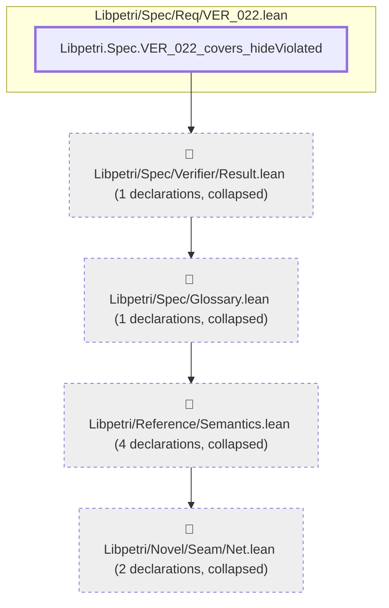

#### `Libpetri.Spec.VER_022_covers_hideViolated` → `Libpetri.Spec.OpenNet.Clause.name`

> Rule: this theorem's tree has 299 nodes, still 192 with other files collapsed, so it is split by direct dependency; this part has 3 nodes, other files collapsed.

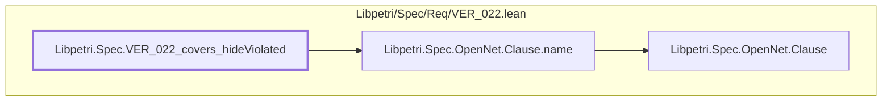

#### `Libpetri.Spec.VER_022_covers_hideViolated` → `Libpetri.Spec.OpenNet.ClauseHolds`

> Rule: this theorem's tree has 299 nodes, still 192 with other files collapsed, so it is split by direct dependency; this part has 11 nodes, other files collapsed.

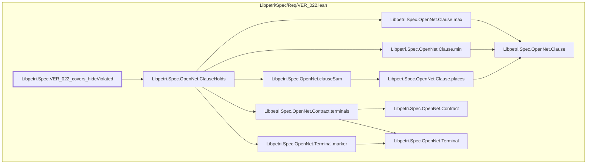

#### `Libpetri.Spec.VER_022_covers_hideViolated` → `Libpetri.Spec.OpenNet.Closed.envPlaces`

> Rule: this theorem's tree has 299 nodes, still 192 with other files collapsed, so it is split by direct dependency; this part has 3 nodes, other files collapsed.


#### `Libpetri.Spec.VER_022_covers_hideViolated` → `Libpetri.Spec.OpenNet.Closed.m0`

> Rule: this theorem's tree has 299 nodes, still 192 with other files collapsed, so it is split by direct dependency; this part has 4 nodes, other files collapsed.

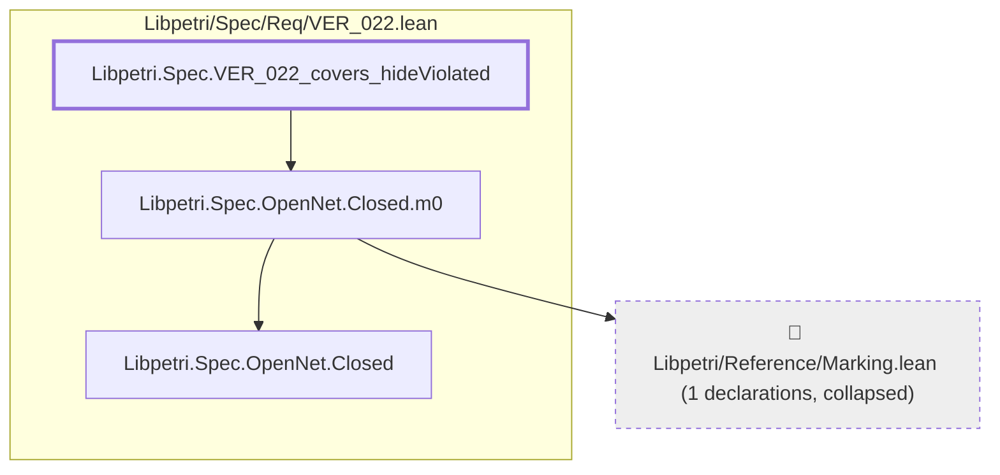

#### `Libpetri.Spec.VER_022_covers_hideViolated` → `Libpetri.Spec.OpenNet.Closed.net`

> Rule: this theorem's tree has 299 nodes, still 192 with other files collapsed, so it is split by direct dependency; this part has 4 nodes, other files collapsed.

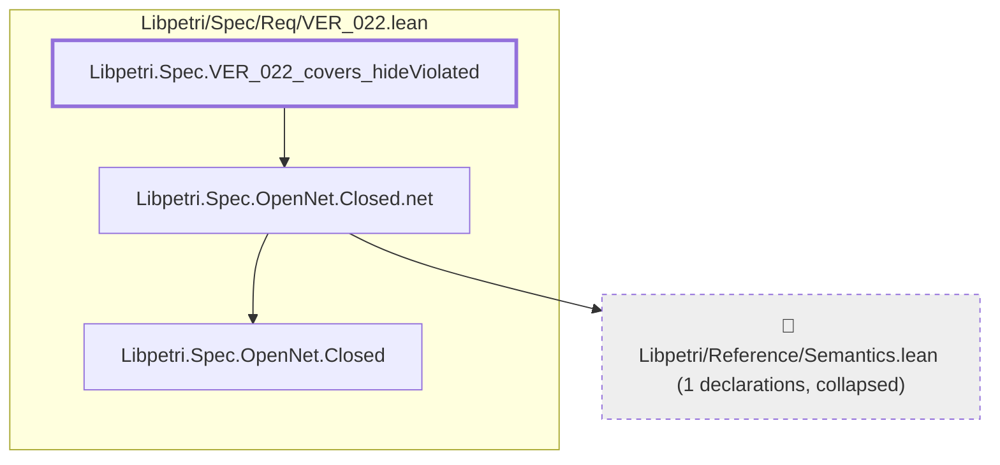

#### `Libpetri.Spec.VER_022_covers_hideViolated` → `Libpetri.Spec.OpenNet.Contract.clauses`

> Rule: this theorem's tree has 299 nodes, still 192 with other files collapsed, so it is split by direct dependency; this part has 4 nodes, other files collapsed.

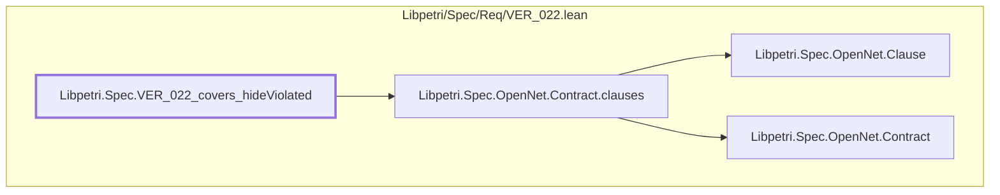

#### `Libpetri.Spec.VER_022_covers_hideViolated` → `Libpetri.Spec.OpenNet.Contract.env`

> Rule: this theorem's tree has 299 nodes, still 192 with other files collapsed, so it is split by direct dependency; this part has 4 nodes, other files collapsed.

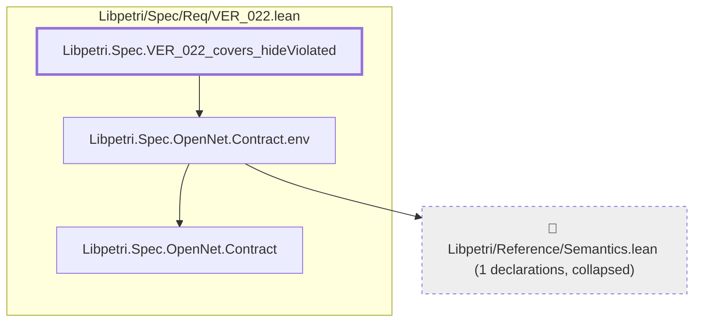

#### `Libpetri.Spec.VER_022_covers_hideViolated` → `Libpetri.Spec.OpenNet.Contract.groups`

> Rule: this theorem's tree has 299 nodes, still 192 with other files collapsed, so it is split by direct dependency; this part has 4 nodes, other files collapsed.

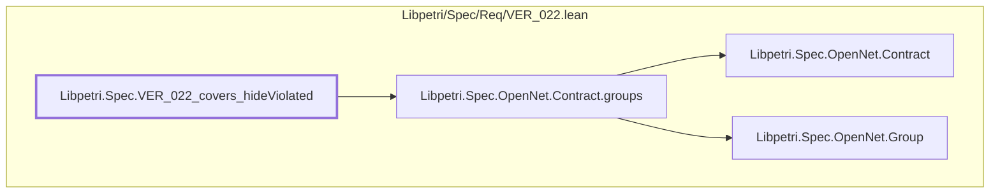

#### `Libpetri.Spec.VER_022_covers_hideViolated` → `Libpetri.Spec.OpenNet.Contract.init`

> Rule: this theorem's tree has 299 nodes, still 192 with other files collapsed, so it is split by direct dependency; this part has 3 nodes, other files collapsed.

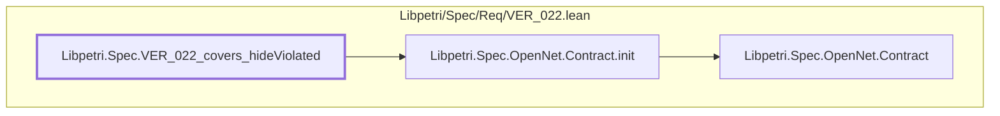

#### `Libpetri.Spec.VER_022_covers_hideViolated` → `Libpetri.Spec.OpenNet.Contract.mk`

> Rule: this theorem's tree has 299 nodes, still 192 with other files collapsed, so it is split by direct dependency; this part has 7 nodes, other files collapsed.

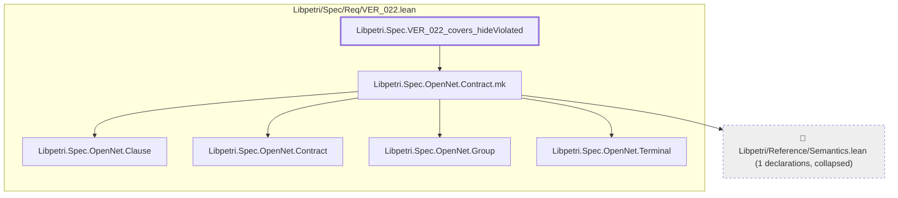

#### `Libpetri.Spec.VER_022_covers_hideViolated` → `Libpetri.Spec.OpenNet.Contract.rest`

> Rule: this theorem's tree has 299 nodes, still 192 with other files collapsed, so it is split by direct dependency; this part has 3 nodes, other files collapsed.

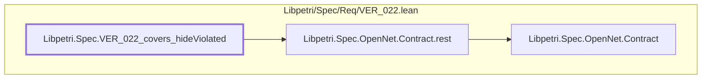

#### `Libpetri.Spec.VER_022_covers_hideViolated` → `Libpetri.Spec.OpenNet.Contract.terminals`

> Rule: this theorem's tree has 299 nodes, still 192 with other files collapsed, so it is split by direct dependency; this part has 4 nodes, other files collapsed.

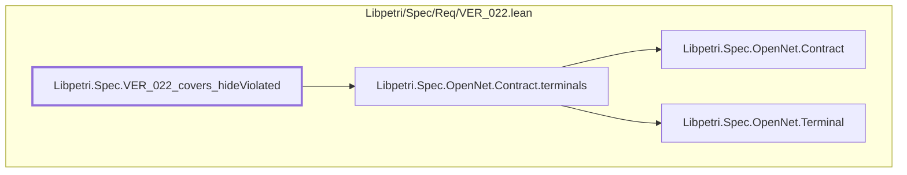

#### `Libpetri.Spec.VER_022_covers_hideViolated` → `Libpetri.Spec.OpenNet.Contract.terminate`

> Rule: this theorem's tree has 299 nodes, still 192 with other files collapsed, so it is split by direct dependency; this part has 3 nodes, other files collapsed.

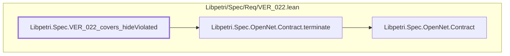

#### `Libpetri.Spec.VER_022_covers_hideViolated` → `Libpetri.Spec.OpenNet.GraphCloses`

> Rule: this theorem's tree has 299 nodes, still 192 with other files collapsed, so it is split by direct dependency; this part has 18 nodes, other files collapsed.

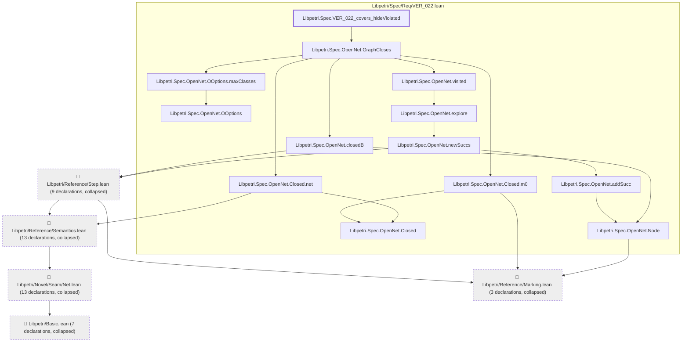

#### `Libpetri.Spec.VER_022_covers_hideViolated` → `Libpetri.Spec.OpenNet.OOptions.assumeNoReaping`

> Rule: this theorem's tree has 299 nodes, still 192 with other files collapsed, so it is split by direct dependency; this part has 3 nodes, other files collapsed.

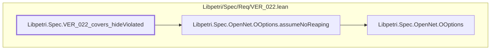

#### `Libpetri.Spec.VER_022_covers_hideViolated` → `Libpetri.Spec.OpenNet.OOptions.maxClasses`

> Rule: this theorem's tree has 299 nodes, still 192 with other files collapsed, so it is split by direct dependency; this part has 3 nodes, other files collapsed.

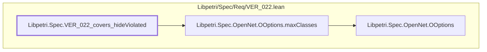

#### `Libpetri.Spec.VER_022_covers_hideViolated` → `Libpetri.Spec.OpenNet.OOptions.mk`

> Rule: this theorem's tree has 299 nodes, still 192 with other files collapsed, so it is split by direct dependency; this part has 3 nodes, other files collapsed.

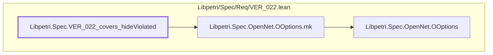

#### `Libpetri.Spec.VER_022_covers_hideViolated` → `Libpetri.Spec.OpenNet.OResult.mk`

> Rule: this theorem's tree has 299 nodes, still 192 with other files collapsed, so it is split by direct dependency; this part has 5 nodes, other files collapsed.

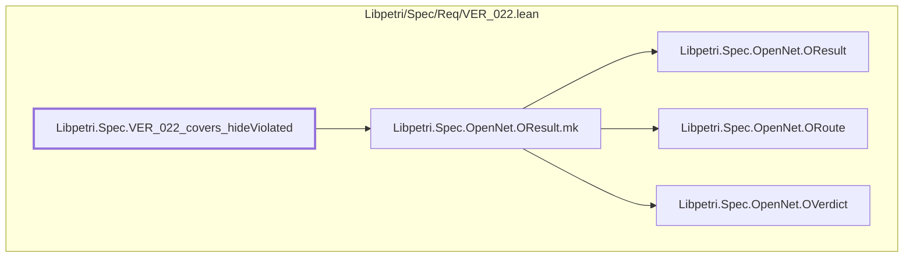

#### `Libpetri.Spec.VER_022_covers_hideViolated` → `Libpetri.Spec.OpenNet.OResult.route`

> Rule: this theorem's tree has 299 nodes, still 192 with other files collapsed, so it is split by direct dependency; this part has 4 nodes, other files collapsed.

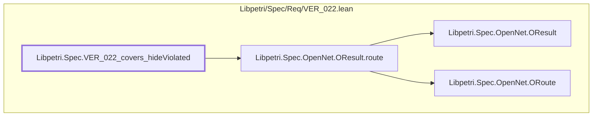

#### `Libpetri.Spec.VER_022_covers_hideViolated` → `Libpetri.Spec.OpenNet.OResult.verdict`

> Rule: this theorem's tree has 299 nodes, still 192 with other files collapsed, so it is split by direct dependency; this part has 4 nodes, other files collapsed.

```mermaid
flowchart TD
  subgraph g0["Libpetri/Spec/Req/VER_022.lean"]
    n9536["Libpetri.Spec.OpenNet.OResult"]
    n9539["Libpetri.Spec.OpenNet.OResult.verdict"]
    n9545["Libpetri.Spec.OpenNet.OVerdict"]
    n11127["Libpetri.Spec.VER_022_covers_hideViolated"]
  end
  n9539 --> n9536
  n9539 --> n9545
  n11127 --> n9539
  classDef root stroke-width:3px
  classDef locked fill:#fff3cd,stroke:#b8860b
  classDef collapsed fill:#eeeeee,stroke-dasharray:4 4
  class n11127 root
```

#### `Libpetri.Spec.VER_022_covers_hideViolated` → `Libpetri.Spec.OpenNet.ORoute.enumeration`

> Rule: this theorem's tree has 299 nodes, still 192 with other files collapsed, so it is split by direct dependency; this part has 3 nodes, other files collapsed.

```mermaid
flowchart TD
  subgraph g0["Libpetri/Spec/Req/VER_022.lean"]
    n9540["Libpetri.Spec.OpenNet.ORoute"]
    n9541["Libpetri.Spec.OpenNet.ORoute.enumeration"]
    n11127["Libpetri.Spec.VER_022_covers_hideViolated"]
  end
  n9541 --> n9540
  n11127 --> n9541
  classDef root stroke-width:3px
  classDef locked fill:#fff3cd,stroke:#b8860b
  classDef collapsed fill:#eeeeee,stroke-dasharray:4 4
  class n11127 root
```

#### `Libpetri.Spec.VER_022_covers_hideViolated` → `Libpetri.Spec.OpenNet.ORoute.smt`

> Rule: this theorem's tree has 299 nodes, still 192 with other files collapsed, so it is split by direct dependency; this part has 3 nodes, other files collapsed.

```mermaid
flowchart TD
  subgraph g0["Libpetri/Spec/Req/VER_022.lean"]
    n9540["Libpetri.Spec.OpenNet.ORoute"]
    n9544["Libpetri.Spec.OpenNet.ORoute.smt"]
    n11127["Libpetri.Spec.VER_022_covers_hideViolated"]
  end
  n9544 --> n9540
  n11127 --> n9544
  classDef root stroke-width:3px
  classDef locked fill:#fff3cd,stroke:#b8860b
  classDef collapsed fill:#eeeeee,stroke-dasharray:4 4
  class n11127 root
```

#### `Libpetri.Spec.VER_022_covers_hideViolated` → `Libpetri.Spec.OpenNet.OVerdict.proven`

> Rule: this theorem's tree has 299 nodes, still 192 with other files collapsed, so it is split by direct dependency; this part has 3 nodes, other files collapsed.

```mermaid
flowchart TD
  subgraph g0["Libpetri/Spec/Req/VER_022.lean"]
    n9545["Libpetri.Spec.OpenNet.OVerdict"]
    n9546["Libpetri.Spec.OpenNet.OVerdict.proven"]
    n11127["Libpetri.Spec.VER_022_covers_hideViolated"]
  end
  n9546 --> n9545
  n11127 --> n9546
  classDef root stroke-width:3px
  classDef locked fill:#fff3cd,stroke:#b8860b
  classDef collapsed fill:#eeeeee,stroke-dasharray:4 4
  class n11127 root
```

#### `Libpetri.Spec.VER_022_covers_hideViolated` → `Libpetri.Spec.OpenNet.OVerdict.unknown`

> Rule: this theorem's tree has 299 nodes, still 192 with other files collapsed, so it is split by direct dependency; this part has 3 nodes, other files collapsed.

```mermaid
flowchart TD
  subgraph g0["Libpetri/Spec/Req/VER_022.lean"]
    n9545["Libpetri.Spec.OpenNet.OVerdict"]
    n9547["Libpetri.Spec.OpenNet.OVerdict.unknown"]
    n11127["Libpetri.Spec.VER_022_covers_hideViolated"]
  end
  n9547 --> n9545
  n11127 --> n9547
  classDef root stroke-width:3px
  classDef locked fill:#fff3cd,stroke:#b8860b
  classDef collapsed fill:#eeeeee,stroke-dasharray:4 4
  class n11127 root
```

#### `Libpetri.Spec.VER_022_covers_hideViolated` → `Libpetri.Spec.OpenNet.OVerdict.violated`

> Rule: this theorem's tree has 299 nodes, still 192 with other files collapsed, so it is split by direct dependency; this part has 4 nodes, other files collapsed.

```mermaid
flowchart TD
  subgraph g0["Libpetri/Spec/Req/VER_022.lean"]
    n9545["Libpetri.Spec.OpenNet.OVerdict"]
    n9548["Libpetri.Spec.OpenNet.OVerdict.violated"]
    n9564["Libpetri.Spec.OpenNet.Witness"]
    n11127["Libpetri.Spec.VER_022_covers_hideViolated"]
  end
  n9548 --> n9545
  n9548 --> n9564
  n11127 --> n9548
  classDef root stroke-width:3px
  classDef locked fill:#fff3cd,stroke:#b8860b
  classDef collapsed fill:#eeeeee,stroke-dasharray:4 4
  class n11127 root
```

#### `Libpetri.Spec.VER_022_covers_hideViolated` → `Libpetri.Spec.OpenNet.OpenSubnet.hasMatch`

> Rule: this theorem's tree has 299 nodes, still 192 with other files collapsed, so it is split by direct dependency; this part has 3 nodes, other files collapsed.

```mermaid
flowchart TD
  subgraph g0["Libpetri/Spec/Req/VER_022.lean"]
    n9549["Libpetri.Spec.OpenNet.OpenSubnet"]
    n9550["Libpetri.Spec.OpenNet.OpenSubnet.hasMatch"]
    n11127["Libpetri.Spec.VER_022_covers_hideViolated"]
  end
  n9550 --> n9549
  n11127 --> n9550
  classDef root stroke-width:3px
  classDef locked fill:#fff3cd,stroke:#b8860b
  classDef collapsed fill:#eeeeee,stroke-dasharray:4 4
  class n11127 root
```

#### `Libpetri.Spec.VER_022_covers_hideViolated` → `Libpetri.Spec.OpenNet.OpenSubnet.mk`

> Rule: this theorem's tree has 299 nodes, still 192 with other files collapsed, so it is split by direct dependency; this part has 4 nodes, other files collapsed.

```mermaid
flowchart TD
  subgraph g0["Libpetri/Spec/Req/VER_022.lean"]
    n9549["Libpetri.Spec.OpenNet.OpenSubnet"]
    n9551["Libpetri.Spec.OpenNet.OpenSubnet.mk"]
    n11127["Libpetri.Spec.VER_022_covers_hideViolated"]
  end
  c94["📁 Libpetri/Reference/Semantics.lean (1 declarations, collapsed)"]
  n9551 --> c94
  n9551 --> n9549
  n11127 --> n9551
  classDef root stroke-width:3px
  classDef locked fill:#fff3cd,stroke:#b8860b
  classDef collapsed fill:#eeeeee,stroke-dasharray:4 4
  class n11127 root
  class c94 collapsed
```

#### `Libpetri.Spec.VER_022_covers_hideViolated` → `Libpetri.Spec.OpenNet.OpenSubnet.net`

> Rule: this theorem's tree has 299 nodes, still 192 with other files collapsed, so it is split by direct dependency; this part has 4 nodes, other files collapsed.

```mermaid
flowchart TD
  subgraph g0["Libpetri/Spec/Req/VER_022.lean"]
    n9549["Libpetri.Spec.OpenNet.OpenSubnet"]
    n9552["Libpetri.Spec.OpenNet.OpenSubnet.net"]
    n11127["Libpetri.Spec.VER_022_covers_hideViolated"]
  end
  c94["📁 Libpetri/Reference/Semantics.lean (1 declarations, collapsed)"]
  n9552 --> c94
  n9552 --> n9549
  n11127 --> n9552
  classDef root stroke-width:3px
  classDef locked fill:#fff3cd,stroke:#b8860b
  classDef collapsed fill:#eeeeee,stroke-dasharray:4 4
  class n11127 root
  class c94 collapsed
```

#### `Libpetri.Spec.VER_022_covers_hideViolated` → `Libpetri.Spec.OpenNet.Part.clause`

> Rule: this theorem's tree has 299 nodes, still 192 with other files collapsed, so it is split by direct dependency; this part has 3 nodes, other files collapsed.

```mermaid
flowchart TD
  subgraph g0["Libpetri/Spec/Req/VER_022.lean"]
    n9555["Libpetri.Spec.OpenNet.Part"]
    n9556["Libpetri.Spec.OpenNet.Part.clause"]
    n11127["Libpetri.Spec.VER_022_covers_hideViolated"]
  end
  n9556 --> n9555
  n11127 --> n9556
  classDef root stroke-width:3px
  classDef locked fill:#fff3cd,stroke:#b8860b
  classDef collapsed fill:#eeeeee,stroke-dasharray:4 4
  class n11127 root
```

#### `Libpetri.Spec.VER_022_covers_hideViolated` → `Libpetri.Spec.OpenNet.Part.stranded`

> Rule: this theorem's tree has 299 nodes, still 192 with other files collapsed, so it is split by direct dependency; this part has 3 nodes, other files collapsed.

```mermaid
flowchart TD
  subgraph g0["Libpetri/Spec/Req/VER_022.lean"]
    n9555["Libpetri.Spec.OpenNet.Part"]
    n9557["Libpetri.Spec.OpenNet.Part.stranded"]
    n11127["Libpetri.Spec.VER_022_covers_hideViolated"]
  end
  n9557 --> n9555
  n11127 --> n9557
  classDef root stroke-width:3px
  classDef locked fill:#fff3cd,stroke:#b8860b
  classDef collapsed fill:#eeeeee,stroke-dasharray:4 4
  class n11127 root
```

#### `Libpetri.Spec.VER_022_covers_hideViolated` → `Libpetri.Spec.OpenNet.Part.termination`

> Rule: this theorem's tree has 299 nodes, still 192 with other files collapsed, so it is split by direct dependency; this part has 3 nodes, other files collapsed.

```mermaid
flowchart TD
  subgraph g0["Libpetri/Spec/Req/VER_022.lean"]
    n9555["Libpetri.Spec.OpenNet.Part"]
    n9558["Libpetri.Spec.OpenNet.Part.termination"]
    n11127["Libpetri.Spec.VER_022_covers_hideViolated"]
  end
  n9558 --> n9555
  n11127 --> n9558
  classDef root stroke-width:3px
  classDef locked fill:#fff3cd,stroke:#b8860b
  classDef collapsed fill:#eeeeee,stroke-dasharray:4 4
  class n11127 root
```

#### `Libpetri.Spec.VER_022_covers_hideViolated` → `Libpetri.Spec.OpenNet.Quiet`

> Rule: this theorem's tree has 299 nodes, still 192 with other files collapsed, so it is split by direct dependency; this part has 7 nodes, other files collapsed.

```mermaid
flowchart TD
  subgraph g0["Libpetri/Spec/Req/VER_022.lean"]
    n9531["Libpetri.Spec.OpenNet.OOptions"]
    n9532["Libpetri.Spec.OpenNet.OOptions.assumeNoReaping"]
    n9559["Libpetri.Spec.OpenNet.Quiet"]
    n11127["Libpetri.Spec.VER_022_covers_hideViolated"]
  end
  c0["📁 Libpetri/Basic.lean (6 declarations, collapsed)"]
  c54["📁 Libpetri/Novel/Seam/Net.lean (8 declarations, collapsed)"]
  c94["📁 Libpetri/Reference/Semantics.lean (5 declarations, collapsed)"]
  c54 --> c0
  c94 --> c54
  n9532 --> n9531
  n9559 --> c94
  n9559 --> n9532
  n11127 --> n9559
  classDef root stroke-width:3px
  classDef locked fill:#fff3cd,stroke:#b8860b
  classDef collapsed fill:#eeeeee,stroke-dasharray:4 4
  class n11127 root
  class c0,c54,c94 collapsed
```

#### `Libpetri.Spec.VER_022_covers_hideViolated` → `Libpetri.Spec.OpenNet.Witness.confirmed`

> Rule: this theorem's tree has 299 nodes, still 192 with other files collapsed, so it is split by direct dependency; this part has 3 nodes, other files collapsed.

```mermaid
flowchart TD
  subgraph g0["Libpetri/Spec/Req/VER_022.lean"]
    n9564["Libpetri.Spec.OpenNet.Witness"]
    n9565["Libpetri.Spec.OpenNet.Witness.confirmed"]
    n11127["Libpetri.Spec.VER_022_covers_hideViolated"]
  end
  n9565 --> n9564
  n11127 --> n9565
  classDef root stroke-width:3px
  classDef locked fill:#fff3cd,stroke:#b8860b
  classDef collapsed fill:#eeeeee,stroke-dasharray:4 4
  class n11127 root
```

#### `Libpetri.Spec.VER_022_covers_hideViolated` → `Libpetri.Spec.OpenNet.Witness.cycleStart`

> Rule: this theorem's tree has 299 nodes, still 192 with other files collapsed, so it is split by direct dependency; this part has 3 nodes, other files collapsed.

```mermaid
flowchart TD
  subgraph g0["Libpetri/Spec/Req/VER_022.lean"]
    n9564["Libpetri.Spec.OpenNet.Witness"]
    n9566["Libpetri.Spec.OpenNet.Witness.cycleStart"]
    n11127["Libpetri.Spec.VER_022_covers_hideViolated"]
  end
  n9566 --> n9564
  n11127 --> n9566
  classDef root stroke-width:3px
  classDef locked fill:#fff3cd,stroke:#b8860b
  classDef collapsed fill:#eeeeee,stroke-dasharray:4 4
  class n11127 root
```

#### `Libpetri.Spec.VER_022_covers_hideViolated` → `Libpetri.Spec.OpenNet.Witness.endM`

> Rule: this theorem's tree has 299 nodes, still 192 with other files collapsed, so it is split by direct dependency; this part has 4 nodes, other files collapsed.

```mermaid
flowchart TD
  subgraph g0["Libpetri/Spec/Req/VER_022.lean"]
    n9564["Libpetri.Spec.OpenNet.Witness"]
    n9567["Libpetri.Spec.OpenNet.Witness.endM"]
    n11127["Libpetri.Spec.VER_022_covers_hideViolated"]
  end
  c86["📁 Libpetri/Reference/Marking.lean (1 declarations, collapsed)"]
  n9567 --> c86
  n9567 --> n9564
  n11127 --> n9567
  classDef root stroke-width:3px
  classDef locked fill:#fff3cd,stroke:#b8860b
  classDef collapsed fill:#eeeeee,stroke-dasharray:4 4
  class n11127 root
  class c86 collapsed
```

#### `Libpetri.Spec.VER_022_covers_hideViolated` → `Libpetri.Spec.OpenNet.Witness.mk`

> Rule: this theorem's tree has 299 nodes, still 192 with other files collapsed, so it is split by direct dependency; this part has 5 nodes, other files collapsed.

```mermaid
flowchart TD
  subgraph g0["Libpetri/Spec/Req/VER_022.lean"]
    n9555["Libpetri.Spec.OpenNet.Part"]
    n9564["Libpetri.Spec.OpenNet.Witness"]
    n9568["Libpetri.Spec.OpenNet.Witness.mk"]
    n11127["Libpetri.Spec.VER_022_covers_hideViolated"]
  end
  c86["📁 Libpetri/Reference/Marking.lean (1 declarations, collapsed)"]
  n9568 --> c86
  n9568 --> n9555
  n9568 --> n9564
  n11127 --> n9568
  classDef root stroke-width:3px
  classDef locked fill:#fff3cd,stroke:#b8860b
  classDef collapsed fill:#eeeeee,stroke-dasharray:4 4
  class n11127 root
  class c86 collapsed
```

#### `Libpetri.Spec.VER_022_covers_hideViolated` → `Libpetri.Spec.OpenNet.Witness.part`

> Rule: this theorem's tree has 299 nodes, still 192 with other files collapsed, so it is split by direct dependency; this part has 4 nodes, other files collapsed.

```mermaid
flowchart TD
  subgraph g0["Libpetri/Spec/Req/VER_022.lean"]
    n9555["Libpetri.Spec.OpenNet.Part"]
    n9564["Libpetri.Spec.OpenNet.Witness"]
    n9569["Libpetri.Spec.OpenNet.Witness.part"]
    n11127["Libpetri.Spec.VER_022_covers_hideViolated"]
  end
  n9569 --> n9555
  n9569 --> n9564
  n11127 --> n9569
  classDef root stroke-width:3px
  classDef locked fill:#fff3cd,stroke:#b8860b
  classDef collapsed fill:#eeeeee,stroke-dasharray:4 4
  class n11127 root
```

#### `Libpetri.Spec.VER_022_covers_hideViolated` → `Libpetri.Spec.OpenNet.Witness.trace`

> Rule: this theorem's tree has 299 nodes, still 192 with other files collapsed, so it is split by direct dependency; this part has 3 nodes, other files collapsed.

```mermaid
flowchart TD
  subgraph g0["Libpetri/Spec/Req/VER_022.lean"]
    n9564["Libpetri.Spec.OpenNet.Witness"]
    n9570["Libpetri.Spec.OpenNet.Witness.trace"]
    n11127["Libpetri.Spec.VER_022_covers_hideViolated"]
  end
  n9570 --> n9564
  n11127 --> n9570
  classDef root stroke-width:3px
  classDef locked fill:#fff3cd,stroke:#b8860b
  classDef collapsed fill:#eeeeee,stroke-dasharray:4 4
  class n11127 root
```

#### `Libpetri.Spec.VER_022_covers_hideViolated` → `Libpetri.Spec.OpenNet.arrC`

> Rule: this theorem's tree has 299 nodes, still 192 with other files collapsed, so it is split by direct dependency; this part has 10 nodes, other files collapsed.

```mermaid
flowchart TD
  subgraph g0["Libpetri/Spec/Req/VER_022.lean"]
    n9497["Libpetri.Spec.OpenNet.Clause"]
    n9500["Libpetri.Spec.OpenNet.Clause.mk"]
    n9512["Libpetri.Spec.OpenNet.Contract"]
    n9517["Libpetri.Spec.OpenNet.Contract.mk"]
    n9524["Libpetri.Spec.OpenNet.Group"]
    n9527["Libpetri.Spec.OpenNet.Group.mk"]
    n9560["Libpetri.Spec.OpenNet.Terminal"]
    n9574["Libpetri.Spec.OpenNet.arrC"]
    n11127["Libpetri.Spec.VER_022_covers_hideViolated"]
  end
  c94["📁 Libpetri/Reference/Semantics.lean (1 declarations, collapsed)"]
  n9500 --> n9497
  n9517 --> c94
  n9517 --> n9497
  n9517 --> n9512
  n9517 --> n9524
  n9517 --> n9560
  n9527 --> n9524
  n9574 --> n9500
  n9574 --> n9517
  n9574 --> n9527
  n11127 --> n9574
  classDef root stroke-width:3px
  classDef locked fill:#fff3cd,stroke:#b8860b
  classDef collapsed fill:#eeeeee,stroke-dasharray:4 4
  class n11127 root
  class c94 collapsed
```

#### `Libpetri.Spec.VER_022_covers_hideViolated` → `Libpetri.Spec.OpenNet.closedB`

> Rule: this theorem's tree has 299 nodes, still 192 with other files collapsed, so it is split by direct dependency; this part has 8 nodes, other files collapsed.

```mermaid
flowchart TD
  subgraph g0["Libpetri/Spec/Req/VER_022.lean"]
    n9530["Libpetri.Spec.OpenNet.Node"]
    n9590["Libpetri.Spec.OpenNet.closedB"]
    n11127["Libpetri.Spec.VER_022_covers_hideViolated"]
  end
  c0["📁 Libpetri/Basic.lean (7 declarations, collapsed)"]
  c54["📁 Libpetri/Novel/Seam/Net.lean (13 declarations, collapsed)"]
  c86["📁 Libpetri/Reference/Marking.lean (3 declarations, collapsed)"]
  c94["📁 Libpetri/Reference/Semantics.lean (13 declarations, collapsed)"]
  c96["📁 Libpetri/Reference/Step.lean (9 declarations, collapsed)"]
  c54 --> c0
  c94 --> c54
  c96 --> c86
  c96 --> c94
  n9530 --> c86
  n9590 --> c96
  n9590 --> n9530
  n11127 --> n9590
  classDef root stroke-width:3px
  classDef locked fill:#fff3cd,stroke:#b8860b
  classDef collapsed fill:#eeeeee,stroke-dasharray:4 4
  class n11127 root
  class c0,c54,c86,c94,c96 collapsed
```

#### `Libpetri.Spec.VER_022_covers_hideViolated` → `Libpetri.Spec.OpenNet.idleNet`

> Rule: this theorem's tree has 299 nodes, still 192 with other files collapsed, so it is split by direct dependency; this part has 3 nodes, other files collapsed.

```mermaid
flowchart TD
  subgraph g0["Libpetri/Spec/Req/VER_022.lean"]
    n9630["Libpetri.Spec.OpenNet.idleNet"]
    n11127["Libpetri.Spec.VER_022_covers_hideViolated"]
  end
  c94["📁 Libpetri/Reference/Semantics.lean (3 declarations, collapsed)"]
  n9630 --> c94
  n11127 --> n9630
  classDef root stroke-width:3px
  classDef locked fill:#fff3cd,stroke:#b8860b
  classDef collapsed fill:#eeeeee,stroke-dasharray:4 4
  class n11127 root
  class c94 collapsed
```

#### `Libpetri.Spec.VER_022_covers_hideViolated` → `Libpetri.Spec.OpenNet.ok_of_toOption`

> Rule: this theorem's tree has 299 nodes, still 192 with other files collapsed, so it is split by direct dependency; this part has 3 nodes, other files collapsed.

```mermaid
flowchart TD
  subgraph g0["Libpetri/Spec/Req/VER_022.lean"]
    n9536["Libpetri.Spec.OpenNet.OResult"]
    n9670["Libpetri.Spec.OpenNet.ok_of_toOption"]
    n11127["Libpetri.Spec.VER_022_covers_hideViolated"]
  end
  n9670 --> n9536
  n11127 --> n9670
  classDef root stroke-width:3px
  classDef locked fill:#fff3cd,stroke:#b8860b
  classDef collapsed fill:#eeeeee,stroke-dasharray:4 4
  class n11127 root
```

#### `Libpetri.Spec.VER_022_covers_hideViolated` → `Libpetri.Spec.OpenNet.orderC`

> Rule: this theorem's tree has 299 nodes, still 192 with other files collapsed, so it is split by direct dependency; this part has 8 nodes, other files collapsed.

```mermaid
flowchart TD
  subgraph g0["Libpetri/Spec/Req/VER_022.lean"]
    n9497["Libpetri.Spec.OpenNet.Clause"]
    n9512["Libpetri.Spec.OpenNet.Contract"]
    n9517["Libpetri.Spec.OpenNet.Contract.mk"]
    n9524["Libpetri.Spec.OpenNet.Group"]
    n9560["Libpetri.Spec.OpenNet.Terminal"]
    n9673["Libpetri.Spec.OpenNet.orderC"]
    n11127["Libpetri.Spec.VER_022_covers_hideViolated"]
  end
  c94["📁 Libpetri/Reference/Semantics.lean (1 declarations, collapsed)"]
  n9517 --> c94
  n9517 --> n9497
  n9517 --> n9512
  n9517 --> n9524
  n9517 --> n9560
  n9673 --> n9517
  n11127 --> n9673
  classDef root stroke-width:3px
  classDef locked fill:#fff3cd,stroke:#b8860b
  classDef collapsed fill:#eeeeee,stroke-dasharray:4 4
  class n11127 root
  class c94 collapsed
```

#### `Libpetri.Spec.VER_022_covers_hideViolated` → `Libpetri.Spec.OpenNet.refClose`

> Rule: this theorem's tree has 299 nodes, still 192 with other files collapsed, so it is split by direct dependency; this part has 52 nodes, other files collapsed.

```mermaid
flowchart TD
  subgraph g0["Libpetri/Spec/Req/VER_022.lean"]
    n9497["Libpetri.Spec.OpenNet.Clause"]
    n9502["Libpetri.Spec.OpenNet.Clause.places"]
    n9505["Libpetri.Spec.OpenNet.CloseFn"]
    n9506["Libpetri.Spec.OpenNet.Closed"]
    n9510["Libpetri.Spec.OpenNet.Closed.mk"]
    n9512["Libpetri.Spec.OpenNet.Contract"]
    n9513["Libpetri.Spec.OpenNet.Contract.clauses"]
    n9514["Libpetri.Spec.OpenNet.Contract.env"]
    n9515["Libpetri.Spec.OpenNet.Contract.groups"]
    n9516["Libpetri.Spec.OpenNet.Contract.init"]
    n9518["Libpetri.Spec.OpenNet.Contract.rest"]
    n9519["Libpetri.Spec.OpenNet.Contract.terminals"]
    n9524["Libpetri.Spec.OpenNet.Group"]
    n9525["Libpetri.Spec.OpenNet.Group.max"]
    n9526["Libpetri.Spec.OpenNet.Group.min"]
    n9528["Libpetri.Spec.OpenNet.Group.places"]
    n9560["Libpetri.Spec.OpenNet.Terminal"]
    n9561["Libpetri.Spec.OpenNet.Terminal.excused"]
    n9562["Libpetri.Spec.OpenNet.Terminal.marker"]
    n9575["Libpetri.Spec.OpenNet.arrName"]
    n9579["Libpetri.Spec.OpenNet.claims"]
    n9588["Libpetri.Spec.OpenNet.closeNet"]
    n9592["Libpetri.Spec.OpenNet.closureNames"]
    n9593["Libpetri.Spec.OpenNet.closureSources"]
    n9594["Libpetri.Spec.OpenNet.closureTrans"]
    n9598["Libpetri.Spec.OpenNet.contractNamed"]
    n9602["Libpetri.Spec.OpenNet.declName"]
    n9603["Libpetri.Spec.OpenNet.envNames"]
    n9604["Libpetri.Spec.OpenNet.envPlacesOf"]
    n9611["Libpetri.Spec.OpenNet.freshFails"]
    n9625["Libpetri.Spec.OpenNet.groupNames"]
    n9626["Libpetri.Spec.OpenNet.groupSources"]
    n9627["Libpetri.Spec.OpenNet.groupTrans"]
    n9655["Libpetri.Spec.OpenNet.manSrc"]
    n9661["Libpetri.Spec.OpenNet.moveT"]
    n9662["Libpetri.Spec.OpenNet.namesFrom"]
    n9663["Libpetri.Spec.OpenNet.netNames"]
    n9664["Libpetri.Spec.OpenNet.netPlaceNames"]
    n9669["Libpetri.Spec.OpenNet.nub"]
    n9671["Libpetri.Spec.OpenNet.optName"]
    n9672["Libpetri.Spec.OpenNet.optSrc"]
    n9674["Libpetri.Spec.OpenNet.outNames"]
    n9679["Libpetri.Spec.OpenNet.refClose"]
    n9698["Libpetri.Spec.OpenNet.sourcesFrom"]
    n9719["Libpetri.Spec.OpenNet.transFrom"]
    n9721["Libpetri.Spec.OpenNet.transPlaces"]
    n9724["Libpetri.Spec.OpenNet.undeclaredOf"]
    n11127["Libpetri.Spec.VER_022_covers_hideViolated"]
  end
  c0["📁 Libpetri/Basic.lean (2 declarations, collapsed)"]
  c54["📁 Libpetri/Novel/Seam/Net.lean (10 declarations, collapsed)"]
  c86["📁 Libpetri/Reference/Marking.lean (3 declarations, collapsed)"]
  c94["📁 Libpetri/Reference/Semantics.lean (15 declarations, collapsed)"]
  c54 --> c0
  c94 --> c54
  n9502 --> n9497
  n9505 --> c94
  n9505 --> n9506
  n9505 --> n9512
  n9510 --> c86
  n9510 --> c94
  n9510 --> n9506
  n9513 --> n9497
  n9513 --> n9512
  n9514 --> c94
  n9514 --> n9512
  n9515 --> n9512
  n9515 --> n9524
  n9516 --> n9512
  n9518 --> n9512
  n9519 --> n9512
  n9519 --> n9560
  n9525 --> n9524
  n9526 --> n9524
  n9528 --> n9524
  n9561 --> n9560
  n9562 --> n9560
  n9579 --> n9592
  n9579 --> n9603
  n9579 --> n9604
  n9588 --> n9510
  n9588 --> n9593
  n9588 --> n9594
  n9588 --> n9603
  n9588 --> n9724
  n9592 --> n9515
  n9592 --> n9662
  n9593 --> n9515
  n9593 --> n9698
  n9594 --> n9515
  n9594 --> n9719
  n9598 --> n9502
  n9598 --> n9513
  n9598 --> n9515
  n9598 --> n9516
  n9598 --> n9518
  n9598 --> n9519
  n9598 --> n9528
  n9598 --> n9561
  n9598 --> n9562
  n9603 --> n9514
  n9604 --> n9514
  n9604 --> n9664
  n9604 --> n9669
  n9625 --> n9525
  n9625 --> n9526
  n9625 --> n9528
  n9625 --> n9575
  n9625 --> n9602
  n9625 --> n9655
  n9625 --> n9671
  n9625 --> n9672
  n9626 --> n9525
  n9626 --> n9526
  n9626 --> n9655
  n9626 --> n9672
  n9627 --> n9525
  n9627 --> n9526
  n9627 --> n9528
  n9627 --> n9575
  n9627 --> n9602
  n9627 --> n9655
  n9627 --> n9661
  n9627 --> n9671
  n9627 --> n9672
  n9661 --> c94
  n9662 --> n9625
  n9663 --> n9664
  n9664 --> n9721
  n9674 --> c94
  n9679 --> n9505
  n9679 --> n9579
  n9679 --> n9588
  n9679 --> n9611
  n9679 --> n9663
  n9698 --> n9626
  n9719 --> n9627
  n9721 --> n9674
  n9724 --> n9598
  n9724 --> n9604
  n11127 --> n9679
  classDef root stroke-width:3px
  classDef locked fill:#fff3cd,stroke:#b8860b
  classDef collapsed fill:#eeeeee,stroke-dasharray:4 4
  class n11127 root
  class c0,c54,c86,c94 collapsed
```

#### `Libpetri.Spec.VER_022_covers_hideViolated` → `Libpetri.Spec.OpenNet.refMeets`

> Rule: this theorem's tree has 299 nodes, still 192 with other files collapsed, so it is split by direct dependency; this part has 21 nodes, other files collapsed.

```mermaid
flowchart TD
  subgraph g0["Libpetri/Spec/Req/VER_022.lean"]
    n9497["Libpetri.Spec.OpenNet.Clause"]
    n9498["Libpetri.Spec.OpenNet.Clause.max"]
    n9499["Libpetri.Spec.OpenNet.Clause.min"]
    n9502["Libpetri.Spec.OpenNet.Clause.places"]
    n9503["Libpetri.Spec.OpenNet.ClauseHolds"]
    n9512["Libpetri.Spec.OpenNet.Contract"]
    n9513["Libpetri.Spec.OpenNet.Contract.clauses"]
    n9518["Libpetri.Spec.OpenNet.Contract.rest"]
    n9519["Libpetri.Spec.OpenNet.Contract.terminals"]
    n9529["Libpetri.Spec.OpenNet.MeetsRel"]
    n9560["Libpetri.Spec.OpenNet.Terminal"]
    n9561["Libpetri.Spec.OpenNet.Terminal.excused"]
    n9562["Libpetri.Spec.OpenNet.Terminal.marker"]
    n9583["Libpetri.Spec.OpenNet.clauseSum"]
    n9681["Libpetri.Spec.OpenNet.refMeets"]
    n9693["Libpetri.Spec.OpenNet.restCond"]
    n9694["Libpetri.Spec.OpenNet.restSinks"]
    n11127["Libpetri.Spec.VER_022_covers_hideViolated"]
  end
  c51["📁 Libpetri/Novel/Seam/Bad.lean (1 declarations, collapsed)"]
  c52["📁 Libpetri/Novel/Seam/Excuses.lean (5 declarations, collapsed)"]
  c353["📁 Libpetri/Spec/Req/VER_014.lean (2 declarations, collapsed)"]
  c51 --> c52
  c353 --> c51
  n9498 --> n9497
  n9499 --> n9497
  n9502 --> n9497
  n9503 --> n9498
  n9503 --> n9499
  n9503 --> n9519
  n9503 --> n9562
  n9503 --> n9583
  n9513 --> n9497
  n9513 --> n9512
  n9518 --> n9512
  n9519 --> n9512
  n9519 --> n9560
  n9529 --> n9512
  n9561 --> n9560
  n9562 --> n9560
  n9583 --> n9502
  n9681 --> c353
  n9681 --> n9503
  n9681 --> n9529
  n9681 --> n9693
  n9681 --> n9694
  n9693 --> c52
  n9693 --> n9519
  n9693 --> n9561
  n9693 --> n9562
  n9694 --> n9502
  n9694 --> n9513
  n9694 --> n9518
  n11127 --> n9681
  classDef root stroke-width:3px
  classDef locked fill:#fff3cd,stroke:#b8860b
  classDef collapsed fill:#eeeeee,stroke-dasharray:4 4
  class n11127 root
  class c51,c52,c353 collapsed
```

#### `Libpetri.Spec.VER_022_covers_hideViolated` → `Libpetri.Spec.OpenNet.refOpenVerify`

> Rule: this theorem's tree has 299 nodes, still 192 with other files collapsed, so it is split by direct dependency; this part has 118 nodes, other files collapsed.

```mermaid
flowchart TD
  subgraph g0["Libpetri/Spec/Req/VER_022.lean"]
    n9497["Libpetri.Spec.OpenNet.Clause"]
    n9498["Libpetri.Spec.OpenNet.Clause.max"]
    n9499["Libpetri.Spec.OpenNet.Clause.min"]
    n9501["Libpetri.Spec.OpenNet.Clause.name"]
    n9502["Libpetri.Spec.OpenNet.Clause.places"]
    n9505["Libpetri.Spec.OpenNet.CloseFn"]
    n9506["Libpetri.Spec.OpenNet.Closed"]
    n9507["Libpetri.Spec.OpenNet.Closed.envPlaces"]
    n9509["Libpetri.Spec.OpenNet.Closed.m0"]
    n9510["Libpetri.Spec.OpenNet.Closed.mk"]
    n9511["Libpetri.Spec.OpenNet.Closed.net"]
    n9512["Libpetri.Spec.OpenNet.Contract"]
    n9513["Libpetri.Spec.OpenNet.Contract.clauses"]
    n9514["Libpetri.Spec.OpenNet.Contract.env"]
    n9515["Libpetri.Spec.OpenNet.Contract.groups"]
    n9516["Libpetri.Spec.OpenNet.Contract.init"]
    n9518["Libpetri.Spec.OpenNet.Contract.rest"]
    n9519["Libpetri.Spec.OpenNet.Contract.terminals"]
    n9520["Libpetri.Spec.OpenNet.Contract.terminate"]
    n9524["Libpetri.Spec.OpenNet.Group"]
    n9525["Libpetri.Spec.OpenNet.Group.max"]
    n9526["Libpetri.Spec.OpenNet.Group.min"]
    n9528["Libpetri.Spec.OpenNet.Group.places"]
    n9530["Libpetri.Spec.OpenNet.Node"]
    n9531["Libpetri.Spec.OpenNet.OOptions"]
    n9532["Libpetri.Spec.OpenNet.OOptions.assumeNoReaping"]
    n9533["Libpetri.Spec.OpenNet.OOptions.maxClasses"]
    n9535["Libpetri.Spec.OpenNet.OOptions.smt"]
    n9536["Libpetri.Spec.OpenNet.OResult"]
    n9537["Libpetri.Spec.OpenNet.OResult.mk"]
    n9540["Libpetri.Spec.OpenNet.ORoute"]
    n9541["Libpetri.Spec.OpenNet.ORoute.enumeration"]
    n9544["Libpetri.Spec.OpenNet.ORoute.smt"]
    n9545["Libpetri.Spec.OpenNet.OVerdict"]
    n9546["Libpetri.Spec.OpenNet.OVerdict.proven"]
    n9547["Libpetri.Spec.OpenNet.OVerdict.unknown"]
    n9548["Libpetri.Spec.OpenNet.OVerdict.violated"]
    n9549["Libpetri.Spec.OpenNet.OpenSubnet"]
    n9550["Libpetri.Spec.OpenNet.OpenSubnet.hasMatch"]
    n9552["Libpetri.Spec.OpenNet.OpenSubnet.net"]
    n9553["Libpetri.Spec.OpenNet.OpenVerifier"]
    n9554["Libpetri.Spec.OpenNet.PNode"]
    n9555["Libpetri.Spec.OpenNet.Part"]
    n9556["Libpetri.Spec.OpenNet.Part.clause"]
    n9557["Libpetri.Spec.OpenNet.Part.stranded"]
    n9558["Libpetri.Spec.OpenNet.Part.termination"]
    n9560["Libpetri.Spec.OpenNet.Terminal"]
    n9561["Libpetri.Spec.OpenNet.Terminal.excused"]
    n9562["Libpetri.Spec.OpenNet.Terminal.marker"]
    n9564["Libpetri.Spec.OpenNet.Witness"]
    n9568["Libpetri.Spec.OpenNet.Witness.mk"]
    n9571["Libpetri.Spec.OpenNet.addSucc"]
    n9575["Libpetri.Spec.OpenNet.arrName"]
    n9576["Libpetri.Spec.OpenNet.canonB"]
    n9579["Libpetri.Spec.OpenNet.claims"]
    n9581["Libpetri.Spec.OpenNet.clauseHoldsB"]
    n9583["Libpetri.Spec.OpenNet.clauseSum"]
    n9585["Libpetri.Spec.OpenNet.clauseWit"]
    n9588["Libpetri.Spec.OpenNet.closeNet"]
    n9590["Libpetri.Spec.OpenNet.closedB"]
    n9592["Libpetri.Spec.OpenNet.closureNames"]
    n9593["Libpetri.Spec.OpenNet.closureSources"]
    n9594["Libpetri.Spec.OpenNet.closureTrans"]
    n9595["Libpetri.Spec.OpenNet.confirmB"]
    n9598["Libpetri.Spec.OpenNet.contractNamed"]
    n9599["Libpetri.Spec.OpenNet.ddAdd"]
    n9602["Libpetri.Spec.OpenNet.declName"]
    n9603["Libpetri.Spec.OpenNet.envNames"]
    n9604["Libpetri.Spec.OpenNet.envPlacesOf"]
    n9605["Libpetri.Spec.OpenNet.explore"]
    n9609["Libpetri.Spec.OpenNet.firstRepeat"]
    n9611["Libpetri.Spec.OpenNet.freshFails"]
    n9616["Libpetri.Spec.OpenNet.graphJudge"]
    n9620["Libpetri.Spec.OpenNet.graphWits"]
    n9625["Libpetri.Spec.OpenNet.groupNames"]
    n9626["Libpetri.Spec.OpenNet.groupSources"]
    n9627["Libpetri.Spec.OpenNet.groupTrans"]
    n9650["Libpetri.Spec.OpenNet.lassoOf"]
    n9655["Libpetri.Spec.OpenNet.manSrc"]
    n9656["Libpetri.Spec.OpenNet.meetsB"]
    n9661["Libpetri.Spec.OpenNet.moveT"]
    n9662["Libpetri.Spec.OpenNet.namesFrom"]
    n9663["Libpetri.Spec.OpenNet.netNames"]
    n9664["Libpetri.Spec.OpenNet.netPlaceNames"]
    n9665["Libpetri.Spec.OpenNet.newSuccs"]
    n9668["Libpetri.Spec.OpenNet.nextT"]
    n9669["Libpetri.Spec.OpenNet.nub"]
    n9671["Libpetri.Spec.OpenNet.optName"]
    n9672["Libpetri.Spec.OpenNet.optSrc"]
    n9674["Libpetri.Spec.OpenNet.outNames"]
    n9675["Libpetri.Spec.OpenNet.provenB"]
    n9677["Libpetri.Spec.OpenNet.quietB"]
    n9679["Libpetri.Spec.OpenNet.refClose"]
    n9680["Libpetri.Spec.OpenNet.refJudge"]
    n9682["Libpetri.Spec.OpenNet.refOpenVerify"]
    n9693["Libpetri.Spec.OpenNet.restCond"]
    n9694["Libpetri.Spec.OpenNet.restSinks"]
    n9696["Libpetri.Spec.OpenNet.skipBudget"]
    n9697["Libpetri.Spec.OpenNet.skipMatch"]
    n9698["Libpetri.Spec.OpenNet.sourcesFrom"]
    n9705["Libpetri.Spec.OpenNet.strandB"]
    n9707["Libpetri.Spec.OpenNet.strandCands"]
    n9709["Libpetri.Spec.OpenNet.strandWit"]
    n9711["Libpetri.Spec.OpenNet.termWit"]
    n9713["Libpetri.Spec.OpenNet.tlayer"]
    n9719["Libpetri.Spec.OpenNet.transFrom"]
    n9721["Libpetri.Spec.OpenNet.transPlaces"]
    n9722["Libpetri.Spec.OpenNet.undecided"]
    n9724["Libpetri.Spec.OpenNet.undeclaredOf"]
    n9725["Libpetri.Spec.OpenNet.visited"]
    n11127["Libpetri.Spec.VER_022_covers_hideViolated"]
  end
  c0["📁 Libpetri/Basic.lean (7 declarations, collapsed)"]
  c52["📁 Libpetri/Novel/Seam/Excuses.lean (4 declarations, collapsed)"]
  c54["📁 Libpetri/Novel/Seam/Net.lean (15 declarations, collapsed)"]
  c77["📁 Libpetri/Reference/Decide.lean (3 declarations, collapsed)"]
  c86["📁 Libpetri/Reference/Marking.lean (4 declarations, collapsed)"]
  c94["📁 Libpetri/Reference/Semantics.lean (17 declarations, collapsed)"]
  c96["📁 Libpetri/Reference/Step.lean (9 declarations, collapsed)"]
  c54 --> c0
  c77 --> c96
  c94 --> c54
  c96 --> c86
  c96 --> c94
  n9498 --> n9497
  n9499 --> n9497
  n9501 --> n9497
  n9502 --> n9497
  n9505 --> c94
  n9505 --> n9506
  n9505 --> n9512
  n9507 --> n9506
  n9509 --> c86
  n9509 --> n9506
  n9510 --> c86
  n9510 --> c94
  n9510 --> n9506
  n9511 --> c94
  n9511 --> n9506
  n9513 --> n9497
  n9513 --> n9512
  n9514 --> c94
  n9514 --> n9512
  n9515 --> n9512
  n9515 --> n9524
  n9516 --> n9512
  n9518 --> n9512
  n9519 --> n9512
  n9519 --> n9560
  n9520 --> n9512
  n9525 --> n9524
  n9526 --> n9524
  n9528 --> n9524
  n9530 --> c86
  n9532 --> n9531
  n9533 --> n9531
  n9535 --> n9531
  n9537 --> n9536
  n9537 --> n9540
  n9537 --> n9545
  n9541 --> n9540
  n9544 --> n9540
  n9546 --> n9545
  n9547 --> n9545
  n9548 --> n9545
  n9548 --> n9564
  n9550 --> n9549
  n9552 --> c94
  n9552 --> n9549
  n9553 --> n9512
  n9553 --> n9531
  n9553 --> n9536
  n9553 --> n9549
  n9554 --> c86
  n9556 --> n9555
  n9557 --> n9555
  n9558 --> n9555
  n9561 --> n9560
  n9562 --> n9560
  n9568 --> c86
  n9568 --> n9555
  n9568 --> n9564
  n9571 --> n9530
  n9576 --> c86
  n9579 --> n9592
  n9579 --> n9603
  n9579 --> n9604
  n9581 --> c86
  n9581 --> n9498
  n9581 --> n9499
  n9581 --> n9519
  n9581 --> n9562
  n9581 --> n9583
  n9583 --> n9502
  n9585 --> n9501
  n9585 --> n9509
  n9585 --> n9511
  n9585 --> n9530
  n9585 --> n9556
  n9585 --> n9568
  n9585 --> n9581
  n9585 --> n9595
  n9585 --> n9677
  n9588 --> n9510
  n9588 --> n9593
  n9588 --> n9594
  n9588 --> n9603
  n9588 --> n9724
  n9590 --> c96
  n9590 --> n9530
  n9592 --> n9515
  n9592 --> n9662
  n9593 --> n9515
  n9593 --> n9698
  n9594 --> n9515
  n9594 --> n9719
  n9595 --> c77
  n9595 --> n9576
  n9598 --> n9502
  n9598 --> n9513
  n9598 --> n9515
  n9598 --> n9516
  n9598 --> n9518
  n9598 --> n9519
  n9598 --> n9528
  n9598 --> n9561
  n9598 --> n9562
  n9599 --> n9554
  n9603 --> n9514
  n9604 --> n9514
  n9604 --> n9664
  n9604 --> n9669
  n9605 --> n9665
  n9609 --> c86
  n9616 --> n9533
  n9616 --> n9546
  n9616 --> n9548
  n9616 --> n9620
  n9616 --> n9675
  n9616 --> n9722
  n9616 --> n9725
  n9620 --> n9520
  n9620 --> n9585
  n9620 --> n9707
  n9620 --> n9709
  n9620 --> n9711
  n9625 --> n9525
  n9625 --> n9526
  n9625 --> n9528
  n9625 --> n9575
  n9625 --> n9602
  n9625 --> n9655
  n9625 --> n9671
  n9625 --> n9672
  n9626 --> n9525
  n9626 --> n9526
  n9626 --> n9655
  n9626 --> n9672
  n9627 --> n9525
  n9627 --> n9526
  n9627 --> n9528
  n9627 --> n9575
  n9627 --> n9602
  n9627 --> n9655
  n9627 --> n9661
  n9627 --> n9671
  n9627 --> n9672
  n9650 --> c77
  n9650 --> n9554
  n9650 --> n9558
  n9650 --> n9568
  n9650 --> n9576
  n9650 --> n9609
  n9656 --> n9581
  n9656 --> n9705
  n9661 --> c94
  n9662 --> n9625
  n9663 --> n9664
  n9664 --> n9721
  n9665 --> c96
  n9665 --> n9571
  n9668 --> c96
  n9668 --> n9599
  n9674 --> c94
  n9675 --> n9507
  n9675 --> n9509
  n9675 --> n9511
  n9675 --> n9520
  n9675 --> n9576
  n9675 --> n9590
  n9675 --> n9656
  n9675 --> n9677
  n9675 --> n9713
  n9677 --> c86
  n9677 --> c94
  n9677 --> n9532
  n9679 --> n9505
  n9679 --> n9579
  n9679 --> n9588
  n9679 --> n9611
  n9679 --> n9663
  n9680 --> n9550
  n9680 --> n9616
  n9680 --> n9696
  n9680 --> n9697
  n9682 --> n9552
  n9682 --> n9553
  n9682 --> n9679
  n9682 --> n9680
  n9693 --> c52
  n9693 --> n9519
  n9693 --> n9561
  n9693 --> n9562
  n9694 --> n9502
  n9694 --> n9513
  n9694 --> n9518
  n9696 --> n9535
  n9696 --> n9537
  n9696 --> n9541
  n9696 --> n9544
  n9696 --> n9547
  n9697 --> n9535
  n9697 --> n9537
  n9697 --> n9541
  n9697 --> n9544
  n9697 --> n9547
  n9698 --> n9626
  n9705 --> c86
  n9705 --> n9693
  n9705 --> n9694
  n9707 --> n9507
  n9707 --> n9511
  n9707 --> n9530
  n9707 --> n9669
  n9707 --> n9677
  n9707 --> n9705
  n9709 --> n9507
  n9709 --> n9509
  n9709 --> n9511
  n9709 --> n9530
  n9709 --> n9557
  n9709 --> n9568
  n9709 --> n9595
  n9709 --> n9677
  n9709 --> n9705
  n9711 --> n9650
  n9711 --> n9713
  n9713 --> n9668
  n9719 --> n9627
  n9721 --> n9674
  n9722 --> n9535
  n9722 --> n9537
  n9722 --> n9541
  n9722 --> n9544
  n9722 --> n9547
  n9724 --> n9598
  n9724 --> n9604
  n9725 --> n9605
  n11127 --> n9682
  classDef root stroke-width:3px
  classDef locked fill:#fff3cd,stroke:#b8860b
  classDef collapsed fill:#eeeeee,stroke-dasharray:4 4
  class n11127 root
  class c0,c52,c54,c77,c86,c94,c96 collapsed
```

#### `Libpetri.Spec.VER_022_covers_hideViolated` → `Libpetri.Spec.OpenNet.relayC`

> Rule: this theorem's tree has 299 nodes, still 192 with other files collapsed, so it is split by direct dependency; this part has 10 nodes, other files collapsed.

```mermaid
flowchart TD
  subgraph g0["Libpetri/Spec/Req/VER_022.lean"]
    n9497["Libpetri.Spec.OpenNet.Clause"]
    n9500["Libpetri.Spec.OpenNet.Clause.mk"]
    n9512["Libpetri.Spec.OpenNet.Contract"]
    n9517["Libpetri.Spec.OpenNet.Contract.mk"]
    n9524["Libpetri.Spec.OpenNet.Group"]
    n9527["Libpetri.Spec.OpenNet.Group.mk"]
    n9560["Libpetri.Spec.OpenNet.Terminal"]
    n9683["Libpetri.Spec.OpenNet.relayC"]
    n11127["Libpetri.Spec.VER_022_covers_hideViolated"]
  end
  c94["📁 Libpetri/Reference/Semantics.lean (1 declarations, collapsed)"]
  n9500 --> n9497
  n9517 --> c94
  n9517 --> n9497
  n9517 --> n9512
  n9517 --> n9524
  n9517 --> n9560
  n9527 --> n9524
  n9683 --> n9500
  n9683 --> n9517
  n9683 --> n9527
  n11127 --> n9683
  classDef root stroke-width:3px
  classDef locked fill:#fff3cd,stroke:#b8860b
  classDef collapsed fill:#eeeeee,stroke-dasharray:4 4
  class n11127 root
  class c94 collapsed
```

#### `Libpetri.Spec.VER_022_covers_hideViolated` → `Libpetri.Spec.OpenNet.relayNet`

> Rule: this theorem's tree has 299 nodes, still 192 with other files collapsed, so it is split by direct dependency; this part has 6 nodes, other files collapsed.

```mermaid
flowchart TD
  subgraph g0["Libpetri/Spec/Req/VER_022.lean"]
    n9684["Libpetri.Spec.OpenNet.relayNet"]
    n9687["Libpetri.Spec.OpenNet.relayT"]
    n11127["Libpetri.Spec.VER_022_covers_hideViolated"]
  end
  c0["📁 Libpetri/Basic.lean (2 declarations, collapsed)"]
  c54["📁 Libpetri/Novel/Seam/Net.lean (4 declarations, collapsed)"]
  c94["📁 Libpetri/Reference/Semantics.lean (6 declarations, collapsed)"]
  c54 --> c0
  c94 --> c54
  n9684 --> n9687
  n9687 --> c94
  n11127 --> n9684
  classDef root stroke-width:3px
  classDef locked fill:#fff3cd,stroke:#b8860b
  classDef collapsed fill:#eeeeee,stroke-dasharray:4 4
  class n11127 root
  class c0,c54,c94 collapsed
```

#### `Libpetri.Spec.VER_022_covers_hideViolated` → `Libpetri.Spec.OpenNet.relayQ`

> Rule: this theorem's tree has 299 nodes, still 192 with other files collapsed, so it is split by direct dependency; this part has 3 nodes, other files collapsed.

```mermaid
flowchart TD
  subgraph g0["Libpetri/Spec/Req/VER_022.lean"]
    n9686["Libpetri.Spec.OpenNet.relayQ"]
    n11127["Libpetri.Spec.VER_022_covers_hideViolated"]
  end
  c86["📁 Libpetri/Reference/Marking.lean (1 declarations, collapsed)"]
  n9686 --> c86
  n11127 --> n9686
  classDef root stroke-width:3px
  classDef locked fill:#fff3cd,stroke:#b8860b
  classDef collapsed fill:#eeeeee,stroke-dasharray:4 4
  class n11127 root
  class c86 collapsed
```

#### `Libpetri.Spec.VER_022_covers_hideViolated` → `Libpetri.Spec.OpenNet.relayX`

> Rule: this theorem's tree has 299 nodes, still 192 with other files collapsed, so it is split by direct dependency; this part has 51 nodes, other files collapsed.

```mermaid
flowchart TD
  subgraph g0["Libpetri/Spec/Req/VER_022.lean"]
    n9497["Libpetri.Spec.OpenNet.Clause"]
    n9500["Libpetri.Spec.OpenNet.Clause.mk"]
    n9502["Libpetri.Spec.OpenNet.Clause.places"]
    n9506["Libpetri.Spec.OpenNet.Closed"]
    n9510["Libpetri.Spec.OpenNet.Closed.mk"]
    n9512["Libpetri.Spec.OpenNet.Contract"]
    n9513["Libpetri.Spec.OpenNet.Contract.clauses"]
    n9514["Libpetri.Spec.OpenNet.Contract.env"]
    n9515["Libpetri.Spec.OpenNet.Contract.groups"]
    n9516["Libpetri.Spec.OpenNet.Contract.init"]
    n9517["Libpetri.Spec.OpenNet.Contract.mk"]
    n9518["Libpetri.Spec.OpenNet.Contract.rest"]
    n9519["Libpetri.Spec.OpenNet.Contract.terminals"]
    n9524["Libpetri.Spec.OpenNet.Group"]
    n9525["Libpetri.Spec.OpenNet.Group.max"]
    n9526["Libpetri.Spec.OpenNet.Group.min"]
    n9527["Libpetri.Spec.OpenNet.Group.mk"]
    n9528["Libpetri.Spec.OpenNet.Group.places"]
    n9560["Libpetri.Spec.OpenNet.Terminal"]
    n9561["Libpetri.Spec.OpenNet.Terminal.excused"]
    n9562["Libpetri.Spec.OpenNet.Terminal.marker"]
    n9575["Libpetri.Spec.OpenNet.arrName"]
    n9588["Libpetri.Spec.OpenNet.closeNet"]
    n9593["Libpetri.Spec.OpenNet.closureSources"]
    n9594["Libpetri.Spec.OpenNet.closureTrans"]
    n9598["Libpetri.Spec.OpenNet.contractNamed"]
    n9602["Libpetri.Spec.OpenNet.declName"]
    n9603["Libpetri.Spec.OpenNet.envNames"]
    n9604["Libpetri.Spec.OpenNet.envPlacesOf"]
    n9626["Libpetri.Spec.OpenNet.groupSources"]
    n9627["Libpetri.Spec.OpenNet.groupTrans"]
    n9655["Libpetri.Spec.OpenNet.manSrc"]
    n9661["Libpetri.Spec.OpenNet.moveT"]
    n9664["Libpetri.Spec.OpenNet.netPlaceNames"]
    n9669["Libpetri.Spec.OpenNet.nub"]
    n9671["Libpetri.Spec.OpenNet.optName"]
    n9672["Libpetri.Spec.OpenNet.optSrc"]
    n9674["Libpetri.Spec.OpenNet.outNames"]
    n9683["Libpetri.Spec.OpenNet.relayC"]
    n9684["Libpetri.Spec.OpenNet.relayNet"]
    n9687["Libpetri.Spec.OpenNet.relayT"]
    n9688["Libpetri.Spec.OpenNet.relayX"]
    n9698["Libpetri.Spec.OpenNet.sourcesFrom"]
    n9719["Libpetri.Spec.OpenNet.transFrom"]
    n9721["Libpetri.Spec.OpenNet.transPlaces"]
    n9724["Libpetri.Spec.OpenNet.undeclaredOf"]
    n11127["Libpetri.Spec.VER_022_covers_hideViolated"]
  end
  c0["📁 Libpetri/Basic.lean (2 declarations, collapsed)"]
  c54["📁 Libpetri/Novel/Seam/Net.lean (10 declarations, collapsed)"]
  c86["📁 Libpetri/Reference/Marking.lean (3 declarations, collapsed)"]
  c94["📁 Libpetri/Reference/Semantics.lean (15 declarations, collapsed)"]
  c54 --> c0
  c94 --> c54
  n9500 --> n9497
  n9502 --> n9497
  n9510 --> c86
  n9510 --> c94
  n9510 --> n9506
  n9513 --> n9497
  n9513 --> n9512
  n9514 --> c94
  n9514 --> n9512
  n9515 --> n9512
  n9515 --> n9524
  n9516 --> n9512
  n9517 --> c94
  n9517 --> n9497
  n9517 --> n9512
  n9517 --> n9524
  n9517 --> n9560
  n9518 --> n9512
  n9519 --> n9512
  n9519 --> n9560
  n9525 --> n9524
  n9526 --> n9524
  n9527 --> n9524
  n9528 --> n9524
  n9561 --> n9560
  n9562 --> n9560
  n9588 --> n9510
  n9588 --> n9593
  n9588 --> n9594
  n9588 --> n9603
  n9588 --> n9724
  n9593 --> n9515
  n9593 --> n9698
  n9594 --> n9515
  n9594 --> n9719
  n9598 --> n9502
  n9598 --> n9513
  n9598 --> n9515
  n9598 --> n9516
  n9598 --> n9518
  n9598 --> n9519
  n9598 --> n9528
  n9598 --> n9561
  n9598 --> n9562
  n9603 --> n9514
  n9604 --> n9514
  n9604 --> n9664
  n9604 --> n9669
  n9626 --> n9525
  n9626 --> n9526
  n9626 --> n9655
  n9626 --> n9672
  n9627 --> n9525
  n9627 --> n9526
  n9627 --> n9528
  n9627 --> n9575
  n9627 --> n9602
  n9627 --> n9655
  n9627 --> n9661
  n9627 --> n9671
  n9627 --> n9672
  n9661 --> c94
  n9664 --> n9721
  n9674 --> c94
  n9683 --> n9500
  n9683 --> n9517
  n9683 --> n9527
  n9684 --> n9687
  n9687 --> c94
  n9688 --> n9588
  n9688 --> n9683
  n9688 --> n9684
  n9698 --> n9626
  n9719 --> n9627
  n9721 --> n9674
  n9724 --> n9598
  n9724 --> n9604
  n11127 --> n9688
  classDef root stroke-width:3px
  classDef locked fill:#fff3cd,stroke:#b8860b
  classDef collapsed fill:#eeeeee,stroke-dasharray:4 4
  class n11127 root
  class c0,c54,c86,c94 collapsed
```

#### `Libpetri.Spec.VER_022_covers_hideViolated` → `Libpetri.Spec.OpenNet.relay_breaks`

> Rule: this theorem's tree has 299 nodes, still 192 with other files collapsed, so it is split by direct dependency; this part has 73 nodes, other files collapsed.

```mermaid
flowchart TD
  subgraph g0["Libpetri/Spec/Req/VER_022.lean"]
    n9497["Libpetri.Spec.OpenNet.Clause"]
    n9498["Libpetri.Spec.OpenNet.Clause.max"]
    n9499["Libpetri.Spec.OpenNet.Clause.min"]
    n9500["Libpetri.Spec.OpenNet.Clause.mk"]
    n9502["Libpetri.Spec.OpenNet.Clause.places"]
    n9503["Libpetri.Spec.OpenNet.ClauseHolds"]
    n9506["Libpetri.Spec.OpenNet.Closed"]
    n9507["Libpetri.Spec.OpenNet.Closed.envPlaces"]
    n9510["Libpetri.Spec.OpenNet.Closed.mk"]
    n9512["Libpetri.Spec.OpenNet.Contract"]
    n9513["Libpetri.Spec.OpenNet.Contract.clauses"]
    n9514["Libpetri.Spec.OpenNet.Contract.env"]
    n9515["Libpetri.Spec.OpenNet.Contract.groups"]
    n9516["Libpetri.Spec.OpenNet.Contract.init"]
    n9517["Libpetri.Spec.OpenNet.Contract.mk"]
    n9518["Libpetri.Spec.OpenNet.Contract.rest"]
    n9519["Libpetri.Spec.OpenNet.Contract.terminals"]
    n9524["Libpetri.Spec.OpenNet.Group"]
    n9525["Libpetri.Spec.OpenNet.Group.max"]
    n9526["Libpetri.Spec.OpenNet.Group.min"]
    n9527["Libpetri.Spec.OpenNet.Group.mk"]
    n9528["Libpetri.Spec.OpenNet.Group.places"]
    n9529["Libpetri.Spec.OpenNet.MeetsRel"]
    n9560["Libpetri.Spec.OpenNet.Terminal"]
    n9561["Libpetri.Spec.OpenNet.Terminal.excused"]
    n9562["Libpetri.Spec.OpenNet.Terminal.marker"]
    n9575["Libpetri.Spec.OpenNet.arrName"]
    n9576["Libpetri.Spec.OpenNet.canonB"]
    n9577["Libpetri.Spec.OpenNet.canonB_canon"]
    n9581["Libpetri.Spec.OpenNet.clauseHoldsB"]
    n9582["Libpetri.Spec.OpenNet.clauseHoldsB_iff"]
    n9583["Libpetri.Spec.OpenNet.clauseSum"]
    n9588["Libpetri.Spec.OpenNet.closeNet"]
    n9593["Libpetri.Spec.OpenNet.closureSources"]
    n9594["Libpetri.Spec.OpenNet.closureTrans"]
    n9598["Libpetri.Spec.OpenNet.contractNamed"]
    n9602["Libpetri.Spec.OpenNet.declName"]
    n9603["Libpetri.Spec.OpenNet.envNames"]
    n9604["Libpetri.Spec.OpenNet.envPlacesOf"]
    n9626["Libpetri.Spec.OpenNet.groupSources"]
    n9627["Libpetri.Spec.OpenNet.groupTrans"]
    n9655["Libpetri.Spec.OpenNet.manSrc"]
    n9656["Libpetri.Spec.OpenNet.meetsB"]
    n9657["Libpetri.Spec.OpenNet.meetsB_iff"]
    n9661["Libpetri.Spec.OpenNet.moveT"]
    n9664["Libpetri.Spec.OpenNet.netPlaceNames"]
    n9669["Libpetri.Spec.OpenNet.nub"]
    n9671["Libpetri.Spec.OpenNet.optName"]
    n9672["Libpetri.Spec.OpenNet.optSrc"]
    n9674["Libpetri.Spec.OpenNet.outNames"]
    n9681["Libpetri.Spec.OpenNet.refMeets"]
    n9683["Libpetri.Spec.OpenNet.relayC"]
    n9684["Libpetri.Spec.OpenNet.relayNet"]
    n9686["Libpetri.Spec.OpenNet.relayQ"]
    n9687["Libpetri.Spec.OpenNet.relayT"]
    n9688["Libpetri.Spec.OpenNet.relayX"]
    n9689["Libpetri.Spec.OpenNet.relay_breaks"]
    n9693["Libpetri.Spec.OpenNet.restCond"]
    n9694["Libpetri.Spec.OpenNet.restSinks"]
    n9698["Libpetri.Spec.OpenNet.sourcesFrom"]
    n9705["Libpetri.Spec.OpenNet.strandB"]
    n9706["Libpetri.Spec.OpenNet.strandB_iff"]
    n9719["Libpetri.Spec.OpenNet.transFrom"]
    n9721["Libpetri.Spec.OpenNet.transPlaces"]
    n9724["Libpetri.Spec.OpenNet.undeclaredOf"]
    n11127["Libpetri.Spec.VER_022_covers_hideViolated"]
  end
  c0["📁 Libpetri/Basic.lean (2 declarations, collapsed)"]
  c51["📁 Libpetri/Novel/Seam/Bad.lean (1 declarations, collapsed)"]
  c52["📁 Libpetri/Novel/Seam/Excuses.lean (5 declarations, collapsed)"]
  c54["📁 Libpetri/Novel/Seam/Net.lean (10 declarations, collapsed)"]
  c86["📁 Libpetri/Reference/Marking.lean (8 declarations, collapsed)"]
  c94["📁 Libpetri/Reference/Semantics.lean (15 declarations, collapsed)"]
  c353["📁 Libpetri/Spec/Req/VER_014.lean (2 declarations, collapsed)"]
  c51 --> c52
  c54 --> c0
  c94 --> c54
  c353 --> c51
  n9498 --> n9497
  n9499 --> n9497
  n9500 --> n9497
  n9502 --> n9497
  n9503 --> n9498
  n9503 --> n9499
  n9503 --> n9519
  n9503 --> n9562
  n9503 --> n9583
  n9507 --> n9506
  n9510 --> c86
  n9510 --> c94
  n9510 --> n9506
  n9513 --> n9497
  n9513 --> n9512
  n9514 --> c94
  n9514 --> n9512
  n9515 --> n9512
  n9515 --> n9524
  n9516 --> n9512
  n9517 --> c94
  n9517 --> n9497
  n9517 --> n9512
  n9517 --> n9524
  n9517 --> n9560
  n9518 --> n9512
  n9519 --> n9512
  n9519 --> n9560
  n9525 --> n9524
  n9526 --> n9524
  n9527 --> n9524
  n9528 --> n9524
  n9529 --> n9512
  n9561 --> n9560
  n9562 --> n9560
  n9576 --> c86
  n9577 --> n9576
  n9581 --> c86
  n9581 --> n9498
  n9581 --> n9499
  n9581 --> n9519
  n9581 --> n9562
  n9581 --> n9583
  n9582 --> n9503
  n9582 --> n9581
  n9583 --> n9502
  n9588 --> n9510
  n9588 --> n9593
  n9588 --> n9594
  n9588 --> n9603
  n9588 --> n9724
  n9593 --> n9515
  n9593 --> n9698
  n9594 --> n9515
  n9594 --> n9719
  n9598 --> n9502
  n9598 --> n9513
  n9598 --> n9515
  n9598 --> n9516
  n9598 --> n9518
  n9598 --> n9519
  n9598 --> n9528
  n9598 --> n9561
  n9598 --> n9562
  n9603 --> n9514
  n9604 --> n9514
  n9604 --> n9664
  n9604 --> n9669
  n9626 --> n9525
  n9626 --> n9526
  n9626 --> n9655
  n9626 --> n9672
  n9627 --> n9525
  n9627 --> n9526
  n9627 --> n9528
  n9627 --> n9575
  n9627 --> n9602
  n9627 --> n9655
  n9627 --> n9661
  n9627 --> n9671
  n9627 --> n9672
  n9656 --> n9581
  n9656 --> n9705
  n9657 --> n9582
  n9657 --> n9656
  n9657 --> n9681
  n9657 --> n9706
  n9661 --> c94
  n9664 --> n9721
  n9674 --> c94
  n9681 --> c353
  n9681 --> n9503
  n9681 --> n9529
  n9681 --> n9693
  n9681 --> n9694
  n9683 --> n9500
  n9683 --> n9517
  n9683 --> n9527
  n9684 --> n9687
  n9686 --> c86
  n9687 --> c94
  n9688 --> n9588
  n9688 --> n9683
  n9688 --> n9684
  n9689 --> n9507
  n9689 --> n9577
  n9689 --> n9657
  n9689 --> n9686
  n9689 --> n9688
  n9693 --> c52
  n9693 --> n9519
  n9693 --> n9561
  n9693 --> n9562
  n9694 --> n9502
  n9694 --> n9513
  n9694 --> n9518
  n9698 --> n9626
  n9705 --> c86
  n9705 --> n9693
  n9705 --> n9694
  n9706 --> c353
  n9706 --> n9705
  n9719 --> n9627
  n9721 --> n9674
  n9724 --> n9598
  n9724 --> n9604
  n11127 --> n9689
  classDef root stroke-width:3px
  classDef locked fill:#fff3cd,stroke:#b8860b
  classDef collapsed fill:#eeeeee,stroke-dasharray:4 4
  class n11127 root
  class c0,c51,c52,c54,c86,c94,c353 collapsed
```

#### `Libpetri.Spec.VER_022_covers_hideViolated` → `Libpetri.Spec.OpenNet.relay_close`

> Rule: this theorem's tree has 299 nodes, still 192 with other files collapsed, so it is split by direct dependency; this part has 60 nodes, other files collapsed.

```mermaid
flowchart TD
  subgraph g0["Libpetri/Spec/Req/VER_022.lean"]
    n9497["Libpetri.Spec.OpenNet.Clause"]
    n9500["Libpetri.Spec.OpenNet.Clause.mk"]
    n9502["Libpetri.Spec.OpenNet.Clause.places"]
    n9505["Libpetri.Spec.OpenNet.CloseFn"]
    n9506["Libpetri.Spec.OpenNet.Closed"]
    n9510["Libpetri.Spec.OpenNet.Closed.mk"]
    n9512["Libpetri.Spec.OpenNet.Contract"]
    n9513["Libpetri.Spec.OpenNet.Contract.clauses"]
    n9514["Libpetri.Spec.OpenNet.Contract.env"]
    n9515["Libpetri.Spec.OpenNet.Contract.groups"]
    n9516["Libpetri.Spec.OpenNet.Contract.init"]
    n9517["Libpetri.Spec.OpenNet.Contract.mk"]
    n9518["Libpetri.Spec.OpenNet.Contract.rest"]
    n9519["Libpetri.Spec.OpenNet.Contract.terminals"]
    n9524["Libpetri.Spec.OpenNet.Group"]
    n9525["Libpetri.Spec.OpenNet.Group.max"]
    n9526["Libpetri.Spec.OpenNet.Group.min"]
    n9527["Libpetri.Spec.OpenNet.Group.mk"]
    n9528["Libpetri.Spec.OpenNet.Group.places"]
    n9560["Libpetri.Spec.OpenNet.Terminal"]
    n9561["Libpetri.Spec.OpenNet.Terminal.excused"]
    n9562["Libpetri.Spec.OpenNet.Terminal.marker"]
    n9575["Libpetri.Spec.OpenNet.arrName"]
    n9579["Libpetri.Spec.OpenNet.claims"]
    n9588["Libpetri.Spec.OpenNet.closeNet"]
    n9592["Libpetri.Spec.OpenNet.closureNames"]
    n9593["Libpetri.Spec.OpenNet.closureSources"]
    n9594["Libpetri.Spec.OpenNet.closureTrans"]
    n9598["Libpetri.Spec.OpenNet.contractNamed"]
    n9602["Libpetri.Spec.OpenNet.declName"]
    n9603["Libpetri.Spec.OpenNet.envNames"]
    n9604["Libpetri.Spec.OpenNet.envPlacesOf"]
    n9611["Libpetri.Spec.OpenNet.freshFails"]
    n9625["Libpetri.Spec.OpenNet.groupNames"]
    n9626["Libpetri.Spec.OpenNet.groupSources"]
    n9627["Libpetri.Spec.OpenNet.groupTrans"]
    n9655["Libpetri.Spec.OpenNet.manSrc"]
    n9661["Libpetri.Spec.OpenNet.moveT"]
    n9662["Libpetri.Spec.OpenNet.namesFrom"]
    n9663["Libpetri.Spec.OpenNet.netNames"]
    n9664["Libpetri.Spec.OpenNet.netPlaceNames"]
    n9669["Libpetri.Spec.OpenNet.nub"]
    n9671["Libpetri.Spec.OpenNet.optName"]
    n9672["Libpetri.Spec.OpenNet.optSrc"]
    n9674["Libpetri.Spec.OpenNet.outNames"]
    n9679["Libpetri.Spec.OpenNet.refClose"]
    n9683["Libpetri.Spec.OpenNet.relayC"]
    n9684["Libpetri.Spec.OpenNet.relayNet"]
    n9687["Libpetri.Spec.OpenNet.relayT"]
    n9688["Libpetri.Spec.OpenNet.relayX"]
    n9690["Libpetri.Spec.OpenNet.relay_close"]
    n9698["Libpetri.Spec.OpenNet.sourcesFrom"]
    n9719["Libpetri.Spec.OpenNet.transFrom"]
    n9721["Libpetri.Spec.OpenNet.transPlaces"]
    n9724["Libpetri.Spec.OpenNet.undeclaredOf"]
    n11127["Libpetri.Spec.VER_022_covers_hideViolated"]
  end
  c0["📁 Libpetri/Basic.lean (2 declarations, collapsed)"]
  c54["📁 Libpetri/Novel/Seam/Net.lean (10 declarations, collapsed)"]
  c86["📁 Libpetri/Reference/Marking.lean (3 declarations, collapsed)"]
  c94["📁 Libpetri/Reference/Semantics.lean (15 declarations, collapsed)"]
  c54 --> c0
  c94 --> c54
  n9500 --> n9497
  n9502 --> n9497
  n9505 --> c94
  n9505 --> n9506
  n9505 --> n9512
  n9510 --> c86
  n9510 --> c94
  n9510 --> n9506
  n9513 --> n9497
  n9513 --> n9512
  n9514 --> c94
  n9514 --> n9512
  n9515 --> n9512
  n9515 --> n9524
  n9516 --> n9512
  n9517 --> c94
  n9517 --> n9497
  n9517 --> n9512
  n9517 --> n9524
  n9517 --> n9560
  n9518 --> n9512
  n9519 --> n9512
  n9519 --> n9560
  n9525 --> n9524
  n9526 --> n9524
  n9527 --> n9524
  n9528 --> n9524
  n9561 --> n9560
  n9562 --> n9560
  n9579 --> n9592
  n9579 --> n9603
  n9579 --> n9604
  n9588 --> n9510
  n9588 --> n9593
  n9588 --> n9594
  n9588 --> n9603
  n9588 --> n9724
  n9592 --> n9515
  n9592 --> n9662
  n9593 --> n9515
  n9593 --> n9698
  n9594 --> n9515
  n9594 --> n9719
  n9598 --> n9502
  n9598 --> n9513
  n9598 --> n9515
  n9598 --> n9516
  n9598 --> n9518
  n9598 --> n9519
  n9598 --> n9528
  n9598 --> n9561
  n9598 --> n9562
  n9603 --> n9514
  n9604 --> n9514
  n9604 --> n9664
  n9604 --> n9669
  n9625 --> n9525
  n9625 --> n9526
  n9625 --> n9528
  n9625 --> n9575
  n9625 --> n9602
  n9625 --> n9655
  n9625 --> n9671
  n9625 --> n9672
  n9626 --> n9525
  n9626 --> n9526
  n9626 --> n9655
  n9626 --> n9672
  n9627 --> n9525
  n9627 --> n9526
  n9627 --> n9528
  n9627 --> n9575
  n9627 --> n9602
  n9627 --> n9655
  n9627 --> n9661
  n9627 --> n9671
  n9627 --> n9672
  n9661 --> c94
  n9662 --> n9625
  n9663 --> n9664
  n9664 --> n9721
  n9674 --> c94
  n9679 --> n9505
  n9679 --> n9579
  n9679 --> n9588
  n9679 --> n9611
  n9679 --> n9663
  n9683 --> n9500
  n9683 --> n9517
  n9683 --> n9527
  n9684 --> n9687
  n9687 --> c94
  n9688 --> n9588
  n9688 --> n9683
  n9688 --> n9684
  n9690 --> n9679
  n9690 --> n9688
  n9698 --> n9626
  n9719 --> n9627
  n9721 --> n9674
  n9724 --> n9598
  n9724 --> n9604
  n11127 --> n9690
  classDef root stroke-width:3px
  classDef locked fill:#fff3cd,stroke:#b8860b
  classDef collapsed fill:#eeeeee,stroke-dasharray:4 4
  class n11127 root
  class c0,c54,c86,c94 collapsed
```

#### `Libpetri.Spec.VER_022_covers_hideViolated` → `Libpetri.Spec.OpenNet.relay_quiet`

> Rule: this theorem's tree has 299 nodes, still 192 with other files collapsed, so it is split by direct dependency; this part has 59 nodes, other files collapsed.

```mermaid
flowchart TD
  subgraph g0["Libpetri/Spec/Req/VER_022.lean"]
    n9497["Libpetri.Spec.OpenNet.Clause"]
    n9500["Libpetri.Spec.OpenNet.Clause.mk"]
    n9502["Libpetri.Spec.OpenNet.Clause.places"]
    n9506["Libpetri.Spec.OpenNet.Closed"]
    n9510["Libpetri.Spec.OpenNet.Closed.mk"]
    n9511["Libpetri.Spec.OpenNet.Closed.net"]
    n9512["Libpetri.Spec.OpenNet.Contract"]
    n9513["Libpetri.Spec.OpenNet.Contract.clauses"]
    n9514["Libpetri.Spec.OpenNet.Contract.env"]
    n9515["Libpetri.Spec.OpenNet.Contract.groups"]
    n9516["Libpetri.Spec.OpenNet.Contract.init"]
    n9517["Libpetri.Spec.OpenNet.Contract.mk"]
    n9518["Libpetri.Spec.OpenNet.Contract.rest"]
    n9519["Libpetri.Spec.OpenNet.Contract.terminals"]
    n9524["Libpetri.Spec.OpenNet.Group"]
    n9525["Libpetri.Spec.OpenNet.Group.max"]
    n9526["Libpetri.Spec.OpenNet.Group.min"]
    n9527["Libpetri.Spec.OpenNet.Group.mk"]
    n9528["Libpetri.Spec.OpenNet.Group.places"]
    n9531["Libpetri.Spec.OpenNet.OOptions"]
    n9532["Libpetri.Spec.OpenNet.OOptions.assumeNoReaping"]
    n9559["Libpetri.Spec.OpenNet.Quiet"]
    n9560["Libpetri.Spec.OpenNet.Terminal"]
    n9561["Libpetri.Spec.OpenNet.Terminal.excused"]
    n9562["Libpetri.Spec.OpenNet.Terminal.marker"]
    n9575["Libpetri.Spec.OpenNet.arrName"]
    n9588["Libpetri.Spec.OpenNet.closeNet"]
    n9593["Libpetri.Spec.OpenNet.closureSources"]
    n9594["Libpetri.Spec.OpenNet.closureTrans"]
    n9598["Libpetri.Spec.OpenNet.contractNamed"]
    n9602["Libpetri.Spec.OpenNet.declName"]
    n9603["Libpetri.Spec.OpenNet.envNames"]
    n9604["Libpetri.Spec.OpenNet.envPlacesOf"]
    n9626["Libpetri.Spec.OpenNet.groupSources"]
    n9627["Libpetri.Spec.OpenNet.groupTrans"]
    n9655["Libpetri.Spec.OpenNet.manSrc"]
    n9661["Libpetri.Spec.OpenNet.moveT"]
    n9664["Libpetri.Spec.OpenNet.netPlaceNames"]
    n9669["Libpetri.Spec.OpenNet.nub"]
    n9671["Libpetri.Spec.OpenNet.optName"]
    n9672["Libpetri.Spec.OpenNet.optSrc"]
    n9674["Libpetri.Spec.OpenNet.outNames"]
    n9677["Libpetri.Spec.OpenNet.quietB"]
    n9678["Libpetri.Spec.OpenNet.quietB_iff"]
    n9683["Libpetri.Spec.OpenNet.relayC"]
    n9684["Libpetri.Spec.OpenNet.relayNet"]
    n9686["Libpetri.Spec.OpenNet.relayQ"]
    n9687["Libpetri.Spec.OpenNet.relayT"]
    n9688["Libpetri.Spec.OpenNet.relayX"]
    n9691["Libpetri.Spec.OpenNet.relay_quiet"]
    n9698["Libpetri.Spec.OpenNet.sourcesFrom"]
    n9719["Libpetri.Spec.OpenNet.transFrom"]
    n9721["Libpetri.Spec.OpenNet.transPlaces"]
    n9724["Libpetri.Spec.OpenNet.undeclaredOf"]
    n11127["Libpetri.Spec.VER_022_covers_hideViolated"]
  end
  c0["📁 Libpetri/Basic.lean (6 declarations, collapsed)"]
  c54["📁 Libpetri/Novel/Seam/Net.lean (12 declarations, collapsed)"]
  c86["📁 Libpetri/Reference/Marking.lean (4 declarations, collapsed)"]
  c94["📁 Libpetri/Reference/Semantics.lean (16 declarations, collapsed)"]
  c54 --> c0
  c94 --> c54
  n9500 --> n9497
  n9502 --> n9497
  n9510 --> c86
  n9510 --> c94
  n9510 --> n9506
  n9511 --> c94
  n9511 --> n9506
  n9513 --> n9497
  n9513 --> n9512
  n9514 --> c94
  n9514 --> n9512
  n9515 --> n9512
  n9515 --> n9524
  n9516 --> n9512
  n9517 --> c94
  n9517 --> n9497
  n9517 --> n9512
  n9517 --> n9524
  n9517 --> n9560
  n9518 --> n9512
  n9519 --> n9512
  n9519 --> n9560
  n9525 --> n9524
  n9526 --> n9524
  n9527 --> n9524
  n9528 --> n9524
  n9532 --> n9531
  n9559 --> c94
  n9559 --> n9532
  n9561 --> n9560
  n9562 --> n9560
  n9588 --> n9510
  n9588 --> n9593
  n9588 --> n9594
  n9588 --> n9603
  n9588 --> n9724
  n9593 --> n9515
  n9593 --> n9698
  n9594 --> n9515
  n9594 --> n9719
  n9598 --> n9502
  n9598 --> n9513
  n9598 --> n9515
  n9598 --> n9516
  n9598 --> n9518
  n9598 --> n9519
  n9598 --> n9528
  n9598 --> n9561
  n9598 --> n9562
  n9603 --> n9514
  n9604 --> n9514
  n9604 --> n9664
  n9604 --> n9669
  n9626 --> n9525
  n9626 --> n9526
  n9626 --> n9655
  n9626 --> n9672
  n9627 --> n9525
  n9627 --> n9526
  n9627 --> n9528
  n9627 --> n9575
  n9627 --> n9602
  n9627 --> n9655
  n9627 --> n9661
  n9627 --> n9671
  n9627 --> n9672
  n9661 --> c94
  n9664 --> n9721
  n9674 --> c94
  n9677 --> c86
  n9677 --> c94
  n9677 --> n9532
  n9678 --> n9559
  n9678 --> n9677
  n9683 --> n9500
  n9683 --> n9517
  n9683 --> n9527
  n9684 --> n9687
  n9686 --> c86
  n9687 --> c94
  n9688 --> n9588
  n9688 --> n9683
  n9688 --> n9684
  n9691 --> n9511
  n9691 --> n9678
  n9691 --> n9686
  n9691 --> n9688
  n9698 --> n9626
  n9719 --> n9627
  n9721 --> n9674
  n9724 --> n9598
  n9724 --> n9604
  n11127 --> n9691
  classDef root stroke-width:3px
  classDef locked fill:#fff3cd,stroke:#b8860b
  classDef collapsed fill:#eeeeee,stroke-dasharray:4 4
  class n11127 root
  class c0,c54,c86,c94 collapsed
```

#### `Libpetri.Spec.VER_022_covers_hideViolated` → `Libpetri.Spec.OpenNet.relay_reach`

> Rule: this theorem's tree has 299 nodes, still 192 with other files collapsed, so it is split by direct dependency; this part has 61 nodes, other files collapsed.

```mermaid
flowchart TD
  subgraph g0["Libpetri/Spec/Req/VER_022.lean"]
    n9497["Libpetri.Spec.OpenNet.Clause"]
    n9500["Libpetri.Spec.OpenNet.Clause.mk"]
    n9502["Libpetri.Spec.OpenNet.Clause.places"]
    n9506["Libpetri.Spec.OpenNet.Closed"]
    n9509["Libpetri.Spec.OpenNet.Closed.m0"]
    n9510["Libpetri.Spec.OpenNet.Closed.mk"]
    n9511["Libpetri.Spec.OpenNet.Closed.net"]
    n9512["Libpetri.Spec.OpenNet.Contract"]
    n9513["Libpetri.Spec.OpenNet.Contract.clauses"]
    n9514["Libpetri.Spec.OpenNet.Contract.env"]
    n9515["Libpetri.Spec.OpenNet.Contract.groups"]
    n9516["Libpetri.Spec.OpenNet.Contract.init"]
    n9517["Libpetri.Spec.OpenNet.Contract.mk"]
    n9518["Libpetri.Spec.OpenNet.Contract.rest"]
    n9519["Libpetri.Spec.OpenNet.Contract.terminals"]
    n9524["Libpetri.Spec.OpenNet.Group"]
    n9525["Libpetri.Spec.OpenNet.Group.max"]
    n9526["Libpetri.Spec.OpenNet.Group.min"]
    n9527["Libpetri.Spec.OpenNet.Group.mk"]
    n9528["Libpetri.Spec.OpenNet.Group.places"]
    n9560["Libpetri.Spec.OpenNet.Terminal"]
    n9561["Libpetri.Spec.OpenNet.Terminal.excused"]
    n9562["Libpetri.Spec.OpenNet.Terminal.marker"]
    n9575["Libpetri.Spec.OpenNet.arrName"]
    n9576["Libpetri.Spec.OpenNet.canonB"]
    n9577["Libpetri.Spec.OpenNet.canonB_canon"]
    n9588["Libpetri.Spec.OpenNet.closeNet"]
    n9593["Libpetri.Spec.OpenNet.closureSources"]
    n9594["Libpetri.Spec.OpenNet.closureTrans"]
    n9598["Libpetri.Spec.OpenNet.contractNamed"]
    n9602["Libpetri.Spec.OpenNet.declName"]
    n9603["Libpetri.Spec.OpenNet.envNames"]
    n9604["Libpetri.Spec.OpenNet.envPlacesOf"]
    n9626["Libpetri.Spec.OpenNet.groupSources"]
    n9627["Libpetri.Spec.OpenNet.groupTrans"]
    n9655["Libpetri.Spec.OpenNet.manSrc"]
    n9661["Libpetri.Spec.OpenNet.moveT"]
    n9664["Libpetri.Spec.OpenNet.netPlaceNames"]
    n9669["Libpetri.Spec.OpenNet.nub"]
    n9671["Libpetri.Spec.OpenNet.optName"]
    n9672["Libpetri.Spec.OpenNet.optSrc"]
    n9674["Libpetri.Spec.OpenNet.outNames"]
    n9683["Libpetri.Spec.OpenNet.relayC"]
    n9684["Libpetri.Spec.OpenNet.relayNet"]
    n9686["Libpetri.Spec.OpenNet.relayQ"]
    n9687["Libpetri.Spec.OpenNet.relayT"]
    n9688["Libpetri.Spec.OpenNet.relayX"]
    n9692["Libpetri.Spec.OpenNet.relay_reach"]
    n9698["Libpetri.Spec.OpenNet.sourcesFrom"]
    n9719["Libpetri.Spec.OpenNet.transFrom"]
    n9721["Libpetri.Spec.OpenNet.transPlaces"]
    n9724["Libpetri.Spec.OpenNet.undeclaredOf"]
    n11127["Libpetri.Spec.VER_022_covers_hideViolated"]
  end
  c0["📁 Libpetri/Basic.lean (7 declarations, collapsed)"]
  c28["📁 Libpetri/Novel/ForwardDeposit.lean (3 declarations, collapsed)"]
  c54["📁 Libpetri/Novel/Seam/Net.lean (16 declarations, collapsed)"]
  c86["📁 Libpetri/Reference/Marking.lean (13 declarations, collapsed)"]
  c94["📁 Libpetri/Reference/Semantics.lean (22 declarations, collapsed)"]
  c96["📁 Libpetri/Reference/Step.lean (22 declarations, collapsed)"]
  c133["📁 Libpetri/Spec/Glossary.lean (2 declarations, collapsed)"]
  c370["📁 Libpetri/Spec/Verifier/Result.lean (2 declarations, collapsed)"]
  c54 --> c0
  c94 --> c28
  c94 --> c54
  c96 --> c86
  c96 --> c94
  c133 --> c94
  c370 --> c133
  n9500 --> n9497
  n9502 --> n9497
  n9509 --> c86
  n9509 --> n9506
  n9510 --> c86
  n9510 --> c94
  n9510 --> n9506
  n9511 --> c94
  n9511 --> n9506
  n9513 --> n9497
  n9513 --> n9512
  n9514 --> c94
  n9514 --> n9512
  n9515 --> n9512
  n9515 --> n9524
  n9516 --> n9512
  n9517 --> c94
  n9517 --> n9497
  n9517 --> n9512
  n9517 --> n9524
  n9517 --> n9560
  n9518 --> n9512
  n9519 --> n9512
  n9519 --> n9560
  n9525 --> n9524
  n9526 --> n9524
  n9527 --> n9524
  n9528 --> n9524
  n9561 --> n9560
  n9562 --> n9560
  n9576 --> c86
  n9577 --> n9576
  n9588 --> n9510
  n9588 --> n9593
  n9588 --> n9594
  n9588 --> n9603
  n9588 --> n9724
  n9593 --> n9515
  n9593 --> n9698
  n9594 --> n9515
  n9594 --> n9719
  n9598 --> n9502
  n9598 --> n9513
  n9598 --> n9515
  n9598 --> n9516
  n9598 --> n9518
  n9598 --> n9519
  n9598 --> n9528
  n9598 --> n9561
  n9598 --> n9562
  n9603 --> n9514
  n9604 --> n9514
  n9604 --> n9664
  n9604 --> n9669
  n9626 --> n9525
  n9626 --> n9526
  n9626 --> n9655
  n9626 --> n9672
  n9627 --> n9525
  n9627 --> n9526
  n9627 --> n9528
  n9627 --> n9575
  n9627 --> n9602
  n9627 --> n9655
  n9627 --> n9661
  n9627 --> n9671
  n9627 --> n9672
  n9661 --> c94
  n9664 --> n9721
  n9674 --> c94
  n9683 --> n9500
  n9683 --> n9517
  n9683 --> n9527
  n9684 --> n9687
  n9686 --> c86
  n9687 --> c94
  n9688 --> n9588
  n9688 --> n9683
  n9688 --> n9684
  n9692 --> c96
  n9692 --> c370
  n9692 --> n9509
  n9692 --> n9511
  n9692 --> n9577
  n9692 --> n9686
  n9692 --> n9688
  n9698 --> n9626
  n9719 --> n9627
  n9721 --> n9674
  n9724 --> n9598
  n9724 --> n9604
  n11127 --> n9692
  classDef root stroke-width:3px
  classDef locked fill:#fff3cd,stroke:#b8860b
  classDef collapsed fill:#eeeeee,stroke-dasharray:4 4
  class n11127 root
  class c0,c28,c54,c86,c94,c96,c133,c370 collapsed
```

#### `Libpetri.Spec.VER_022_covers_hideViolated` → `Libpetri.Spec.OpenNet.restCond`

> Rule: this theorem's tree has 299 nodes, still 192 with other files collapsed, so it is split by direct dependency; this part has 8 nodes, other files collapsed.

```mermaid
flowchart TD
  subgraph g0["Libpetri/Spec/Req/VER_022.lean"]
    n9512["Libpetri.Spec.OpenNet.Contract"]
    n9519["Libpetri.Spec.OpenNet.Contract.terminals"]
    n9560["Libpetri.Spec.OpenNet.Terminal"]
    n9561["Libpetri.Spec.OpenNet.Terminal.excused"]
    n9562["Libpetri.Spec.OpenNet.Terminal.marker"]
    n9693["Libpetri.Spec.OpenNet.restCond"]
    n11127["Libpetri.Spec.VER_022_covers_hideViolated"]
  end
  c52["📁 Libpetri/Novel/Seam/Excuses.lean (2 declarations, collapsed)"]
  n9519 --> n9512
  n9519 --> n9560
  n9561 --> n9560
  n9562 --> n9560
  n9693 --> c52
  n9693 --> n9519
  n9693 --> n9561
  n9693 --> n9562
  n11127 --> n9693
  classDef root stroke-width:3px
  classDef locked fill:#fff3cd,stroke:#b8860b
  classDef collapsed fill:#eeeeee,stroke-dasharray:4 4
  class n11127 root
  class c52 collapsed
```

#### `Libpetri.Spec.VER_022_covers_hideViolated` → `Libpetri.Spec.OpenNet.restSinks`

> Rule: this theorem's tree has 299 nodes, still 192 with other files collapsed, so it is split by direct dependency; this part has 7 nodes, other files collapsed.

```mermaid
flowchart TD
  subgraph g0["Libpetri/Spec/Req/VER_022.lean"]
    n9497["Libpetri.Spec.OpenNet.Clause"]
    n9502["Libpetri.Spec.OpenNet.Clause.places"]
    n9512["Libpetri.Spec.OpenNet.Contract"]
    n9513["Libpetri.Spec.OpenNet.Contract.clauses"]
    n9518["Libpetri.Spec.OpenNet.Contract.rest"]
    n9694["Libpetri.Spec.OpenNet.restSinks"]
    n11127["Libpetri.Spec.VER_022_covers_hideViolated"]
  end
  n9502 --> n9497
  n9513 --> n9497
  n9513 --> n9512
  n9518 --> n9512
  n9694 --> n9502
  n9694 --> n9513
  n9694 --> n9518
  n11127 --> n9694
  classDef root stroke-width:3px
  classDef locked fill:#fff3cd,stroke:#b8860b
  classDef collapsed fill:#eeeeee,stroke-dasharray:4 4
  class n11127 root
```

#### `Libpetri.Spec.VER_022_covers_hideViolated` → `Libpetri.Spec.OpenNet.spinC`

> Rule: this theorem's tree has 299 nodes, still 192 with other files collapsed, so it is split by direct dependency; this part has 8 nodes, other files collapsed.

```mermaid
flowchart TD
  subgraph g0["Libpetri/Spec/Req/VER_022.lean"]
    n9497["Libpetri.Spec.OpenNet.Clause"]
    n9512["Libpetri.Spec.OpenNet.Contract"]
    n9517["Libpetri.Spec.OpenNet.Contract.mk"]
    n9524["Libpetri.Spec.OpenNet.Group"]
    n9560["Libpetri.Spec.OpenNet.Terminal"]
    n9699["Libpetri.Spec.OpenNet.spinC"]
    n11127["Libpetri.Spec.VER_022_covers_hideViolated"]
  end
  c94["📁 Libpetri/Reference/Semantics.lean (1 declarations, collapsed)"]
  n9517 --> c94
  n9517 --> n9497
  n9517 --> n9512
  n9517 --> n9524
  n9517 --> n9560
  n9699 --> n9517
  n11127 --> n9699
  classDef root stroke-width:3px
  classDef locked fill:#fff3cd,stroke:#b8860b
  classDef collapsed fill:#eeeeee,stroke-dasharray:4 4
  class n11127 root
  class c94 collapsed
```

#### `Libpetri.Spec.VER_022_covers_hideViolated` → `Libpetri.Spec.OpenNet.spinNet`

> Rule: this theorem's tree has 299 nodes, still 192 with other files collapsed, so it is split by direct dependency; this part has 6 nodes, other files collapsed.

```mermaid
flowchart TD
  subgraph g0["Libpetri/Spec/Req/VER_022.lean"]
    n9700["Libpetri.Spec.OpenNet.spinNet"]
    n9701["Libpetri.Spec.OpenNet.spinT"]
    n11127["Libpetri.Spec.VER_022_covers_hideViolated"]
  end
  c0["📁 Libpetri/Basic.lean (2 declarations, collapsed)"]
  c54["📁 Libpetri/Novel/Seam/Net.lean (4 declarations, collapsed)"]
  c94["📁 Libpetri/Reference/Semantics.lean (6 declarations, collapsed)"]
  c54 --> c0
  c94 --> c54
  n9700 --> n9701
  n9701 --> c94
  n11127 --> n9700
  classDef root stroke-width:3px
  classDef locked fill:#fff3cd,stroke:#b8860b
  classDef collapsed fill:#eeeeee,stroke-dasharray:4 4
  class n11127 root
  class c0,c54,c94 collapsed
```

#### `Libpetri.Spec.VER_022_covers_hideViolated` → `Libpetri.Spec.OpenNet.visited`

> Rule: this theorem's tree has 299 nodes, still 192 with other files collapsed, so it is split by direct dependency; this part has 11 nodes, other files collapsed.

```mermaid
flowchart TD
  subgraph g0["Libpetri/Spec/Req/VER_022.lean"]
    n9530["Libpetri.Spec.OpenNet.Node"]
    n9571["Libpetri.Spec.OpenNet.addSucc"]
    n9605["Libpetri.Spec.OpenNet.explore"]
    n9665["Libpetri.Spec.OpenNet.newSuccs"]
    n9725["Libpetri.Spec.OpenNet.visited"]
    n11127["Libpetri.Spec.VER_022_covers_hideViolated"]
  end
  c0["📁 Libpetri/Basic.lean (7 declarations, collapsed)"]
  c54["📁 Libpetri/Novel/Seam/Net.lean (13 declarations, collapsed)"]
  c86["📁 Libpetri/Reference/Marking.lean (3 declarations, collapsed)"]
  c94["📁 Libpetri/Reference/Semantics.lean (13 declarations, collapsed)"]
  c96["📁 Libpetri/Reference/Step.lean (9 declarations, collapsed)"]
  c54 --> c0
  c94 --> c54
  c96 --> c86
  c96 --> c94
  n9530 --> c86
  n9571 --> n9530
  n9605 --> n9665
  n9665 --> c96
  n9665 --> n9571
  n9725 --> n9605
  n11127 --> n9725
  classDef root stroke-width:3px
  classDef locked fill:#fff3cd,stroke:#b8860b
  classDef collapsed fill:#eeeeee,stroke-dasharray:4 4
  class n11127 root
  class c0,c54,c86,c94,c96 collapsed
```

#### `Libpetri.Spec.VER_022_covers_hideViolated` → `Libpetri.Spec.ReachF`

> Rule: this theorem's tree has 299 nodes, still 192 with other files collapsed, so it is split by direct dependency; this part has 5 nodes, other files collapsed.

```mermaid
flowchart TD
  subgraph g0["Libpetri/Spec/Req/VER_022.lean"]
    n11127["Libpetri.Spec.VER_022_covers_hideViolated"]
  end
  c54["📁 Libpetri/Novel/Seam/Net.lean (2 declarations, collapsed)"]
  c94["📁 Libpetri/Reference/Semantics.lean (4 declarations, collapsed)"]
  c133["📁 Libpetri/Spec/Glossary.lean (1 declarations, collapsed)"]
  c370["📁 Libpetri/Spec/Verifier/Result.lean (2 declarations, collapsed)"]
  c94 --> c54
  c133 --> c94
  c370 --> c133
  n11127 --> c370
  classDef root stroke-width:3px
  classDef locked fill:#fff3cd,stroke:#b8860b
  classDef collapsed fill:#eeeeee,stroke-dasharray:4 4
  class n11127 root
  class c54,c94,c133,c370 collapsed
```

#### `Libpetri.Spec.VER_022_covers_hideViolated` → `Libpetri.Spec.RefFire`

> Rule: this theorem's tree has 299 nodes, still 192 with other files collapsed, so it is split by direct dependency; this part has 6 nodes, other files collapsed.

```mermaid
flowchart TD
  subgraph g0["Libpetri/Spec/Req/VER_022.lean"]
    n11127["Libpetri.Spec.VER_022_covers_hideViolated"]
  end
  c0["📁 Libpetri/Basic.lean (7 declarations, collapsed)"]
  c28["📁 Libpetri/Novel/ForwardDeposit.lean (3 declarations, collapsed)"]
  c54["📁 Libpetri/Novel/Seam/Net.lean (13 declarations, collapsed)"]
  c94["📁 Libpetri/Reference/Semantics.lean (16 declarations, collapsed)"]
  c133["📁 Libpetri/Spec/Glossary.lean (2 declarations, collapsed)"]
  c54 --> c0
  c94 --> c28
  c94 --> c54
  c133 --> c94
  n11127 --> c133
  classDef root stroke-width:3px
  classDef locked fill:#fff3cd,stroke:#b8860b
  classDef collapsed fill:#eeeeee,stroke-dasharray:4 4
  class n11127 root
  class c0,c28,c54,c94,c133 collapsed
```

#### `Libpetri.Spec.VER_022_covers_hideViolated` → `Libpetri.Spec.RunF`

> Rule: this theorem's tree has 299 nodes, still 192 with other files collapsed, so it is split by direct dependency; this part has 5 nodes, other files collapsed.

```mermaid
flowchart TD
  subgraph g0["Libpetri/Spec/Req/VER_022.lean"]
    n11127["Libpetri.Spec.VER_022_covers_hideViolated"]
  end
  c54["📁 Libpetri/Novel/Seam/Net.lean (2 declarations, collapsed)"]
  c94["📁 Libpetri/Reference/Semantics.lean (4 declarations, collapsed)"]
  c133["📁 Libpetri/Spec/Glossary.lean (1 declarations, collapsed)"]
  c370["📁 Libpetri/Spec/Verifier/Result.lean (2 declarations, collapsed)"]
  c94 --> c54
  c133 --> c94
  c370 --> c133
  n11127 --> c370
  classDef root stroke-width:3px
  classDef locked fill:#fff3cd,stroke:#b8860b
  classDef collapsed fill:#eeeeee,stroke-dasharray:4 4
  class n11127 root
  class c54,c94,c133,c370 collapsed
```

#### `Libpetri.Spec.VER_022_covers_hideViolated` → `Libpetri.Spec.VER_022`

> Rule: this theorem's tree has 299 nodes, still 192 with other files collapsed, so it is split by direct dependency; this part has 59 nodes, other files collapsed.

```mermaid
flowchart TD
  subgraph g0["Libpetri/Spec/Req/VER_022.lean"]
    n9497["Libpetri.Spec.OpenNet.Clause"]
    n9498["Libpetri.Spec.OpenNet.Clause.max"]
    n9499["Libpetri.Spec.OpenNet.Clause.min"]
    n9501["Libpetri.Spec.OpenNet.Clause.name"]
    n9502["Libpetri.Spec.OpenNet.Clause.places"]
    n9503["Libpetri.Spec.OpenNet.ClauseHolds"]
    n9505["Libpetri.Spec.OpenNet.CloseFn"]
    n9506["Libpetri.Spec.OpenNet.Closed"]
    n9507["Libpetri.Spec.OpenNet.Closed.envPlaces"]
    n9509["Libpetri.Spec.OpenNet.Closed.m0"]
    n9511["Libpetri.Spec.OpenNet.Closed.net"]
    n9512["Libpetri.Spec.OpenNet.Contract"]
    n9513["Libpetri.Spec.OpenNet.Contract.clauses"]
    n9518["Libpetri.Spec.OpenNet.Contract.rest"]
    n9519["Libpetri.Spec.OpenNet.Contract.terminals"]
    n9520["Libpetri.Spec.OpenNet.Contract.terminate"]
    n9529["Libpetri.Spec.OpenNet.MeetsRel"]
    n9531["Libpetri.Spec.OpenNet.OOptions"]
    n9532["Libpetri.Spec.OpenNet.OOptions.assumeNoReaping"]
    n9536["Libpetri.Spec.OpenNet.OResult"]
    n9538["Libpetri.Spec.OpenNet.OResult.route"]
    n9539["Libpetri.Spec.OpenNet.OResult.verdict"]
    n9540["Libpetri.Spec.OpenNet.ORoute"]
    n9544["Libpetri.Spec.OpenNet.ORoute.smt"]
    n9545["Libpetri.Spec.OpenNet.OVerdict"]
    n9546["Libpetri.Spec.OpenNet.OVerdict.proven"]
    n9547["Libpetri.Spec.OpenNet.OVerdict.unknown"]
    n9548["Libpetri.Spec.OpenNet.OVerdict.violated"]
    n9549["Libpetri.Spec.OpenNet.OpenSubnet"]
    n9550["Libpetri.Spec.OpenNet.OpenSubnet.hasMatch"]
    n9552["Libpetri.Spec.OpenNet.OpenSubnet.net"]
    n9553["Libpetri.Spec.OpenNet.OpenVerifier"]
    n9555["Libpetri.Spec.OpenNet.Part"]
    n9556["Libpetri.Spec.OpenNet.Part.clause"]
    n9557["Libpetri.Spec.OpenNet.Part.stranded"]
    n9558["Libpetri.Spec.OpenNet.Part.termination"]
    n9559["Libpetri.Spec.OpenNet.Quiet"]
    n9560["Libpetri.Spec.OpenNet.Terminal"]
    n9561["Libpetri.Spec.OpenNet.Terminal.excused"]
    n9562["Libpetri.Spec.OpenNet.Terminal.marker"]
    n9564["Libpetri.Spec.OpenNet.Witness"]
    n9565["Libpetri.Spec.OpenNet.Witness.confirmed"]
    n9566["Libpetri.Spec.OpenNet.Witness.cycleStart"]
    n9567["Libpetri.Spec.OpenNet.Witness.endM"]
    n9569["Libpetri.Spec.OpenNet.Witness.part"]
    n9570["Libpetri.Spec.OpenNet.Witness.trace"]
    n9583["Libpetri.Spec.OpenNet.clauseSum"]
    n9693["Libpetri.Spec.OpenNet.restCond"]
    n9694["Libpetri.Spec.OpenNet.restSinks"]
    n11114["Libpetri.Spec.VER_022"]
    n11127["Libpetri.Spec.VER_022_covers_hideViolated"]
  end
  c0["📁 Libpetri/Basic.lean (6 declarations, collapsed)"]
  c52["📁 Libpetri/Novel/Seam/Excuses.lean (2 declarations, collapsed)"]
  c54["📁 Libpetri/Novel/Seam/Net.lean (9 declarations, collapsed)"]
  c86["📁 Libpetri/Reference/Marking.lean (2 declarations, collapsed)"]
  c94["📁 Libpetri/Reference/Semantics.lean (5 declarations, collapsed)"]
  c133["📁 Libpetri/Spec/Glossary.lean (1 declarations, collapsed)"]
  c353["📁 Libpetri/Spec/Req/VER_014.lean (1 declarations, collapsed)"]
  c370["📁 Libpetri/Spec/Verifier/Result.lean (3 declarations, collapsed)"]
  c54 --> c0
  c94 --> c54
  c133 --> c94
  c353 --> c52
  c370 --> c133
  n9498 --> n9497
  n9499 --> n9497
  n9501 --> n9497
  n9502 --> n9497
  n9503 --> n9498
  n9503 --> n9499
  n9503 --> n9519
  n9503 --> n9562
  n9503 --> n9583
  n9505 --> c94
  n9505 --> n9506
  n9505 --> n9512
  n9507 --> n9506
  n9509 --> c86
  n9509 --> n9506
  n9511 --> c94
  n9511 --> n9506
  n9513 --> n9497
  n9513 --> n9512
  n9518 --> n9512
  n9519 --> n9512
  n9519 --> n9560
  n9520 --> n9512
  n9529 --> n9512
  n9532 --> n9531
  n9538 --> n9536
  n9538 --> n9540
  n9539 --> n9536
  n9539 --> n9545
  n9544 --> n9540
  n9546 --> n9545
  n9547 --> n9545
  n9548 --> n9545
  n9548 --> n9564
  n9550 --> n9549
  n9552 --> c94
  n9552 --> n9549
  n9553 --> n9512
  n9553 --> n9531
  n9553 --> n9536
  n9553 --> n9549
  n9556 --> n9555
  n9557 --> n9555
  n9558 --> n9555
  n9559 --> c94
  n9559 --> n9532
  n9561 --> n9560
  n9562 --> n9560
  n9565 --> n9564
  n9566 --> n9564
  n9567 --> c86
  n9567 --> n9564
  n9569 --> n9555
  n9569 --> n9564
  n9570 --> n9564
  n9583 --> n9502
  n9693 --> c52
  n9693 --> n9519
  n9693 --> n9561
  n9693 --> n9562
  n9694 --> n9502
  n9694 --> n9513
  n9694 --> n9518
  n11114 --> c353
  n11114 --> c370
  n11114 --> n9501
  n11114 --> n9503
  n11114 --> n9505
  n11114 --> n9507
  n11114 --> n9509
  n11114 --> n9511
  n11114 --> n9520
  n11114 --> n9529
  n11114 --> n9538
  n11114 --> n9539
  n11114 --> n9544
  n11114 --> n9546
  n11114 --> n9547
  n11114 --> n9548
  n11114 --> n9550
  n11114 --> n9552
  n11114 --> n9553
  n11114 --> n9556
  n11114 --> n9557
  n11114 --> n9558
  n11114 --> n9559
  n11114 --> n9565
  n11114 --> n9566
  n11114 --> n9567
  n11114 --> n9569
  n11114 --> n9570
  n11114 --> n9693
  n11114 --> n9694
  n11127 --> n11114
  classDef root stroke-width:3px
  classDef locked fill:#fff3cd,stroke:#b8860b
  classDef collapsed fill:#eeeeee,stroke-dasharray:4 4
  class n11127 root
  class c0,c52,c54,c86,c94,c133,c353,c370 collapsed
```

#### `Libpetri.Spec.VER_022_covers_hideViolated` → `Libpetri.Spec.VER_022_nonvacuous`

> Rule: this theorem's tree has 299 nodes, still 192 with other files collapsed, so it is split by direct dependency; this part has 146 nodes, other files collapsed.

```mermaid
flowchart TD
  subgraph g0["Libpetri/Spec/Req/VER_022.lean"]
    n9497["Libpetri.Spec.OpenNet.Clause"]
    n9498["Libpetri.Spec.OpenNet.Clause.max"]
    n9499["Libpetri.Spec.OpenNet.Clause.min"]
    n9500["Libpetri.Spec.OpenNet.Clause.mk"]
    n9501["Libpetri.Spec.OpenNet.Clause.name"]
    n9502["Libpetri.Spec.OpenNet.Clause.places"]
    n9505["Libpetri.Spec.OpenNet.CloseFn"]
    n9506["Libpetri.Spec.OpenNet.Closed"]
    n9507["Libpetri.Spec.OpenNet.Closed.envPlaces"]
    n9509["Libpetri.Spec.OpenNet.Closed.m0"]
    n9510["Libpetri.Spec.OpenNet.Closed.mk"]
    n9511["Libpetri.Spec.OpenNet.Closed.net"]
    n9512["Libpetri.Spec.OpenNet.Contract"]
    n9513["Libpetri.Spec.OpenNet.Contract.clauses"]
    n9514["Libpetri.Spec.OpenNet.Contract.env"]
    n9515["Libpetri.Spec.OpenNet.Contract.groups"]
    n9516["Libpetri.Spec.OpenNet.Contract.init"]
    n9517["Libpetri.Spec.OpenNet.Contract.mk"]
    n9518["Libpetri.Spec.OpenNet.Contract.rest"]
    n9519["Libpetri.Spec.OpenNet.Contract.terminals"]
    n9520["Libpetri.Spec.OpenNet.Contract.terminate"]
    n9524["Libpetri.Spec.OpenNet.Group"]
    n9525["Libpetri.Spec.OpenNet.Group.max"]
    n9526["Libpetri.Spec.OpenNet.Group.min"]
    n9527["Libpetri.Spec.OpenNet.Group.mk"]
    n9528["Libpetri.Spec.OpenNet.Group.places"]
    n9530["Libpetri.Spec.OpenNet.Node"]
    n9531["Libpetri.Spec.OpenNet.OOptions"]
    n9532["Libpetri.Spec.OpenNet.OOptions.assumeNoReaping"]
    n9533["Libpetri.Spec.OpenNet.OOptions.maxClasses"]
    n9534["Libpetri.Spec.OpenNet.OOptions.mk"]
    n9535["Libpetri.Spec.OpenNet.OOptions.smt"]
    n9536["Libpetri.Spec.OpenNet.OResult"]
    n9537["Libpetri.Spec.OpenNet.OResult.mk"]
    n9539["Libpetri.Spec.OpenNet.OResult.verdict"]
    n9540["Libpetri.Spec.OpenNet.ORoute"]
    n9541["Libpetri.Spec.OpenNet.ORoute.enumeration"]
    n9542["Libpetri.Spec.OpenNet.ORoute.ofNat"]
    n9543["Libpetri.Spec.OpenNet.ORoute.ofNat_ctorIdx"]
    n9544["Libpetri.Spec.OpenNet.ORoute.smt"]
    n9545["Libpetri.Spec.OpenNet.OVerdict"]
    n9546["Libpetri.Spec.OpenNet.OVerdict.proven"]
    n9547["Libpetri.Spec.OpenNet.OVerdict.unknown"]
    n9548["Libpetri.Spec.OpenNet.OVerdict.violated"]
    n9549["Libpetri.Spec.OpenNet.OpenSubnet"]
    n9550["Libpetri.Spec.OpenNet.OpenSubnet.hasMatch"]
    n9551["Libpetri.Spec.OpenNet.OpenSubnet.mk"]
    n9552["Libpetri.Spec.OpenNet.OpenSubnet.net"]
    n9553["Libpetri.Spec.OpenNet.OpenVerifier"]
    n9554["Libpetri.Spec.OpenNet.PNode"]
    n9555["Libpetri.Spec.OpenNet.Part"]
    n9556["Libpetri.Spec.OpenNet.Part.clause"]
    n9557["Libpetri.Spec.OpenNet.Part.stranded"]
    n9558["Libpetri.Spec.OpenNet.Part.termination"]
    n9560["Libpetri.Spec.OpenNet.Terminal"]
    n9561["Libpetri.Spec.OpenNet.Terminal.excused"]
    n9562["Libpetri.Spec.OpenNet.Terminal.marker"]
    n9564["Libpetri.Spec.OpenNet.Witness"]
    n9568["Libpetri.Spec.OpenNet.Witness.mk"]
    n9569["Libpetri.Spec.OpenNet.Witness.part"]
    n9571["Libpetri.Spec.OpenNet.addSucc"]
    n9574["Libpetri.Spec.OpenNet.arrC"]
    n9575["Libpetri.Spec.OpenNet.arrName"]
    n9576["Libpetri.Spec.OpenNet.canonB"]
    n9579["Libpetri.Spec.OpenNet.claims"]
    n9581["Libpetri.Spec.OpenNet.clauseHoldsB"]
    n9583["Libpetri.Spec.OpenNet.clauseSum"]
    n9585["Libpetri.Spec.OpenNet.clauseWit"]
    n9588["Libpetri.Spec.OpenNet.closeNet"]
    n9590["Libpetri.Spec.OpenNet.closedB"]
    n9592["Libpetri.Spec.OpenNet.closureNames"]
    n9593["Libpetri.Spec.OpenNet.closureSources"]
    n9594["Libpetri.Spec.OpenNet.closureTrans"]
    n9595["Libpetri.Spec.OpenNet.confirmB"]
    n9598["Libpetri.Spec.OpenNet.contractNamed"]
    n9599["Libpetri.Spec.OpenNet.ddAdd"]
    n9602["Libpetri.Spec.OpenNet.declName"]
    n9603["Libpetri.Spec.OpenNet.envNames"]
    n9604["Libpetri.Spec.OpenNet.envPlacesOf"]
    n9605["Libpetri.Spec.OpenNet.explore"]
    n9609["Libpetri.Spec.OpenNet.firstRepeat"]
    n9611["Libpetri.Spec.OpenNet.freshFails"]
    n9616["Libpetri.Spec.OpenNet.graphJudge"]
    n9620["Libpetri.Spec.OpenNet.graphWits"]
    n9625["Libpetri.Spec.OpenNet.groupNames"]
    n9626["Libpetri.Spec.OpenNet.groupSources"]
    n9627["Libpetri.Spec.OpenNet.groupTrans"]
    n9630["Libpetri.Spec.OpenNet.idleNet"]
    n9631["Libpetri.Spec.OpenNet.instDecidableEqOResult"]
    n9632["Libpetri.Spec.OpenNet.instDecidableEqOResult.decEq"]
    n9633["Libpetri.Spec.OpenNet.instDecidableEqORoute"]
    n9634["Libpetri.Spec.OpenNet.instDecidableEqOVerdict"]
    n9635["Libpetri.Spec.OpenNet.instDecidableEqOVerdict.decEq"]
    n9636["Libpetri.Spec.OpenNet.instDecidableEqPart"]
    n9637["Libpetri.Spec.OpenNet.instDecidableEqPart.decEq"]
    n9638["Libpetri.Spec.OpenNet.instDecidableEqWitness"]
    n9639["Libpetri.Spec.OpenNet.instDecidableEqWitness.decEq"]
    n9650["Libpetri.Spec.OpenNet.lassoOf"]
    n9655["Libpetri.Spec.OpenNet.manSrc"]
    n9656["Libpetri.Spec.OpenNet.meetsB"]
    n9661["Libpetri.Spec.OpenNet.moveT"]
    n9662["Libpetri.Spec.OpenNet.namesFrom"]
    n9663["Libpetri.Spec.OpenNet.netNames"]
    n9664["Libpetri.Spec.OpenNet.netPlaceNames"]
    n9665["Libpetri.Spec.OpenNet.newSuccs"]
    n9668["Libpetri.Spec.OpenNet.nextT"]
    n9669["Libpetri.Spec.OpenNet.nub"]
    n9671["Libpetri.Spec.OpenNet.optName"]
    n9672["Libpetri.Spec.OpenNet.optSrc"]
    n9673["Libpetri.Spec.OpenNet.orderC"]
    n9674["Libpetri.Spec.OpenNet.outNames"]
    n9675["Libpetri.Spec.OpenNet.provenB"]
    n9677["Libpetri.Spec.OpenNet.quietB"]
    n9679["Libpetri.Spec.OpenNet.refClose"]
    n9680["Libpetri.Spec.OpenNet.refJudge"]
    n9682["Libpetri.Spec.OpenNet.refOpenVerify"]
    n9683["Libpetri.Spec.OpenNet.relayC"]
    n9684["Libpetri.Spec.OpenNet.relayNet"]
    n9687["Libpetri.Spec.OpenNet.relayT"]
    n9693["Libpetri.Spec.OpenNet.restCond"]
    n9694["Libpetri.Spec.OpenNet.restSinks"]
    n9696["Libpetri.Spec.OpenNet.skipBudget"]
    n9697["Libpetri.Spec.OpenNet.skipMatch"]
    n9698["Libpetri.Spec.OpenNet.sourcesFrom"]
    n9699["Libpetri.Spec.OpenNet.spinC"]
    n9700["Libpetri.Spec.OpenNet.spinNet"]
    n9701["Libpetri.Spec.OpenNet.spinT"]
    n9705["Libpetri.Spec.OpenNet.strandB"]
    n9707["Libpetri.Spec.OpenNet.strandCands"]
    n9709["Libpetri.Spec.OpenNet.strandWit"]
    n9711["Libpetri.Spec.OpenNet.termWit"]
    n9713["Libpetri.Spec.OpenNet.tlayer"]
    n9719["Libpetri.Spec.OpenNet.transFrom"]
    n9721["Libpetri.Spec.OpenNet.transPlaces"]
    n9722["Libpetri.Spec.OpenNet.undecided"]
    n9724["Libpetri.Spec.OpenNet.undeclaredOf"]
    n9725["Libpetri.Spec.OpenNet.visited"]
    n11127["Libpetri.Spec.VER_022_covers_hideViolated"]
    n11152["Libpetri.Spec.VER_022_nonvacuous"]
  end
  c0["📁 Libpetri/Basic.lean (7 declarations, collapsed)"]
  c52["📁 Libpetri/Novel/Seam/Excuses.lean (4 declarations, collapsed)"]
  c54["📁 Libpetri/Novel/Seam/Net.lean (15 declarations, collapsed)"]
  c77["📁 Libpetri/Reference/Decide.lean (3 declarations, collapsed)"]
  c86["📁 Libpetri/Reference/Marking.lean (4 declarations, collapsed)"]
  c94["📁 Libpetri/Reference/Semantics.lean (17 declarations, collapsed)"]
  c96["📁 Libpetri/Reference/Step.lean (9 declarations, collapsed)"]
  c54 --> c0
  c77 --> c96
  c94 --> c54
  c96 --> c86
  c96 --> c94
  n9498 --> n9497
  n9499 --> n9497
  n9500 --> n9497
  n9501 --> n9497
  n9502 --> n9497
  n9505 --> c94
  n9505 --> n9506
  n9505 --> n9512
  n9507 --> n9506
  n9509 --> c86
  n9509 --> n9506
  n9510 --> c86
  n9510 --> c94
  n9510 --> n9506
  n9511 --> c94
  n9511 --> n9506
  n9513 --> n9497
  n9513 --> n9512
  n9514 --> c94
  n9514 --> n9512
  n9515 --> n9512
  n9515 --> n9524
  n9516 --> n9512
  n9517 --> c94
  n9517 --> n9497
  n9517 --> n9512
  n9517 --> n9524
  n9517 --> n9560
  n9518 --> n9512
  n9519 --> n9512
  n9519 --> n9560
  n9520 --> n9512
  n9525 --> n9524
  n9526 --> n9524
  n9527 --> n9524
  n9528 --> n9524
  n9530 --> c86
  n9532 --> n9531
  n9533 --> n9531
  n9534 --> n9531
  n9535 --> n9531
  n9537 --> n9536
  n9537 --> n9540
  n9537 --> n9545
  n9539 --> n9536
  n9539 --> n9545
  n9541 --> n9540
  n9542 --> n9541
  n9542 --> n9544
  n9543 --> n9542
  n9544 --> n9540
  n9546 --> n9545
  n9547 --> n9545
  n9548 --> n9545
  n9548 --> n9564
  n9550 --> n9549
  n9551 --> c94
  n9551 --> n9549
  n9552 --> c94
  n9552 --> n9549
  n9553 --> n9512
  n9553 --> n9531
  n9553 --> n9536
  n9553 --> n9549
  n9554 --> c86
  n9556 --> n9555
  n9557 --> n9555
  n9558 --> n9555
  n9561 --> n9560
  n9562 --> n9560
  n9568 --> c86
  n9568 --> n9555
  n9568 --> n9564
  n9569 --> n9555
  n9569 --> n9564
  n9571 --> n9530
  n9574 --> n9500
  n9574 --> n9517
  n9574 --> n9527
  n9576 --> c86
  n9579 --> n9592
  n9579 --> n9603
  n9579 --> n9604
  n9581 --> c86
  n9581 --> n9498
  n9581 --> n9499
  n9581 --> n9519
  n9581 --> n9562
  n9581 --> n9583
  n9583 --> n9502
  n9585 --> n9501
  n9585 --> n9509
  n9585 --> n9511
  n9585 --> n9530
  n9585 --> n9556
  n9585 --> n9568
  n9585 --> n9581
  n9585 --> n9595
  n9585 --> n9677
  n9588 --> n9510
  n9588 --> n9593
  n9588 --> n9594
  n9588 --> n9603
  n9588 --> n9724
  n9590 --> c96
  n9590 --> n9530
  n9592 --> n9515
  n9592 --> n9662
  n9593 --> n9515
  n9593 --> n9698
  n9594 --> n9515
  n9594 --> n9719
  n9595 --> c77
  n9595 --> n9576
  n9598 --> n9502
  n9598 --> n9513
  n9598 --> n9515
  n9598 --> n9516
  n9598 --> n9518
  n9598 --> n9519
  n9598 --> n9528
  n9598 --> n9561
  n9598 --> n9562
  n9599 --> n9554
  n9603 --> n9514
  n9604 --> n9514
  n9604 --> n9664
  n9604 --> n9669
  n9605 --> n9665
  n9609 --> c86
  n9616 --> n9533
  n9616 --> n9546
  n9616 --> n9548
  n9616 --> n9620
  n9616 --> n9675
  n9616 --> n9722
  n9616 --> n9725
  n9620 --> n9520
  n9620 --> n9585
  n9620 --> n9707
  n9620 --> n9709
  n9620 --> n9711
  n9625 --> n9525
  n9625 --> n9526
  n9625 --> n9528
  n9625 --> n9575
  n9625 --> n9602
  n9625 --> n9655
  n9625 --> n9671
  n9625 --> n9672
  n9626 --> n9525
  n9626 --> n9526
  n9626 --> n9655
  n9626 --> n9672
  n9627 --> n9525
  n9627 --> n9526
  n9627 --> n9528
  n9627 --> n9575
  n9627 --> n9602
  n9627 --> n9655
  n9627 --> n9661
  n9627 --> n9671
  n9627 --> n9672
  n9630 --> c94
  n9631 --> n9632
  n9632 --> n9537
  n9632 --> n9633
  n9632 --> n9634
  n9633 --> n9543
  n9634 --> n9635
  n9635 --> n9546
  n9635 --> n9547
  n9635 --> n9548
  n9635 --> n9638
  n9636 --> n9637
  n9637 --> n9556
  n9637 --> n9557
  n9637 --> n9558
  n9638 --> n9639
  n9639 --> n9568
  n9639 --> n9636
  n9650 --> c77
  n9650 --> n9554
  n9650 --> n9558
  n9650 --> n9568
  n9650 --> n9576
  n9650 --> n9609
  n9656 --> n9581
  n9656 --> n9705
  n9661 --> c94
  n9662 --> n9625
  n9663 --> n9664
  n9664 --> n9721
  n9665 --> c96
  n9665 --> n9571
  n9668 --> c96
  n9668 --> n9599
  n9673 --> n9517
  n9674 --> c94
  n9675 --> n9507
  n9675 --> n9509
  n9675 --> n9511
  n9675 --> n9520
  n9675 --> n9576
  n9675 --> n9590
  n9675 --> n9656
  n9675 --> n9677
  n9675 --> n9713
  n9677 --> c86
  n9677 --> c94
  n9677 --> n9532
  n9679 --> n9505
  n9679 --> n9579
  n9679 --> n9588
  n9679 --> n9611
  n9679 --> n9663
  n9680 --> n9550
  n9680 --> n9616
  n9680 --> n9696
  n9680 --> n9697
  n9682 --> n9552
  n9682 --> n9553
  n9682 --> n9679
  n9682 --> n9680
  n9683 --> n9500
  n9683 --> n9517
  n9683 --> n9527
  n9684 --> n9687
  n9687 --> c94
  n9693 --> c52
  n9693 --> n9519
  n9693 --> n9561
  n9693 --> n9562
  n9694 --> n9502
  n9694 --> n9513
  n9694 --> n9518
  n9696 --> n9535
  n9696 --> n9537
  n9696 --> n9541
  n9696 --> n9544
  n9696 --> n9547
  n9697 --> n9535
  n9697 --> n9537
  n9697 --> n9541
  n9697 --> n9544
  n9697 --> n9547
  n9698 --> n9626
  n9699 --> n9517
  n9700 --> n9701
  n9701 --> c94
  n9705 --> c86
  n9705 --> n9693
  n9705 --> n9694
  n9707 --> n9507
  n9707 --> n9511
  n9707 --> n9530
  n9707 --> n9669
  n9707 --> n9677
  n9707 --> n9705
  n9709 --> n9507
  n9709 --> n9509
  n9709 --> n9511
  n9709 --> n9530
  n9709 --> n9557
  n9709 --> n9568
  n9709 --> n9595
  n9709 --> n9677
  n9709 --> n9705
  n9711 --> n9650
  n9711 --> n9713
  n9713 --> n9668
  n9719 --> n9627
  n9721 --> n9674
  n9722 --> n9535
  n9722 --> n9537
  n9722 --> n9541
  n9722 --> n9544
  n9722 --> n9547
  n9724 --> n9598
  n9724 --> n9604
  n9725 --> n9605
  n11127 --> n11152
  n11152 --> n9534
  n11152 --> n9539
  n11152 --> n9551
  n11152 --> n9569
  n11152 --> n9574
  n11152 --> n9630
  n11152 --> n9631
  n11152 --> n9673
  n11152 --> n9682
  n11152 --> n9683
  n11152 --> n9684
  n11152 --> n9699
  n11152 --> n9700
  classDef root stroke-width:3px
  classDef locked fill:#fff3cd,stroke:#b8860b
  classDef collapsed fill:#eeeeee,stroke-dasharray:4 4
  class n11127 root
  class c0,c52,c54,c77,c86,c94,c96 collapsed
```

#### `Libpetri.Spec.VER_022_covers_hideViolated` → `Libpetri.Spec.VER_022_reference`

> Rule: this theorem's tree has 299 nodes, still 192 with other files collapsed, so it is split by direct dependency; this part has 156 nodes, other files collapsed.

```mermaid
flowchart TD
  subgraph g0["Libpetri/Spec/Req/VER_022.lean"]
    n9497["Libpetri.Spec.OpenNet.Clause"]
    n9498["Libpetri.Spec.OpenNet.Clause.max"]
    n9499["Libpetri.Spec.OpenNet.Clause.min"]
    n9501["Libpetri.Spec.OpenNet.Clause.name"]
    n9502["Libpetri.Spec.OpenNet.Clause.places"]
    n9503["Libpetri.Spec.OpenNet.ClauseHolds"]
    n9505["Libpetri.Spec.OpenNet.CloseFn"]
    n9506["Libpetri.Spec.OpenNet.Closed"]
    n9507["Libpetri.Spec.OpenNet.Closed.envPlaces"]
    n9509["Libpetri.Spec.OpenNet.Closed.m0"]
    n9510["Libpetri.Spec.OpenNet.Closed.mk"]
    n9511["Libpetri.Spec.OpenNet.Closed.net"]
    n9512["Libpetri.Spec.OpenNet.Contract"]
    n9513["Libpetri.Spec.OpenNet.Contract.clauses"]
    n9514["Libpetri.Spec.OpenNet.Contract.env"]
    n9515["Libpetri.Spec.OpenNet.Contract.groups"]
    n9516["Libpetri.Spec.OpenNet.Contract.init"]
    n9518["Libpetri.Spec.OpenNet.Contract.rest"]
    n9519["Libpetri.Spec.OpenNet.Contract.terminals"]
    n9520["Libpetri.Spec.OpenNet.Contract.terminate"]
    n9524["Libpetri.Spec.OpenNet.Group"]
    n9525["Libpetri.Spec.OpenNet.Group.max"]
    n9526["Libpetri.Spec.OpenNet.Group.min"]
    n9528["Libpetri.Spec.OpenNet.Group.places"]
    n9529["Libpetri.Spec.OpenNet.MeetsRel"]
    n9530["Libpetri.Spec.OpenNet.Node"]
    n9531["Libpetri.Spec.OpenNet.OOptions"]
    n9532["Libpetri.Spec.OpenNet.OOptions.assumeNoReaping"]
    n9533["Libpetri.Spec.OpenNet.OOptions.maxClasses"]
    n9535["Libpetri.Spec.OpenNet.OOptions.smt"]
    n9536["Libpetri.Spec.OpenNet.OResult"]
    n9537["Libpetri.Spec.OpenNet.OResult.mk"]
    n9538["Libpetri.Spec.OpenNet.OResult.route"]
    n9539["Libpetri.Spec.OpenNet.OResult.verdict"]
    n9540["Libpetri.Spec.OpenNet.ORoute"]
    n9541["Libpetri.Spec.OpenNet.ORoute.enumeration"]
    n9544["Libpetri.Spec.OpenNet.ORoute.smt"]
    n9545["Libpetri.Spec.OpenNet.OVerdict"]
    n9546["Libpetri.Spec.OpenNet.OVerdict.proven"]
    n9547["Libpetri.Spec.OpenNet.OVerdict.unknown"]
    n9548["Libpetri.Spec.OpenNet.OVerdict.violated"]
    n9549["Libpetri.Spec.OpenNet.OpenSubnet"]
    n9550["Libpetri.Spec.OpenNet.OpenSubnet.hasMatch"]
    n9552["Libpetri.Spec.OpenNet.OpenSubnet.net"]
    n9553["Libpetri.Spec.OpenNet.OpenVerifier"]
    n9554["Libpetri.Spec.OpenNet.PNode"]
    n9555["Libpetri.Spec.OpenNet.Part"]
    n9556["Libpetri.Spec.OpenNet.Part.clause"]
    n9557["Libpetri.Spec.OpenNet.Part.stranded"]
    n9558["Libpetri.Spec.OpenNet.Part.termination"]
    n9559["Libpetri.Spec.OpenNet.Quiet"]
    n9560["Libpetri.Spec.OpenNet.Terminal"]
    n9561["Libpetri.Spec.OpenNet.Terminal.excused"]
    n9562["Libpetri.Spec.OpenNet.Terminal.marker"]
    n9564["Libpetri.Spec.OpenNet.Witness"]
    n9565["Libpetri.Spec.OpenNet.Witness.confirmed"]
    n9566["Libpetri.Spec.OpenNet.Witness.cycleStart"]
    n9567["Libpetri.Spec.OpenNet.Witness.endM"]
    n9568["Libpetri.Spec.OpenNet.Witness.mk"]
    n9569["Libpetri.Spec.OpenNet.Witness.part"]
    n9570["Libpetri.Spec.OpenNet.Witness.trace"]
    n9571["Libpetri.Spec.OpenNet.addSucc"]
    n9575["Libpetri.Spec.OpenNet.arrName"]
    n9576["Libpetri.Spec.OpenNet.canonB"]
    n9577["Libpetri.Spec.OpenNet.canonB_canon"]
    n9579["Libpetri.Spec.OpenNet.claims"]
    n9581["Libpetri.Spec.OpenNet.clauseHoldsB"]
    n9582["Libpetri.Spec.OpenNet.clauseHoldsB_iff"]
    n9583["Libpetri.Spec.OpenNet.clauseSum"]
    n9585["Libpetri.Spec.OpenNet.clauseWit"]
    n9586["Libpetri.Spec.OpenNet.clauseWit_sound"]
    n9588["Libpetri.Spec.OpenNet.closeNet"]
    n9590["Libpetri.Spec.OpenNet.closedB"]
    n9591["Libpetri.Spec.OpenNet.closed_complete"]
    n9592["Libpetri.Spec.OpenNet.closureNames"]
    n9593["Libpetri.Spec.OpenNet.closureSources"]
    n9594["Libpetri.Spec.OpenNet.closureTrans"]
    n9595["Libpetri.Spec.OpenNet.confirmB"]
    n9597["Libpetri.Spec.OpenNet.confirmB_run"]
    n9598["Libpetri.Spec.OpenNet.contractNamed"]
    n9599["Libpetri.Spec.OpenNet.ddAdd"]
    n9600["Libpetri.Spec.OpenNet.ddAdd_self"]
    n9601["Libpetri.Spec.OpenNet.ddAdd_sup"]
    n9602["Libpetri.Spec.OpenNet.declName"]
    n9603["Libpetri.Spec.OpenNet.envNames"]
    n9604["Libpetri.Spec.OpenNet.envPlacesOf"]
    n9605["Libpetri.Spec.OpenNet.explore"]
    n9609["Libpetri.Spec.OpenNet.firstRepeat"]
    n9611["Libpetri.Spec.OpenNet.freshFails"]
    n9616["Libpetri.Spec.OpenNet.graphJudge"]
    n9620["Libpetri.Spec.OpenNet.graphWits"]
    n9621["Libpetri.Spec.OpenNet.graphWits_confirmed"]
    n9623["Libpetri.Spec.OpenNet.graphWits_sound"]
    n9625["Libpetri.Spec.OpenNet.groupNames"]
    n9626["Libpetri.Spec.OpenNet.groupSources"]
    n9627["Libpetri.Spec.OpenNet.groupTrans"]
    n9650["Libpetri.Spec.OpenNet.lassoOf"]
    n9652["Libpetri.Spec.OpenNet.lassoOf_sound"]
    n9655["Libpetri.Spec.OpenNet.manSrc"]
    n9656["Libpetri.Spec.OpenNet.meetsB"]
    n9657["Libpetri.Spec.OpenNet.meetsB_iff"]
    n9658["Libpetri.Spec.OpenNet.mem_ddFold"]
    n9661["Libpetri.Spec.OpenNet.moveT"]
    n9662["Libpetri.Spec.OpenNet.namesFrom"]
    n9663["Libpetri.Spec.OpenNet.netNames"]
    n9664["Libpetri.Spec.OpenNet.netPlaceNames"]
    n9665["Libpetri.Spec.OpenNet.newSuccs"]
    n9668["Libpetri.Spec.OpenNet.nextT"]
    n9669["Libpetri.Spec.OpenNet.nub"]
    n9671["Libpetri.Spec.OpenNet.optName"]
    n9672["Libpetri.Spec.OpenNet.optSrc"]
    n9674["Libpetri.Spec.OpenNet.outNames"]
    n9675["Libpetri.Spec.OpenNet.provenB"]
    n9676["Libpetri.Spec.OpenNet.provenB_sound"]
    n9677["Libpetri.Spec.OpenNet.quietB"]
    n9678["Libpetri.Spec.OpenNet.quietB_iff"]
    n9679["Libpetri.Spec.OpenNet.refClose"]
    n9680["Libpetri.Spec.OpenNet.refJudge"]
    n9681["Libpetri.Spec.OpenNet.refMeets"]
    n9682["Libpetri.Spec.OpenNet.refOpenVerify"]
    n9693["Libpetri.Spec.OpenNet.restCond"]
    n9694["Libpetri.Spec.OpenNet.restSinks"]
    n9696["Libpetri.Spec.OpenNet.skipBudget"]
    n9697["Libpetri.Spec.OpenNet.skipMatch"]
    n9698["Libpetri.Spec.OpenNet.sourcesFrom"]
    n9705["Libpetri.Spec.OpenNet.strandB"]
    n9706["Libpetri.Spec.OpenNet.strandB_iff"]
    n9707["Libpetri.Spec.OpenNet.strandCands"]
    n9709["Libpetri.Spec.OpenNet.strandWit"]
    n9710["Libpetri.Spec.OpenNet.strandWit_sound"]
    n9711["Libpetri.Spec.OpenNet.termWit"]
    n9712["Libpetri.Spec.OpenNet.termWit_sound"]
    n9713["Libpetri.Spec.OpenNet.tlayer"]
    n9716["Libpetri.Spec.OpenNet.tlayer_nil_terminates"]
    n9718["Libpetri.Spec.OpenNet.tlayer_run"]
    n9719["Libpetri.Spec.OpenNet.transFrom"]
    n9721["Libpetri.Spec.OpenNet.transPlaces"]
    n9722["Libpetri.Spec.OpenNet.undecided"]
    n9723["Libpetri.Spec.OpenNet.undecided_facts"]
    n9724["Libpetri.Spec.OpenNet.undeclaredOf"]
    n9725["Libpetri.Spec.OpenNet.visited"]
    n11114["Libpetri.Spec.VER_022"]
    n11127["Libpetri.Spec.VER_022_covers_hideViolated"]
    n11154["Libpetri.Spec.VER_022_reference"]
  end
  c0["📁 Libpetri/Basic.lean (7 declarations, collapsed)"]
  c28["📁 Libpetri/Novel/ForwardDeposit.lean (3 declarations, collapsed)"]
  c51["📁 Libpetri/Novel/Seam/Bad.lean (1 declarations, collapsed)"]
  c52["📁 Libpetri/Novel/Seam/Excuses.lean (5 declarations, collapsed)"]
  c54["📁 Libpetri/Novel/Seam/Net.lean (16 declarations, collapsed)"]
  c77["📁 Libpetri/Reference/Decide.lean (8 declarations, collapsed)"]
  c86["📁 Libpetri/Reference/Marking.lean (16 declarations, collapsed)"]
  c94["📁 Libpetri/Reference/Semantics.lean (28 declarations, collapsed)"]
  c96["📁 Libpetri/Reference/Step.lean (24 declarations, collapsed)"]
  c133["📁 Libpetri/Spec/Glossary.lean (2 declarations, collapsed)"]
  c353["📁 Libpetri/Spec/Req/VER_014.lean (2 declarations, collapsed)"]
  c370["📁 Libpetri/Spec/Verifier/Result.lean (7 declarations, collapsed)"]
  c51 --> c52
  c54 --> c0
  c77 --> c96
  c94 --> c28
  c94 --> c54
  c96 --> c86
  c96 --> c94
  c133 --> c94
  c353 --> c51
  c370 --> c133
  n9498 --> n9497
  n9499 --> n9497
  n9501 --> n9497
  n9502 --> n9497
  n9503 --> n9498
  n9503 --> n9499
  n9503 --> n9519
  n9503 --> n9562
  n9503 --> n9583
  n9505 --> c94
  n9505 --> n9506
  n9505 --> n9512
  n9507 --> n9506
  n9509 --> c86
  n9509 --> n9506
  n9510 --> c86
  n9510 --> c94
  n9510 --> n9506
  n9511 --> c94
  n9511 --> n9506
  n9513 --> n9497
  n9513 --> n9512
  n9514 --> c94
  n9514 --> n9512
  n9515 --> n9512
  n9515 --> n9524
  n9516 --> n9512
  n9518 --> n9512
  n9519 --> n9512
  n9519 --> n9560
  n9520 --> n9512
  n9525 --> n9524
  n9526 --> n9524
  n9528 --> n9524
  n9529 --> n9512
  n9530 --> c86
  n9532 --> n9531
  n9533 --> n9531
  n9535 --> n9531
  n9537 --> n9536
  n9537 --> n9540
  n9537 --> n9545
  n9538 --> n9536
  n9538 --> n9540
  n9539 --> n9536
  n9539 --> n9545
  n9541 --> n9540
  n9544 --> n9540
  n9546 --> n9545
  n9547 --> n9545
  n9548 --> n9545
  n9548 --> n9564
  n9550 --> n9549
  n9552 --> c94
  n9552 --> n9549
  n9553 --> n9512
  n9553 --> n9531
  n9553 --> n9536
  n9553 --> n9549
  n9554 --> c86
  n9556 --> n9555
  n9557 --> n9555
  n9558 --> n9555
  n9559 --> c94
  n9559 --> n9532
  n9561 --> n9560
  n9562 --> n9560
  n9565 --> n9564
  n9566 --> n9564
  n9567 --> c86
  n9567 --> n9564
  n9568 --> c86
  n9568 --> n9555
  n9568 --> n9564
  n9569 --> n9555
  n9569 --> n9564
  n9570 --> n9564
  n9571 --> n9530
  n9576 --> c86
  n9577 --> n9576
  n9579 --> n9592
  n9579 --> n9603
  n9579 --> n9604
  n9581 --> c86
  n9581 --> n9498
  n9581 --> n9499
  n9581 --> n9519
  n9581 --> n9562
  n9581 --> n9583
  n9582 --> n9503
  n9582 --> n9581
  n9583 --> n9502
  n9585 --> n9501
  n9585 --> n9509
  n9585 --> n9511
  n9585 --> n9530
  n9585 --> n9556
  n9585 --> n9568
  n9585 --> n9581
  n9585 --> n9595
  n9585 --> n9677
  n9586 --> n9565
  n9586 --> n9566
  n9586 --> n9567
  n9586 --> n9569
  n9586 --> n9570
  n9586 --> n9582
  n9586 --> n9585
  n9586 --> n9597
  n9586 --> n9678
  n9588 --> n9510
  n9588 --> n9593
  n9588 --> n9594
  n9588 --> n9603
  n9588 --> n9724
  n9590 --> c96
  n9590 --> n9530
  n9591 --> n9590
  n9592 --> n9515
  n9592 --> n9662
  n9593 --> n9515
  n9593 --> n9698
  n9594 --> n9515
  n9594 --> n9719
  n9595 --> c77
  n9595 --> n9576
  n9597 --> n9577
  n9597 --> n9595
  n9598 --> n9502
  n9598 --> n9513
  n9598 --> n9515
  n9598 --> n9516
  n9598 --> n9518
  n9598 --> n9519
  n9598 --> n9528
  n9598 --> n9561
  n9598 --> n9562
  n9599 --> n9554
  n9600 --> n9599
  n9601 --> n9599
  n9603 --> n9514
  n9604 --> n9514
  n9604 --> n9664
  n9604 --> n9669
  n9605 --> n9665
  n9609 --> c86
  n9616 --> n9533
  n9616 --> n9546
  n9616 --> n9548
  n9616 --> n9620
  n9616 --> n9675
  n9616 --> n9722
  n9616 --> n9725
  n9620 --> n9520
  n9620 --> n9585
  n9620 --> n9707
  n9620 --> n9709
  n9620 --> n9711
  n9621 --> n9586
  n9621 --> n9620
  n9621 --> n9710
  n9621 --> n9712
  n9623 --> n9586
  n9623 --> n9620
  n9623 --> n9710
  n9623 --> n9712
  n9625 --> n9525
  n9625 --> n9526
  n9625 --> n9528
  n9625 --> n9575
  n9625 --> n9602
  n9625 --> n9655
  n9625 --> n9671
  n9625 --> n9672
  n9626 --> n9525
  n9626 --> n9526
  n9626 --> n9655
  n9626 --> n9672
  n9627 --> n9525
  n9627 --> n9526
  n9627 --> n9528
  n9627 --> n9575
  n9627 --> n9602
  n9627 --> n9655
  n9627 --> n9661
  n9627 --> n9671
  n9627 --> n9672
  n9650 --> c77
  n9650 --> n9554
  n9650 --> n9558
  n9650 --> n9568
  n9650 --> n9576
  n9650 --> n9609
  n9652 --> n9565
  n9652 --> n9566
  n9652 --> n9567
  n9652 --> n9569
  n9652 --> n9570
  n9652 --> n9577
  n9652 --> n9650
  n9656 --> n9581
  n9656 --> n9705
  n9657 --> n9582
  n9657 --> n9656
  n9657 --> n9681
  n9657 --> n9706
  n9658 --> n9600
  n9658 --> n9601
  n9661 --> c94
  n9662 --> n9625
  n9663 --> n9664
  n9664 --> n9721
  n9665 --> c96
  n9665 --> n9571
  n9668 --> c96
  n9668 --> n9599
  n9674 --> c94
  n9675 --> n9507
  n9675 --> n9509
  n9675 --> n9511
  n9675 --> n9520
  n9675 --> n9576
  n9675 --> n9590
  n9675 --> n9656
  n9675 --> n9677
  n9675 --> n9713
  n9676 --> n9577
  n9676 --> n9591
  n9676 --> n9657
  n9676 --> n9675
  n9676 --> n9678
  n9676 --> n9716
  n9677 --> c86
  n9677 --> c94
  n9677 --> n9532
  n9678 --> n9559
  n9678 --> n9677
  n9679 --> n9505
  n9679 --> n9579
  n9679 --> n9588
  n9679 --> n9611
  n9679 --> n9663
  n9680 --> n9550
  n9680 --> n9616
  n9680 --> n9696
  n9680 --> n9697
  n9681 --> c353
  n9681 --> n9503
  n9681 --> n9529
  n9681 --> n9693
  n9681 --> n9694
  n9682 --> n9552
  n9682 --> n9553
  n9682 --> n9679
  n9682 --> n9680
  n9693 --> c52
  n9693 --> n9519
  n9693 --> n9561
  n9693 --> n9562
  n9694 --> n9502
  n9694 --> n9513
  n9694 --> n9518
  n9696 --> n9535
  n9696 --> n9537
  n9696 --> n9541
  n9696 --> n9544
  n9696 --> n9547
  n9697 --> n9535
  n9697 --> n9537
  n9697 --> n9541
  n9697 --> n9544
  n9697 --> n9547
  n9698 --> n9626
  n9705 --> c86
  n9705 --> n9693
  n9705 --> n9694
  n9706 --> c353
  n9706 --> n9705
  n9707 --> n9507
  n9707 --> n9511
  n9707 --> n9530
  n9707 --> n9669
  n9707 --> n9677
  n9707 --> n9705
  n9709 --> n9507
  n9709 --> n9509
  n9709 --> n9511
  n9709 --> n9530
  n9709 --> n9557
  n9709 --> n9568
  n9709 --> n9595
  n9709 --> n9677
  n9709 --> n9705
  n9710 --> n9565
  n9710 --> n9566
  n9710 --> n9567
  n9710 --> n9569
  n9710 --> n9570
  n9710 --> n9597
  n9710 --> n9678
  n9710 --> n9706
  n9710 --> n9709
  n9711 --> n9650
  n9711 --> n9713
  n9712 --> n9652
  n9712 --> n9711
  n9713 --> n9668
  n9716 --> n9718
  n9718 --> n9658
  n9718 --> n9713
  n9719 --> n9627
  n9721 --> n9674
  n9722 --> n9535
  n9722 --> n9537
  n9722 --> n9541
  n9722 --> n9544
  n9722 --> n9547
  n9723 --> n9539
  n9723 --> n9546
  n9723 --> n9548
  n9723 --> n9696
  n9723 --> n9697
  n9723 --> n9722
  n9724 --> n9598
  n9724 --> n9604
  n9725 --> n9605
  n11114 --> c353
  n11114 --> c370
  n11114 --> n9501
  n11114 --> n9503
  n11114 --> n9505
  n11114 --> n9507
  n11114 --> n9509
  n11114 --> n9511
  n11114 --> n9520
  n11114 --> n9529
  n11114 --> n9538
  n11114 --> n9539
  n11114 --> n9544
  n11114 --> n9546
  n11114 --> n9547
  n11114 --> n9548
  n11114 --> n9550
  n11114 --> n9552
  n11114 --> n9553
  n11114 --> n9556
  n11114 --> n9557
  n11114 --> n9558
  n11114 --> n9559
  n11114 --> n9565
  n11114 --> n9566
  n11114 --> n9567
  n11114 --> n9569
  n11114 --> n9570
  n11114 --> n9693
  n11114 --> n9694
  n11127 --> n11154
  n11154 --> n9621
  n11154 --> n9623
  n11154 --> n9676
  n11154 --> n9682
  n11154 --> n9723
  n11154 --> n11114
  classDef root stroke-width:3px
  classDef locked fill:#fff3cd,stroke:#b8860b
  classDef collapsed fill:#eeeeee,stroke-dasharray:4 4
  class n11127 root
  class c0,c28,c51,c52,c54,c77,c86,c94,c96,c133,c353,c370 collapsed
```

#### `Libpetri.Spec.VER_022_covers_hideViolated` → `Libpetri.Spec.Ver022Covers`

> Rule: this theorem's tree has 299 nodes, still 192 with other files collapsed, so it is split by direct dependency; this part has 38 nodes, other files collapsed.

```mermaid
flowchart TD
  subgraph g0["Libpetri/Spec/Req/VER_022.lean"]
    n9505["Libpetri.Spec.OpenNet.CloseFn"]
    n9506["Libpetri.Spec.OpenNet.Closed"]
    n9507["Libpetri.Spec.OpenNet.Closed.envPlaces"]
    n9509["Libpetri.Spec.OpenNet.Closed.m0"]
    n9511["Libpetri.Spec.OpenNet.Closed.net"]
    n9512["Libpetri.Spec.OpenNet.Contract"]
    n9520["Libpetri.Spec.OpenNet.Contract.terminate"]
    n9523["Libpetri.Spec.OpenNet.GraphCloses"]
    n9529["Libpetri.Spec.OpenNet.MeetsRel"]
    n9530["Libpetri.Spec.OpenNet.Node"]
    n9531["Libpetri.Spec.OpenNet.OOptions"]
    n9532["Libpetri.Spec.OpenNet.OOptions.assumeNoReaping"]
    n9533["Libpetri.Spec.OpenNet.OOptions.maxClasses"]
    n9536["Libpetri.Spec.OpenNet.OResult"]
    n9539["Libpetri.Spec.OpenNet.OResult.verdict"]
    n9545["Libpetri.Spec.OpenNet.OVerdict"]
    n9546["Libpetri.Spec.OpenNet.OVerdict.proven"]
    n9548["Libpetri.Spec.OpenNet.OVerdict.violated"]
    n9549["Libpetri.Spec.OpenNet.OpenSubnet"]
    n9550["Libpetri.Spec.OpenNet.OpenSubnet.hasMatch"]
    n9552["Libpetri.Spec.OpenNet.OpenSubnet.net"]
    n9553["Libpetri.Spec.OpenNet.OpenVerifier"]
    n9559["Libpetri.Spec.OpenNet.Quiet"]
    n9564["Libpetri.Spec.OpenNet.Witness"]
    n9571["Libpetri.Spec.OpenNet.addSucc"]
    n9590["Libpetri.Spec.OpenNet.closedB"]
    n9605["Libpetri.Spec.OpenNet.explore"]
    n9665["Libpetri.Spec.OpenNet.newSuccs"]
    n9725["Libpetri.Spec.OpenNet.visited"]
    n11127["Libpetri.Spec.VER_022_covers_hideViolated"]
    n11310["Libpetri.Spec.Ver022Covers"]
  end
  c0["📁 Libpetri/Basic.lean (7 declarations, collapsed)"]
  c54["📁 Libpetri/Novel/Seam/Net.lean (13 declarations, collapsed)"]
  c86["📁 Libpetri/Reference/Marking.lean (3 declarations, collapsed)"]
  c94["📁 Libpetri/Reference/Semantics.lean (14 declarations, collapsed)"]
  c96["📁 Libpetri/Reference/Step.lean (9 declarations, collapsed)"]
  c133["📁 Libpetri/Spec/Glossary.lean (1 declarations, collapsed)"]
  c370["📁 Libpetri/Spec/Verifier/Result.lean (2 declarations, collapsed)"]
  c54 --> c0
  c94 --> c54
  c96 --> c86
  c96 --> c94
  c133 --> c94
  c370 --> c133
  n9505 --> c94
  n9505 --> n9506
  n9505 --> n9512
  n9507 --> n9506
  n9509 --> c86
  n9509 --> n9506
  n9511 --> c94
  n9511 --> n9506
  n9520 --> n9512
  n9523 --> n9509
  n9523 --> n9511
  n9523 --> n9533
  n9523 --> n9590
  n9523 --> n9725
  n9529 --> n9512
  n9530 --> c86
  n9532 --> n9531
  n9533 --> n9531
  n9539 --> n9536
  n9539 --> n9545
  n9546 --> n9545
  n9548 --> n9545
  n9548 --> n9564
  n9550 --> n9549
  n9552 --> c94
  n9552 --> n9549
  n9553 --> n9512
  n9553 --> n9531
  n9553 --> n9536
  n9553 --> n9549
  n9559 --> c94
  n9559 --> n9532
  n9571 --> n9530
  n9590 --> c96
  n9590 --> n9530
  n9605 --> n9665
  n9665 --> c96
  n9665 --> n9571
  n9725 --> n9605
  n11127 --> n11310
  n11310 --> c370
  n11310 --> n9505
  n11310 --> n9507
  n11310 --> n9520
  n11310 --> n9523
  n11310 --> n9529
  n11310 --> n9539
  n11310 --> n9546
  n11310 --> n9548
  n11310 --> n9550
  n11310 --> n9552
  n11310 --> n9553
  n11310 --> n9559
  classDef root stroke-width:3px
  classDef locked fill:#fff3cd,stroke:#b8860b
  classDef collapsed fill:#eeeeee,stroke-dasharray:4 4
  class n11127 root
  class c0,c54,c86,c94,c96,c133,c370 collapsed
```

#### `Libpetri.Spec.VER_022_covers_hideViolated` → `Libpetri.Spec.refStrand`

> Rule: this theorem's tree has 299 nodes, still 192 with other files collapsed, so it is split by direct dependency; this part has 4 nodes, other files collapsed.

```mermaid
flowchart TD
  subgraph g0["Libpetri/Spec/Req/VER_022.lean"]
    n11127["Libpetri.Spec.VER_022_covers_hideViolated"]
  end
  c51["📁 Libpetri/Novel/Seam/Bad.lean (1 declarations, collapsed)"]
  c52["📁 Libpetri/Novel/Seam/Excuses.lean (4 declarations, collapsed)"]
  c353["📁 Libpetri/Spec/Req/VER_014.lean (2 declarations, collapsed)"]
  c51 --> c52
  c353 --> c51
  n11127 --> c353
  classDef root stroke-width:3px
  classDef locked fill:#fff3cd,stroke:#b8860b
  classDef collapsed fill:#eeeeee,stroke-dasharray:4 4
  class n11127 root
  class c51,c52,c353 collapsed
```

#### `Libpetri.Spec.VER_022_covers_hideViolated` → `Libpetri.Spec.verifyHideViolated`

> Rule: this theorem's tree has 299 nodes, still 192 with other files collapsed, so it is split by direct dependency; this part has 120 nodes, other files collapsed.

```mermaid
flowchart TD
  subgraph g0["Libpetri/Spec/Req/VER_022.lean"]
    n9497["Libpetri.Spec.OpenNet.Clause"]
    n9498["Libpetri.Spec.OpenNet.Clause.max"]
    n9499["Libpetri.Spec.OpenNet.Clause.min"]
    n9501["Libpetri.Spec.OpenNet.Clause.name"]
    n9502["Libpetri.Spec.OpenNet.Clause.places"]
    n9505["Libpetri.Spec.OpenNet.CloseFn"]
    n9506["Libpetri.Spec.OpenNet.Closed"]
    n9507["Libpetri.Spec.OpenNet.Closed.envPlaces"]
    n9509["Libpetri.Spec.OpenNet.Closed.m0"]
    n9510["Libpetri.Spec.OpenNet.Closed.mk"]
    n9511["Libpetri.Spec.OpenNet.Closed.net"]
    n9512["Libpetri.Spec.OpenNet.Contract"]
    n9513["Libpetri.Spec.OpenNet.Contract.clauses"]
    n9514["Libpetri.Spec.OpenNet.Contract.env"]
    n9515["Libpetri.Spec.OpenNet.Contract.groups"]
    n9516["Libpetri.Spec.OpenNet.Contract.init"]
    n9518["Libpetri.Spec.OpenNet.Contract.rest"]
    n9519["Libpetri.Spec.OpenNet.Contract.terminals"]
    n9520["Libpetri.Spec.OpenNet.Contract.terminate"]
    n9524["Libpetri.Spec.OpenNet.Group"]
    n9525["Libpetri.Spec.OpenNet.Group.max"]
    n9526["Libpetri.Spec.OpenNet.Group.min"]
    n9528["Libpetri.Spec.OpenNet.Group.places"]
    n9530["Libpetri.Spec.OpenNet.Node"]
    n9531["Libpetri.Spec.OpenNet.OOptions"]
    n9532["Libpetri.Spec.OpenNet.OOptions.assumeNoReaping"]
    n9533["Libpetri.Spec.OpenNet.OOptions.maxClasses"]
    n9535["Libpetri.Spec.OpenNet.OOptions.smt"]
    n9536["Libpetri.Spec.OpenNet.OResult"]
    n9537["Libpetri.Spec.OpenNet.OResult.mk"]
    n9539["Libpetri.Spec.OpenNet.OResult.verdict"]
    n9540["Libpetri.Spec.OpenNet.ORoute"]
    n9541["Libpetri.Spec.OpenNet.ORoute.enumeration"]
    n9544["Libpetri.Spec.OpenNet.ORoute.smt"]
    n9545["Libpetri.Spec.OpenNet.OVerdict"]
    n9546["Libpetri.Spec.OpenNet.OVerdict.proven"]
    n9547["Libpetri.Spec.OpenNet.OVerdict.unknown"]
    n9548["Libpetri.Spec.OpenNet.OVerdict.violated"]
    n9549["Libpetri.Spec.OpenNet.OpenSubnet"]
    n9550["Libpetri.Spec.OpenNet.OpenSubnet.hasMatch"]
    n9552["Libpetri.Spec.OpenNet.OpenSubnet.net"]
    n9553["Libpetri.Spec.OpenNet.OpenVerifier"]
    n9554["Libpetri.Spec.OpenNet.PNode"]
    n9555["Libpetri.Spec.OpenNet.Part"]
    n9556["Libpetri.Spec.OpenNet.Part.clause"]
    n9557["Libpetri.Spec.OpenNet.Part.stranded"]
    n9558["Libpetri.Spec.OpenNet.Part.termination"]
    n9560["Libpetri.Spec.OpenNet.Terminal"]
    n9561["Libpetri.Spec.OpenNet.Terminal.excused"]
    n9562["Libpetri.Spec.OpenNet.Terminal.marker"]
    n9564["Libpetri.Spec.OpenNet.Witness"]
    n9568["Libpetri.Spec.OpenNet.Witness.mk"]
    n9571["Libpetri.Spec.OpenNet.addSucc"]
    n9575["Libpetri.Spec.OpenNet.arrName"]
    n9576["Libpetri.Spec.OpenNet.canonB"]
    n9579["Libpetri.Spec.OpenNet.claims"]
    n9581["Libpetri.Spec.OpenNet.clauseHoldsB"]
    n9583["Libpetri.Spec.OpenNet.clauseSum"]
    n9585["Libpetri.Spec.OpenNet.clauseWit"]
    n9588["Libpetri.Spec.OpenNet.closeNet"]
    n9590["Libpetri.Spec.OpenNet.closedB"]
    n9592["Libpetri.Spec.OpenNet.closureNames"]
    n9593["Libpetri.Spec.OpenNet.closureSources"]
    n9594["Libpetri.Spec.OpenNet.closureTrans"]
    n9595["Libpetri.Spec.OpenNet.confirmB"]
    n9598["Libpetri.Spec.OpenNet.contractNamed"]
    n9599["Libpetri.Spec.OpenNet.ddAdd"]
    n9602["Libpetri.Spec.OpenNet.declName"]
    n9603["Libpetri.Spec.OpenNet.envNames"]
    n9604["Libpetri.Spec.OpenNet.envPlacesOf"]
    n9605["Libpetri.Spec.OpenNet.explore"]
    n9609["Libpetri.Spec.OpenNet.firstRepeat"]
    n9611["Libpetri.Spec.OpenNet.freshFails"]
    n9616["Libpetri.Spec.OpenNet.graphJudge"]
    n9620["Libpetri.Spec.OpenNet.graphWits"]
    n9625["Libpetri.Spec.OpenNet.groupNames"]
    n9626["Libpetri.Spec.OpenNet.groupSources"]
    n9627["Libpetri.Spec.OpenNet.groupTrans"]
    n9650["Libpetri.Spec.OpenNet.lassoOf"]
    n9655["Libpetri.Spec.OpenNet.manSrc"]
    n9656["Libpetri.Spec.OpenNet.meetsB"]
    n9661["Libpetri.Spec.OpenNet.moveT"]
    n9662["Libpetri.Spec.OpenNet.namesFrom"]
    n9663["Libpetri.Spec.OpenNet.netNames"]
    n9664["Libpetri.Spec.OpenNet.netPlaceNames"]
    n9665["Libpetri.Spec.OpenNet.newSuccs"]
    n9668["Libpetri.Spec.OpenNet.nextT"]
    n9669["Libpetri.Spec.OpenNet.nub"]
    n9671["Libpetri.Spec.OpenNet.optName"]
    n9672["Libpetri.Spec.OpenNet.optSrc"]
    n9674["Libpetri.Spec.OpenNet.outNames"]
    n9675["Libpetri.Spec.OpenNet.provenB"]
    n9677["Libpetri.Spec.OpenNet.quietB"]
    n9679["Libpetri.Spec.OpenNet.refClose"]
    n9680["Libpetri.Spec.OpenNet.refJudge"]
    n9682["Libpetri.Spec.OpenNet.refOpenVerify"]
    n9693["Libpetri.Spec.OpenNet.restCond"]
    n9694["Libpetri.Spec.OpenNet.restSinks"]
    n9696["Libpetri.Spec.OpenNet.skipBudget"]
    n9697["Libpetri.Spec.OpenNet.skipMatch"]
    n9698["Libpetri.Spec.OpenNet.sourcesFrom"]
    n9705["Libpetri.Spec.OpenNet.strandB"]
    n9707["Libpetri.Spec.OpenNet.strandCands"]
    n9709["Libpetri.Spec.OpenNet.strandWit"]
    n9711["Libpetri.Spec.OpenNet.termWit"]
    n9713["Libpetri.Spec.OpenNet.tlayer"]
    n9719["Libpetri.Spec.OpenNet.transFrom"]
    n9721["Libpetri.Spec.OpenNet.transPlaces"]
    n9722["Libpetri.Spec.OpenNet.undecided"]
    n9724["Libpetri.Spec.OpenNet.undeclaredOf"]
    n9725["Libpetri.Spec.OpenNet.visited"]
    n11127["Libpetri.Spec.VER_022_covers_hideViolated"]
    n22406["Libpetri.Spec.verifyHideViolated"]
  end
  c0["📁 Libpetri/Basic.lean (7 declarations, collapsed)"]
  c52["📁 Libpetri/Novel/Seam/Excuses.lean (4 declarations, collapsed)"]
  c54["📁 Libpetri/Novel/Seam/Net.lean (15 declarations, collapsed)"]
  c77["📁 Libpetri/Reference/Decide.lean (3 declarations, collapsed)"]
  c86["📁 Libpetri/Reference/Marking.lean (4 declarations, collapsed)"]
  c94["📁 Libpetri/Reference/Semantics.lean (17 declarations, collapsed)"]
  c96["📁 Libpetri/Reference/Step.lean (9 declarations, collapsed)"]
  c54 --> c0
  c77 --> c96
  c94 --> c54
  c96 --> c86
  c96 --> c94
  n9498 --> n9497
  n9499 --> n9497
  n9501 --> n9497
  n9502 --> n9497
  n9505 --> c94
  n9505 --> n9506
  n9505 --> n9512
  n9507 --> n9506
  n9509 --> c86
  n9509 --> n9506
  n9510 --> c86
  n9510 --> c94
  n9510 --> n9506
  n9511 --> c94
  n9511 --> n9506
  n9513 --> n9497
  n9513 --> n9512
  n9514 --> c94
  n9514 --> n9512
  n9515 --> n9512
  n9515 --> n9524
  n9516 --> n9512
  n9518 --> n9512
  n9519 --> n9512
  n9519 --> n9560
  n9520 --> n9512
  n9525 --> n9524
  n9526 --> n9524
  n9528 --> n9524
  n9530 --> c86
  n9532 --> n9531
  n9533 --> n9531
  n9535 --> n9531
  n9537 --> n9536
  n9537 --> n9540
  n9537 --> n9545
  n9539 --> n9536
  n9539 --> n9545
  n9541 --> n9540
  n9544 --> n9540
  n9546 --> n9545
  n9547 --> n9545
  n9548 --> n9545
  n9548 --> n9564
  n9550 --> n9549
  n9552 --> c94
  n9552 --> n9549
  n9553 --> n9512
  n9553 --> n9531
  n9553 --> n9536
  n9553 --> n9549
  n9554 --> c86
  n9556 --> n9555
  n9557 --> n9555
  n9558 --> n9555
  n9561 --> n9560
  n9562 --> n9560
  n9568 --> c86
  n9568 --> n9555
  n9568 --> n9564
  n9571 --> n9530
  n9576 --> c86
  n9579 --> n9592
  n9579 --> n9603
  n9579 --> n9604
  n9581 --> c86
  n9581 --> n9498
  n9581 --> n9499
  n9581 --> n9519
  n9581 --> n9562
  n9581 --> n9583
  n9583 --> n9502
  n9585 --> n9501
  n9585 --> n9509
  n9585 --> n9511
  n9585 --> n9530
  n9585 --> n9556
  n9585 --> n9568
  n9585 --> n9581
  n9585 --> n9595
  n9585 --> n9677
  n9588 --> n9510
  n9588 --> n9593
  n9588 --> n9594
  n9588 --> n9603
  n9588 --> n9724
  n9590 --> c96
  n9590 --> n9530
  n9592 --> n9515
  n9592 --> n9662
  n9593 --> n9515
  n9593 --> n9698
  n9594 --> n9515
  n9594 --> n9719
  n9595 --> c77
  n9595 --> n9576
  n9598 --> n9502
  n9598 --> n9513
  n9598 --> n9515
  n9598 --> n9516
  n9598 --> n9518
  n9598 --> n9519
  n9598 --> n9528
  n9598 --> n9561
  n9598 --> n9562
  n9599 --> n9554
  n9603 --> n9514
  n9604 --> n9514
  n9604 --> n9664
  n9604 --> n9669
  n9605 --> n9665
  n9609 --> c86
  n9616 --> n9533
  n9616 --> n9546
  n9616 --> n9548
  n9616 --> n9620
  n9616 --> n9675
  n9616 --> n9722
  n9616 --> n9725
  n9620 --> n9520
  n9620 --> n9585
  n9620 --> n9707
  n9620 --> n9709
  n9620 --> n9711
  n9625 --> n9525
  n9625 --> n9526
  n9625 --> n9528
  n9625 --> n9575
  n9625 --> n9602
  n9625 --> n9655
  n9625 --> n9671
  n9625 --> n9672
  n9626 --> n9525
  n9626 --> n9526
  n9626 --> n9655
  n9626 --> n9672
  n9627 --> n9525
  n9627 --> n9526
  n9627 --> n9528
  n9627 --> n9575
  n9627 --> n9602
  n9627 --> n9655
  n9627 --> n9661
  n9627 --> n9671
  n9627 --> n9672
  n9650 --> c77
  n9650 --> n9554
  n9650 --> n9558
  n9650 --> n9568
  n9650 --> n9576
  n9650 --> n9609
  n9656 --> n9581
  n9656 --> n9705
  n9661 --> c94
  n9662 --> n9625
  n9663 --> n9664
  n9664 --> n9721
  n9665 --> c96
  n9665 --> n9571
  n9668 --> c96
  n9668 --> n9599
  n9674 --> c94
  n9675 --> n9507
  n9675 --> n9509
  n9675 --> n9511
  n9675 --> n9520
  n9675 --> n9576
  n9675 --> n9590
  n9675 --> n9656
  n9675 --> n9677
  n9675 --> n9713
  n9677 --> c86
  n9677 --> c94
  n9677 --> n9532
  n9679 --> n9505
  n9679 --> n9579
  n9679 --> n9588
  n9679 --> n9611
  n9679 --> n9663
  n9680 --> n9550
  n9680 --> n9616
  n9680 --> n9696
  n9680 --> n9697
  n9682 --> n9552
  n9682 --> n9553
  n9682 --> n9679
  n9682 --> n9680
  n9693 --> c52
  n9693 --> n9519
  n9693 --> n9561
  n9693 --> n9562
  n9694 --> n9502
  n9694 --> n9513
  n9694 --> n9518
  n9696 --> n9535
  n9696 --> n9537
  n9696 --> n9541
  n9696 --> n9544
  n9696 --> n9547
  n9697 --> n9535
  n9697 --> n9537
  n9697 --> n9541
  n9697 --> n9544
  n9697 --> n9547
  n9698 --> n9626
  n9705 --> c86
  n9705 --> n9693
  n9705 --> n9694
  n9707 --> n9507
  n9707 --> n9511
  n9707 --> n9530
  n9707 --> n9669
  n9707 --> n9677
  n9707 --> n9705
  n9709 --> n9507
  n9709 --> n9509
  n9709 --> n9511
  n9709 --> n9530
  n9709 --> n9557
  n9709 --> n9568
  n9709 --> n9595
  n9709 --> n9677
  n9709 --> n9705
  n9711 --> n9650
  n9711 --> n9713
  n9713 --> n9668
  n9719 --> n9627
  n9721 --> n9674
  n9722 --> n9535
  n9722 --> n9537
  n9722 --> n9541
  n9722 --> n9544
  n9722 --> n9547
  n9724 --> n9598
  n9724 --> n9604
  n9725 --> n9605
  n11127 --> n22406
  n22406 --> n9539
  n22406 --> n9682
  classDef root stroke-width:3px
  classDef locked fill:#fff3cd,stroke:#b8860b
  classDef collapsed fill:#eeeeee,stroke-dasharray:4 4
  class n11127 root
  class c0,c52,c54,c77,c86,c94,c96 collapsed
```

Shared leaves of `Libpetri.Spec.VER_022_covers_hideViolated` (direct dependencies too small for a diagram of their own, fewer than 3 nodes):

- `Libpetri.Reference.get` (`Libpetri/Reference/Marking.lean`)
- `Libpetri.Spec.OpenNet.Clause` (`Libpetri/Spec/Req/VER_022.lean`)
- `Libpetri.Spec.OpenNet.Closed` (`Libpetri/Spec/Req/VER_022.lean`)
- `Libpetri.Spec.OpenNet.Contract` (`Libpetri/Spec/Req/VER_022.lean`)
- `Libpetri.Spec.OpenNet.OOptions` (`Libpetri/Spec/Req/VER_022.lean`)
- `Libpetri.Spec.OpenNet.OResult` (`Libpetri/Spec/Req/VER_022.lean`)
- `Libpetri.Spec.OpenNet.ORoute` (`Libpetri/Spec/Req/VER_022.lean`)
- `Libpetri.Spec.OpenNet.OVerdict` (`Libpetri/Spec/Req/VER_022.lean`)
- `Libpetri.Spec.OpenNet.OpenSubnet` (`Libpetri/Spec/Req/VER_022.lean`)
- `Libpetri.Spec.OpenNet.Part` (`Libpetri/Spec/Req/VER_022.lean`)
- `Libpetri.Spec.OpenNet.Witness` (`Libpetri/Spec/Req/VER_022.lean`)

### `Libpetri.Spec.VER_022_covers_refuse`

#### `Libpetri.Spec.VER_022_covers_refuse` → `Libpetri.Spec.LStepF`

> Rule: this theorem's tree has 184 nodes, still 121 with other files collapsed, so it is split by direct dependency; this part has 5 nodes, other files collapsed.

```mermaid
flowchart TD
  subgraph g0["Libpetri/Spec/Req/VER_022.lean"]
    n11128["Libpetri.Spec.VER_022_covers_refuse"]
  end
  c54["📁 Libpetri/Novel/Seam/Net.lean (2 declarations, collapsed)"]
  c94["📁 Libpetri/Reference/Semantics.lean (4 declarations, collapsed)"]
  c133["📁 Libpetri/Spec/Glossary.lean (1 declarations, collapsed)"]
  c370["📁 Libpetri/Spec/Verifier/Result.lean (1 declarations, collapsed)"]
  c94 --> c54
  c133 --> c94
  c370 --> c133
  n11128 --> c370
  classDef root stroke-width:3px
  classDef locked fill:#fff3cd,stroke:#b8860b
  classDef collapsed fill:#eeeeee,stroke-dasharray:4 4
  class n11128 root
  class c54,c94,c133,c370 collapsed
```

#### `Libpetri.Spec.VER_022_covers_refuse` → `Libpetri.Spec.OpenNet.Closed.envPlaces`

> Rule: this theorem's tree has 184 nodes, still 121 with other files collapsed, so it is split by direct dependency; this part has 3 nodes, other files collapsed.

```mermaid
flowchart TD
  subgraph g0["Libpetri/Spec/Req/VER_022.lean"]
    n9506["Libpetri.Spec.OpenNet.Closed"]
    n9507["Libpetri.Spec.OpenNet.Closed.envPlaces"]
    n11128["Libpetri.Spec.VER_022_covers_refuse"]
  end
  n9507 --> n9506
  n11128 --> n9507
  classDef root stroke-width:3px
  classDef locked fill:#fff3cd,stroke:#b8860b
  classDef collapsed fill:#eeeeee,stroke-dasharray:4 4
  class n11128 root
```

#### `Libpetri.Spec.VER_022_covers_refuse` → `Libpetri.Spec.OpenNet.Closed.m0`

> Rule: this theorem's tree has 184 nodes, still 121 with other files collapsed, so it is split by direct dependency; this part has 4 nodes, other files collapsed.

```mermaid
flowchart TD
  subgraph g0["Libpetri/Spec/Req/VER_022.lean"]
    n9506["Libpetri.Spec.OpenNet.Closed"]
    n9509["Libpetri.Spec.OpenNet.Closed.m0"]
    n11128["Libpetri.Spec.VER_022_covers_refuse"]
  end
  c86["📁 Libpetri/Reference/Marking.lean (1 declarations, collapsed)"]
  n9509 --> c86
  n9509 --> n9506
  n11128 --> n9509
  classDef root stroke-width:3px
  classDef locked fill:#fff3cd,stroke:#b8860b
  classDef collapsed fill:#eeeeee,stroke-dasharray:4 4
  class n11128 root
  class c86 collapsed
```

#### `Libpetri.Spec.VER_022_covers_refuse` → `Libpetri.Spec.OpenNet.Closed.net`

> Rule: this theorem's tree has 184 nodes, still 121 with other files collapsed, so it is split by direct dependency; this part has 4 nodes, other files collapsed.

```mermaid
flowchart TD
  subgraph g0["Libpetri/Spec/Req/VER_022.lean"]
    n9506["Libpetri.Spec.OpenNet.Closed"]
    n9511["Libpetri.Spec.OpenNet.Closed.net"]
    n11128["Libpetri.Spec.VER_022_covers_refuse"]
  end
  c94["📁 Libpetri/Reference/Semantics.lean (1 declarations, collapsed)"]
  n9511 --> c94
  n9511 --> n9506
  n11128 --> n9511
  classDef root stroke-width:3px
  classDef locked fill:#fff3cd,stroke:#b8860b
  classDef collapsed fill:#eeeeee,stroke-dasharray:4 4
  class n11128 root
  class c94 collapsed
```

#### `Libpetri.Spec.VER_022_covers_refuse` → `Libpetri.Spec.OpenNet.Contract.terminate`

> Rule: this theorem's tree has 184 nodes, still 121 with other files collapsed, so it is split by direct dependency; this part has 3 nodes, other files collapsed.

```mermaid
flowchart TD
  subgraph g0["Libpetri/Spec/Req/VER_022.lean"]
    n9512["Libpetri.Spec.OpenNet.Contract"]
    n9520["Libpetri.Spec.OpenNet.Contract.terminate"]
    n11128["Libpetri.Spec.VER_022_covers_refuse"]
  end
  n9520 --> n9512
  n11128 --> n9520
  classDef root stroke-width:3px
  classDef locked fill:#fff3cd,stroke:#b8860b
  classDef collapsed fill:#eeeeee,stroke-dasharray:4 4
  class n11128 root
```

#### `Libpetri.Spec.VER_022_covers_refuse` → `Libpetri.Spec.OpenNet.GraphCloses`

> Rule: this theorem's tree has 184 nodes, still 121 with other files collapsed, so it is split by direct dependency; this part has 18 nodes, other files collapsed.

```mermaid
flowchart TD
  subgraph g0["Libpetri/Spec/Req/VER_022.lean"]
    n9506["Libpetri.Spec.OpenNet.Closed"]
    n9509["Libpetri.Spec.OpenNet.Closed.m0"]
    n9511["Libpetri.Spec.OpenNet.Closed.net"]
    n9523["Libpetri.Spec.OpenNet.GraphCloses"]
    n9530["Libpetri.Spec.OpenNet.Node"]
    n9531["Libpetri.Spec.OpenNet.OOptions"]
    n9533["Libpetri.Spec.OpenNet.OOptions.maxClasses"]
    n9571["Libpetri.Spec.OpenNet.addSucc"]
    n9590["Libpetri.Spec.OpenNet.closedB"]
    n9605["Libpetri.Spec.OpenNet.explore"]
    n9665["Libpetri.Spec.OpenNet.newSuccs"]
    n9725["Libpetri.Spec.OpenNet.visited"]
    n11128["Libpetri.Spec.VER_022_covers_refuse"]
  end
  c0["📁 Libpetri/Basic.lean (7 declarations, collapsed)"]
  c54["📁 Libpetri/Novel/Seam/Net.lean (13 declarations, collapsed)"]
  c86["📁 Libpetri/Reference/Marking.lean (3 declarations, collapsed)"]
  c94["📁 Libpetri/Reference/Semantics.lean (13 declarations, collapsed)"]
  c96["📁 Libpetri/Reference/Step.lean (9 declarations, collapsed)"]
  c54 --> c0
  c94 --> c54
  c96 --> c86
  c96 --> c94
  n9509 --> c86
  n9509 --> n9506
  n9511 --> c94
  n9511 --> n9506
  n9523 --> n9509
  n9523 --> n9511
  n9523 --> n9533
  n9523 --> n9590
  n9523 --> n9725
  n9530 --> c86
  n9533 --> n9531
  n9571 --> n9530
  n9590 --> c96
  n9590 --> n9530
  n9605 --> n9665
  n9665 --> c96
  n9665 --> n9571
  n9725 --> n9605
  n11128 --> n9523
  classDef root stroke-width:3px
  classDef locked fill:#fff3cd,stroke:#b8860b
  classDef collapsed fill:#eeeeee,stroke-dasharray:4 4
  class n11128 root
  class c0,c54,c86,c94,c96 collapsed
```

#### `Libpetri.Spec.VER_022_covers_refuse` → `Libpetri.Spec.OpenNet.OOptions.maxClasses`

> Rule: this theorem's tree has 184 nodes, still 121 with other files collapsed, so it is split by direct dependency; this part has 3 nodes, other files collapsed.

```mermaid
flowchart TD
  subgraph g0["Libpetri/Spec/Req/VER_022.lean"]
    n9531["Libpetri.Spec.OpenNet.OOptions"]
    n9533["Libpetri.Spec.OpenNet.OOptions.maxClasses"]
    n11128["Libpetri.Spec.VER_022_covers_refuse"]
  end
  n9533 --> n9531
  n11128 --> n9533
  classDef root stroke-width:3px
  classDef locked fill:#fff3cd,stroke:#b8860b
  classDef collapsed fill:#eeeeee,stroke-dasharray:4 4
  class n11128 root
```

#### `Libpetri.Spec.VER_022_covers_refuse` → `Libpetri.Spec.OpenNet.OOptions.mk`

> Rule: this theorem's tree has 184 nodes, still 121 with other files collapsed, so it is split by direct dependency; this part has 3 nodes, other files collapsed.

```mermaid
flowchart TD
  subgraph g0["Libpetri/Spec/Req/VER_022.lean"]
    n9531["Libpetri.Spec.OpenNet.OOptions"]
    n9534["Libpetri.Spec.OpenNet.OOptions.mk"]
    n11128["Libpetri.Spec.VER_022_covers_refuse"]
  end
  n9534 --> n9531
  n11128 --> n9534
  classDef root stroke-width:3px
  classDef locked fill:#fff3cd,stroke:#b8860b
  classDef collapsed fill:#eeeeee,stroke-dasharray:4 4
  class n11128 root
```

#### `Libpetri.Spec.VER_022_covers_refuse` → `Libpetri.Spec.OpenNet.OResult.mk`

> Rule: this theorem's tree has 184 nodes, still 121 with other files collapsed, so it is split by direct dependency; this part has 5 nodes, other files collapsed.

```mermaid
flowchart TD
  subgraph g0["Libpetri/Spec/Req/VER_022.lean"]
    n9536["Libpetri.Spec.OpenNet.OResult"]
    n9537["Libpetri.Spec.OpenNet.OResult.mk"]
    n9540["Libpetri.Spec.OpenNet.ORoute"]
    n9545["Libpetri.Spec.OpenNet.OVerdict"]
    n11128["Libpetri.Spec.VER_022_covers_refuse"]
  end
  n9537 --> n9536
  n9537 --> n9540
  n9537 --> n9545
  n11128 --> n9537
  classDef root stroke-width:3px
  classDef locked fill:#fff3cd,stroke:#b8860b
  classDef collapsed fill:#eeeeee,stroke-dasharray:4 4
  class n11128 root
```

#### `Libpetri.Spec.VER_022_covers_refuse` → `Libpetri.Spec.OpenNet.OResult.verdict`

> Rule: this theorem's tree has 184 nodes, still 121 with other files collapsed, so it is split by direct dependency; this part has 4 nodes, other files collapsed.

```mermaid
flowchart TD
  subgraph g0["Libpetri/Spec/Req/VER_022.lean"]
    n9536["Libpetri.Spec.OpenNet.OResult"]
    n9539["Libpetri.Spec.OpenNet.OResult.verdict"]
    n9545["Libpetri.Spec.OpenNet.OVerdict"]
    n11128["Libpetri.Spec.VER_022_covers_refuse"]
  end
  n9539 --> n9536
  n9539 --> n9545
  n11128 --> n9539
  classDef root stroke-width:3px
  classDef locked fill:#fff3cd,stroke:#b8860b
  classDef collapsed fill:#eeeeee,stroke-dasharray:4 4
  class n11128 root
```

#### `Libpetri.Spec.VER_022_covers_refuse` → `Libpetri.Spec.OpenNet.ORoute.smt`

> Rule: this theorem's tree has 184 nodes, still 121 with other files collapsed, so it is split by direct dependency; this part has 3 nodes, other files collapsed.

```mermaid
flowchart TD
  subgraph g0["Libpetri/Spec/Req/VER_022.lean"]
    n9540["Libpetri.Spec.OpenNet.ORoute"]
    n9544["Libpetri.Spec.OpenNet.ORoute.smt"]
    n11128["Libpetri.Spec.VER_022_covers_refuse"]
  end
  n9544 --> n9540
  n11128 --> n9544
  classDef root stroke-width:3px
  classDef locked fill:#fff3cd,stroke:#b8860b
  classDef collapsed fill:#eeeeee,stroke-dasharray:4 4
  class n11128 root
```

#### `Libpetri.Spec.VER_022_covers_refuse` → `Libpetri.Spec.OpenNet.OVerdict.proven`

> Rule: this theorem's tree has 184 nodes, still 121 with other files collapsed, so it is split by direct dependency; this part has 3 nodes, other files collapsed.

```mermaid
flowchart TD
  subgraph g0["Libpetri/Spec/Req/VER_022.lean"]
    n9545["Libpetri.Spec.OpenNet.OVerdict"]
    n9546["Libpetri.Spec.OpenNet.OVerdict.proven"]
    n11128["Libpetri.Spec.VER_022_covers_refuse"]
  end
  n9546 --> n9545
  n11128 --> n9546
  classDef root stroke-width:3px
  classDef locked fill:#fff3cd,stroke:#b8860b
  classDef collapsed fill:#eeeeee,stroke-dasharray:4 4
  class n11128 root
```

#### `Libpetri.Spec.VER_022_covers_refuse` → `Libpetri.Spec.OpenNet.OVerdict.unknown`

> Rule: this theorem's tree has 184 nodes, still 121 with other files collapsed, so it is split by direct dependency; this part has 3 nodes, other files collapsed.

```mermaid
flowchart TD
  subgraph g0["Libpetri/Spec/Req/VER_022.lean"]
    n9545["Libpetri.Spec.OpenNet.OVerdict"]
    n9547["Libpetri.Spec.OpenNet.OVerdict.unknown"]
    n11128["Libpetri.Spec.VER_022_covers_refuse"]
  end
  n9547 --> n9545
  n11128 --> n9547
  classDef root stroke-width:3px
  classDef locked fill:#fff3cd,stroke:#b8860b
  classDef collapsed fill:#eeeeee,stroke-dasharray:4 4
  class n11128 root
```

#### `Libpetri.Spec.VER_022_covers_refuse` → `Libpetri.Spec.OpenNet.OVerdict.violated`

> Rule: this theorem's tree has 184 nodes, still 121 with other files collapsed, so it is split by direct dependency; this part has 4 nodes, other files collapsed.

```mermaid
flowchart TD
  subgraph g0["Libpetri/Spec/Req/VER_022.lean"]
    n9545["Libpetri.Spec.OpenNet.OVerdict"]
    n9548["Libpetri.Spec.OpenNet.OVerdict.violated"]
    n9564["Libpetri.Spec.OpenNet.Witness"]
    n11128["Libpetri.Spec.VER_022_covers_refuse"]
  end
  n9548 --> n9545
  n9548 --> n9564
  n11128 --> n9548
  classDef root stroke-width:3px
  classDef locked fill:#fff3cd,stroke:#b8860b
  classDef collapsed fill:#eeeeee,stroke-dasharray:4 4
  class n11128 root
```

#### `Libpetri.Spec.VER_022_covers_refuse` → `Libpetri.Spec.OpenNet.OpenSubnet.hasMatch`

> Rule: this theorem's tree has 184 nodes, still 121 with other files collapsed, so it is split by direct dependency; this part has 3 nodes, other files collapsed.

```mermaid
flowchart TD
  subgraph g0["Libpetri/Spec/Req/VER_022.lean"]
    n9549["Libpetri.Spec.OpenNet.OpenSubnet"]
    n9550["Libpetri.Spec.OpenNet.OpenSubnet.hasMatch"]
    n11128["Libpetri.Spec.VER_022_covers_refuse"]
  end
  n9550 --> n9549
  n11128 --> n9550
  classDef root stroke-width:3px
  classDef locked fill:#fff3cd,stroke:#b8860b
  classDef collapsed fill:#eeeeee,stroke-dasharray:4 4
  class n11128 root
```

#### `Libpetri.Spec.VER_022_covers_refuse` → `Libpetri.Spec.OpenNet.OpenSubnet.mk`

> Rule: this theorem's tree has 184 nodes, still 121 with other files collapsed, so it is split by direct dependency; this part has 4 nodes, other files collapsed.

```mermaid
flowchart TD
  subgraph g0["Libpetri/Spec/Req/VER_022.lean"]
    n9549["Libpetri.Spec.OpenNet.OpenSubnet"]
    n9551["Libpetri.Spec.OpenNet.OpenSubnet.mk"]
    n11128["Libpetri.Spec.VER_022_covers_refuse"]
  end
  c94["📁 Libpetri/Reference/Semantics.lean (1 declarations, collapsed)"]
  n9551 --> c94
  n9551 --> n9549
  n11128 --> n9551
  classDef root stroke-width:3px
  classDef locked fill:#fff3cd,stroke:#b8860b
  classDef collapsed fill:#eeeeee,stroke-dasharray:4 4
  class n11128 root
  class c94 collapsed
```

#### `Libpetri.Spec.VER_022_covers_refuse` → `Libpetri.Spec.OpenNet.OpenSubnet.net`

> Rule: this theorem's tree has 184 nodes, still 121 with other files collapsed, so it is split by direct dependency; this part has 4 nodes, other files collapsed.

```mermaid
flowchart TD
  subgraph g0["Libpetri/Spec/Req/VER_022.lean"]
    n9549["Libpetri.Spec.OpenNet.OpenSubnet"]
    n9552["Libpetri.Spec.OpenNet.OpenSubnet.net"]
    n11128["Libpetri.Spec.VER_022_covers_refuse"]
  end
  c94["📁 Libpetri/Reference/Semantics.lean (1 declarations, collapsed)"]
  n9552 --> c94
  n9552 --> n9549
  n11128 --> n9552
  classDef root stroke-width:3px
  classDef locked fill:#fff3cd,stroke:#b8860b
  classDef collapsed fill:#eeeeee,stroke-dasharray:4 4
  class n11128 root
  class c94 collapsed
```

#### `Libpetri.Spec.VER_022_covers_refuse` → `Libpetri.Spec.OpenNet.Quiet`

> Rule: this theorem's tree has 184 nodes, still 121 with other files collapsed, so it is split by direct dependency; this part has 7 nodes, other files collapsed.

```mermaid
flowchart TD
  subgraph g0["Libpetri/Spec/Req/VER_022.lean"]
    n9531["Libpetri.Spec.OpenNet.OOptions"]
    n9532["Libpetri.Spec.OpenNet.OOptions.assumeNoReaping"]
    n9559["Libpetri.Spec.OpenNet.Quiet"]
    n11128["Libpetri.Spec.VER_022_covers_refuse"]
  end
  c0["📁 Libpetri/Basic.lean (6 declarations, collapsed)"]
  c54["📁 Libpetri/Novel/Seam/Net.lean (8 declarations, collapsed)"]
  c94["📁 Libpetri/Reference/Semantics.lean (5 declarations, collapsed)"]
  c54 --> c0
  c94 --> c54
  n9532 --> n9531
  n9559 --> c94
  n9559 --> n9532
  n11128 --> n9559
  classDef root stroke-width:3px
  classDef locked fill:#fff3cd,stroke:#b8860b
  classDef collapsed fill:#eeeeee,stroke-dasharray:4 4
  class n11128 root
  class c0,c54,c94 collapsed
```

#### `Libpetri.Spec.VER_022_covers_refuse` → `Libpetri.Spec.OpenNet.refClose`

> Rule: this theorem's tree has 184 nodes, still 121 with other files collapsed, so it is split by direct dependency; this part has 52 nodes, other files collapsed.

```mermaid
flowchart TD
  subgraph g0["Libpetri/Spec/Req/VER_022.lean"]
    n9497["Libpetri.Spec.OpenNet.Clause"]
    n9502["Libpetri.Spec.OpenNet.Clause.places"]
    n9505["Libpetri.Spec.OpenNet.CloseFn"]
    n9506["Libpetri.Spec.OpenNet.Closed"]
    n9510["Libpetri.Spec.OpenNet.Closed.mk"]
    n9512["Libpetri.Spec.OpenNet.Contract"]
    n9513["Libpetri.Spec.OpenNet.Contract.clauses"]
    n9514["Libpetri.Spec.OpenNet.Contract.env"]
    n9515["Libpetri.Spec.OpenNet.Contract.groups"]
    n9516["Libpetri.Spec.OpenNet.Contract.init"]
    n9518["Libpetri.Spec.OpenNet.Contract.rest"]
    n9519["Libpetri.Spec.OpenNet.Contract.terminals"]
    n9524["Libpetri.Spec.OpenNet.Group"]
    n9525["Libpetri.Spec.OpenNet.Group.max"]
    n9526["Libpetri.Spec.OpenNet.Group.min"]
    n9528["Libpetri.Spec.OpenNet.Group.places"]
    n9560["Libpetri.Spec.OpenNet.Terminal"]
    n9561["Libpetri.Spec.OpenNet.Terminal.excused"]
    n9562["Libpetri.Spec.OpenNet.Terminal.marker"]
    n9575["Libpetri.Spec.OpenNet.arrName"]
    n9579["Libpetri.Spec.OpenNet.claims"]
    n9588["Libpetri.Spec.OpenNet.closeNet"]
    n9592["Libpetri.Spec.OpenNet.closureNames"]
    n9593["Libpetri.Spec.OpenNet.closureSources"]
    n9594["Libpetri.Spec.OpenNet.closureTrans"]
    n9598["Libpetri.Spec.OpenNet.contractNamed"]
    n9602["Libpetri.Spec.OpenNet.declName"]
    n9603["Libpetri.Spec.OpenNet.envNames"]
    n9604["Libpetri.Spec.OpenNet.envPlacesOf"]
    n9611["Libpetri.Spec.OpenNet.freshFails"]
    n9625["Libpetri.Spec.OpenNet.groupNames"]
    n9626["Libpetri.Spec.OpenNet.groupSources"]
    n9627["Libpetri.Spec.OpenNet.groupTrans"]
    n9655["Libpetri.Spec.OpenNet.manSrc"]
    n9661["Libpetri.Spec.OpenNet.moveT"]
    n9662["Libpetri.Spec.OpenNet.namesFrom"]
    n9663["Libpetri.Spec.OpenNet.netNames"]
    n9664["Libpetri.Spec.OpenNet.netPlaceNames"]
    n9669["Libpetri.Spec.OpenNet.nub"]
    n9671["Libpetri.Spec.OpenNet.optName"]
    n9672["Libpetri.Spec.OpenNet.optSrc"]
    n9674["Libpetri.Spec.OpenNet.outNames"]
    n9679["Libpetri.Spec.OpenNet.refClose"]
    n9698["Libpetri.Spec.OpenNet.sourcesFrom"]
    n9719["Libpetri.Spec.OpenNet.transFrom"]
    n9721["Libpetri.Spec.OpenNet.transPlaces"]
    n9724["Libpetri.Spec.OpenNet.undeclaredOf"]
    n11128["Libpetri.Spec.VER_022_covers_refuse"]
  end
  c0["📁 Libpetri/Basic.lean (2 declarations, collapsed)"]
  c54["📁 Libpetri/Novel/Seam/Net.lean (10 declarations, collapsed)"]
  c86["📁 Libpetri/Reference/Marking.lean (3 declarations, collapsed)"]
  c94["📁 Libpetri/Reference/Semantics.lean (15 declarations, collapsed)"]
  c54 --> c0
  c94 --> c54
  n9502 --> n9497
  n9505 --> c94
  n9505 --> n9506
  n9505 --> n9512
  n9510 --> c86
  n9510 --> c94
  n9510 --> n9506
  n9513 --> n9497
  n9513 --> n9512
  n9514 --> c94
  n9514 --> n9512
  n9515 --> n9512
  n9515 --> n9524
  n9516 --> n9512
  n9518 --> n9512
  n9519 --> n9512
  n9519 --> n9560
  n9525 --> n9524
  n9526 --> n9524
  n9528 --> n9524
  n9561 --> n9560
  n9562 --> n9560
  n9579 --> n9592
  n9579 --> n9603
  n9579 --> n9604
  n9588 --> n9510
  n9588 --> n9593
  n9588 --> n9594
  n9588 --> n9603
  n9588 --> n9724
  n9592 --> n9515
  n9592 --> n9662
  n9593 --> n9515
  n9593 --> n9698
  n9594 --> n9515
  n9594 --> n9719
  n9598 --> n9502
  n9598 --> n9513
  n9598 --> n9515
  n9598 --> n9516
  n9598 --> n9518
  n9598 --> n9519
  n9598 --> n9528
  n9598 --> n9561
  n9598 --> n9562
  n9603 --> n9514
  n9604 --> n9514
  n9604 --> n9664
  n9604 --> n9669
  n9625 --> n9525
  n9625 --> n9526
  n9625 --> n9528
  n9625 --> n9575
  n9625 --> n9602
  n9625 --> n9655
  n9625 --> n9671
  n9625 --> n9672
  n9626 --> n9525
  n9626 --> n9526
  n9626 --> n9655
  n9626 --> n9672
  n9627 --> n9525
  n9627 --> n9526
  n9627 --> n9528
  n9627 --> n9575
  n9627 --> n9602
  n9627 --> n9655
  n9627 --> n9661
  n9627 --> n9671
  n9627 --> n9672
  n9661 --> c94
  n9662 --> n9625
  n9663 --> n9664
  n9664 --> n9721
  n9674 --> c94
  n9679 --> n9505
  n9679 --> n9579
  n9679 --> n9588
  n9679 --> n9611
  n9679 --> n9663
  n9698 --> n9626
  n9719 --> n9627
  n9721 --> n9674
  n9724 --> n9598
  n9724 --> n9604
  n11128 --> n9679
  classDef root stroke-width:3px
  classDef locked fill:#fff3cd,stroke:#b8860b
  classDef collapsed fill:#eeeeee,stroke-dasharray:4 4
  class n11128 root
  class c0,c54,c86,c94 collapsed
```

#### `Libpetri.Spec.VER_022_covers_refuse` → `Libpetri.Spec.OpenNet.refMeets`

> Rule: this theorem's tree has 184 nodes, still 121 with other files collapsed, so it is split by direct dependency; this part has 21 nodes, other files collapsed.

```mermaid
flowchart TD
  subgraph g0["Libpetri/Spec/Req/VER_022.lean"]
    n9497["Libpetri.Spec.OpenNet.Clause"]
    n9498["Libpetri.Spec.OpenNet.Clause.max"]
    n9499["Libpetri.Spec.OpenNet.Clause.min"]
    n9502["Libpetri.Spec.OpenNet.Clause.places"]
    n9503["Libpetri.Spec.OpenNet.ClauseHolds"]
    n9512["Libpetri.Spec.OpenNet.Contract"]
    n9513["Libpetri.Spec.OpenNet.Contract.clauses"]
    n9518["Libpetri.Spec.OpenNet.Contract.rest"]
    n9519["Libpetri.Spec.OpenNet.Contract.terminals"]
    n9529["Libpetri.Spec.OpenNet.MeetsRel"]
    n9560["Libpetri.Spec.OpenNet.Terminal"]
    n9561["Libpetri.Spec.OpenNet.Terminal.excused"]
    n9562["Libpetri.Spec.OpenNet.Terminal.marker"]
    n9583["Libpetri.Spec.OpenNet.clauseSum"]
    n9681["Libpetri.Spec.OpenNet.refMeets"]
    n9693["Libpetri.Spec.OpenNet.restCond"]
    n9694["Libpetri.Spec.OpenNet.restSinks"]
    n11128["Libpetri.Spec.VER_022_covers_refuse"]
  end
  c51["📁 Libpetri/Novel/Seam/Bad.lean (1 declarations, collapsed)"]
  c52["📁 Libpetri/Novel/Seam/Excuses.lean (5 declarations, collapsed)"]
  c353["📁 Libpetri/Spec/Req/VER_014.lean (2 declarations, collapsed)"]
  c51 --> c52
  c353 --> c51
  n9498 --> n9497
  n9499 --> n9497
  n9502 --> n9497
  n9503 --> n9498
  n9503 --> n9499
  n9503 --> n9519
  n9503 --> n9562
  n9503 --> n9583
  n9513 --> n9497
  n9513 --> n9512
  n9518 --> n9512
  n9519 --> n9512
  n9519 --> n9560
  n9529 --> n9512
  n9561 --> n9560
  n9562 --> n9560
  n9583 --> n9502
  n9681 --> c353
  n9681 --> n9503
  n9681 --> n9529
  n9681 --> n9693
  n9681 --> n9694
  n9693 --> c52
  n9693 --> n9519
  n9693 --> n9561
  n9693 --> n9562
  n9694 --> n9502
  n9694 --> n9513
  n9694 --> n9518
  n11128 --> n9681
  classDef root stroke-width:3px
  classDef locked fill:#fff3cd,stroke:#b8860b
  classDef collapsed fill:#eeeeee,stroke-dasharray:4 4
  class n11128 root
  class c51,c52,c353 collapsed
```

#### `Libpetri.Spec.VER_022_covers_refuse` → `Libpetri.Spec.OpenNet.relayC`

> Rule: this theorem's tree has 184 nodes, still 121 with other files collapsed, so it is split by direct dependency; this part has 10 nodes, other files collapsed.

```mermaid
flowchart TD
  subgraph g0["Libpetri/Spec/Req/VER_022.lean"]
    n9497["Libpetri.Spec.OpenNet.Clause"]
    n9500["Libpetri.Spec.OpenNet.Clause.mk"]
    n9512["Libpetri.Spec.OpenNet.Contract"]
    n9517["Libpetri.Spec.OpenNet.Contract.mk"]
    n9524["Libpetri.Spec.OpenNet.Group"]
    n9527["Libpetri.Spec.OpenNet.Group.mk"]
    n9560["Libpetri.Spec.OpenNet.Terminal"]
    n9683["Libpetri.Spec.OpenNet.relayC"]
    n11128["Libpetri.Spec.VER_022_covers_refuse"]
  end
  c94["📁 Libpetri/Reference/Semantics.lean (1 declarations, collapsed)"]
  n9500 --> n9497
  n9517 --> c94
  n9517 --> n9497
  n9517 --> n9512
  n9517 --> n9524
  n9517 --> n9560
  n9527 --> n9524
  n9683 --> n9500
  n9683 --> n9517
  n9683 --> n9527
  n11128 --> n9683
  classDef root stroke-width:3px
  classDef locked fill:#fff3cd,stroke:#b8860b
  classDef collapsed fill:#eeeeee,stroke-dasharray:4 4
  class n11128 root
  class c94 collapsed
```

#### `Libpetri.Spec.VER_022_covers_refuse` → `Libpetri.Spec.OpenNet.relayNet`

> Rule: this theorem's tree has 184 nodes, still 121 with other files collapsed, so it is split by direct dependency; this part has 6 nodes, other files collapsed.

```mermaid
flowchart TD
  subgraph g0["Libpetri/Spec/Req/VER_022.lean"]
    n9684["Libpetri.Spec.OpenNet.relayNet"]
    n9687["Libpetri.Spec.OpenNet.relayT"]
    n11128["Libpetri.Spec.VER_022_covers_refuse"]
  end
  c0["📁 Libpetri/Basic.lean (2 declarations, collapsed)"]
  c54["📁 Libpetri/Novel/Seam/Net.lean (4 declarations, collapsed)"]
  c94["📁 Libpetri/Reference/Semantics.lean (6 declarations, collapsed)"]
  c54 --> c0
  c94 --> c54
  n9684 --> n9687
  n9687 --> c94
  n11128 --> n9684
  classDef root stroke-width:3px
  classDef locked fill:#fff3cd,stroke:#b8860b
  classDef collapsed fill:#eeeeee,stroke-dasharray:4 4
  class n11128 root
  class c0,c54,c94 collapsed
```

#### `Libpetri.Spec.VER_022_covers_refuse` → `Libpetri.Spec.OpenNet.relayX`

> Rule: this theorem's tree has 184 nodes, still 121 with other files collapsed, so it is split by direct dependency; this part has 51 nodes, other files collapsed.

```mermaid
flowchart TD
  subgraph g0["Libpetri/Spec/Req/VER_022.lean"]
    n9497["Libpetri.Spec.OpenNet.Clause"]
    n9500["Libpetri.Spec.OpenNet.Clause.mk"]
    n9502["Libpetri.Spec.OpenNet.Clause.places"]
    n9506["Libpetri.Spec.OpenNet.Closed"]
    n9510["Libpetri.Spec.OpenNet.Closed.mk"]
    n9512["Libpetri.Spec.OpenNet.Contract"]
    n9513["Libpetri.Spec.OpenNet.Contract.clauses"]
    n9514["Libpetri.Spec.OpenNet.Contract.env"]
    n9515["Libpetri.Spec.OpenNet.Contract.groups"]
    n9516["Libpetri.Spec.OpenNet.Contract.init"]
    n9517["Libpetri.Spec.OpenNet.Contract.mk"]
    n9518["Libpetri.Spec.OpenNet.Contract.rest"]
    n9519["Libpetri.Spec.OpenNet.Contract.terminals"]
    n9524["Libpetri.Spec.OpenNet.Group"]
    n9525["Libpetri.Spec.OpenNet.Group.max"]
    n9526["Libpetri.Spec.OpenNet.Group.min"]
    n9527["Libpetri.Spec.OpenNet.Group.mk"]
    n9528["Libpetri.Spec.OpenNet.Group.places"]
    n9560["Libpetri.Spec.OpenNet.Terminal"]
    n9561["Libpetri.Spec.OpenNet.Terminal.excused"]
    n9562["Libpetri.Spec.OpenNet.Terminal.marker"]
    n9575["Libpetri.Spec.OpenNet.arrName"]
    n9588["Libpetri.Spec.OpenNet.closeNet"]
    n9593["Libpetri.Spec.OpenNet.closureSources"]
    n9594["Libpetri.Spec.OpenNet.closureTrans"]
    n9598["Libpetri.Spec.OpenNet.contractNamed"]
    n9602["Libpetri.Spec.OpenNet.declName"]
    n9603["Libpetri.Spec.OpenNet.envNames"]
    n9604["Libpetri.Spec.OpenNet.envPlacesOf"]
    n9626["Libpetri.Spec.OpenNet.groupSources"]
    n9627["Libpetri.Spec.OpenNet.groupTrans"]
    n9655["Libpetri.Spec.OpenNet.manSrc"]
    n9661["Libpetri.Spec.OpenNet.moveT"]
    n9664["Libpetri.Spec.OpenNet.netPlaceNames"]
    n9669["Libpetri.Spec.OpenNet.nub"]
    n9671["Libpetri.Spec.OpenNet.optName"]
    n9672["Libpetri.Spec.OpenNet.optSrc"]
    n9674["Libpetri.Spec.OpenNet.outNames"]
    n9683["Libpetri.Spec.OpenNet.relayC"]
    n9684["Libpetri.Spec.OpenNet.relayNet"]
    n9687["Libpetri.Spec.OpenNet.relayT"]
    n9688["Libpetri.Spec.OpenNet.relayX"]
    n9698["Libpetri.Spec.OpenNet.sourcesFrom"]
    n9719["Libpetri.Spec.OpenNet.transFrom"]
    n9721["Libpetri.Spec.OpenNet.transPlaces"]
    n9724["Libpetri.Spec.OpenNet.undeclaredOf"]
    n11128["Libpetri.Spec.VER_022_covers_refuse"]
  end
  c0["📁 Libpetri/Basic.lean (2 declarations, collapsed)"]
  c54["📁 Libpetri/Novel/Seam/Net.lean (10 declarations, collapsed)"]
  c86["📁 Libpetri/Reference/Marking.lean (3 declarations, collapsed)"]
  c94["📁 Libpetri/Reference/Semantics.lean (15 declarations, collapsed)"]
  c54 --> c0
  c94 --> c54
  n9500 --> n9497
  n9502 --> n9497
  n9510 --> c86
  n9510 --> c94
  n9510 --> n9506
  n9513 --> n9497
  n9513 --> n9512
  n9514 --> c94
  n9514 --> n9512
  n9515 --> n9512
  n9515 --> n9524
  n9516 --> n9512
  n9517 --> c94
  n9517 --> n9497
  n9517 --> n9512
  n9517 --> n9524
  n9517 --> n9560
  n9518 --> n9512
  n9519 --> n9512
  n9519 --> n9560
  n9525 --> n9524
  n9526 --> n9524
  n9527 --> n9524
  n9528 --> n9524
  n9561 --> n9560
  n9562 --> n9560
  n9588 --> n9510
  n9588 --> n9593
  n9588 --> n9594
  n9588 --> n9603
  n9588 --> n9724
  n9593 --> n9515
  n9593 --> n9698
  n9594 --> n9515
  n9594 --> n9719
  n9598 --> n9502
  n9598 --> n9513
  n9598 --> n9515
  n9598 --> n9516
  n9598 --> n9518
  n9598 --> n9519
  n9598 --> n9528
  n9598 --> n9561
  n9598 --> n9562
  n9603 --> n9514
  n9604 --> n9514
  n9604 --> n9664
  n9604 --> n9669
  n9626 --> n9525
  n9626 --> n9526
  n9626 --> n9655
  n9626 --> n9672
  n9627 --> n9525
  n9627 --> n9526
  n9627 --> n9528
  n9627 --> n9575
  n9627 --> n9602
  n9627 --> n9655
  n9627 --> n9661
  n9627 --> n9671
  n9627 --> n9672
  n9661 --> c94
  n9664 --> n9721
  n9674 --> c94
  n9683 --> n9500
  n9683 --> n9517
  n9683 --> n9527
  n9684 --> n9687
  n9687 --> c94
  n9688 --> n9588
  n9688 --> n9683
  n9688 --> n9684
  n9698 --> n9626
  n9719 --> n9627
  n9721 --> n9674
  n9724 --> n9598
  n9724 --> n9604
  n11128 --> n9688
  classDef root stroke-width:3px
  classDef locked fill:#fff3cd,stroke:#b8860b
  classDef collapsed fill:#eeeeee,stroke-dasharray:4 4
  class n11128 root
  class c0,c54,c86,c94 collapsed
```

#### `Libpetri.Spec.VER_022_covers_refuse` → `Libpetri.Spec.OpenNet.relay_close`

> Rule: this theorem's tree has 184 nodes, still 121 with other files collapsed, so it is split by direct dependency; this part has 60 nodes, other files collapsed.

```mermaid
flowchart TD
  subgraph g0["Libpetri/Spec/Req/VER_022.lean"]
    n9497["Libpetri.Spec.OpenNet.Clause"]
    n9500["Libpetri.Spec.OpenNet.Clause.mk"]
    n9502["Libpetri.Spec.OpenNet.Clause.places"]
    n9505["Libpetri.Spec.OpenNet.CloseFn"]
    n9506["Libpetri.Spec.OpenNet.Closed"]
    n9510["Libpetri.Spec.OpenNet.Closed.mk"]
    n9512["Libpetri.Spec.OpenNet.Contract"]
    n9513["Libpetri.Spec.OpenNet.Contract.clauses"]
    n9514["Libpetri.Spec.OpenNet.Contract.env"]
    n9515["Libpetri.Spec.OpenNet.Contract.groups"]
    n9516["Libpetri.Spec.OpenNet.Contract.init"]
    n9517["Libpetri.Spec.OpenNet.Contract.mk"]
    n9518["Libpetri.Spec.OpenNet.Contract.rest"]
    n9519["Libpetri.Spec.OpenNet.Contract.terminals"]
    n9524["Libpetri.Spec.OpenNet.Group"]
    n9525["Libpetri.Spec.OpenNet.Group.max"]
    n9526["Libpetri.Spec.OpenNet.Group.min"]
    n9527["Libpetri.Spec.OpenNet.Group.mk"]
    n9528["Libpetri.Spec.OpenNet.Group.places"]
    n9560["Libpetri.Spec.OpenNet.Terminal"]
    n9561["Libpetri.Spec.OpenNet.Terminal.excused"]
    n9562["Libpetri.Spec.OpenNet.Terminal.marker"]
    n9575["Libpetri.Spec.OpenNet.arrName"]
    n9579["Libpetri.Spec.OpenNet.claims"]
    n9588["Libpetri.Spec.OpenNet.closeNet"]
    n9592["Libpetri.Spec.OpenNet.closureNames"]
    n9593["Libpetri.Spec.OpenNet.closureSources"]
    n9594["Libpetri.Spec.OpenNet.closureTrans"]
    n9598["Libpetri.Spec.OpenNet.contractNamed"]
    n9602["Libpetri.Spec.OpenNet.declName"]
    n9603["Libpetri.Spec.OpenNet.envNames"]
    n9604["Libpetri.Spec.OpenNet.envPlacesOf"]
    n9611["Libpetri.Spec.OpenNet.freshFails"]
    n9625["Libpetri.Spec.OpenNet.groupNames"]
    n9626["Libpetri.Spec.OpenNet.groupSources"]
    n9627["Libpetri.Spec.OpenNet.groupTrans"]
    n9655["Libpetri.Spec.OpenNet.manSrc"]
    n9661["Libpetri.Spec.OpenNet.moveT"]
    n9662["Libpetri.Spec.OpenNet.namesFrom"]
    n9663["Libpetri.Spec.OpenNet.netNames"]
    n9664["Libpetri.Spec.OpenNet.netPlaceNames"]
    n9669["Libpetri.Spec.OpenNet.nub"]
    n9671["Libpetri.Spec.OpenNet.optName"]
    n9672["Libpetri.Spec.OpenNet.optSrc"]
    n9674["Libpetri.Spec.OpenNet.outNames"]
    n9679["Libpetri.Spec.OpenNet.refClose"]
    n9683["Libpetri.Spec.OpenNet.relayC"]
    n9684["Libpetri.Spec.OpenNet.relayNet"]
    n9687["Libpetri.Spec.OpenNet.relayT"]
    n9688["Libpetri.Spec.OpenNet.relayX"]
    n9690["Libpetri.Spec.OpenNet.relay_close"]
    n9698["Libpetri.Spec.OpenNet.sourcesFrom"]
    n9719["Libpetri.Spec.OpenNet.transFrom"]
    n9721["Libpetri.Spec.OpenNet.transPlaces"]
    n9724["Libpetri.Spec.OpenNet.undeclaredOf"]
    n11128["Libpetri.Spec.VER_022_covers_refuse"]
  end
  c0["📁 Libpetri/Basic.lean (2 declarations, collapsed)"]
  c54["📁 Libpetri/Novel/Seam/Net.lean (10 declarations, collapsed)"]
  c86["📁 Libpetri/Reference/Marking.lean (3 declarations, collapsed)"]
  c94["📁 Libpetri/Reference/Semantics.lean (15 declarations, collapsed)"]
  c54 --> c0
  c94 --> c54
  n9500 --> n9497
  n9502 --> n9497
  n9505 --> c94
  n9505 --> n9506
  n9505 --> n9512
  n9510 --> c86
  n9510 --> c94
  n9510 --> n9506
  n9513 --> n9497
  n9513 --> n9512
  n9514 --> c94
  n9514 --> n9512
  n9515 --> n9512
  n9515 --> n9524
  n9516 --> n9512
  n9517 --> c94
  n9517 --> n9497
  n9517 --> n9512
  n9517 --> n9524
  n9517 --> n9560
  n9518 --> n9512
  n9519 --> n9512
  n9519 --> n9560
  n9525 --> n9524
  n9526 --> n9524
  n9527 --> n9524
  n9528 --> n9524
  n9561 --> n9560
  n9562 --> n9560
  n9579 --> n9592
  n9579 --> n9603
  n9579 --> n9604
  n9588 --> n9510
  n9588 --> n9593
  n9588 --> n9594
  n9588 --> n9603
  n9588 --> n9724
  n9592 --> n9515
  n9592 --> n9662
  n9593 --> n9515
  n9593 --> n9698
  n9594 --> n9515
  n9594 --> n9719
  n9598 --> n9502
  n9598 --> n9513
  n9598 --> n9515
  n9598 --> n9516
  n9598 --> n9518
  n9598 --> n9519
  n9598 --> n9528
  n9598 --> n9561
  n9598 --> n9562
  n9603 --> n9514
  n9604 --> n9514
  n9604 --> n9664
  n9604 --> n9669
  n9625 --> n9525
  n9625 --> n9526
  n9625 --> n9528
  n9625 --> n9575
  n9625 --> n9602
  n9625 --> n9655
  n9625 --> n9671
  n9625 --> n9672
  n9626 --> n9525
  n9626 --> n9526
  n9626 --> n9655
  n9626 --> n9672
  n9627 --> n9525
  n9627 --> n9526
  n9627 --> n9528
  n9627 --> n9575
  n9627 --> n9602
  n9627 --> n9655
  n9627 --> n9661
  n9627 --> n9671
  n9627 --> n9672
  n9661 --> c94
  n9662 --> n9625
  n9663 --> n9664
  n9664 --> n9721
  n9674 --> c94
  n9679 --> n9505
  n9679 --> n9579
  n9679 --> n9588
  n9679 --> n9611
  n9679 --> n9663
  n9683 --> n9500
  n9683 --> n9517
  n9683 --> n9527
  n9684 --> n9687
  n9687 --> c94
  n9688 --> n9588
  n9688 --> n9683
  n9688 --> n9684
  n9690 --> n9679
  n9690 --> n9688
  n9698 --> n9626
  n9719 --> n9627
  n9721 --> n9674
  n9724 --> n9598
  n9724 --> n9604
  n11128 --> n9690
  classDef root stroke-width:3px
  classDef locked fill:#fff3cd,stroke:#b8860b
  classDef collapsed fill:#eeeeee,stroke-dasharray:4 4
  class n11128 root
  class c0,c54,c86,c94 collapsed
```

#### `Libpetri.Spec.VER_022_covers_refuse` → `Libpetri.Spec.ReachF`

> Rule: this theorem's tree has 184 nodes, still 121 with other files collapsed, so it is split by direct dependency; this part has 5 nodes, other files collapsed.

```mermaid
flowchart TD
  subgraph g0["Libpetri/Spec/Req/VER_022.lean"]
    n11128["Libpetri.Spec.VER_022_covers_refuse"]
  end
  c54["📁 Libpetri/Novel/Seam/Net.lean (2 declarations, collapsed)"]
  c94["📁 Libpetri/Reference/Semantics.lean (4 declarations, collapsed)"]
  c133["📁 Libpetri/Spec/Glossary.lean (1 declarations, collapsed)"]
  c370["📁 Libpetri/Spec/Verifier/Result.lean (2 declarations, collapsed)"]
  c94 --> c54
  c133 --> c94
  c370 --> c133
  n11128 --> c370
  classDef root stroke-width:3px
  classDef locked fill:#fff3cd,stroke:#b8860b
  classDef collapsed fill:#eeeeee,stroke-dasharray:4 4
  class n11128 root
  class c54,c94,c133,c370 collapsed
```

#### `Libpetri.Spec.VER_022_covers_refuse` → `Libpetri.Spec.RefFire`

> Rule: this theorem's tree has 184 nodes, still 121 with other files collapsed, so it is split by direct dependency; this part has 6 nodes, other files collapsed.

```mermaid
flowchart TD
  subgraph g0["Libpetri/Spec/Req/VER_022.lean"]
    n11128["Libpetri.Spec.VER_022_covers_refuse"]
  end
  c0["📁 Libpetri/Basic.lean (7 declarations, collapsed)"]
  c28["📁 Libpetri/Novel/ForwardDeposit.lean (3 declarations, collapsed)"]
  c54["📁 Libpetri/Novel/Seam/Net.lean (13 declarations, collapsed)"]
  c94["📁 Libpetri/Reference/Semantics.lean (16 declarations, collapsed)"]
  c133["📁 Libpetri/Spec/Glossary.lean (2 declarations, collapsed)"]
  c54 --> c0
  c94 --> c28
  c94 --> c54
  c133 --> c94
  n11128 --> c133
  classDef root stroke-width:3px
  classDef locked fill:#fff3cd,stroke:#b8860b
  classDef collapsed fill:#eeeeee,stroke-dasharray:4 4
  class n11128 root
  class c0,c28,c54,c94,c133 collapsed
```

#### `Libpetri.Spec.VER_022_covers_refuse` → `Libpetri.Spec.VER_022`

> Rule: this theorem's tree has 184 nodes, still 121 with other files collapsed, so it is split by direct dependency; this part has 59 nodes, other files collapsed.

```mermaid
flowchart TD
  subgraph g0["Libpetri/Spec/Req/VER_022.lean"]
    n9497["Libpetri.Spec.OpenNet.Clause"]
    n9498["Libpetri.Spec.OpenNet.Clause.max"]
    n9499["Libpetri.Spec.OpenNet.Clause.min"]
    n9501["Libpetri.Spec.OpenNet.Clause.name"]
    n9502["Libpetri.Spec.OpenNet.Clause.places"]
    n9503["Libpetri.Spec.OpenNet.ClauseHolds"]
    n9505["Libpetri.Spec.OpenNet.CloseFn"]
    n9506["Libpetri.Spec.OpenNet.Closed"]
    n9507["Libpetri.Spec.OpenNet.Closed.envPlaces"]
    n9509["Libpetri.Spec.OpenNet.Closed.m0"]
    n9511["Libpetri.Spec.OpenNet.Closed.net"]
    n9512["Libpetri.Spec.OpenNet.Contract"]
    n9513["Libpetri.Spec.OpenNet.Contract.clauses"]
    n9518["Libpetri.Spec.OpenNet.Contract.rest"]
    n9519["Libpetri.Spec.OpenNet.Contract.terminals"]
    n9520["Libpetri.Spec.OpenNet.Contract.terminate"]
    n9529["Libpetri.Spec.OpenNet.MeetsRel"]
    n9531["Libpetri.Spec.OpenNet.OOptions"]
    n9532["Libpetri.Spec.OpenNet.OOptions.assumeNoReaping"]
    n9536["Libpetri.Spec.OpenNet.OResult"]
    n9538["Libpetri.Spec.OpenNet.OResult.route"]
    n9539["Libpetri.Spec.OpenNet.OResult.verdict"]
    n9540["Libpetri.Spec.OpenNet.ORoute"]
    n9544["Libpetri.Spec.OpenNet.ORoute.smt"]
    n9545["Libpetri.Spec.OpenNet.OVerdict"]
    n9546["Libpetri.Spec.OpenNet.OVerdict.proven"]
    n9547["Libpetri.Spec.OpenNet.OVerdict.unknown"]
    n9548["Libpetri.Spec.OpenNet.OVerdict.violated"]
    n9549["Libpetri.Spec.OpenNet.OpenSubnet"]
    n9550["Libpetri.Spec.OpenNet.OpenSubnet.hasMatch"]
    n9552["Libpetri.Spec.OpenNet.OpenSubnet.net"]
    n9553["Libpetri.Spec.OpenNet.OpenVerifier"]
    n9555["Libpetri.Spec.OpenNet.Part"]
    n9556["Libpetri.Spec.OpenNet.Part.clause"]
    n9557["Libpetri.Spec.OpenNet.Part.stranded"]
    n9558["Libpetri.Spec.OpenNet.Part.termination"]
    n9559["Libpetri.Spec.OpenNet.Quiet"]
    n9560["Libpetri.Spec.OpenNet.Terminal"]
    n9561["Libpetri.Spec.OpenNet.Terminal.excused"]
    n9562["Libpetri.Spec.OpenNet.Terminal.marker"]
    n9564["Libpetri.Spec.OpenNet.Witness"]
    n9565["Libpetri.Spec.OpenNet.Witness.confirmed"]
    n9566["Libpetri.Spec.OpenNet.Witness.cycleStart"]
    n9567["Libpetri.Spec.OpenNet.Witness.endM"]
    n9569["Libpetri.Spec.OpenNet.Witness.part"]
    n9570["Libpetri.Spec.OpenNet.Witness.trace"]
    n9583["Libpetri.Spec.OpenNet.clauseSum"]
    n9693["Libpetri.Spec.OpenNet.restCond"]
    n9694["Libpetri.Spec.OpenNet.restSinks"]
    n11114["Libpetri.Spec.VER_022"]
    n11128["Libpetri.Spec.VER_022_covers_refuse"]
  end
  c0["📁 Libpetri/Basic.lean (6 declarations, collapsed)"]
  c52["📁 Libpetri/Novel/Seam/Excuses.lean (2 declarations, collapsed)"]
  c54["📁 Libpetri/Novel/Seam/Net.lean (9 declarations, collapsed)"]
  c86["📁 Libpetri/Reference/Marking.lean (2 declarations, collapsed)"]
  c94["📁 Libpetri/Reference/Semantics.lean (5 declarations, collapsed)"]
  c133["📁 Libpetri/Spec/Glossary.lean (1 declarations, collapsed)"]
  c353["📁 Libpetri/Spec/Req/VER_014.lean (1 declarations, collapsed)"]
  c370["📁 Libpetri/Spec/Verifier/Result.lean (3 declarations, collapsed)"]
  c54 --> c0
  c94 --> c54
  c133 --> c94
  c353 --> c52
  c370 --> c133
  n9498 --> n9497
  n9499 --> n9497
  n9501 --> n9497
  n9502 --> n9497
  n9503 --> n9498
  n9503 --> n9499
  n9503 --> n9519
  n9503 --> n9562
  n9503 --> n9583
  n9505 --> c94
  n9505 --> n9506
  n9505 --> n9512
  n9507 --> n9506
  n9509 --> c86
  n9509 --> n9506
  n9511 --> c94
  n9511 --> n9506
  n9513 --> n9497
  n9513 --> n9512
  n9518 --> n9512
  n9519 --> n9512
  n9519 --> n9560
  n9520 --> n9512
  n9529 --> n9512
  n9532 --> n9531
  n9538 --> n9536
  n9538 --> n9540
  n9539 --> n9536
  n9539 --> n9545
  n9544 --> n9540
  n9546 --> n9545
  n9547 --> n9545
  n9548 --> n9545
  n9548 --> n9564
  n9550 --> n9549
  n9552 --> c94
  n9552 --> n9549
  n9553 --> n9512
  n9553 --> n9531
  n9553 --> n9536
  n9553 --> n9549
  n9556 --> n9555
  n9557 --> n9555
  n9558 --> n9555
  n9559 --> c94
  n9559 --> n9532
  n9561 --> n9560
  n9562 --> n9560
  n9565 --> n9564
  n9566 --> n9564
  n9567 --> c86
  n9567 --> n9564
  n9569 --> n9555
  n9569 --> n9564
  n9570 --> n9564
  n9583 --> n9502
  n9693 --> c52
  n9693 --> n9519
  n9693 --> n9561
  n9693 --> n9562
  n9694 --> n9502
  n9694 --> n9513
  n9694 --> n9518
  n11114 --> c353
  n11114 --> c370
  n11114 --> n9501
  n11114 --> n9503
  n11114 --> n9505
  n11114 --> n9507
  n11114 --> n9509
  n11114 --> n9511
  n11114 --> n9520
  n11114 --> n9529
  n11114 --> n9538
  n11114 --> n9539
  n11114 --> n9544
  n11114 --> n9546
  n11114 --> n9547
  n11114 --> n9548
  n11114 --> n9550
  n11114 --> n9552
  n11114 --> n9553
  n11114 --> n9556
  n11114 --> n9557
  n11114 --> n9558
  n11114 --> n9559
  n11114 --> n9565
  n11114 --> n9566
  n11114 --> n9567
  n11114 --> n9569
  n11114 --> n9570
  n11114 --> n9693
  n11114 --> n9694
  n11128 --> n11114
  classDef root stroke-width:3px
  classDef locked fill:#fff3cd,stroke:#b8860b
  classDef collapsed fill:#eeeeee,stroke-dasharray:4 4
  class n11128 root
  class c0,c52,c54,c86,c94,c133,c353,c370 collapsed
```

#### `Libpetri.Spec.VER_022_covers_refuse` → `Libpetri.Spec.Ver022Covers`

> Rule: this theorem's tree has 184 nodes, still 121 with other files collapsed, so it is split by direct dependency; this part has 38 nodes, other files collapsed.

```mermaid
flowchart TD
  subgraph g0["Libpetri/Spec/Req/VER_022.lean"]
    n9505["Libpetri.Spec.OpenNet.CloseFn"]
    n9506["Libpetri.Spec.OpenNet.Closed"]
    n9507["Libpetri.Spec.OpenNet.Closed.envPlaces"]
    n9509["Libpetri.Spec.OpenNet.Closed.m0"]
    n9511["Libpetri.Spec.OpenNet.Closed.net"]
    n9512["Libpetri.Spec.OpenNet.Contract"]
    n9520["Libpetri.Spec.OpenNet.Contract.terminate"]
    n9523["Libpetri.Spec.OpenNet.GraphCloses"]
    n9529["Libpetri.Spec.OpenNet.MeetsRel"]
    n9530["Libpetri.Spec.OpenNet.Node"]
    n9531["Libpetri.Spec.OpenNet.OOptions"]
    n9532["Libpetri.Spec.OpenNet.OOptions.assumeNoReaping"]
    n9533["Libpetri.Spec.OpenNet.OOptions.maxClasses"]
    n9536["Libpetri.Spec.OpenNet.OResult"]
    n9539["Libpetri.Spec.OpenNet.OResult.verdict"]
    n9545["Libpetri.Spec.OpenNet.OVerdict"]
    n9546["Libpetri.Spec.OpenNet.OVerdict.proven"]
    n9548["Libpetri.Spec.OpenNet.OVerdict.violated"]
    n9549["Libpetri.Spec.OpenNet.OpenSubnet"]
    n9550["Libpetri.Spec.OpenNet.OpenSubnet.hasMatch"]
    n9552["Libpetri.Spec.OpenNet.OpenSubnet.net"]
    n9553["Libpetri.Spec.OpenNet.OpenVerifier"]
    n9559["Libpetri.Spec.OpenNet.Quiet"]
    n9564["Libpetri.Spec.OpenNet.Witness"]
    n9571["Libpetri.Spec.OpenNet.addSucc"]
    n9590["Libpetri.Spec.OpenNet.closedB"]
    n9605["Libpetri.Spec.OpenNet.explore"]
    n9665["Libpetri.Spec.OpenNet.newSuccs"]
    n9725["Libpetri.Spec.OpenNet.visited"]
    n11128["Libpetri.Spec.VER_022_covers_refuse"]
    n11310["Libpetri.Spec.Ver022Covers"]
  end
  c0["📁 Libpetri/Basic.lean (7 declarations, collapsed)"]
  c54["📁 Libpetri/Novel/Seam/Net.lean (13 declarations, collapsed)"]
  c86["📁 Libpetri/Reference/Marking.lean (3 declarations, collapsed)"]
  c94["📁 Libpetri/Reference/Semantics.lean (14 declarations, collapsed)"]
  c96["📁 Libpetri/Reference/Step.lean (9 declarations, collapsed)"]
  c133["📁 Libpetri/Spec/Glossary.lean (1 declarations, collapsed)"]
  c370["📁 Libpetri/Spec/Verifier/Result.lean (2 declarations, collapsed)"]
  c54 --> c0
  c94 --> c54
  c96 --> c86
  c96 --> c94
  c133 --> c94
  c370 --> c133
  n9505 --> c94
  n9505 --> n9506
  n9505 --> n9512
  n9507 --> n9506
  n9509 --> c86
  n9509 --> n9506
  n9511 --> c94
  n9511 --> n9506
  n9520 --> n9512
  n9523 --> n9509
  n9523 --> n9511
  n9523 --> n9533
  n9523 --> n9590
  n9523 --> n9725
  n9529 --> n9512
  n9530 --> c86
  n9532 --> n9531
  n9533 --> n9531
  n9539 --> n9536
  n9539 --> n9545
  n9546 --> n9545
  n9548 --> n9545
  n9548 --> n9564
  n9550 --> n9549
  n9552 --> c94
  n9552 --> n9549
  n9553 --> n9512
  n9553 --> n9531
  n9553 --> n9536
  n9553 --> n9549
  n9559 --> c94
  n9559 --> n9532
  n9571 --> n9530
  n9590 --> c96
  n9590 --> n9530
  n9605 --> n9665
  n9665 --> c96
  n9665 --> n9571
  n9725 --> n9605
  n11128 --> n11310
  n11310 --> c370
  n11310 --> n9505
  n11310 --> n9507
  n11310 --> n9520
  n11310 --> n9523
  n11310 --> n9529
  n11310 --> n9539
  n11310 --> n9546
  n11310 --> n9548
  n11310 --> n9550
  n11310 --> n9552
  n11310 --> n9553
  n11310 --> n9559
  classDef root stroke-width:3px
  classDef locked fill:#fff3cd,stroke:#b8860b
  classDef collapsed fill:#eeeeee,stroke-dasharray:4 4
  class n11128 root
  class c0,c54,c86,c94,c96,c133,c370 collapsed
```

#### `Libpetri.Spec.VER_022_covers_refuse` → `Libpetri.Spec.refStrand`

> Rule: this theorem's tree has 184 nodes, still 121 with other files collapsed, so it is split by direct dependency; this part has 4 nodes, other files collapsed.

```mermaid
flowchart TD
  subgraph g0["Libpetri/Spec/Req/VER_022.lean"]
    n11128["Libpetri.Spec.VER_022_covers_refuse"]
  end
  c51["📁 Libpetri/Novel/Seam/Bad.lean (1 declarations, collapsed)"]
  c52["📁 Libpetri/Novel/Seam/Excuses.lean (4 declarations, collapsed)"]
  c353["📁 Libpetri/Spec/Req/VER_014.lean (2 declarations, collapsed)"]
  c51 --> c52
  c353 --> c51
  n11128 --> c353
  classDef root stroke-width:3px
  classDef locked fill:#fff3cd,stroke:#b8860b
  classDef collapsed fill:#eeeeee,stroke-dasharray:4 4
  class n11128 root
  class c51,c52,c353 collapsed
```

#### `Libpetri.Spec.VER_022_covers_refuse` → `Libpetri.Spec.ver022_of_silent`

> Rule: this theorem's tree has 184 nodes, still 121 with other files collapsed, so it is split by direct dependency; this part has 100 nodes, other files collapsed.

```mermaid
flowchart TD
  subgraph g0["Libpetri/Spec/Req/VER_022.lean"]
    n9497["Libpetri.Spec.OpenNet.Clause"]
    n9498["Libpetri.Spec.OpenNet.Clause.max"]
    n9499["Libpetri.Spec.OpenNet.Clause.min"]
    n9501["Libpetri.Spec.OpenNet.Clause.name"]
    n9502["Libpetri.Spec.OpenNet.Clause.places"]
    n9503["Libpetri.Spec.OpenNet.ClauseHolds"]
    n9505["Libpetri.Spec.OpenNet.CloseFn"]
    n9506["Libpetri.Spec.OpenNet.Closed"]
    n9507["Libpetri.Spec.OpenNet.Closed.envPlaces"]
    n9509["Libpetri.Spec.OpenNet.Closed.m0"]
    n9510["Libpetri.Spec.OpenNet.Closed.mk"]
    n9511["Libpetri.Spec.OpenNet.Closed.net"]
    n9512["Libpetri.Spec.OpenNet.Contract"]
    n9513["Libpetri.Spec.OpenNet.Contract.clauses"]
    n9514["Libpetri.Spec.OpenNet.Contract.env"]
    n9515["Libpetri.Spec.OpenNet.Contract.groups"]
    n9516["Libpetri.Spec.OpenNet.Contract.init"]
    n9518["Libpetri.Spec.OpenNet.Contract.rest"]
    n9519["Libpetri.Spec.OpenNet.Contract.terminals"]
    n9520["Libpetri.Spec.OpenNet.Contract.terminate"]
    n9524["Libpetri.Spec.OpenNet.Group"]
    n9525["Libpetri.Spec.OpenNet.Group.max"]
    n9526["Libpetri.Spec.OpenNet.Group.min"]
    n9528["Libpetri.Spec.OpenNet.Group.places"]
    n9529["Libpetri.Spec.OpenNet.MeetsRel"]
    n9531["Libpetri.Spec.OpenNet.OOptions"]
    n9532["Libpetri.Spec.OpenNet.OOptions.assumeNoReaping"]
    n9536["Libpetri.Spec.OpenNet.OResult"]
    n9537["Libpetri.Spec.OpenNet.OResult.mk"]
    n9538["Libpetri.Spec.OpenNet.OResult.route"]
    n9539["Libpetri.Spec.OpenNet.OResult.verdict"]
    n9540["Libpetri.Spec.OpenNet.ORoute"]
    n9544["Libpetri.Spec.OpenNet.ORoute.smt"]
    n9545["Libpetri.Spec.OpenNet.OVerdict"]
    n9546["Libpetri.Spec.OpenNet.OVerdict.proven"]
    n9547["Libpetri.Spec.OpenNet.OVerdict.unknown"]
    n9548["Libpetri.Spec.OpenNet.OVerdict.violated"]
    n9549["Libpetri.Spec.OpenNet.OpenSubnet"]
    n9550["Libpetri.Spec.OpenNet.OpenSubnet.hasMatch"]
    n9552["Libpetri.Spec.OpenNet.OpenSubnet.net"]
    n9553["Libpetri.Spec.OpenNet.OpenVerifier"]
    n9555["Libpetri.Spec.OpenNet.Part"]
    n9556["Libpetri.Spec.OpenNet.Part.clause"]
    n9557["Libpetri.Spec.OpenNet.Part.stranded"]
    n9558["Libpetri.Spec.OpenNet.Part.termination"]
    n9559["Libpetri.Spec.OpenNet.Quiet"]
    n9560["Libpetri.Spec.OpenNet.Terminal"]
    n9561["Libpetri.Spec.OpenNet.Terminal.excused"]
    n9562["Libpetri.Spec.OpenNet.Terminal.marker"]
    n9564["Libpetri.Spec.OpenNet.Witness"]
    n9565["Libpetri.Spec.OpenNet.Witness.confirmed"]
    n9566["Libpetri.Spec.OpenNet.Witness.cycleStart"]
    n9567["Libpetri.Spec.OpenNet.Witness.endM"]
    n9569["Libpetri.Spec.OpenNet.Witness.part"]
    n9570["Libpetri.Spec.OpenNet.Witness.trace"]
    n9575["Libpetri.Spec.OpenNet.arrName"]
    n9579["Libpetri.Spec.OpenNet.claims"]
    n9583["Libpetri.Spec.OpenNet.clauseSum"]
    n9588["Libpetri.Spec.OpenNet.closeNet"]
    n9592["Libpetri.Spec.OpenNet.closureNames"]
    n9593["Libpetri.Spec.OpenNet.closureSources"]
    n9594["Libpetri.Spec.OpenNet.closureTrans"]
    n9598["Libpetri.Spec.OpenNet.contractNamed"]
    n9602["Libpetri.Spec.OpenNet.declName"]
    n9603["Libpetri.Spec.OpenNet.envNames"]
    n9604["Libpetri.Spec.OpenNet.envPlacesOf"]
    n9611["Libpetri.Spec.OpenNet.freshFails"]
    n9625["Libpetri.Spec.OpenNet.groupNames"]
    n9626["Libpetri.Spec.OpenNet.groupSources"]
    n9627["Libpetri.Spec.OpenNet.groupTrans"]
    n9655["Libpetri.Spec.OpenNet.manSrc"]
    n9661["Libpetri.Spec.OpenNet.moveT"]
    n9662["Libpetri.Spec.OpenNet.namesFrom"]
    n9663["Libpetri.Spec.OpenNet.netNames"]
    n9664["Libpetri.Spec.OpenNet.netPlaceNames"]
    n9669["Libpetri.Spec.OpenNet.nub"]
    n9671["Libpetri.Spec.OpenNet.optName"]
    n9672["Libpetri.Spec.OpenNet.optSrc"]
    n9674["Libpetri.Spec.OpenNet.outNames"]
    n9679["Libpetri.Spec.OpenNet.refClose"]
    n9681["Libpetri.Spec.OpenNet.refMeets"]
    n9693["Libpetri.Spec.OpenNet.restCond"]
    n9694["Libpetri.Spec.OpenNet.restSinks"]
    n9698["Libpetri.Spec.OpenNet.sourcesFrom"]
    n9719["Libpetri.Spec.OpenNet.transFrom"]
    n9721["Libpetri.Spec.OpenNet.transPlaces"]
    n9724["Libpetri.Spec.OpenNet.undeclaredOf"]
    n11114["Libpetri.Spec.VER_022"]
    n11128["Libpetri.Spec.VER_022_covers_refuse"]
    n22278["Libpetri.Spec.ver022_of_silent"]
  end
  c0["📁 Libpetri/Basic.lean (7 declarations, collapsed)"]
  c28["📁 Libpetri/Novel/ForwardDeposit.lean (3 declarations, collapsed)"]
  c51["📁 Libpetri/Novel/Seam/Bad.lean (1 declarations, collapsed)"]
  c52["📁 Libpetri/Novel/Seam/Excuses.lean (5 declarations, collapsed)"]
  c54["📁 Libpetri/Novel/Seam/Net.lean (16 declarations, collapsed)"]
  c86["📁 Libpetri/Reference/Marking.lean (4 declarations, collapsed)"]
  c94["📁 Libpetri/Reference/Semantics.lean (22 declarations, collapsed)"]
  c133["📁 Libpetri/Spec/Glossary.lean (2 declarations, collapsed)"]
  c353["📁 Libpetri/Spec/Req/VER_014.lean (2 declarations, collapsed)"]
  c370["📁 Libpetri/Spec/Verifier/Result.lean (3 declarations, collapsed)"]
  c51 --> c52
  c54 --> c0
  c94 --> c28
  c94 --> c54
  c133 --> c94
  c353 --> c51
  c370 --> c133
  n9498 --> n9497
  n9499 --> n9497
  n9501 --> n9497
  n9502 --> n9497
  n9503 --> n9498
  n9503 --> n9499
  n9503 --> n9519
  n9503 --> n9562
  n9503 --> n9583
  n9505 --> c94
  n9505 --> n9506
  n9505 --> n9512
  n9507 --> n9506
  n9509 --> c86
  n9509 --> n9506
  n9510 --> c86
  n9510 --> c94
  n9510 --> n9506
  n9511 --> c94
  n9511 --> n9506
  n9513 --> n9497
  n9513 --> n9512
  n9514 --> c94
  n9514 --> n9512
  n9515 --> n9512
  n9515 --> n9524
  n9516 --> n9512
  n9518 --> n9512
  n9519 --> n9512
  n9519 --> n9560
  n9520 --> n9512
  n9525 --> n9524
  n9526 --> n9524
  n9528 --> n9524
  n9529 --> n9512
  n9532 --> n9531
  n9537 --> n9536
  n9537 --> n9540
  n9537 --> n9545
  n9538 --> n9536
  n9538 --> n9540
  n9539 --> n9536
  n9539 --> n9545
  n9544 --> n9540
  n9546 --> n9545
  n9547 --> n9545
  n9548 --> n9545
  n9548 --> n9564
  n9550 --> n9549
  n9552 --> c94
  n9552 --> n9549
  n9553 --> n9512
  n9553 --> n9531
  n9553 --> n9536
  n9553 --> n9549
  n9556 --> n9555
  n9557 --> n9555
  n9558 --> n9555
  n9559 --> c94
  n9559 --> n9532
  n9561 --> n9560
  n9562 --> n9560
  n9565 --> n9564
  n9566 --> n9564
  n9567 --> c86
  n9567 --> n9564
  n9569 --> n9555
  n9569 --> n9564
  n9570 --> n9564
  n9579 --> n9592
  n9579 --> n9603
  n9579 --> n9604
  n9583 --> n9502
  n9588 --> n9510
  n9588 --> n9593
  n9588 --> n9594
  n9588 --> n9603
  n9588 --> n9724
  n9592 --> n9515
  n9592 --> n9662
  n9593 --> n9515
  n9593 --> n9698
  n9594 --> n9515
  n9594 --> n9719
  n9598 --> n9502
  n9598 --> n9513
  n9598 --> n9515
  n9598 --> n9516
  n9598 --> n9518
  n9598 --> n9519
  n9598 --> n9528
  n9598 --> n9561
  n9598 --> n9562
  n9603 --> n9514
  n9604 --> n9514
  n9604 --> n9664
  n9604 --> n9669
  n9625 --> n9525
  n9625 --> n9526
  n9625 --> n9528
  n9625 --> n9575
  n9625 --> n9602
  n9625 --> n9655
  n9625 --> n9671
  n9625 --> n9672
  n9626 --> n9525
  n9626 --> n9526
  n9626 --> n9655
  n9626 --> n9672
  n9627 --> n9525
  n9627 --> n9526
  n9627 --> n9528
  n9627 --> n9575
  n9627 --> n9602
  n9627 --> n9655
  n9627 --> n9661
  n9627 --> n9671
  n9627 --> n9672
  n9661 --> c94
  n9662 --> n9625
  n9663 --> n9664
  n9664 --> n9721
  n9674 --> c94
  n9679 --> n9505
  n9679 --> n9579
  n9679 --> n9588
  n9679 --> n9611
  n9679 --> n9663
  n9681 --> c353
  n9681 --> n9503
  n9681 --> n9529
  n9681 --> n9693
  n9681 --> n9694
  n9693 --> c52
  n9693 --> n9519
  n9693 --> n9561
  n9693 --> n9562
  n9694 --> n9502
  n9694 --> n9513
  n9694 --> n9518
  n9698 --> n9626
  n9719 --> n9627
  n9721 --> n9674
  n9724 --> n9598
  n9724 --> n9604
  n11114 --> c353
  n11114 --> c370
  n11114 --> n9501
  n11114 --> n9503
  n11114 --> n9505
  n11114 --> n9507
  n11114 --> n9509
  n11114 --> n9511
  n11114 --> n9520
  n11114 --> n9529
  n11114 --> n9538
  n11114 --> n9539
  n11114 --> n9544
  n11114 --> n9546
  n11114 --> n9547
  n11114 --> n9548
  n11114 --> n9550
  n11114 --> n9552
  n11114 --> n9553
  n11114 --> n9556
  n11114 --> n9557
  n11114 --> n9558
  n11114 --> n9559
  n11114 --> n9565
  n11114 --> n9566
  n11114 --> n9567
  n11114 --> n9569
  n11114 --> n9570
  n11114 --> n9693
  n11114 --> n9694
  n11128 --> n22278
  n22278 --> n9537
  n22278 --> n9679
  n22278 --> n9681
  n22278 --> n11114
  classDef root stroke-width:3px
  classDef locked fill:#fff3cd,stroke:#b8860b
  classDef collapsed fill:#eeeeee,stroke-dasharray:4 4
  class n11128 root
  class c0,c28,c51,c52,c54,c86,c94,c133,c353,c370 collapsed
```

#### `Libpetri.Spec.VER_022_covers_refuse` → `Libpetri.Spec.verifyRefuse`

> Rule: this theorem's tree has 184 nodes, still 121 with other files collapsed, so it is split by direct dependency; this part has 7 nodes, other files collapsed.

```mermaid
flowchart TD
  subgraph g0["Libpetri/Spec/Req/VER_022.lean"]
    n9512["Libpetri.Spec.OpenNet.Contract"]
    n9531["Libpetri.Spec.OpenNet.OOptions"]
    n9536["Libpetri.Spec.OpenNet.OResult"]
    n9549["Libpetri.Spec.OpenNet.OpenSubnet"]
    n9553["Libpetri.Spec.OpenNet.OpenVerifier"]
    n11128["Libpetri.Spec.VER_022_covers_refuse"]
    n22414["Libpetri.Spec.verifyRefuse"]
  end
  n9553 --> n9512
  n9553 --> n9531
  n9553 --> n9536
  n9553 --> n9549
  n11128 --> n22414
  n22414 --> n9553
  classDef root stroke-width:3px
  classDef locked fill:#fff3cd,stroke:#b8860b
  classDef collapsed fill:#eeeeee,stroke-dasharray:4 4
  class n11128 root
```

Shared leaves of `Libpetri.Spec.VER_022_covers_refuse` (direct dependencies too small for a diagram of their own, fewer than 3 nodes):

- `Libpetri.Reference.get` (`Libpetri/Reference/Marking.lean`)
- `Libpetri.Spec.OpenNet.Closed` (`Libpetri/Spec/Req/VER_022.lean`)
- `Libpetri.Spec.OpenNet.Contract` (`Libpetri/Spec/Req/VER_022.lean`)
- `Libpetri.Spec.OpenNet.OOptions` (`Libpetri/Spec/Req/VER_022.lean`)
- `Libpetri.Spec.OpenNet.OResult` (`Libpetri/Spec/Req/VER_022.lean`)
- `Libpetri.Spec.OpenNet.OVerdict` (`Libpetri/Spec/Req/VER_022.lean`)
- `Libpetri.Spec.OpenNet.OpenSubnet` (`Libpetri/Spec/Req/VER_022.lean`)
- `Libpetri.Spec.OpenNet.Witness` (`Libpetri/Spec/Req/VER_022.lean`)

### `Libpetri.Spec.VER_022_covers_unknown`

#### `Libpetri.Spec.VER_022_covers_unknown` → `Libpetri.Spec.LStepF`

> Rule: this theorem's tree has 234 nodes, still 141 with other files collapsed, so it is split by direct dependency; this part has 5 nodes, other files collapsed.

```mermaid
flowchart TD
  subgraph g0["Libpetri/Spec/Req/VER_022.lean"]
    n11129["Libpetri.Spec.VER_022_covers_unknown"]
  end
  c54["📁 Libpetri/Novel/Seam/Net.lean (2 declarations, collapsed)"]
  c94["📁 Libpetri/Reference/Semantics.lean (4 declarations, collapsed)"]
  c133["📁 Libpetri/Spec/Glossary.lean (1 declarations, collapsed)"]
  c370["📁 Libpetri/Spec/Verifier/Result.lean (1 declarations, collapsed)"]
  c94 --> c54
  c133 --> c94
  c370 --> c133
  n11129 --> c370
  classDef root stroke-width:3px
  classDef locked fill:#fff3cd,stroke:#b8860b
  classDef collapsed fill:#eeeeee,stroke-dasharray:4 4
  class n11129 root
  class c54,c94,c133,c370 collapsed
```

#### `Libpetri.Spec.VER_022_covers_unknown` → `Libpetri.Spec.OpenNet.Closed.envPlaces`

> Rule: this theorem's tree has 234 nodes, still 141 with other files collapsed, so it is split by direct dependency; this part has 3 nodes, other files collapsed.

```mermaid
flowchart TD
  subgraph g0["Libpetri/Spec/Req/VER_022.lean"]
    n9506["Libpetri.Spec.OpenNet.Closed"]
    n9507["Libpetri.Spec.OpenNet.Closed.envPlaces"]
    n11129["Libpetri.Spec.VER_022_covers_unknown"]
  end
  n9507 --> n9506
  n11129 --> n9507
  classDef root stroke-width:3px
  classDef locked fill:#fff3cd,stroke:#b8860b
  classDef collapsed fill:#eeeeee,stroke-dasharray:4 4
  class n11129 root
```

#### `Libpetri.Spec.VER_022_covers_unknown` → `Libpetri.Spec.OpenNet.Closed.m0`

> Rule: this theorem's tree has 234 nodes, still 141 with other files collapsed, so it is split by direct dependency; this part has 4 nodes, other files collapsed.

```mermaid
flowchart TD
  subgraph g0["Libpetri/Spec/Req/VER_022.lean"]
    n9506["Libpetri.Spec.OpenNet.Closed"]
    n9509["Libpetri.Spec.OpenNet.Closed.m0"]
    n11129["Libpetri.Spec.VER_022_covers_unknown"]
  end
  c86["📁 Libpetri/Reference/Marking.lean (1 declarations, collapsed)"]
  n9509 --> c86
  n9509 --> n9506
  n11129 --> n9509
  classDef root stroke-width:3px
  classDef locked fill:#fff3cd,stroke:#b8860b
  classDef collapsed fill:#eeeeee,stroke-dasharray:4 4
  class n11129 root
  class c86 collapsed
```

#### `Libpetri.Spec.VER_022_covers_unknown` → `Libpetri.Spec.OpenNet.Closed.net`

> Rule: this theorem's tree has 234 nodes, still 141 with other files collapsed, so it is split by direct dependency; this part has 4 nodes, other files collapsed.

```mermaid
flowchart TD
  subgraph g0["Libpetri/Spec/Req/VER_022.lean"]
    n9506["Libpetri.Spec.OpenNet.Closed"]
    n9511["Libpetri.Spec.OpenNet.Closed.net"]
    n11129["Libpetri.Spec.VER_022_covers_unknown"]
  end
  c94["📁 Libpetri/Reference/Semantics.lean (1 declarations, collapsed)"]
  n9511 --> c94
  n9511 --> n9506
  n11129 --> n9511
  classDef root stroke-width:3px
  classDef locked fill:#fff3cd,stroke:#b8860b
  classDef collapsed fill:#eeeeee,stroke-dasharray:4 4
  class n11129 root
  class c94 collapsed
```

#### `Libpetri.Spec.VER_022_covers_unknown` → `Libpetri.Spec.OpenNet.Contract.terminate`

> Rule: this theorem's tree has 234 nodes, still 141 with other files collapsed, so it is split by direct dependency; this part has 3 nodes, other files collapsed.

```mermaid
flowchart TD
  subgraph g0["Libpetri/Spec/Req/VER_022.lean"]
    n9512["Libpetri.Spec.OpenNet.Contract"]
    n9520["Libpetri.Spec.OpenNet.Contract.terminate"]
    n11129["Libpetri.Spec.VER_022_covers_unknown"]
  end
  n9520 --> n9512
  n11129 --> n9520
  classDef root stroke-width:3px
  classDef locked fill:#fff3cd,stroke:#b8860b
  classDef collapsed fill:#eeeeee,stroke-dasharray:4 4
  class n11129 root
```

#### `Libpetri.Spec.VER_022_covers_unknown` → `Libpetri.Spec.OpenNet.GraphCloses`

> Rule: this theorem's tree has 234 nodes, still 141 with other files collapsed, so it is split by direct dependency; this part has 18 nodes, other files collapsed.

```mermaid
flowchart TD
  subgraph g0["Libpetri/Spec/Req/VER_022.lean"]
    n9506["Libpetri.Spec.OpenNet.Closed"]
    n9509["Libpetri.Spec.OpenNet.Closed.m0"]
    n9511["Libpetri.Spec.OpenNet.Closed.net"]
    n9523["Libpetri.Spec.OpenNet.GraphCloses"]
    n9530["Libpetri.Spec.OpenNet.Node"]
    n9531["Libpetri.Spec.OpenNet.OOptions"]
    n9533["Libpetri.Spec.OpenNet.OOptions.maxClasses"]
    n9571["Libpetri.Spec.OpenNet.addSucc"]
    n9590["Libpetri.Spec.OpenNet.closedB"]
    n9605["Libpetri.Spec.OpenNet.explore"]
    n9665["Libpetri.Spec.OpenNet.newSuccs"]
    n9725["Libpetri.Spec.OpenNet.visited"]
    n11129["Libpetri.Spec.VER_022_covers_unknown"]
  end
  c0["📁 Libpetri/Basic.lean (7 declarations, collapsed)"]
  c54["📁 Libpetri/Novel/Seam/Net.lean (13 declarations, collapsed)"]
  c86["📁 Libpetri/Reference/Marking.lean (3 declarations, collapsed)"]
  c94["📁 Libpetri/Reference/Semantics.lean (13 declarations, collapsed)"]
  c96["📁 Libpetri/Reference/Step.lean (9 declarations, collapsed)"]
  c54 --> c0
  c94 --> c54
  c96 --> c86
  c96 --> c94
  n9509 --> c86
  n9509 --> n9506
  n9511 --> c94
  n9511 --> n9506
  n9523 --> n9509
  n9523 --> n9511
  n9523 --> n9533
  n9523 --> n9590
  n9523 --> n9725
  n9530 --> c86
  n9533 --> n9531
  n9571 --> n9530
  n9590 --> c96
  n9590 --> n9530
  n9605 --> n9665
  n9665 --> c96
  n9665 --> n9571
  n9725 --> n9605
  n11129 --> n9523
  classDef root stroke-width:3px
  classDef locked fill:#fff3cd,stroke:#b8860b
  classDef collapsed fill:#eeeeee,stroke-dasharray:4 4
  class n11129 root
  class c0,c54,c86,c94,c96 collapsed
```

#### `Libpetri.Spec.VER_022_covers_unknown` → `Libpetri.Spec.OpenNet.OOptions.maxClasses`

> Rule: this theorem's tree has 234 nodes, still 141 with other files collapsed, so it is split by direct dependency; this part has 3 nodes, other files collapsed.

```mermaid
flowchart TD
  subgraph g0["Libpetri/Spec/Req/VER_022.lean"]
    n9531["Libpetri.Spec.OpenNet.OOptions"]
    n9533["Libpetri.Spec.OpenNet.OOptions.maxClasses"]
    n11129["Libpetri.Spec.VER_022_covers_unknown"]
  end
  n9533 --> n9531
  n11129 --> n9533
  classDef root stroke-width:3px
  classDef locked fill:#fff3cd,stroke:#b8860b
  classDef collapsed fill:#eeeeee,stroke-dasharray:4 4
  class n11129 root
```

#### `Libpetri.Spec.VER_022_covers_unknown` → `Libpetri.Spec.OpenNet.OOptions.mk`

> Rule: this theorem's tree has 234 nodes, still 141 with other files collapsed, so it is split by direct dependency; this part has 3 nodes, other files collapsed.

```mermaid
flowchart TD
  subgraph g0["Libpetri/Spec/Req/VER_022.lean"]
    n9531["Libpetri.Spec.OpenNet.OOptions"]
    n9534["Libpetri.Spec.OpenNet.OOptions.mk"]
    n11129["Libpetri.Spec.VER_022_covers_unknown"]
  end
  n9534 --> n9531
  n11129 --> n9534
  classDef root stroke-width:3px
  classDef locked fill:#fff3cd,stroke:#b8860b
  classDef collapsed fill:#eeeeee,stroke-dasharray:4 4
  class n11129 root
```

#### `Libpetri.Spec.VER_022_covers_unknown` → `Libpetri.Spec.OpenNet.OResult.mk`

> Rule: this theorem's tree has 234 nodes, still 141 with other files collapsed, so it is split by direct dependency; this part has 5 nodes, other files collapsed.

```mermaid
flowchart TD
  subgraph g0["Libpetri/Spec/Req/VER_022.lean"]
    n9536["Libpetri.Spec.OpenNet.OResult"]
    n9537["Libpetri.Spec.OpenNet.OResult.mk"]
    n9540["Libpetri.Spec.OpenNet.ORoute"]
    n9545["Libpetri.Spec.OpenNet.OVerdict"]
    n11129["Libpetri.Spec.VER_022_covers_unknown"]
  end
  n9537 --> n9536
  n9537 --> n9540
  n9537 --> n9545
  n11129 --> n9537
  classDef root stroke-width:3px
  classDef locked fill:#fff3cd,stroke:#b8860b
  classDef collapsed fill:#eeeeee,stroke-dasharray:4 4
  class n11129 root
```

#### `Libpetri.Spec.VER_022_covers_unknown` → `Libpetri.Spec.OpenNet.OResult.verdict`

> Rule: this theorem's tree has 234 nodes, still 141 with other files collapsed, so it is split by direct dependency; this part has 4 nodes, other files collapsed.

```mermaid
flowchart TD
  subgraph g0["Libpetri/Spec/Req/VER_022.lean"]
    n9536["Libpetri.Spec.OpenNet.OResult"]
    n9539["Libpetri.Spec.OpenNet.OResult.verdict"]
    n9545["Libpetri.Spec.OpenNet.OVerdict"]
    n11129["Libpetri.Spec.VER_022_covers_unknown"]
  end
  n9539 --> n9536
  n9539 --> n9545
  n11129 --> n9539
  classDef root stroke-width:3px
  classDef locked fill:#fff3cd,stroke:#b8860b
  classDef collapsed fill:#eeeeee,stroke-dasharray:4 4
  class n11129 root
```

#### `Libpetri.Spec.VER_022_covers_unknown` → `Libpetri.Spec.OpenNet.ORoute.smt`

> Rule: this theorem's tree has 234 nodes, still 141 with other files collapsed, so it is split by direct dependency; this part has 3 nodes, other files collapsed.

```mermaid
flowchart TD
  subgraph g0["Libpetri/Spec/Req/VER_022.lean"]
    n9540["Libpetri.Spec.OpenNet.ORoute"]
    n9544["Libpetri.Spec.OpenNet.ORoute.smt"]
    n11129["Libpetri.Spec.VER_022_covers_unknown"]
  end
  n9544 --> n9540
  n11129 --> n9544
  classDef root stroke-width:3px
  classDef locked fill:#fff3cd,stroke:#b8860b
  classDef collapsed fill:#eeeeee,stroke-dasharray:4 4
  class n11129 root
```

#### `Libpetri.Spec.VER_022_covers_unknown` → `Libpetri.Spec.OpenNet.OVerdict.proven`

> Rule: this theorem's tree has 234 nodes, still 141 with other files collapsed, so it is split by direct dependency; this part has 3 nodes, other files collapsed.

```mermaid
flowchart TD
  subgraph g0["Libpetri/Spec/Req/VER_022.lean"]
    n9545["Libpetri.Spec.OpenNet.OVerdict"]
    n9546["Libpetri.Spec.OpenNet.OVerdict.proven"]
    n11129["Libpetri.Spec.VER_022_covers_unknown"]
  end
  n9546 --> n9545
  n11129 --> n9546
  classDef root stroke-width:3px
  classDef locked fill:#fff3cd,stroke:#b8860b
  classDef collapsed fill:#eeeeee,stroke-dasharray:4 4
  class n11129 root
```

#### `Libpetri.Spec.VER_022_covers_unknown` → `Libpetri.Spec.OpenNet.OVerdict.unknown`

> Rule: this theorem's tree has 234 nodes, still 141 with other files collapsed, so it is split by direct dependency; this part has 3 nodes, other files collapsed.

```mermaid
flowchart TD
  subgraph g0["Libpetri/Spec/Req/VER_022.lean"]
    n9545["Libpetri.Spec.OpenNet.OVerdict"]
    n9547["Libpetri.Spec.OpenNet.OVerdict.unknown"]
    n11129["Libpetri.Spec.VER_022_covers_unknown"]
  end
  n9547 --> n9545
  n11129 --> n9547
  classDef root stroke-width:3px
  classDef locked fill:#fff3cd,stroke:#b8860b
  classDef collapsed fill:#eeeeee,stroke-dasharray:4 4
  class n11129 root
```

#### `Libpetri.Spec.VER_022_covers_unknown` → `Libpetri.Spec.OpenNet.OVerdict.violated`

> Rule: this theorem's tree has 234 nodes, still 141 with other files collapsed, so it is split by direct dependency; this part has 4 nodes, other files collapsed.

```mermaid
flowchart TD
  subgraph g0["Libpetri/Spec/Req/VER_022.lean"]
    n9545["Libpetri.Spec.OpenNet.OVerdict"]
    n9548["Libpetri.Spec.OpenNet.OVerdict.violated"]
    n9564["Libpetri.Spec.OpenNet.Witness"]
    n11129["Libpetri.Spec.VER_022_covers_unknown"]
  end
  n9548 --> n9545
  n9548 --> n9564
  n11129 --> n9548
  classDef root stroke-width:3px
  classDef locked fill:#fff3cd,stroke:#b8860b
  classDef collapsed fill:#eeeeee,stroke-dasharray:4 4
  class n11129 root
```

#### `Libpetri.Spec.VER_022_covers_unknown` → `Libpetri.Spec.OpenNet.OpenSubnet.hasMatch`

> Rule: this theorem's tree has 234 nodes, still 141 with other files collapsed, so it is split by direct dependency; this part has 3 nodes, other files collapsed.

```mermaid
flowchart TD
  subgraph g0["Libpetri/Spec/Req/VER_022.lean"]
    n9549["Libpetri.Spec.OpenNet.OpenSubnet"]
    n9550["Libpetri.Spec.OpenNet.OpenSubnet.hasMatch"]
    n11129["Libpetri.Spec.VER_022_covers_unknown"]
  end
  n9550 --> n9549
  n11129 --> n9550
  classDef root stroke-width:3px
  classDef locked fill:#fff3cd,stroke:#b8860b
  classDef collapsed fill:#eeeeee,stroke-dasharray:4 4
  class n11129 root
```

#### `Libpetri.Spec.VER_022_covers_unknown` → `Libpetri.Spec.OpenNet.OpenSubnet.mk`

> Rule: this theorem's tree has 234 nodes, still 141 with other files collapsed, so it is split by direct dependency; this part has 4 nodes, other files collapsed.

```mermaid
flowchart TD
  subgraph g0["Libpetri/Spec/Req/VER_022.lean"]
    n9549["Libpetri.Spec.OpenNet.OpenSubnet"]
    n9551["Libpetri.Spec.OpenNet.OpenSubnet.mk"]
    n11129["Libpetri.Spec.VER_022_covers_unknown"]
  end
  c94["📁 Libpetri/Reference/Semantics.lean (1 declarations, collapsed)"]
  n9551 --> c94
  n9551 --> n9549
  n11129 --> n9551
  classDef root stroke-width:3px
  classDef locked fill:#fff3cd,stroke:#b8860b
  classDef collapsed fill:#eeeeee,stroke-dasharray:4 4
  class n11129 root
  class c94 collapsed
```

#### `Libpetri.Spec.VER_022_covers_unknown` → `Libpetri.Spec.OpenNet.OpenSubnet.net`

> Rule: this theorem's tree has 234 nodes, still 141 with other files collapsed, so it is split by direct dependency; this part has 4 nodes, other files collapsed.

```mermaid
flowchart TD
  subgraph g0["Libpetri/Spec/Req/VER_022.lean"]
    n9549["Libpetri.Spec.OpenNet.OpenSubnet"]
    n9552["Libpetri.Spec.OpenNet.OpenSubnet.net"]
    n11129["Libpetri.Spec.VER_022_covers_unknown"]
  end
  c94["📁 Libpetri/Reference/Semantics.lean (1 declarations, collapsed)"]
  n9552 --> c94
  n9552 --> n9549
  n11129 --> n9552
  classDef root stroke-width:3px
  classDef locked fill:#fff3cd,stroke:#b8860b
  classDef collapsed fill:#eeeeee,stroke-dasharray:4 4
  class n11129 root
  class c94 collapsed
```

#### `Libpetri.Spec.VER_022_covers_unknown` → `Libpetri.Spec.OpenNet.Quiet`

> Rule: this theorem's tree has 234 nodes, still 141 with other files collapsed, so it is split by direct dependency; this part has 7 nodes, other files collapsed.

```mermaid
flowchart TD
  subgraph g0["Libpetri/Spec/Req/VER_022.lean"]
    n9531["Libpetri.Spec.OpenNet.OOptions"]
    n9532["Libpetri.Spec.OpenNet.OOptions.assumeNoReaping"]
    n9559["Libpetri.Spec.OpenNet.Quiet"]
    n11129["Libpetri.Spec.VER_022_covers_unknown"]
  end
  c0["📁 Libpetri/Basic.lean (6 declarations, collapsed)"]
  c54["📁 Libpetri/Novel/Seam/Net.lean (8 declarations, collapsed)"]
  c94["📁 Libpetri/Reference/Semantics.lean (5 declarations, collapsed)"]
  c54 --> c0
  c94 --> c54
  n9532 --> n9531
  n9559 --> c94
  n9559 --> n9532
  n11129 --> n9559
  classDef root stroke-width:3px
  classDef locked fill:#fff3cd,stroke:#b8860b
  classDef collapsed fill:#eeeeee,stroke-dasharray:4 4
  class n11129 root
  class c0,c54,c94 collapsed
```

#### `Libpetri.Spec.VER_022_covers_unknown` → `Libpetri.Spec.OpenNet.arrC`

> Rule: this theorem's tree has 234 nodes, still 141 with other files collapsed, so it is split by direct dependency; this part has 10 nodes, other files collapsed.

```mermaid
flowchart TD
  subgraph g0["Libpetri/Spec/Req/VER_022.lean"]
    n9497["Libpetri.Spec.OpenNet.Clause"]
    n9500["Libpetri.Spec.OpenNet.Clause.mk"]
    n9512["Libpetri.Spec.OpenNet.Contract"]
    n9517["Libpetri.Spec.OpenNet.Contract.mk"]
    n9524["Libpetri.Spec.OpenNet.Group"]
    n9527["Libpetri.Spec.OpenNet.Group.mk"]
    n9560["Libpetri.Spec.OpenNet.Terminal"]
    n9574["Libpetri.Spec.OpenNet.arrC"]
    n11129["Libpetri.Spec.VER_022_covers_unknown"]
  end
  c94["📁 Libpetri/Reference/Semantics.lean (1 declarations, collapsed)"]
  n9500 --> n9497
  n9517 --> c94
  n9517 --> n9497
  n9517 --> n9512
  n9517 --> n9524
  n9517 --> n9560
  n9527 --> n9524
  n9574 --> n9500
  n9574 --> n9517
  n9574 --> n9527
  n11129 --> n9574
  classDef root stroke-width:3px
  classDef locked fill:#fff3cd,stroke:#b8860b
  classDef collapsed fill:#eeeeee,stroke-dasharray:4 4
  class n11129 root
  class c94 collapsed
```

#### `Libpetri.Spec.VER_022_covers_unknown` → `Libpetri.Spec.OpenNet.closeNet`

> Rule: this theorem's tree has 234 nodes, still 141 with other files collapsed, so it is split by direct dependency; this part has 44 nodes, other files collapsed.

```mermaid
flowchart TD
  subgraph g0["Libpetri/Spec/Req/VER_022.lean"]
    n9497["Libpetri.Spec.OpenNet.Clause"]
    n9502["Libpetri.Spec.OpenNet.Clause.places"]
    n9506["Libpetri.Spec.OpenNet.Closed"]
    n9510["Libpetri.Spec.OpenNet.Closed.mk"]
    n9512["Libpetri.Spec.OpenNet.Contract"]
    n9513["Libpetri.Spec.OpenNet.Contract.clauses"]
    n9514["Libpetri.Spec.OpenNet.Contract.env"]
    n9515["Libpetri.Spec.OpenNet.Contract.groups"]
    n9516["Libpetri.Spec.OpenNet.Contract.init"]
    n9518["Libpetri.Spec.OpenNet.Contract.rest"]
    n9519["Libpetri.Spec.OpenNet.Contract.terminals"]
    n9524["Libpetri.Spec.OpenNet.Group"]
    n9525["Libpetri.Spec.OpenNet.Group.max"]
    n9526["Libpetri.Spec.OpenNet.Group.min"]
    n9528["Libpetri.Spec.OpenNet.Group.places"]
    n9560["Libpetri.Spec.OpenNet.Terminal"]
    n9561["Libpetri.Spec.OpenNet.Terminal.excused"]
    n9562["Libpetri.Spec.OpenNet.Terminal.marker"]
    n9575["Libpetri.Spec.OpenNet.arrName"]
    n9588["Libpetri.Spec.OpenNet.closeNet"]
    n9593["Libpetri.Spec.OpenNet.closureSources"]
    n9594["Libpetri.Spec.OpenNet.closureTrans"]
    n9598["Libpetri.Spec.OpenNet.contractNamed"]
    n9602["Libpetri.Spec.OpenNet.declName"]
    n9603["Libpetri.Spec.OpenNet.envNames"]
    n9604["Libpetri.Spec.OpenNet.envPlacesOf"]
    n9626["Libpetri.Spec.OpenNet.groupSources"]
    n9627["Libpetri.Spec.OpenNet.groupTrans"]
    n9655["Libpetri.Spec.OpenNet.manSrc"]
    n9661["Libpetri.Spec.OpenNet.moveT"]
    n9664["Libpetri.Spec.OpenNet.netPlaceNames"]
    n9669["Libpetri.Spec.OpenNet.nub"]
    n9671["Libpetri.Spec.OpenNet.optName"]
    n9672["Libpetri.Spec.OpenNet.optSrc"]
    n9674["Libpetri.Spec.OpenNet.outNames"]
    n9698["Libpetri.Spec.OpenNet.sourcesFrom"]
    n9719["Libpetri.Spec.OpenNet.transFrom"]
    n9721["Libpetri.Spec.OpenNet.transPlaces"]
    n9724["Libpetri.Spec.OpenNet.undeclaredOf"]
    n11129["Libpetri.Spec.VER_022_covers_unknown"]
  end
  c0["📁 Libpetri/Basic.lean (2 declarations, collapsed)"]
  c54["📁 Libpetri/Novel/Seam/Net.lean (10 declarations, collapsed)"]
  c86["📁 Libpetri/Reference/Marking.lean (3 declarations, collapsed)"]
  c94["📁 Libpetri/Reference/Semantics.lean (15 declarations, collapsed)"]
  c54 --> c0
  c94 --> c54
  n9502 --> n9497
  n9510 --> c86
  n9510 --> c94
  n9510 --> n9506
  n9513 --> n9497
  n9513 --> n9512
  n9514 --> c94
  n9514 --> n9512
  n9515 --> n9512
  n9515 --> n9524
  n9516 --> n9512
  n9518 --> n9512
  n9519 --> n9512
  n9519 --> n9560
  n9525 --> n9524
  n9526 --> n9524
  n9528 --> n9524
  n9561 --> n9560
  n9562 --> n9560
  n9588 --> n9510
  n9588 --> n9593
  n9588 --> n9594
  n9588 --> n9603
  n9588 --> n9724
  n9593 --> n9515
  n9593 --> n9698
  n9594 --> n9515
  n9594 --> n9719
  n9598 --> n9502
  n9598 --> n9513
  n9598 --> n9515
  n9598 --> n9516
  n9598 --> n9518
  n9598 --> n9519
  n9598 --> n9528
  n9598 --> n9561
  n9598 --> n9562
  n9603 --> n9514
  n9604 --> n9514
  n9604 --> n9664
  n9604 --> n9669
  n9626 --> n9525
  n9626 --> n9526
  n9626 --> n9655
  n9626 --> n9672
  n9627 --> n9525
  n9627 --> n9526
  n9627 --> n9528
  n9627 --> n9575
  n9627 --> n9602
  n9627 --> n9655
  n9627 --> n9661
  n9627 --> n9671
  n9627 --> n9672
  n9661 --> c94
  n9664 --> n9721
  n9674 --> c94
  n9698 --> n9626
  n9719 --> n9627
  n9721 --> n9674
  n9724 --> n9598
  n9724 --> n9604
  n11129 --> n9588
  classDef root stroke-width:3px
  classDef locked fill:#fff3cd,stroke:#b8860b
  classDef collapsed fill:#eeeeee,stroke-dasharray:4 4
  class n11129 root
  class c0,c54,c86,c94 collapsed
```

#### `Libpetri.Spec.VER_022_covers_unknown` → `Libpetri.Spec.OpenNet.idleNet`

> Rule: this theorem's tree has 234 nodes, still 141 with other files collapsed, so it is split by direct dependency; this part has 3 nodes, other files collapsed.

```mermaid
flowchart TD
  subgraph g0["Libpetri/Spec/Req/VER_022.lean"]
    n9630["Libpetri.Spec.OpenNet.idleNet"]
    n11129["Libpetri.Spec.VER_022_covers_unknown"]
  end
  c94["📁 Libpetri/Reference/Semantics.lean (3 declarations, collapsed)"]
  n9630 --> c94
  n11129 --> n9630
  classDef root stroke-width:3px
  classDef locked fill:#fff3cd,stroke:#b8860b
  classDef collapsed fill:#eeeeee,stroke-dasharray:4 4
  class n11129 root
  class c94 collapsed
```

#### `Libpetri.Spec.VER_022_covers_unknown` → `Libpetri.Spec.OpenNet.refClose`

> Rule: this theorem's tree has 234 nodes, still 141 with other files collapsed, so it is split by direct dependency; this part has 52 nodes, other files collapsed.

```mermaid
flowchart TD
  subgraph g0["Libpetri/Spec/Req/VER_022.lean"]
    n9497["Libpetri.Spec.OpenNet.Clause"]
    n9502["Libpetri.Spec.OpenNet.Clause.places"]
    n9505["Libpetri.Spec.OpenNet.CloseFn"]
    n9506["Libpetri.Spec.OpenNet.Closed"]
    n9510["Libpetri.Spec.OpenNet.Closed.mk"]
    n9512["Libpetri.Spec.OpenNet.Contract"]
    n9513["Libpetri.Spec.OpenNet.Contract.clauses"]
    n9514["Libpetri.Spec.OpenNet.Contract.env"]
    n9515["Libpetri.Spec.OpenNet.Contract.groups"]
    n9516["Libpetri.Spec.OpenNet.Contract.init"]
    n9518["Libpetri.Spec.OpenNet.Contract.rest"]
    n9519["Libpetri.Spec.OpenNet.Contract.terminals"]
    n9524["Libpetri.Spec.OpenNet.Group"]
    n9525["Libpetri.Spec.OpenNet.Group.max"]
    n9526["Libpetri.Spec.OpenNet.Group.min"]
    n9528["Libpetri.Spec.OpenNet.Group.places"]
    n9560["Libpetri.Spec.OpenNet.Terminal"]
    n9561["Libpetri.Spec.OpenNet.Terminal.excused"]
    n9562["Libpetri.Spec.OpenNet.Terminal.marker"]
    n9575["Libpetri.Spec.OpenNet.arrName"]
    n9579["Libpetri.Spec.OpenNet.claims"]
    n9588["Libpetri.Spec.OpenNet.closeNet"]
    n9592["Libpetri.Spec.OpenNet.closureNames"]
    n9593["Libpetri.Spec.OpenNet.closureSources"]
    n9594["Libpetri.Spec.OpenNet.closureTrans"]
    n9598["Libpetri.Spec.OpenNet.contractNamed"]
    n9602["Libpetri.Spec.OpenNet.declName"]
    n9603["Libpetri.Spec.OpenNet.envNames"]
    n9604["Libpetri.Spec.OpenNet.envPlacesOf"]
    n9611["Libpetri.Spec.OpenNet.freshFails"]
    n9625["Libpetri.Spec.OpenNet.groupNames"]
    n9626["Libpetri.Spec.OpenNet.groupSources"]
    n9627["Libpetri.Spec.OpenNet.groupTrans"]
    n9655["Libpetri.Spec.OpenNet.manSrc"]
    n9661["Libpetri.Spec.OpenNet.moveT"]
    n9662["Libpetri.Spec.OpenNet.namesFrom"]
    n9663["Libpetri.Spec.OpenNet.netNames"]
    n9664["Libpetri.Spec.OpenNet.netPlaceNames"]
    n9669["Libpetri.Spec.OpenNet.nub"]
    n9671["Libpetri.Spec.OpenNet.optName"]
    n9672["Libpetri.Spec.OpenNet.optSrc"]
    n9674["Libpetri.Spec.OpenNet.outNames"]
    n9679["Libpetri.Spec.OpenNet.refClose"]
    n9698["Libpetri.Spec.OpenNet.sourcesFrom"]
    n9719["Libpetri.Spec.OpenNet.transFrom"]
    n9721["Libpetri.Spec.OpenNet.transPlaces"]
    n9724["Libpetri.Spec.OpenNet.undeclaredOf"]
    n11129["Libpetri.Spec.VER_022_covers_unknown"]
  end
  c0["📁 Libpetri/Basic.lean (2 declarations, collapsed)"]
  c54["📁 Libpetri/Novel/Seam/Net.lean (10 declarations, collapsed)"]
  c86["📁 Libpetri/Reference/Marking.lean (3 declarations, collapsed)"]
  c94["📁 Libpetri/Reference/Semantics.lean (15 declarations, collapsed)"]
  c54 --> c0
  c94 --> c54
  n9502 --> n9497
  n9505 --> c94
  n9505 --> n9506
  n9505 --> n9512
  n9510 --> c86
  n9510 --> c94
  n9510 --> n9506
  n9513 --> n9497
  n9513 --> n9512
  n9514 --> c94
  n9514 --> n9512
  n9515 --> n9512
  n9515 --> n9524
  n9516 --> n9512
  n9518 --> n9512
  n9519 --> n9512
  n9519 --> n9560
  n9525 --> n9524
  n9526 --> n9524
  n9528 --> n9524
  n9561 --> n9560
  n9562 --> n9560
  n9579 --> n9592
  n9579 --> n9603
  n9579 --> n9604
  n9588 --> n9510
  n9588 --> n9593
  n9588 --> n9594
  n9588 --> n9603
  n9588 --> n9724
  n9592 --> n9515
  n9592 --> n9662
  n9593 --> n9515
  n9593 --> n9698
  n9594 --> n9515
  n9594 --> n9719
  n9598 --> n9502
  n9598 --> n9513
  n9598 --> n9515
  n9598 --> n9516
  n9598 --> n9518
  n9598 --> n9519
  n9598 --> n9528
  n9598 --> n9561
  n9598 --> n9562
  n9603 --> n9514
  n9604 --> n9514
  n9604 --> n9664
  n9604 --> n9669
  n9625 --> n9525
  n9625 --> n9526
  n9625 --> n9528
  n9625 --> n9575
  n9625 --> n9602
  n9625 --> n9655
  n9625 --> n9671
  n9625 --> n9672
  n9626 --> n9525
  n9626 --> n9526
  n9626 --> n9655
  n9626 --> n9672
  n9627 --> n9525
  n9627 --> n9526
  n9627 --> n9528
  n9627 --> n9575
  n9627 --> n9602
  n9627 --> n9655
  n9627 --> n9661
  n9627 --> n9671
  n9627 --> n9672
  n9661 --> c94
  n9662 --> n9625
  n9663 --> n9664
  n9664 --> n9721
  n9674 --> c94
  n9679 --> n9505
  n9679 --> n9579
  n9679 --> n9588
  n9679 --> n9611
  n9679 --> n9663
  n9698 --> n9626
  n9719 --> n9627
  n9721 --> n9674
  n9724 --> n9598
  n9724 --> n9604
  n11129 --> n9679
  classDef root stroke-width:3px
  classDef locked fill:#fff3cd,stroke:#b8860b
  classDef collapsed fill:#eeeeee,stroke-dasharray:4 4
  class n11129 root
  class c0,c54,c86,c94 collapsed
```

#### `Libpetri.Spec.VER_022_covers_unknown` → `Libpetri.Spec.OpenNet.refMeets`

> Rule: this theorem's tree has 234 nodes, still 141 with other files collapsed, so it is split by direct dependency; this part has 21 nodes, other files collapsed.

```mermaid
flowchart TD
  subgraph g0["Libpetri/Spec/Req/VER_022.lean"]
    n9497["Libpetri.Spec.OpenNet.Clause"]
    n9498["Libpetri.Spec.OpenNet.Clause.max"]
    n9499["Libpetri.Spec.OpenNet.Clause.min"]
    n9502["Libpetri.Spec.OpenNet.Clause.places"]
    n9503["Libpetri.Spec.OpenNet.ClauseHolds"]
    n9512["Libpetri.Spec.OpenNet.Contract"]
    n9513["Libpetri.Spec.OpenNet.Contract.clauses"]
    n9518["Libpetri.Spec.OpenNet.Contract.rest"]
    n9519["Libpetri.Spec.OpenNet.Contract.terminals"]
    n9529["Libpetri.Spec.OpenNet.MeetsRel"]
    n9560["Libpetri.Spec.OpenNet.Terminal"]
    n9561["Libpetri.Spec.OpenNet.Terminal.excused"]
    n9562["Libpetri.Spec.OpenNet.Terminal.marker"]
    n9583["Libpetri.Spec.OpenNet.clauseSum"]
    n9681["Libpetri.Spec.OpenNet.refMeets"]
    n9693["Libpetri.Spec.OpenNet.restCond"]
    n9694["Libpetri.Spec.OpenNet.restSinks"]
    n11129["Libpetri.Spec.VER_022_covers_unknown"]
  end
  c51["📁 Libpetri/Novel/Seam/Bad.lean (1 declarations, collapsed)"]
  c52["📁 Libpetri/Novel/Seam/Excuses.lean (5 declarations, collapsed)"]
  c353["📁 Libpetri/Spec/Req/VER_014.lean (2 declarations, collapsed)"]
  c51 --> c52
  c353 --> c51
  n9498 --> n9497
  n9499 --> n9497
  n9502 --> n9497
  n9503 --> n9498
  n9503 --> n9499
  n9503 --> n9519
  n9503 --> n9562
  n9503 --> n9583
  n9513 --> n9497
  n9513 --> n9512
  n9518 --> n9512
  n9519 --> n9512
  n9519 --> n9560
  n9529 --> n9512
  n9561 --> n9560
  n9562 --> n9560
  n9583 --> n9502
  n9681 --> c353
  n9681 --> n9503
  n9681 --> n9529
  n9681 --> n9693
  n9681 --> n9694
  n9693 --> c52
  n9693 --> n9519
  n9693 --> n9561
  n9693 --> n9562
  n9694 --> n9502
  n9694 --> n9513
  n9694 --> n9518
  n11129 --> n9681
  classDef root stroke-width:3px
  classDef locked fill:#fff3cd,stroke:#b8860b
  classDef collapsed fill:#eeeeee,stroke-dasharray:4 4
  class n11129 root
  class c51,c52,c353 collapsed
```

#### `Libpetri.Spec.VER_022_covers_unknown` → `Libpetri.Spec.ReachF`

> Rule: this theorem's tree has 234 nodes, still 141 with other files collapsed, so it is split by direct dependency; this part has 5 nodes, other files collapsed.

```mermaid
flowchart TD
  subgraph g0["Libpetri/Spec/Req/VER_022.lean"]
    n11129["Libpetri.Spec.VER_022_covers_unknown"]
  end
  c54["📁 Libpetri/Novel/Seam/Net.lean (2 declarations, collapsed)"]
  c94["📁 Libpetri/Reference/Semantics.lean (4 declarations, collapsed)"]
  c133["📁 Libpetri/Spec/Glossary.lean (1 declarations, collapsed)"]
  c370["📁 Libpetri/Spec/Verifier/Result.lean (2 declarations, collapsed)"]
  c94 --> c54
  c133 --> c94
  c370 --> c133
  n11129 --> c370
  classDef root stroke-width:3px
  classDef locked fill:#fff3cd,stroke:#b8860b
  classDef collapsed fill:#eeeeee,stroke-dasharray:4 4
  class n11129 root
  class c54,c94,c133,c370 collapsed
```

#### `Libpetri.Spec.VER_022_covers_unknown` → `Libpetri.Spec.RefFire`

> Rule: this theorem's tree has 234 nodes, still 141 with other files collapsed, so it is split by direct dependency; this part has 6 nodes, other files collapsed.

```mermaid
flowchart TD
  subgraph g0["Libpetri/Spec/Req/VER_022.lean"]
    n11129["Libpetri.Spec.VER_022_covers_unknown"]
  end
  c0["📁 Libpetri/Basic.lean (7 declarations, collapsed)"]
  c28["📁 Libpetri/Novel/ForwardDeposit.lean (3 declarations, collapsed)"]
  c54["📁 Libpetri/Novel/Seam/Net.lean (13 declarations, collapsed)"]
  c94["📁 Libpetri/Reference/Semantics.lean (16 declarations, collapsed)"]
  c133["📁 Libpetri/Spec/Glossary.lean (2 declarations, collapsed)"]
  c54 --> c0
  c94 --> c28
  c94 --> c54
  c133 --> c94
  n11129 --> c133
  classDef root stroke-width:3px
  classDef locked fill:#fff3cd,stroke:#b8860b
  classDef collapsed fill:#eeeeee,stroke-dasharray:4 4
  class n11129 root
  class c0,c28,c54,c94,c133 collapsed
```

#### `Libpetri.Spec.VER_022_covers_unknown` → `Libpetri.Spec.VER_022`

> Rule: this theorem's tree has 234 nodes, still 141 with other files collapsed, so it is split by direct dependency; this part has 59 nodes, other files collapsed.

```mermaid
flowchart TD
  subgraph g0["Libpetri/Spec/Req/VER_022.lean"]
    n9497["Libpetri.Spec.OpenNet.Clause"]
    n9498["Libpetri.Spec.OpenNet.Clause.max"]
    n9499["Libpetri.Spec.OpenNet.Clause.min"]
    n9501["Libpetri.Spec.OpenNet.Clause.name"]
    n9502["Libpetri.Spec.OpenNet.Clause.places"]
    n9503["Libpetri.Spec.OpenNet.ClauseHolds"]
    n9505["Libpetri.Spec.OpenNet.CloseFn"]
    n9506["Libpetri.Spec.OpenNet.Closed"]
    n9507["Libpetri.Spec.OpenNet.Closed.envPlaces"]
    n9509["Libpetri.Spec.OpenNet.Closed.m0"]
    n9511["Libpetri.Spec.OpenNet.Closed.net"]
    n9512["Libpetri.Spec.OpenNet.Contract"]
    n9513["Libpetri.Spec.OpenNet.Contract.clauses"]
    n9518["Libpetri.Spec.OpenNet.Contract.rest"]
    n9519["Libpetri.Spec.OpenNet.Contract.terminals"]
    n9520["Libpetri.Spec.OpenNet.Contract.terminate"]
    n9529["Libpetri.Spec.OpenNet.MeetsRel"]
    n9531["Libpetri.Spec.OpenNet.OOptions"]
    n9532["Libpetri.Spec.OpenNet.OOptions.assumeNoReaping"]
    n9536["Libpetri.Spec.OpenNet.OResult"]
    n9538["Libpetri.Spec.OpenNet.OResult.route"]
    n9539["Libpetri.Spec.OpenNet.OResult.verdict"]
    n9540["Libpetri.Spec.OpenNet.ORoute"]
    n9544["Libpetri.Spec.OpenNet.ORoute.smt"]
    n9545["Libpetri.Spec.OpenNet.OVerdict"]
    n9546["Libpetri.Spec.OpenNet.OVerdict.proven"]
    n9547["Libpetri.Spec.OpenNet.OVerdict.unknown"]
    n9548["Libpetri.Spec.OpenNet.OVerdict.violated"]
    n9549["Libpetri.Spec.OpenNet.OpenSubnet"]
    n9550["Libpetri.Spec.OpenNet.OpenSubnet.hasMatch"]
    n9552["Libpetri.Spec.OpenNet.OpenSubnet.net"]
    n9553["Libpetri.Spec.OpenNet.OpenVerifier"]
    n9555["Libpetri.Spec.OpenNet.Part"]
    n9556["Libpetri.Spec.OpenNet.Part.clause"]
    n9557["Libpetri.Spec.OpenNet.Part.stranded"]
    n9558["Libpetri.Spec.OpenNet.Part.termination"]
    n9559["Libpetri.Spec.OpenNet.Quiet"]
    n9560["Libpetri.Spec.OpenNet.Terminal"]
    n9561["Libpetri.Spec.OpenNet.Terminal.excused"]
    n9562["Libpetri.Spec.OpenNet.Terminal.marker"]
    n9564["Libpetri.Spec.OpenNet.Witness"]
    n9565["Libpetri.Spec.OpenNet.Witness.confirmed"]
    n9566["Libpetri.Spec.OpenNet.Witness.cycleStart"]
    n9567["Libpetri.Spec.OpenNet.Witness.endM"]
    n9569["Libpetri.Spec.OpenNet.Witness.part"]
    n9570["Libpetri.Spec.OpenNet.Witness.trace"]
    n9583["Libpetri.Spec.OpenNet.clauseSum"]
    n9693["Libpetri.Spec.OpenNet.restCond"]
    n9694["Libpetri.Spec.OpenNet.restSinks"]
    n11114["Libpetri.Spec.VER_022"]
    n11129["Libpetri.Spec.VER_022_covers_unknown"]
  end
  c0["📁 Libpetri/Basic.lean (6 declarations, collapsed)"]
  c52["📁 Libpetri/Novel/Seam/Excuses.lean (2 declarations, collapsed)"]
  c54["📁 Libpetri/Novel/Seam/Net.lean (9 declarations, collapsed)"]
  c86["📁 Libpetri/Reference/Marking.lean (2 declarations, collapsed)"]
  c94["📁 Libpetri/Reference/Semantics.lean (5 declarations, collapsed)"]
  c133["📁 Libpetri/Spec/Glossary.lean (1 declarations, collapsed)"]
  c353["📁 Libpetri/Spec/Req/VER_014.lean (1 declarations, collapsed)"]
  c370["📁 Libpetri/Spec/Verifier/Result.lean (3 declarations, collapsed)"]
  c54 --> c0
  c94 --> c54
  c133 --> c94
  c353 --> c52
  c370 --> c133
  n9498 --> n9497
  n9499 --> n9497
  n9501 --> n9497
  n9502 --> n9497
  n9503 --> n9498
  n9503 --> n9499
  n9503 --> n9519
  n9503 --> n9562
  n9503 --> n9583
  n9505 --> c94
  n9505 --> n9506
  n9505 --> n9512
  n9507 --> n9506
  n9509 --> c86
  n9509 --> n9506
  n9511 --> c94
  n9511 --> n9506
  n9513 --> n9497
  n9513 --> n9512
  n9518 --> n9512
  n9519 --> n9512
  n9519 --> n9560
  n9520 --> n9512
  n9529 --> n9512
  n9532 --> n9531
  n9538 --> n9536
  n9538 --> n9540
  n9539 --> n9536
  n9539 --> n9545
  n9544 --> n9540
  n9546 --> n9545
  n9547 --> n9545
  n9548 --> n9545
  n9548 --> n9564
  n9550 --> n9549
  n9552 --> c94
  n9552 --> n9549
  n9553 --> n9512
  n9553 --> n9531
  n9553 --> n9536
  n9553 --> n9549
  n9556 --> n9555
  n9557 --> n9555
  n9558 --> n9555
  n9559 --> c94
  n9559 --> n9532
  n9561 --> n9560
  n9562 --> n9560
  n9565 --> n9564
  n9566 --> n9564
  n9567 --> c86
  n9567 --> n9564
  n9569 --> n9555
  n9569 --> n9564
  n9570 --> n9564
  n9583 --> n9502
  n9693 --> c52
  n9693 --> n9519
  n9693 --> n9561
  n9693 --> n9562
  n9694 --> n9502
  n9694 --> n9513
  n9694 --> n9518
  n11114 --> c353
  n11114 --> c370
  n11114 --> n9501
  n11114 --> n9503
  n11114 --> n9505
  n11114 --> n9507
  n11114 --> n9509
  n11114 --> n9511
  n11114 --> n9520
  n11114 --> n9529
  n11114 --> n9538
  n11114 --> n9539
  n11114 --> n9544
  n11114 --> n9546
  n11114 --> n9547
  n11114 --> n9548
  n11114 --> n9550
  n11114 --> n9552
  n11114 --> n9553
  n11114 --> n9556
  n11114 --> n9557
  n11114 --> n9558
  n11114 --> n9559
  n11114 --> n9565
  n11114 --> n9566
  n11114 --> n9567
  n11114 --> n9569
  n11114 --> n9570
  n11114 --> n9693
  n11114 --> n9694
  n11129 --> n11114
  classDef root stroke-width:3px
  classDef locked fill:#fff3cd,stroke:#b8860b
  classDef collapsed fill:#eeeeee,stroke-dasharray:4 4
  class n11129 root
  class c0,c52,c54,c86,c94,c133,c353,c370 collapsed
```

#### `Libpetri.Spec.VER_022_covers_unknown` → `Libpetri.Spec.Ver022Covers`

> Rule: this theorem's tree has 234 nodes, still 141 with other files collapsed, so it is split by direct dependency; this part has 38 nodes, other files collapsed.

```mermaid
flowchart TD
  subgraph g0["Libpetri/Spec/Req/VER_022.lean"]
    n9505["Libpetri.Spec.OpenNet.CloseFn"]
    n9506["Libpetri.Spec.OpenNet.Closed"]
    n9507["Libpetri.Spec.OpenNet.Closed.envPlaces"]
    n9509["Libpetri.Spec.OpenNet.Closed.m0"]
    n9511["Libpetri.Spec.OpenNet.Closed.net"]
    n9512["Libpetri.Spec.OpenNet.Contract"]
    n9520["Libpetri.Spec.OpenNet.Contract.terminate"]
    n9523["Libpetri.Spec.OpenNet.GraphCloses"]
    n9529["Libpetri.Spec.OpenNet.MeetsRel"]
    n9530["Libpetri.Spec.OpenNet.Node"]
    n9531["Libpetri.Spec.OpenNet.OOptions"]
    n9532["Libpetri.Spec.OpenNet.OOptions.assumeNoReaping"]
    n9533["Libpetri.Spec.OpenNet.OOptions.maxClasses"]
    n9536["Libpetri.Spec.OpenNet.OResult"]
    n9539["Libpetri.Spec.OpenNet.OResult.verdict"]
    n9545["Libpetri.Spec.OpenNet.OVerdict"]
    n9546["Libpetri.Spec.OpenNet.OVerdict.proven"]
    n9548["Libpetri.Spec.OpenNet.OVerdict.violated"]
    n9549["Libpetri.Spec.OpenNet.OpenSubnet"]
    n9550["Libpetri.Spec.OpenNet.OpenSubnet.hasMatch"]
    n9552["Libpetri.Spec.OpenNet.OpenSubnet.net"]
    n9553["Libpetri.Spec.OpenNet.OpenVerifier"]
    n9559["Libpetri.Spec.OpenNet.Quiet"]
    n9564["Libpetri.Spec.OpenNet.Witness"]
    n9571["Libpetri.Spec.OpenNet.addSucc"]
    n9590["Libpetri.Spec.OpenNet.closedB"]
    n9605["Libpetri.Spec.OpenNet.explore"]
    n9665["Libpetri.Spec.OpenNet.newSuccs"]
    n9725["Libpetri.Spec.OpenNet.visited"]
    n11129["Libpetri.Spec.VER_022_covers_unknown"]
    n11310["Libpetri.Spec.Ver022Covers"]
  end
  c0["📁 Libpetri/Basic.lean (7 declarations, collapsed)"]
  c54["📁 Libpetri/Novel/Seam/Net.lean (13 declarations, collapsed)"]
  c86["📁 Libpetri/Reference/Marking.lean (3 declarations, collapsed)"]
  c94["📁 Libpetri/Reference/Semantics.lean (14 declarations, collapsed)"]
  c96["📁 Libpetri/Reference/Step.lean (9 declarations, collapsed)"]
  c133["📁 Libpetri/Spec/Glossary.lean (1 declarations, collapsed)"]
  c370["📁 Libpetri/Spec/Verifier/Result.lean (2 declarations, collapsed)"]
  c54 --> c0
  c94 --> c54
  c96 --> c86
  c96 --> c94
  c133 --> c94
  c370 --> c133
  n9505 --> c94
  n9505 --> n9506
  n9505 --> n9512
  n9507 --> n9506
  n9509 --> c86
  n9509 --> n9506
  n9511 --> c94
  n9511 --> n9506
  n9520 --> n9512
  n9523 --> n9509
  n9523 --> n9511
  n9523 --> n9533
  n9523 --> n9590
  n9523 --> n9725
  n9529 --> n9512
  n9530 --> c86
  n9532 --> n9531
  n9533 --> n9531
  n9539 --> n9536
  n9539 --> n9545
  n9546 --> n9545
  n9548 --> n9545
  n9548 --> n9564
  n9550 --> n9549
  n9552 --> c94
  n9552 --> n9549
  n9553 --> n9512
  n9553 --> n9531
  n9553 --> n9536
  n9553 --> n9549
  n9559 --> c94
  n9559 --> n9532
  n9571 --> n9530
  n9590 --> c96
  n9590 --> n9530
  n9605 --> n9665
  n9665 --> c96
  n9665 --> n9571
  n9725 --> n9605
  n11129 --> n11310
  n11310 --> c370
  n11310 --> n9505
  n11310 --> n9507
  n11310 --> n9520
  n11310 --> n9523
  n11310 --> n9529
  n11310 --> n9539
  n11310 --> n9546
  n11310 --> n9548
  n11310 --> n9550
  n11310 --> n9552
  n11310 --> n9553
  n11310 --> n9559
  classDef root stroke-width:3px
  classDef locked fill:#fff3cd,stroke:#b8860b
  classDef collapsed fill:#eeeeee,stroke-dasharray:4 4
  class n11129 root
  class c0,c54,c86,c94,c96,c133,c370 collapsed
```

#### `Libpetri.Spec.VER_022_covers_unknown` → `Libpetri.Spec.idle_covered`

> Rule: this theorem's tree has 234 nodes, still 141 with other files collapsed, so it is split by direct dependency; this part has 111 nodes, other files collapsed.

```mermaid
flowchart TD
  subgraph g0["Libpetri/Spec/Req/VER_022.lean"]
    n9497["Libpetri.Spec.OpenNet.Clause"]
    n9498["Libpetri.Spec.OpenNet.Clause.max"]
    n9499["Libpetri.Spec.OpenNet.Clause.min"]
    n9500["Libpetri.Spec.OpenNet.Clause.mk"]
    n9502["Libpetri.Spec.OpenNet.Clause.places"]
    n9503["Libpetri.Spec.OpenNet.ClauseHolds"]
    n9505["Libpetri.Spec.OpenNet.CloseFn"]
    n9506["Libpetri.Spec.OpenNet.Closed"]
    n9507["Libpetri.Spec.OpenNet.Closed.envPlaces"]
    n9509["Libpetri.Spec.OpenNet.Closed.m0"]
    n9510["Libpetri.Spec.OpenNet.Closed.mk"]
    n9511["Libpetri.Spec.OpenNet.Closed.net"]
    n9512["Libpetri.Spec.OpenNet.Contract"]
    n9513["Libpetri.Spec.OpenNet.Contract.clauses"]
    n9514["Libpetri.Spec.OpenNet.Contract.env"]
    n9515["Libpetri.Spec.OpenNet.Contract.groups"]
    n9516["Libpetri.Spec.OpenNet.Contract.init"]
    n9517["Libpetri.Spec.OpenNet.Contract.mk"]
    n9518["Libpetri.Spec.OpenNet.Contract.rest"]
    n9519["Libpetri.Spec.OpenNet.Contract.terminals"]
    n9520["Libpetri.Spec.OpenNet.Contract.terminate"]
    n9523["Libpetri.Spec.OpenNet.GraphCloses"]
    n9524["Libpetri.Spec.OpenNet.Group"]
    n9525["Libpetri.Spec.OpenNet.Group.max"]
    n9526["Libpetri.Spec.OpenNet.Group.min"]
    n9527["Libpetri.Spec.OpenNet.Group.mk"]
    n9528["Libpetri.Spec.OpenNet.Group.places"]
    n9529["Libpetri.Spec.OpenNet.MeetsRel"]
    n9530["Libpetri.Spec.OpenNet.Node"]
    n9531["Libpetri.Spec.OpenNet.OOptions"]
    n9532["Libpetri.Spec.OpenNet.OOptions.assumeNoReaping"]
    n9533["Libpetri.Spec.OpenNet.OOptions.maxClasses"]
    n9534["Libpetri.Spec.OpenNet.OOptions.mk"]
    n9554["Libpetri.Spec.OpenNet.PNode"]
    n9559["Libpetri.Spec.OpenNet.Quiet"]
    n9560["Libpetri.Spec.OpenNet.Terminal"]
    n9561["Libpetri.Spec.OpenNet.Terminal.excused"]
    n9562["Libpetri.Spec.OpenNet.Terminal.marker"]
    n9571["Libpetri.Spec.OpenNet.addSucc"]
    n9574["Libpetri.Spec.OpenNet.arrC"]
    n9575["Libpetri.Spec.OpenNet.arrName"]
    n9576["Libpetri.Spec.OpenNet.canonB"]
    n9577["Libpetri.Spec.OpenNet.canonB_canon"]
    n9579["Libpetri.Spec.OpenNet.claims"]
    n9581["Libpetri.Spec.OpenNet.clauseHoldsB"]
    n9582["Libpetri.Spec.OpenNet.clauseHoldsB_iff"]
    n9583["Libpetri.Spec.OpenNet.clauseSum"]
    n9588["Libpetri.Spec.OpenNet.closeNet"]
    n9590["Libpetri.Spec.OpenNet.closedB"]
    n9591["Libpetri.Spec.OpenNet.closed_complete"]
    n9592["Libpetri.Spec.OpenNet.closureNames"]
    n9593["Libpetri.Spec.OpenNet.closureSources"]
    n9594["Libpetri.Spec.OpenNet.closureTrans"]
    n9598["Libpetri.Spec.OpenNet.contractNamed"]
    n9599["Libpetri.Spec.OpenNet.ddAdd"]
    n9600["Libpetri.Spec.OpenNet.ddAdd_self"]
    n9601["Libpetri.Spec.OpenNet.ddAdd_sup"]
    n9602["Libpetri.Spec.OpenNet.declName"]
    n9603["Libpetri.Spec.OpenNet.envNames"]
    n9604["Libpetri.Spec.OpenNet.envPlacesOf"]
    n9605["Libpetri.Spec.OpenNet.explore"]
    n9611["Libpetri.Spec.OpenNet.freshFails"]
    n9625["Libpetri.Spec.OpenNet.groupNames"]
    n9626["Libpetri.Spec.OpenNet.groupSources"]
    n9627["Libpetri.Spec.OpenNet.groupTrans"]
    n9630["Libpetri.Spec.OpenNet.idleNet"]
    n9655["Libpetri.Spec.OpenNet.manSrc"]
    n9656["Libpetri.Spec.OpenNet.meetsB"]
    n9657["Libpetri.Spec.OpenNet.meetsB_iff"]
    n9658["Libpetri.Spec.OpenNet.mem_ddFold"]
    n9661["Libpetri.Spec.OpenNet.moveT"]
    n9662["Libpetri.Spec.OpenNet.namesFrom"]
    n9663["Libpetri.Spec.OpenNet.netNames"]
    n9664["Libpetri.Spec.OpenNet.netPlaceNames"]
    n9665["Libpetri.Spec.OpenNet.newSuccs"]
    n9668["Libpetri.Spec.OpenNet.nextT"]
    n9669["Libpetri.Spec.OpenNet.nub"]
    n9671["Libpetri.Spec.OpenNet.optName"]
    n9672["Libpetri.Spec.OpenNet.optSrc"]
    n9674["Libpetri.Spec.OpenNet.outNames"]
    n9675["Libpetri.Spec.OpenNet.provenB"]
    n9676["Libpetri.Spec.OpenNet.provenB_sound"]
    n9677["Libpetri.Spec.OpenNet.quietB"]
    n9678["Libpetri.Spec.OpenNet.quietB_iff"]
    n9679["Libpetri.Spec.OpenNet.refClose"]
    n9681["Libpetri.Spec.OpenNet.refMeets"]
    n9693["Libpetri.Spec.OpenNet.restCond"]
    n9694["Libpetri.Spec.OpenNet.restSinks"]
    n9698["Libpetri.Spec.OpenNet.sourcesFrom"]
    n9705["Libpetri.Spec.OpenNet.strandB"]
    n9706["Libpetri.Spec.OpenNet.strandB_iff"]
    n9713["Libpetri.Spec.OpenNet.tlayer"]
    n9716["Libpetri.Spec.OpenNet.tlayer_nil_terminates"]
    n9718["Libpetri.Spec.OpenNet.tlayer_run"]
    n9719["Libpetri.Spec.OpenNet.transFrom"]
    n9721["Libpetri.Spec.OpenNet.transPlaces"]
    n9724["Libpetri.Spec.OpenNet.undeclaredOf"]
    n9725["Libpetri.Spec.OpenNet.visited"]
    n11129["Libpetri.Spec.VER_022_covers_unknown"]
    n17155["Libpetri.Spec.idle_covered"]
  end
  c0["📁 Libpetri/Basic.lean (7 declarations, collapsed)"]
  c28["📁 Libpetri/Novel/ForwardDeposit.lean (3 declarations, collapsed)"]
  c51["📁 Libpetri/Novel/Seam/Bad.lean (1 declarations, collapsed)"]
  c52["📁 Libpetri/Novel/Seam/Excuses.lean (5 declarations, collapsed)"]
  c54["📁 Libpetri/Novel/Seam/Net.lean (16 declarations, collapsed)"]
  c86["📁 Libpetri/Reference/Marking.lean (15 declarations, collapsed)"]
  c94["📁 Libpetri/Reference/Semantics.lean (25 declarations, collapsed)"]
  c96["📁 Libpetri/Reference/Step.lean (24 declarations, collapsed)"]
  c133["📁 Libpetri/Spec/Glossary.lean (2 declarations, collapsed)"]
  c353["📁 Libpetri/Spec/Req/VER_014.lean (2 declarations, collapsed)"]
  c370["📁 Libpetri/Spec/Verifier/Result.lean (3 declarations, collapsed)"]
  c51 --> c52
  c54 --> c0
  c94 --> c28
  c94 --> c54
  c96 --> c86
  c96 --> c94
  c133 --> c94
  c353 --> c51
  c370 --> c133
  n9498 --> n9497
  n9499 --> n9497
  n9500 --> n9497
  n9502 --> n9497
  n9503 --> n9498
  n9503 --> n9499
  n9503 --> n9519
  n9503 --> n9562
  n9503 --> n9583
  n9505 --> c94
  n9505 --> n9506
  n9505 --> n9512
  n9507 --> n9506
  n9509 --> c86
  n9509 --> n9506
  n9510 --> c86
  n9510 --> c94
  n9510 --> n9506
  n9511 --> c94
  n9511 --> n9506
  n9513 --> n9497
  n9513 --> n9512
  n9514 --> c94
  n9514 --> n9512
  n9515 --> n9512
  n9515 --> n9524
  n9516 --> n9512
  n9517 --> c94
  n9517 --> n9497
  n9517 --> n9512
  n9517 --> n9524
  n9517 --> n9560
  n9518 --> n9512
  n9519 --> n9512
  n9519 --> n9560
  n9520 --> n9512
  n9523 --> n9509
  n9523 --> n9511
  n9523 --> n9533
  n9523 --> n9590
  n9523 --> n9725
  n9525 --> n9524
  n9526 --> n9524
  n9527 --> n9524
  n9528 --> n9524
  n9529 --> n9512
  n9530 --> c86
  n9532 --> n9531
  n9533 --> n9531
  n9534 --> n9531
  n9554 --> c86
  n9559 --> c94
  n9559 --> n9532
  n9561 --> n9560
  n9562 --> n9560
  n9571 --> n9530
  n9574 --> n9500
  n9574 --> n9517
  n9574 --> n9527
  n9576 --> c86
  n9577 --> n9576
  n9579 --> n9592
  n9579 --> n9603
  n9579 --> n9604
  n9581 --> c86
  n9581 --> n9498
  n9581 --> n9499
  n9581 --> n9519
  n9581 --> n9562
  n9581 --> n9583
  n9582 --> n9503
  n9582 --> n9581
  n9583 --> n9502
  n9588 --> n9510
  n9588 --> n9593
  n9588 --> n9594
  n9588 --> n9603
  n9588 --> n9724
  n9590 --> c96
  n9590 --> n9530
  n9591 --> n9590
  n9592 --> n9515
  n9592 --> n9662
  n9593 --> n9515
  n9593 --> n9698
  n9594 --> n9515
  n9594 --> n9719
  n9598 --> n9502
  n9598 --> n9513
  n9598 --> n9515
  n9598 --> n9516
  n9598 --> n9518
  n9598 --> n9519
  n9598 --> n9528
  n9598 --> n9561
  n9598 --> n9562
  n9599 --> n9554
  n9600 --> n9599
  n9601 --> n9599
  n9603 --> n9514
  n9604 --> n9514
  n9604 --> n9664
  n9604 --> n9669
  n9605 --> n9665
  n9625 --> n9525
  n9625 --> n9526
  n9625 --> n9528
  n9625 --> n9575
  n9625 --> n9602
  n9625 --> n9655
  n9625 --> n9671
  n9625 --> n9672
  n9626 --> n9525
  n9626 --> n9526
  n9626 --> n9655
  n9626 --> n9672
  n9627 --> n9525
  n9627 --> n9526
  n9627 --> n9528
  n9627 --> n9575
  n9627 --> n9602
  n9627 --> n9655
  n9627 --> n9661
  n9627 --> n9671
  n9627 --> n9672
  n9630 --> c94
  n9656 --> n9581
  n9656 --> n9705
  n9657 --> n9582
  n9657 --> n9656
  n9657 --> n9681
  n9657 --> n9706
  n9658 --> n9600
  n9658 --> n9601
  n9661 --> c94
  n9662 --> n9625
  n9663 --> n9664
  n9664 --> n9721
  n9665 --> c96
  n9665 --> n9571
  n9668 --> c96
  n9668 --> n9599
  n9674 --> c94
  n9675 --> n9507
  n9675 --> n9509
  n9675 --> n9511
  n9675 --> n9520
  n9675 --> n9576
  n9675 --> n9590
  n9675 --> n9656
  n9675 --> n9677
  n9675 --> n9713
  n9676 --> n9577
  n9676 --> n9591
  n9676 --> n9657
  n9676 --> n9675
  n9676 --> n9678
  n9676 --> n9716
  n9677 --> c86
  n9677 --> c94
  n9677 --> n9532
  n9678 --> n9559
  n9678 --> n9677
  n9679 --> n9505
  n9679 --> n9579
  n9679 --> n9588
  n9679 --> n9611
  n9679 --> n9663
  n9681 --> c353
  n9681 --> n9503
  n9681 --> n9529
  n9681 --> n9693
  n9681 --> n9694
  n9693 --> c52
  n9693 --> n9519
  n9693 --> n9561
  n9693 --> n9562
  n9694 --> n9502
  n9694 --> n9513
  n9694 --> n9518
  n9698 --> n9626
  n9705 --> c86
  n9705 --> n9693
  n9705 --> n9694
  n9706 --> c353
  n9706 --> n9705
  n9713 --> n9668
  n9716 --> n9718
  n9718 --> n9658
  n9718 --> n9713
  n9719 --> n9627
  n9721 --> n9674
  n9724 --> n9598
  n9724 --> n9604
  n9725 --> n9605
  n11129 --> n17155
  n17155 --> c370
  n17155 --> n9523
  n17155 --> n9534
  n17155 --> n9574
  n17155 --> n9630
  n17155 --> n9676
  n17155 --> n9679
  classDef root stroke-width:3px
  classDef locked fill:#fff3cd,stroke:#b8860b
  classDef collapsed fill:#eeeeee,stroke-dasharray:4 4
  class n11129 root
  class c0,c28,c51,c52,c54,c86,c94,c96,c133,c353,c370 collapsed
```

#### `Libpetri.Spec.VER_022_covers_unknown` → `Libpetri.Spec.refStrand`

> Rule: this theorem's tree has 234 nodes, still 141 with other files collapsed, so it is split by direct dependency; this part has 4 nodes, other files collapsed.

```mermaid
flowchart TD
  subgraph g0["Libpetri/Spec/Req/VER_022.lean"]
    n11129["Libpetri.Spec.VER_022_covers_unknown"]
  end
  c51["📁 Libpetri/Novel/Seam/Bad.lean (1 declarations, collapsed)"]
  c52["📁 Libpetri/Novel/Seam/Excuses.lean (4 declarations, collapsed)"]
  c353["📁 Libpetri/Spec/Req/VER_014.lean (2 declarations, collapsed)"]
  c51 --> c52
  c353 --> c51
  n11129 --> c353
  classDef root stroke-width:3px
  classDef locked fill:#fff3cd,stroke:#b8860b
  classDef collapsed fill:#eeeeee,stroke-dasharray:4 4
  class n11129 root
  class c51,c52,c353 collapsed
```

#### `Libpetri.Spec.VER_022_covers_unknown` → `Libpetri.Spec.ver022_of_silent`

> Rule: this theorem's tree has 234 nodes, still 141 with other files collapsed, so it is split by direct dependency; this part has 100 nodes, other files collapsed.

```mermaid
flowchart TD
  subgraph g0["Libpetri/Spec/Req/VER_022.lean"]
    n9497["Libpetri.Spec.OpenNet.Clause"]
    n9498["Libpetri.Spec.OpenNet.Clause.max"]
    n9499["Libpetri.Spec.OpenNet.Clause.min"]
    n9501["Libpetri.Spec.OpenNet.Clause.name"]
    n9502["Libpetri.Spec.OpenNet.Clause.places"]
    n9503["Libpetri.Spec.OpenNet.ClauseHolds"]
    n9505["Libpetri.Spec.OpenNet.CloseFn"]
    n9506["Libpetri.Spec.OpenNet.Closed"]
    n9507["Libpetri.Spec.OpenNet.Closed.envPlaces"]
    n9509["Libpetri.Spec.OpenNet.Closed.m0"]
    n9510["Libpetri.Spec.OpenNet.Closed.mk"]
    n9511["Libpetri.Spec.OpenNet.Closed.net"]
    n9512["Libpetri.Spec.OpenNet.Contract"]
    n9513["Libpetri.Spec.OpenNet.Contract.clauses"]
    n9514["Libpetri.Spec.OpenNet.Contract.env"]
    n9515["Libpetri.Spec.OpenNet.Contract.groups"]
    n9516["Libpetri.Spec.OpenNet.Contract.init"]
    n9518["Libpetri.Spec.OpenNet.Contract.rest"]
    n9519["Libpetri.Spec.OpenNet.Contract.terminals"]
    n9520["Libpetri.Spec.OpenNet.Contract.terminate"]
    n9524["Libpetri.Spec.OpenNet.Group"]
    n9525["Libpetri.Spec.OpenNet.Group.max"]
    n9526["Libpetri.Spec.OpenNet.Group.min"]
    n9528["Libpetri.Spec.OpenNet.Group.places"]
    n9529["Libpetri.Spec.OpenNet.MeetsRel"]
    n9531["Libpetri.Spec.OpenNet.OOptions"]
    n9532["Libpetri.Spec.OpenNet.OOptions.assumeNoReaping"]
    n9536["Libpetri.Spec.OpenNet.OResult"]
    n9537["Libpetri.Spec.OpenNet.OResult.mk"]
    n9538["Libpetri.Spec.OpenNet.OResult.route"]
    n9539["Libpetri.Spec.OpenNet.OResult.verdict"]
    n9540["Libpetri.Spec.OpenNet.ORoute"]
    n9544["Libpetri.Spec.OpenNet.ORoute.smt"]
    n9545["Libpetri.Spec.OpenNet.OVerdict"]
    n9546["Libpetri.Spec.OpenNet.OVerdict.proven"]
    n9547["Libpetri.Spec.OpenNet.OVerdict.unknown"]
    n9548["Libpetri.Spec.OpenNet.OVerdict.violated"]
    n9549["Libpetri.Spec.OpenNet.OpenSubnet"]
    n9550["Libpetri.Spec.OpenNet.OpenSubnet.hasMatch"]
    n9552["Libpetri.Spec.OpenNet.OpenSubnet.net"]
    n9553["Libpetri.Spec.OpenNet.OpenVerifier"]
    n9555["Libpetri.Spec.OpenNet.Part"]
    n9556["Libpetri.Spec.OpenNet.Part.clause"]
    n9557["Libpetri.Spec.OpenNet.Part.stranded"]
    n9558["Libpetri.Spec.OpenNet.Part.termination"]
    n9559["Libpetri.Spec.OpenNet.Quiet"]
    n9560["Libpetri.Spec.OpenNet.Terminal"]
    n9561["Libpetri.Spec.OpenNet.Terminal.excused"]
    n9562["Libpetri.Spec.OpenNet.Terminal.marker"]
    n9564["Libpetri.Spec.OpenNet.Witness"]
    n9565["Libpetri.Spec.OpenNet.Witness.confirmed"]
    n9566["Libpetri.Spec.OpenNet.Witness.cycleStart"]
    n9567["Libpetri.Spec.OpenNet.Witness.endM"]
    n9569["Libpetri.Spec.OpenNet.Witness.part"]
    n9570["Libpetri.Spec.OpenNet.Witness.trace"]
    n9575["Libpetri.Spec.OpenNet.arrName"]
    n9579["Libpetri.Spec.OpenNet.claims"]
    n9583["Libpetri.Spec.OpenNet.clauseSum"]
    n9588["Libpetri.Spec.OpenNet.closeNet"]
    n9592["Libpetri.Spec.OpenNet.closureNames"]
    n9593["Libpetri.Spec.OpenNet.closureSources"]
    n9594["Libpetri.Spec.OpenNet.closureTrans"]
    n9598["Libpetri.Spec.OpenNet.contractNamed"]
    n9602["Libpetri.Spec.OpenNet.declName"]
    n9603["Libpetri.Spec.OpenNet.envNames"]
    n9604["Libpetri.Spec.OpenNet.envPlacesOf"]
    n9611["Libpetri.Spec.OpenNet.freshFails"]
    n9625["Libpetri.Spec.OpenNet.groupNames"]
    n9626["Libpetri.Spec.OpenNet.groupSources"]
    n9627["Libpetri.Spec.OpenNet.groupTrans"]
    n9655["Libpetri.Spec.OpenNet.manSrc"]
    n9661["Libpetri.Spec.OpenNet.moveT"]
    n9662["Libpetri.Spec.OpenNet.namesFrom"]
    n9663["Libpetri.Spec.OpenNet.netNames"]
    n9664["Libpetri.Spec.OpenNet.netPlaceNames"]
    n9669["Libpetri.Spec.OpenNet.nub"]
    n9671["Libpetri.Spec.OpenNet.optName"]
    n9672["Libpetri.Spec.OpenNet.optSrc"]
    n9674["Libpetri.Spec.OpenNet.outNames"]
    n9679["Libpetri.Spec.OpenNet.refClose"]
    n9681["Libpetri.Spec.OpenNet.refMeets"]
    n9693["Libpetri.Spec.OpenNet.restCond"]
    n9694["Libpetri.Spec.OpenNet.restSinks"]
    n9698["Libpetri.Spec.OpenNet.sourcesFrom"]
    n9719["Libpetri.Spec.OpenNet.transFrom"]
    n9721["Libpetri.Spec.OpenNet.transPlaces"]
    n9724["Libpetri.Spec.OpenNet.undeclaredOf"]
    n11114["Libpetri.Spec.VER_022"]
    n11129["Libpetri.Spec.VER_022_covers_unknown"]
    n22278["Libpetri.Spec.ver022_of_silent"]
  end
  c0["📁 Libpetri/Basic.lean (7 declarations, collapsed)"]
  c28["📁 Libpetri/Novel/ForwardDeposit.lean (3 declarations, collapsed)"]
  c51["📁 Libpetri/Novel/Seam/Bad.lean (1 declarations, collapsed)"]
  c52["📁 Libpetri/Novel/Seam/Excuses.lean (5 declarations, collapsed)"]
  c54["📁 Libpetri/Novel/Seam/Net.lean (16 declarations, collapsed)"]
  c86["📁 Libpetri/Reference/Marking.lean (4 declarations, collapsed)"]
  c94["📁 Libpetri/Reference/Semantics.lean (22 declarations, collapsed)"]
  c133["📁 Libpetri/Spec/Glossary.lean (2 declarations, collapsed)"]
  c353["📁 Libpetri/Spec/Req/VER_014.lean (2 declarations, collapsed)"]
  c370["📁 Libpetri/Spec/Verifier/Result.lean (3 declarations, collapsed)"]
  c51 --> c52
  c54 --> c0
  c94 --> c28
  c94 --> c54
  c133 --> c94
  c353 --> c51
  c370 --> c133
  n9498 --> n9497
  n9499 --> n9497
  n9501 --> n9497
  n9502 --> n9497
  n9503 --> n9498
  n9503 --> n9499
  n9503 --> n9519
  n9503 --> n9562
  n9503 --> n9583
  n9505 --> c94
  n9505 --> n9506
  n9505 --> n9512
  n9507 --> n9506
  n9509 --> c86
  n9509 --> n9506
  n9510 --> c86
  n9510 --> c94
  n9510 --> n9506
  n9511 --> c94
  n9511 --> n9506
  n9513 --> n9497
  n9513 --> n9512
  n9514 --> c94
  n9514 --> n9512
  n9515 --> n9512
  n9515 --> n9524
  n9516 --> n9512
  n9518 --> n9512
  n9519 --> n9512
  n9519 --> n9560
  n9520 --> n9512
  n9525 --> n9524
  n9526 --> n9524
  n9528 --> n9524
  n9529 --> n9512
  n9532 --> n9531
  n9537 --> n9536
  n9537 --> n9540
  n9537 --> n9545
  n9538 --> n9536
  n9538 --> n9540
  n9539 --> n9536
  n9539 --> n9545
  n9544 --> n9540
  n9546 --> n9545
  n9547 --> n9545
  n9548 --> n9545
  n9548 --> n9564
  n9550 --> n9549
  n9552 --> c94
  n9552 --> n9549
  n9553 --> n9512
  n9553 --> n9531
  n9553 --> n9536
  n9553 --> n9549
  n9556 --> n9555
  n9557 --> n9555
  n9558 --> n9555
  n9559 --> c94
  n9559 --> n9532
  n9561 --> n9560
  n9562 --> n9560
  n9565 --> n9564
  n9566 --> n9564
  n9567 --> c86
  n9567 --> n9564
  n9569 --> n9555
  n9569 --> n9564
  n9570 --> n9564
  n9579 --> n9592
  n9579 --> n9603
  n9579 --> n9604
  n9583 --> n9502
  n9588 --> n9510
  n9588 --> n9593
  n9588 --> n9594
  n9588 --> n9603
  n9588 --> n9724
  n9592 --> n9515
  n9592 --> n9662
  n9593 --> n9515
  n9593 --> n9698
  n9594 --> n9515
  n9594 --> n9719
  n9598 --> n9502
  n9598 --> n9513
  n9598 --> n9515
  n9598 --> n9516
  n9598 --> n9518
  n9598 --> n9519
  n9598 --> n9528
  n9598 --> n9561
  n9598 --> n9562
  n9603 --> n9514
  n9604 --> n9514
  n9604 --> n9664
  n9604 --> n9669
  n9625 --> n9525
  n9625 --> n9526
  n9625 --> n9528
  n9625 --> n9575
  n9625 --> n9602
  n9625 --> n9655
  n9625 --> n9671
  n9625 --> n9672
  n9626 --> n9525
  n9626 --> n9526
  n9626 --> n9655
  n9626 --> n9672
  n9627 --> n9525
  n9627 --> n9526
  n9627 --> n9528
  n9627 --> n9575
  n9627 --> n9602
  n9627 --> n9655
  n9627 --> n9661
  n9627 --> n9671
  n9627 --> n9672
  n9661 --> c94
  n9662 --> n9625
  n9663 --> n9664
  n9664 --> n9721
  n9674 --> c94
  n9679 --> n9505
  n9679 --> n9579
  n9679 --> n9588
  n9679 --> n9611
  n9679 --> n9663
  n9681 --> c353
  n9681 --> n9503
  n9681 --> n9529
  n9681 --> n9693
  n9681 --> n9694
  n9693 --> c52
  n9693 --> n9519
  n9693 --> n9561
  n9693 --> n9562
  n9694 --> n9502
  n9694 --> n9513
  n9694 --> n9518
  n9698 --> n9626
  n9719 --> n9627
  n9721 --> n9674
  n9724 --> n9598
  n9724 --> n9604
  n11114 --> c353
  n11114 --> c370
  n11114 --> n9501
  n11114 --> n9503
  n11114 --> n9505
  n11114 --> n9507
  n11114 --> n9509
  n11114 --> n9511
  n11114 --> n9520
  n11114 --> n9529
  n11114 --> n9538
  n11114 --> n9539
  n11114 --> n9544
  n11114 --> n9546
  n11114 --> n9547
  n11114 --> n9548
  n11114 --> n9550
  n11114 --> n9552
  n11114 --> n9553
  n11114 --> n9556
  n11114 --> n9557
  n11114 --> n9558
  n11114 --> n9559
  n11114 --> n9565
  n11114 --> n9566
  n11114 --> n9567
  n11114 --> n9569
  n11114 --> n9570
  n11114 --> n9693
  n11114 --> n9694
  n11129 --> n22278
  n22278 --> n9537
  n22278 --> n9679
  n22278 --> n9681
  n22278 --> n11114
  classDef root stroke-width:3px
  classDef locked fill:#fff3cd,stroke:#b8860b
  classDef collapsed fill:#eeeeee,stroke-dasharray:4 4
  class n11129 root
  class c0,c28,c51,c52,c54,c86,c94,c133,c353,c370 collapsed
```

#### `Libpetri.Spec.VER_022_covers_unknown` → `Libpetri.Spec.verifyUnknown`

> Rule: this theorem's tree has 234 nodes, still 141 with other files collapsed, so it is split by direct dependency; this part has 63 nodes, other files collapsed.

```mermaid
flowchart TD
  subgraph g0["Libpetri/Spec/Req/VER_022.lean"]
    n9497["Libpetri.Spec.OpenNet.Clause"]
    n9502["Libpetri.Spec.OpenNet.Clause.places"]
    n9505["Libpetri.Spec.OpenNet.CloseFn"]
    n9506["Libpetri.Spec.OpenNet.Closed"]
    n9510["Libpetri.Spec.OpenNet.Closed.mk"]
    n9512["Libpetri.Spec.OpenNet.Contract"]
    n9513["Libpetri.Spec.OpenNet.Contract.clauses"]
    n9514["Libpetri.Spec.OpenNet.Contract.env"]
    n9515["Libpetri.Spec.OpenNet.Contract.groups"]
    n9516["Libpetri.Spec.OpenNet.Contract.init"]
    n9518["Libpetri.Spec.OpenNet.Contract.rest"]
    n9519["Libpetri.Spec.OpenNet.Contract.terminals"]
    n9524["Libpetri.Spec.OpenNet.Group"]
    n9525["Libpetri.Spec.OpenNet.Group.max"]
    n9526["Libpetri.Spec.OpenNet.Group.min"]
    n9528["Libpetri.Spec.OpenNet.Group.places"]
    n9531["Libpetri.Spec.OpenNet.OOptions"]
    n9536["Libpetri.Spec.OpenNet.OResult"]
    n9537["Libpetri.Spec.OpenNet.OResult.mk"]
    n9540["Libpetri.Spec.OpenNet.ORoute"]
    n9544["Libpetri.Spec.OpenNet.ORoute.smt"]
    n9545["Libpetri.Spec.OpenNet.OVerdict"]
    n9547["Libpetri.Spec.OpenNet.OVerdict.unknown"]
    n9549["Libpetri.Spec.OpenNet.OpenSubnet"]
    n9552["Libpetri.Spec.OpenNet.OpenSubnet.net"]
    n9553["Libpetri.Spec.OpenNet.OpenVerifier"]
    n9560["Libpetri.Spec.OpenNet.Terminal"]
    n9561["Libpetri.Spec.OpenNet.Terminal.excused"]
    n9562["Libpetri.Spec.OpenNet.Terminal.marker"]
    n9575["Libpetri.Spec.OpenNet.arrName"]
    n9579["Libpetri.Spec.OpenNet.claims"]
    n9588["Libpetri.Spec.OpenNet.closeNet"]
    n9592["Libpetri.Spec.OpenNet.closureNames"]
    n9593["Libpetri.Spec.OpenNet.closureSources"]
    n9594["Libpetri.Spec.OpenNet.closureTrans"]
    n9598["Libpetri.Spec.OpenNet.contractNamed"]
    n9602["Libpetri.Spec.OpenNet.declName"]
    n9603["Libpetri.Spec.OpenNet.envNames"]
    n9604["Libpetri.Spec.OpenNet.envPlacesOf"]
    n9611["Libpetri.Spec.OpenNet.freshFails"]
    n9625["Libpetri.Spec.OpenNet.groupNames"]
    n9626["Libpetri.Spec.OpenNet.groupSources"]
    n9627["Libpetri.Spec.OpenNet.groupTrans"]
    n9655["Libpetri.Spec.OpenNet.manSrc"]
    n9661["Libpetri.Spec.OpenNet.moveT"]
    n9662["Libpetri.Spec.OpenNet.namesFrom"]
    n9663["Libpetri.Spec.OpenNet.netNames"]
    n9664["Libpetri.Spec.OpenNet.netPlaceNames"]
    n9669["Libpetri.Spec.OpenNet.nub"]
    n9671["Libpetri.Spec.OpenNet.optName"]
    n9672["Libpetri.Spec.OpenNet.optSrc"]
    n9674["Libpetri.Spec.OpenNet.outNames"]
    n9679["Libpetri.Spec.OpenNet.refClose"]
    n9698["Libpetri.Spec.OpenNet.sourcesFrom"]
    n9719["Libpetri.Spec.OpenNet.transFrom"]
    n9721["Libpetri.Spec.OpenNet.transPlaces"]
    n9724["Libpetri.Spec.OpenNet.undeclaredOf"]
    n11129["Libpetri.Spec.VER_022_covers_unknown"]
    n22417["Libpetri.Spec.verifyUnknown"]
  end
  c0["📁 Libpetri/Basic.lean (2 declarations, collapsed)"]
  c54["📁 Libpetri/Novel/Seam/Net.lean (10 declarations, collapsed)"]
  c86["📁 Libpetri/Reference/Marking.lean (3 declarations, collapsed)"]
  c94["📁 Libpetri/Reference/Semantics.lean (15 declarations, collapsed)"]
  c54 --> c0
  c94 --> c54
  n9502 --> n9497
  n9505 --> c94
  n9505 --> n9506
  n9505 --> n9512
  n9510 --> c86
  n9510 --> c94
  n9510 --> n9506
  n9513 --> n9497
  n9513 --> n9512
  n9514 --> c94
  n9514 --> n9512
  n9515 --> n9512
  n9515 --> n9524
  n9516 --> n9512
  n9518 --> n9512
  n9519 --> n9512
  n9519 --> n9560
  n9525 --> n9524
  n9526 --> n9524
  n9528 --> n9524
  n9537 --> n9536
  n9537 --> n9540
  n9537 --> n9545
  n9544 --> n9540
  n9547 --> n9545
  n9552 --> c94
  n9552 --> n9549
  n9553 --> n9512
  n9553 --> n9531
  n9553 --> n9536
  n9553 --> n9549
  n9561 --> n9560
  n9562 --> n9560
  n9579 --> n9592
  n9579 --> n9603
  n9579 --> n9604
  n9588 --> n9510
  n9588 --> n9593
  n9588 --> n9594
  n9588 --> n9603
  n9588 --> n9724
  n9592 --> n9515
  n9592 --> n9662
  n9593 --> n9515
  n9593 --> n9698
  n9594 --> n9515
  n9594 --> n9719
  n9598 --> n9502
  n9598 --> n9513
  n9598 --> n9515
  n9598 --> n9516
  n9598 --> n9518
  n9598 --> n9519
  n9598 --> n9528
  n9598 --> n9561
  n9598 --> n9562
  n9603 --> n9514
  n9604 --> n9514
  n9604 --> n9664
  n9604 --> n9669
  n9625 --> n9525
  n9625 --> n9526
  n9625 --> n9528
  n9625 --> n9575
  n9625 --> n9602
  n9625 --> n9655
  n9625 --> n9671
  n9625 --> n9672
  n9626 --> n9525
  n9626 --> n9526
  n9626 --> n9655
  n9626 --> n9672
  n9627 --> n9525
  n9627 --> n9526
  n9627 --> n9528
  n9627 --> n9575
  n9627 --> n9602
  n9627 --> n9655
  n9627 --> n9661
  n9627 --> n9671
  n9627 --> n9672
  n9661 --> c94
  n9662 --> n9625
  n9663 --> n9664
  n9664 --> n9721
  n9674 --> c94
  n9679 --> n9505
  n9679 --> n9579
  n9679 --> n9588
  n9679 --> n9611
  n9679 --> n9663
  n9698 --> n9626
  n9719 --> n9627
  n9721 --> n9674
  n9724 --> n9598
  n9724 --> n9604
  n11129 --> n22417
  n22417 --> n9537
  n22417 --> n9544
  n22417 --> n9547
  n22417 --> n9552
  n22417 --> n9553
  n22417 --> n9679
  classDef root stroke-width:3px
  classDef locked fill:#fff3cd,stroke:#b8860b
  classDef collapsed fill:#eeeeee,stroke-dasharray:4 4
  class n11129 root
  class c0,c54,c86,c94 collapsed
```

Shared leaves of `Libpetri.Spec.VER_022_covers_unknown` (direct dependencies too small for a diagram of their own, fewer than 3 nodes):

- `Libpetri.Reference.get` (`Libpetri/Reference/Marking.lean`)
- `Libpetri.Spec.OpenNet.Closed` (`Libpetri/Spec/Req/VER_022.lean`)
- `Libpetri.Spec.OpenNet.Contract` (`Libpetri/Spec/Req/VER_022.lean`)
- `Libpetri.Spec.OpenNet.OOptions` (`Libpetri/Spec/Req/VER_022.lean`)
- `Libpetri.Spec.OpenNet.OResult` (`Libpetri/Spec/Req/VER_022.lean`)
- `Libpetri.Spec.OpenNet.OVerdict` (`Libpetri/Spec/Req/VER_022.lean`)
- `Libpetri.Spec.OpenNet.OpenSubnet` (`Libpetri/Spec/Req/VER_022.lean`)
- `Libpetri.Spec.OpenNet.Witness` (`Libpetri/Spec/Req/VER_022.lean`)

### `Libpetri.Spec.VER_022_meets_plain`

> Rule: this theorem's whole tree, 28 nodes.

```mermaid
flowchart TD
  subgraph g0["Libpetri/Novel/Seam/Excuses.lean"]
    n1912["Libpetri.Novel.Seam.CondSinks"]
    n1913["Libpetri.Novel.Seam.CondSinks.marker"]
    n1914["Libpetri.Novel.Seam.CondSinks.mk"]
    n1915["Libpetri.Novel.Seam.CondSinks.places"]
  end
  subgraph g1["Libpetri/Spec/Req/VER_014.lean"]
    n9966["Libpetri.Spec.RestProp"]
    n9967["Libpetri.Spec.RestProp.deadlockFree"]
    n9970["Libpetri.Spec.RestProp.terminatesAtSink"]
    n9971["Libpetri.Spec.RestViolRel"]
    n10137["Libpetri.Spec.StrandRel"]
    n10864["Libpetri.Spec.VER_014"]
  end
  subgraph g2["Libpetri/Spec/Req/VER_022.lean"]
    n9497["Libpetri.Spec.OpenNet.Clause"]
    n9498["Libpetri.Spec.OpenNet.Clause.max"]
    n9499["Libpetri.Spec.OpenNet.Clause.min"]
    n9502["Libpetri.Spec.OpenNet.Clause.places"]
    n9503["Libpetri.Spec.OpenNet.ClauseHolds"]
    n9512["Libpetri.Spec.OpenNet.Contract"]
    n9513["Libpetri.Spec.OpenNet.Contract.clauses"]
    n9518["Libpetri.Spec.OpenNet.Contract.rest"]
    n9519["Libpetri.Spec.OpenNet.Contract.terminals"]
    n9529["Libpetri.Spec.OpenNet.MeetsRel"]
    n9560["Libpetri.Spec.OpenNet.Terminal"]
    n9561["Libpetri.Spec.OpenNet.Terminal.excused"]
    n9562["Libpetri.Spec.OpenNet.Terminal.marker"]
    n9583["Libpetri.Spec.OpenNet.clauseSum"]
    n9693["Libpetri.Spec.OpenNet.restCond"]
    n9694["Libpetri.Spec.OpenNet.restSinks"]
    n11144["Libpetri.Spec.VER_022_meets"]
    n11150["Libpetri.Spec.VER_022_meets_plain"]
  end
  n1913 --> n1912
  n1914 --> n1912
  n1915 --> n1912
  n9498 --> n9497
  n9499 --> n9497
  n9502 --> n9497
  n9503 --> n9498
  n9503 --> n9499
  n9503 --> n9519
  n9503 --> n9562
  n9503 --> n9583
  n9513 --> n9497
  n9513 --> n9512
  n9518 --> n9512
  n9519 --> n9512
  n9519 --> n9560
  n9529 --> n9512
  n9561 --> n9560
  n9562 --> n9560
  n9583 --> n9502
  n9693 --> n1914
  n9693 --> n9519
  n9693 --> n9561
  n9693 --> n9562
  n9694 --> n9502
  n9694 --> n9513
  n9694 --> n9518
  n9967 --> n9966
  n9970 --> n9966
  n9971 --> n1912
  n9971 --> n9966
  n10137 --> n1912
  n10864 --> n1913
  n10864 --> n1915
  n10864 --> n9967
  n10864 --> n9970
  n10864 --> n9971
  n10864 --> n10137
  n11144 --> n9498
  n11144 --> n9499
  n11144 --> n9529
  n11144 --> n9583
  n11144 --> n9693
  n11144 --> n9694
  n11144 --> n10137
  n11150 --> n9503
  n11150 --> n10864
  n11150 --> n11144
  classDef root stroke-width:3px
  classDef locked fill:#fff3cd,stroke:#b8860b
  classDef collapsed fill:#eeeeee,stroke-dasharray:4 4
  class n11150 root
```

### `Libpetri.Spec.VER_022_quiescent_sources`

> Rule: this theorem's tree has 84 nodes (limit 60); every file other than its own is collapsed into one node, leaving 52.

```mermaid
flowchart TD
  subgraph g0["Libpetri/Spec/Req/VER_022.lean"]
    n9497["Libpetri.Spec.OpenNet.Clause"]
    n9502["Libpetri.Spec.OpenNet.Clause.places"]
    n9505["Libpetri.Spec.OpenNet.CloseFn"]
    n9506["Libpetri.Spec.OpenNet.Closed"]
    n9507["Libpetri.Spec.OpenNet.Closed.envPlaces"]
    n9508["Libpetri.Spec.OpenNet.Closed.envSteps"]
    n9509["Libpetri.Spec.OpenNet.Closed.m0"]
    n9511["Libpetri.Spec.OpenNet.Closed.net"]
    n9512["Libpetri.Spec.OpenNet.Contract"]
    n9513["Libpetri.Spec.OpenNet.Contract.clauses"]
    n9514["Libpetri.Spec.OpenNet.Contract.env"]
    n9515["Libpetri.Spec.OpenNet.Contract.groups"]
    n9516["Libpetri.Spec.OpenNet.Contract.init"]
    n9518["Libpetri.Spec.OpenNet.Contract.rest"]
    n9519["Libpetri.Spec.OpenNet.Contract.terminals"]
    n9524["Libpetri.Spec.OpenNet.Group"]
    n9525["Libpetri.Spec.OpenNet.Group.max"]
    n9526["Libpetri.Spec.OpenNet.Group.min"]
    n9528["Libpetri.Spec.OpenNet.Group.places"]
    n9560["Libpetri.Spec.OpenNet.Terminal"]
    n9561["Libpetri.Spec.OpenNet.Terminal.excused"]
    n9562["Libpetri.Spec.OpenNet.Terminal.marker"]
    n9575["Libpetri.Spec.OpenNet.arrName"]
    n9592["Libpetri.Spec.OpenNet.closureNames"]
    n9593["Libpetri.Spec.OpenNet.closureSources"]
    n9594["Libpetri.Spec.OpenNet.closureTrans"]
    n9598["Libpetri.Spec.OpenNet.contractNamed"]
    n9602["Libpetri.Spec.OpenNet.declName"]
    n9603["Libpetri.Spec.OpenNet.envNames"]
    n9604["Libpetri.Spec.OpenNet.envPlacesOf"]
    n9625["Libpetri.Spec.OpenNet.groupNames"]
    n9626["Libpetri.Spec.OpenNet.groupSources"]
    n9627["Libpetri.Spec.OpenNet.groupTrans"]
    n9629["Libpetri.Spec.OpenNet.groupTrans_sub"]
    n9655["Libpetri.Spec.OpenNet.manSrc"]
    n9661["Libpetri.Spec.OpenNet.moveT"]
    n9662["Libpetri.Spec.OpenNet.namesFrom"]
    n9663["Libpetri.Spec.OpenNet.netNames"]
    n9664["Libpetri.Spec.OpenNet.netPlaceNames"]
    n9669["Libpetri.Spec.OpenNet.nub"]
    n9671["Libpetri.Spec.OpenNet.optName"]
    n9672["Libpetri.Spec.OpenNet.optSrc"]
    n9674["Libpetri.Spec.OpenNet.outNames"]
    n9698["Libpetri.Spec.OpenNet.sourcesFrom"]
    n9719["Libpetri.Spec.OpenNet.transFrom"]
    n9721["Libpetri.Spec.OpenNet.transPlaces"]
    n11115["Libpetri.Spec.VER_022_closure"]
    n11153["Libpetri.Spec.VER_022_quiescent_sources"]
  end
  c0["📁 Libpetri/Basic.lean (6 declarations, collapsed)"]
  c54["📁 Libpetri/Novel/Seam/Net.lean (12 declarations, collapsed)"]
  c86["📁 Libpetri/Reference/Marking.lean (3 declarations, collapsed)"]
  c94["📁 Libpetri/Reference/Semantics.lean (15 declarations, collapsed)"]
  c54 --> c0
  c94 --> c54
  n9502 --> n9497
  n9505 --> c94
  n9505 --> n9506
  n9505 --> n9512
  n9507 --> n9506
  n9508 --> n9506
  n9509 --> c86
  n9509 --> n9506
  n9511 --> c94
  n9511 --> n9506
  n9513 --> n9497
  n9513 --> n9512
  n9514 --> c94
  n9514 --> n9512
  n9515 --> n9512
  n9515 --> n9524
  n9516 --> n9512
  n9518 --> n9512
  n9519 --> n9512
  n9519 --> n9560
  n9525 --> n9524
  n9526 --> n9524
  n9528 --> n9524
  n9561 --> n9560
  n9562 --> n9560
  n9592 --> n9515
  n9592 --> n9662
  n9593 --> n9515
  n9593 --> n9698
  n9594 --> n9515
  n9594 --> n9719
  n9598 --> n9502
  n9598 --> n9513
  n9598 --> n9515
  n9598 --> n9516
  n9598 --> n9518
  n9598 --> n9519
  n9598 --> n9528
  n9598 --> n9561
  n9598 --> n9562
  n9603 --> n9514
  n9604 --> n9514
  n9604 --> n9664
  n9604 --> n9669
  n9625 --> n9525
  n9625 --> n9526
  n9625 --> n9528
  n9625 --> n9575
  n9625 --> n9602
  n9625 --> n9655
  n9625 --> n9671
  n9625 --> n9672
  n9626 --> n9525
  n9626 --> n9526
  n9626 --> n9655
  n9626 --> n9672
  n9627 --> n9525
  n9627 --> n9526
  n9627 --> n9528
  n9627 --> n9575
  n9627 --> n9602
  n9627 --> n9655
  n9627 --> n9661
  n9627 --> n9671
  n9627 --> n9672
  n9629 --> n9719
  n9661 --> c94
  n9662 --> n9625
  n9663 --> n9664
  n9664 --> n9721
  n9674 --> c94
  n9698 --> n9626
  n9719 --> n9627
  n9721 --> n9674
  n11115 --> n9505
  n11115 --> n9507
  n11115 --> n9508
  n11115 --> n9509
  n11115 --> n9511
  n11115 --> n9592
  n11115 --> n9593
  n11115 --> n9594
  n11115 --> n9598
  n11115 --> n9603
  n11115 --> n9604
  n11115 --> n9663
  n11153 --> n9629
  n11153 --> n11115
  classDef root stroke-width:3px
  classDef locked fill:#fff3cd,stroke:#b8860b
  classDef collapsed fill:#eeeeee,stroke-dasharray:4 4
  class n11153 root
  class c0,c54,c86,c94 collapsed
```

Axioms used:

- `Libpetri.Spec.VER_022_covers_hideViolated`: `Classical.choice`, `Quot.sound`, `propext`
- `Libpetri.Spec.VER_022_covers_refuse`: `Classical.choice`, `Quot.sound`, `propext`
- `Libpetri.Spec.VER_022_covers_unknown`: `Classical.choice`, `Quot.sound`, `propext`
- `Libpetri.Spec.VER_022_meets_plain`: `Classical.choice`, `Quot.sound`, `propext`
- `Libpetri.Spec.VER_022_quiescent_sources`: `Classical.choice`, `Quot.sound`, `propext`
