# VER-022

Generated by `scripts/proof-graph.py` from `proof-graph.json`. Do not edit.

Theorems carrying this ID:

- `Libpetri.Spec.VER_022_covers_refuse` (theorem, `Libpetri/Spec/Req/VER_022.lean:2490`)
- `Libpetri.Spec.VER_022_covers_unknown` (theorem, `Libpetri/Spec/Req/VER_022.lean:2469`)
- `Libpetri.Spec.VER_022_meets_plain` (theorem, `Libpetri/Spec/Req/VER_022.lean:1842`)
- `Libpetri.Spec.VER_022_quiescent_sources` (theorem, `Libpetri/Spec/Req/VER_022.lean:2085`)

> **Note:** the full tree has 252 nodes (limit 60), so it is drawn as one diagram per theorem (4 theorems).

### `Libpetri.Spec.VER_022_covers_refuse`

#### `Libpetri.Spec.VER_022_covers_refuse` → `Libpetri.Spec.LStepF`

> Rule: this theorem's tree has 184 nodes, still 121 with other files collapsed, so it is split by direct dependency; this part has 5 nodes, other files collapsed.

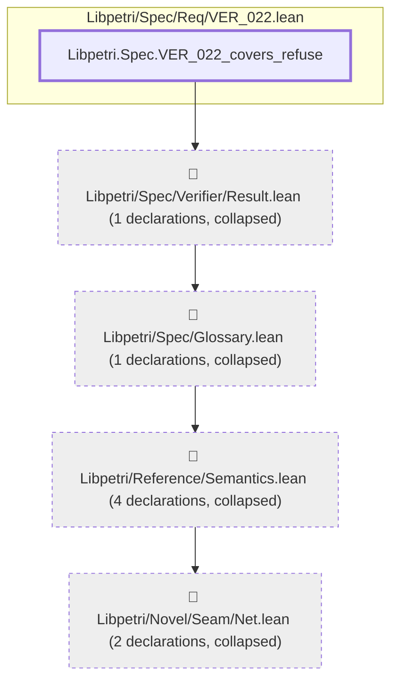

#### `Libpetri.Spec.VER_022_covers_refuse` → `Libpetri.Spec.OpenNet.Closed.envPlaces`

> Rule: this theorem's tree has 184 nodes, still 121 with other files collapsed, so it is split by direct dependency; this part has 3 nodes, other files collapsed.


#### `Libpetri.Spec.VER_022_covers_refuse` → `Libpetri.Spec.OpenNet.Closed.m0`

> Rule: this theorem's tree has 184 nodes, still 121 with other files collapsed, so it is split by direct dependency; this part has 4 nodes, other files collapsed.

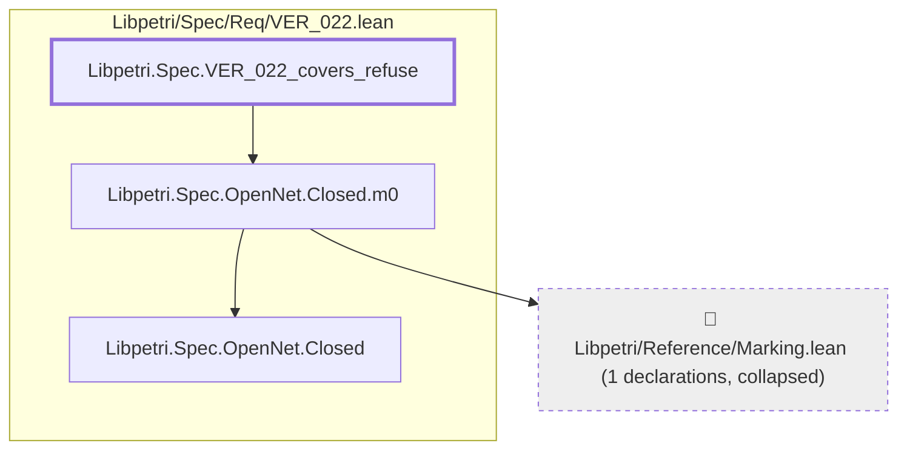

#### `Libpetri.Spec.VER_022_covers_refuse` → `Libpetri.Spec.OpenNet.Closed.net`

> Rule: this theorem's tree has 184 nodes, still 121 with other files collapsed, so it is split by direct dependency; this part has 4 nodes, other files collapsed.

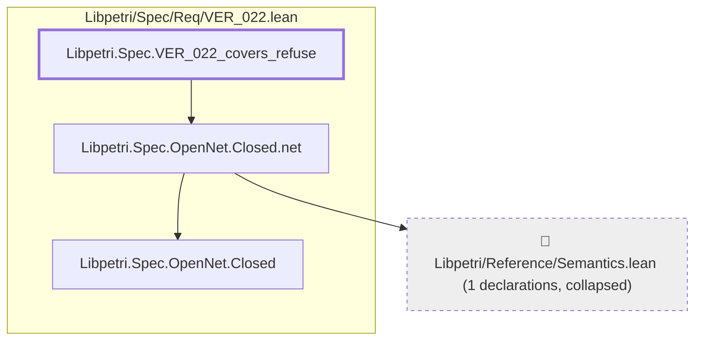

#### `Libpetri.Spec.VER_022_covers_refuse` → `Libpetri.Spec.OpenNet.Contract.terminate`

> Rule: this theorem's tree has 184 nodes, still 121 with other files collapsed, so it is split by direct dependency; this part has 3 nodes, other files collapsed.

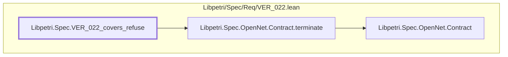

#### `Libpetri.Spec.VER_022_covers_refuse` → `Libpetri.Spec.OpenNet.GraphCloses`

> Rule: this theorem's tree has 184 nodes, still 121 with other files collapsed, so it is split by direct dependency; this part has 18 nodes, other files collapsed.

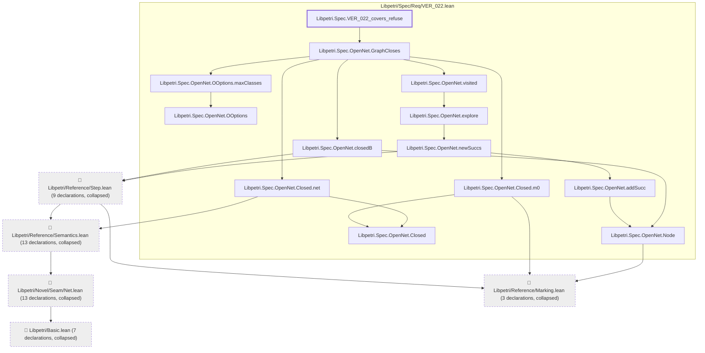

#### `Libpetri.Spec.VER_022_covers_refuse` → `Libpetri.Spec.OpenNet.OOptions.maxClasses`

> Rule: this theorem's tree has 184 nodes, still 121 with other files collapsed, so it is split by direct dependency; this part has 3 nodes, other files collapsed.

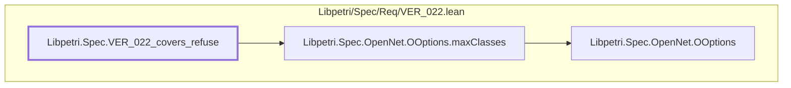

#### `Libpetri.Spec.VER_022_covers_refuse` → `Libpetri.Spec.OpenNet.OOptions.mk`

> Rule: this theorem's tree has 184 nodes, still 121 with other files collapsed, so it is split by direct dependency; this part has 3 nodes, other files collapsed.

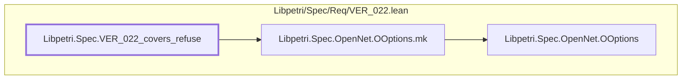

#### `Libpetri.Spec.VER_022_covers_refuse` → `Libpetri.Spec.OpenNet.OResult.mk`

> Rule: this theorem's tree has 184 nodes, still 121 with other files collapsed, so it is split by direct dependency; this part has 5 nodes, other files collapsed.

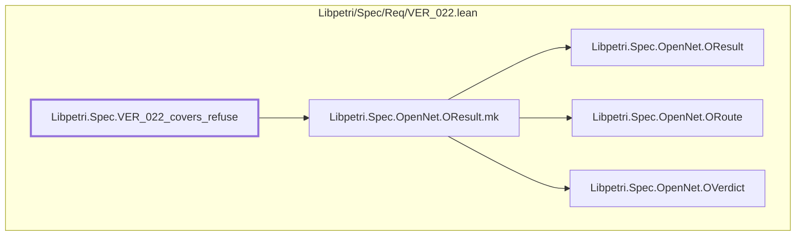

#### `Libpetri.Spec.VER_022_covers_refuse` → `Libpetri.Spec.OpenNet.OResult.verdict`

> Rule: this theorem's tree has 184 nodes, still 121 with other files collapsed, so it is split by direct dependency; this part has 4 nodes, other files collapsed.

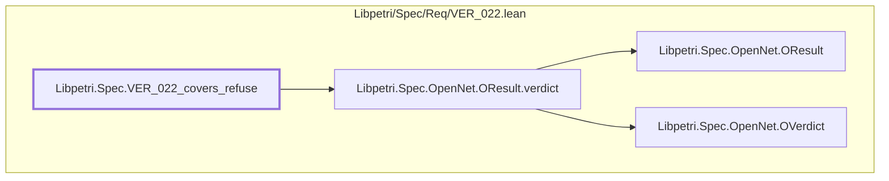

#### `Libpetri.Spec.VER_022_covers_refuse` → `Libpetri.Spec.OpenNet.ORoute.smt`

> Rule: this theorem's tree has 184 nodes, still 121 with other files collapsed, so it is split by direct dependency; this part has 3 nodes, other files collapsed.

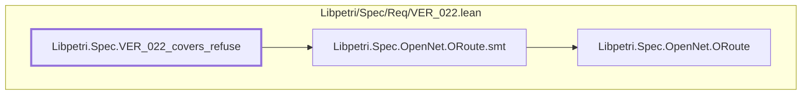

#### `Libpetri.Spec.VER_022_covers_refuse` → `Libpetri.Spec.OpenNet.OVerdict.proven`

> Rule: this theorem's tree has 184 nodes, still 121 with other files collapsed, so it is split by direct dependency; this part has 3 nodes, other files collapsed.

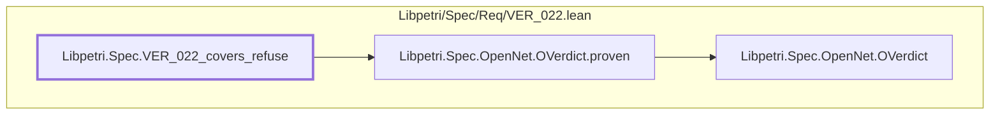

#### `Libpetri.Spec.VER_022_covers_refuse` → `Libpetri.Spec.OpenNet.OVerdict.unknown`

> Rule: this theorem's tree has 184 nodes, still 121 with other files collapsed, so it is split by direct dependency; this part has 3 nodes, other files collapsed.

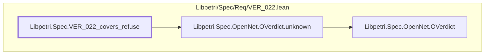

#### `Libpetri.Spec.VER_022_covers_refuse` → `Libpetri.Spec.OpenNet.OpenSubnet.hasMatch`

> Rule: this theorem's tree has 184 nodes, still 121 with other files collapsed, so it is split by direct dependency; this part has 3 nodes, other files collapsed.

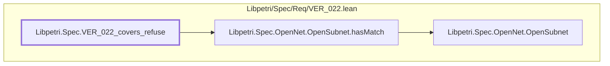

#### `Libpetri.Spec.VER_022_covers_refuse` → `Libpetri.Spec.OpenNet.OpenSubnet.mk`

> Rule: this theorem's tree has 184 nodes, still 121 with other files collapsed, so it is split by direct dependency; this part has 4 nodes, other files collapsed.


#### `Libpetri.Spec.VER_022_covers_refuse` → `Libpetri.Spec.OpenNet.OpenSubnet.net`

> Rule: this theorem's tree has 184 nodes, still 121 with other files collapsed, so it is split by direct dependency; this part has 4 nodes, other files collapsed.

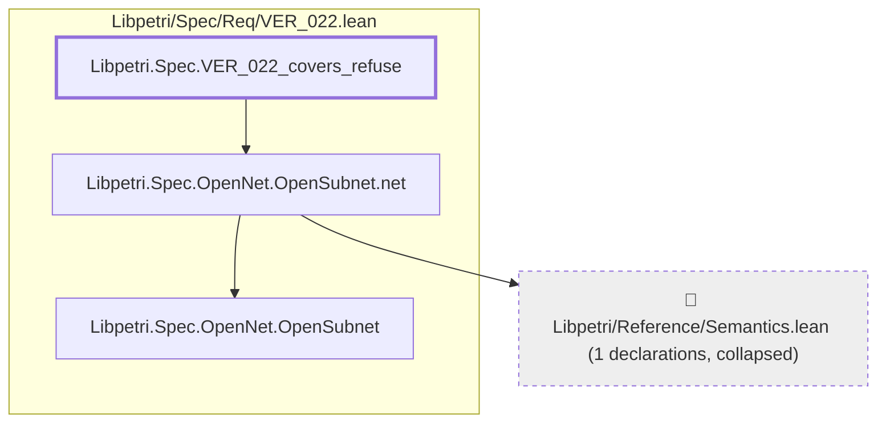

#### `Libpetri.Spec.VER_022_covers_refuse` → `Libpetri.Spec.OpenNet.Quiet`

> Rule: this theorem's tree has 184 nodes, still 121 with other files collapsed, so it is split by direct dependency; this part has 7 nodes, other files collapsed.

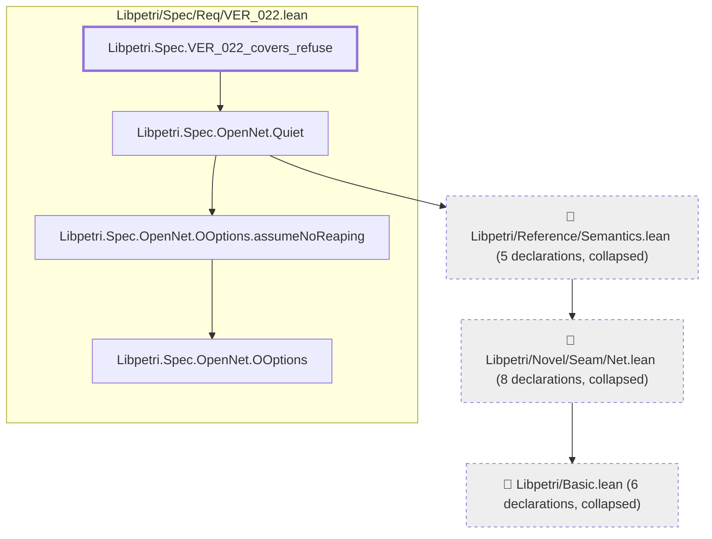

#### `Libpetri.Spec.VER_022_covers_refuse` → `Libpetri.Spec.OpenNet.refClose`

> Rule: this theorem's tree has 184 nodes, still 121 with other files collapsed, so it is split by direct dependency; this part has 52 nodes, other files collapsed.

```mermaid
flowchart TD
  subgraph g0["Libpetri/Spec/Req/VER_022.lean"]
    n9296["Libpetri.Spec.OpenNet.Clause"]
    n9301["Libpetri.Spec.OpenNet.Clause.places"]
    n9304["Libpetri.Spec.OpenNet.CloseFn"]
    n9305["Libpetri.Spec.OpenNet.Closed"]
    n9309["Libpetri.Spec.OpenNet.Closed.mk"]
    n9311["Libpetri.Spec.OpenNet.Contract"]
    n9312["Libpetri.Spec.OpenNet.Contract.clauses"]
    n9313["Libpetri.Spec.OpenNet.Contract.env"]
    n9314["Libpetri.Spec.OpenNet.Contract.groups"]
    n9315["Libpetri.Spec.OpenNet.Contract.init"]
    n9317["Libpetri.Spec.OpenNet.Contract.rest"]
    n9318["Libpetri.Spec.OpenNet.Contract.terminals"]
    n9322["Libpetri.Spec.OpenNet.Group"]
    n9323["Libpetri.Spec.OpenNet.Group.max"]
    n9324["Libpetri.Spec.OpenNet.Group.min"]
    n9326["Libpetri.Spec.OpenNet.Group.places"]
    n9358["Libpetri.Spec.OpenNet.Terminal"]
    n9359["Libpetri.Spec.OpenNet.Terminal.excused"]
    n9360["Libpetri.Spec.OpenNet.Terminal.marker"]
    n9372["Libpetri.Spec.OpenNet.arrName"]
    n9376["Libpetri.Spec.OpenNet.claims"]
    n9385["Libpetri.Spec.OpenNet.closeNet"]
    n9389["Libpetri.Spec.OpenNet.closureNames"]
    n9390["Libpetri.Spec.OpenNet.closureSources"]
    n9391["Libpetri.Spec.OpenNet.closureTrans"]
    n9394["Libpetri.Spec.OpenNet.contractNamed"]
    n9398["Libpetri.Spec.OpenNet.declName"]
    n9399["Libpetri.Spec.OpenNet.envNames"]
    n9400["Libpetri.Spec.OpenNet.envPlacesOf"]
    n9406["Libpetri.Spec.OpenNet.freshFails"]
    n9417["Libpetri.Spec.OpenNet.groupNames"]
    n9418["Libpetri.Spec.OpenNet.groupSources"]
    n9419["Libpetri.Spec.OpenNet.groupTrans"]
    n9446["Libpetri.Spec.OpenNet.manSrc"]
    n9452["Libpetri.Spec.OpenNet.moveT"]
    n9453["Libpetri.Spec.OpenNet.namesFrom"]
    n9454["Libpetri.Spec.OpenNet.netNames"]
    n9455["Libpetri.Spec.OpenNet.netPlaceNames"]
    n9459["Libpetri.Spec.OpenNet.nub"]
    n9461["Libpetri.Spec.OpenNet.optName"]
    n9462["Libpetri.Spec.OpenNet.optSrc"]
    n9464["Libpetri.Spec.OpenNet.outNames"]
    n9469["Libpetri.Spec.OpenNet.refClose"]
    n9488["Libpetri.Spec.OpenNet.sourcesFrom"]
    n9508["Libpetri.Spec.OpenNet.transFrom"]
    n9510["Libpetri.Spec.OpenNet.transPlaces"]
    n9513["Libpetri.Spec.OpenNet.undeclaredOf"]
    n10815["Libpetri.Spec.VER_022_covers_refuse"]
  end
  c0["📁 Libpetri/Basic.lean (2 declarations, collapsed)"]
  c54["📁 Libpetri/Novel/Seam/Net.lean (10 declarations, collapsed)"]
  c86["📁 Libpetri/Reference/Marking.lean (3 declarations, collapsed)"]
  c94["📁 Libpetri/Reference/Semantics.lean (15 declarations, collapsed)"]
  c54 --> c0
  c94 --> c54
  n9301 --> n9296
  n9304 --> c94
  n9304 --> n9305
  n9304 --> n9311
  n9309 --> c86
  n9309 --> c94
  n9309 --> n9305
  n9312 --> n9296
  n9312 --> n9311
  n9313 --> c94
  n9313 --> n9311
  n9314 --> n9311
  n9314 --> n9322
  n9315 --> n9311
  n9317 --> n9311
  n9318 --> n9311
  n9318 --> n9358
  n9323 --> n9322
  n9324 --> n9322
  n9326 --> n9322
  n9359 --> n9358
  n9360 --> n9358
  n9376 --> n9389
  n9376 --> n9399
  n9376 --> n9400
  n9385 --> n9309
  n9385 --> n9390
  n9385 --> n9391
  n9385 --> n9399
  n9385 --> n9513
  n9389 --> n9314
  n9389 --> n9453
  n9390 --> n9314
  n9390 --> n9488
  n9391 --> n9314
  n9391 --> n9508
  n9394 --> n9301
  n9394 --> n9312
  n9394 --> n9314
  n9394 --> n9315
  n9394 --> n9317
  n9394 --> n9318
  n9394 --> n9326
  n9394 --> n9359
  n9394 --> n9360
  n9399 --> n9313
  n9400 --> n9313
  n9400 --> n9455
  n9400 --> n9459
  n9417 --> n9323
  n9417 --> n9324
  n9417 --> n9326
  n9417 --> n9372
  n9417 --> n9398
  n9417 --> n9446
  n9417 --> n9461
  n9417 --> n9462
  n9418 --> n9323
  n9418 --> n9324
  n9418 --> n9446
  n9418 --> n9462
  n9419 --> n9323
  n9419 --> n9324
  n9419 --> n9326
  n9419 --> n9372
  n9419 --> n9398
  n9419 --> n9446
  n9419 --> n9452
  n9419 --> n9461
  n9419 --> n9462
  n9452 --> c94
  n9453 --> n9417
  n9454 --> n9455
  n9455 --> n9510
  n9464 --> c94
  n9469 --> n9304
  n9469 --> n9376
  n9469 --> n9385
  n9469 --> n9406
  n9469 --> n9454
  n9488 --> n9418
  n9508 --> n9419
  n9510 --> n9464
  n9513 --> n9394
  n9513 --> n9400
  n10815 --> n9469
  classDef root stroke-width:3px
  classDef locked fill:#fff3cd,stroke:#b8860b
  classDef collapsed fill:#eeeeee,stroke-dasharray:4 4
  class n10815 root
  class c0,c54,c86,c94 collapsed
```

#### `Libpetri.Spec.VER_022_covers_refuse` → `Libpetri.Spec.OpenNet.refMeets`

> Rule: this theorem's tree has 184 nodes, still 121 with other files collapsed, so it is split by direct dependency; this part has 21 nodes, other files collapsed.

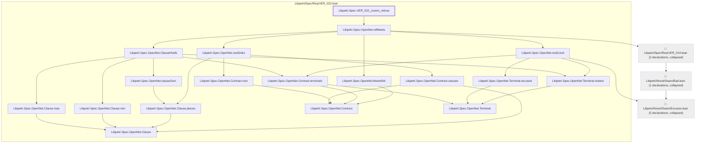

#### `Libpetri.Spec.VER_022_covers_refuse` → `Libpetri.Spec.OpenNet.relayC`

> Rule: this theorem's tree has 184 nodes, still 121 with other files collapsed, so it is split by direct dependency; this part has 10 nodes, other files collapsed.

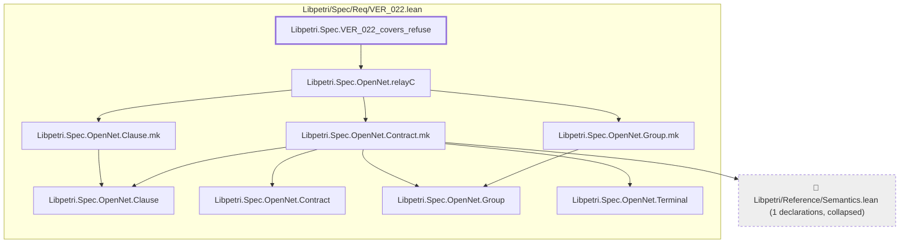

#### `Libpetri.Spec.VER_022_covers_refuse` → `Libpetri.Spec.OpenNet.relayNet`

> Rule: this theorem's tree has 184 nodes, still 121 with other files collapsed, so it is split by direct dependency; this part has 6 nodes, other files collapsed.

```mermaid
flowchart TD
  subgraph g0["Libpetri/Spec/Req/VER_022.lean"]
    n9474["Libpetri.Spec.OpenNet.relayNet"]
    n9477["Libpetri.Spec.OpenNet.relayT"]
    n10815["Libpetri.Spec.VER_022_covers_refuse"]
  end
  c0["📁 Libpetri/Basic.lean (2 declarations, collapsed)"]
  c54["📁 Libpetri/Novel/Seam/Net.lean (4 declarations, collapsed)"]
  c94["📁 Libpetri/Reference/Semantics.lean (6 declarations, collapsed)"]
  c54 --> c0
  c94 --> c54
  n9474 --> n9477
  n9477 --> c94
  n10815 --> n9474
  classDef root stroke-width:3px
  classDef locked fill:#fff3cd,stroke:#b8860b
  classDef collapsed fill:#eeeeee,stroke-dasharray:4 4
  class n10815 root
  class c0,c54,c94 collapsed
```

#### `Libpetri.Spec.VER_022_covers_refuse` → `Libpetri.Spec.OpenNet.relayX`

> Rule: this theorem's tree has 184 nodes, still 121 with other files collapsed, so it is split by direct dependency; this part has 51 nodes, other files collapsed.

```mermaid
flowchart TD
  subgraph g0["Libpetri/Spec/Req/VER_022.lean"]
    n9296["Libpetri.Spec.OpenNet.Clause"]
    n9299["Libpetri.Spec.OpenNet.Clause.mk"]
    n9301["Libpetri.Spec.OpenNet.Clause.places"]
    n9305["Libpetri.Spec.OpenNet.Closed"]
    n9309["Libpetri.Spec.OpenNet.Closed.mk"]
    n9311["Libpetri.Spec.OpenNet.Contract"]
    n9312["Libpetri.Spec.OpenNet.Contract.clauses"]
    n9313["Libpetri.Spec.OpenNet.Contract.env"]
    n9314["Libpetri.Spec.OpenNet.Contract.groups"]
    n9315["Libpetri.Spec.OpenNet.Contract.init"]
    n9316["Libpetri.Spec.OpenNet.Contract.mk"]
    n9317["Libpetri.Spec.OpenNet.Contract.rest"]
    n9318["Libpetri.Spec.OpenNet.Contract.terminals"]
    n9322["Libpetri.Spec.OpenNet.Group"]
    n9323["Libpetri.Spec.OpenNet.Group.max"]
    n9324["Libpetri.Spec.OpenNet.Group.min"]
    n9325["Libpetri.Spec.OpenNet.Group.mk"]
    n9326["Libpetri.Spec.OpenNet.Group.places"]
    n9358["Libpetri.Spec.OpenNet.Terminal"]
    n9359["Libpetri.Spec.OpenNet.Terminal.excused"]
    n9360["Libpetri.Spec.OpenNet.Terminal.marker"]
    n9372["Libpetri.Spec.OpenNet.arrName"]
    n9385["Libpetri.Spec.OpenNet.closeNet"]
    n9390["Libpetri.Spec.OpenNet.closureSources"]
    n9391["Libpetri.Spec.OpenNet.closureTrans"]
    n9394["Libpetri.Spec.OpenNet.contractNamed"]
    n9398["Libpetri.Spec.OpenNet.declName"]
    n9399["Libpetri.Spec.OpenNet.envNames"]
    n9400["Libpetri.Spec.OpenNet.envPlacesOf"]
    n9418["Libpetri.Spec.OpenNet.groupSources"]
    n9419["Libpetri.Spec.OpenNet.groupTrans"]
    n9446["Libpetri.Spec.OpenNet.manSrc"]
    n9452["Libpetri.Spec.OpenNet.moveT"]
    n9455["Libpetri.Spec.OpenNet.netPlaceNames"]
    n9459["Libpetri.Spec.OpenNet.nub"]
    n9461["Libpetri.Spec.OpenNet.optName"]
    n9462["Libpetri.Spec.OpenNet.optSrc"]
    n9464["Libpetri.Spec.OpenNet.outNames"]
    n9473["Libpetri.Spec.OpenNet.relayC"]
    n9474["Libpetri.Spec.OpenNet.relayNet"]
    n9477["Libpetri.Spec.OpenNet.relayT"]
    n9478["Libpetri.Spec.OpenNet.relayX"]
    n9488["Libpetri.Spec.OpenNet.sourcesFrom"]
    n9508["Libpetri.Spec.OpenNet.transFrom"]
    n9510["Libpetri.Spec.OpenNet.transPlaces"]
    n9513["Libpetri.Spec.OpenNet.undeclaredOf"]
    n10815["Libpetri.Spec.VER_022_covers_refuse"]
  end
  c0["📁 Libpetri/Basic.lean (2 declarations, collapsed)"]
  c54["📁 Libpetri/Novel/Seam/Net.lean (10 declarations, collapsed)"]
  c86["📁 Libpetri/Reference/Marking.lean (3 declarations, collapsed)"]
  c94["📁 Libpetri/Reference/Semantics.lean (15 declarations, collapsed)"]
  c54 --> c0
  c94 --> c54
  n9299 --> n9296
  n9301 --> n9296
  n9309 --> c86
  n9309 --> c94
  n9309 --> n9305
  n9312 --> n9296
  n9312 --> n9311
  n9313 --> c94
  n9313 --> n9311
  n9314 --> n9311
  n9314 --> n9322
  n9315 --> n9311
  n9316 --> c94
  n9316 --> n9296
  n9316 --> n9311
  n9316 --> n9322
  n9316 --> n9358
  n9317 --> n9311
  n9318 --> n9311
  n9318 --> n9358
  n9323 --> n9322
  n9324 --> n9322
  n9325 --> n9322
  n9326 --> n9322
  n9359 --> n9358
  n9360 --> n9358
  n9385 --> n9309
  n9385 --> n9390
  n9385 --> n9391
  n9385 --> n9399
  n9385 --> n9513
  n9390 --> n9314
  n9390 --> n9488
  n9391 --> n9314
  n9391 --> n9508
  n9394 --> n9301
  n9394 --> n9312
  n9394 --> n9314
  n9394 --> n9315
  n9394 --> n9317
  n9394 --> n9318
  n9394 --> n9326
  n9394 --> n9359
  n9394 --> n9360
  n9399 --> n9313
  n9400 --> n9313
  n9400 --> n9455
  n9400 --> n9459
  n9418 --> n9323
  n9418 --> n9324
  n9418 --> n9446
  n9418 --> n9462
  n9419 --> n9323
  n9419 --> n9324
  n9419 --> n9326
  n9419 --> n9372
  n9419 --> n9398
  n9419 --> n9446
  n9419 --> n9452
  n9419 --> n9461
  n9419 --> n9462
  n9452 --> c94
  n9455 --> n9510
  n9464 --> c94
  n9473 --> n9299
  n9473 --> n9316
  n9473 --> n9325
  n9474 --> n9477
  n9477 --> c94
  n9478 --> n9385
  n9478 --> n9473
  n9478 --> n9474
  n9488 --> n9418
  n9508 --> n9419
  n9510 --> n9464
  n9513 --> n9394
  n9513 --> n9400
  n10815 --> n9478
  classDef root stroke-width:3px
  classDef locked fill:#fff3cd,stroke:#b8860b
  classDef collapsed fill:#eeeeee,stroke-dasharray:4 4
  class n10815 root
  class c0,c54,c86,c94 collapsed
```

#### `Libpetri.Spec.VER_022_covers_refuse` → `Libpetri.Spec.OpenNet.relay_close`

> Rule: this theorem's tree has 184 nodes, still 121 with other files collapsed, so it is split by direct dependency; this part has 60 nodes, other files collapsed.

```mermaid
flowchart TD
  subgraph g0["Libpetri/Spec/Req/VER_022.lean"]
    n9296["Libpetri.Spec.OpenNet.Clause"]
    n9299["Libpetri.Spec.OpenNet.Clause.mk"]
    n9301["Libpetri.Spec.OpenNet.Clause.places"]
    n9304["Libpetri.Spec.OpenNet.CloseFn"]
    n9305["Libpetri.Spec.OpenNet.Closed"]
    n9309["Libpetri.Spec.OpenNet.Closed.mk"]
    n9311["Libpetri.Spec.OpenNet.Contract"]
    n9312["Libpetri.Spec.OpenNet.Contract.clauses"]
    n9313["Libpetri.Spec.OpenNet.Contract.env"]
    n9314["Libpetri.Spec.OpenNet.Contract.groups"]
    n9315["Libpetri.Spec.OpenNet.Contract.init"]
    n9316["Libpetri.Spec.OpenNet.Contract.mk"]
    n9317["Libpetri.Spec.OpenNet.Contract.rest"]
    n9318["Libpetri.Spec.OpenNet.Contract.terminals"]
    n9322["Libpetri.Spec.OpenNet.Group"]
    n9323["Libpetri.Spec.OpenNet.Group.max"]
    n9324["Libpetri.Spec.OpenNet.Group.min"]
    n9325["Libpetri.Spec.OpenNet.Group.mk"]
    n9326["Libpetri.Spec.OpenNet.Group.places"]
    n9358["Libpetri.Spec.OpenNet.Terminal"]
    n9359["Libpetri.Spec.OpenNet.Terminal.excused"]
    n9360["Libpetri.Spec.OpenNet.Terminal.marker"]
    n9372["Libpetri.Spec.OpenNet.arrName"]
    n9376["Libpetri.Spec.OpenNet.claims"]
    n9385["Libpetri.Spec.OpenNet.closeNet"]
    n9389["Libpetri.Spec.OpenNet.closureNames"]
    n9390["Libpetri.Spec.OpenNet.closureSources"]
    n9391["Libpetri.Spec.OpenNet.closureTrans"]
    n9394["Libpetri.Spec.OpenNet.contractNamed"]
    n9398["Libpetri.Spec.OpenNet.declName"]
    n9399["Libpetri.Spec.OpenNet.envNames"]
    n9400["Libpetri.Spec.OpenNet.envPlacesOf"]
    n9406["Libpetri.Spec.OpenNet.freshFails"]
    n9417["Libpetri.Spec.OpenNet.groupNames"]
    n9418["Libpetri.Spec.OpenNet.groupSources"]
    n9419["Libpetri.Spec.OpenNet.groupTrans"]
    n9446["Libpetri.Spec.OpenNet.manSrc"]
    n9452["Libpetri.Spec.OpenNet.moveT"]
    n9453["Libpetri.Spec.OpenNet.namesFrom"]
    n9454["Libpetri.Spec.OpenNet.netNames"]
    n9455["Libpetri.Spec.OpenNet.netPlaceNames"]
    n9459["Libpetri.Spec.OpenNet.nub"]
    n9461["Libpetri.Spec.OpenNet.optName"]
    n9462["Libpetri.Spec.OpenNet.optSrc"]
    n9464["Libpetri.Spec.OpenNet.outNames"]
    n9469["Libpetri.Spec.OpenNet.refClose"]
    n9473["Libpetri.Spec.OpenNet.relayC"]
    n9474["Libpetri.Spec.OpenNet.relayNet"]
    n9477["Libpetri.Spec.OpenNet.relayT"]
    n9478["Libpetri.Spec.OpenNet.relayX"]
    n9480["Libpetri.Spec.OpenNet.relay_close"]
    n9488["Libpetri.Spec.OpenNet.sourcesFrom"]
    n9508["Libpetri.Spec.OpenNet.transFrom"]
    n9510["Libpetri.Spec.OpenNet.transPlaces"]
    n9513["Libpetri.Spec.OpenNet.undeclaredOf"]
    n10815["Libpetri.Spec.VER_022_covers_refuse"]
  end
  c0["📁 Libpetri/Basic.lean (2 declarations, collapsed)"]
  c54["📁 Libpetri/Novel/Seam/Net.lean (10 declarations, collapsed)"]
  c86["📁 Libpetri/Reference/Marking.lean (3 declarations, collapsed)"]
  c94["📁 Libpetri/Reference/Semantics.lean (15 declarations, collapsed)"]
  c54 --> c0
  c94 --> c54
  n9299 --> n9296
  n9301 --> n9296
  n9304 --> c94
  n9304 --> n9305
  n9304 --> n9311
  n9309 --> c86
  n9309 --> c94
  n9309 --> n9305
  n9312 --> n9296
  n9312 --> n9311
  n9313 --> c94
  n9313 --> n9311
  n9314 --> n9311
  n9314 --> n9322
  n9315 --> n9311
  n9316 --> c94
  n9316 --> n9296
  n9316 --> n9311
  n9316 --> n9322
  n9316 --> n9358
  n9317 --> n9311
  n9318 --> n9311
  n9318 --> n9358
  n9323 --> n9322
  n9324 --> n9322
  n9325 --> n9322
  n9326 --> n9322
  n9359 --> n9358
  n9360 --> n9358
  n9376 --> n9389
  n9376 --> n9399
  n9376 --> n9400
  n9385 --> n9309
  n9385 --> n9390
  n9385 --> n9391
  n9385 --> n9399
  n9385 --> n9513
  n9389 --> n9314
  n9389 --> n9453
  n9390 --> n9314
  n9390 --> n9488
  n9391 --> n9314
  n9391 --> n9508
  n9394 --> n9301
  n9394 --> n9312
  n9394 --> n9314
  n9394 --> n9315
  n9394 --> n9317
  n9394 --> n9318
  n9394 --> n9326
  n9394 --> n9359
  n9394 --> n9360
  n9399 --> n9313
  n9400 --> n9313
  n9400 --> n9455
  n9400 --> n9459
  n9417 --> n9323
  n9417 --> n9324
  n9417 --> n9326
  n9417 --> n9372
  n9417 --> n9398
  n9417 --> n9446
  n9417 --> n9461
  n9417 --> n9462
  n9418 --> n9323
  n9418 --> n9324
  n9418 --> n9446
  n9418 --> n9462
  n9419 --> n9323
  n9419 --> n9324
  n9419 --> n9326
  n9419 --> n9372
  n9419 --> n9398
  n9419 --> n9446
  n9419 --> n9452
  n9419 --> n9461
  n9419 --> n9462
  n9452 --> c94
  n9453 --> n9417
  n9454 --> n9455
  n9455 --> n9510
  n9464 --> c94
  n9469 --> n9304
  n9469 --> n9376
  n9469 --> n9385
  n9469 --> n9406
  n9469 --> n9454
  n9473 --> n9299
  n9473 --> n9316
  n9473 --> n9325
  n9474 --> n9477
  n9477 --> c94
  n9478 --> n9385
  n9478 --> n9473
  n9478 --> n9474
  n9480 --> n9469
  n9480 --> n9478
  n9488 --> n9418
  n9508 --> n9419
  n9510 --> n9464
  n9513 --> n9394
  n9513 --> n9400
  n10815 --> n9480
  classDef root stroke-width:3px
  classDef locked fill:#fff3cd,stroke:#b8860b
  classDef collapsed fill:#eeeeee,stroke-dasharray:4 4
  class n10815 root
  class c0,c54,c86,c94 collapsed
```

#### `Libpetri.Spec.VER_022_covers_refuse` → `Libpetri.Spec.ReachF`

> Rule: this theorem's tree has 184 nodes, still 121 with other files collapsed, so it is split by direct dependency; this part has 5 nodes, other files collapsed.

```mermaid
flowchart TD
  subgraph g0["Libpetri/Spec/Req/VER_022.lean"]
    n10815["Libpetri.Spec.VER_022_covers_refuse"]
  end
  c54["📁 Libpetri/Novel/Seam/Net.lean (2 declarations, collapsed)"]
  c94["📁 Libpetri/Reference/Semantics.lean (4 declarations, collapsed)"]
  c132["📁 Libpetri/Spec/Glossary.lean (1 declarations, collapsed)"]
  c367["📁 Libpetri/Spec/Verifier/Result.lean (2 declarations, collapsed)"]
  c94 --> c54
  c132 --> c94
  c367 --> c132
  n10815 --> c367
  classDef root stroke-width:3px
  classDef locked fill:#fff3cd,stroke:#b8860b
  classDef collapsed fill:#eeeeee,stroke-dasharray:4 4
  class n10815 root
  class c54,c94,c132,c367 collapsed
```

#### `Libpetri.Spec.VER_022_covers_refuse` → `Libpetri.Spec.RefFire`

> Rule: this theorem's tree has 184 nodes, still 121 with other files collapsed, so it is split by direct dependency; this part has 6 nodes, other files collapsed.

```mermaid
flowchart TD
  subgraph g0["Libpetri/Spec/Req/VER_022.lean"]
    n10815["Libpetri.Spec.VER_022_covers_refuse"]
  end
  c0["📁 Libpetri/Basic.lean (7 declarations, collapsed)"]
  c28["📁 Libpetri/Novel/ForwardDeposit.lean (3 declarations, collapsed)"]
  c54["📁 Libpetri/Novel/Seam/Net.lean (13 declarations, collapsed)"]
  c94["📁 Libpetri/Reference/Semantics.lean (16 declarations, collapsed)"]
  c132["📁 Libpetri/Spec/Glossary.lean (2 declarations, collapsed)"]
  c54 --> c0
  c94 --> c28
  c94 --> c54
  c132 --> c94
  n10815 --> c132
  classDef root stroke-width:3px
  classDef locked fill:#fff3cd,stroke:#b8860b
  classDef collapsed fill:#eeeeee,stroke-dasharray:4 4
  class n10815 root
  class c0,c28,c54,c94,c132 collapsed
```

#### `Libpetri.Spec.VER_022_covers_refuse` → `Libpetri.Spec.VER_022`

> Rule: this theorem's tree has 184 nodes, still 121 with other files collapsed, so it is split by direct dependency; this part has 59 nodes, other files collapsed.

```mermaid
flowchart TD
  subgraph g0["Libpetri/Spec/Req/VER_022.lean"]
    n9296["Libpetri.Spec.OpenNet.Clause"]
    n9297["Libpetri.Spec.OpenNet.Clause.max"]
    n9298["Libpetri.Spec.OpenNet.Clause.min"]
    n9300["Libpetri.Spec.OpenNet.Clause.name"]
    n9301["Libpetri.Spec.OpenNet.Clause.places"]
    n9302["Libpetri.Spec.OpenNet.ClauseHolds"]
    n9304["Libpetri.Spec.OpenNet.CloseFn"]
    n9305["Libpetri.Spec.OpenNet.Closed"]
    n9306["Libpetri.Spec.OpenNet.Closed.envPlaces"]
    n9308["Libpetri.Spec.OpenNet.Closed.m0"]
    n9310["Libpetri.Spec.OpenNet.Closed.net"]
    n9311["Libpetri.Spec.OpenNet.Contract"]
    n9312["Libpetri.Spec.OpenNet.Contract.clauses"]
    n9317["Libpetri.Spec.OpenNet.Contract.rest"]
    n9318["Libpetri.Spec.OpenNet.Contract.terminals"]
    n9319["Libpetri.Spec.OpenNet.Contract.terminate"]
    n9327["Libpetri.Spec.OpenNet.MeetsRel"]
    n9329["Libpetri.Spec.OpenNet.OOptions"]
    n9330["Libpetri.Spec.OpenNet.OOptions.assumeNoReaping"]
    n9334["Libpetri.Spec.OpenNet.OResult"]
    n9336["Libpetri.Spec.OpenNet.OResult.route"]
    n9337["Libpetri.Spec.OpenNet.OResult.verdict"]
    n9338["Libpetri.Spec.OpenNet.ORoute"]
    n9342["Libpetri.Spec.OpenNet.ORoute.smt"]
    n9343["Libpetri.Spec.OpenNet.OVerdict"]
    n9344["Libpetri.Spec.OpenNet.OVerdict.proven"]
    n9345["Libpetri.Spec.OpenNet.OVerdict.unknown"]
    n9346["Libpetri.Spec.OpenNet.OVerdict.violated"]
    n9347["Libpetri.Spec.OpenNet.OpenSubnet"]
    n9348["Libpetri.Spec.OpenNet.OpenSubnet.hasMatch"]
    n9350["Libpetri.Spec.OpenNet.OpenSubnet.net"]
    n9351["Libpetri.Spec.OpenNet.OpenVerifier"]
    n9353["Libpetri.Spec.OpenNet.Part"]
    n9354["Libpetri.Spec.OpenNet.Part.clause"]
    n9355["Libpetri.Spec.OpenNet.Part.stranded"]
    n9356["Libpetri.Spec.OpenNet.Part.termination"]
    n9357["Libpetri.Spec.OpenNet.Quiet"]
    n9358["Libpetri.Spec.OpenNet.Terminal"]
    n9359["Libpetri.Spec.OpenNet.Terminal.excused"]
    n9360["Libpetri.Spec.OpenNet.Terminal.marker"]
    n9362["Libpetri.Spec.OpenNet.Witness"]
    n9363["Libpetri.Spec.OpenNet.Witness.confirmed"]
    n9364["Libpetri.Spec.OpenNet.Witness.cycleStart"]
    n9365["Libpetri.Spec.OpenNet.Witness.endM"]
    n9367["Libpetri.Spec.OpenNet.Witness.part"]
    n9368["Libpetri.Spec.OpenNet.Witness.trace"]
    n9380["Libpetri.Spec.OpenNet.clauseSum"]
    n9483["Libpetri.Spec.OpenNet.restCond"]
    n9484["Libpetri.Spec.OpenNet.restSinks"]
    n10802["Libpetri.Spec.VER_022"]
    n10815["Libpetri.Spec.VER_022_covers_refuse"]
  end
  c0["📁 Libpetri/Basic.lean (6 declarations, collapsed)"]
  c52["📁 Libpetri/Novel/Seam/Excuses.lean (2 declarations, collapsed)"]
  c54["📁 Libpetri/Novel/Seam/Net.lean (9 declarations, collapsed)"]
  c86["📁 Libpetri/Reference/Marking.lean (2 declarations, collapsed)"]
  c94["📁 Libpetri/Reference/Semantics.lean (5 declarations, collapsed)"]
  c132["📁 Libpetri/Spec/Glossary.lean (1 declarations, collapsed)"]
  c351["📁 Libpetri/Spec/Req/VER_014.lean (1 declarations, collapsed)"]
  c367["📁 Libpetri/Spec/Verifier/Result.lean (3 declarations, collapsed)"]
  c54 --> c0
  c94 --> c54
  c132 --> c94
  c351 --> c52
  c367 --> c132
  n9297 --> n9296
  n9298 --> n9296
  n9300 --> n9296
  n9301 --> n9296
  n9302 --> n9297
  n9302 --> n9298
  n9302 --> n9318
  n9302 --> n9360
  n9302 --> n9380
  n9304 --> c94
  n9304 --> n9305
  n9304 --> n9311
  n9306 --> n9305
  n9308 --> c86
  n9308 --> n9305
  n9310 --> c94
  n9310 --> n9305
  n9312 --> n9296
  n9312 --> n9311
  n9317 --> n9311
  n9318 --> n9311
  n9318 --> n9358
  n9319 --> n9311
  n9327 --> n9311
  n9330 --> n9329
  n9336 --> n9334
  n9336 --> n9338
  n9337 --> n9334
  n9337 --> n9343
  n9342 --> n9338
  n9344 --> n9343
  n9345 --> n9343
  n9346 --> n9343
  n9346 --> n9362
  n9348 --> n9347
  n9350 --> c94
  n9350 --> n9347
  n9351 --> n9311
  n9351 --> n9329
  n9351 --> n9334
  n9351 --> n9347
  n9354 --> n9353
  n9355 --> n9353
  n9356 --> n9353
  n9357 --> c94
  n9357 --> n9330
  n9359 --> n9358
  n9360 --> n9358
  n9363 --> n9362
  n9364 --> n9362
  n9365 --> c86
  n9365 --> n9362
  n9367 --> n9353
  n9367 --> n9362
  n9368 --> n9362
  n9380 --> n9301
  n9483 --> c52
  n9483 --> n9318
  n9483 --> n9359
  n9483 --> n9360
  n9484 --> n9301
  n9484 --> n9312
  n9484 --> n9317
  n10802 --> c351
  n10802 --> c367
  n10802 --> n9300
  n10802 --> n9302
  n10802 --> n9304
  n10802 --> n9306
  n10802 --> n9308
  n10802 --> n9310
  n10802 --> n9319
  n10802 --> n9327
  n10802 --> n9336
  n10802 --> n9337
  n10802 --> n9342
  n10802 --> n9344
  n10802 --> n9345
  n10802 --> n9346
  n10802 --> n9348
  n10802 --> n9350
  n10802 --> n9351
  n10802 --> n9354
  n10802 --> n9355
  n10802 --> n9356
  n10802 --> n9357
  n10802 --> n9363
  n10802 --> n9364
  n10802 --> n9365
  n10802 --> n9367
  n10802 --> n9368
  n10802 --> n9483
  n10802 --> n9484
  n10815 --> n10802
  classDef root stroke-width:3px
  classDef locked fill:#fff3cd,stroke:#b8860b
  classDef collapsed fill:#eeeeee,stroke-dasharray:4 4
  class n10815 root
  class c0,c52,c54,c86,c94,c132,c351,c367 collapsed
```

#### `Libpetri.Spec.VER_022_covers_refuse` → `Libpetri.Spec.Ver022Covers`

> Rule: this theorem's tree has 184 nodes, still 121 with other files collapsed, so it is split by direct dependency; this part has 36 nodes, other files collapsed.

```mermaid
flowchart TD
  subgraph g0["Libpetri/Spec/Req/VER_022.lean"]
    n9304["Libpetri.Spec.OpenNet.CloseFn"]
    n9305["Libpetri.Spec.OpenNet.Closed"]
    n9306["Libpetri.Spec.OpenNet.Closed.envPlaces"]
    n9308["Libpetri.Spec.OpenNet.Closed.m0"]
    n9310["Libpetri.Spec.OpenNet.Closed.net"]
    n9311["Libpetri.Spec.OpenNet.Contract"]
    n9319["Libpetri.Spec.OpenNet.Contract.terminate"]
    n9321["Libpetri.Spec.OpenNet.GraphCloses"]
    n9327["Libpetri.Spec.OpenNet.MeetsRel"]
    n9328["Libpetri.Spec.OpenNet.Node"]
    n9329["Libpetri.Spec.OpenNet.OOptions"]
    n9330["Libpetri.Spec.OpenNet.OOptions.assumeNoReaping"]
    n9331["Libpetri.Spec.OpenNet.OOptions.maxClasses"]
    n9334["Libpetri.Spec.OpenNet.OResult"]
    n9337["Libpetri.Spec.OpenNet.OResult.verdict"]
    n9343["Libpetri.Spec.OpenNet.OVerdict"]
    n9344["Libpetri.Spec.OpenNet.OVerdict.proven"]
    n9347["Libpetri.Spec.OpenNet.OpenSubnet"]
    n9348["Libpetri.Spec.OpenNet.OpenSubnet.hasMatch"]
    n9350["Libpetri.Spec.OpenNet.OpenSubnet.net"]
    n9351["Libpetri.Spec.OpenNet.OpenVerifier"]
    n9357["Libpetri.Spec.OpenNet.Quiet"]
    n9369["Libpetri.Spec.OpenNet.addSucc"]
    n9387["Libpetri.Spec.OpenNet.closedB"]
    n9401["Libpetri.Spec.OpenNet.explore"]
    n9456["Libpetri.Spec.OpenNet.newSuccs"]
    n9514["Libpetri.Spec.OpenNet.visited"]
    n10815["Libpetri.Spec.VER_022_covers_refuse"]
    n10976["Libpetri.Spec.Ver022Covers"]
  end
  c0["📁 Libpetri/Basic.lean (7 declarations, collapsed)"]
  c54["📁 Libpetri/Novel/Seam/Net.lean (13 declarations, collapsed)"]
  c86["📁 Libpetri/Reference/Marking.lean (3 declarations, collapsed)"]
  c94["📁 Libpetri/Reference/Semantics.lean (14 declarations, collapsed)"]
  c96["📁 Libpetri/Reference/Step.lean (9 declarations, collapsed)"]
  c132["📁 Libpetri/Spec/Glossary.lean (1 declarations, collapsed)"]
  c367["📁 Libpetri/Spec/Verifier/Result.lean (2 declarations, collapsed)"]
  c54 --> c0
  c94 --> c54
  c96 --> c86
  c96 --> c94
  c132 --> c94
  c367 --> c132
  n9304 --> c94
  n9304 --> n9305
  n9304 --> n9311
  n9306 --> n9305
  n9308 --> c86
  n9308 --> n9305
  n9310 --> c94
  n9310 --> n9305
  n9319 --> n9311
  n9321 --> n9308
  n9321 --> n9310
  n9321 --> n9331
  n9321 --> n9387
  n9321 --> n9514
  n9327 --> n9311
  n9328 --> c86
  n9330 --> n9329
  n9331 --> n9329
  n9337 --> n9334
  n9337 --> n9343
  n9344 --> n9343
  n9348 --> n9347
  n9350 --> c94
  n9350 --> n9347
  n9351 --> n9311
  n9351 --> n9329
  n9351 --> n9334
  n9351 --> n9347
  n9357 --> c94
  n9357 --> n9330
  n9369 --> n9328
  n9387 --> c96
  n9387 --> n9328
  n9401 --> n9456
  n9456 --> c96
  n9456 --> n9369
  n9514 --> n9401
  n10815 --> n10976
  n10976 --> c367
  n10976 --> n9304
  n10976 --> n9306
  n10976 --> n9319
  n10976 --> n9321
  n10976 --> n9327
  n10976 --> n9337
  n10976 --> n9344
  n10976 --> n9348
  n10976 --> n9350
  n10976 --> n9351
  n10976 --> n9357
  classDef root stroke-width:3px
  classDef locked fill:#fff3cd,stroke:#b8860b
  classDef collapsed fill:#eeeeee,stroke-dasharray:4 4
  class n10815 root
  class c0,c54,c86,c94,c96,c132,c367 collapsed
```

#### `Libpetri.Spec.VER_022_covers_refuse` → `Libpetri.Spec.refStrand`

> Rule: this theorem's tree has 184 nodes, still 121 with other files collapsed, so it is split by direct dependency; this part has 4 nodes, other files collapsed.

```mermaid
flowchart TD
  subgraph g0["Libpetri/Spec/Req/VER_022.lean"]
    n10815["Libpetri.Spec.VER_022_covers_refuse"]
  end
  c51["📁 Libpetri/Novel/Seam/Bad.lean (1 declarations, collapsed)"]
  c52["📁 Libpetri/Novel/Seam/Excuses.lean (4 declarations, collapsed)"]
  c351["📁 Libpetri/Spec/Req/VER_014.lean (2 declarations, collapsed)"]
  c51 --> c52
  c351 --> c51
  n10815 --> c351
  classDef root stroke-width:3px
  classDef locked fill:#fff3cd,stroke:#b8860b
  classDef collapsed fill:#eeeeee,stroke-dasharray:4 4
  class n10815 root
  class c51,c52,c351 collapsed
```

#### `Libpetri.Spec.VER_022_covers_refuse` → `Libpetri.Spec.ver022_of_silent`

> Rule: this theorem's tree has 184 nodes, still 121 with other files collapsed, so it is split by direct dependency; this part has 100 nodes, other files collapsed.

```mermaid
flowchart TD
  subgraph g0["Libpetri/Spec/Req/VER_022.lean"]
    n9296["Libpetri.Spec.OpenNet.Clause"]
    n9297["Libpetri.Spec.OpenNet.Clause.max"]
    n9298["Libpetri.Spec.OpenNet.Clause.min"]
    n9300["Libpetri.Spec.OpenNet.Clause.name"]
    n9301["Libpetri.Spec.OpenNet.Clause.places"]
    n9302["Libpetri.Spec.OpenNet.ClauseHolds"]
    n9304["Libpetri.Spec.OpenNet.CloseFn"]
    n9305["Libpetri.Spec.OpenNet.Closed"]
    n9306["Libpetri.Spec.OpenNet.Closed.envPlaces"]
    n9308["Libpetri.Spec.OpenNet.Closed.m0"]
    n9309["Libpetri.Spec.OpenNet.Closed.mk"]
    n9310["Libpetri.Spec.OpenNet.Closed.net"]
    n9311["Libpetri.Spec.OpenNet.Contract"]
    n9312["Libpetri.Spec.OpenNet.Contract.clauses"]
    n9313["Libpetri.Spec.OpenNet.Contract.env"]
    n9314["Libpetri.Spec.OpenNet.Contract.groups"]
    n9315["Libpetri.Spec.OpenNet.Contract.init"]
    n9317["Libpetri.Spec.OpenNet.Contract.rest"]
    n9318["Libpetri.Spec.OpenNet.Contract.terminals"]
    n9319["Libpetri.Spec.OpenNet.Contract.terminate"]
    n9322["Libpetri.Spec.OpenNet.Group"]
    n9323["Libpetri.Spec.OpenNet.Group.max"]
    n9324["Libpetri.Spec.OpenNet.Group.min"]
    n9326["Libpetri.Spec.OpenNet.Group.places"]
    n9327["Libpetri.Spec.OpenNet.MeetsRel"]
    n9329["Libpetri.Spec.OpenNet.OOptions"]
    n9330["Libpetri.Spec.OpenNet.OOptions.assumeNoReaping"]
    n9334["Libpetri.Spec.OpenNet.OResult"]
    n9335["Libpetri.Spec.OpenNet.OResult.mk"]
    n9336["Libpetri.Spec.OpenNet.OResult.route"]
    n9337["Libpetri.Spec.OpenNet.OResult.verdict"]
    n9338["Libpetri.Spec.OpenNet.ORoute"]
    n9342["Libpetri.Spec.OpenNet.ORoute.smt"]
    n9343["Libpetri.Spec.OpenNet.OVerdict"]
    n9344["Libpetri.Spec.OpenNet.OVerdict.proven"]
    n9345["Libpetri.Spec.OpenNet.OVerdict.unknown"]
    n9346["Libpetri.Spec.OpenNet.OVerdict.violated"]
    n9347["Libpetri.Spec.OpenNet.OpenSubnet"]
    n9348["Libpetri.Spec.OpenNet.OpenSubnet.hasMatch"]
    n9350["Libpetri.Spec.OpenNet.OpenSubnet.net"]
    n9351["Libpetri.Spec.OpenNet.OpenVerifier"]
    n9353["Libpetri.Spec.OpenNet.Part"]
    n9354["Libpetri.Spec.OpenNet.Part.clause"]
    n9355["Libpetri.Spec.OpenNet.Part.stranded"]
    n9356["Libpetri.Spec.OpenNet.Part.termination"]
    n9357["Libpetri.Spec.OpenNet.Quiet"]
    n9358["Libpetri.Spec.OpenNet.Terminal"]
    n9359["Libpetri.Spec.OpenNet.Terminal.excused"]
    n9360["Libpetri.Spec.OpenNet.Terminal.marker"]
    n9362["Libpetri.Spec.OpenNet.Witness"]
    n9363["Libpetri.Spec.OpenNet.Witness.confirmed"]
    n9364["Libpetri.Spec.OpenNet.Witness.cycleStart"]
    n9365["Libpetri.Spec.OpenNet.Witness.endM"]
    n9367["Libpetri.Spec.OpenNet.Witness.part"]
    n9368["Libpetri.Spec.OpenNet.Witness.trace"]
    n9372["Libpetri.Spec.OpenNet.arrName"]
    n9376["Libpetri.Spec.OpenNet.claims"]
    n9380["Libpetri.Spec.OpenNet.clauseSum"]
    n9385["Libpetri.Spec.OpenNet.closeNet"]
    n9389["Libpetri.Spec.OpenNet.closureNames"]
    n9390["Libpetri.Spec.OpenNet.closureSources"]
    n9391["Libpetri.Spec.OpenNet.closureTrans"]
    n9394["Libpetri.Spec.OpenNet.contractNamed"]
    n9398["Libpetri.Spec.OpenNet.declName"]
    n9399["Libpetri.Spec.OpenNet.envNames"]
    n9400["Libpetri.Spec.OpenNet.envPlacesOf"]
    n9406["Libpetri.Spec.OpenNet.freshFails"]
    n9417["Libpetri.Spec.OpenNet.groupNames"]
    n9418["Libpetri.Spec.OpenNet.groupSources"]
    n9419["Libpetri.Spec.OpenNet.groupTrans"]
    n9446["Libpetri.Spec.OpenNet.manSrc"]
    n9452["Libpetri.Spec.OpenNet.moveT"]
    n9453["Libpetri.Spec.OpenNet.namesFrom"]
    n9454["Libpetri.Spec.OpenNet.netNames"]
    n9455["Libpetri.Spec.OpenNet.netPlaceNames"]
    n9459["Libpetri.Spec.OpenNet.nub"]
    n9461["Libpetri.Spec.OpenNet.optName"]
    n9462["Libpetri.Spec.OpenNet.optSrc"]
    n9464["Libpetri.Spec.OpenNet.outNames"]
    n9469["Libpetri.Spec.OpenNet.refClose"]
    n9471["Libpetri.Spec.OpenNet.refMeets"]
    n9483["Libpetri.Spec.OpenNet.restCond"]
    n9484["Libpetri.Spec.OpenNet.restSinks"]
    n9488["Libpetri.Spec.OpenNet.sourcesFrom"]
    n9508["Libpetri.Spec.OpenNet.transFrom"]
    n9510["Libpetri.Spec.OpenNet.transPlaces"]
    n9513["Libpetri.Spec.OpenNet.undeclaredOf"]
    n10802["Libpetri.Spec.VER_022"]
    n10815["Libpetri.Spec.VER_022_covers_refuse"]
    n21690["Libpetri.Spec.ver022_of_silent"]
  end
  c0["📁 Libpetri/Basic.lean (7 declarations, collapsed)"]
  c28["📁 Libpetri/Novel/ForwardDeposit.lean (3 declarations, collapsed)"]
  c51["📁 Libpetri/Novel/Seam/Bad.lean (1 declarations, collapsed)"]
  c52["📁 Libpetri/Novel/Seam/Excuses.lean (5 declarations, collapsed)"]
  c54["📁 Libpetri/Novel/Seam/Net.lean (16 declarations, collapsed)"]
  c86["📁 Libpetri/Reference/Marking.lean (4 declarations, collapsed)"]
  c94["📁 Libpetri/Reference/Semantics.lean (22 declarations, collapsed)"]
  c132["📁 Libpetri/Spec/Glossary.lean (2 declarations, collapsed)"]
  c351["📁 Libpetri/Spec/Req/VER_014.lean (2 declarations, collapsed)"]
  c367["📁 Libpetri/Spec/Verifier/Result.lean (3 declarations, collapsed)"]
  c51 --> c52
  c54 --> c0
  c94 --> c28
  c94 --> c54
  c132 --> c94
  c351 --> c51
  c367 --> c132
  n9297 --> n9296
  n9298 --> n9296
  n9300 --> n9296
  n9301 --> n9296
  n9302 --> n9297
  n9302 --> n9298
  n9302 --> n9318
  n9302 --> n9360
  n9302 --> n9380
  n9304 --> c94
  n9304 --> n9305
  n9304 --> n9311
  n9306 --> n9305
  n9308 --> c86
  n9308 --> n9305
  n9309 --> c86
  n9309 --> c94
  n9309 --> n9305
  n9310 --> c94
  n9310 --> n9305
  n9312 --> n9296
  n9312 --> n9311
  n9313 --> c94
  n9313 --> n9311
  n9314 --> n9311
  n9314 --> n9322
  n9315 --> n9311
  n9317 --> n9311
  n9318 --> n9311
  n9318 --> n9358
  n9319 --> n9311
  n9323 --> n9322
  n9324 --> n9322
  n9326 --> n9322
  n9327 --> n9311
  n9330 --> n9329
  n9335 --> n9334
  n9335 --> n9338
  n9335 --> n9343
  n9336 --> n9334
  n9336 --> n9338
  n9337 --> n9334
  n9337 --> n9343
  n9342 --> n9338
  n9344 --> n9343
  n9345 --> n9343
  n9346 --> n9343
  n9346 --> n9362
  n9348 --> n9347
  n9350 --> c94
  n9350 --> n9347
  n9351 --> n9311
  n9351 --> n9329
  n9351 --> n9334
  n9351 --> n9347
  n9354 --> n9353
  n9355 --> n9353
  n9356 --> n9353
  n9357 --> c94
  n9357 --> n9330
  n9359 --> n9358
  n9360 --> n9358
  n9363 --> n9362
  n9364 --> n9362
  n9365 --> c86
  n9365 --> n9362
  n9367 --> n9353
  n9367 --> n9362
  n9368 --> n9362
  n9376 --> n9389
  n9376 --> n9399
  n9376 --> n9400
  n9380 --> n9301
  n9385 --> n9309
  n9385 --> n9390
  n9385 --> n9391
  n9385 --> n9399
  n9385 --> n9513
  n9389 --> n9314
  n9389 --> n9453
  n9390 --> n9314
  n9390 --> n9488
  n9391 --> n9314
  n9391 --> n9508
  n9394 --> n9301
  n9394 --> n9312
  n9394 --> n9314
  n9394 --> n9315
  n9394 --> n9317
  n9394 --> n9318
  n9394 --> n9326
  n9394 --> n9359
  n9394 --> n9360
  n9399 --> n9313
  n9400 --> n9313
  n9400 --> n9455
  n9400 --> n9459
  n9417 --> n9323
  n9417 --> n9324
  n9417 --> n9326
  n9417 --> n9372
  n9417 --> n9398
  n9417 --> n9446
  n9417 --> n9461
  n9417 --> n9462
  n9418 --> n9323
  n9418 --> n9324
  n9418 --> n9446
  n9418 --> n9462
  n9419 --> n9323
  n9419 --> n9324
  n9419 --> n9326
  n9419 --> n9372
  n9419 --> n9398
  n9419 --> n9446
  n9419 --> n9452
  n9419 --> n9461
  n9419 --> n9462
  n9452 --> c94
  n9453 --> n9417
  n9454 --> n9455
  n9455 --> n9510
  n9464 --> c94
  n9469 --> n9304
  n9469 --> n9376
  n9469 --> n9385
  n9469 --> n9406
  n9469 --> n9454
  n9471 --> c351
  n9471 --> n9302
  n9471 --> n9327
  n9471 --> n9483
  n9471 --> n9484
  n9483 --> c52
  n9483 --> n9318
  n9483 --> n9359
  n9483 --> n9360
  n9484 --> n9301
  n9484 --> n9312
  n9484 --> n9317
  n9488 --> n9418
  n9508 --> n9419
  n9510 --> n9464
  n9513 --> n9394
  n9513 --> n9400
  n10802 --> c351
  n10802 --> c367
  n10802 --> n9300
  n10802 --> n9302
  n10802 --> n9304
  n10802 --> n9306
  n10802 --> n9308
  n10802 --> n9310
  n10802 --> n9319
  n10802 --> n9327
  n10802 --> n9336
  n10802 --> n9337
  n10802 --> n9342
  n10802 --> n9344
  n10802 --> n9345
  n10802 --> n9346
  n10802 --> n9348
  n10802 --> n9350
  n10802 --> n9351
  n10802 --> n9354
  n10802 --> n9355
  n10802 --> n9356
  n10802 --> n9357
  n10802 --> n9363
  n10802 --> n9364
  n10802 --> n9365
  n10802 --> n9367
  n10802 --> n9368
  n10802 --> n9483
  n10802 --> n9484
  n10815 --> n21690
  n21690 --> n9335
  n21690 --> n9469
  n21690 --> n9471
  n21690 --> n10802
  classDef root stroke-width:3px
  classDef locked fill:#fff3cd,stroke:#b8860b
  classDef collapsed fill:#eeeeee,stroke-dasharray:4 4
  class n10815 root
  class c0,c28,c51,c52,c54,c86,c94,c132,c351,c367 collapsed
```

#### `Libpetri.Spec.VER_022_covers_refuse` → `Libpetri.Spec.verifyRefuse`

> Rule: this theorem's tree has 184 nodes, still 121 with other files collapsed, so it is split by direct dependency; this part has 7 nodes, other files collapsed.

```mermaid
flowchart TD
  subgraph g0["Libpetri/Spec/Req/VER_022.lean"]
    n9311["Libpetri.Spec.OpenNet.Contract"]
    n9329["Libpetri.Spec.OpenNet.OOptions"]
    n9334["Libpetri.Spec.OpenNet.OResult"]
    n9347["Libpetri.Spec.OpenNet.OpenSubnet"]
    n9351["Libpetri.Spec.OpenNet.OpenVerifier"]
    n10815["Libpetri.Spec.VER_022_covers_refuse"]
    n21825["Libpetri.Spec.verifyRefuse"]
  end
  n9351 --> n9311
  n9351 --> n9329
  n9351 --> n9334
  n9351 --> n9347
  n10815 --> n21825
  n21825 --> n9351
  classDef root stroke-width:3px
  classDef locked fill:#fff3cd,stroke:#b8860b
  classDef collapsed fill:#eeeeee,stroke-dasharray:4 4
  class n10815 root
```

Shared leaves of `Libpetri.Spec.VER_022_covers_refuse` (direct dependencies too small for a diagram of their own, fewer than 3 nodes):

- `Libpetri.Reference.get` (`Libpetri/Reference/Marking.lean`)
- `Libpetri.Spec.OpenNet.Closed` (`Libpetri/Spec/Req/VER_022.lean`)
- `Libpetri.Spec.OpenNet.Contract` (`Libpetri/Spec/Req/VER_022.lean`)
- `Libpetri.Spec.OpenNet.OOptions` (`Libpetri/Spec/Req/VER_022.lean`)
- `Libpetri.Spec.OpenNet.OResult` (`Libpetri/Spec/Req/VER_022.lean`)
- `Libpetri.Spec.OpenNet.OVerdict` (`Libpetri/Spec/Req/VER_022.lean`)
- `Libpetri.Spec.OpenNet.OpenSubnet` (`Libpetri/Spec/Req/VER_022.lean`)

### `Libpetri.Spec.VER_022_covers_unknown`

#### `Libpetri.Spec.VER_022_covers_unknown` → `Libpetri.Spec.LStepF`

> Rule: this theorem's tree has 234 nodes, still 141 with other files collapsed, so it is split by direct dependency; this part has 5 nodes, other files collapsed.

```mermaid
flowchart TD
  subgraph g0["Libpetri/Spec/Req/VER_022.lean"]
    n10816["Libpetri.Spec.VER_022_covers_unknown"]
  end
  c54["📁 Libpetri/Novel/Seam/Net.lean (2 declarations, collapsed)"]
  c94["📁 Libpetri/Reference/Semantics.lean (4 declarations, collapsed)"]
  c132["📁 Libpetri/Spec/Glossary.lean (1 declarations, collapsed)"]
  c367["📁 Libpetri/Spec/Verifier/Result.lean (1 declarations, collapsed)"]
  c94 --> c54
  c132 --> c94
  c367 --> c132
  n10816 --> c367
  classDef root stroke-width:3px
  classDef locked fill:#fff3cd,stroke:#b8860b
  classDef collapsed fill:#eeeeee,stroke-dasharray:4 4
  class n10816 root
  class c54,c94,c132,c367 collapsed
```

#### `Libpetri.Spec.VER_022_covers_unknown` → `Libpetri.Spec.OpenNet.Closed.envPlaces`

> Rule: this theorem's tree has 234 nodes, still 141 with other files collapsed, so it is split by direct dependency; this part has 3 nodes, other files collapsed.

```mermaid
flowchart TD
  subgraph g0["Libpetri/Spec/Req/VER_022.lean"]
    n9305["Libpetri.Spec.OpenNet.Closed"]
    n9306["Libpetri.Spec.OpenNet.Closed.envPlaces"]
    n10816["Libpetri.Spec.VER_022_covers_unknown"]
  end
  n9306 --> n9305
  n10816 --> n9306
  classDef root stroke-width:3px
  classDef locked fill:#fff3cd,stroke:#b8860b
  classDef collapsed fill:#eeeeee,stroke-dasharray:4 4
  class n10816 root
```

#### `Libpetri.Spec.VER_022_covers_unknown` → `Libpetri.Spec.OpenNet.Closed.m0`

> Rule: this theorem's tree has 234 nodes, still 141 with other files collapsed, so it is split by direct dependency; this part has 4 nodes, other files collapsed.

```mermaid
flowchart TD
  subgraph g0["Libpetri/Spec/Req/VER_022.lean"]
    n9305["Libpetri.Spec.OpenNet.Closed"]
    n9308["Libpetri.Spec.OpenNet.Closed.m0"]
    n10816["Libpetri.Spec.VER_022_covers_unknown"]
  end
  c86["📁 Libpetri/Reference/Marking.lean (1 declarations, collapsed)"]
  n9308 --> c86
  n9308 --> n9305
  n10816 --> n9308
  classDef root stroke-width:3px
  classDef locked fill:#fff3cd,stroke:#b8860b
  classDef collapsed fill:#eeeeee,stroke-dasharray:4 4
  class n10816 root
  class c86 collapsed
```

#### `Libpetri.Spec.VER_022_covers_unknown` → `Libpetri.Spec.OpenNet.Closed.net`

> Rule: this theorem's tree has 234 nodes, still 141 with other files collapsed, so it is split by direct dependency; this part has 4 nodes, other files collapsed.

```mermaid
flowchart TD
  subgraph g0["Libpetri/Spec/Req/VER_022.lean"]
    n9305["Libpetri.Spec.OpenNet.Closed"]
    n9310["Libpetri.Spec.OpenNet.Closed.net"]
    n10816["Libpetri.Spec.VER_022_covers_unknown"]
  end
  c94["📁 Libpetri/Reference/Semantics.lean (1 declarations, collapsed)"]
  n9310 --> c94
  n9310 --> n9305
  n10816 --> n9310
  classDef root stroke-width:3px
  classDef locked fill:#fff3cd,stroke:#b8860b
  classDef collapsed fill:#eeeeee,stroke-dasharray:4 4
  class n10816 root
  class c94 collapsed
```

#### `Libpetri.Spec.VER_022_covers_unknown` → `Libpetri.Spec.OpenNet.Contract.terminate`

> Rule: this theorem's tree has 234 nodes, still 141 with other files collapsed, so it is split by direct dependency; this part has 3 nodes, other files collapsed.

```mermaid
flowchart TD
  subgraph g0["Libpetri/Spec/Req/VER_022.lean"]
    n9311["Libpetri.Spec.OpenNet.Contract"]
    n9319["Libpetri.Spec.OpenNet.Contract.terminate"]
    n10816["Libpetri.Spec.VER_022_covers_unknown"]
  end
  n9319 --> n9311
  n10816 --> n9319
  classDef root stroke-width:3px
  classDef locked fill:#fff3cd,stroke:#b8860b
  classDef collapsed fill:#eeeeee,stroke-dasharray:4 4
  class n10816 root
```

#### `Libpetri.Spec.VER_022_covers_unknown` → `Libpetri.Spec.OpenNet.GraphCloses`

> Rule: this theorem's tree has 234 nodes, still 141 with other files collapsed, so it is split by direct dependency; this part has 18 nodes, other files collapsed.

```mermaid
flowchart TD
  subgraph g0["Libpetri/Spec/Req/VER_022.lean"]
    n9305["Libpetri.Spec.OpenNet.Closed"]
    n9308["Libpetri.Spec.OpenNet.Closed.m0"]
    n9310["Libpetri.Spec.OpenNet.Closed.net"]
    n9321["Libpetri.Spec.OpenNet.GraphCloses"]
    n9328["Libpetri.Spec.OpenNet.Node"]
    n9329["Libpetri.Spec.OpenNet.OOptions"]
    n9331["Libpetri.Spec.OpenNet.OOptions.maxClasses"]
    n9369["Libpetri.Spec.OpenNet.addSucc"]
    n9387["Libpetri.Spec.OpenNet.closedB"]
    n9401["Libpetri.Spec.OpenNet.explore"]
    n9456["Libpetri.Spec.OpenNet.newSuccs"]
    n9514["Libpetri.Spec.OpenNet.visited"]
    n10816["Libpetri.Spec.VER_022_covers_unknown"]
  end
  c0["📁 Libpetri/Basic.lean (7 declarations, collapsed)"]
  c54["📁 Libpetri/Novel/Seam/Net.lean (13 declarations, collapsed)"]
  c86["📁 Libpetri/Reference/Marking.lean (3 declarations, collapsed)"]
  c94["📁 Libpetri/Reference/Semantics.lean (13 declarations, collapsed)"]
  c96["📁 Libpetri/Reference/Step.lean (9 declarations, collapsed)"]
  c54 --> c0
  c94 --> c54
  c96 --> c86
  c96 --> c94
  n9308 --> c86
  n9308 --> n9305
  n9310 --> c94
  n9310 --> n9305
  n9321 --> n9308
  n9321 --> n9310
  n9321 --> n9331
  n9321 --> n9387
  n9321 --> n9514
  n9328 --> c86
  n9331 --> n9329
  n9369 --> n9328
  n9387 --> c96
  n9387 --> n9328
  n9401 --> n9456
  n9456 --> c96
  n9456 --> n9369
  n9514 --> n9401
  n10816 --> n9321
  classDef root stroke-width:3px
  classDef locked fill:#fff3cd,stroke:#b8860b
  classDef collapsed fill:#eeeeee,stroke-dasharray:4 4
  class n10816 root
  class c0,c54,c86,c94,c96 collapsed
```

#### `Libpetri.Spec.VER_022_covers_unknown` → `Libpetri.Spec.OpenNet.OOptions.maxClasses`

> Rule: this theorem's tree has 234 nodes, still 141 with other files collapsed, so it is split by direct dependency; this part has 3 nodes, other files collapsed.

```mermaid
flowchart TD
  subgraph g0["Libpetri/Spec/Req/VER_022.lean"]
    n9329["Libpetri.Spec.OpenNet.OOptions"]
    n9331["Libpetri.Spec.OpenNet.OOptions.maxClasses"]
    n10816["Libpetri.Spec.VER_022_covers_unknown"]
  end
  n9331 --> n9329
  n10816 --> n9331
  classDef root stroke-width:3px
  classDef locked fill:#fff3cd,stroke:#b8860b
  classDef collapsed fill:#eeeeee,stroke-dasharray:4 4
  class n10816 root
```

#### `Libpetri.Spec.VER_022_covers_unknown` → `Libpetri.Spec.OpenNet.OOptions.mk`

> Rule: this theorem's tree has 234 nodes, still 141 with other files collapsed, so it is split by direct dependency; this part has 3 nodes, other files collapsed.

```mermaid
flowchart TD
  subgraph g0["Libpetri/Spec/Req/VER_022.lean"]
    n9329["Libpetri.Spec.OpenNet.OOptions"]
    n9332["Libpetri.Spec.OpenNet.OOptions.mk"]
    n10816["Libpetri.Spec.VER_022_covers_unknown"]
  end
  n9332 --> n9329
  n10816 --> n9332
  classDef root stroke-width:3px
  classDef locked fill:#fff3cd,stroke:#b8860b
  classDef collapsed fill:#eeeeee,stroke-dasharray:4 4
  class n10816 root
```

#### `Libpetri.Spec.VER_022_covers_unknown` → `Libpetri.Spec.OpenNet.OResult.mk`

> Rule: this theorem's tree has 234 nodes, still 141 with other files collapsed, so it is split by direct dependency; this part has 5 nodes, other files collapsed.

```mermaid
flowchart TD
  subgraph g0["Libpetri/Spec/Req/VER_022.lean"]
    n9334["Libpetri.Spec.OpenNet.OResult"]
    n9335["Libpetri.Spec.OpenNet.OResult.mk"]
    n9338["Libpetri.Spec.OpenNet.ORoute"]
    n9343["Libpetri.Spec.OpenNet.OVerdict"]
    n10816["Libpetri.Spec.VER_022_covers_unknown"]
  end
  n9335 --> n9334
  n9335 --> n9338
  n9335 --> n9343
  n10816 --> n9335
  classDef root stroke-width:3px
  classDef locked fill:#fff3cd,stroke:#b8860b
  classDef collapsed fill:#eeeeee,stroke-dasharray:4 4
  class n10816 root
```

#### `Libpetri.Spec.VER_022_covers_unknown` → `Libpetri.Spec.OpenNet.OResult.verdict`

> Rule: this theorem's tree has 234 nodes, still 141 with other files collapsed, so it is split by direct dependency; this part has 4 nodes, other files collapsed.

```mermaid
flowchart TD
  subgraph g0["Libpetri/Spec/Req/VER_022.lean"]
    n9334["Libpetri.Spec.OpenNet.OResult"]
    n9337["Libpetri.Spec.OpenNet.OResult.verdict"]
    n9343["Libpetri.Spec.OpenNet.OVerdict"]
    n10816["Libpetri.Spec.VER_022_covers_unknown"]
  end
  n9337 --> n9334
  n9337 --> n9343
  n10816 --> n9337
  classDef root stroke-width:3px
  classDef locked fill:#fff3cd,stroke:#b8860b
  classDef collapsed fill:#eeeeee,stroke-dasharray:4 4
  class n10816 root
```

#### `Libpetri.Spec.VER_022_covers_unknown` → `Libpetri.Spec.OpenNet.ORoute.smt`

> Rule: this theorem's tree has 234 nodes, still 141 with other files collapsed, so it is split by direct dependency; this part has 3 nodes, other files collapsed.

```mermaid
flowchart TD
  subgraph g0["Libpetri/Spec/Req/VER_022.lean"]
    n9338["Libpetri.Spec.OpenNet.ORoute"]
    n9342["Libpetri.Spec.OpenNet.ORoute.smt"]
    n10816["Libpetri.Spec.VER_022_covers_unknown"]
  end
  n9342 --> n9338
  n10816 --> n9342
  classDef root stroke-width:3px
  classDef locked fill:#fff3cd,stroke:#b8860b
  classDef collapsed fill:#eeeeee,stroke-dasharray:4 4
  class n10816 root
```

#### `Libpetri.Spec.VER_022_covers_unknown` → `Libpetri.Spec.OpenNet.OVerdict.proven`

> Rule: this theorem's tree has 234 nodes, still 141 with other files collapsed, so it is split by direct dependency; this part has 3 nodes, other files collapsed.

```mermaid
flowchart TD
  subgraph g0["Libpetri/Spec/Req/VER_022.lean"]
    n9343["Libpetri.Spec.OpenNet.OVerdict"]
    n9344["Libpetri.Spec.OpenNet.OVerdict.proven"]
    n10816["Libpetri.Spec.VER_022_covers_unknown"]
  end
  n9344 --> n9343
  n10816 --> n9344
  classDef root stroke-width:3px
  classDef locked fill:#fff3cd,stroke:#b8860b
  classDef collapsed fill:#eeeeee,stroke-dasharray:4 4
  class n10816 root
```

#### `Libpetri.Spec.VER_022_covers_unknown` → `Libpetri.Spec.OpenNet.OVerdict.unknown`

> Rule: this theorem's tree has 234 nodes, still 141 with other files collapsed, so it is split by direct dependency; this part has 3 nodes, other files collapsed.

```mermaid
flowchart TD
  subgraph g0["Libpetri/Spec/Req/VER_022.lean"]
    n9343["Libpetri.Spec.OpenNet.OVerdict"]
    n9345["Libpetri.Spec.OpenNet.OVerdict.unknown"]
    n10816["Libpetri.Spec.VER_022_covers_unknown"]
  end
  n9345 --> n9343
  n10816 --> n9345
  classDef root stroke-width:3px
  classDef locked fill:#fff3cd,stroke:#b8860b
  classDef collapsed fill:#eeeeee,stroke-dasharray:4 4
  class n10816 root
```

#### `Libpetri.Spec.VER_022_covers_unknown` → `Libpetri.Spec.OpenNet.OVerdict.violated`

> Rule: this theorem's tree has 234 nodes, still 141 with other files collapsed, so it is split by direct dependency; this part has 4 nodes, other files collapsed.

```mermaid
flowchart TD
  subgraph g0["Libpetri/Spec/Req/VER_022.lean"]
    n9343["Libpetri.Spec.OpenNet.OVerdict"]
    n9346["Libpetri.Spec.OpenNet.OVerdict.violated"]
    n9362["Libpetri.Spec.OpenNet.Witness"]
    n10816["Libpetri.Spec.VER_022_covers_unknown"]
  end
  n9346 --> n9343
  n9346 --> n9362
  n10816 --> n9346
  classDef root stroke-width:3px
  classDef locked fill:#fff3cd,stroke:#b8860b
  classDef collapsed fill:#eeeeee,stroke-dasharray:4 4
  class n10816 root
```

#### `Libpetri.Spec.VER_022_covers_unknown` → `Libpetri.Spec.OpenNet.OpenSubnet.hasMatch`

> Rule: this theorem's tree has 234 nodes, still 141 with other files collapsed, so it is split by direct dependency; this part has 3 nodes, other files collapsed.

```mermaid
flowchart TD
  subgraph g0["Libpetri/Spec/Req/VER_022.lean"]
    n9347["Libpetri.Spec.OpenNet.OpenSubnet"]
    n9348["Libpetri.Spec.OpenNet.OpenSubnet.hasMatch"]
    n10816["Libpetri.Spec.VER_022_covers_unknown"]
  end
  n9348 --> n9347
  n10816 --> n9348
  classDef root stroke-width:3px
  classDef locked fill:#fff3cd,stroke:#b8860b
  classDef collapsed fill:#eeeeee,stroke-dasharray:4 4
  class n10816 root
```

#### `Libpetri.Spec.VER_022_covers_unknown` → `Libpetri.Spec.OpenNet.OpenSubnet.mk`

> Rule: this theorem's tree has 234 nodes, still 141 with other files collapsed, so it is split by direct dependency; this part has 4 nodes, other files collapsed.

```mermaid
flowchart TD
  subgraph g0["Libpetri/Spec/Req/VER_022.lean"]
    n9347["Libpetri.Spec.OpenNet.OpenSubnet"]
    n9349["Libpetri.Spec.OpenNet.OpenSubnet.mk"]
    n10816["Libpetri.Spec.VER_022_covers_unknown"]
  end
  c94["📁 Libpetri/Reference/Semantics.lean (1 declarations, collapsed)"]
  n9349 --> c94
  n9349 --> n9347
  n10816 --> n9349
  classDef root stroke-width:3px
  classDef locked fill:#fff3cd,stroke:#b8860b
  classDef collapsed fill:#eeeeee,stroke-dasharray:4 4
  class n10816 root
  class c94 collapsed
```

#### `Libpetri.Spec.VER_022_covers_unknown` → `Libpetri.Spec.OpenNet.OpenSubnet.net`

> Rule: this theorem's tree has 234 nodes, still 141 with other files collapsed, so it is split by direct dependency; this part has 4 nodes, other files collapsed.

```mermaid
flowchart TD
  subgraph g0["Libpetri/Spec/Req/VER_022.lean"]
    n9347["Libpetri.Spec.OpenNet.OpenSubnet"]
    n9350["Libpetri.Spec.OpenNet.OpenSubnet.net"]
    n10816["Libpetri.Spec.VER_022_covers_unknown"]
  end
  c94["📁 Libpetri/Reference/Semantics.lean (1 declarations, collapsed)"]
  n9350 --> c94
  n9350 --> n9347
  n10816 --> n9350
  classDef root stroke-width:3px
  classDef locked fill:#fff3cd,stroke:#b8860b
  classDef collapsed fill:#eeeeee,stroke-dasharray:4 4
  class n10816 root
  class c94 collapsed
```

#### `Libpetri.Spec.VER_022_covers_unknown` → `Libpetri.Spec.OpenNet.Quiet`

> Rule: this theorem's tree has 234 nodes, still 141 with other files collapsed, so it is split by direct dependency; this part has 7 nodes, other files collapsed.

```mermaid
flowchart TD
  subgraph g0["Libpetri/Spec/Req/VER_022.lean"]
    n9329["Libpetri.Spec.OpenNet.OOptions"]
    n9330["Libpetri.Spec.OpenNet.OOptions.assumeNoReaping"]
    n9357["Libpetri.Spec.OpenNet.Quiet"]
    n10816["Libpetri.Spec.VER_022_covers_unknown"]
  end
  c0["📁 Libpetri/Basic.lean (6 declarations, collapsed)"]
  c54["📁 Libpetri/Novel/Seam/Net.lean (8 declarations, collapsed)"]
  c94["📁 Libpetri/Reference/Semantics.lean (5 declarations, collapsed)"]
  c54 --> c0
  c94 --> c54
  n9330 --> n9329
  n9357 --> c94
  n9357 --> n9330
  n10816 --> n9357
  classDef root stroke-width:3px
  classDef locked fill:#fff3cd,stroke:#b8860b
  classDef collapsed fill:#eeeeee,stroke-dasharray:4 4
  class n10816 root
  class c0,c54,c94 collapsed
```

#### `Libpetri.Spec.VER_022_covers_unknown` → `Libpetri.Spec.OpenNet.arrC`

> Rule: this theorem's tree has 234 nodes, still 141 with other files collapsed, so it is split by direct dependency; this part has 10 nodes, other files collapsed.

```mermaid
flowchart TD
  subgraph g0["Libpetri/Spec/Req/VER_022.lean"]
    n9296["Libpetri.Spec.OpenNet.Clause"]
    n9299["Libpetri.Spec.OpenNet.Clause.mk"]
    n9311["Libpetri.Spec.OpenNet.Contract"]
    n9316["Libpetri.Spec.OpenNet.Contract.mk"]
    n9322["Libpetri.Spec.OpenNet.Group"]
    n9325["Libpetri.Spec.OpenNet.Group.mk"]
    n9358["Libpetri.Spec.OpenNet.Terminal"]
    n9371["Libpetri.Spec.OpenNet.arrC"]
    n10816["Libpetri.Spec.VER_022_covers_unknown"]
  end
  c94["📁 Libpetri/Reference/Semantics.lean (1 declarations, collapsed)"]
  n9299 --> n9296
  n9316 --> c94
  n9316 --> n9296
  n9316 --> n9311
  n9316 --> n9322
  n9316 --> n9358
  n9325 --> n9322
  n9371 --> n9299
  n9371 --> n9316
  n9371 --> n9325
  n10816 --> n9371
  classDef root stroke-width:3px
  classDef locked fill:#fff3cd,stroke:#b8860b
  classDef collapsed fill:#eeeeee,stroke-dasharray:4 4
  class n10816 root
  class c94 collapsed
```

#### `Libpetri.Spec.VER_022_covers_unknown` → `Libpetri.Spec.OpenNet.closeNet`

> Rule: this theorem's tree has 234 nodes, still 141 with other files collapsed, so it is split by direct dependency; this part has 44 nodes, other files collapsed.

```mermaid
flowchart TD
  subgraph g0["Libpetri/Spec/Req/VER_022.lean"]
    n9296["Libpetri.Spec.OpenNet.Clause"]
    n9301["Libpetri.Spec.OpenNet.Clause.places"]
    n9305["Libpetri.Spec.OpenNet.Closed"]
    n9309["Libpetri.Spec.OpenNet.Closed.mk"]
    n9311["Libpetri.Spec.OpenNet.Contract"]
    n9312["Libpetri.Spec.OpenNet.Contract.clauses"]
    n9313["Libpetri.Spec.OpenNet.Contract.env"]
    n9314["Libpetri.Spec.OpenNet.Contract.groups"]
    n9315["Libpetri.Spec.OpenNet.Contract.init"]
    n9317["Libpetri.Spec.OpenNet.Contract.rest"]
    n9318["Libpetri.Spec.OpenNet.Contract.terminals"]
    n9322["Libpetri.Spec.OpenNet.Group"]
    n9323["Libpetri.Spec.OpenNet.Group.max"]
    n9324["Libpetri.Spec.OpenNet.Group.min"]
    n9326["Libpetri.Spec.OpenNet.Group.places"]
    n9358["Libpetri.Spec.OpenNet.Terminal"]
    n9359["Libpetri.Spec.OpenNet.Terminal.excused"]
    n9360["Libpetri.Spec.OpenNet.Terminal.marker"]
    n9372["Libpetri.Spec.OpenNet.arrName"]
    n9385["Libpetri.Spec.OpenNet.closeNet"]
    n9390["Libpetri.Spec.OpenNet.closureSources"]
    n9391["Libpetri.Spec.OpenNet.closureTrans"]
    n9394["Libpetri.Spec.OpenNet.contractNamed"]
    n9398["Libpetri.Spec.OpenNet.declName"]
    n9399["Libpetri.Spec.OpenNet.envNames"]
    n9400["Libpetri.Spec.OpenNet.envPlacesOf"]
    n9418["Libpetri.Spec.OpenNet.groupSources"]
    n9419["Libpetri.Spec.OpenNet.groupTrans"]
    n9446["Libpetri.Spec.OpenNet.manSrc"]
    n9452["Libpetri.Spec.OpenNet.moveT"]
    n9455["Libpetri.Spec.OpenNet.netPlaceNames"]
    n9459["Libpetri.Spec.OpenNet.nub"]
    n9461["Libpetri.Spec.OpenNet.optName"]
    n9462["Libpetri.Spec.OpenNet.optSrc"]
    n9464["Libpetri.Spec.OpenNet.outNames"]
    n9488["Libpetri.Spec.OpenNet.sourcesFrom"]
    n9508["Libpetri.Spec.OpenNet.transFrom"]
    n9510["Libpetri.Spec.OpenNet.transPlaces"]
    n9513["Libpetri.Spec.OpenNet.undeclaredOf"]
    n10816["Libpetri.Spec.VER_022_covers_unknown"]
  end
  c0["📁 Libpetri/Basic.lean (2 declarations, collapsed)"]
  c54["📁 Libpetri/Novel/Seam/Net.lean (10 declarations, collapsed)"]
  c86["📁 Libpetri/Reference/Marking.lean (3 declarations, collapsed)"]
  c94["📁 Libpetri/Reference/Semantics.lean (15 declarations, collapsed)"]
  c54 --> c0
  c94 --> c54
  n9301 --> n9296
  n9309 --> c86
  n9309 --> c94
  n9309 --> n9305
  n9312 --> n9296
  n9312 --> n9311
  n9313 --> c94
  n9313 --> n9311
  n9314 --> n9311
  n9314 --> n9322
  n9315 --> n9311
  n9317 --> n9311
  n9318 --> n9311
  n9318 --> n9358
  n9323 --> n9322
  n9324 --> n9322
  n9326 --> n9322
  n9359 --> n9358
  n9360 --> n9358
  n9385 --> n9309
  n9385 --> n9390
  n9385 --> n9391
  n9385 --> n9399
  n9385 --> n9513
  n9390 --> n9314
  n9390 --> n9488
  n9391 --> n9314
  n9391 --> n9508
  n9394 --> n9301
  n9394 --> n9312
  n9394 --> n9314
  n9394 --> n9315
  n9394 --> n9317
  n9394 --> n9318
  n9394 --> n9326
  n9394 --> n9359
  n9394 --> n9360
  n9399 --> n9313
  n9400 --> n9313
  n9400 --> n9455
  n9400 --> n9459
  n9418 --> n9323
  n9418 --> n9324
  n9418 --> n9446
  n9418 --> n9462
  n9419 --> n9323
  n9419 --> n9324
  n9419 --> n9326
  n9419 --> n9372
  n9419 --> n9398
  n9419 --> n9446
  n9419 --> n9452
  n9419 --> n9461
  n9419 --> n9462
  n9452 --> c94
  n9455 --> n9510
  n9464 --> c94
  n9488 --> n9418
  n9508 --> n9419
  n9510 --> n9464
  n9513 --> n9394
  n9513 --> n9400
  n10816 --> n9385
  classDef root stroke-width:3px
  classDef locked fill:#fff3cd,stroke:#b8860b
  classDef collapsed fill:#eeeeee,stroke-dasharray:4 4
  class n10816 root
  class c0,c54,c86,c94 collapsed
```

#### `Libpetri.Spec.VER_022_covers_unknown` → `Libpetri.Spec.OpenNet.idleNet`

> Rule: this theorem's tree has 234 nodes, still 141 with other files collapsed, so it is split by direct dependency; this part has 3 nodes, other files collapsed.

```mermaid
flowchart TD
  subgraph g0["Libpetri/Spec/Req/VER_022.lean"]
    n9422["Libpetri.Spec.OpenNet.idleNet"]
    n10816["Libpetri.Spec.VER_022_covers_unknown"]
  end
  c94["📁 Libpetri/Reference/Semantics.lean (3 declarations, collapsed)"]
  n9422 --> c94
  n10816 --> n9422
  classDef root stroke-width:3px
  classDef locked fill:#fff3cd,stroke:#b8860b
  classDef collapsed fill:#eeeeee,stroke-dasharray:4 4
  class n10816 root
  class c94 collapsed
```

#### `Libpetri.Spec.VER_022_covers_unknown` → `Libpetri.Spec.OpenNet.refClose`

> Rule: this theorem's tree has 234 nodes, still 141 with other files collapsed, so it is split by direct dependency; this part has 52 nodes, other files collapsed.

```mermaid
flowchart TD
  subgraph g0["Libpetri/Spec/Req/VER_022.lean"]
    n9296["Libpetri.Spec.OpenNet.Clause"]
    n9301["Libpetri.Spec.OpenNet.Clause.places"]
    n9304["Libpetri.Spec.OpenNet.CloseFn"]
    n9305["Libpetri.Spec.OpenNet.Closed"]
    n9309["Libpetri.Spec.OpenNet.Closed.mk"]
    n9311["Libpetri.Spec.OpenNet.Contract"]
    n9312["Libpetri.Spec.OpenNet.Contract.clauses"]
    n9313["Libpetri.Spec.OpenNet.Contract.env"]
    n9314["Libpetri.Spec.OpenNet.Contract.groups"]
    n9315["Libpetri.Spec.OpenNet.Contract.init"]
    n9317["Libpetri.Spec.OpenNet.Contract.rest"]
    n9318["Libpetri.Spec.OpenNet.Contract.terminals"]
    n9322["Libpetri.Spec.OpenNet.Group"]
    n9323["Libpetri.Spec.OpenNet.Group.max"]
    n9324["Libpetri.Spec.OpenNet.Group.min"]
    n9326["Libpetri.Spec.OpenNet.Group.places"]
    n9358["Libpetri.Spec.OpenNet.Terminal"]
    n9359["Libpetri.Spec.OpenNet.Terminal.excused"]
    n9360["Libpetri.Spec.OpenNet.Terminal.marker"]
    n9372["Libpetri.Spec.OpenNet.arrName"]
    n9376["Libpetri.Spec.OpenNet.claims"]
    n9385["Libpetri.Spec.OpenNet.closeNet"]
    n9389["Libpetri.Spec.OpenNet.closureNames"]
    n9390["Libpetri.Spec.OpenNet.closureSources"]
    n9391["Libpetri.Spec.OpenNet.closureTrans"]
    n9394["Libpetri.Spec.OpenNet.contractNamed"]
    n9398["Libpetri.Spec.OpenNet.declName"]
    n9399["Libpetri.Spec.OpenNet.envNames"]
    n9400["Libpetri.Spec.OpenNet.envPlacesOf"]
    n9406["Libpetri.Spec.OpenNet.freshFails"]
    n9417["Libpetri.Spec.OpenNet.groupNames"]
    n9418["Libpetri.Spec.OpenNet.groupSources"]
    n9419["Libpetri.Spec.OpenNet.groupTrans"]
    n9446["Libpetri.Spec.OpenNet.manSrc"]
    n9452["Libpetri.Spec.OpenNet.moveT"]
    n9453["Libpetri.Spec.OpenNet.namesFrom"]
    n9454["Libpetri.Spec.OpenNet.netNames"]
    n9455["Libpetri.Spec.OpenNet.netPlaceNames"]
    n9459["Libpetri.Spec.OpenNet.nub"]
    n9461["Libpetri.Spec.OpenNet.optName"]
    n9462["Libpetri.Spec.OpenNet.optSrc"]
    n9464["Libpetri.Spec.OpenNet.outNames"]
    n9469["Libpetri.Spec.OpenNet.refClose"]
    n9488["Libpetri.Spec.OpenNet.sourcesFrom"]
    n9508["Libpetri.Spec.OpenNet.transFrom"]
    n9510["Libpetri.Spec.OpenNet.transPlaces"]
    n9513["Libpetri.Spec.OpenNet.undeclaredOf"]
    n10816["Libpetri.Spec.VER_022_covers_unknown"]
  end
  c0["📁 Libpetri/Basic.lean (2 declarations, collapsed)"]
  c54["📁 Libpetri/Novel/Seam/Net.lean (10 declarations, collapsed)"]
  c86["📁 Libpetri/Reference/Marking.lean (3 declarations, collapsed)"]
  c94["📁 Libpetri/Reference/Semantics.lean (15 declarations, collapsed)"]
  c54 --> c0
  c94 --> c54
  n9301 --> n9296
  n9304 --> c94
  n9304 --> n9305
  n9304 --> n9311
  n9309 --> c86
  n9309 --> c94
  n9309 --> n9305
  n9312 --> n9296
  n9312 --> n9311
  n9313 --> c94
  n9313 --> n9311
  n9314 --> n9311
  n9314 --> n9322
  n9315 --> n9311
  n9317 --> n9311
  n9318 --> n9311
  n9318 --> n9358
  n9323 --> n9322
  n9324 --> n9322
  n9326 --> n9322
  n9359 --> n9358
  n9360 --> n9358
  n9376 --> n9389
  n9376 --> n9399
  n9376 --> n9400
  n9385 --> n9309
  n9385 --> n9390
  n9385 --> n9391
  n9385 --> n9399
  n9385 --> n9513
  n9389 --> n9314
  n9389 --> n9453
  n9390 --> n9314
  n9390 --> n9488
  n9391 --> n9314
  n9391 --> n9508
  n9394 --> n9301
  n9394 --> n9312
  n9394 --> n9314
  n9394 --> n9315
  n9394 --> n9317
  n9394 --> n9318
  n9394 --> n9326
  n9394 --> n9359
  n9394 --> n9360
  n9399 --> n9313
  n9400 --> n9313
  n9400 --> n9455
  n9400 --> n9459
  n9417 --> n9323
  n9417 --> n9324
  n9417 --> n9326
  n9417 --> n9372
  n9417 --> n9398
  n9417 --> n9446
  n9417 --> n9461
  n9417 --> n9462
  n9418 --> n9323
  n9418 --> n9324
  n9418 --> n9446
  n9418 --> n9462
  n9419 --> n9323
  n9419 --> n9324
  n9419 --> n9326
  n9419 --> n9372
  n9419 --> n9398
  n9419 --> n9446
  n9419 --> n9452
  n9419 --> n9461
  n9419 --> n9462
  n9452 --> c94
  n9453 --> n9417
  n9454 --> n9455
  n9455 --> n9510
  n9464 --> c94
  n9469 --> n9304
  n9469 --> n9376
  n9469 --> n9385
  n9469 --> n9406
  n9469 --> n9454
  n9488 --> n9418
  n9508 --> n9419
  n9510 --> n9464
  n9513 --> n9394
  n9513 --> n9400
  n10816 --> n9469
  classDef root stroke-width:3px
  classDef locked fill:#fff3cd,stroke:#b8860b
  classDef collapsed fill:#eeeeee,stroke-dasharray:4 4
  class n10816 root
  class c0,c54,c86,c94 collapsed
```

#### `Libpetri.Spec.VER_022_covers_unknown` → `Libpetri.Spec.OpenNet.refMeets`

> Rule: this theorem's tree has 234 nodes, still 141 with other files collapsed, so it is split by direct dependency; this part has 21 nodes, other files collapsed.

```mermaid
flowchart TD
  subgraph g0["Libpetri/Spec/Req/VER_022.lean"]
    n9296["Libpetri.Spec.OpenNet.Clause"]
    n9297["Libpetri.Spec.OpenNet.Clause.max"]
    n9298["Libpetri.Spec.OpenNet.Clause.min"]
    n9301["Libpetri.Spec.OpenNet.Clause.places"]
    n9302["Libpetri.Spec.OpenNet.ClauseHolds"]
    n9311["Libpetri.Spec.OpenNet.Contract"]
    n9312["Libpetri.Spec.OpenNet.Contract.clauses"]
    n9317["Libpetri.Spec.OpenNet.Contract.rest"]
    n9318["Libpetri.Spec.OpenNet.Contract.terminals"]
    n9327["Libpetri.Spec.OpenNet.MeetsRel"]
    n9358["Libpetri.Spec.OpenNet.Terminal"]
    n9359["Libpetri.Spec.OpenNet.Terminal.excused"]
    n9360["Libpetri.Spec.OpenNet.Terminal.marker"]
    n9380["Libpetri.Spec.OpenNet.clauseSum"]
    n9471["Libpetri.Spec.OpenNet.refMeets"]
    n9483["Libpetri.Spec.OpenNet.restCond"]
    n9484["Libpetri.Spec.OpenNet.restSinks"]
    n10816["Libpetri.Spec.VER_022_covers_unknown"]
  end
  c51["📁 Libpetri/Novel/Seam/Bad.lean (1 declarations, collapsed)"]
  c52["📁 Libpetri/Novel/Seam/Excuses.lean (5 declarations, collapsed)"]
  c351["📁 Libpetri/Spec/Req/VER_014.lean (2 declarations, collapsed)"]
  c51 --> c52
  c351 --> c51
  n9297 --> n9296
  n9298 --> n9296
  n9301 --> n9296
  n9302 --> n9297
  n9302 --> n9298
  n9302 --> n9318
  n9302 --> n9360
  n9302 --> n9380
  n9312 --> n9296
  n9312 --> n9311
  n9317 --> n9311
  n9318 --> n9311
  n9318 --> n9358
  n9327 --> n9311
  n9359 --> n9358
  n9360 --> n9358
  n9380 --> n9301
  n9471 --> c351
  n9471 --> n9302
  n9471 --> n9327
  n9471 --> n9483
  n9471 --> n9484
  n9483 --> c52
  n9483 --> n9318
  n9483 --> n9359
  n9483 --> n9360
  n9484 --> n9301
  n9484 --> n9312
  n9484 --> n9317
  n10816 --> n9471
  classDef root stroke-width:3px
  classDef locked fill:#fff3cd,stroke:#b8860b
  classDef collapsed fill:#eeeeee,stroke-dasharray:4 4
  class n10816 root
  class c51,c52,c351 collapsed
```

#### `Libpetri.Spec.VER_022_covers_unknown` → `Libpetri.Spec.ReachF`

> Rule: this theorem's tree has 234 nodes, still 141 with other files collapsed, so it is split by direct dependency; this part has 5 nodes, other files collapsed.

```mermaid
flowchart TD
  subgraph g0["Libpetri/Spec/Req/VER_022.lean"]
    n10816["Libpetri.Spec.VER_022_covers_unknown"]
  end
  c54["📁 Libpetri/Novel/Seam/Net.lean (2 declarations, collapsed)"]
  c94["📁 Libpetri/Reference/Semantics.lean (4 declarations, collapsed)"]
  c132["📁 Libpetri/Spec/Glossary.lean (1 declarations, collapsed)"]
  c367["📁 Libpetri/Spec/Verifier/Result.lean (2 declarations, collapsed)"]
  c94 --> c54
  c132 --> c94
  c367 --> c132
  n10816 --> c367
  classDef root stroke-width:3px
  classDef locked fill:#fff3cd,stroke:#b8860b
  classDef collapsed fill:#eeeeee,stroke-dasharray:4 4
  class n10816 root
  class c54,c94,c132,c367 collapsed
```

#### `Libpetri.Spec.VER_022_covers_unknown` → `Libpetri.Spec.RefFire`

> Rule: this theorem's tree has 234 nodes, still 141 with other files collapsed, so it is split by direct dependency; this part has 6 nodes, other files collapsed.

```mermaid
flowchart TD
  subgraph g0["Libpetri/Spec/Req/VER_022.lean"]
    n10816["Libpetri.Spec.VER_022_covers_unknown"]
  end
  c0["📁 Libpetri/Basic.lean (7 declarations, collapsed)"]
  c28["📁 Libpetri/Novel/ForwardDeposit.lean (3 declarations, collapsed)"]
  c54["📁 Libpetri/Novel/Seam/Net.lean (13 declarations, collapsed)"]
  c94["📁 Libpetri/Reference/Semantics.lean (16 declarations, collapsed)"]
  c132["📁 Libpetri/Spec/Glossary.lean (2 declarations, collapsed)"]
  c54 --> c0
  c94 --> c28
  c94 --> c54
  c132 --> c94
  n10816 --> c132
  classDef root stroke-width:3px
  classDef locked fill:#fff3cd,stroke:#b8860b
  classDef collapsed fill:#eeeeee,stroke-dasharray:4 4
  class n10816 root
  class c0,c28,c54,c94,c132 collapsed
```

#### `Libpetri.Spec.VER_022_covers_unknown` → `Libpetri.Spec.VER_022`

> Rule: this theorem's tree has 234 nodes, still 141 with other files collapsed, so it is split by direct dependency; this part has 59 nodes, other files collapsed.

```mermaid
flowchart TD
  subgraph g0["Libpetri/Spec/Req/VER_022.lean"]
    n9296["Libpetri.Spec.OpenNet.Clause"]
    n9297["Libpetri.Spec.OpenNet.Clause.max"]
    n9298["Libpetri.Spec.OpenNet.Clause.min"]
    n9300["Libpetri.Spec.OpenNet.Clause.name"]
    n9301["Libpetri.Spec.OpenNet.Clause.places"]
    n9302["Libpetri.Spec.OpenNet.ClauseHolds"]
    n9304["Libpetri.Spec.OpenNet.CloseFn"]
    n9305["Libpetri.Spec.OpenNet.Closed"]
    n9306["Libpetri.Spec.OpenNet.Closed.envPlaces"]
    n9308["Libpetri.Spec.OpenNet.Closed.m0"]
    n9310["Libpetri.Spec.OpenNet.Closed.net"]
    n9311["Libpetri.Spec.OpenNet.Contract"]
    n9312["Libpetri.Spec.OpenNet.Contract.clauses"]
    n9317["Libpetri.Spec.OpenNet.Contract.rest"]
    n9318["Libpetri.Spec.OpenNet.Contract.terminals"]
    n9319["Libpetri.Spec.OpenNet.Contract.terminate"]
    n9327["Libpetri.Spec.OpenNet.MeetsRel"]
    n9329["Libpetri.Spec.OpenNet.OOptions"]
    n9330["Libpetri.Spec.OpenNet.OOptions.assumeNoReaping"]
    n9334["Libpetri.Spec.OpenNet.OResult"]
    n9336["Libpetri.Spec.OpenNet.OResult.route"]
    n9337["Libpetri.Spec.OpenNet.OResult.verdict"]
    n9338["Libpetri.Spec.OpenNet.ORoute"]
    n9342["Libpetri.Spec.OpenNet.ORoute.smt"]
    n9343["Libpetri.Spec.OpenNet.OVerdict"]
    n9344["Libpetri.Spec.OpenNet.OVerdict.proven"]
    n9345["Libpetri.Spec.OpenNet.OVerdict.unknown"]
    n9346["Libpetri.Spec.OpenNet.OVerdict.violated"]
    n9347["Libpetri.Spec.OpenNet.OpenSubnet"]
    n9348["Libpetri.Spec.OpenNet.OpenSubnet.hasMatch"]
    n9350["Libpetri.Spec.OpenNet.OpenSubnet.net"]
    n9351["Libpetri.Spec.OpenNet.OpenVerifier"]
    n9353["Libpetri.Spec.OpenNet.Part"]
    n9354["Libpetri.Spec.OpenNet.Part.clause"]
    n9355["Libpetri.Spec.OpenNet.Part.stranded"]
    n9356["Libpetri.Spec.OpenNet.Part.termination"]
    n9357["Libpetri.Spec.OpenNet.Quiet"]
    n9358["Libpetri.Spec.OpenNet.Terminal"]
    n9359["Libpetri.Spec.OpenNet.Terminal.excused"]
    n9360["Libpetri.Spec.OpenNet.Terminal.marker"]
    n9362["Libpetri.Spec.OpenNet.Witness"]
    n9363["Libpetri.Spec.OpenNet.Witness.confirmed"]
    n9364["Libpetri.Spec.OpenNet.Witness.cycleStart"]
    n9365["Libpetri.Spec.OpenNet.Witness.endM"]
    n9367["Libpetri.Spec.OpenNet.Witness.part"]
    n9368["Libpetri.Spec.OpenNet.Witness.trace"]
    n9380["Libpetri.Spec.OpenNet.clauseSum"]
    n9483["Libpetri.Spec.OpenNet.restCond"]
    n9484["Libpetri.Spec.OpenNet.restSinks"]
    n10802["Libpetri.Spec.VER_022"]
    n10816["Libpetri.Spec.VER_022_covers_unknown"]
  end
  c0["📁 Libpetri/Basic.lean (6 declarations, collapsed)"]
  c52["📁 Libpetri/Novel/Seam/Excuses.lean (2 declarations, collapsed)"]
  c54["📁 Libpetri/Novel/Seam/Net.lean (9 declarations, collapsed)"]
  c86["📁 Libpetri/Reference/Marking.lean (2 declarations, collapsed)"]
  c94["📁 Libpetri/Reference/Semantics.lean (5 declarations, collapsed)"]
  c132["📁 Libpetri/Spec/Glossary.lean (1 declarations, collapsed)"]
  c351["📁 Libpetri/Spec/Req/VER_014.lean (1 declarations, collapsed)"]
  c367["📁 Libpetri/Spec/Verifier/Result.lean (3 declarations, collapsed)"]
  c54 --> c0
  c94 --> c54
  c132 --> c94
  c351 --> c52
  c367 --> c132
  n9297 --> n9296
  n9298 --> n9296
  n9300 --> n9296
  n9301 --> n9296
  n9302 --> n9297
  n9302 --> n9298
  n9302 --> n9318
  n9302 --> n9360
  n9302 --> n9380
  n9304 --> c94
  n9304 --> n9305
  n9304 --> n9311
  n9306 --> n9305
  n9308 --> c86
  n9308 --> n9305
  n9310 --> c94
  n9310 --> n9305
  n9312 --> n9296
  n9312 --> n9311
  n9317 --> n9311
  n9318 --> n9311
  n9318 --> n9358
  n9319 --> n9311
  n9327 --> n9311
  n9330 --> n9329
  n9336 --> n9334
  n9336 --> n9338
  n9337 --> n9334
  n9337 --> n9343
  n9342 --> n9338
  n9344 --> n9343
  n9345 --> n9343
  n9346 --> n9343
  n9346 --> n9362
  n9348 --> n9347
  n9350 --> c94
  n9350 --> n9347
  n9351 --> n9311
  n9351 --> n9329
  n9351 --> n9334
  n9351 --> n9347
  n9354 --> n9353
  n9355 --> n9353
  n9356 --> n9353
  n9357 --> c94
  n9357 --> n9330
  n9359 --> n9358
  n9360 --> n9358
  n9363 --> n9362
  n9364 --> n9362
  n9365 --> c86
  n9365 --> n9362
  n9367 --> n9353
  n9367 --> n9362
  n9368 --> n9362
  n9380 --> n9301
  n9483 --> c52
  n9483 --> n9318
  n9483 --> n9359
  n9483 --> n9360
  n9484 --> n9301
  n9484 --> n9312
  n9484 --> n9317
  n10802 --> c351
  n10802 --> c367
  n10802 --> n9300
  n10802 --> n9302
  n10802 --> n9304
  n10802 --> n9306
  n10802 --> n9308
  n10802 --> n9310
  n10802 --> n9319
  n10802 --> n9327
  n10802 --> n9336
  n10802 --> n9337
  n10802 --> n9342
  n10802 --> n9344
  n10802 --> n9345
  n10802 --> n9346
  n10802 --> n9348
  n10802 --> n9350
  n10802 --> n9351
  n10802 --> n9354
  n10802 --> n9355
  n10802 --> n9356
  n10802 --> n9357
  n10802 --> n9363
  n10802 --> n9364
  n10802 --> n9365
  n10802 --> n9367
  n10802 --> n9368
  n10802 --> n9483
  n10802 --> n9484
  n10816 --> n10802
  classDef root stroke-width:3px
  classDef locked fill:#fff3cd,stroke:#b8860b
  classDef collapsed fill:#eeeeee,stroke-dasharray:4 4
  class n10816 root
  class c0,c52,c54,c86,c94,c132,c351,c367 collapsed
```

#### `Libpetri.Spec.VER_022_covers_unknown` → `Libpetri.Spec.Ver022Covers`

> Rule: this theorem's tree has 234 nodes, still 141 with other files collapsed, so it is split by direct dependency; this part has 36 nodes, other files collapsed.

```mermaid
flowchart TD
  subgraph g0["Libpetri/Spec/Req/VER_022.lean"]
    n9304["Libpetri.Spec.OpenNet.CloseFn"]
    n9305["Libpetri.Spec.OpenNet.Closed"]
    n9306["Libpetri.Spec.OpenNet.Closed.envPlaces"]
    n9308["Libpetri.Spec.OpenNet.Closed.m0"]
    n9310["Libpetri.Spec.OpenNet.Closed.net"]
    n9311["Libpetri.Spec.OpenNet.Contract"]
    n9319["Libpetri.Spec.OpenNet.Contract.terminate"]
    n9321["Libpetri.Spec.OpenNet.GraphCloses"]
    n9327["Libpetri.Spec.OpenNet.MeetsRel"]
    n9328["Libpetri.Spec.OpenNet.Node"]
    n9329["Libpetri.Spec.OpenNet.OOptions"]
    n9330["Libpetri.Spec.OpenNet.OOptions.assumeNoReaping"]
    n9331["Libpetri.Spec.OpenNet.OOptions.maxClasses"]
    n9334["Libpetri.Spec.OpenNet.OResult"]
    n9337["Libpetri.Spec.OpenNet.OResult.verdict"]
    n9343["Libpetri.Spec.OpenNet.OVerdict"]
    n9344["Libpetri.Spec.OpenNet.OVerdict.proven"]
    n9347["Libpetri.Spec.OpenNet.OpenSubnet"]
    n9348["Libpetri.Spec.OpenNet.OpenSubnet.hasMatch"]
    n9350["Libpetri.Spec.OpenNet.OpenSubnet.net"]
    n9351["Libpetri.Spec.OpenNet.OpenVerifier"]
    n9357["Libpetri.Spec.OpenNet.Quiet"]
    n9369["Libpetri.Spec.OpenNet.addSucc"]
    n9387["Libpetri.Spec.OpenNet.closedB"]
    n9401["Libpetri.Spec.OpenNet.explore"]
    n9456["Libpetri.Spec.OpenNet.newSuccs"]
    n9514["Libpetri.Spec.OpenNet.visited"]
    n10816["Libpetri.Spec.VER_022_covers_unknown"]
    n10976["Libpetri.Spec.Ver022Covers"]
  end
  c0["📁 Libpetri/Basic.lean (7 declarations, collapsed)"]
  c54["📁 Libpetri/Novel/Seam/Net.lean (13 declarations, collapsed)"]
  c86["📁 Libpetri/Reference/Marking.lean (3 declarations, collapsed)"]
  c94["📁 Libpetri/Reference/Semantics.lean (14 declarations, collapsed)"]
  c96["📁 Libpetri/Reference/Step.lean (9 declarations, collapsed)"]
  c132["📁 Libpetri/Spec/Glossary.lean (1 declarations, collapsed)"]
  c367["📁 Libpetri/Spec/Verifier/Result.lean (2 declarations, collapsed)"]
  c54 --> c0
  c94 --> c54
  c96 --> c86
  c96 --> c94
  c132 --> c94
  c367 --> c132
  n9304 --> c94
  n9304 --> n9305
  n9304 --> n9311
  n9306 --> n9305
  n9308 --> c86
  n9308 --> n9305
  n9310 --> c94
  n9310 --> n9305
  n9319 --> n9311
  n9321 --> n9308
  n9321 --> n9310
  n9321 --> n9331
  n9321 --> n9387
  n9321 --> n9514
  n9327 --> n9311
  n9328 --> c86
  n9330 --> n9329
  n9331 --> n9329
  n9337 --> n9334
  n9337 --> n9343
  n9344 --> n9343
  n9348 --> n9347
  n9350 --> c94
  n9350 --> n9347
  n9351 --> n9311
  n9351 --> n9329
  n9351 --> n9334
  n9351 --> n9347
  n9357 --> c94
  n9357 --> n9330
  n9369 --> n9328
  n9387 --> c96
  n9387 --> n9328
  n9401 --> n9456
  n9456 --> c96
  n9456 --> n9369
  n9514 --> n9401
  n10816 --> n10976
  n10976 --> c367
  n10976 --> n9304
  n10976 --> n9306
  n10976 --> n9319
  n10976 --> n9321
  n10976 --> n9327
  n10976 --> n9337
  n10976 --> n9344
  n10976 --> n9348
  n10976 --> n9350
  n10976 --> n9351
  n10976 --> n9357
  classDef root stroke-width:3px
  classDef locked fill:#fff3cd,stroke:#b8860b
  classDef collapsed fill:#eeeeee,stroke-dasharray:4 4
  class n10816 root
  class c0,c54,c86,c94,c96,c132,c367 collapsed
```

#### `Libpetri.Spec.VER_022_covers_unknown` → `Libpetri.Spec.idle_covered`

> Rule: this theorem's tree has 234 nodes, still 141 with other files collapsed, so it is split by direct dependency; this part has 111 nodes, other files collapsed.

```mermaid
flowchart TD
  subgraph g0["Libpetri/Spec/Req/VER_022.lean"]
    n9296["Libpetri.Spec.OpenNet.Clause"]
    n9297["Libpetri.Spec.OpenNet.Clause.max"]
    n9298["Libpetri.Spec.OpenNet.Clause.min"]
    n9299["Libpetri.Spec.OpenNet.Clause.mk"]
    n9301["Libpetri.Spec.OpenNet.Clause.places"]
    n9302["Libpetri.Spec.OpenNet.ClauseHolds"]
    n9304["Libpetri.Spec.OpenNet.CloseFn"]
    n9305["Libpetri.Spec.OpenNet.Closed"]
    n9306["Libpetri.Spec.OpenNet.Closed.envPlaces"]
    n9308["Libpetri.Spec.OpenNet.Closed.m0"]
    n9309["Libpetri.Spec.OpenNet.Closed.mk"]
    n9310["Libpetri.Spec.OpenNet.Closed.net"]
    n9311["Libpetri.Spec.OpenNet.Contract"]
    n9312["Libpetri.Spec.OpenNet.Contract.clauses"]
    n9313["Libpetri.Spec.OpenNet.Contract.env"]
    n9314["Libpetri.Spec.OpenNet.Contract.groups"]
    n9315["Libpetri.Spec.OpenNet.Contract.init"]
    n9316["Libpetri.Spec.OpenNet.Contract.mk"]
    n9317["Libpetri.Spec.OpenNet.Contract.rest"]
    n9318["Libpetri.Spec.OpenNet.Contract.terminals"]
    n9319["Libpetri.Spec.OpenNet.Contract.terminate"]
    n9321["Libpetri.Spec.OpenNet.GraphCloses"]
    n9322["Libpetri.Spec.OpenNet.Group"]
    n9323["Libpetri.Spec.OpenNet.Group.max"]
    n9324["Libpetri.Spec.OpenNet.Group.min"]
    n9325["Libpetri.Spec.OpenNet.Group.mk"]
    n9326["Libpetri.Spec.OpenNet.Group.places"]
    n9327["Libpetri.Spec.OpenNet.MeetsRel"]
    n9328["Libpetri.Spec.OpenNet.Node"]
    n9329["Libpetri.Spec.OpenNet.OOptions"]
    n9330["Libpetri.Spec.OpenNet.OOptions.assumeNoReaping"]
    n9331["Libpetri.Spec.OpenNet.OOptions.maxClasses"]
    n9332["Libpetri.Spec.OpenNet.OOptions.mk"]
    n9352["Libpetri.Spec.OpenNet.PNode"]
    n9357["Libpetri.Spec.OpenNet.Quiet"]
    n9358["Libpetri.Spec.OpenNet.Terminal"]
    n9359["Libpetri.Spec.OpenNet.Terminal.excused"]
    n9360["Libpetri.Spec.OpenNet.Terminal.marker"]
    n9369["Libpetri.Spec.OpenNet.addSucc"]
    n9371["Libpetri.Spec.OpenNet.arrC"]
    n9372["Libpetri.Spec.OpenNet.arrName"]
    n9373["Libpetri.Spec.OpenNet.canonB"]
    n9374["Libpetri.Spec.OpenNet.canonB_canon"]
    n9376["Libpetri.Spec.OpenNet.claims"]
    n9378["Libpetri.Spec.OpenNet.clauseHoldsB"]
    n9379["Libpetri.Spec.OpenNet.clauseHoldsB_iff"]
    n9380["Libpetri.Spec.OpenNet.clauseSum"]
    n9385["Libpetri.Spec.OpenNet.closeNet"]
    n9387["Libpetri.Spec.OpenNet.closedB"]
    n9388["Libpetri.Spec.OpenNet.closed_complete"]
    n9389["Libpetri.Spec.OpenNet.closureNames"]
    n9390["Libpetri.Spec.OpenNet.closureSources"]
    n9391["Libpetri.Spec.OpenNet.closureTrans"]
    n9394["Libpetri.Spec.OpenNet.contractNamed"]
    n9395["Libpetri.Spec.OpenNet.ddAdd"]
    n9396["Libpetri.Spec.OpenNet.ddAdd_self"]
    n9397["Libpetri.Spec.OpenNet.ddAdd_sup"]
    n9398["Libpetri.Spec.OpenNet.declName"]
    n9399["Libpetri.Spec.OpenNet.envNames"]
    n9400["Libpetri.Spec.OpenNet.envPlacesOf"]
    n9401["Libpetri.Spec.OpenNet.explore"]
    n9406["Libpetri.Spec.OpenNet.freshFails"]
    n9417["Libpetri.Spec.OpenNet.groupNames"]
    n9418["Libpetri.Spec.OpenNet.groupSources"]
    n9419["Libpetri.Spec.OpenNet.groupTrans"]
    n9422["Libpetri.Spec.OpenNet.idleNet"]
    n9446["Libpetri.Spec.OpenNet.manSrc"]
    n9447["Libpetri.Spec.OpenNet.meetsB"]
    n9448["Libpetri.Spec.OpenNet.meetsB_iff"]
    n9449["Libpetri.Spec.OpenNet.mem_ddFold"]
    n9452["Libpetri.Spec.OpenNet.moveT"]
    n9453["Libpetri.Spec.OpenNet.namesFrom"]
    n9454["Libpetri.Spec.OpenNet.netNames"]
    n9455["Libpetri.Spec.OpenNet.netPlaceNames"]
    n9456["Libpetri.Spec.OpenNet.newSuccs"]
    n9458["Libpetri.Spec.OpenNet.nextT"]
    n9459["Libpetri.Spec.OpenNet.nub"]
    n9461["Libpetri.Spec.OpenNet.optName"]
    n9462["Libpetri.Spec.OpenNet.optSrc"]
    n9464["Libpetri.Spec.OpenNet.outNames"]
    n9465["Libpetri.Spec.OpenNet.provenB"]
    n9466["Libpetri.Spec.OpenNet.provenB_sound"]
    n9467["Libpetri.Spec.OpenNet.quietB"]
    n9468["Libpetri.Spec.OpenNet.quietB_iff"]
    n9469["Libpetri.Spec.OpenNet.refClose"]
    n9471["Libpetri.Spec.OpenNet.refMeets"]
    n9483["Libpetri.Spec.OpenNet.restCond"]
    n9484["Libpetri.Spec.OpenNet.restSinks"]
    n9488["Libpetri.Spec.OpenNet.sourcesFrom"]
    n9495["Libpetri.Spec.OpenNet.strandB"]
    n9496["Libpetri.Spec.OpenNet.strandB_iff"]
    n9503["Libpetri.Spec.OpenNet.tlayer"]
    n9505["Libpetri.Spec.OpenNet.tlayer_nil_terminates"]
    n9507["Libpetri.Spec.OpenNet.tlayer_run"]
    n9508["Libpetri.Spec.OpenNet.transFrom"]
    n9510["Libpetri.Spec.OpenNet.transPlaces"]
    n9513["Libpetri.Spec.OpenNet.undeclaredOf"]
    n9514["Libpetri.Spec.OpenNet.visited"]
    n10816["Libpetri.Spec.VER_022_covers_unknown"]
    n16704["Libpetri.Spec.idle_covered"]
  end
  c0["📁 Libpetri/Basic.lean (7 declarations, collapsed)"]
  c28["📁 Libpetri/Novel/ForwardDeposit.lean (3 declarations, collapsed)"]
  c51["📁 Libpetri/Novel/Seam/Bad.lean (1 declarations, collapsed)"]
  c52["📁 Libpetri/Novel/Seam/Excuses.lean (5 declarations, collapsed)"]
  c54["📁 Libpetri/Novel/Seam/Net.lean (16 declarations, collapsed)"]
  c86["📁 Libpetri/Reference/Marking.lean (15 declarations, collapsed)"]
  c94["📁 Libpetri/Reference/Semantics.lean (25 declarations, collapsed)"]
  c96["📁 Libpetri/Reference/Step.lean (24 declarations, collapsed)"]
  c132["📁 Libpetri/Spec/Glossary.lean (2 declarations, collapsed)"]
  c351["📁 Libpetri/Spec/Req/VER_014.lean (2 declarations, collapsed)"]
  c367["📁 Libpetri/Spec/Verifier/Result.lean (3 declarations, collapsed)"]
  c51 --> c52
  c54 --> c0
  c94 --> c28
  c94 --> c54
  c96 --> c86
  c96 --> c94
  c132 --> c94
  c351 --> c51
  c367 --> c132
  n9297 --> n9296
  n9298 --> n9296
  n9299 --> n9296
  n9301 --> n9296
  n9302 --> n9297
  n9302 --> n9298
  n9302 --> n9318
  n9302 --> n9360
  n9302 --> n9380
  n9304 --> c94
  n9304 --> n9305
  n9304 --> n9311
  n9306 --> n9305
  n9308 --> c86
  n9308 --> n9305
  n9309 --> c86
  n9309 --> c94
  n9309 --> n9305
  n9310 --> c94
  n9310 --> n9305
  n9312 --> n9296
  n9312 --> n9311
  n9313 --> c94
  n9313 --> n9311
  n9314 --> n9311
  n9314 --> n9322
  n9315 --> n9311
  n9316 --> c94
  n9316 --> n9296
  n9316 --> n9311
  n9316 --> n9322
  n9316 --> n9358
  n9317 --> n9311
  n9318 --> n9311
  n9318 --> n9358
  n9319 --> n9311
  n9321 --> n9308
  n9321 --> n9310
  n9321 --> n9331
  n9321 --> n9387
  n9321 --> n9514
  n9323 --> n9322
  n9324 --> n9322
  n9325 --> n9322
  n9326 --> n9322
  n9327 --> n9311
  n9328 --> c86
  n9330 --> n9329
  n9331 --> n9329
  n9332 --> n9329
  n9352 --> c86
  n9357 --> c94
  n9357 --> n9330
  n9359 --> n9358
  n9360 --> n9358
  n9369 --> n9328
  n9371 --> n9299
  n9371 --> n9316
  n9371 --> n9325
  n9373 --> c86
  n9374 --> n9373
  n9376 --> n9389
  n9376 --> n9399
  n9376 --> n9400
  n9378 --> c86
  n9378 --> n9297
  n9378 --> n9298
  n9378 --> n9318
  n9378 --> n9360
  n9378 --> n9380
  n9379 --> n9302
  n9379 --> n9378
  n9380 --> n9301
  n9385 --> n9309
  n9385 --> n9390
  n9385 --> n9391
  n9385 --> n9399
  n9385 --> n9513
  n9387 --> c96
  n9387 --> n9328
  n9388 --> n9387
  n9389 --> n9314
  n9389 --> n9453
  n9390 --> n9314
  n9390 --> n9488
  n9391 --> n9314
  n9391 --> n9508
  n9394 --> n9301
  n9394 --> n9312
  n9394 --> n9314
  n9394 --> n9315
  n9394 --> n9317
  n9394 --> n9318
  n9394 --> n9326
  n9394 --> n9359
  n9394 --> n9360
  n9395 --> n9352
  n9396 --> n9395
  n9397 --> n9395
  n9399 --> n9313
  n9400 --> n9313
  n9400 --> n9455
  n9400 --> n9459
  n9401 --> n9456
  n9417 --> n9323
  n9417 --> n9324
  n9417 --> n9326
  n9417 --> n9372
  n9417 --> n9398
  n9417 --> n9446
  n9417 --> n9461
  n9417 --> n9462
  n9418 --> n9323
  n9418 --> n9324
  n9418 --> n9446
  n9418 --> n9462
  n9419 --> n9323
  n9419 --> n9324
  n9419 --> n9326
  n9419 --> n9372
  n9419 --> n9398
  n9419 --> n9446
  n9419 --> n9452
  n9419 --> n9461
  n9419 --> n9462
  n9422 --> c94
  n9447 --> n9378
  n9447 --> n9495
  n9448 --> n9379
  n9448 --> n9447
  n9448 --> n9471
  n9448 --> n9496
  n9449 --> n9396
  n9449 --> n9397
  n9452 --> c94
  n9453 --> n9417
  n9454 --> n9455
  n9455 --> n9510
  n9456 --> c96
  n9456 --> n9369
  n9458 --> c96
  n9458 --> n9395
  n9464 --> c94
  n9465 --> n9306
  n9465 --> n9308
  n9465 --> n9310
  n9465 --> n9319
  n9465 --> n9373
  n9465 --> n9387
  n9465 --> n9447
  n9465 --> n9467
  n9465 --> n9503
  n9466 --> n9374
  n9466 --> n9388
  n9466 --> n9448
  n9466 --> n9465
  n9466 --> n9468
  n9466 --> n9505
  n9467 --> c86
  n9467 --> c94
  n9467 --> n9330
  n9468 --> n9357
  n9468 --> n9467
  n9469 --> n9304
  n9469 --> n9376
  n9469 --> n9385
  n9469 --> n9406
  n9469 --> n9454
  n9471 --> c351
  n9471 --> n9302
  n9471 --> n9327
  n9471 --> n9483
  n9471 --> n9484
  n9483 --> c52
  n9483 --> n9318
  n9483 --> n9359
  n9483 --> n9360
  n9484 --> n9301
  n9484 --> n9312
  n9484 --> n9317
  n9488 --> n9418
  n9495 --> c86
  n9495 --> n9483
  n9495 --> n9484
  n9496 --> c351
  n9496 --> n9495
  n9503 --> n9458
  n9505 --> n9507
  n9507 --> n9449
  n9507 --> n9503
  n9508 --> n9419
  n9510 --> n9464
  n9513 --> n9394
  n9513 --> n9400
  n9514 --> n9401
  n10816 --> n16704
  n16704 --> c367
  n16704 --> n9321
  n16704 --> n9332
  n16704 --> n9371
  n16704 --> n9422
  n16704 --> n9466
  n16704 --> n9469
  classDef root stroke-width:3px
  classDef locked fill:#fff3cd,stroke:#b8860b
  classDef collapsed fill:#eeeeee,stroke-dasharray:4 4
  class n10816 root
  class c0,c28,c51,c52,c54,c86,c94,c96,c132,c351,c367 collapsed
```

#### `Libpetri.Spec.VER_022_covers_unknown` → `Libpetri.Spec.refStrand`

> Rule: this theorem's tree has 234 nodes, still 141 with other files collapsed, so it is split by direct dependency; this part has 4 nodes, other files collapsed.

```mermaid
flowchart TD
  subgraph g0["Libpetri/Spec/Req/VER_022.lean"]
    n10816["Libpetri.Spec.VER_022_covers_unknown"]
  end
  c51["📁 Libpetri/Novel/Seam/Bad.lean (1 declarations, collapsed)"]
  c52["📁 Libpetri/Novel/Seam/Excuses.lean (4 declarations, collapsed)"]
  c351["📁 Libpetri/Spec/Req/VER_014.lean (2 declarations, collapsed)"]
  c51 --> c52
  c351 --> c51
  n10816 --> c351
  classDef root stroke-width:3px
  classDef locked fill:#fff3cd,stroke:#b8860b
  classDef collapsed fill:#eeeeee,stroke-dasharray:4 4
  class n10816 root
  class c51,c52,c351 collapsed
```

#### `Libpetri.Spec.VER_022_covers_unknown` → `Libpetri.Spec.ver022_of_silent`

> Rule: this theorem's tree has 234 nodes, still 141 with other files collapsed, so it is split by direct dependency; this part has 100 nodes, other files collapsed.

```mermaid
flowchart TD
  subgraph g0["Libpetri/Spec/Req/VER_022.lean"]
    n9296["Libpetri.Spec.OpenNet.Clause"]
    n9297["Libpetri.Spec.OpenNet.Clause.max"]
    n9298["Libpetri.Spec.OpenNet.Clause.min"]
    n9300["Libpetri.Spec.OpenNet.Clause.name"]
    n9301["Libpetri.Spec.OpenNet.Clause.places"]
    n9302["Libpetri.Spec.OpenNet.ClauseHolds"]
    n9304["Libpetri.Spec.OpenNet.CloseFn"]
    n9305["Libpetri.Spec.OpenNet.Closed"]
    n9306["Libpetri.Spec.OpenNet.Closed.envPlaces"]
    n9308["Libpetri.Spec.OpenNet.Closed.m0"]
    n9309["Libpetri.Spec.OpenNet.Closed.mk"]
    n9310["Libpetri.Spec.OpenNet.Closed.net"]
    n9311["Libpetri.Spec.OpenNet.Contract"]
    n9312["Libpetri.Spec.OpenNet.Contract.clauses"]
    n9313["Libpetri.Spec.OpenNet.Contract.env"]
    n9314["Libpetri.Spec.OpenNet.Contract.groups"]
    n9315["Libpetri.Spec.OpenNet.Contract.init"]
    n9317["Libpetri.Spec.OpenNet.Contract.rest"]
    n9318["Libpetri.Spec.OpenNet.Contract.terminals"]
    n9319["Libpetri.Spec.OpenNet.Contract.terminate"]
    n9322["Libpetri.Spec.OpenNet.Group"]
    n9323["Libpetri.Spec.OpenNet.Group.max"]
    n9324["Libpetri.Spec.OpenNet.Group.min"]
    n9326["Libpetri.Spec.OpenNet.Group.places"]
    n9327["Libpetri.Spec.OpenNet.MeetsRel"]
    n9329["Libpetri.Spec.OpenNet.OOptions"]
    n9330["Libpetri.Spec.OpenNet.OOptions.assumeNoReaping"]
    n9334["Libpetri.Spec.OpenNet.OResult"]
    n9335["Libpetri.Spec.OpenNet.OResult.mk"]
    n9336["Libpetri.Spec.OpenNet.OResult.route"]
    n9337["Libpetri.Spec.OpenNet.OResult.verdict"]
    n9338["Libpetri.Spec.OpenNet.ORoute"]
    n9342["Libpetri.Spec.OpenNet.ORoute.smt"]
    n9343["Libpetri.Spec.OpenNet.OVerdict"]
    n9344["Libpetri.Spec.OpenNet.OVerdict.proven"]
    n9345["Libpetri.Spec.OpenNet.OVerdict.unknown"]
    n9346["Libpetri.Spec.OpenNet.OVerdict.violated"]
    n9347["Libpetri.Spec.OpenNet.OpenSubnet"]
    n9348["Libpetri.Spec.OpenNet.OpenSubnet.hasMatch"]
    n9350["Libpetri.Spec.OpenNet.OpenSubnet.net"]
    n9351["Libpetri.Spec.OpenNet.OpenVerifier"]
    n9353["Libpetri.Spec.OpenNet.Part"]
    n9354["Libpetri.Spec.OpenNet.Part.clause"]
    n9355["Libpetri.Spec.OpenNet.Part.stranded"]
    n9356["Libpetri.Spec.OpenNet.Part.termination"]
    n9357["Libpetri.Spec.OpenNet.Quiet"]
    n9358["Libpetri.Spec.OpenNet.Terminal"]
    n9359["Libpetri.Spec.OpenNet.Terminal.excused"]
    n9360["Libpetri.Spec.OpenNet.Terminal.marker"]
    n9362["Libpetri.Spec.OpenNet.Witness"]
    n9363["Libpetri.Spec.OpenNet.Witness.confirmed"]
    n9364["Libpetri.Spec.OpenNet.Witness.cycleStart"]
    n9365["Libpetri.Spec.OpenNet.Witness.endM"]
    n9367["Libpetri.Spec.OpenNet.Witness.part"]
    n9368["Libpetri.Spec.OpenNet.Witness.trace"]
    n9372["Libpetri.Spec.OpenNet.arrName"]
    n9376["Libpetri.Spec.OpenNet.claims"]
    n9380["Libpetri.Spec.OpenNet.clauseSum"]
    n9385["Libpetri.Spec.OpenNet.closeNet"]
    n9389["Libpetri.Spec.OpenNet.closureNames"]
    n9390["Libpetri.Spec.OpenNet.closureSources"]
    n9391["Libpetri.Spec.OpenNet.closureTrans"]
    n9394["Libpetri.Spec.OpenNet.contractNamed"]
    n9398["Libpetri.Spec.OpenNet.declName"]
    n9399["Libpetri.Spec.OpenNet.envNames"]
    n9400["Libpetri.Spec.OpenNet.envPlacesOf"]
    n9406["Libpetri.Spec.OpenNet.freshFails"]
    n9417["Libpetri.Spec.OpenNet.groupNames"]
    n9418["Libpetri.Spec.OpenNet.groupSources"]
    n9419["Libpetri.Spec.OpenNet.groupTrans"]
    n9446["Libpetri.Spec.OpenNet.manSrc"]
    n9452["Libpetri.Spec.OpenNet.moveT"]
    n9453["Libpetri.Spec.OpenNet.namesFrom"]
    n9454["Libpetri.Spec.OpenNet.netNames"]
    n9455["Libpetri.Spec.OpenNet.netPlaceNames"]
    n9459["Libpetri.Spec.OpenNet.nub"]
    n9461["Libpetri.Spec.OpenNet.optName"]
    n9462["Libpetri.Spec.OpenNet.optSrc"]
    n9464["Libpetri.Spec.OpenNet.outNames"]
    n9469["Libpetri.Spec.OpenNet.refClose"]
    n9471["Libpetri.Spec.OpenNet.refMeets"]
    n9483["Libpetri.Spec.OpenNet.restCond"]
    n9484["Libpetri.Spec.OpenNet.restSinks"]
    n9488["Libpetri.Spec.OpenNet.sourcesFrom"]
    n9508["Libpetri.Spec.OpenNet.transFrom"]
    n9510["Libpetri.Spec.OpenNet.transPlaces"]
    n9513["Libpetri.Spec.OpenNet.undeclaredOf"]
    n10802["Libpetri.Spec.VER_022"]
    n10816["Libpetri.Spec.VER_022_covers_unknown"]
    n21690["Libpetri.Spec.ver022_of_silent"]
  end
  c0["📁 Libpetri/Basic.lean (7 declarations, collapsed)"]
  c28["📁 Libpetri/Novel/ForwardDeposit.lean (3 declarations, collapsed)"]
  c51["📁 Libpetri/Novel/Seam/Bad.lean (1 declarations, collapsed)"]
  c52["📁 Libpetri/Novel/Seam/Excuses.lean (5 declarations, collapsed)"]
  c54["📁 Libpetri/Novel/Seam/Net.lean (16 declarations, collapsed)"]
  c86["📁 Libpetri/Reference/Marking.lean (4 declarations, collapsed)"]
  c94["📁 Libpetri/Reference/Semantics.lean (22 declarations, collapsed)"]
  c132["📁 Libpetri/Spec/Glossary.lean (2 declarations, collapsed)"]
  c351["📁 Libpetri/Spec/Req/VER_014.lean (2 declarations, collapsed)"]
  c367["📁 Libpetri/Spec/Verifier/Result.lean (3 declarations, collapsed)"]
  c51 --> c52
  c54 --> c0
  c94 --> c28
  c94 --> c54
  c132 --> c94
  c351 --> c51
  c367 --> c132
  n9297 --> n9296
  n9298 --> n9296
  n9300 --> n9296
  n9301 --> n9296
  n9302 --> n9297
  n9302 --> n9298
  n9302 --> n9318
  n9302 --> n9360
  n9302 --> n9380
  n9304 --> c94
  n9304 --> n9305
  n9304 --> n9311
  n9306 --> n9305
  n9308 --> c86
  n9308 --> n9305
  n9309 --> c86
  n9309 --> c94
  n9309 --> n9305
  n9310 --> c94
  n9310 --> n9305
  n9312 --> n9296
  n9312 --> n9311
  n9313 --> c94
  n9313 --> n9311
  n9314 --> n9311
  n9314 --> n9322
  n9315 --> n9311
  n9317 --> n9311
  n9318 --> n9311
  n9318 --> n9358
  n9319 --> n9311
  n9323 --> n9322
  n9324 --> n9322
  n9326 --> n9322
  n9327 --> n9311
  n9330 --> n9329
  n9335 --> n9334
  n9335 --> n9338
  n9335 --> n9343
  n9336 --> n9334
  n9336 --> n9338
  n9337 --> n9334
  n9337 --> n9343
  n9342 --> n9338
  n9344 --> n9343
  n9345 --> n9343
  n9346 --> n9343
  n9346 --> n9362
  n9348 --> n9347
  n9350 --> c94
  n9350 --> n9347
  n9351 --> n9311
  n9351 --> n9329
  n9351 --> n9334
  n9351 --> n9347
  n9354 --> n9353
  n9355 --> n9353
  n9356 --> n9353
  n9357 --> c94
  n9357 --> n9330
  n9359 --> n9358
  n9360 --> n9358
  n9363 --> n9362
  n9364 --> n9362
  n9365 --> c86
  n9365 --> n9362
  n9367 --> n9353
  n9367 --> n9362
  n9368 --> n9362
  n9376 --> n9389
  n9376 --> n9399
  n9376 --> n9400
  n9380 --> n9301
  n9385 --> n9309
  n9385 --> n9390
  n9385 --> n9391
  n9385 --> n9399
  n9385 --> n9513
  n9389 --> n9314
  n9389 --> n9453
  n9390 --> n9314
  n9390 --> n9488
  n9391 --> n9314
  n9391 --> n9508
  n9394 --> n9301
  n9394 --> n9312
  n9394 --> n9314
  n9394 --> n9315
  n9394 --> n9317
  n9394 --> n9318
  n9394 --> n9326
  n9394 --> n9359
  n9394 --> n9360
  n9399 --> n9313
  n9400 --> n9313
  n9400 --> n9455
  n9400 --> n9459
  n9417 --> n9323
  n9417 --> n9324
  n9417 --> n9326
  n9417 --> n9372
  n9417 --> n9398
  n9417 --> n9446
  n9417 --> n9461
  n9417 --> n9462
  n9418 --> n9323
  n9418 --> n9324
  n9418 --> n9446
  n9418 --> n9462
  n9419 --> n9323
  n9419 --> n9324
  n9419 --> n9326
  n9419 --> n9372
  n9419 --> n9398
  n9419 --> n9446
  n9419 --> n9452
  n9419 --> n9461
  n9419 --> n9462
  n9452 --> c94
  n9453 --> n9417
  n9454 --> n9455
  n9455 --> n9510
  n9464 --> c94
  n9469 --> n9304
  n9469 --> n9376
  n9469 --> n9385
  n9469 --> n9406
  n9469 --> n9454
  n9471 --> c351
  n9471 --> n9302
  n9471 --> n9327
  n9471 --> n9483
  n9471 --> n9484
  n9483 --> c52
  n9483 --> n9318
  n9483 --> n9359
  n9483 --> n9360
  n9484 --> n9301
  n9484 --> n9312
  n9484 --> n9317
  n9488 --> n9418
  n9508 --> n9419
  n9510 --> n9464
  n9513 --> n9394
  n9513 --> n9400
  n10802 --> c351
  n10802 --> c367
  n10802 --> n9300
  n10802 --> n9302
  n10802 --> n9304
  n10802 --> n9306
  n10802 --> n9308
  n10802 --> n9310
  n10802 --> n9319
  n10802 --> n9327
  n10802 --> n9336
  n10802 --> n9337
  n10802 --> n9342
  n10802 --> n9344
  n10802 --> n9345
  n10802 --> n9346
  n10802 --> n9348
  n10802 --> n9350
  n10802 --> n9351
  n10802 --> n9354
  n10802 --> n9355
  n10802 --> n9356
  n10802 --> n9357
  n10802 --> n9363
  n10802 --> n9364
  n10802 --> n9365
  n10802 --> n9367
  n10802 --> n9368
  n10802 --> n9483
  n10802 --> n9484
  n10816 --> n21690
  n21690 --> n9335
  n21690 --> n9469
  n21690 --> n9471
  n21690 --> n10802
  classDef root stroke-width:3px
  classDef locked fill:#fff3cd,stroke:#b8860b
  classDef collapsed fill:#eeeeee,stroke-dasharray:4 4
  class n10816 root
  class c0,c28,c51,c52,c54,c86,c94,c132,c351,c367 collapsed
```

#### `Libpetri.Spec.VER_022_covers_unknown` → `Libpetri.Spec.verifyUnknown`

> Rule: this theorem's tree has 234 nodes, still 141 with other files collapsed, so it is split by direct dependency; this part has 63 nodes, other files collapsed.

```mermaid
flowchart TD
  subgraph g0["Libpetri/Spec/Req/VER_022.lean"]
    n9296["Libpetri.Spec.OpenNet.Clause"]
    n9301["Libpetri.Spec.OpenNet.Clause.places"]
    n9304["Libpetri.Spec.OpenNet.CloseFn"]
    n9305["Libpetri.Spec.OpenNet.Closed"]
    n9309["Libpetri.Spec.OpenNet.Closed.mk"]
    n9311["Libpetri.Spec.OpenNet.Contract"]
    n9312["Libpetri.Spec.OpenNet.Contract.clauses"]
    n9313["Libpetri.Spec.OpenNet.Contract.env"]
    n9314["Libpetri.Spec.OpenNet.Contract.groups"]
    n9315["Libpetri.Spec.OpenNet.Contract.init"]
    n9317["Libpetri.Spec.OpenNet.Contract.rest"]
    n9318["Libpetri.Spec.OpenNet.Contract.terminals"]
    n9322["Libpetri.Spec.OpenNet.Group"]
    n9323["Libpetri.Spec.OpenNet.Group.max"]
    n9324["Libpetri.Spec.OpenNet.Group.min"]
    n9326["Libpetri.Spec.OpenNet.Group.places"]
    n9329["Libpetri.Spec.OpenNet.OOptions"]
    n9334["Libpetri.Spec.OpenNet.OResult"]
    n9335["Libpetri.Spec.OpenNet.OResult.mk"]
    n9338["Libpetri.Spec.OpenNet.ORoute"]
    n9342["Libpetri.Spec.OpenNet.ORoute.smt"]
    n9343["Libpetri.Spec.OpenNet.OVerdict"]
    n9345["Libpetri.Spec.OpenNet.OVerdict.unknown"]
    n9347["Libpetri.Spec.OpenNet.OpenSubnet"]
    n9350["Libpetri.Spec.OpenNet.OpenSubnet.net"]
    n9351["Libpetri.Spec.OpenNet.OpenVerifier"]
    n9358["Libpetri.Spec.OpenNet.Terminal"]
    n9359["Libpetri.Spec.OpenNet.Terminal.excused"]
    n9360["Libpetri.Spec.OpenNet.Terminal.marker"]
    n9372["Libpetri.Spec.OpenNet.arrName"]
    n9376["Libpetri.Spec.OpenNet.claims"]
    n9385["Libpetri.Spec.OpenNet.closeNet"]
    n9389["Libpetri.Spec.OpenNet.closureNames"]
    n9390["Libpetri.Spec.OpenNet.closureSources"]
    n9391["Libpetri.Spec.OpenNet.closureTrans"]
    n9394["Libpetri.Spec.OpenNet.contractNamed"]
    n9398["Libpetri.Spec.OpenNet.declName"]
    n9399["Libpetri.Spec.OpenNet.envNames"]
    n9400["Libpetri.Spec.OpenNet.envPlacesOf"]
    n9406["Libpetri.Spec.OpenNet.freshFails"]
    n9417["Libpetri.Spec.OpenNet.groupNames"]
    n9418["Libpetri.Spec.OpenNet.groupSources"]
    n9419["Libpetri.Spec.OpenNet.groupTrans"]
    n9446["Libpetri.Spec.OpenNet.manSrc"]
    n9452["Libpetri.Spec.OpenNet.moveT"]
    n9453["Libpetri.Spec.OpenNet.namesFrom"]
    n9454["Libpetri.Spec.OpenNet.netNames"]
    n9455["Libpetri.Spec.OpenNet.netPlaceNames"]
    n9459["Libpetri.Spec.OpenNet.nub"]
    n9461["Libpetri.Spec.OpenNet.optName"]
    n9462["Libpetri.Spec.OpenNet.optSrc"]
    n9464["Libpetri.Spec.OpenNet.outNames"]
    n9469["Libpetri.Spec.OpenNet.refClose"]
    n9488["Libpetri.Spec.OpenNet.sourcesFrom"]
    n9508["Libpetri.Spec.OpenNet.transFrom"]
    n9510["Libpetri.Spec.OpenNet.transPlaces"]
    n9513["Libpetri.Spec.OpenNet.undeclaredOf"]
    n10816["Libpetri.Spec.VER_022_covers_unknown"]
    n21828["Libpetri.Spec.verifyUnknown"]
  end
  c0["📁 Libpetri/Basic.lean (2 declarations, collapsed)"]
  c54["📁 Libpetri/Novel/Seam/Net.lean (10 declarations, collapsed)"]
  c86["📁 Libpetri/Reference/Marking.lean (3 declarations, collapsed)"]
  c94["📁 Libpetri/Reference/Semantics.lean (15 declarations, collapsed)"]
  c54 --> c0
  c94 --> c54
  n9301 --> n9296
  n9304 --> c94
  n9304 --> n9305
  n9304 --> n9311
  n9309 --> c86
  n9309 --> c94
  n9309 --> n9305
  n9312 --> n9296
  n9312 --> n9311
  n9313 --> c94
  n9313 --> n9311
  n9314 --> n9311
  n9314 --> n9322
  n9315 --> n9311
  n9317 --> n9311
  n9318 --> n9311
  n9318 --> n9358
  n9323 --> n9322
  n9324 --> n9322
  n9326 --> n9322
  n9335 --> n9334
  n9335 --> n9338
  n9335 --> n9343
  n9342 --> n9338
  n9345 --> n9343
  n9350 --> c94
  n9350 --> n9347
  n9351 --> n9311
  n9351 --> n9329
  n9351 --> n9334
  n9351 --> n9347
  n9359 --> n9358
  n9360 --> n9358
  n9376 --> n9389
  n9376 --> n9399
  n9376 --> n9400
  n9385 --> n9309
  n9385 --> n9390
  n9385 --> n9391
  n9385 --> n9399
  n9385 --> n9513
  n9389 --> n9314
  n9389 --> n9453
  n9390 --> n9314
  n9390 --> n9488
  n9391 --> n9314
  n9391 --> n9508
  n9394 --> n9301
  n9394 --> n9312
  n9394 --> n9314
  n9394 --> n9315
  n9394 --> n9317
  n9394 --> n9318
  n9394 --> n9326
  n9394 --> n9359
  n9394 --> n9360
  n9399 --> n9313
  n9400 --> n9313
  n9400 --> n9455
  n9400 --> n9459
  n9417 --> n9323
  n9417 --> n9324
  n9417 --> n9326
  n9417 --> n9372
  n9417 --> n9398
  n9417 --> n9446
  n9417 --> n9461
  n9417 --> n9462
  n9418 --> n9323
  n9418 --> n9324
  n9418 --> n9446
  n9418 --> n9462
  n9419 --> n9323
  n9419 --> n9324
  n9419 --> n9326
  n9419 --> n9372
  n9419 --> n9398
  n9419 --> n9446
  n9419 --> n9452
  n9419 --> n9461
  n9419 --> n9462
  n9452 --> c94
  n9453 --> n9417
  n9454 --> n9455
  n9455 --> n9510
  n9464 --> c94
  n9469 --> n9304
  n9469 --> n9376
  n9469 --> n9385
  n9469 --> n9406
  n9469 --> n9454
  n9488 --> n9418
  n9508 --> n9419
  n9510 --> n9464
  n9513 --> n9394
  n9513 --> n9400
  n10816 --> n21828
  n21828 --> n9335
  n21828 --> n9342
  n21828 --> n9345
  n21828 --> n9350
  n21828 --> n9351
  n21828 --> n9469
  classDef root stroke-width:3px
  classDef locked fill:#fff3cd,stroke:#b8860b
  classDef collapsed fill:#eeeeee,stroke-dasharray:4 4
  class n10816 root
  class c0,c54,c86,c94 collapsed
```

Shared leaves of `Libpetri.Spec.VER_022_covers_unknown` (direct dependencies too small for a diagram of their own, fewer than 3 nodes):

- `Libpetri.Reference.get` (`Libpetri/Reference/Marking.lean`)
- `Libpetri.Spec.OpenNet.Closed` (`Libpetri/Spec/Req/VER_022.lean`)
- `Libpetri.Spec.OpenNet.Contract` (`Libpetri/Spec/Req/VER_022.lean`)
- `Libpetri.Spec.OpenNet.OOptions` (`Libpetri/Spec/Req/VER_022.lean`)
- `Libpetri.Spec.OpenNet.OResult` (`Libpetri/Spec/Req/VER_022.lean`)
- `Libpetri.Spec.OpenNet.OVerdict` (`Libpetri/Spec/Req/VER_022.lean`)
- `Libpetri.Spec.OpenNet.OpenSubnet` (`Libpetri/Spec/Req/VER_022.lean`)
- `Libpetri.Spec.OpenNet.Witness` (`Libpetri/Spec/Req/VER_022.lean`)

### `Libpetri.Spec.VER_022_meets_plain`

> Rule: this theorem's whole tree, 28 nodes.

```mermaid
flowchart TD
  subgraph g0["Libpetri/Novel/Seam/Excuses.lean"]
    n1912["Libpetri.Novel.Seam.CondSinks"]
    n1913["Libpetri.Novel.Seam.CondSinks.marker"]
    n1914["Libpetri.Novel.Seam.CondSinks.mk"]
    n1915["Libpetri.Novel.Seam.CondSinks.places"]
  end
  subgraph g1["Libpetri/Spec/Req/VER_014.lean"]
    n9751["Libpetri.Spec.RestProp"]
    n9752["Libpetri.Spec.RestProp.deadlockFree"]
    n9755["Libpetri.Spec.RestProp.terminatesAtSink"]
    n9756["Libpetri.Spec.RestViolRel"]
    n9922["Libpetri.Spec.StrandRel"]
    n10555["Libpetri.Spec.VER_014"]
  end
  subgraph g2["Libpetri/Spec/Req/VER_022.lean"]
    n9296["Libpetri.Spec.OpenNet.Clause"]
    n9297["Libpetri.Spec.OpenNet.Clause.max"]
    n9298["Libpetri.Spec.OpenNet.Clause.min"]
    n9301["Libpetri.Spec.OpenNet.Clause.places"]
    n9302["Libpetri.Spec.OpenNet.ClauseHolds"]
    n9311["Libpetri.Spec.OpenNet.Contract"]
    n9312["Libpetri.Spec.OpenNet.Contract.clauses"]
    n9317["Libpetri.Spec.OpenNet.Contract.rest"]
    n9318["Libpetri.Spec.OpenNet.Contract.terminals"]
    n9327["Libpetri.Spec.OpenNet.MeetsRel"]
    n9358["Libpetri.Spec.OpenNet.Terminal"]
    n9359["Libpetri.Spec.OpenNet.Terminal.excused"]
    n9360["Libpetri.Spec.OpenNet.Terminal.marker"]
    n9380["Libpetri.Spec.OpenNet.clauseSum"]
    n9483["Libpetri.Spec.OpenNet.restCond"]
    n9484["Libpetri.Spec.OpenNet.restSinks"]
    n10831["Libpetri.Spec.VER_022_meets"]
    n10837["Libpetri.Spec.VER_022_meets_plain"]
  end
  n1913 --> n1912
  n1914 --> n1912
  n1915 --> n1912
  n9297 --> n9296
  n9298 --> n9296
  n9301 --> n9296
  n9302 --> n9297
  n9302 --> n9298
  n9302 --> n9318
  n9302 --> n9360
  n9302 --> n9380
  n9312 --> n9296
  n9312 --> n9311
  n9317 --> n9311
  n9318 --> n9311
  n9318 --> n9358
  n9327 --> n9311
  n9359 --> n9358
  n9360 --> n9358
  n9380 --> n9301
  n9483 --> n1914
  n9483 --> n9318
  n9483 --> n9359
  n9483 --> n9360
  n9484 --> n9301
  n9484 --> n9312
  n9484 --> n9317
  n9752 --> n9751
  n9755 --> n9751
  n9756 --> n1912
  n9756 --> n9751
  n9922 --> n1912
  n10555 --> n1913
  n10555 --> n1915
  n10555 --> n9752
  n10555 --> n9755
  n10555 --> n9756
  n10555 --> n9922
  n10831 --> n9297
  n10831 --> n9298
  n10831 --> n9327
  n10831 --> n9380
  n10831 --> n9483
  n10831 --> n9484
  n10831 --> n9922
  n10837 --> n9302
  n10837 --> n10555
  n10837 --> n10831
  classDef root stroke-width:3px
  classDef locked fill:#fff3cd,stroke:#b8860b
  classDef collapsed fill:#eeeeee,stroke-dasharray:4 4
  class n10837 root
```

### `Libpetri.Spec.VER_022_quiescent_sources`

> Rule: this theorem's tree has 84 nodes (limit 60); every file other than its own is collapsed into one node, leaving 52.

```mermaid
flowchart TD
  subgraph g0["Libpetri/Spec/Req/VER_022.lean"]
    n9296["Libpetri.Spec.OpenNet.Clause"]
    n9301["Libpetri.Spec.OpenNet.Clause.places"]
    n9304["Libpetri.Spec.OpenNet.CloseFn"]
    n9305["Libpetri.Spec.OpenNet.Closed"]
    n9306["Libpetri.Spec.OpenNet.Closed.envPlaces"]
    n9307["Libpetri.Spec.OpenNet.Closed.envSteps"]
    n9308["Libpetri.Spec.OpenNet.Closed.m0"]
    n9310["Libpetri.Spec.OpenNet.Closed.net"]
    n9311["Libpetri.Spec.OpenNet.Contract"]
    n9312["Libpetri.Spec.OpenNet.Contract.clauses"]
    n9313["Libpetri.Spec.OpenNet.Contract.env"]
    n9314["Libpetri.Spec.OpenNet.Contract.groups"]
    n9315["Libpetri.Spec.OpenNet.Contract.init"]
    n9317["Libpetri.Spec.OpenNet.Contract.rest"]
    n9318["Libpetri.Spec.OpenNet.Contract.terminals"]
    n9322["Libpetri.Spec.OpenNet.Group"]
    n9323["Libpetri.Spec.OpenNet.Group.max"]
    n9324["Libpetri.Spec.OpenNet.Group.min"]
    n9326["Libpetri.Spec.OpenNet.Group.places"]
    n9358["Libpetri.Spec.OpenNet.Terminal"]
    n9359["Libpetri.Spec.OpenNet.Terminal.excused"]
    n9360["Libpetri.Spec.OpenNet.Terminal.marker"]
    n9372["Libpetri.Spec.OpenNet.arrName"]
    n9389["Libpetri.Spec.OpenNet.closureNames"]
    n9390["Libpetri.Spec.OpenNet.closureSources"]
    n9391["Libpetri.Spec.OpenNet.closureTrans"]
    n9394["Libpetri.Spec.OpenNet.contractNamed"]
    n9398["Libpetri.Spec.OpenNet.declName"]
    n9399["Libpetri.Spec.OpenNet.envNames"]
    n9400["Libpetri.Spec.OpenNet.envPlacesOf"]
    n9417["Libpetri.Spec.OpenNet.groupNames"]
    n9418["Libpetri.Spec.OpenNet.groupSources"]
    n9419["Libpetri.Spec.OpenNet.groupTrans"]
    n9421["Libpetri.Spec.OpenNet.groupTrans_sub"]
    n9446["Libpetri.Spec.OpenNet.manSrc"]
    n9452["Libpetri.Spec.OpenNet.moveT"]
    n9453["Libpetri.Spec.OpenNet.namesFrom"]
    n9454["Libpetri.Spec.OpenNet.netNames"]
    n9455["Libpetri.Spec.OpenNet.netPlaceNames"]
    n9459["Libpetri.Spec.OpenNet.nub"]
    n9461["Libpetri.Spec.OpenNet.optName"]
    n9462["Libpetri.Spec.OpenNet.optSrc"]
    n9464["Libpetri.Spec.OpenNet.outNames"]
    n9488["Libpetri.Spec.OpenNet.sourcesFrom"]
    n9508["Libpetri.Spec.OpenNet.transFrom"]
    n9510["Libpetri.Spec.OpenNet.transPlaces"]
    n10803["Libpetri.Spec.VER_022_closure"]
    n10840["Libpetri.Spec.VER_022_quiescent_sources"]
  end
  c0["📁 Libpetri/Basic.lean (6 declarations, collapsed)"]
  c54["📁 Libpetri/Novel/Seam/Net.lean (12 declarations, collapsed)"]
  c86["📁 Libpetri/Reference/Marking.lean (3 declarations, collapsed)"]
  c94["📁 Libpetri/Reference/Semantics.lean (15 declarations, collapsed)"]
  c54 --> c0
  c94 --> c54
  n9301 --> n9296
  n9304 --> c94
  n9304 --> n9305
  n9304 --> n9311
  n9306 --> n9305
  n9307 --> n9305
  n9308 --> c86
  n9308 --> n9305
  n9310 --> c94
  n9310 --> n9305
  n9312 --> n9296
  n9312 --> n9311
  n9313 --> c94
  n9313 --> n9311
  n9314 --> n9311
  n9314 --> n9322
  n9315 --> n9311
  n9317 --> n9311
  n9318 --> n9311
  n9318 --> n9358
  n9323 --> n9322
  n9324 --> n9322
  n9326 --> n9322
  n9359 --> n9358
  n9360 --> n9358
  n9389 --> n9314
  n9389 --> n9453
  n9390 --> n9314
  n9390 --> n9488
  n9391 --> n9314
  n9391 --> n9508
  n9394 --> n9301
  n9394 --> n9312
  n9394 --> n9314
  n9394 --> n9315
  n9394 --> n9317
  n9394 --> n9318
  n9394 --> n9326
  n9394 --> n9359
  n9394 --> n9360
  n9399 --> n9313
  n9400 --> n9313
  n9400 --> n9455
  n9400 --> n9459
  n9417 --> n9323
  n9417 --> n9324
  n9417 --> n9326
  n9417 --> n9372
  n9417 --> n9398
  n9417 --> n9446
  n9417 --> n9461
  n9417 --> n9462
  n9418 --> n9323
  n9418 --> n9324
  n9418 --> n9446
  n9418 --> n9462
  n9419 --> n9323
  n9419 --> n9324
  n9419 --> n9326
  n9419 --> n9372
  n9419 --> n9398
  n9419 --> n9446
  n9419 --> n9452
  n9419 --> n9461
  n9419 --> n9462
  n9421 --> n9508
  n9452 --> c94
  n9453 --> n9417
  n9454 --> n9455
  n9455 --> n9510
  n9464 --> c94
  n9488 --> n9418
  n9508 --> n9419
  n9510 --> n9464
  n10803 --> n9304
  n10803 --> n9306
  n10803 --> n9307
  n10803 --> n9308
  n10803 --> n9310
  n10803 --> n9389
  n10803 --> n9390
  n10803 --> n9391
  n10803 --> n9394
  n10803 --> n9399
  n10803 --> n9400
  n10803 --> n9454
  n10840 --> n9421
  n10840 --> n10803
  classDef root stroke-width:3px
  classDef locked fill:#fff3cd,stroke:#b8860b
  classDef collapsed fill:#eeeeee,stroke-dasharray:4 4
  class n10840 root
  class c0,c54,c86,c94 collapsed
```

Axioms used:

- `Libpetri.Spec.VER_022_covers_refuse`: `Classical.choice`, `Quot.sound`, `propext`
- `Libpetri.Spec.VER_022_covers_unknown`: `Classical.choice`, `Quot.sound`, `propext`
- `Libpetri.Spec.VER_022_meets_plain`: `Classical.choice`, `Quot.sound`, `propext`
- `Libpetri.Spec.VER_022_quiescent_sources`: `Classical.choice`, `Quot.sound`, `propext`
