# VER-022

Generated by `scripts/proof-graph.py` from `proof-graph.json`. Do not edit.

Theorems carrying this ID:

- `Libpetri.Spec.VER_022_covers_hideViolated` (theorem, `Libpetri/Spec/Req/VER_022.lean:2824`)
- `Libpetri.Spec.VER_022_covers_refuse` (theorem, `Libpetri/Spec/Req/VER_022.lean:2804`)
- `Libpetri.Spec.VER_022_covers_unknown` (theorem, `Libpetri/Spec/Req/VER_022.lean:2783`)
- `Libpetri.Spec.VER_022_meets_plain` (theorem, `Libpetri/Spec/Req/VER_022.lean:2156`)
- `Libpetri.Spec.VER_022_quiescent_sources` (theorem, `Libpetri/Spec/Req/VER_022.lean:2399`)

> **Note:** the full tree has 316 nodes (limit 60), so it is drawn as one diagram per theorem (5 theorems).

### `Libpetri.Spec.VER_022_covers_hideViolated`

#### `Libpetri.Spec.VER_022_covers_hideViolated` → `Libpetri.Spec.LStepF`

> Rule: this theorem's tree has 299 nodes, still 192 with other files collapsed, so it is split by direct dependency; this part has 5 nodes, other files collapsed.

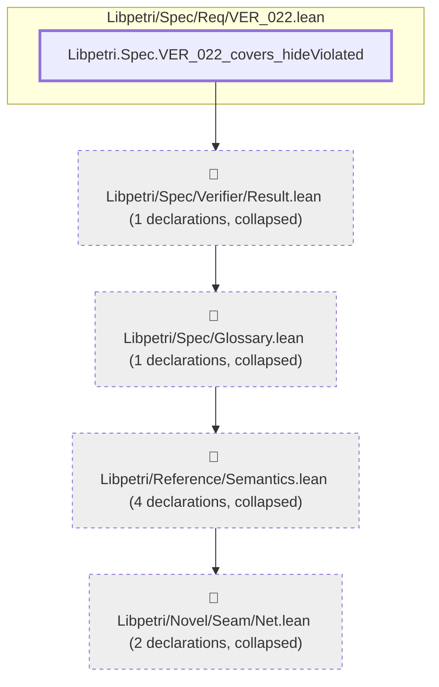

#### `Libpetri.Spec.VER_022_covers_hideViolated` → `Libpetri.Spec.OpenNet.Clause.name`

> Rule: this theorem's tree has 299 nodes, still 192 with other files collapsed, so it is split by direct dependency; this part has 3 nodes, other files collapsed.

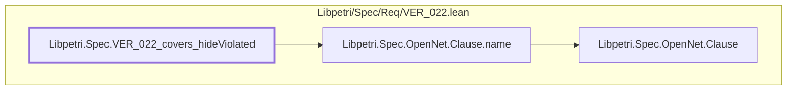

#### `Libpetri.Spec.VER_022_covers_hideViolated` → `Libpetri.Spec.OpenNet.ClauseHolds`

> Rule: this theorem's tree has 299 nodes, still 192 with other files collapsed, so it is split by direct dependency; this part has 11 nodes, other files collapsed.

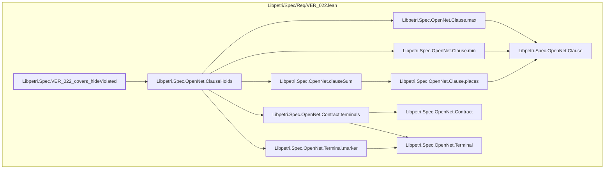

#### `Libpetri.Spec.VER_022_covers_hideViolated` → `Libpetri.Spec.OpenNet.Closed.envPlaces`

> Rule: this theorem's tree has 299 nodes, still 192 with other files collapsed, so it is split by direct dependency; this part has 3 nodes, other files collapsed.


#### `Libpetri.Spec.VER_022_covers_hideViolated` → `Libpetri.Spec.OpenNet.Closed.m0`

> Rule: this theorem's tree has 299 nodes, still 192 with other files collapsed, so it is split by direct dependency; this part has 4 nodes, other files collapsed.

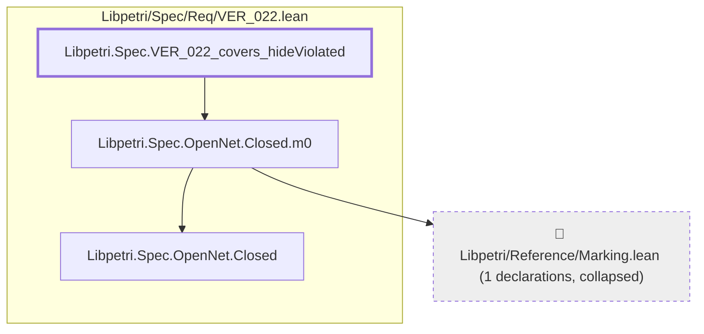

#### `Libpetri.Spec.VER_022_covers_hideViolated` → `Libpetri.Spec.OpenNet.Closed.net`

> Rule: this theorem's tree has 299 nodes, still 192 with other files collapsed, so it is split by direct dependency; this part has 4 nodes, other files collapsed.

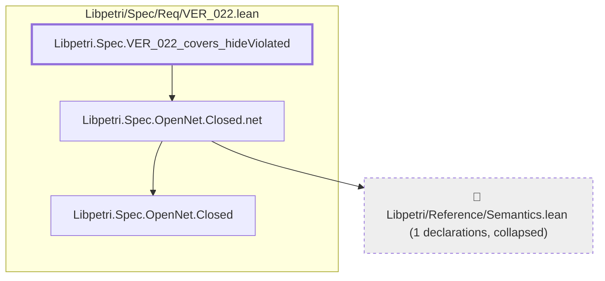

#### `Libpetri.Spec.VER_022_covers_hideViolated` → `Libpetri.Spec.OpenNet.Contract.clauses`

> Rule: this theorem's tree has 299 nodes, still 192 with other files collapsed, so it is split by direct dependency; this part has 4 nodes, other files collapsed.

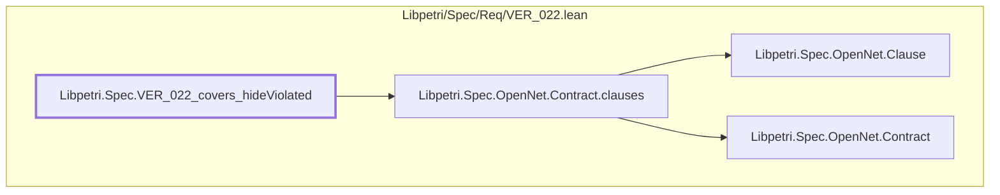

#### `Libpetri.Spec.VER_022_covers_hideViolated` → `Libpetri.Spec.OpenNet.Contract.env`

> Rule: this theorem's tree has 299 nodes, still 192 with other files collapsed, so it is split by direct dependency; this part has 4 nodes, other files collapsed.

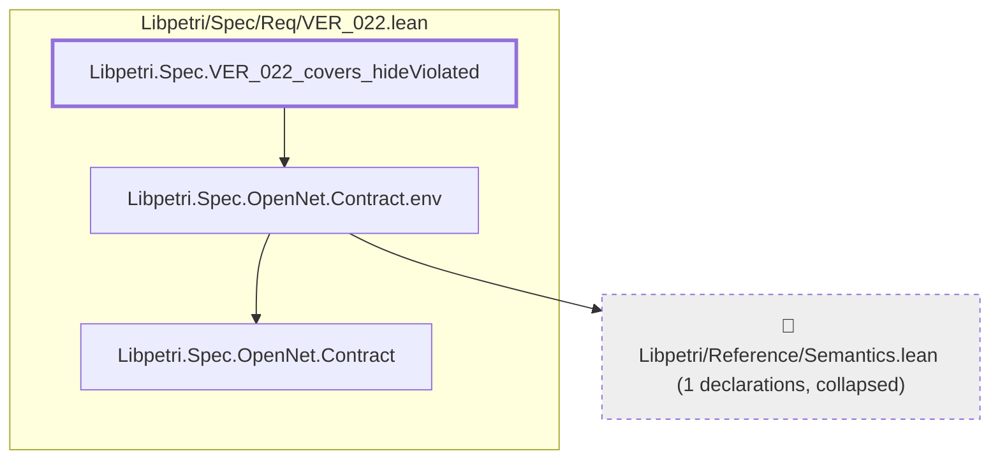

#### `Libpetri.Spec.VER_022_covers_hideViolated` → `Libpetri.Spec.OpenNet.Contract.groups`

> Rule: this theorem's tree has 299 nodes, still 192 with other files collapsed, so it is split by direct dependency; this part has 4 nodes, other files collapsed.

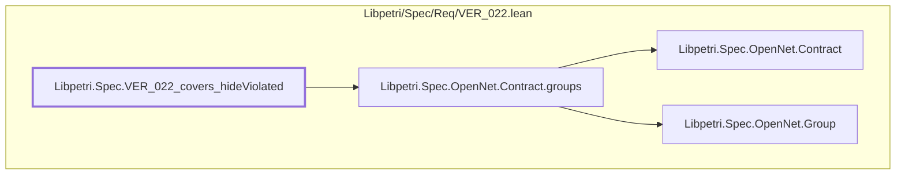

#### `Libpetri.Spec.VER_022_covers_hideViolated` → `Libpetri.Spec.OpenNet.Contract.init`

> Rule: this theorem's tree has 299 nodes, still 192 with other files collapsed, so it is split by direct dependency; this part has 3 nodes, other files collapsed.

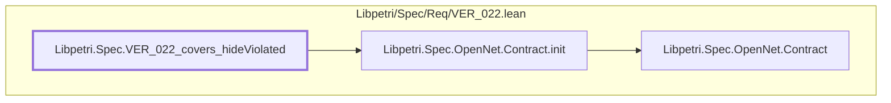

#### `Libpetri.Spec.VER_022_covers_hideViolated` → `Libpetri.Spec.OpenNet.Contract.mk`

> Rule: this theorem's tree has 299 nodes, still 192 with other files collapsed, so it is split by direct dependency; this part has 7 nodes, other files collapsed.

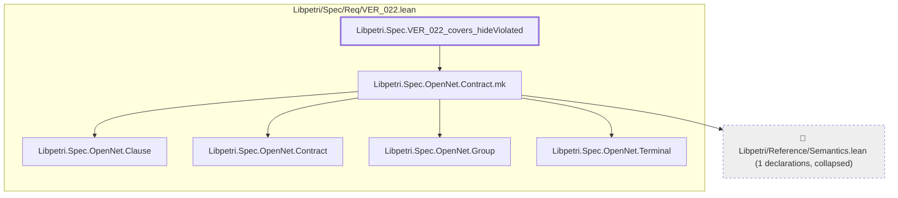

#### `Libpetri.Spec.VER_022_covers_hideViolated` → `Libpetri.Spec.OpenNet.Contract.rest`

> Rule: this theorem's tree has 299 nodes, still 192 with other files collapsed, so it is split by direct dependency; this part has 3 nodes, other files collapsed.

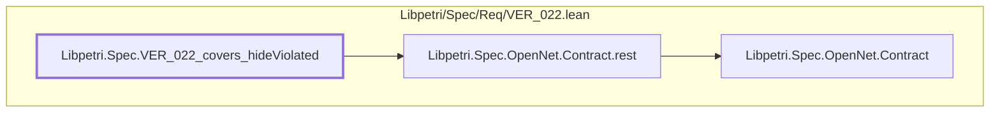

#### `Libpetri.Spec.VER_022_covers_hideViolated` → `Libpetri.Spec.OpenNet.Contract.terminals`

> Rule: this theorem's tree has 299 nodes, still 192 with other files collapsed, so it is split by direct dependency; this part has 4 nodes, other files collapsed.

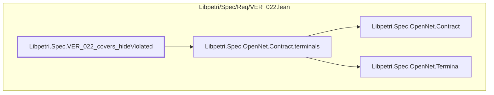

#### `Libpetri.Spec.VER_022_covers_hideViolated` → `Libpetri.Spec.OpenNet.Contract.terminate`

> Rule: this theorem's tree has 299 nodes, still 192 with other files collapsed, so it is split by direct dependency; this part has 3 nodes, other files collapsed.

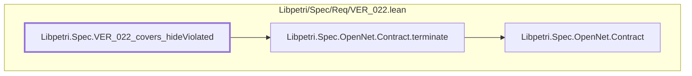

#### `Libpetri.Spec.VER_022_covers_hideViolated` → `Libpetri.Spec.OpenNet.GraphCloses`

> Rule: this theorem's tree has 299 nodes, still 192 with other files collapsed, so it is split by direct dependency; this part has 18 nodes, other files collapsed.

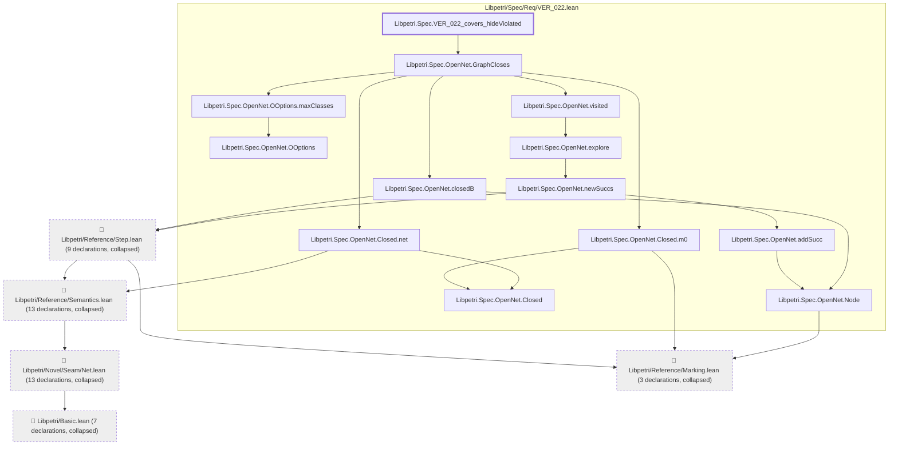

#### `Libpetri.Spec.VER_022_covers_hideViolated` → `Libpetri.Spec.OpenNet.OOptions.assumeNoReaping`

> Rule: this theorem's tree has 299 nodes, still 192 with other files collapsed, so it is split by direct dependency; this part has 3 nodes, other files collapsed.

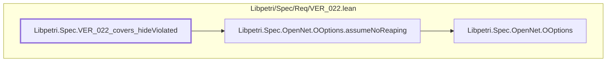

#### `Libpetri.Spec.VER_022_covers_hideViolated` → `Libpetri.Spec.OpenNet.OOptions.maxClasses`

> Rule: this theorem's tree has 299 nodes, still 192 with other files collapsed, so it is split by direct dependency; this part has 3 nodes, other files collapsed.

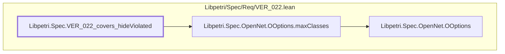

#### `Libpetri.Spec.VER_022_covers_hideViolated` → `Libpetri.Spec.OpenNet.OOptions.mk`

> Rule: this theorem's tree has 299 nodes, still 192 with other files collapsed, so it is split by direct dependency; this part has 3 nodes, other files collapsed.

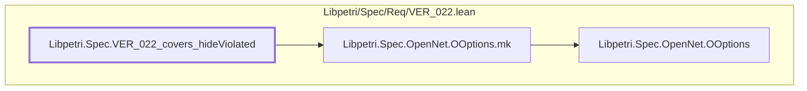

#### `Libpetri.Spec.VER_022_covers_hideViolated` → `Libpetri.Spec.OpenNet.OResult.mk`

> Rule: this theorem's tree has 299 nodes, still 192 with other files collapsed, so it is split by direct dependency; this part has 5 nodes, other files collapsed.

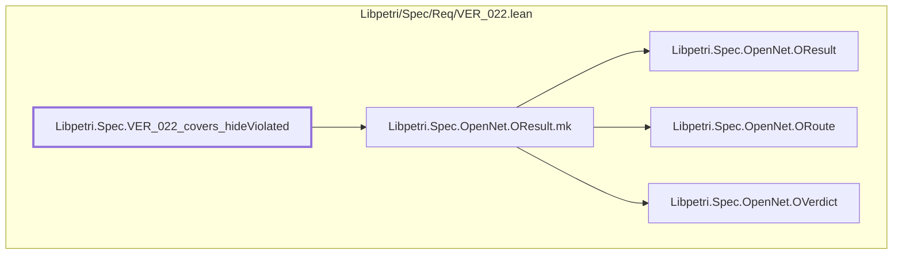

#### `Libpetri.Spec.VER_022_covers_hideViolated` → `Libpetri.Spec.OpenNet.OResult.route`

> Rule: this theorem's tree has 299 nodes, still 192 with other files collapsed, so it is split by direct dependency; this part has 4 nodes, other files collapsed.

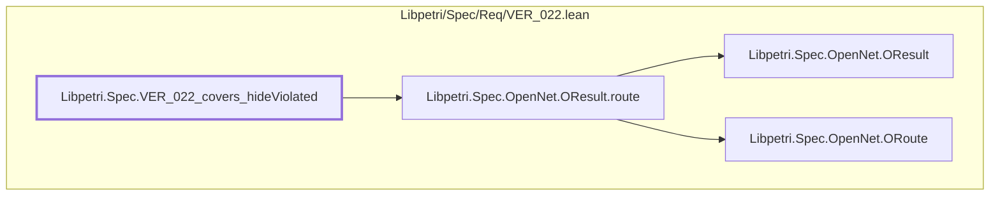

#### `Libpetri.Spec.VER_022_covers_hideViolated` → `Libpetri.Spec.OpenNet.OResult.verdict`

> Rule: this theorem's tree has 299 nodes, still 192 with other files collapsed, so it is split by direct dependency; this part has 4 nodes, other files collapsed.

```mermaid
flowchart TD
  subgraph g0["Libpetri/Spec/Req/VER_022.lean"]
    n9670["Libpetri.Spec.OpenNet.OResult"]
    n9673["Libpetri.Spec.OpenNet.OResult.verdict"]
    n9679["Libpetri.Spec.OpenNet.OVerdict"]
    n11259["Libpetri.Spec.VER_022_covers_hideViolated"]
  end
  n9673 --> n9670
  n9673 --> n9679
  n11259 --> n9673
  classDef root stroke-width:3px
  classDef locked fill:#fff3cd,stroke:#b8860b
  classDef collapsed fill:#eeeeee,stroke-dasharray:4 4
  class n11259 root
```

#### `Libpetri.Spec.VER_022_covers_hideViolated` → `Libpetri.Spec.OpenNet.ORoute.enumeration`

> Rule: this theorem's tree has 299 nodes, still 192 with other files collapsed, so it is split by direct dependency; this part has 3 nodes, other files collapsed.

```mermaid
flowchart TD
  subgraph g0["Libpetri/Spec/Req/VER_022.lean"]
    n9674["Libpetri.Spec.OpenNet.ORoute"]
    n9675["Libpetri.Spec.OpenNet.ORoute.enumeration"]
    n11259["Libpetri.Spec.VER_022_covers_hideViolated"]
  end
  n9675 --> n9674
  n11259 --> n9675
  classDef root stroke-width:3px
  classDef locked fill:#fff3cd,stroke:#b8860b
  classDef collapsed fill:#eeeeee,stroke-dasharray:4 4
  class n11259 root
```

#### `Libpetri.Spec.VER_022_covers_hideViolated` → `Libpetri.Spec.OpenNet.ORoute.smt`

> Rule: this theorem's tree has 299 nodes, still 192 with other files collapsed, so it is split by direct dependency; this part has 3 nodes, other files collapsed.

```mermaid
flowchart TD
  subgraph g0["Libpetri/Spec/Req/VER_022.lean"]
    n9674["Libpetri.Spec.OpenNet.ORoute"]
    n9678["Libpetri.Spec.OpenNet.ORoute.smt"]
    n11259["Libpetri.Spec.VER_022_covers_hideViolated"]
  end
  n9678 --> n9674
  n11259 --> n9678
  classDef root stroke-width:3px
  classDef locked fill:#fff3cd,stroke:#b8860b
  classDef collapsed fill:#eeeeee,stroke-dasharray:4 4
  class n11259 root
```

#### `Libpetri.Spec.VER_022_covers_hideViolated` → `Libpetri.Spec.OpenNet.OVerdict.proven`

> Rule: this theorem's tree has 299 nodes, still 192 with other files collapsed, so it is split by direct dependency; this part has 3 nodes, other files collapsed.

```mermaid
flowchart TD
  subgraph g0["Libpetri/Spec/Req/VER_022.lean"]
    n9679["Libpetri.Spec.OpenNet.OVerdict"]
    n9680["Libpetri.Spec.OpenNet.OVerdict.proven"]
    n11259["Libpetri.Spec.VER_022_covers_hideViolated"]
  end
  n9680 --> n9679
  n11259 --> n9680
  classDef root stroke-width:3px
  classDef locked fill:#fff3cd,stroke:#b8860b
  classDef collapsed fill:#eeeeee,stroke-dasharray:4 4
  class n11259 root
```

#### `Libpetri.Spec.VER_022_covers_hideViolated` → `Libpetri.Spec.OpenNet.OVerdict.unknown`

> Rule: this theorem's tree has 299 nodes, still 192 with other files collapsed, so it is split by direct dependency; this part has 3 nodes, other files collapsed.

```mermaid
flowchart TD
  subgraph g0["Libpetri/Spec/Req/VER_022.lean"]
    n9679["Libpetri.Spec.OpenNet.OVerdict"]
    n9681["Libpetri.Spec.OpenNet.OVerdict.unknown"]
    n11259["Libpetri.Spec.VER_022_covers_hideViolated"]
  end
  n9681 --> n9679
  n11259 --> n9681
  classDef root stroke-width:3px
  classDef locked fill:#fff3cd,stroke:#b8860b
  classDef collapsed fill:#eeeeee,stroke-dasharray:4 4
  class n11259 root
```

#### `Libpetri.Spec.VER_022_covers_hideViolated` → `Libpetri.Spec.OpenNet.OVerdict.violated`

> Rule: this theorem's tree has 299 nodes, still 192 with other files collapsed, so it is split by direct dependency; this part has 4 nodes, other files collapsed.

```mermaid
flowchart TD
  subgraph g0["Libpetri/Spec/Req/VER_022.lean"]
    n9679["Libpetri.Spec.OpenNet.OVerdict"]
    n9682["Libpetri.Spec.OpenNet.OVerdict.violated"]
    n9698["Libpetri.Spec.OpenNet.Witness"]
    n11259["Libpetri.Spec.VER_022_covers_hideViolated"]
  end
  n9682 --> n9679
  n9682 --> n9698
  n11259 --> n9682
  classDef root stroke-width:3px
  classDef locked fill:#fff3cd,stroke:#b8860b
  classDef collapsed fill:#eeeeee,stroke-dasharray:4 4
  class n11259 root
```

#### `Libpetri.Spec.VER_022_covers_hideViolated` → `Libpetri.Spec.OpenNet.OpenSubnet.hasMatch`

> Rule: this theorem's tree has 299 nodes, still 192 with other files collapsed, so it is split by direct dependency; this part has 3 nodes, other files collapsed.

```mermaid
flowchart TD
  subgraph g0["Libpetri/Spec/Req/VER_022.lean"]
    n9683["Libpetri.Spec.OpenNet.OpenSubnet"]
    n9684["Libpetri.Spec.OpenNet.OpenSubnet.hasMatch"]
    n11259["Libpetri.Spec.VER_022_covers_hideViolated"]
  end
  n9684 --> n9683
  n11259 --> n9684
  classDef root stroke-width:3px
  classDef locked fill:#fff3cd,stroke:#b8860b
  classDef collapsed fill:#eeeeee,stroke-dasharray:4 4
  class n11259 root
```

#### `Libpetri.Spec.VER_022_covers_hideViolated` → `Libpetri.Spec.OpenNet.OpenSubnet.mk`

> Rule: this theorem's tree has 299 nodes, still 192 with other files collapsed, so it is split by direct dependency; this part has 4 nodes, other files collapsed.

```mermaid
flowchart TD
  subgraph g0["Libpetri/Spec/Req/VER_022.lean"]
    n9683["Libpetri.Spec.OpenNet.OpenSubnet"]
    n9685["Libpetri.Spec.OpenNet.OpenSubnet.mk"]
    n11259["Libpetri.Spec.VER_022_covers_hideViolated"]
  end
  c94["📁 Libpetri/Reference/Semantics.lean (1 declarations, collapsed)"]
  n9685 --> c94
  n9685 --> n9683
  n11259 --> n9685
  classDef root stroke-width:3px
  classDef locked fill:#fff3cd,stroke:#b8860b
  classDef collapsed fill:#eeeeee,stroke-dasharray:4 4
  class n11259 root
  class c94 collapsed
```

#### `Libpetri.Spec.VER_022_covers_hideViolated` → `Libpetri.Spec.OpenNet.OpenSubnet.net`

> Rule: this theorem's tree has 299 nodes, still 192 with other files collapsed, so it is split by direct dependency; this part has 4 nodes, other files collapsed.

```mermaid
flowchart TD
  subgraph g0["Libpetri/Spec/Req/VER_022.lean"]
    n9683["Libpetri.Spec.OpenNet.OpenSubnet"]
    n9686["Libpetri.Spec.OpenNet.OpenSubnet.net"]
    n11259["Libpetri.Spec.VER_022_covers_hideViolated"]
  end
  c94["📁 Libpetri/Reference/Semantics.lean (1 declarations, collapsed)"]
  n9686 --> c94
  n9686 --> n9683
  n11259 --> n9686
  classDef root stroke-width:3px
  classDef locked fill:#fff3cd,stroke:#b8860b
  classDef collapsed fill:#eeeeee,stroke-dasharray:4 4
  class n11259 root
  class c94 collapsed
```

#### `Libpetri.Spec.VER_022_covers_hideViolated` → `Libpetri.Spec.OpenNet.Part.clause`

> Rule: this theorem's tree has 299 nodes, still 192 with other files collapsed, so it is split by direct dependency; this part has 3 nodes, other files collapsed.

```mermaid
flowchart TD
  subgraph g0["Libpetri/Spec/Req/VER_022.lean"]
    n9689["Libpetri.Spec.OpenNet.Part"]
    n9690["Libpetri.Spec.OpenNet.Part.clause"]
    n11259["Libpetri.Spec.VER_022_covers_hideViolated"]
  end
  n9690 --> n9689
  n11259 --> n9690
  classDef root stroke-width:3px
  classDef locked fill:#fff3cd,stroke:#b8860b
  classDef collapsed fill:#eeeeee,stroke-dasharray:4 4
  class n11259 root
```

#### `Libpetri.Spec.VER_022_covers_hideViolated` → `Libpetri.Spec.OpenNet.Part.stranded`

> Rule: this theorem's tree has 299 nodes, still 192 with other files collapsed, so it is split by direct dependency; this part has 3 nodes, other files collapsed.

```mermaid
flowchart TD
  subgraph g0["Libpetri/Spec/Req/VER_022.lean"]
    n9689["Libpetri.Spec.OpenNet.Part"]
    n9691["Libpetri.Spec.OpenNet.Part.stranded"]
    n11259["Libpetri.Spec.VER_022_covers_hideViolated"]
  end
  n9691 --> n9689
  n11259 --> n9691
  classDef root stroke-width:3px
  classDef locked fill:#fff3cd,stroke:#b8860b
  classDef collapsed fill:#eeeeee,stroke-dasharray:4 4
  class n11259 root
```

#### `Libpetri.Spec.VER_022_covers_hideViolated` → `Libpetri.Spec.OpenNet.Part.termination`

> Rule: this theorem's tree has 299 nodes, still 192 with other files collapsed, so it is split by direct dependency; this part has 3 nodes, other files collapsed.

```mermaid
flowchart TD
  subgraph g0["Libpetri/Spec/Req/VER_022.lean"]
    n9689["Libpetri.Spec.OpenNet.Part"]
    n9692["Libpetri.Spec.OpenNet.Part.termination"]
    n11259["Libpetri.Spec.VER_022_covers_hideViolated"]
  end
  n9692 --> n9689
  n11259 --> n9692
  classDef root stroke-width:3px
  classDef locked fill:#fff3cd,stroke:#b8860b
  classDef collapsed fill:#eeeeee,stroke-dasharray:4 4
  class n11259 root
```

#### `Libpetri.Spec.VER_022_covers_hideViolated` → `Libpetri.Spec.OpenNet.Quiet`

> Rule: this theorem's tree has 299 nodes, still 192 with other files collapsed, so it is split by direct dependency; this part has 7 nodes, other files collapsed.

```mermaid
flowchart TD
  subgraph g0["Libpetri/Spec/Req/VER_022.lean"]
    n9665["Libpetri.Spec.OpenNet.OOptions"]
    n9666["Libpetri.Spec.OpenNet.OOptions.assumeNoReaping"]
    n9693["Libpetri.Spec.OpenNet.Quiet"]
    n11259["Libpetri.Spec.VER_022_covers_hideViolated"]
  end
  c0["📁 Libpetri/Basic.lean (6 declarations, collapsed)"]
  c54["📁 Libpetri/Novel/Seam/Net.lean (8 declarations, collapsed)"]
  c94["📁 Libpetri/Reference/Semantics.lean (5 declarations, collapsed)"]
  c54 --> c0
  c94 --> c54
  n9666 --> n9665
  n9693 --> c94
  n9693 --> n9666
  n11259 --> n9693
  classDef root stroke-width:3px
  classDef locked fill:#fff3cd,stroke:#b8860b
  classDef collapsed fill:#eeeeee,stroke-dasharray:4 4
  class n11259 root
  class c0,c54,c94 collapsed
```

#### `Libpetri.Spec.VER_022_covers_hideViolated` → `Libpetri.Spec.OpenNet.Witness.confirmed`

> Rule: this theorem's tree has 299 nodes, still 192 with other files collapsed, so it is split by direct dependency; this part has 3 nodes, other files collapsed.

```mermaid
flowchart TD
  subgraph g0["Libpetri/Spec/Req/VER_022.lean"]
    n9698["Libpetri.Spec.OpenNet.Witness"]
    n9699["Libpetri.Spec.OpenNet.Witness.confirmed"]
    n11259["Libpetri.Spec.VER_022_covers_hideViolated"]
  end
  n9699 --> n9698
  n11259 --> n9699
  classDef root stroke-width:3px
  classDef locked fill:#fff3cd,stroke:#b8860b
  classDef collapsed fill:#eeeeee,stroke-dasharray:4 4
  class n11259 root
```

#### `Libpetri.Spec.VER_022_covers_hideViolated` → `Libpetri.Spec.OpenNet.Witness.cycleStart`

> Rule: this theorem's tree has 299 nodes, still 192 with other files collapsed, so it is split by direct dependency; this part has 3 nodes, other files collapsed.

```mermaid
flowchart TD
  subgraph g0["Libpetri/Spec/Req/VER_022.lean"]
    n9698["Libpetri.Spec.OpenNet.Witness"]
    n9700["Libpetri.Spec.OpenNet.Witness.cycleStart"]
    n11259["Libpetri.Spec.VER_022_covers_hideViolated"]
  end
  n9700 --> n9698
  n11259 --> n9700
  classDef root stroke-width:3px
  classDef locked fill:#fff3cd,stroke:#b8860b
  classDef collapsed fill:#eeeeee,stroke-dasharray:4 4
  class n11259 root
```

#### `Libpetri.Spec.VER_022_covers_hideViolated` → `Libpetri.Spec.OpenNet.Witness.endM`

> Rule: this theorem's tree has 299 nodes, still 192 with other files collapsed, so it is split by direct dependency; this part has 4 nodes, other files collapsed.

```mermaid
flowchart TD
  subgraph g0["Libpetri/Spec/Req/VER_022.lean"]
    n9698["Libpetri.Spec.OpenNet.Witness"]
    n9701["Libpetri.Spec.OpenNet.Witness.endM"]
    n11259["Libpetri.Spec.VER_022_covers_hideViolated"]
  end
  c86["📁 Libpetri/Reference/Marking.lean (1 declarations, collapsed)"]
  n9701 --> c86
  n9701 --> n9698
  n11259 --> n9701
  classDef root stroke-width:3px
  classDef locked fill:#fff3cd,stroke:#b8860b
  classDef collapsed fill:#eeeeee,stroke-dasharray:4 4
  class n11259 root
  class c86 collapsed
```

#### `Libpetri.Spec.VER_022_covers_hideViolated` → `Libpetri.Spec.OpenNet.Witness.mk`

> Rule: this theorem's tree has 299 nodes, still 192 with other files collapsed, so it is split by direct dependency; this part has 5 nodes, other files collapsed.

```mermaid
flowchart TD
  subgraph g0["Libpetri/Spec/Req/VER_022.lean"]
    n9689["Libpetri.Spec.OpenNet.Part"]
    n9698["Libpetri.Spec.OpenNet.Witness"]
    n9702["Libpetri.Spec.OpenNet.Witness.mk"]
    n11259["Libpetri.Spec.VER_022_covers_hideViolated"]
  end
  c86["📁 Libpetri/Reference/Marking.lean (1 declarations, collapsed)"]
  n9702 --> c86
  n9702 --> n9689
  n9702 --> n9698
  n11259 --> n9702
  classDef root stroke-width:3px
  classDef locked fill:#fff3cd,stroke:#b8860b
  classDef collapsed fill:#eeeeee,stroke-dasharray:4 4
  class n11259 root
  class c86 collapsed
```

#### `Libpetri.Spec.VER_022_covers_hideViolated` → `Libpetri.Spec.OpenNet.Witness.part`

> Rule: this theorem's tree has 299 nodes, still 192 with other files collapsed, so it is split by direct dependency; this part has 4 nodes, other files collapsed.

```mermaid
flowchart TD
  subgraph g0["Libpetri/Spec/Req/VER_022.lean"]
    n9689["Libpetri.Spec.OpenNet.Part"]
    n9698["Libpetri.Spec.OpenNet.Witness"]
    n9703["Libpetri.Spec.OpenNet.Witness.part"]
    n11259["Libpetri.Spec.VER_022_covers_hideViolated"]
  end
  n9703 --> n9689
  n9703 --> n9698
  n11259 --> n9703
  classDef root stroke-width:3px
  classDef locked fill:#fff3cd,stroke:#b8860b
  classDef collapsed fill:#eeeeee,stroke-dasharray:4 4
  class n11259 root
```

#### `Libpetri.Spec.VER_022_covers_hideViolated` → `Libpetri.Spec.OpenNet.Witness.trace`

> Rule: this theorem's tree has 299 nodes, still 192 with other files collapsed, so it is split by direct dependency; this part has 3 nodes, other files collapsed.

```mermaid
flowchart TD
  subgraph g0["Libpetri/Spec/Req/VER_022.lean"]
    n9698["Libpetri.Spec.OpenNet.Witness"]
    n9704["Libpetri.Spec.OpenNet.Witness.trace"]
    n11259["Libpetri.Spec.VER_022_covers_hideViolated"]
  end
  n9704 --> n9698
  n11259 --> n9704
  classDef root stroke-width:3px
  classDef locked fill:#fff3cd,stroke:#b8860b
  classDef collapsed fill:#eeeeee,stroke-dasharray:4 4
  class n11259 root
```

#### `Libpetri.Spec.VER_022_covers_hideViolated` → `Libpetri.Spec.OpenNet.arrC`

> Rule: this theorem's tree has 299 nodes, still 192 with other files collapsed, so it is split by direct dependency; this part has 10 nodes, other files collapsed.

```mermaid
flowchart TD
  subgraph g0["Libpetri/Spec/Req/VER_022.lean"]
    n9631["Libpetri.Spec.OpenNet.Clause"]
    n9634["Libpetri.Spec.OpenNet.Clause.mk"]
    n9646["Libpetri.Spec.OpenNet.Contract"]
    n9651["Libpetri.Spec.OpenNet.Contract.mk"]
    n9658["Libpetri.Spec.OpenNet.Group"]
    n9661["Libpetri.Spec.OpenNet.Group.mk"]
    n9694["Libpetri.Spec.OpenNet.Terminal"]
    n9708["Libpetri.Spec.OpenNet.arrC"]
    n11259["Libpetri.Spec.VER_022_covers_hideViolated"]
  end
  c94["📁 Libpetri/Reference/Semantics.lean (1 declarations, collapsed)"]
  n9634 --> n9631
  n9651 --> c94
  n9651 --> n9631
  n9651 --> n9646
  n9651 --> n9658
  n9651 --> n9694
  n9661 --> n9658
  n9708 --> n9634
  n9708 --> n9651
  n9708 --> n9661
  n11259 --> n9708
  classDef root stroke-width:3px
  classDef locked fill:#fff3cd,stroke:#b8860b
  classDef collapsed fill:#eeeeee,stroke-dasharray:4 4
  class n11259 root
  class c94 collapsed
```

#### `Libpetri.Spec.VER_022_covers_hideViolated` → `Libpetri.Spec.OpenNet.closedB`

> Rule: this theorem's tree has 299 nodes, still 192 with other files collapsed, so it is split by direct dependency; this part has 8 nodes, other files collapsed.

```mermaid
flowchart TD
  subgraph g0["Libpetri/Spec/Req/VER_022.lean"]
    n9664["Libpetri.Spec.OpenNet.Node"]
    n9724["Libpetri.Spec.OpenNet.closedB"]
    n11259["Libpetri.Spec.VER_022_covers_hideViolated"]
  end
  c0["📁 Libpetri/Basic.lean (7 declarations, collapsed)"]
  c54["📁 Libpetri/Novel/Seam/Net.lean (13 declarations, collapsed)"]
  c86["📁 Libpetri/Reference/Marking.lean (3 declarations, collapsed)"]
  c94["📁 Libpetri/Reference/Semantics.lean (13 declarations, collapsed)"]
  c96["📁 Libpetri/Reference/Step.lean (9 declarations, collapsed)"]
  c54 --> c0
  c94 --> c54
  c96 --> c86
  c96 --> c94
  n9664 --> c86
  n9724 --> c96
  n9724 --> n9664
  n11259 --> n9724
  classDef root stroke-width:3px
  classDef locked fill:#fff3cd,stroke:#b8860b
  classDef collapsed fill:#eeeeee,stroke-dasharray:4 4
  class n11259 root
  class c0,c54,c86,c94,c96 collapsed
```

#### `Libpetri.Spec.VER_022_covers_hideViolated` → `Libpetri.Spec.OpenNet.idleNet`

> Rule: this theorem's tree has 299 nodes, still 192 with other files collapsed, so it is split by direct dependency; this part has 3 nodes, other files collapsed.

```mermaid
flowchart TD
  subgraph g0["Libpetri/Spec/Req/VER_022.lean"]
    n9764["Libpetri.Spec.OpenNet.idleNet"]
    n11259["Libpetri.Spec.VER_022_covers_hideViolated"]
  end
  c94["📁 Libpetri/Reference/Semantics.lean (3 declarations, collapsed)"]
  n9764 --> c94
  n11259 --> n9764
  classDef root stroke-width:3px
  classDef locked fill:#fff3cd,stroke:#b8860b
  classDef collapsed fill:#eeeeee,stroke-dasharray:4 4
  class n11259 root
  class c94 collapsed
```

#### `Libpetri.Spec.VER_022_covers_hideViolated` → `Libpetri.Spec.OpenNet.ok_of_toOption`

> Rule: this theorem's tree has 299 nodes, still 192 with other files collapsed, so it is split by direct dependency; this part has 3 nodes, other files collapsed.

```mermaid
flowchart TD
  subgraph g0["Libpetri/Spec/Req/VER_022.lean"]
    n9670["Libpetri.Spec.OpenNet.OResult"]
    n9804["Libpetri.Spec.OpenNet.ok_of_toOption"]
    n11259["Libpetri.Spec.VER_022_covers_hideViolated"]
  end
  n9804 --> n9670
  n11259 --> n9804
  classDef root stroke-width:3px
  classDef locked fill:#fff3cd,stroke:#b8860b
  classDef collapsed fill:#eeeeee,stroke-dasharray:4 4
  class n11259 root
```

#### `Libpetri.Spec.VER_022_covers_hideViolated` → `Libpetri.Spec.OpenNet.orderC`

> Rule: this theorem's tree has 299 nodes, still 192 with other files collapsed, so it is split by direct dependency; this part has 8 nodes, other files collapsed.

```mermaid
flowchart TD
  subgraph g0["Libpetri/Spec/Req/VER_022.lean"]
    n9631["Libpetri.Spec.OpenNet.Clause"]
    n9646["Libpetri.Spec.OpenNet.Contract"]
    n9651["Libpetri.Spec.OpenNet.Contract.mk"]
    n9658["Libpetri.Spec.OpenNet.Group"]
    n9694["Libpetri.Spec.OpenNet.Terminal"]
    n9807["Libpetri.Spec.OpenNet.orderC"]
    n11259["Libpetri.Spec.VER_022_covers_hideViolated"]
  end
  c94["📁 Libpetri/Reference/Semantics.lean (1 declarations, collapsed)"]
  n9651 --> c94
  n9651 --> n9631
  n9651 --> n9646
  n9651 --> n9658
  n9651 --> n9694
  n9807 --> n9651
  n11259 --> n9807
  classDef root stroke-width:3px
  classDef locked fill:#fff3cd,stroke:#b8860b
  classDef collapsed fill:#eeeeee,stroke-dasharray:4 4
  class n11259 root
  class c94 collapsed
```

#### `Libpetri.Spec.VER_022_covers_hideViolated` → `Libpetri.Spec.OpenNet.refClose`

> Rule: this theorem's tree has 299 nodes, still 192 with other files collapsed, so it is split by direct dependency; this part has 52 nodes, other files collapsed.

```mermaid
flowchart TD
  subgraph g0["Libpetri/Spec/Req/VER_022.lean"]
    n9631["Libpetri.Spec.OpenNet.Clause"]
    n9636["Libpetri.Spec.OpenNet.Clause.places"]
    n9639["Libpetri.Spec.OpenNet.CloseFn"]
    n9640["Libpetri.Spec.OpenNet.Closed"]
    n9644["Libpetri.Spec.OpenNet.Closed.mk"]
    n9646["Libpetri.Spec.OpenNet.Contract"]
    n9647["Libpetri.Spec.OpenNet.Contract.clauses"]
    n9648["Libpetri.Spec.OpenNet.Contract.env"]
    n9649["Libpetri.Spec.OpenNet.Contract.groups"]
    n9650["Libpetri.Spec.OpenNet.Contract.init"]
    n9652["Libpetri.Spec.OpenNet.Contract.rest"]
    n9653["Libpetri.Spec.OpenNet.Contract.terminals"]
    n9658["Libpetri.Spec.OpenNet.Group"]
    n9659["Libpetri.Spec.OpenNet.Group.max"]
    n9660["Libpetri.Spec.OpenNet.Group.min"]
    n9662["Libpetri.Spec.OpenNet.Group.places"]
    n9694["Libpetri.Spec.OpenNet.Terminal"]
    n9695["Libpetri.Spec.OpenNet.Terminal.excused"]
    n9696["Libpetri.Spec.OpenNet.Terminal.marker"]
    n9709["Libpetri.Spec.OpenNet.arrName"]
    n9713["Libpetri.Spec.OpenNet.claims"]
    n9722["Libpetri.Spec.OpenNet.closeNet"]
    n9726["Libpetri.Spec.OpenNet.closureNames"]
    n9727["Libpetri.Spec.OpenNet.closureSources"]
    n9728["Libpetri.Spec.OpenNet.closureTrans"]
    n9732["Libpetri.Spec.OpenNet.contractNamed"]
    n9736["Libpetri.Spec.OpenNet.declName"]
    n9737["Libpetri.Spec.OpenNet.envNames"]
    n9738["Libpetri.Spec.OpenNet.envPlacesOf"]
    n9745["Libpetri.Spec.OpenNet.freshFails"]
    n9759["Libpetri.Spec.OpenNet.groupNames"]
    n9760["Libpetri.Spec.OpenNet.groupSources"]
    n9761["Libpetri.Spec.OpenNet.groupTrans"]
    n9789["Libpetri.Spec.OpenNet.manSrc"]
    n9795["Libpetri.Spec.OpenNet.moveT"]
    n9796["Libpetri.Spec.OpenNet.namesFrom"]
    n9797["Libpetri.Spec.OpenNet.netNames"]
    n9798["Libpetri.Spec.OpenNet.netPlaceNames"]
    n9803["Libpetri.Spec.OpenNet.nub"]
    n9805["Libpetri.Spec.OpenNet.optName"]
    n9806["Libpetri.Spec.OpenNet.optSrc"]
    n9808["Libpetri.Spec.OpenNet.outNames"]
    n9813["Libpetri.Spec.OpenNet.refClose"]
    n9832["Libpetri.Spec.OpenNet.sourcesFrom"]
    n9853["Libpetri.Spec.OpenNet.transFrom"]
    n9855["Libpetri.Spec.OpenNet.transPlaces"]
    n9858["Libpetri.Spec.OpenNet.undeclaredOf"]
    n11259["Libpetri.Spec.VER_022_covers_hideViolated"]
  end
  c0["📁 Libpetri/Basic.lean (2 declarations, collapsed)"]
  c54["📁 Libpetri/Novel/Seam/Net.lean (10 declarations, collapsed)"]
  c86["📁 Libpetri/Reference/Marking.lean (3 declarations, collapsed)"]
  c94["📁 Libpetri/Reference/Semantics.lean (15 declarations, collapsed)"]
  c54 --> c0
  c94 --> c54
  n9636 --> n9631
  n9639 --> c94
  n9639 --> n9640
  n9639 --> n9646
  n9644 --> c86
  n9644 --> c94
  n9644 --> n9640
  n9647 --> n9631
  n9647 --> n9646
  n9648 --> c94
  n9648 --> n9646
  n9649 --> n9646
  n9649 --> n9658
  n9650 --> n9646
  n9652 --> n9646
  n9653 --> n9646
  n9653 --> n9694
  n9659 --> n9658
  n9660 --> n9658
  n9662 --> n9658
  n9695 --> n9694
  n9696 --> n9694
  n9713 --> n9726
  n9713 --> n9737
  n9713 --> n9738
  n9722 --> n9644
  n9722 --> n9727
  n9722 --> n9728
  n9722 --> n9737
  n9722 --> n9858
  n9726 --> n9649
  n9726 --> n9796
  n9727 --> n9649
  n9727 --> n9832
  n9728 --> n9649
  n9728 --> n9853
  n9732 --> n9636
  n9732 --> n9647
  n9732 --> n9649
  n9732 --> n9650
  n9732 --> n9652
  n9732 --> n9653
  n9732 --> n9662
  n9732 --> n9695
  n9732 --> n9696
  n9737 --> n9648
  n9738 --> n9648
  n9738 --> n9798
  n9738 --> n9803
  n9759 --> n9659
  n9759 --> n9660
  n9759 --> n9662
  n9759 --> n9709
  n9759 --> n9736
  n9759 --> n9789
  n9759 --> n9805
  n9759 --> n9806
  n9760 --> n9659
  n9760 --> n9660
  n9760 --> n9789
  n9760 --> n9806
  n9761 --> n9659
  n9761 --> n9660
  n9761 --> n9662
  n9761 --> n9709
  n9761 --> n9736
  n9761 --> n9789
  n9761 --> n9795
  n9761 --> n9805
  n9761 --> n9806
  n9795 --> c94
  n9796 --> n9759
  n9797 --> n9798
  n9798 --> n9855
  n9808 --> c94
  n9813 --> n9639
  n9813 --> n9713
  n9813 --> n9722
  n9813 --> n9745
  n9813 --> n9797
  n9832 --> n9760
  n9853 --> n9761
  n9855 --> n9808
  n9858 --> n9732
  n9858 --> n9738
  n11259 --> n9813
  classDef root stroke-width:3px
  classDef locked fill:#fff3cd,stroke:#b8860b
  classDef collapsed fill:#eeeeee,stroke-dasharray:4 4
  class n11259 root
  class c0,c54,c86,c94 collapsed
```

#### `Libpetri.Spec.VER_022_covers_hideViolated` → `Libpetri.Spec.OpenNet.refMeets`

> Rule: this theorem's tree has 299 nodes, still 192 with other files collapsed, so it is split by direct dependency; this part has 21 nodes, other files collapsed.

```mermaid
flowchart TD
  subgraph g0["Libpetri/Spec/Req/VER_022.lean"]
    n9631["Libpetri.Spec.OpenNet.Clause"]
    n9632["Libpetri.Spec.OpenNet.Clause.max"]
    n9633["Libpetri.Spec.OpenNet.Clause.min"]
    n9636["Libpetri.Spec.OpenNet.Clause.places"]
    n9637["Libpetri.Spec.OpenNet.ClauseHolds"]
    n9646["Libpetri.Spec.OpenNet.Contract"]
    n9647["Libpetri.Spec.OpenNet.Contract.clauses"]
    n9652["Libpetri.Spec.OpenNet.Contract.rest"]
    n9653["Libpetri.Spec.OpenNet.Contract.terminals"]
    n9663["Libpetri.Spec.OpenNet.MeetsRel"]
    n9694["Libpetri.Spec.OpenNet.Terminal"]
    n9695["Libpetri.Spec.OpenNet.Terminal.excused"]
    n9696["Libpetri.Spec.OpenNet.Terminal.marker"]
    n9717["Libpetri.Spec.OpenNet.clauseSum"]
    n9815["Libpetri.Spec.OpenNet.refMeets"]
    n9827["Libpetri.Spec.OpenNet.restCond"]
    n9828["Libpetri.Spec.OpenNet.restSinks"]
    n11259["Libpetri.Spec.VER_022_covers_hideViolated"]
  end
  c51["📁 Libpetri/Novel/Seam/Bad.lean (1 declarations, collapsed)"]
  c52["📁 Libpetri/Novel/Seam/Excuses.lean (5 declarations, collapsed)"]
  c354["📁 Libpetri/Spec/Req/VER_014.lean (2 declarations, collapsed)"]
  c51 --> c52
  c354 --> c51
  n9632 --> n9631
  n9633 --> n9631
  n9636 --> n9631
  n9637 --> n9632
  n9637 --> n9633
  n9637 --> n9653
  n9637 --> n9696
  n9637 --> n9717
  n9647 --> n9631
  n9647 --> n9646
  n9652 --> n9646
  n9653 --> n9646
  n9653 --> n9694
  n9663 --> n9646
  n9695 --> n9694
  n9696 --> n9694
  n9717 --> n9636
  n9815 --> c354
  n9815 --> n9637
  n9815 --> n9663
  n9815 --> n9827
  n9815 --> n9828
  n9827 --> c52
  n9827 --> n9653
  n9827 --> n9695
  n9827 --> n9696
  n9828 --> n9636
  n9828 --> n9647
  n9828 --> n9652
  n11259 --> n9815
  classDef root stroke-width:3px
  classDef locked fill:#fff3cd,stroke:#b8860b
  classDef collapsed fill:#eeeeee,stroke-dasharray:4 4
  class n11259 root
  class c51,c52,c354 collapsed
```

#### `Libpetri.Spec.VER_022_covers_hideViolated` → `Libpetri.Spec.OpenNet.refOpenVerify`

> Rule: this theorem's tree has 299 nodes, still 192 with other files collapsed, so it is split by direct dependency; this part has 118 nodes, other files collapsed.

```mermaid
flowchart TD
  subgraph g0["Libpetri/Spec/Req/VER_022.lean"]
    n9631["Libpetri.Spec.OpenNet.Clause"]
    n9632["Libpetri.Spec.OpenNet.Clause.max"]
    n9633["Libpetri.Spec.OpenNet.Clause.min"]
    n9635["Libpetri.Spec.OpenNet.Clause.name"]
    n9636["Libpetri.Spec.OpenNet.Clause.places"]
    n9639["Libpetri.Spec.OpenNet.CloseFn"]
    n9640["Libpetri.Spec.OpenNet.Closed"]
    n9641["Libpetri.Spec.OpenNet.Closed.envPlaces"]
    n9643["Libpetri.Spec.OpenNet.Closed.m0"]
    n9644["Libpetri.Spec.OpenNet.Closed.mk"]
    n9645["Libpetri.Spec.OpenNet.Closed.net"]
    n9646["Libpetri.Spec.OpenNet.Contract"]
    n9647["Libpetri.Spec.OpenNet.Contract.clauses"]
    n9648["Libpetri.Spec.OpenNet.Contract.env"]
    n9649["Libpetri.Spec.OpenNet.Contract.groups"]
    n9650["Libpetri.Spec.OpenNet.Contract.init"]
    n9652["Libpetri.Spec.OpenNet.Contract.rest"]
    n9653["Libpetri.Spec.OpenNet.Contract.terminals"]
    n9654["Libpetri.Spec.OpenNet.Contract.terminate"]
    n9658["Libpetri.Spec.OpenNet.Group"]
    n9659["Libpetri.Spec.OpenNet.Group.max"]
    n9660["Libpetri.Spec.OpenNet.Group.min"]
    n9662["Libpetri.Spec.OpenNet.Group.places"]
    n9664["Libpetri.Spec.OpenNet.Node"]
    n9665["Libpetri.Spec.OpenNet.OOptions"]
    n9666["Libpetri.Spec.OpenNet.OOptions.assumeNoReaping"]
    n9667["Libpetri.Spec.OpenNet.OOptions.maxClasses"]
    n9669["Libpetri.Spec.OpenNet.OOptions.smt"]
    n9670["Libpetri.Spec.OpenNet.OResult"]
    n9671["Libpetri.Spec.OpenNet.OResult.mk"]
    n9674["Libpetri.Spec.OpenNet.ORoute"]
    n9675["Libpetri.Spec.OpenNet.ORoute.enumeration"]
    n9678["Libpetri.Spec.OpenNet.ORoute.smt"]
    n9679["Libpetri.Spec.OpenNet.OVerdict"]
    n9680["Libpetri.Spec.OpenNet.OVerdict.proven"]
    n9681["Libpetri.Spec.OpenNet.OVerdict.unknown"]
    n9682["Libpetri.Spec.OpenNet.OVerdict.violated"]
    n9683["Libpetri.Spec.OpenNet.OpenSubnet"]
    n9684["Libpetri.Spec.OpenNet.OpenSubnet.hasMatch"]
    n9686["Libpetri.Spec.OpenNet.OpenSubnet.net"]
    n9687["Libpetri.Spec.OpenNet.OpenVerifier"]
    n9688["Libpetri.Spec.OpenNet.PNode"]
    n9689["Libpetri.Spec.OpenNet.Part"]
    n9690["Libpetri.Spec.OpenNet.Part.clause"]
    n9691["Libpetri.Spec.OpenNet.Part.stranded"]
    n9692["Libpetri.Spec.OpenNet.Part.termination"]
    n9694["Libpetri.Spec.OpenNet.Terminal"]
    n9695["Libpetri.Spec.OpenNet.Terminal.excused"]
    n9696["Libpetri.Spec.OpenNet.Terminal.marker"]
    n9698["Libpetri.Spec.OpenNet.Witness"]
    n9702["Libpetri.Spec.OpenNet.Witness.mk"]
    n9705["Libpetri.Spec.OpenNet.addSucc"]
    n9709["Libpetri.Spec.OpenNet.arrName"]
    n9710["Libpetri.Spec.OpenNet.canonB"]
    n9713["Libpetri.Spec.OpenNet.claims"]
    n9715["Libpetri.Spec.OpenNet.clauseHoldsB"]
    n9717["Libpetri.Spec.OpenNet.clauseSum"]
    n9719["Libpetri.Spec.OpenNet.clauseWit"]
    n9722["Libpetri.Spec.OpenNet.closeNet"]
    n9724["Libpetri.Spec.OpenNet.closedB"]
    n9726["Libpetri.Spec.OpenNet.closureNames"]
    n9727["Libpetri.Spec.OpenNet.closureSources"]
    n9728["Libpetri.Spec.OpenNet.closureTrans"]
    n9729["Libpetri.Spec.OpenNet.confirmB"]
    n9732["Libpetri.Spec.OpenNet.contractNamed"]
    n9733["Libpetri.Spec.OpenNet.ddAdd"]
    n9736["Libpetri.Spec.OpenNet.declName"]
    n9737["Libpetri.Spec.OpenNet.envNames"]
    n9738["Libpetri.Spec.OpenNet.envPlacesOf"]
    n9739["Libpetri.Spec.OpenNet.explore"]
    n9743["Libpetri.Spec.OpenNet.firstRepeat"]
    n9745["Libpetri.Spec.OpenNet.freshFails"]
    n9750["Libpetri.Spec.OpenNet.graphJudge"]
    n9754["Libpetri.Spec.OpenNet.graphWits"]
    n9759["Libpetri.Spec.OpenNet.groupNames"]
    n9760["Libpetri.Spec.OpenNet.groupSources"]
    n9761["Libpetri.Spec.OpenNet.groupTrans"]
    n9784["Libpetri.Spec.OpenNet.lassoOf"]
    n9789["Libpetri.Spec.OpenNet.manSrc"]
    n9790["Libpetri.Spec.OpenNet.meetsB"]
    n9795["Libpetri.Spec.OpenNet.moveT"]
    n9796["Libpetri.Spec.OpenNet.namesFrom"]
    n9797["Libpetri.Spec.OpenNet.netNames"]
    n9798["Libpetri.Spec.OpenNet.netPlaceNames"]
    n9799["Libpetri.Spec.OpenNet.newSuccs"]
    n9802["Libpetri.Spec.OpenNet.nextT"]
    n9803["Libpetri.Spec.OpenNet.nub"]
    n9805["Libpetri.Spec.OpenNet.optName"]
    n9806["Libpetri.Spec.OpenNet.optSrc"]
    n9808["Libpetri.Spec.OpenNet.outNames"]
    n9809["Libpetri.Spec.OpenNet.provenB"]
    n9811["Libpetri.Spec.OpenNet.quietB"]
    n9813["Libpetri.Spec.OpenNet.refClose"]
    n9814["Libpetri.Spec.OpenNet.refJudge"]
    n9816["Libpetri.Spec.OpenNet.refOpenVerify"]
    n9827["Libpetri.Spec.OpenNet.restCond"]
    n9828["Libpetri.Spec.OpenNet.restSinks"]
    n9830["Libpetri.Spec.OpenNet.skipBudget"]
    n9831["Libpetri.Spec.OpenNet.skipMatch"]
    n9832["Libpetri.Spec.OpenNet.sourcesFrom"]
    n9839["Libpetri.Spec.OpenNet.strandB"]
    n9841["Libpetri.Spec.OpenNet.strandCands"]
    n9843["Libpetri.Spec.OpenNet.strandWit"]
    n9845["Libpetri.Spec.OpenNet.termWit"]
    n9847["Libpetri.Spec.OpenNet.tlayer"]
    n9853["Libpetri.Spec.OpenNet.transFrom"]
    n9855["Libpetri.Spec.OpenNet.transPlaces"]
    n9856["Libpetri.Spec.OpenNet.undecided"]
    n9858["Libpetri.Spec.OpenNet.undeclaredOf"]
    n9859["Libpetri.Spec.OpenNet.visited"]
    n11259["Libpetri.Spec.VER_022_covers_hideViolated"]
  end
  c0["📁 Libpetri/Basic.lean (7 declarations, collapsed)"]
  c52["📁 Libpetri/Novel/Seam/Excuses.lean (4 declarations, collapsed)"]
  c54["📁 Libpetri/Novel/Seam/Net.lean (15 declarations, collapsed)"]
  c77["📁 Libpetri/Reference/Decide.lean (3 declarations, collapsed)"]
  c86["📁 Libpetri/Reference/Marking.lean (4 declarations, collapsed)"]
  c94["📁 Libpetri/Reference/Semantics.lean (17 declarations, collapsed)"]
  c96["📁 Libpetri/Reference/Step.lean (9 declarations, collapsed)"]
  c54 --> c0
  c77 --> c96
  c94 --> c54
  c96 --> c86
  c96 --> c94
  n9632 --> n9631
  n9633 --> n9631
  n9635 --> n9631
  n9636 --> n9631
  n9639 --> c94
  n9639 --> n9640
  n9639 --> n9646
  n9641 --> n9640
  n9643 --> c86
  n9643 --> n9640
  n9644 --> c86
  n9644 --> c94
  n9644 --> n9640
  n9645 --> c94
  n9645 --> n9640
  n9647 --> n9631
  n9647 --> n9646
  n9648 --> c94
  n9648 --> n9646
  n9649 --> n9646
  n9649 --> n9658
  n9650 --> n9646
  n9652 --> n9646
  n9653 --> n9646
  n9653 --> n9694
  n9654 --> n9646
  n9659 --> n9658
  n9660 --> n9658
  n9662 --> n9658
  n9664 --> c86
  n9666 --> n9665
  n9667 --> n9665
  n9669 --> n9665
  n9671 --> n9670
  n9671 --> n9674
  n9671 --> n9679
  n9675 --> n9674
  n9678 --> n9674
  n9680 --> n9679
  n9681 --> n9679
  n9682 --> n9679
  n9682 --> n9698
  n9684 --> n9683
  n9686 --> c94
  n9686 --> n9683
  n9687 --> n9646
  n9687 --> n9665
  n9687 --> n9670
  n9687 --> n9683
  n9688 --> c86
  n9690 --> n9689
  n9691 --> n9689
  n9692 --> n9689
  n9695 --> n9694
  n9696 --> n9694
  n9702 --> c86
  n9702 --> n9689
  n9702 --> n9698
  n9705 --> n9664
  n9710 --> c86
  n9713 --> n9726
  n9713 --> n9737
  n9713 --> n9738
  n9715 --> c86
  n9715 --> n9632
  n9715 --> n9633
  n9715 --> n9653
  n9715 --> n9696
  n9715 --> n9717
  n9717 --> n9636
  n9719 --> n9635
  n9719 --> n9643
  n9719 --> n9645
  n9719 --> n9664
  n9719 --> n9690
  n9719 --> n9702
  n9719 --> n9715
  n9719 --> n9729
  n9719 --> n9811
  n9722 --> n9644
  n9722 --> n9727
  n9722 --> n9728
  n9722 --> n9737
  n9722 --> n9858
  n9724 --> c96
  n9724 --> n9664
  n9726 --> n9649
  n9726 --> n9796
  n9727 --> n9649
  n9727 --> n9832
  n9728 --> n9649
  n9728 --> n9853
  n9729 --> c77
  n9729 --> n9710
  n9732 --> n9636
  n9732 --> n9647
  n9732 --> n9649
  n9732 --> n9650
  n9732 --> n9652
  n9732 --> n9653
  n9732 --> n9662
  n9732 --> n9695
  n9732 --> n9696
  n9733 --> n9688
  n9737 --> n9648
  n9738 --> n9648
  n9738 --> n9798
  n9738 --> n9803
  n9739 --> n9799
  n9743 --> c86
  n9750 --> n9667
  n9750 --> n9680
  n9750 --> n9682
  n9750 --> n9754
  n9750 --> n9809
  n9750 --> n9856
  n9750 --> n9859
  n9754 --> n9654
  n9754 --> n9719
  n9754 --> n9841
  n9754 --> n9843
  n9754 --> n9845
  n9759 --> n9659
  n9759 --> n9660
  n9759 --> n9662
  n9759 --> n9709
  n9759 --> n9736
  n9759 --> n9789
  n9759 --> n9805
  n9759 --> n9806
  n9760 --> n9659
  n9760 --> n9660
  n9760 --> n9789
  n9760 --> n9806
  n9761 --> n9659
  n9761 --> n9660
  n9761 --> n9662
  n9761 --> n9709
  n9761 --> n9736
  n9761 --> n9789
  n9761 --> n9795
  n9761 --> n9805
  n9761 --> n9806
  n9784 --> c77
  n9784 --> n9688
  n9784 --> n9692
  n9784 --> n9702
  n9784 --> n9710
  n9784 --> n9743
  n9790 --> n9715
  n9790 --> n9839
  n9795 --> c94
  n9796 --> n9759
  n9797 --> n9798
  n9798 --> n9855
  n9799 --> c96
  n9799 --> n9705
  n9802 --> c96
  n9802 --> n9733
  n9808 --> c94
  n9809 --> n9641
  n9809 --> n9643
  n9809 --> n9645
  n9809 --> n9654
  n9809 --> n9710
  n9809 --> n9724
  n9809 --> n9790
  n9809 --> n9811
  n9809 --> n9847
  n9811 --> c86
  n9811 --> c94
  n9811 --> n9666
  n9813 --> n9639
  n9813 --> n9713
  n9813 --> n9722
  n9813 --> n9745
  n9813 --> n9797
  n9814 --> n9684
  n9814 --> n9750
  n9814 --> n9830
  n9814 --> n9831
  n9816 --> n9686
  n9816 --> n9687
  n9816 --> n9813
  n9816 --> n9814
  n9827 --> c52
  n9827 --> n9653
  n9827 --> n9695
  n9827 --> n9696
  n9828 --> n9636
  n9828 --> n9647
  n9828 --> n9652
  n9830 --> n9669
  n9830 --> n9671
  n9830 --> n9675
  n9830 --> n9678
  n9830 --> n9681
  n9831 --> n9669
  n9831 --> n9671
  n9831 --> n9675
  n9831 --> n9678
  n9831 --> n9681
  n9832 --> n9760
  n9839 --> c86
  n9839 --> n9827
  n9839 --> n9828
  n9841 --> n9641
  n9841 --> n9645
  n9841 --> n9664
  n9841 --> n9803
  n9841 --> n9811
  n9841 --> n9839
  n9843 --> n9641
  n9843 --> n9643
  n9843 --> n9645
  n9843 --> n9664
  n9843 --> n9691
  n9843 --> n9702
  n9843 --> n9729
  n9843 --> n9811
  n9843 --> n9839
  n9845 --> n9784
  n9845 --> n9847
  n9847 --> n9802
  n9853 --> n9761
  n9855 --> n9808
  n9856 --> n9669
  n9856 --> n9671
  n9856 --> n9675
  n9856 --> n9678
  n9856 --> n9681
  n9858 --> n9732
  n9858 --> n9738
  n9859 --> n9739
  n11259 --> n9816
  classDef root stroke-width:3px
  classDef locked fill:#fff3cd,stroke:#b8860b
  classDef collapsed fill:#eeeeee,stroke-dasharray:4 4
  class n11259 root
  class c0,c52,c54,c77,c86,c94,c96 collapsed
```

#### `Libpetri.Spec.VER_022_covers_hideViolated` → `Libpetri.Spec.OpenNet.relayC`

> Rule: this theorem's tree has 299 nodes, still 192 with other files collapsed, so it is split by direct dependency; this part has 10 nodes, other files collapsed.

```mermaid
flowchart TD
  subgraph g0["Libpetri/Spec/Req/VER_022.lean"]
    n9631["Libpetri.Spec.OpenNet.Clause"]
    n9634["Libpetri.Spec.OpenNet.Clause.mk"]
    n9646["Libpetri.Spec.OpenNet.Contract"]
    n9651["Libpetri.Spec.OpenNet.Contract.mk"]
    n9658["Libpetri.Spec.OpenNet.Group"]
    n9661["Libpetri.Spec.OpenNet.Group.mk"]
    n9694["Libpetri.Spec.OpenNet.Terminal"]
    n9817["Libpetri.Spec.OpenNet.relayC"]
    n11259["Libpetri.Spec.VER_022_covers_hideViolated"]
  end
  c94["📁 Libpetri/Reference/Semantics.lean (1 declarations, collapsed)"]
  n9634 --> n9631
  n9651 --> c94
  n9651 --> n9631
  n9651 --> n9646
  n9651 --> n9658
  n9651 --> n9694
  n9661 --> n9658
  n9817 --> n9634
  n9817 --> n9651
  n9817 --> n9661
  n11259 --> n9817
  classDef root stroke-width:3px
  classDef locked fill:#fff3cd,stroke:#b8860b
  classDef collapsed fill:#eeeeee,stroke-dasharray:4 4
  class n11259 root
  class c94 collapsed
```

#### `Libpetri.Spec.VER_022_covers_hideViolated` → `Libpetri.Spec.OpenNet.relayNet`

> Rule: this theorem's tree has 299 nodes, still 192 with other files collapsed, so it is split by direct dependency; this part has 6 nodes, other files collapsed.

```mermaid
flowchart TD
  subgraph g0["Libpetri/Spec/Req/VER_022.lean"]
    n9818["Libpetri.Spec.OpenNet.relayNet"]
    n9821["Libpetri.Spec.OpenNet.relayT"]
    n11259["Libpetri.Spec.VER_022_covers_hideViolated"]
  end
  c0["📁 Libpetri/Basic.lean (2 declarations, collapsed)"]
  c54["📁 Libpetri/Novel/Seam/Net.lean (4 declarations, collapsed)"]
  c94["📁 Libpetri/Reference/Semantics.lean (6 declarations, collapsed)"]
  c54 --> c0
  c94 --> c54
  n9818 --> n9821
  n9821 --> c94
  n11259 --> n9818
  classDef root stroke-width:3px
  classDef locked fill:#fff3cd,stroke:#b8860b
  classDef collapsed fill:#eeeeee,stroke-dasharray:4 4
  class n11259 root
  class c0,c54,c94 collapsed
```

#### `Libpetri.Spec.VER_022_covers_hideViolated` → `Libpetri.Spec.OpenNet.relayQ`

> Rule: this theorem's tree has 299 nodes, still 192 with other files collapsed, so it is split by direct dependency; this part has 3 nodes, other files collapsed.

```mermaid
flowchart TD
  subgraph g0["Libpetri/Spec/Req/VER_022.lean"]
    n9820["Libpetri.Spec.OpenNet.relayQ"]
    n11259["Libpetri.Spec.VER_022_covers_hideViolated"]
  end
  c86["📁 Libpetri/Reference/Marking.lean (1 declarations, collapsed)"]
  n9820 --> c86
  n11259 --> n9820
  classDef root stroke-width:3px
  classDef locked fill:#fff3cd,stroke:#b8860b
  classDef collapsed fill:#eeeeee,stroke-dasharray:4 4
  class n11259 root
  class c86 collapsed
```

#### `Libpetri.Spec.VER_022_covers_hideViolated` → `Libpetri.Spec.OpenNet.relayX`

> Rule: this theorem's tree has 299 nodes, still 192 with other files collapsed, so it is split by direct dependency; this part has 51 nodes, other files collapsed.

```mermaid
flowchart TD
  subgraph g0["Libpetri/Spec/Req/VER_022.lean"]
    n9631["Libpetri.Spec.OpenNet.Clause"]
    n9634["Libpetri.Spec.OpenNet.Clause.mk"]
    n9636["Libpetri.Spec.OpenNet.Clause.places"]
    n9640["Libpetri.Spec.OpenNet.Closed"]
    n9644["Libpetri.Spec.OpenNet.Closed.mk"]
    n9646["Libpetri.Spec.OpenNet.Contract"]
    n9647["Libpetri.Spec.OpenNet.Contract.clauses"]
    n9648["Libpetri.Spec.OpenNet.Contract.env"]
    n9649["Libpetri.Spec.OpenNet.Contract.groups"]
    n9650["Libpetri.Spec.OpenNet.Contract.init"]
    n9651["Libpetri.Spec.OpenNet.Contract.mk"]
    n9652["Libpetri.Spec.OpenNet.Contract.rest"]
    n9653["Libpetri.Spec.OpenNet.Contract.terminals"]
    n9658["Libpetri.Spec.OpenNet.Group"]
    n9659["Libpetri.Spec.OpenNet.Group.max"]
    n9660["Libpetri.Spec.OpenNet.Group.min"]
    n9661["Libpetri.Spec.OpenNet.Group.mk"]
    n9662["Libpetri.Spec.OpenNet.Group.places"]
    n9694["Libpetri.Spec.OpenNet.Terminal"]
    n9695["Libpetri.Spec.OpenNet.Terminal.excused"]
    n9696["Libpetri.Spec.OpenNet.Terminal.marker"]
    n9709["Libpetri.Spec.OpenNet.arrName"]
    n9722["Libpetri.Spec.OpenNet.closeNet"]
    n9727["Libpetri.Spec.OpenNet.closureSources"]
    n9728["Libpetri.Spec.OpenNet.closureTrans"]
    n9732["Libpetri.Spec.OpenNet.contractNamed"]
    n9736["Libpetri.Spec.OpenNet.declName"]
    n9737["Libpetri.Spec.OpenNet.envNames"]
    n9738["Libpetri.Spec.OpenNet.envPlacesOf"]
    n9760["Libpetri.Spec.OpenNet.groupSources"]
    n9761["Libpetri.Spec.OpenNet.groupTrans"]
    n9789["Libpetri.Spec.OpenNet.manSrc"]
    n9795["Libpetri.Spec.OpenNet.moveT"]
    n9798["Libpetri.Spec.OpenNet.netPlaceNames"]
    n9803["Libpetri.Spec.OpenNet.nub"]
    n9805["Libpetri.Spec.OpenNet.optName"]
    n9806["Libpetri.Spec.OpenNet.optSrc"]
    n9808["Libpetri.Spec.OpenNet.outNames"]
    n9817["Libpetri.Spec.OpenNet.relayC"]
    n9818["Libpetri.Spec.OpenNet.relayNet"]
    n9821["Libpetri.Spec.OpenNet.relayT"]
    n9822["Libpetri.Spec.OpenNet.relayX"]
    n9832["Libpetri.Spec.OpenNet.sourcesFrom"]
    n9853["Libpetri.Spec.OpenNet.transFrom"]
    n9855["Libpetri.Spec.OpenNet.transPlaces"]
    n9858["Libpetri.Spec.OpenNet.undeclaredOf"]
    n11259["Libpetri.Spec.VER_022_covers_hideViolated"]
  end
  c0["📁 Libpetri/Basic.lean (2 declarations, collapsed)"]
  c54["📁 Libpetri/Novel/Seam/Net.lean (10 declarations, collapsed)"]
  c86["📁 Libpetri/Reference/Marking.lean (3 declarations, collapsed)"]
  c94["📁 Libpetri/Reference/Semantics.lean (15 declarations, collapsed)"]
  c54 --> c0
  c94 --> c54
  n9634 --> n9631
  n9636 --> n9631
  n9644 --> c86
  n9644 --> c94
  n9644 --> n9640
  n9647 --> n9631
  n9647 --> n9646
  n9648 --> c94
  n9648 --> n9646
  n9649 --> n9646
  n9649 --> n9658
  n9650 --> n9646
  n9651 --> c94
  n9651 --> n9631
  n9651 --> n9646
  n9651 --> n9658
  n9651 --> n9694
  n9652 --> n9646
  n9653 --> n9646
  n9653 --> n9694
  n9659 --> n9658
  n9660 --> n9658
  n9661 --> n9658
  n9662 --> n9658
  n9695 --> n9694
  n9696 --> n9694
  n9722 --> n9644
  n9722 --> n9727
  n9722 --> n9728
  n9722 --> n9737
  n9722 --> n9858
  n9727 --> n9649
  n9727 --> n9832
  n9728 --> n9649
  n9728 --> n9853
  n9732 --> n9636
  n9732 --> n9647
  n9732 --> n9649
  n9732 --> n9650
  n9732 --> n9652
  n9732 --> n9653
  n9732 --> n9662
  n9732 --> n9695
  n9732 --> n9696
  n9737 --> n9648
  n9738 --> n9648
  n9738 --> n9798
  n9738 --> n9803
  n9760 --> n9659
  n9760 --> n9660
  n9760 --> n9789
  n9760 --> n9806
  n9761 --> n9659
  n9761 --> n9660
  n9761 --> n9662
  n9761 --> n9709
  n9761 --> n9736
  n9761 --> n9789
  n9761 --> n9795
  n9761 --> n9805
  n9761 --> n9806
  n9795 --> c94
  n9798 --> n9855
  n9808 --> c94
  n9817 --> n9634
  n9817 --> n9651
  n9817 --> n9661
  n9818 --> n9821
  n9821 --> c94
  n9822 --> n9722
  n9822 --> n9817
  n9822 --> n9818
  n9832 --> n9760
  n9853 --> n9761
  n9855 --> n9808
  n9858 --> n9732
  n9858 --> n9738
  n11259 --> n9822
  classDef root stroke-width:3px
  classDef locked fill:#fff3cd,stroke:#b8860b
  classDef collapsed fill:#eeeeee,stroke-dasharray:4 4
  class n11259 root
  class c0,c54,c86,c94 collapsed
```

#### `Libpetri.Spec.VER_022_covers_hideViolated` → `Libpetri.Spec.OpenNet.relay_breaks`

> Rule: this theorem's tree has 299 nodes, still 192 with other files collapsed, so it is split by direct dependency; this part has 73 nodes, other files collapsed.

```mermaid
flowchart TD
  subgraph g0["Libpetri/Spec/Req/VER_022.lean"]
    n9631["Libpetri.Spec.OpenNet.Clause"]
    n9632["Libpetri.Spec.OpenNet.Clause.max"]
    n9633["Libpetri.Spec.OpenNet.Clause.min"]
    n9634["Libpetri.Spec.OpenNet.Clause.mk"]
    n9636["Libpetri.Spec.OpenNet.Clause.places"]
    n9637["Libpetri.Spec.OpenNet.ClauseHolds"]
    n9640["Libpetri.Spec.OpenNet.Closed"]
    n9641["Libpetri.Spec.OpenNet.Closed.envPlaces"]
    n9644["Libpetri.Spec.OpenNet.Closed.mk"]
    n9646["Libpetri.Spec.OpenNet.Contract"]
    n9647["Libpetri.Spec.OpenNet.Contract.clauses"]
    n9648["Libpetri.Spec.OpenNet.Contract.env"]
    n9649["Libpetri.Spec.OpenNet.Contract.groups"]
    n9650["Libpetri.Spec.OpenNet.Contract.init"]
    n9651["Libpetri.Spec.OpenNet.Contract.mk"]
    n9652["Libpetri.Spec.OpenNet.Contract.rest"]
    n9653["Libpetri.Spec.OpenNet.Contract.terminals"]
    n9658["Libpetri.Spec.OpenNet.Group"]
    n9659["Libpetri.Spec.OpenNet.Group.max"]
    n9660["Libpetri.Spec.OpenNet.Group.min"]
    n9661["Libpetri.Spec.OpenNet.Group.mk"]
    n9662["Libpetri.Spec.OpenNet.Group.places"]
    n9663["Libpetri.Spec.OpenNet.MeetsRel"]
    n9694["Libpetri.Spec.OpenNet.Terminal"]
    n9695["Libpetri.Spec.OpenNet.Terminal.excused"]
    n9696["Libpetri.Spec.OpenNet.Terminal.marker"]
    n9709["Libpetri.Spec.OpenNet.arrName"]
    n9710["Libpetri.Spec.OpenNet.canonB"]
    n9711["Libpetri.Spec.OpenNet.canonB_canon"]
    n9715["Libpetri.Spec.OpenNet.clauseHoldsB"]
    n9716["Libpetri.Spec.OpenNet.clauseHoldsB_iff"]
    n9717["Libpetri.Spec.OpenNet.clauseSum"]
    n9722["Libpetri.Spec.OpenNet.closeNet"]
    n9727["Libpetri.Spec.OpenNet.closureSources"]
    n9728["Libpetri.Spec.OpenNet.closureTrans"]
    n9732["Libpetri.Spec.OpenNet.contractNamed"]
    n9736["Libpetri.Spec.OpenNet.declName"]
    n9737["Libpetri.Spec.OpenNet.envNames"]
    n9738["Libpetri.Spec.OpenNet.envPlacesOf"]
    n9760["Libpetri.Spec.OpenNet.groupSources"]
    n9761["Libpetri.Spec.OpenNet.groupTrans"]
    n9789["Libpetri.Spec.OpenNet.manSrc"]
    n9790["Libpetri.Spec.OpenNet.meetsB"]
    n9791["Libpetri.Spec.OpenNet.meetsB_iff"]
    n9795["Libpetri.Spec.OpenNet.moveT"]
    n9798["Libpetri.Spec.OpenNet.netPlaceNames"]
    n9803["Libpetri.Spec.OpenNet.nub"]
    n9805["Libpetri.Spec.OpenNet.optName"]
    n9806["Libpetri.Spec.OpenNet.optSrc"]
    n9808["Libpetri.Spec.OpenNet.outNames"]
    n9815["Libpetri.Spec.OpenNet.refMeets"]
    n9817["Libpetri.Spec.OpenNet.relayC"]
    n9818["Libpetri.Spec.OpenNet.relayNet"]
    n9820["Libpetri.Spec.OpenNet.relayQ"]
    n9821["Libpetri.Spec.OpenNet.relayT"]
    n9822["Libpetri.Spec.OpenNet.relayX"]
    n9823["Libpetri.Spec.OpenNet.relay_breaks"]
    n9827["Libpetri.Spec.OpenNet.restCond"]
    n9828["Libpetri.Spec.OpenNet.restSinks"]
    n9832["Libpetri.Spec.OpenNet.sourcesFrom"]
    n9839["Libpetri.Spec.OpenNet.strandB"]
    n9840["Libpetri.Spec.OpenNet.strandB_iff"]
    n9853["Libpetri.Spec.OpenNet.transFrom"]
    n9855["Libpetri.Spec.OpenNet.transPlaces"]
    n9858["Libpetri.Spec.OpenNet.undeclaredOf"]
    n11259["Libpetri.Spec.VER_022_covers_hideViolated"]
  end
  c0["📁 Libpetri/Basic.lean (2 declarations, collapsed)"]
  c51["📁 Libpetri/Novel/Seam/Bad.lean (1 declarations, collapsed)"]
  c52["📁 Libpetri/Novel/Seam/Excuses.lean (5 declarations, collapsed)"]
  c54["📁 Libpetri/Novel/Seam/Net.lean (10 declarations, collapsed)"]
  c86["📁 Libpetri/Reference/Marking.lean (8 declarations, collapsed)"]
  c94["📁 Libpetri/Reference/Semantics.lean (15 declarations, collapsed)"]
  c354["📁 Libpetri/Spec/Req/VER_014.lean (2 declarations, collapsed)"]
  c51 --> c52
  c54 --> c0
  c94 --> c54
  c354 --> c51
  n9632 --> n9631
  n9633 --> n9631
  n9634 --> n9631
  n9636 --> n9631
  n9637 --> n9632
  n9637 --> n9633
  n9637 --> n9653
  n9637 --> n9696
  n9637 --> n9717
  n9641 --> n9640
  n9644 --> c86
  n9644 --> c94
  n9644 --> n9640
  n9647 --> n9631
  n9647 --> n9646
  n9648 --> c94
  n9648 --> n9646
  n9649 --> n9646
  n9649 --> n9658
  n9650 --> n9646
  n9651 --> c94
  n9651 --> n9631
  n9651 --> n9646
  n9651 --> n9658
  n9651 --> n9694
  n9652 --> n9646
  n9653 --> n9646
  n9653 --> n9694
  n9659 --> n9658
  n9660 --> n9658
  n9661 --> n9658
  n9662 --> n9658
  n9663 --> n9646
  n9695 --> n9694
  n9696 --> n9694
  n9710 --> c86
  n9711 --> n9710
  n9715 --> c86
  n9715 --> n9632
  n9715 --> n9633
  n9715 --> n9653
  n9715 --> n9696
  n9715 --> n9717
  n9716 --> n9637
  n9716 --> n9715
  n9717 --> n9636
  n9722 --> n9644
  n9722 --> n9727
  n9722 --> n9728
  n9722 --> n9737
  n9722 --> n9858
  n9727 --> n9649
  n9727 --> n9832
  n9728 --> n9649
  n9728 --> n9853
  n9732 --> n9636
  n9732 --> n9647
  n9732 --> n9649
  n9732 --> n9650
  n9732 --> n9652
  n9732 --> n9653
  n9732 --> n9662
  n9732 --> n9695
  n9732 --> n9696
  n9737 --> n9648
  n9738 --> n9648
  n9738 --> n9798
  n9738 --> n9803
  n9760 --> n9659
  n9760 --> n9660
  n9760 --> n9789
  n9760 --> n9806
  n9761 --> n9659
  n9761 --> n9660
  n9761 --> n9662
  n9761 --> n9709
  n9761 --> n9736
  n9761 --> n9789
  n9761 --> n9795
  n9761 --> n9805
  n9761 --> n9806
  n9790 --> n9715
  n9790 --> n9839
  n9791 --> n9716
  n9791 --> n9790
  n9791 --> n9815
  n9791 --> n9840
  n9795 --> c94
  n9798 --> n9855
  n9808 --> c94
  n9815 --> c354
  n9815 --> n9637
  n9815 --> n9663
  n9815 --> n9827
  n9815 --> n9828
  n9817 --> n9634
  n9817 --> n9651
  n9817 --> n9661
  n9818 --> n9821
  n9820 --> c86
  n9821 --> c94
  n9822 --> n9722
  n9822 --> n9817
  n9822 --> n9818
  n9823 --> n9641
  n9823 --> n9711
  n9823 --> n9791
  n9823 --> n9820
  n9823 --> n9822
  n9827 --> c52
  n9827 --> n9653
  n9827 --> n9695
  n9827 --> n9696
  n9828 --> n9636
  n9828 --> n9647
  n9828 --> n9652
  n9832 --> n9760
  n9839 --> c86
  n9839 --> n9827
  n9839 --> n9828
  n9840 --> c354
  n9840 --> n9839
  n9853 --> n9761
  n9855 --> n9808
  n9858 --> n9732
  n9858 --> n9738
  n11259 --> n9823
  classDef root stroke-width:3px
  classDef locked fill:#fff3cd,stroke:#b8860b
  classDef collapsed fill:#eeeeee,stroke-dasharray:4 4
  class n11259 root
  class c0,c51,c52,c54,c86,c94,c354 collapsed
```

#### `Libpetri.Spec.VER_022_covers_hideViolated` → `Libpetri.Spec.OpenNet.relay_close`

> Rule: this theorem's tree has 299 nodes, still 192 with other files collapsed, so it is split by direct dependency; this part has 60 nodes, other files collapsed.

```mermaid
flowchart TD
  subgraph g0["Libpetri/Spec/Req/VER_022.lean"]
    n9631["Libpetri.Spec.OpenNet.Clause"]
    n9634["Libpetri.Spec.OpenNet.Clause.mk"]
    n9636["Libpetri.Spec.OpenNet.Clause.places"]
    n9639["Libpetri.Spec.OpenNet.CloseFn"]
    n9640["Libpetri.Spec.OpenNet.Closed"]
    n9644["Libpetri.Spec.OpenNet.Closed.mk"]
    n9646["Libpetri.Spec.OpenNet.Contract"]
    n9647["Libpetri.Spec.OpenNet.Contract.clauses"]
    n9648["Libpetri.Spec.OpenNet.Contract.env"]
    n9649["Libpetri.Spec.OpenNet.Contract.groups"]
    n9650["Libpetri.Spec.OpenNet.Contract.init"]
    n9651["Libpetri.Spec.OpenNet.Contract.mk"]
    n9652["Libpetri.Spec.OpenNet.Contract.rest"]
    n9653["Libpetri.Spec.OpenNet.Contract.terminals"]
    n9658["Libpetri.Spec.OpenNet.Group"]
    n9659["Libpetri.Spec.OpenNet.Group.max"]
    n9660["Libpetri.Spec.OpenNet.Group.min"]
    n9661["Libpetri.Spec.OpenNet.Group.mk"]
    n9662["Libpetri.Spec.OpenNet.Group.places"]
    n9694["Libpetri.Spec.OpenNet.Terminal"]
    n9695["Libpetri.Spec.OpenNet.Terminal.excused"]
    n9696["Libpetri.Spec.OpenNet.Terminal.marker"]
    n9709["Libpetri.Spec.OpenNet.arrName"]
    n9713["Libpetri.Spec.OpenNet.claims"]
    n9722["Libpetri.Spec.OpenNet.closeNet"]
    n9726["Libpetri.Spec.OpenNet.closureNames"]
    n9727["Libpetri.Spec.OpenNet.closureSources"]
    n9728["Libpetri.Spec.OpenNet.closureTrans"]
    n9732["Libpetri.Spec.OpenNet.contractNamed"]
    n9736["Libpetri.Spec.OpenNet.declName"]
    n9737["Libpetri.Spec.OpenNet.envNames"]
    n9738["Libpetri.Spec.OpenNet.envPlacesOf"]
    n9745["Libpetri.Spec.OpenNet.freshFails"]
    n9759["Libpetri.Spec.OpenNet.groupNames"]
    n9760["Libpetri.Spec.OpenNet.groupSources"]
    n9761["Libpetri.Spec.OpenNet.groupTrans"]
    n9789["Libpetri.Spec.OpenNet.manSrc"]
    n9795["Libpetri.Spec.OpenNet.moveT"]
    n9796["Libpetri.Spec.OpenNet.namesFrom"]
    n9797["Libpetri.Spec.OpenNet.netNames"]
    n9798["Libpetri.Spec.OpenNet.netPlaceNames"]
    n9803["Libpetri.Spec.OpenNet.nub"]
    n9805["Libpetri.Spec.OpenNet.optName"]
    n9806["Libpetri.Spec.OpenNet.optSrc"]
    n9808["Libpetri.Spec.OpenNet.outNames"]
    n9813["Libpetri.Spec.OpenNet.refClose"]
    n9817["Libpetri.Spec.OpenNet.relayC"]
    n9818["Libpetri.Spec.OpenNet.relayNet"]
    n9821["Libpetri.Spec.OpenNet.relayT"]
    n9822["Libpetri.Spec.OpenNet.relayX"]
    n9824["Libpetri.Spec.OpenNet.relay_close"]
    n9832["Libpetri.Spec.OpenNet.sourcesFrom"]
    n9853["Libpetri.Spec.OpenNet.transFrom"]
    n9855["Libpetri.Spec.OpenNet.transPlaces"]
    n9858["Libpetri.Spec.OpenNet.undeclaredOf"]
    n11259["Libpetri.Spec.VER_022_covers_hideViolated"]
  end
  c0["📁 Libpetri/Basic.lean (2 declarations, collapsed)"]
  c54["📁 Libpetri/Novel/Seam/Net.lean (10 declarations, collapsed)"]
  c86["📁 Libpetri/Reference/Marking.lean (3 declarations, collapsed)"]
  c94["📁 Libpetri/Reference/Semantics.lean (15 declarations, collapsed)"]
  c54 --> c0
  c94 --> c54
  n9634 --> n9631
  n9636 --> n9631
  n9639 --> c94
  n9639 --> n9640
  n9639 --> n9646
  n9644 --> c86
  n9644 --> c94
  n9644 --> n9640
  n9647 --> n9631
  n9647 --> n9646
  n9648 --> c94
  n9648 --> n9646
  n9649 --> n9646
  n9649 --> n9658
  n9650 --> n9646
  n9651 --> c94
  n9651 --> n9631
  n9651 --> n9646
  n9651 --> n9658
  n9651 --> n9694
  n9652 --> n9646
  n9653 --> n9646
  n9653 --> n9694
  n9659 --> n9658
  n9660 --> n9658
  n9661 --> n9658
  n9662 --> n9658
  n9695 --> n9694
  n9696 --> n9694
  n9713 --> n9726
  n9713 --> n9737
  n9713 --> n9738
  n9722 --> n9644
  n9722 --> n9727
  n9722 --> n9728
  n9722 --> n9737
  n9722 --> n9858
  n9726 --> n9649
  n9726 --> n9796
  n9727 --> n9649
  n9727 --> n9832
  n9728 --> n9649
  n9728 --> n9853
  n9732 --> n9636
  n9732 --> n9647
  n9732 --> n9649
  n9732 --> n9650
  n9732 --> n9652
  n9732 --> n9653
  n9732 --> n9662
  n9732 --> n9695
  n9732 --> n9696
  n9737 --> n9648
  n9738 --> n9648
  n9738 --> n9798
  n9738 --> n9803
  n9759 --> n9659
  n9759 --> n9660
  n9759 --> n9662
  n9759 --> n9709
  n9759 --> n9736
  n9759 --> n9789
  n9759 --> n9805
  n9759 --> n9806
  n9760 --> n9659
  n9760 --> n9660
  n9760 --> n9789
  n9760 --> n9806
  n9761 --> n9659
  n9761 --> n9660
  n9761 --> n9662
  n9761 --> n9709
  n9761 --> n9736
  n9761 --> n9789
  n9761 --> n9795
  n9761 --> n9805
  n9761 --> n9806
  n9795 --> c94
  n9796 --> n9759
  n9797 --> n9798
  n9798 --> n9855
  n9808 --> c94
  n9813 --> n9639
  n9813 --> n9713
  n9813 --> n9722
  n9813 --> n9745
  n9813 --> n9797
  n9817 --> n9634
  n9817 --> n9651
  n9817 --> n9661
  n9818 --> n9821
  n9821 --> c94
  n9822 --> n9722
  n9822 --> n9817
  n9822 --> n9818
  n9824 --> n9813
  n9824 --> n9822
  n9832 --> n9760
  n9853 --> n9761
  n9855 --> n9808
  n9858 --> n9732
  n9858 --> n9738
  n11259 --> n9824
  classDef root stroke-width:3px
  classDef locked fill:#fff3cd,stroke:#b8860b
  classDef collapsed fill:#eeeeee,stroke-dasharray:4 4
  class n11259 root
  class c0,c54,c86,c94 collapsed
```

#### `Libpetri.Spec.VER_022_covers_hideViolated` → `Libpetri.Spec.OpenNet.relay_quiet`

> Rule: this theorem's tree has 299 nodes, still 192 with other files collapsed, so it is split by direct dependency; this part has 59 nodes, other files collapsed.

```mermaid
flowchart TD
  subgraph g0["Libpetri/Spec/Req/VER_022.lean"]
    n9631["Libpetri.Spec.OpenNet.Clause"]
    n9634["Libpetri.Spec.OpenNet.Clause.mk"]
    n9636["Libpetri.Spec.OpenNet.Clause.places"]
    n9640["Libpetri.Spec.OpenNet.Closed"]
    n9644["Libpetri.Spec.OpenNet.Closed.mk"]
    n9645["Libpetri.Spec.OpenNet.Closed.net"]
    n9646["Libpetri.Spec.OpenNet.Contract"]
    n9647["Libpetri.Spec.OpenNet.Contract.clauses"]
    n9648["Libpetri.Spec.OpenNet.Contract.env"]
    n9649["Libpetri.Spec.OpenNet.Contract.groups"]
    n9650["Libpetri.Spec.OpenNet.Contract.init"]
    n9651["Libpetri.Spec.OpenNet.Contract.mk"]
    n9652["Libpetri.Spec.OpenNet.Contract.rest"]
    n9653["Libpetri.Spec.OpenNet.Contract.terminals"]
    n9658["Libpetri.Spec.OpenNet.Group"]
    n9659["Libpetri.Spec.OpenNet.Group.max"]
    n9660["Libpetri.Spec.OpenNet.Group.min"]
    n9661["Libpetri.Spec.OpenNet.Group.mk"]
    n9662["Libpetri.Spec.OpenNet.Group.places"]
    n9665["Libpetri.Spec.OpenNet.OOptions"]
    n9666["Libpetri.Spec.OpenNet.OOptions.assumeNoReaping"]
    n9693["Libpetri.Spec.OpenNet.Quiet"]
    n9694["Libpetri.Spec.OpenNet.Terminal"]
    n9695["Libpetri.Spec.OpenNet.Terminal.excused"]
    n9696["Libpetri.Spec.OpenNet.Terminal.marker"]
    n9709["Libpetri.Spec.OpenNet.arrName"]
    n9722["Libpetri.Spec.OpenNet.closeNet"]
    n9727["Libpetri.Spec.OpenNet.closureSources"]
    n9728["Libpetri.Spec.OpenNet.closureTrans"]
    n9732["Libpetri.Spec.OpenNet.contractNamed"]
    n9736["Libpetri.Spec.OpenNet.declName"]
    n9737["Libpetri.Spec.OpenNet.envNames"]
    n9738["Libpetri.Spec.OpenNet.envPlacesOf"]
    n9760["Libpetri.Spec.OpenNet.groupSources"]
    n9761["Libpetri.Spec.OpenNet.groupTrans"]
    n9789["Libpetri.Spec.OpenNet.manSrc"]
    n9795["Libpetri.Spec.OpenNet.moveT"]
    n9798["Libpetri.Spec.OpenNet.netPlaceNames"]
    n9803["Libpetri.Spec.OpenNet.nub"]
    n9805["Libpetri.Spec.OpenNet.optName"]
    n9806["Libpetri.Spec.OpenNet.optSrc"]
    n9808["Libpetri.Spec.OpenNet.outNames"]
    n9811["Libpetri.Spec.OpenNet.quietB"]
    n9812["Libpetri.Spec.OpenNet.quietB_iff"]
    n9817["Libpetri.Spec.OpenNet.relayC"]
    n9818["Libpetri.Spec.OpenNet.relayNet"]
    n9820["Libpetri.Spec.OpenNet.relayQ"]
    n9821["Libpetri.Spec.OpenNet.relayT"]
    n9822["Libpetri.Spec.OpenNet.relayX"]
    n9825["Libpetri.Spec.OpenNet.relay_quiet"]
    n9832["Libpetri.Spec.OpenNet.sourcesFrom"]
    n9853["Libpetri.Spec.OpenNet.transFrom"]
    n9855["Libpetri.Spec.OpenNet.transPlaces"]
    n9858["Libpetri.Spec.OpenNet.undeclaredOf"]
    n11259["Libpetri.Spec.VER_022_covers_hideViolated"]
  end
  c0["📁 Libpetri/Basic.lean (6 declarations, collapsed)"]
  c54["📁 Libpetri/Novel/Seam/Net.lean (12 declarations, collapsed)"]
  c86["📁 Libpetri/Reference/Marking.lean (4 declarations, collapsed)"]
  c94["📁 Libpetri/Reference/Semantics.lean (16 declarations, collapsed)"]
  c54 --> c0
  c94 --> c54
  n9634 --> n9631
  n9636 --> n9631
  n9644 --> c86
  n9644 --> c94
  n9644 --> n9640
  n9645 --> c94
  n9645 --> n9640
  n9647 --> n9631
  n9647 --> n9646
  n9648 --> c94
  n9648 --> n9646
  n9649 --> n9646
  n9649 --> n9658
  n9650 --> n9646
  n9651 --> c94
  n9651 --> n9631
  n9651 --> n9646
  n9651 --> n9658
  n9651 --> n9694
  n9652 --> n9646
  n9653 --> n9646
  n9653 --> n9694
  n9659 --> n9658
  n9660 --> n9658
  n9661 --> n9658
  n9662 --> n9658
  n9666 --> n9665
  n9693 --> c94
  n9693 --> n9666
  n9695 --> n9694
  n9696 --> n9694
  n9722 --> n9644
  n9722 --> n9727
  n9722 --> n9728
  n9722 --> n9737
  n9722 --> n9858
  n9727 --> n9649
  n9727 --> n9832
  n9728 --> n9649
  n9728 --> n9853
  n9732 --> n9636
  n9732 --> n9647
  n9732 --> n9649
  n9732 --> n9650
  n9732 --> n9652
  n9732 --> n9653
  n9732 --> n9662
  n9732 --> n9695
  n9732 --> n9696
  n9737 --> n9648
  n9738 --> n9648
  n9738 --> n9798
  n9738 --> n9803
  n9760 --> n9659
  n9760 --> n9660
  n9760 --> n9789
  n9760 --> n9806
  n9761 --> n9659
  n9761 --> n9660
  n9761 --> n9662
  n9761 --> n9709
  n9761 --> n9736
  n9761 --> n9789
  n9761 --> n9795
  n9761 --> n9805
  n9761 --> n9806
  n9795 --> c94
  n9798 --> n9855
  n9808 --> c94
  n9811 --> c86
  n9811 --> c94
  n9811 --> n9666
  n9812 --> n9693
  n9812 --> n9811
  n9817 --> n9634
  n9817 --> n9651
  n9817 --> n9661
  n9818 --> n9821
  n9820 --> c86
  n9821 --> c94
  n9822 --> n9722
  n9822 --> n9817
  n9822 --> n9818
  n9825 --> n9645
  n9825 --> n9812
  n9825 --> n9820
  n9825 --> n9822
  n9832 --> n9760
  n9853 --> n9761
  n9855 --> n9808
  n9858 --> n9732
  n9858 --> n9738
  n11259 --> n9825
  classDef root stroke-width:3px
  classDef locked fill:#fff3cd,stroke:#b8860b
  classDef collapsed fill:#eeeeee,stroke-dasharray:4 4
  class n11259 root
  class c0,c54,c86,c94 collapsed
```

#### `Libpetri.Spec.VER_022_covers_hideViolated` → `Libpetri.Spec.OpenNet.relay_reach`

> Rule: this theorem's tree has 299 nodes, still 192 with other files collapsed, so it is split by direct dependency; this part has 61 nodes, other files collapsed.

```mermaid
flowchart TD
  subgraph g0["Libpetri/Spec/Req/VER_022.lean"]
    n9631["Libpetri.Spec.OpenNet.Clause"]
    n9634["Libpetri.Spec.OpenNet.Clause.mk"]
    n9636["Libpetri.Spec.OpenNet.Clause.places"]
    n9640["Libpetri.Spec.OpenNet.Closed"]
    n9643["Libpetri.Spec.OpenNet.Closed.m0"]
    n9644["Libpetri.Spec.OpenNet.Closed.mk"]
    n9645["Libpetri.Spec.OpenNet.Closed.net"]
    n9646["Libpetri.Spec.OpenNet.Contract"]
    n9647["Libpetri.Spec.OpenNet.Contract.clauses"]
    n9648["Libpetri.Spec.OpenNet.Contract.env"]
    n9649["Libpetri.Spec.OpenNet.Contract.groups"]
    n9650["Libpetri.Spec.OpenNet.Contract.init"]
    n9651["Libpetri.Spec.OpenNet.Contract.mk"]
    n9652["Libpetri.Spec.OpenNet.Contract.rest"]
    n9653["Libpetri.Spec.OpenNet.Contract.terminals"]
    n9658["Libpetri.Spec.OpenNet.Group"]
    n9659["Libpetri.Spec.OpenNet.Group.max"]
    n9660["Libpetri.Spec.OpenNet.Group.min"]
    n9661["Libpetri.Spec.OpenNet.Group.mk"]
    n9662["Libpetri.Spec.OpenNet.Group.places"]
    n9694["Libpetri.Spec.OpenNet.Terminal"]
    n9695["Libpetri.Spec.OpenNet.Terminal.excused"]
    n9696["Libpetri.Spec.OpenNet.Terminal.marker"]
    n9709["Libpetri.Spec.OpenNet.arrName"]
    n9710["Libpetri.Spec.OpenNet.canonB"]
    n9711["Libpetri.Spec.OpenNet.canonB_canon"]
    n9722["Libpetri.Spec.OpenNet.closeNet"]
    n9727["Libpetri.Spec.OpenNet.closureSources"]
    n9728["Libpetri.Spec.OpenNet.closureTrans"]
    n9732["Libpetri.Spec.OpenNet.contractNamed"]
    n9736["Libpetri.Spec.OpenNet.declName"]
    n9737["Libpetri.Spec.OpenNet.envNames"]
    n9738["Libpetri.Spec.OpenNet.envPlacesOf"]
    n9760["Libpetri.Spec.OpenNet.groupSources"]
    n9761["Libpetri.Spec.OpenNet.groupTrans"]
    n9789["Libpetri.Spec.OpenNet.manSrc"]
    n9795["Libpetri.Spec.OpenNet.moveT"]
    n9798["Libpetri.Spec.OpenNet.netPlaceNames"]
    n9803["Libpetri.Spec.OpenNet.nub"]
    n9805["Libpetri.Spec.OpenNet.optName"]
    n9806["Libpetri.Spec.OpenNet.optSrc"]
    n9808["Libpetri.Spec.OpenNet.outNames"]
    n9817["Libpetri.Spec.OpenNet.relayC"]
    n9818["Libpetri.Spec.OpenNet.relayNet"]
    n9820["Libpetri.Spec.OpenNet.relayQ"]
    n9821["Libpetri.Spec.OpenNet.relayT"]
    n9822["Libpetri.Spec.OpenNet.relayX"]
    n9826["Libpetri.Spec.OpenNet.relay_reach"]
    n9832["Libpetri.Spec.OpenNet.sourcesFrom"]
    n9853["Libpetri.Spec.OpenNet.transFrom"]
    n9855["Libpetri.Spec.OpenNet.transPlaces"]
    n9858["Libpetri.Spec.OpenNet.undeclaredOf"]
    n11259["Libpetri.Spec.VER_022_covers_hideViolated"]
  end
  c0["📁 Libpetri/Basic.lean (7 declarations, collapsed)"]
  c28["📁 Libpetri/Novel/ForwardDeposit.lean (3 declarations, collapsed)"]
  c54["📁 Libpetri/Novel/Seam/Net.lean (16 declarations, collapsed)"]
  c86["📁 Libpetri/Reference/Marking.lean (13 declarations, collapsed)"]
  c94["📁 Libpetri/Reference/Semantics.lean (22 declarations, collapsed)"]
  c96["📁 Libpetri/Reference/Step.lean (22 declarations, collapsed)"]
  c133["📁 Libpetri/Spec/Glossary.lean (2 declarations, collapsed)"]
  c371["📁 Libpetri/Spec/Verifier/Result.lean (2 declarations, collapsed)"]
  c54 --> c0
  c94 --> c28
  c94 --> c54
  c96 --> c86
  c96 --> c94
  c133 --> c94
  c371 --> c133
  n9634 --> n9631
  n9636 --> n9631
  n9643 --> c86
  n9643 --> n9640
  n9644 --> c86
  n9644 --> c94
  n9644 --> n9640
  n9645 --> c94
  n9645 --> n9640
  n9647 --> n9631
  n9647 --> n9646
  n9648 --> c94
  n9648 --> n9646
  n9649 --> n9646
  n9649 --> n9658
  n9650 --> n9646
  n9651 --> c94
  n9651 --> n9631
  n9651 --> n9646
  n9651 --> n9658
  n9651 --> n9694
  n9652 --> n9646
  n9653 --> n9646
  n9653 --> n9694
  n9659 --> n9658
  n9660 --> n9658
  n9661 --> n9658
  n9662 --> n9658
  n9695 --> n9694
  n9696 --> n9694
  n9710 --> c86
  n9711 --> n9710
  n9722 --> n9644
  n9722 --> n9727
  n9722 --> n9728
  n9722 --> n9737
  n9722 --> n9858
  n9727 --> n9649
  n9727 --> n9832
  n9728 --> n9649
  n9728 --> n9853
  n9732 --> n9636
  n9732 --> n9647
  n9732 --> n9649
  n9732 --> n9650
  n9732 --> n9652
  n9732 --> n9653
  n9732 --> n9662
  n9732 --> n9695
  n9732 --> n9696
  n9737 --> n9648
  n9738 --> n9648
  n9738 --> n9798
  n9738 --> n9803
  n9760 --> n9659
  n9760 --> n9660
  n9760 --> n9789
  n9760 --> n9806
  n9761 --> n9659
  n9761 --> n9660
  n9761 --> n9662
  n9761 --> n9709
  n9761 --> n9736
  n9761 --> n9789
  n9761 --> n9795
  n9761 --> n9805
  n9761 --> n9806
  n9795 --> c94
  n9798 --> n9855
  n9808 --> c94
  n9817 --> n9634
  n9817 --> n9651
  n9817 --> n9661
  n9818 --> n9821
  n9820 --> c86
  n9821 --> c94
  n9822 --> n9722
  n9822 --> n9817
  n9822 --> n9818
  n9826 --> c96
  n9826 --> c371
  n9826 --> n9643
  n9826 --> n9645
  n9826 --> n9711
  n9826 --> n9820
  n9826 --> n9822
  n9832 --> n9760
  n9853 --> n9761
  n9855 --> n9808
  n9858 --> n9732
  n9858 --> n9738
  n11259 --> n9826
  classDef root stroke-width:3px
  classDef locked fill:#fff3cd,stroke:#b8860b
  classDef collapsed fill:#eeeeee,stroke-dasharray:4 4
  class n11259 root
  class c0,c28,c54,c86,c94,c96,c133,c371 collapsed
```

#### `Libpetri.Spec.VER_022_covers_hideViolated` → `Libpetri.Spec.OpenNet.restCond`

> Rule: this theorem's tree has 299 nodes, still 192 with other files collapsed, so it is split by direct dependency; this part has 8 nodes, other files collapsed.

```mermaid
flowchart TD
  subgraph g0["Libpetri/Spec/Req/VER_022.lean"]
    n9646["Libpetri.Spec.OpenNet.Contract"]
    n9653["Libpetri.Spec.OpenNet.Contract.terminals"]
    n9694["Libpetri.Spec.OpenNet.Terminal"]
    n9695["Libpetri.Spec.OpenNet.Terminal.excused"]
    n9696["Libpetri.Spec.OpenNet.Terminal.marker"]
    n9827["Libpetri.Spec.OpenNet.restCond"]
    n11259["Libpetri.Spec.VER_022_covers_hideViolated"]
  end
  c52["📁 Libpetri/Novel/Seam/Excuses.lean (2 declarations, collapsed)"]
  n9653 --> n9646
  n9653 --> n9694
  n9695 --> n9694
  n9696 --> n9694
  n9827 --> c52
  n9827 --> n9653
  n9827 --> n9695
  n9827 --> n9696
  n11259 --> n9827
  classDef root stroke-width:3px
  classDef locked fill:#fff3cd,stroke:#b8860b
  classDef collapsed fill:#eeeeee,stroke-dasharray:4 4
  class n11259 root
  class c52 collapsed
```

#### `Libpetri.Spec.VER_022_covers_hideViolated` → `Libpetri.Spec.OpenNet.restSinks`

> Rule: this theorem's tree has 299 nodes, still 192 with other files collapsed, so it is split by direct dependency; this part has 7 nodes, other files collapsed.

```mermaid
flowchart TD
  subgraph g0["Libpetri/Spec/Req/VER_022.lean"]
    n9631["Libpetri.Spec.OpenNet.Clause"]
    n9636["Libpetri.Spec.OpenNet.Clause.places"]
    n9646["Libpetri.Spec.OpenNet.Contract"]
    n9647["Libpetri.Spec.OpenNet.Contract.clauses"]
    n9652["Libpetri.Spec.OpenNet.Contract.rest"]
    n9828["Libpetri.Spec.OpenNet.restSinks"]
    n11259["Libpetri.Spec.VER_022_covers_hideViolated"]
  end
  n9636 --> n9631
  n9647 --> n9631
  n9647 --> n9646
  n9652 --> n9646
  n9828 --> n9636
  n9828 --> n9647
  n9828 --> n9652
  n11259 --> n9828
  classDef root stroke-width:3px
  classDef locked fill:#fff3cd,stroke:#b8860b
  classDef collapsed fill:#eeeeee,stroke-dasharray:4 4
  class n11259 root
```

#### `Libpetri.Spec.VER_022_covers_hideViolated` → `Libpetri.Spec.OpenNet.spinC`

> Rule: this theorem's tree has 299 nodes, still 192 with other files collapsed, so it is split by direct dependency; this part has 8 nodes, other files collapsed.

```mermaid
flowchart TD
  subgraph g0["Libpetri/Spec/Req/VER_022.lean"]
    n9631["Libpetri.Spec.OpenNet.Clause"]
    n9646["Libpetri.Spec.OpenNet.Contract"]
    n9651["Libpetri.Spec.OpenNet.Contract.mk"]
    n9658["Libpetri.Spec.OpenNet.Group"]
    n9694["Libpetri.Spec.OpenNet.Terminal"]
    n9833["Libpetri.Spec.OpenNet.spinC"]
    n11259["Libpetri.Spec.VER_022_covers_hideViolated"]
  end
  c94["📁 Libpetri/Reference/Semantics.lean (1 declarations, collapsed)"]
  n9651 --> c94
  n9651 --> n9631
  n9651 --> n9646
  n9651 --> n9658
  n9651 --> n9694
  n9833 --> n9651
  n11259 --> n9833
  classDef root stroke-width:3px
  classDef locked fill:#fff3cd,stroke:#b8860b
  classDef collapsed fill:#eeeeee,stroke-dasharray:4 4
  class n11259 root
  class c94 collapsed
```

#### `Libpetri.Spec.VER_022_covers_hideViolated` → `Libpetri.Spec.OpenNet.spinNet`

> Rule: this theorem's tree has 299 nodes, still 192 with other files collapsed, so it is split by direct dependency; this part has 6 nodes, other files collapsed.

```mermaid
flowchart TD
  subgraph g0["Libpetri/Spec/Req/VER_022.lean"]
    n9834["Libpetri.Spec.OpenNet.spinNet"]
    n9835["Libpetri.Spec.OpenNet.spinT"]
    n11259["Libpetri.Spec.VER_022_covers_hideViolated"]
  end
  c0["📁 Libpetri/Basic.lean (2 declarations, collapsed)"]
  c54["📁 Libpetri/Novel/Seam/Net.lean (4 declarations, collapsed)"]
  c94["📁 Libpetri/Reference/Semantics.lean (6 declarations, collapsed)"]
  c54 --> c0
  c94 --> c54
  n9834 --> n9835
  n9835 --> c94
  n11259 --> n9834
  classDef root stroke-width:3px
  classDef locked fill:#fff3cd,stroke:#b8860b
  classDef collapsed fill:#eeeeee,stroke-dasharray:4 4
  class n11259 root
  class c0,c54,c94 collapsed
```

#### `Libpetri.Spec.VER_022_covers_hideViolated` → `Libpetri.Spec.OpenNet.visited`

> Rule: this theorem's tree has 299 nodes, still 192 with other files collapsed, so it is split by direct dependency; this part has 11 nodes, other files collapsed.

```mermaid
flowchart TD
  subgraph g0["Libpetri/Spec/Req/VER_022.lean"]
    n9664["Libpetri.Spec.OpenNet.Node"]
    n9705["Libpetri.Spec.OpenNet.addSucc"]
    n9739["Libpetri.Spec.OpenNet.explore"]
    n9799["Libpetri.Spec.OpenNet.newSuccs"]
    n9859["Libpetri.Spec.OpenNet.visited"]
    n11259["Libpetri.Spec.VER_022_covers_hideViolated"]
  end
  c0["📁 Libpetri/Basic.lean (7 declarations, collapsed)"]
  c54["📁 Libpetri/Novel/Seam/Net.lean (13 declarations, collapsed)"]
  c86["📁 Libpetri/Reference/Marking.lean (3 declarations, collapsed)"]
  c94["📁 Libpetri/Reference/Semantics.lean (13 declarations, collapsed)"]
  c96["📁 Libpetri/Reference/Step.lean (9 declarations, collapsed)"]
  c54 --> c0
  c94 --> c54
  c96 --> c86
  c96 --> c94
  n9664 --> c86
  n9705 --> n9664
  n9739 --> n9799
  n9799 --> c96
  n9799 --> n9705
  n9859 --> n9739
  n11259 --> n9859
  classDef root stroke-width:3px
  classDef locked fill:#fff3cd,stroke:#b8860b
  classDef collapsed fill:#eeeeee,stroke-dasharray:4 4
  class n11259 root
  class c0,c54,c86,c94,c96 collapsed
```

#### `Libpetri.Spec.VER_022_covers_hideViolated` → `Libpetri.Spec.ReachF`

> Rule: this theorem's tree has 299 nodes, still 192 with other files collapsed, so it is split by direct dependency; this part has 5 nodes, other files collapsed.

```mermaid
flowchart TD
  subgraph g0["Libpetri/Spec/Req/VER_022.lean"]
    n11259["Libpetri.Spec.VER_022_covers_hideViolated"]
  end
  c54["📁 Libpetri/Novel/Seam/Net.lean (2 declarations, collapsed)"]
  c94["📁 Libpetri/Reference/Semantics.lean (4 declarations, collapsed)"]
  c133["📁 Libpetri/Spec/Glossary.lean (1 declarations, collapsed)"]
  c371["📁 Libpetri/Spec/Verifier/Result.lean (2 declarations, collapsed)"]
  c94 --> c54
  c133 --> c94
  c371 --> c133
  n11259 --> c371
  classDef root stroke-width:3px
  classDef locked fill:#fff3cd,stroke:#b8860b
  classDef collapsed fill:#eeeeee,stroke-dasharray:4 4
  class n11259 root
  class c54,c94,c133,c371 collapsed
```

#### `Libpetri.Spec.VER_022_covers_hideViolated` → `Libpetri.Spec.RefFire`

> Rule: this theorem's tree has 299 nodes, still 192 with other files collapsed, so it is split by direct dependency; this part has 6 nodes, other files collapsed.

```mermaid
flowchart TD
  subgraph g0["Libpetri/Spec/Req/VER_022.lean"]
    n11259["Libpetri.Spec.VER_022_covers_hideViolated"]
  end
  c0["📁 Libpetri/Basic.lean (7 declarations, collapsed)"]
  c28["📁 Libpetri/Novel/ForwardDeposit.lean (3 declarations, collapsed)"]
  c54["📁 Libpetri/Novel/Seam/Net.lean (13 declarations, collapsed)"]
  c94["📁 Libpetri/Reference/Semantics.lean (16 declarations, collapsed)"]
  c133["📁 Libpetri/Spec/Glossary.lean (2 declarations, collapsed)"]
  c54 --> c0
  c94 --> c28
  c94 --> c54
  c133 --> c94
  n11259 --> c133
  classDef root stroke-width:3px
  classDef locked fill:#fff3cd,stroke:#b8860b
  classDef collapsed fill:#eeeeee,stroke-dasharray:4 4
  class n11259 root
  class c0,c28,c54,c94,c133 collapsed
```

#### `Libpetri.Spec.VER_022_covers_hideViolated` → `Libpetri.Spec.RunF`

> Rule: this theorem's tree has 299 nodes, still 192 with other files collapsed, so it is split by direct dependency; this part has 5 nodes, other files collapsed.

```mermaid
flowchart TD
  subgraph g0["Libpetri/Spec/Req/VER_022.lean"]
    n11259["Libpetri.Spec.VER_022_covers_hideViolated"]
  end
  c54["📁 Libpetri/Novel/Seam/Net.lean (2 declarations, collapsed)"]
  c94["📁 Libpetri/Reference/Semantics.lean (4 declarations, collapsed)"]
  c133["📁 Libpetri/Spec/Glossary.lean (1 declarations, collapsed)"]
  c371["📁 Libpetri/Spec/Verifier/Result.lean (2 declarations, collapsed)"]
  c94 --> c54
  c133 --> c94
  c371 --> c133
  n11259 --> c371
  classDef root stroke-width:3px
  classDef locked fill:#fff3cd,stroke:#b8860b
  classDef collapsed fill:#eeeeee,stroke-dasharray:4 4
  class n11259 root
  class c54,c94,c133,c371 collapsed
```

#### `Libpetri.Spec.VER_022_covers_hideViolated` → `Libpetri.Spec.VER_022`

> Rule: this theorem's tree has 299 nodes, still 192 with other files collapsed, so it is split by direct dependency; this part has 59 nodes, other files collapsed.

```mermaid
flowchart TD
  subgraph g0["Libpetri/Spec/Req/VER_022.lean"]
    n9631["Libpetri.Spec.OpenNet.Clause"]
    n9632["Libpetri.Spec.OpenNet.Clause.max"]
    n9633["Libpetri.Spec.OpenNet.Clause.min"]
    n9635["Libpetri.Spec.OpenNet.Clause.name"]
    n9636["Libpetri.Spec.OpenNet.Clause.places"]
    n9637["Libpetri.Spec.OpenNet.ClauseHolds"]
    n9639["Libpetri.Spec.OpenNet.CloseFn"]
    n9640["Libpetri.Spec.OpenNet.Closed"]
    n9641["Libpetri.Spec.OpenNet.Closed.envPlaces"]
    n9643["Libpetri.Spec.OpenNet.Closed.m0"]
    n9645["Libpetri.Spec.OpenNet.Closed.net"]
    n9646["Libpetri.Spec.OpenNet.Contract"]
    n9647["Libpetri.Spec.OpenNet.Contract.clauses"]
    n9652["Libpetri.Spec.OpenNet.Contract.rest"]
    n9653["Libpetri.Spec.OpenNet.Contract.terminals"]
    n9654["Libpetri.Spec.OpenNet.Contract.terminate"]
    n9663["Libpetri.Spec.OpenNet.MeetsRel"]
    n9665["Libpetri.Spec.OpenNet.OOptions"]
    n9666["Libpetri.Spec.OpenNet.OOptions.assumeNoReaping"]
    n9670["Libpetri.Spec.OpenNet.OResult"]
    n9672["Libpetri.Spec.OpenNet.OResult.route"]
    n9673["Libpetri.Spec.OpenNet.OResult.verdict"]
    n9674["Libpetri.Spec.OpenNet.ORoute"]
    n9678["Libpetri.Spec.OpenNet.ORoute.smt"]
    n9679["Libpetri.Spec.OpenNet.OVerdict"]
    n9680["Libpetri.Spec.OpenNet.OVerdict.proven"]
    n9681["Libpetri.Spec.OpenNet.OVerdict.unknown"]
    n9682["Libpetri.Spec.OpenNet.OVerdict.violated"]
    n9683["Libpetri.Spec.OpenNet.OpenSubnet"]
    n9684["Libpetri.Spec.OpenNet.OpenSubnet.hasMatch"]
    n9686["Libpetri.Spec.OpenNet.OpenSubnet.net"]
    n9687["Libpetri.Spec.OpenNet.OpenVerifier"]
    n9689["Libpetri.Spec.OpenNet.Part"]
    n9690["Libpetri.Spec.OpenNet.Part.clause"]
    n9691["Libpetri.Spec.OpenNet.Part.stranded"]
    n9692["Libpetri.Spec.OpenNet.Part.termination"]
    n9693["Libpetri.Spec.OpenNet.Quiet"]
    n9694["Libpetri.Spec.OpenNet.Terminal"]
    n9695["Libpetri.Spec.OpenNet.Terminal.excused"]
    n9696["Libpetri.Spec.OpenNet.Terminal.marker"]
    n9698["Libpetri.Spec.OpenNet.Witness"]
    n9699["Libpetri.Spec.OpenNet.Witness.confirmed"]
    n9700["Libpetri.Spec.OpenNet.Witness.cycleStart"]
    n9701["Libpetri.Spec.OpenNet.Witness.endM"]
    n9703["Libpetri.Spec.OpenNet.Witness.part"]
    n9704["Libpetri.Spec.OpenNet.Witness.trace"]
    n9717["Libpetri.Spec.OpenNet.clauseSum"]
    n9827["Libpetri.Spec.OpenNet.restCond"]
    n9828["Libpetri.Spec.OpenNet.restSinks"]
    n11246["Libpetri.Spec.VER_022"]
    n11259["Libpetri.Spec.VER_022_covers_hideViolated"]
  end
  c0["📁 Libpetri/Basic.lean (6 declarations, collapsed)"]
  c52["📁 Libpetri/Novel/Seam/Excuses.lean (2 declarations, collapsed)"]
  c54["📁 Libpetri/Novel/Seam/Net.lean (9 declarations, collapsed)"]
  c86["📁 Libpetri/Reference/Marking.lean (2 declarations, collapsed)"]
  c94["📁 Libpetri/Reference/Semantics.lean (5 declarations, collapsed)"]
  c133["📁 Libpetri/Spec/Glossary.lean (1 declarations, collapsed)"]
  c354["📁 Libpetri/Spec/Req/VER_014.lean (1 declarations, collapsed)"]
  c371["📁 Libpetri/Spec/Verifier/Result.lean (3 declarations, collapsed)"]
  c54 --> c0
  c94 --> c54
  c133 --> c94
  c354 --> c52
  c371 --> c133
  n9632 --> n9631
  n9633 --> n9631
  n9635 --> n9631
  n9636 --> n9631
  n9637 --> n9632
  n9637 --> n9633
  n9637 --> n9653
  n9637 --> n9696
  n9637 --> n9717
  n9639 --> c94
  n9639 --> n9640
  n9639 --> n9646
  n9641 --> n9640
  n9643 --> c86
  n9643 --> n9640
  n9645 --> c94
  n9645 --> n9640
  n9647 --> n9631
  n9647 --> n9646
  n9652 --> n9646
  n9653 --> n9646
  n9653 --> n9694
  n9654 --> n9646
  n9663 --> n9646
  n9666 --> n9665
  n9672 --> n9670
  n9672 --> n9674
  n9673 --> n9670
  n9673 --> n9679
  n9678 --> n9674
  n9680 --> n9679
  n9681 --> n9679
  n9682 --> n9679
  n9682 --> n9698
  n9684 --> n9683
  n9686 --> c94
  n9686 --> n9683
  n9687 --> n9646
  n9687 --> n9665
  n9687 --> n9670
  n9687 --> n9683
  n9690 --> n9689
  n9691 --> n9689
  n9692 --> n9689
  n9693 --> c94
  n9693 --> n9666
  n9695 --> n9694
  n9696 --> n9694
  n9699 --> n9698
  n9700 --> n9698
  n9701 --> c86
  n9701 --> n9698
  n9703 --> n9689
  n9703 --> n9698
  n9704 --> n9698
  n9717 --> n9636
  n9827 --> c52
  n9827 --> n9653
  n9827 --> n9695
  n9827 --> n9696
  n9828 --> n9636
  n9828 --> n9647
  n9828 --> n9652
  n11246 --> c354
  n11246 --> c371
  n11246 --> n9635
  n11246 --> n9637
  n11246 --> n9639
  n11246 --> n9641
  n11246 --> n9643
  n11246 --> n9645
  n11246 --> n9654
  n11246 --> n9663
  n11246 --> n9672
  n11246 --> n9673
  n11246 --> n9678
  n11246 --> n9680
  n11246 --> n9681
  n11246 --> n9682
  n11246 --> n9684
  n11246 --> n9686
  n11246 --> n9687
  n11246 --> n9690
  n11246 --> n9691
  n11246 --> n9692
  n11246 --> n9693
  n11246 --> n9699
  n11246 --> n9700
  n11246 --> n9701
  n11246 --> n9703
  n11246 --> n9704
  n11246 --> n9827
  n11246 --> n9828
  n11259 --> n11246
  classDef root stroke-width:3px
  classDef locked fill:#fff3cd,stroke:#b8860b
  classDef collapsed fill:#eeeeee,stroke-dasharray:4 4
  class n11259 root
  class c0,c52,c54,c86,c94,c133,c354,c371 collapsed
```

#### `Libpetri.Spec.VER_022_covers_hideViolated` → `Libpetri.Spec.VER_022_nonvacuous`

> Rule: this theorem's tree has 299 nodes, still 192 with other files collapsed, so it is split by direct dependency; this part has 146 nodes, other files collapsed.

```mermaid
flowchart TD
  subgraph g0["Libpetri/Spec/Req/VER_022.lean"]
    n9631["Libpetri.Spec.OpenNet.Clause"]
    n9632["Libpetri.Spec.OpenNet.Clause.max"]
    n9633["Libpetri.Spec.OpenNet.Clause.min"]
    n9634["Libpetri.Spec.OpenNet.Clause.mk"]
    n9635["Libpetri.Spec.OpenNet.Clause.name"]
    n9636["Libpetri.Spec.OpenNet.Clause.places"]
    n9639["Libpetri.Spec.OpenNet.CloseFn"]
    n9640["Libpetri.Spec.OpenNet.Closed"]
    n9641["Libpetri.Spec.OpenNet.Closed.envPlaces"]
    n9643["Libpetri.Spec.OpenNet.Closed.m0"]
    n9644["Libpetri.Spec.OpenNet.Closed.mk"]
    n9645["Libpetri.Spec.OpenNet.Closed.net"]
    n9646["Libpetri.Spec.OpenNet.Contract"]
    n9647["Libpetri.Spec.OpenNet.Contract.clauses"]
    n9648["Libpetri.Spec.OpenNet.Contract.env"]
    n9649["Libpetri.Spec.OpenNet.Contract.groups"]
    n9650["Libpetri.Spec.OpenNet.Contract.init"]
    n9651["Libpetri.Spec.OpenNet.Contract.mk"]
    n9652["Libpetri.Spec.OpenNet.Contract.rest"]
    n9653["Libpetri.Spec.OpenNet.Contract.terminals"]
    n9654["Libpetri.Spec.OpenNet.Contract.terminate"]
    n9658["Libpetri.Spec.OpenNet.Group"]
    n9659["Libpetri.Spec.OpenNet.Group.max"]
    n9660["Libpetri.Spec.OpenNet.Group.min"]
    n9661["Libpetri.Spec.OpenNet.Group.mk"]
    n9662["Libpetri.Spec.OpenNet.Group.places"]
    n9664["Libpetri.Spec.OpenNet.Node"]
    n9665["Libpetri.Spec.OpenNet.OOptions"]
    n9666["Libpetri.Spec.OpenNet.OOptions.assumeNoReaping"]
    n9667["Libpetri.Spec.OpenNet.OOptions.maxClasses"]
    n9668["Libpetri.Spec.OpenNet.OOptions.mk"]
    n9669["Libpetri.Spec.OpenNet.OOptions.smt"]
    n9670["Libpetri.Spec.OpenNet.OResult"]
    n9671["Libpetri.Spec.OpenNet.OResult.mk"]
    n9673["Libpetri.Spec.OpenNet.OResult.verdict"]
    n9674["Libpetri.Spec.OpenNet.ORoute"]
    n9675["Libpetri.Spec.OpenNet.ORoute.enumeration"]
    n9676["Libpetri.Spec.OpenNet.ORoute.ofNat"]
    n9677["Libpetri.Spec.OpenNet.ORoute.ofNat_ctorIdx"]
    n9678["Libpetri.Spec.OpenNet.ORoute.smt"]
    n9679["Libpetri.Spec.OpenNet.OVerdict"]
    n9680["Libpetri.Spec.OpenNet.OVerdict.proven"]
    n9681["Libpetri.Spec.OpenNet.OVerdict.unknown"]
    n9682["Libpetri.Spec.OpenNet.OVerdict.violated"]
    n9683["Libpetri.Spec.OpenNet.OpenSubnet"]
    n9684["Libpetri.Spec.OpenNet.OpenSubnet.hasMatch"]
    n9685["Libpetri.Spec.OpenNet.OpenSubnet.mk"]
    n9686["Libpetri.Spec.OpenNet.OpenSubnet.net"]
    n9687["Libpetri.Spec.OpenNet.OpenVerifier"]
    n9688["Libpetri.Spec.OpenNet.PNode"]
    n9689["Libpetri.Spec.OpenNet.Part"]
    n9690["Libpetri.Spec.OpenNet.Part.clause"]
    n9691["Libpetri.Spec.OpenNet.Part.stranded"]
    n9692["Libpetri.Spec.OpenNet.Part.termination"]
    n9694["Libpetri.Spec.OpenNet.Terminal"]
    n9695["Libpetri.Spec.OpenNet.Terminal.excused"]
    n9696["Libpetri.Spec.OpenNet.Terminal.marker"]
    n9698["Libpetri.Spec.OpenNet.Witness"]
    n9702["Libpetri.Spec.OpenNet.Witness.mk"]
    n9703["Libpetri.Spec.OpenNet.Witness.part"]
    n9705["Libpetri.Spec.OpenNet.addSucc"]
    n9708["Libpetri.Spec.OpenNet.arrC"]
    n9709["Libpetri.Spec.OpenNet.arrName"]
    n9710["Libpetri.Spec.OpenNet.canonB"]
    n9713["Libpetri.Spec.OpenNet.claims"]
    n9715["Libpetri.Spec.OpenNet.clauseHoldsB"]
    n9717["Libpetri.Spec.OpenNet.clauseSum"]
    n9719["Libpetri.Spec.OpenNet.clauseWit"]
    n9722["Libpetri.Spec.OpenNet.closeNet"]
    n9724["Libpetri.Spec.OpenNet.closedB"]
    n9726["Libpetri.Spec.OpenNet.closureNames"]
    n9727["Libpetri.Spec.OpenNet.closureSources"]
    n9728["Libpetri.Spec.OpenNet.closureTrans"]
    n9729["Libpetri.Spec.OpenNet.confirmB"]
    n9732["Libpetri.Spec.OpenNet.contractNamed"]
    n9733["Libpetri.Spec.OpenNet.ddAdd"]
    n9736["Libpetri.Spec.OpenNet.declName"]
    n9737["Libpetri.Spec.OpenNet.envNames"]
    n9738["Libpetri.Spec.OpenNet.envPlacesOf"]
    n9739["Libpetri.Spec.OpenNet.explore"]
    n9743["Libpetri.Spec.OpenNet.firstRepeat"]
    n9745["Libpetri.Spec.OpenNet.freshFails"]
    n9750["Libpetri.Spec.OpenNet.graphJudge"]
    n9754["Libpetri.Spec.OpenNet.graphWits"]
    n9759["Libpetri.Spec.OpenNet.groupNames"]
    n9760["Libpetri.Spec.OpenNet.groupSources"]
    n9761["Libpetri.Spec.OpenNet.groupTrans"]
    n9764["Libpetri.Spec.OpenNet.idleNet"]
    n9765["Libpetri.Spec.OpenNet.instDecidableEqOResult"]
    n9766["Libpetri.Spec.OpenNet.instDecidableEqOResult.decEq"]
    n9767["Libpetri.Spec.OpenNet.instDecidableEqORoute"]
    n9768["Libpetri.Spec.OpenNet.instDecidableEqOVerdict"]
    n9769["Libpetri.Spec.OpenNet.instDecidableEqOVerdict.decEq"]
    n9770["Libpetri.Spec.OpenNet.instDecidableEqPart"]
    n9771["Libpetri.Spec.OpenNet.instDecidableEqPart.decEq"]
    n9772["Libpetri.Spec.OpenNet.instDecidableEqWitness"]
    n9773["Libpetri.Spec.OpenNet.instDecidableEqWitness.decEq"]
    n9784["Libpetri.Spec.OpenNet.lassoOf"]
    n9789["Libpetri.Spec.OpenNet.manSrc"]
    n9790["Libpetri.Spec.OpenNet.meetsB"]
    n9795["Libpetri.Spec.OpenNet.moveT"]
    n9796["Libpetri.Spec.OpenNet.namesFrom"]
    n9797["Libpetri.Spec.OpenNet.netNames"]
    n9798["Libpetri.Spec.OpenNet.netPlaceNames"]
    n9799["Libpetri.Spec.OpenNet.newSuccs"]
    n9802["Libpetri.Spec.OpenNet.nextT"]
    n9803["Libpetri.Spec.OpenNet.nub"]
    n9805["Libpetri.Spec.OpenNet.optName"]
    n9806["Libpetri.Spec.OpenNet.optSrc"]
    n9807["Libpetri.Spec.OpenNet.orderC"]
    n9808["Libpetri.Spec.OpenNet.outNames"]
    n9809["Libpetri.Spec.OpenNet.provenB"]
    n9811["Libpetri.Spec.OpenNet.quietB"]
    n9813["Libpetri.Spec.OpenNet.refClose"]
    n9814["Libpetri.Spec.OpenNet.refJudge"]
    n9816["Libpetri.Spec.OpenNet.refOpenVerify"]
    n9817["Libpetri.Spec.OpenNet.relayC"]
    n9818["Libpetri.Spec.OpenNet.relayNet"]
    n9821["Libpetri.Spec.OpenNet.relayT"]
    n9827["Libpetri.Spec.OpenNet.restCond"]
    n9828["Libpetri.Spec.OpenNet.restSinks"]
    n9830["Libpetri.Spec.OpenNet.skipBudget"]
    n9831["Libpetri.Spec.OpenNet.skipMatch"]
    n9832["Libpetri.Spec.OpenNet.sourcesFrom"]
    n9833["Libpetri.Spec.OpenNet.spinC"]
    n9834["Libpetri.Spec.OpenNet.spinNet"]
    n9835["Libpetri.Spec.OpenNet.spinT"]
    n9839["Libpetri.Spec.OpenNet.strandB"]
    n9841["Libpetri.Spec.OpenNet.strandCands"]
    n9843["Libpetri.Spec.OpenNet.strandWit"]
    n9845["Libpetri.Spec.OpenNet.termWit"]
    n9847["Libpetri.Spec.OpenNet.tlayer"]
    n9853["Libpetri.Spec.OpenNet.transFrom"]
    n9855["Libpetri.Spec.OpenNet.transPlaces"]
    n9856["Libpetri.Spec.OpenNet.undecided"]
    n9858["Libpetri.Spec.OpenNet.undeclaredOf"]
    n9859["Libpetri.Spec.OpenNet.visited"]
    n11259["Libpetri.Spec.VER_022_covers_hideViolated"]
    n11284["Libpetri.Spec.VER_022_nonvacuous"]
  end
  c0["📁 Libpetri/Basic.lean (7 declarations, collapsed)"]
  c52["📁 Libpetri/Novel/Seam/Excuses.lean (4 declarations, collapsed)"]
  c54["📁 Libpetri/Novel/Seam/Net.lean (15 declarations, collapsed)"]
  c77["📁 Libpetri/Reference/Decide.lean (3 declarations, collapsed)"]
  c86["📁 Libpetri/Reference/Marking.lean (4 declarations, collapsed)"]
  c94["📁 Libpetri/Reference/Semantics.lean (17 declarations, collapsed)"]
  c96["📁 Libpetri/Reference/Step.lean (9 declarations, collapsed)"]
  c54 --> c0
  c77 --> c96
  c94 --> c54
  c96 --> c86
  c96 --> c94
  n9632 --> n9631
  n9633 --> n9631
  n9634 --> n9631
  n9635 --> n9631
  n9636 --> n9631
  n9639 --> c94
  n9639 --> n9640
  n9639 --> n9646
  n9641 --> n9640
  n9643 --> c86
  n9643 --> n9640
  n9644 --> c86
  n9644 --> c94
  n9644 --> n9640
  n9645 --> c94
  n9645 --> n9640
  n9647 --> n9631
  n9647 --> n9646
  n9648 --> c94
  n9648 --> n9646
  n9649 --> n9646
  n9649 --> n9658
  n9650 --> n9646
  n9651 --> c94
  n9651 --> n9631
  n9651 --> n9646
  n9651 --> n9658
  n9651 --> n9694
  n9652 --> n9646
  n9653 --> n9646
  n9653 --> n9694
  n9654 --> n9646
  n9659 --> n9658
  n9660 --> n9658
  n9661 --> n9658
  n9662 --> n9658
  n9664 --> c86
  n9666 --> n9665
  n9667 --> n9665
  n9668 --> n9665
  n9669 --> n9665
  n9671 --> n9670
  n9671 --> n9674
  n9671 --> n9679
  n9673 --> n9670
  n9673 --> n9679
  n9675 --> n9674
  n9676 --> n9675
  n9676 --> n9678
  n9677 --> n9676
  n9678 --> n9674
  n9680 --> n9679
  n9681 --> n9679
  n9682 --> n9679
  n9682 --> n9698
  n9684 --> n9683
  n9685 --> c94
  n9685 --> n9683
  n9686 --> c94
  n9686 --> n9683
  n9687 --> n9646
  n9687 --> n9665
  n9687 --> n9670
  n9687 --> n9683
  n9688 --> c86
  n9690 --> n9689
  n9691 --> n9689
  n9692 --> n9689
  n9695 --> n9694
  n9696 --> n9694
  n9702 --> c86
  n9702 --> n9689
  n9702 --> n9698
  n9703 --> n9689
  n9703 --> n9698
  n9705 --> n9664
  n9708 --> n9634
  n9708 --> n9651
  n9708 --> n9661
  n9710 --> c86
  n9713 --> n9726
  n9713 --> n9737
  n9713 --> n9738
  n9715 --> c86
  n9715 --> n9632
  n9715 --> n9633
  n9715 --> n9653
  n9715 --> n9696
  n9715 --> n9717
  n9717 --> n9636
  n9719 --> n9635
  n9719 --> n9643
  n9719 --> n9645
  n9719 --> n9664
  n9719 --> n9690
  n9719 --> n9702
  n9719 --> n9715
  n9719 --> n9729
  n9719 --> n9811
  n9722 --> n9644
  n9722 --> n9727
  n9722 --> n9728
  n9722 --> n9737
  n9722 --> n9858
  n9724 --> c96
  n9724 --> n9664
  n9726 --> n9649
  n9726 --> n9796
  n9727 --> n9649
  n9727 --> n9832
  n9728 --> n9649
  n9728 --> n9853
  n9729 --> c77
  n9729 --> n9710
  n9732 --> n9636
  n9732 --> n9647
  n9732 --> n9649
  n9732 --> n9650
  n9732 --> n9652
  n9732 --> n9653
  n9732 --> n9662
  n9732 --> n9695
  n9732 --> n9696
  n9733 --> n9688
  n9737 --> n9648
  n9738 --> n9648
  n9738 --> n9798
  n9738 --> n9803
  n9739 --> n9799
  n9743 --> c86
  n9750 --> n9667
  n9750 --> n9680
  n9750 --> n9682
  n9750 --> n9754
  n9750 --> n9809
  n9750 --> n9856
  n9750 --> n9859
  n9754 --> n9654
  n9754 --> n9719
  n9754 --> n9841
  n9754 --> n9843
  n9754 --> n9845
  n9759 --> n9659
  n9759 --> n9660
  n9759 --> n9662
  n9759 --> n9709
  n9759 --> n9736
  n9759 --> n9789
  n9759 --> n9805
  n9759 --> n9806
  n9760 --> n9659
  n9760 --> n9660
  n9760 --> n9789
  n9760 --> n9806
  n9761 --> n9659
  n9761 --> n9660
  n9761 --> n9662
  n9761 --> n9709
  n9761 --> n9736
  n9761 --> n9789
  n9761 --> n9795
  n9761 --> n9805
  n9761 --> n9806
  n9764 --> c94
  n9765 --> n9766
  n9766 --> n9671
  n9766 --> n9767
  n9766 --> n9768
  n9767 --> n9677
  n9768 --> n9769
  n9769 --> n9680
  n9769 --> n9681
  n9769 --> n9682
  n9769 --> n9772
  n9770 --> n9771
  n9771 --> n9690
  n9771 --> n9691
  n9771 --> n9692
  n9772 --> n9773
  n9773 --> n9702
  n9773 --> n9770
  n9784 --> c77
  n9784 --> n9688
  n9784 --> n9692
  n9784 --> n9702
  n9784 --> n9710
  n9784 --> n9743
  n9790 --> n9715
  n9790 --> n9839
  n9795 --> c94
  n9796 --> n9759
  n9797 --> n9798
  n9798 --> n9855
  n9799 --> c96
  n9799 --> n9705
  n9802 --> c96
  n9802 --> n9733
  n9807 --> n9651
  n9808 --> c94
  n9809 --> n9641
  n9809 --> n9643
  n9809 --> n9645
  n9809 --> n9654
  n9809 --> n9710
  n9809 --> n9724
  n9809 --> n9790
  n9809 --> n9811
  n9809 --> n9847
  n9811 --> c86
  n9811 --> c94
  n9811 --> n9666
  n9813 --> n9639
  n9813 --> n9713
  n9813 --> n9722
  n9813 --> n9745
  n9813 --> n9797
  n9814 --> n9684
  n9814 --> n9750
  n9814 --> n9830
  n9814 --> n9831
  n9816 --> n9686
  n9816 --> n9687
  n9816 --> n9813
  n9816 --> n9814
  n9817 --> n9634
  n9817 --> n9651
  n9817 --> n9661
  n9818 --> n9821
  n9821 --> c94
  n9827 --> c52
  n9827 --> n9653
  n9827 --> n9695
  n9827 --> n9696
  n9828 --> n9636
  n9828 --> n9647
  n9828 --> n9652
  n9830 --> n9669
  n9830 --> n9671
  n9830 --> n9675
  n9830 --> n9678
  n9830 --> n9681
  n9831 --> n9669
  n9831 --> n9671
  n9831 --> n9675
  n9831 --> n9678
  n9831 --> n9681
  n9832 --> n9760
  n9833 --> n9651
  n9834 --> n9835
  n9835 --> c94
  n9839 --> c86
  n9839 --> n9827
  n9839 --> n9828
  n9841 --> n9641
  n9841 --> n9645
  n9841 --> n9664
  n9841 --> n9803
  n9841 --> n9811
  n9841 --> n9839
  n9843 --> n9641
  n9843 --> n9643
  n9843 --> n9645
  n9843 --> n9664
  n9843 --> n9691
  n9843 --> n9702
  n9843 --> n9729
  n9843 --> n9811
  n9843 --> n9839
  n9845 --> n9784
  n9845 --> n9847
  n9847 --> n9802
  n9853 --> n9761
  n9855 --> n9808
  n9856 --> n9669
  n9856 --> n9671
  n9856 --> n9675
  n9856 --> n9678
  n9856 --> n9681
  n9858 --> n9732
  n9858 --> n9738
  n9859 --> n9739
  n11259 --> n11284
  n11284 --> n9668
  n11284 --> n9673
  n11284 --> n9685
  n11284 --> n9703
  n11284 --> n9708
  n11284 --> n9764
  n11284 --> n9765
  n11284 --> n9807
  n11284 --> n9816
  n11284 --> n9817
  n11284 --> n9818
  n11284 --> n9833
  n11284 --> n9834
  classDef root stroke-width:3px
  classDef locked fill:#fff3cd,stroke:#b8860b
  classDef collapsed fill:#eeeeee,stroke-dasharray:4 4
  class n11259 root
  class c0,c52,c54,c77,c86,c94,c96 collapsed
```

#### `Libpetri.Spec.VER_022_covers_hideViolated` → `Libpetri.Spec.VER_022_reference`

> Rule: this theorem's tree has 299 nodes, still 192 with other files collapsed, so it is split by direct dependency; this part has 156 nodes, other files collapsed.

```mermaid
flowchart TD
  subgraph g0["Libpetri/Spec/Req/VER_022.lean"]
    n9631["Libpetri.Spec.OpenNet.Clause"]
    n9632["Libpetri.Spec.OpenNet.Clause.max"]
    n9633["Libpetri.Spec.OpenNet.Clause.min"]
    n9635["Libpetri.Spec.OpenNet.Clause.name"]
    n9636["Libpetri.Spec.OpenNet.Clause.places"]
    n9637["Libpetri.Spec.OpenNet.ClauseHolds"]
    n9639["Libpetri.Spec.OpenNet.CloseFn"]
    n9640["Libpetri.Spec.OpenNet.Closed"]
    n9641["Libpetri.Spec.OpenNet.Closed.envPlaces"]
    n9643["Libpetri.Spec.OpenNet.Closed.m0"]
    n9644["Libpetri.Spec.OpenNet.Closed.mk"]
    n9645["Libpetri.Spec.OpenNet.Closed.net"]
    n9646["Libpetri.Spec.OpenNet.Contract"]
    n9647["Libpetri.Spec.OpenNet.Contract.clauses"]
    n9648["Libpetri.Spec.OpenNet.Contract.env"]
    n9649["Libpetri.Spec.OpenNet.Contract.groups"]
    n9650["Libpetri.Spec.OpenNet.Contract.init"]
    n9652["Libpetri.Spec.OpenNet.Contract.rest"]
    n9653["Libpetri.Spec.OpenNet.Contract.terminals"]
    n9654["Libpetri.Spec.OpenNet.Contract.terminate"]
    n9658["Libpetri.Spec.OpenNet.Group"]
    n9659["Libpetri.Spec.OpenNet.Group.max"]
    n9660["Libpetri.Spec.OpenNet.Group.min"]
    n9662["Libpetri.Spec.OpenNet.Group.places"]
    n9663["Libpetri.Spec.OpenNet.MeetsRel"]
    n9664["Libpetri.Spec.OpenNet.Node"]
    n9665["Libpetri.Spec.OpenNet.OOptions"]
    n9666["Libpetri.Spec.OpenNet.OOptions.assumeNoReaping"]
    n9667["Libpetri.Spec.OpenNet.OOptions.maxClasses"]
    n9669["Libpetri.Spec.OpenNet.OOptions.smt"]
    n9670["Libpetri.Spec.OpenNet.OResult"]
    n9671["Libpetri.Spec.OpenNet.OResult.mk"]
    n9672["Libpetri.Spec.OpenNet.OResult.route"]
    n9673["Libpetri.Spec.OpenNet.OResult.verdict"]
    n9674["Libpetri.Spec.OpenNet.ORoute"]
    n9675["Libpetri.Spec.OpenNet.ORoute.enumeration"]
    n9678["Libpetri.Spec.OpenNet.ORoute.smt"]
    n9679["Libpetri.Spec.OpenNet.OVerdict"]
    n9680["Libpetri.Spec.OpenNet.OVerdict.proven"]
    n9681["Libpetri.Spec.OpenNet.OVerdict.unknown"]
    n9682["Libpetri.Spec.OpenNet.OVerdict.violated"]
    n9683["Libpetri.Spec.OpenNet.OpenSubnet"]
    n9684["Libpetri.Spec.OpenNet.OpenSubnet.hasMatch"]
    n9686["Libpetri.Spec.OpenNet.OpenSubnet.net"]
    n9687["Libpetri.Spec.OpenNet.OpenVerifier"]
    n9688["Libpetri.Spec.OpenNet.PNode"]
    n9689["Libpetri.Spec.OpenNet.Part"]
    n9690["Libpetri.Spec.OpenNet.Part.clause"]
    n9691["Libpetri.Spec.OpenNet.Part.stranded"]
    n9692["Libpetri.Spec.OpenNet.Part.termination"]
    n9693["Libpetri.Spec.OpenNet.Quiet"]
    n9694["Libpetri.Spec.OpenNet.Terminal"]
    n9695["Libpetri.Spec.OpenNet.Terminal.excused"]
    n9696["Libpetri.Spec.OpenNet.Terminal.marker"]
    n9698["Libpetri.Spec.OpenNet.Witness"]
    n9699["Libpetri.Spec.OpenNet.Witness.confirmed"]
    n9700["Libpetri.Spec.OpenNet.Witness.cycleStart"]
    n9701["Libpetri.Spec.OpenNet.Witness.endM"]
    n9702["Libpetri.Spec.OpenNet.Witness.mk"]
    n9703["Libpetri.Spec.OpenNet.Witness.part"]
    n9704["Libpetri.Spec.OpenNet.Witness.trace"]
    n9705["Libpetri.Spec.OpenNet.addSucc"]
    n9709["Libpetri.Spec.OpenNet.arrName"]
    n9710["Libpetri.Spec.OpenNet.canonB"]
    n9711["Libpetri.Spec.OpenNet.canonB_canon"]
    n9713["Libpetri.Spec.OpenNet.claims"]
    n9715["Libpetri.Spec.OpenNet.clauseHoldsB"]
    n9716["Libpetri.Spec.OpenNet.clauseHoldsB_iff"]
    n9717["Libpetri.Spec.OpenNet.clauseSum"]
    n9719["Libpetri.Spec.OpenNet.clauseWit"]
    n9720["Libpetri.Spec.OpenNet.clauseWit_sound"]
    n9722["Libpetri.Spec.OpenNet.closeNet"]
    n9724["Libpetri.Spec.OpenNet.closedB"]
    n9725["Libpetri.Spec.OpenNet.closed_complete"]
    n9726["Libpetri.Spec.OpenNet.closureNames"]
    n9727["Libpetri.Spec.OpenNet.closureSources"]
    n9728["Libpetri.Spec.OpenNet.closureTrans"]
    n9729["Libpetri.Spec.OpenNet.confirmB"]
    n9731["Libpetri.Spec.OpenNet.confirmB_run"]
    n9732["Libpetri.Spec.OpenNet.contractNamed"]
    n9733["Libpetri.Spec.OpenNet.ddAdd"]
    n9734["Libpetri.Spec.OpenNet.ddAdd_self"]
    n9735["Libpetri.Spec.OpenNet.ddAdd_sup"]
    n9736["Libpetri.Spec.OpenNet.declName"]
    n9737["Libpetri.Spec.OpenNet.envNames"]
    n9738["Libpetri.Spec.OpenNet.envPlacesOf"]
    n9739["Libpetri.Spec.OpenNet.explore"]
    n9743["Libpetri.Spec.OpenNet.firstRepeat"]
    n9745["Libpetri.Spec.OpenNet.freshFails"]
    n9750["Libpetri.Spec.OpenNet.graphJudge"]
    n9754["Libpetri.Spec.OpenNet.graphWits"]
    n9755["Libpetri.Spec.OpenNet.graphWits_confirmed"]
    n9757["Libpetri.Spec.OpenNet.graphWits_sound"]
    n9759["Libpetri.Spec.OpenNet.groupNames"]
    n9760["Libpetri.Spec.OpenNet.groupSources"]
    n9761["Libpetri.Spec.OpenNet.groupTrans"]
    n9784["Libpetri.Spec.OpenNet.lassoOf"]
    n9786["Libpetri.Spec.OpenNet.lassoOf_sound"]
    n9789["Libpetri.Spec.OpenNet.manSrc"]
    n9790["Libpetri.Spec.OpenNet.meetsB"]
    n9791["Libpetri.Spec.OpenNet.meetsB_iff"]
    n9792["Libpetri.Spec.OpenNet.mem_ddFold"]
    n9795["Libpetri.Spec.OpenNet.moveT"]
    n9796["Libpetri.Spec.OpenNet.namesFrom"]
    n9797["Libpetri.Spec.OpenNet.netNames"]
    n9798["Libpetri.Spec.OpenNet.netPlaceNames"]
    n9799["Libpetri.Spec.OpenNet.newSuccs"]
    n9802["Libpetri.Spec.OpenNet.nextT"]
    n9803["Libpetri.Spec.OpenNet.nub"]
    n9805["Libpetri.Spec.OpenNet.optName"]
    n9806["Libpetri.Spec.OpenNet.optSrc"]
    n9808["Libpetri.Spec.OpenNet.outNames"]
    n9809["Libpetri.Spec.OpenNet.provenB"]
    n9810["Libpetri.Spec.OpenNet.provenB_sound"]
    n9811["Libpetri.Spec.OpenNet.quietB"]
    n9812["Libpetri.Spec.OpenNet.quietB_iff"]
    n9813["Libpetri.Spec.OpenNet.refClose"]
    n9814["Libpetri.Spec.OpenNet.refJudge"]
    n9815["Libpetri.Spec.OpenNet.refMeets"]
    n9816["Libpetri.Spec.OpenNet.refOpenVerify"]
    n9827["Libpetri.Spec.OpenNet.restCond"]
    n9828["Libpetri.Spec.OpenNet.restSinks"]
    n9830["Libpetri.Spec.OpenNet.skipBudget"]
    n9831["Libpetri.Spec.OpenNet.skipMatch"]
    n9832["Libpetri.Spec.OpenNet.sourcesFrom"]
    n9839["Libpetri.Spec.OpenNet.strandB"]
    n9840["Libpetri.Spec.OpenNet.strandB_iff"]
    n9841["Libpetri.Spec.OpenNet.strandCands"]
    n9843["Libpetri.Spec.OpenNet.strandWit"]
    n9844["Libpetri.Spec.OpenNet.strandWit_sound"]
    n9845["Libpetri.Spec.OpenNet.termWit"]
    n9846["Libpetri.Spec.OpenNet.termWit_sound"]
    n9847["Libpetri.Spec.OpenNet.tlayer"]
    n9850["Libpetri.Spec.OpenNet.tlayer_nil_terminates"]
    n9852["Libpetri.Spec.OpenNet.tlayer_run"]
    n9853["Libpetri.Spec.OpenNet.transFrom"]
    n9855["Libpetri.Spec.OpenNet.transPlaces"]
    n9856["Libpetri.Spec.OpenNet.undecided"]
    n9857["Libpetri.Spec.OpenNet.undecided_facts"]
    n9858["Libpetri.Spec.OpenNet.undeclaredOf"]
    n9859["Libpetri.Spec.OpenNet.visited"]
    n11246["Libpetri.Spec.VER_022"]
    n11259["Libpetri.Spec.VER_022_covers_hideViolated"]
    n11286["Libpetri.Spec.VER_022_reference"]
  end
  c0["📁 Libpetri/Basic.lean (7 declarations, collapsed)"]
  c28["📁 Libpetri/Novel/ForwardDeposit.lean (3 declarations, collapsed)"]
  c51["📁 Libpetri/Novel/Seam/Bad.lean (1 declarations, collapsed)"]
  c52["📁 Libpetri/Novel/Seam/Excuses.lean (5 declarations, collapsed)"]
  c54["📁 Libpetri/Novel/Seam/Net.lean (16 declarations, collapsed)"]
  c77["📁 Libpetri/Reference/Decide.lean (8 declarations, collapsed)"]
  c86["📁 Libpetri/Reference/Marking.lean (16 declarations, collapsed)"]
  c94["📁 Libpetri/Reference/Semantics.lean (28 declarations, collapsed)"]
  c96["📁 Libpetri/Reference/Step.lean (24 declarations, collapsed)"]
  c133["📁 Libpetri/Spec/Glossary.lean (2 declarations, collapsed)"]
  c354["📁 Libpetri/Spec/Req/VER_014.lean (2 declarations, collapsed)"]
  c371["📁 Libpetri/Spec/Verifier/Result.lean (7 declarations, collapsed)"]
  c51 --> c52
  c54 --> c0
  c77 --> c96
  c94 --> c28
  c94 --> c54
  c96 --> c86
  c96 --> c94
  c133 --> c94
  c354 --> c51
  c371 --> c133
  n9632 --> n9631
  n9633 --> n9631
  n9635 --> n9631
  n9636 --> n9631
  n9637 --> n9632
  n9637 --> n9633
  n9637 --> n9653
  n9637 --> n9696
  n9637 --> n9717
  n9639 --> c94
  n9639 --> n9640
  n9639 --> n9646
  n9641 --> n9640
  n9643 --> c86
  n9643 --> n9640
  n9644 --> c86
  n9644 --> c94
  n9644 --> n9640
  n9645 --> c94
  n9645 --> n9640
  n9647 --> n9631
  n9647 --> n9646
  n9648 --> c94
  n9648 --> n9646
  n9649 --> n9646
  n9649 --> n9658
  n9650 --> n9646
  n9652 --> n9646
  n9653 --> n9646
  n9653 --> n9694
  n9654 --> n9646
  n9659 --> n9658
  n9660 --> n9658
  n9662 --> n9658
  n9663 --> n9646
  n9664 --> c86
  n9666 --> n9665
  n9667 --> n9665
  n9669 --> n9665
  n9671 --> n9670
  n9671 --> n9674
  n9671 --> n9679
  n9672 --> n9670
  n9672 --> n9674
  n9673 --> n9670
  n9673 --> n9679
  n9675 --> n9674
  n9678 --> n9674
  n9680 --> n9679
  n9681 --> n9679
  n9682 --> n9679
  n9682 --> n9698
  n9684 --> n9683
  n9686 --> c94
  n9686 --> n9683
  n9687 --> n9646
  n9687 --> n9665
  n9687 --> n9670
  n9687 --> n9683
  n9688 --> c86
  n9690 --> n9689
  n9691 --> n9689
  n9692 --> n9689
  n9693 --> c94
  n9693 --> n9666
  n9695 --> n9694
  n9696 --> n9694
  n9699 --> n9698
  n9700 --> n9698
  n9701 --> c86
  n9701 --> n9698
  n9702 --> c86
  n9702 --> n9689
  n9702 --> n9698
  n9703 --> n9689
  n9703 --> n9698
  n9704 --> n9698
  n9705 --> n9664
  n9710 --> c86
  n9711 --> n9710
  n9713 --> n9726
  n9713 --> n9737
  n9713 --> n9738
  n9715 --> c86
  n9715 --> n9632
  n9715 --> n9633
  n9715 --> n9653
  n9715 --> n9696
  n9715 --> n9717
  n9716 --> n9637
  n9716 --> n9715
  n9717 --> n9636
  n9719 --> n9635
  n9719 --> n9643
  n9719 --> n9645
  n9719 --> n9664
  n9719 --> n9690
  n9719 --> n9702
  n9719 --> n9715
  n9719 --> n9729
  n9719 --> n9811
  n9720 --> n9699
  n9720 --> n9700
  n9720 --> n9701
  n9720 --> n9703
  n9720 --> n9704
  n9720 --> n9716
  n9720 --> n9719
  n9720 --> n9731
  n9720 --> n9812
  n9722 --> n9644
  n9722 --> n9727
  n9722 --> n9728
  n9722 --> n9737
  n9722 --> n9858
  n9724 --> c96
  n9724 --> n9664
  n9725 --> n9724
  n9726 --> n9649
  n9726 --> n9796
  n9727 --> n9649
  n9727 --> n9832
  n9728 --> n9649
  n9728 --> n9853
  n9729 --> c77
  n9729 --> n9710
  n9731 --> n9711
  n9731 --> n9729
  n9732 --> n9636
  n9732 --> n9647
  n9732 --> n9649
  n9732 --> n9650
  n9732 --> n9652
  n9732 --> n9653
  n9732 --> n9662
  n9732 --> n9695
  n9732 --> n9696
  n9733 --> n9688
  n9734 --> n9733
  n9735 --> n9733
  n9737 --> n9648
  n9738 --> n9648
  n9738 --> n9798
  n9738 --> n9803
  n9739 --> n9799
  n9743 --> c86
  n9750 --> n9667
  n9750 --> n9680
  n9750 --> n9682
  n9750 --> n9754
  n9750 --> n9809
  n9750 --> n9856
  n9750 --> n9859
  n9754 --> n9654
  n9754 --> n9719
  n9754 --> n9841
  n9754 --> n9843
  n9754 --> n9845
  n9755 --> n9720
  n9755 --> n9754
  n9755 --> n9844
  n9755 --> n9846
  n9757 --> n9720
  n9757 --> n9754
  n9757 --> n9844
  n9757 --> n9846
  n9759 --> n9659
  n9759 --> n9660
  n9759 --> n9662
  n9759 --> n9709
  n9759 --> n9736
  n9759 --> n9789
  n9759 --> n9805
  n9759 --> n9806
  n9760 --> n9659
  n9760 --> n9660
  n9760 --> n9789
  n9760 --> n9806
  n9761 --> n9659
  n9761 --> n9660
  n9761 --> n9662
  n9761 --> n9709
  n9761 --> n9736
  n9761 --> n9789
  n9761 --> n9795
  n9761 --> n9805
  n9761 --> n9806
  n9784 --> c77
  n9784 --> n9688
  n9784 --> n9692
  n9784 --> n9702
  n9784 --> n9710
  n9784 --> n9743
  n9786 --> n9699
  n9786 --> n9700
  n9786 --> n9701
  n9786 --> n9703
  n9786 --> n9704
  n9786 --> n9711
  n9786 --> n9784
  n9790 --> n9715
  n9790 --> n9839
  n9791 --> n9716
  n9791 --> n9790
  n9791 --> n9815
  n9791 --> n9840
  n9792 --> n9734
  n9792 --> n9735
  n9795 --> c94
  n9796 --> n9759
  n9797 --> n9798
  n9798 --> n9855
  n9799 --> c96
  n9799 --> n9705
  n9802 --> c96
  n9802 --> n9733
  n9808 --> c94
  n9809 --> n9641
  n9809 --> n9643
  n9809 --> n9645
  n9809 --> n9654
  n9809 --> n9710
  n9809 --> n9724
  n9809 --> n9790
  n9809 --> n9811
  n9809 --> n9847
  n9810 --> n9711
  n9810 --> n9725
  n9810 --> n9791
  n9810 --> n9809
  n9810 --> n9812
  n9810 --> n9850
  n9811 --> c86
  n9811 --> c94
  n9811 --> n9666
  n9812 --> n9693
  n9812 --> n9811
  n9813 --> n9639
  n9813 --> n9713
  n9813 --> n9722
  n9813 --> n9745
  n9813 --> n9797
  n9814 --> n9684
  n9814 --> n9750
  n9814 --> n9830
  n9814 --> n9831
  n9815 --> c354
  n9815 --> n9637
  n9815 --> n9663
  n9815 --> n9827
  n9815 --> n9828
  n9816 --> n9686
  n9816 --> n9687
  n9816 --> n9813
  n9816 --> n9814
  n9827 --> c52
  n9827 --> n9653
  n9827 --> n9695
  n9827 --> n9696
  n9828 --> n9636
  n9828 --> n9647
  n9828 --> n9652
  n9830 --> n9669
  n9830 --> n9671
  n9830 --> n9675
  n9830 --> n9678
  n9830 --> n9681
  n9831 --> n9669
  n9831 --> n9671
  n9831 --> n9675
  n9831 --> n9678
  n9831 --> n9681
  n9832 --> n9760
  n9839 --> c86
  n9839 --> n9827
  n9839 --> n9828
  n9840 --> c354
  n9840 --> n9839
  n9841 --> n9641
  n9841 --> n9645
  n9841 --> n9664
  n9841 --> n9803
  n9841 --> n9811
  n9841 --> n9839
  n9843 --> n9641
  n9843 --> n9643
  n9843 --> n9645
  n9843 --> n9664
  n9843 --> n9691
  n9843 --> n9702
  n9843 --> n9729
  n9843 --> n9811
  n9843 --> n9839
  n9844 --> n9699
  n9844 --> n9700
  n9844 --> n9701
  n9844 --> n9703
  n9844 --> n9704
  n9844 --> n9731
  n9844 --> n9812
  n9844 --> n9840
  n9844 --> n9843
  n9845 --> n9784
  n9845 --> n9847
  n9846 --> n9786
  n9846 --> n9845
  n9847 --> n9802
  n9850 --> n9852
  n9852 --> n9792
  n9852 --> n9847
  n9853 --> n9761
  n9855 --> n9808
  n9856 --> n9669
  n9856 --> n9671
  n9856 --> n9675
  n9856 --> n9678
  n9856 --> n9681
  n9857 --> n9673
  n9857 --> n9680
  n9857 --> n9682
  n9857 --> n9830
  n9857 --> n9831
  n9857 --> n9856
  n9858 --> n9732
  n9858 --> n9738
  n9859 --> n9739
  n11246 --> c354
  n11246 --> c371
  n11246 --> n9635
  n11246 --> n9637
  n11246 --> n9639
  n11246 --> n9641
  n11246 --> n9643
  n11246 --> n9645
  n11246 --> n9654
  n11246 --> n9663
  n11246 --> n9672
  n11246 --> n9673
  n11246 --> n9678
  n11246 --> n9680
  n11246 --> n9681
  n11246 --> n9682
  n11246 --> n9684
  n11246 --> n9686
  n11246 --> n9687
  n11246 --> n9690
  n11246 --> n9691
  n11246 --> n9692
  n11246 --> n9693
  n11246 --> n9699
  n11246 --> n9700
  n11246 --> n9701
  n11246 --> n9703
  n11246 --> n9704
  n11246 --> n9827
  n11246 --> n9828
  n11259 --> n11286
  n11286 --> n9755
  n11286 --> n9757
  n11286 --> n9810
  n11286 --> n9816
  n11286 --> n9857
  n11286 --> n11246
  classDef root stroke-width:3px
  classDef locked fill:#fff3cd,stroke:#b8860b
  classDef collapsed fill:#eeeeee,stroke-dasharray:4 4
  class n11259 root
  class c0,c28,c51,c52,c54,c77,c86,c94,c96,c133,c354,c371 collapsed
```

#### `Libpetri.Spec.VER_022_covers_hideViolated` → `Libpetri.Spec.Ver022Covers`

> Rule: this theorem's tree has 299 nodes, still 192 with other files collapsed, so it is split by direct dependency; this part has 38 nodes, other files collapsed.

```mermaid
flowchart TD
  subgraph g0["Libpetri/Spec/Req/VER_022.lean"]
    n9639["Libpetri.Spec.OpenNet.CloseFn"]
    n9640["Libpetri.Spec.OpenNet.Closed"]
    n9641["Libpetri.Spec.OpenNet.Closed.envPlaces"]
    n9643["Libpetri.Spec.OpenNet.Closed.m0"]
    n9645["Libpetri.Spec.OpenNet.Closed.net"]
    n9646["Libpetri.Spec.OpenNet.Contract"]
    n9654["Libpetri.Spec.OpenNet.Contract.terminate"]
    n9657["Libpetri.Spec.OpenNet.GraphCloses"]
    n9663["Libpetri.Spec.OpenNet.MeetsRel"]
    n9664["Libpetri.Spec.OpenNet.Node"]
    n9665["Libpetri.Spec.OpenNet.OOptions"]
    n9666["Libpetri.Spec.OpenNet.OOptions.assumeNoReaping"]
    n9667["Libpetri.Spec.OpenNet.OOptions.maxClasses"]
    n9670["Libpetri.Spec.OpenNet.OResult"]
    n9673["Libpetri.Spec.OpenNet.OResult.verdict"]
    n9679["Libpetri.Spec.OpenNet.OVerdict"]
    n9680["Libpetri.Spec.OpenNet.OVerdict.proven"]
    n9682["Libpetri.Spec.OpenNet.OVerdict.violated"]
    n9683["Libpetri.Spec.OpenNet.OpenSubnet"]
    n9684["Libpetri.Spec.OpenNet.OpenSubnet.hasMatch"]
    n9686["Libpetri.Spec.OpenNet.OpenSubnet.net"]
    n9687["Libpetri.Spec.OpenNet.OpenVerifier"]
    n9693["Libpetri.Spec.OpenNet.Quiet"]
    n9698["Libpetri.Spec.OpenNet.Witness"]
    n9705["Libpetri.Spec.OpenNet.addSucc"]
    n9724["Libpetri.Spec.OpenNet.closedB"]
    n9739["Libpetri.Spec.OpenNet.explore"]
    n9799["Libpetri.Spec.OpenNet.newSuccs"]
    n9859["Libpetri.Spec.OpenNet.visited"]
    n11259["Libpetri.Spec.VER_022_covers_hideViolated"]
    n11442["Libpetri.Spec.Ver022Covers"]
  end
  c0["📁 Libpetri/Basic.lean (7 declarations, collapsed)"]
  c54["📁 Libpetri/Novel/Seam/Net.lean (13 declarations, collapsed)"]
  c86["📁 Libpetri/Reference/Marking.lean (3 declarations, collapsed)"]
  c94["📁 Libpetri/Reference/Semantics.lean (14 declarations, collapsed)"]
  c96["📁 Libpetri/Reference/Step.lean (9 declarations, collapsed)"]
  c133["📁 Libpetri/Spec/Glossary.lean (1 declarations, collapsed)"]
  c371["📁 Libpetri/Spec/Verifier/Result.lean (2 declarations, collapsed)"]
  c54 --> c0
  c94 --> c54
  c96 --> c86
  c96 --> c94
  c133 --> c94
  c371 --> c133
  n9639 --> c94
  n9639 --> n9640
  n9639 --> n9646
  n9641 --> n9640
  n9643 --> c86
  n9643 --> n9640
  n9645 --> c94
  n9645 --> n9640
  n9654 --> n9646
  n9657 --> n9643
  n9657 --> n9645
  n9657 --> n9667
  n9657 --> n9724
  n9657 --> n9859
  n9663 --> n9646
  n9664 --> c86
  n9666 --> n9665
  n9667 --> n9665
  n9673 --> n9670
  n9673 --> n9679
  n9680 --> n9679
  n9682 --> n9679
  n9682 --> n9698
  n9684 --> n9683
  n9686 --> c94
  n9686 --> n9683
  n9687 --> n9646
  n9687 --> n9665
  n9687 --> n9670
  n9687 --> n9683
  n9693 --> c94
  n9693 --> n9666
  n9705 --> n9664
  n9724 --> c96
  n9724 --> n9664
  n9739 --> n9799
  n9799 --> c96
  n9799 --> n9705
  n9859 --> n9739
  n11259 --> n11442
  n11442 --> c371
  n11442 --> n9639
  n11442 --> n9641
  n11442 --> n9654
  n11442 --> n9657
  n11442 --> n9663
  n11442 --> n9673
  n11442 --> n9680
  n11442 --> n9682
  n11442 --> n9684
  n11442 --> n9686
  n11442 --> n9687
  n11442 --> n9693
  classDef root stroke-width:3px
  classDef locked fill:#fff3cd,stroke:#b8860b
  classDef collapsed fill:#eeeeee,stroke-dasharray:4 4
  class n11259 root
  class c0,c54,c86,c94,c96,c133,c371 collapsed
```

#### `Libpetri.Spec.VER_022_covers_hideViolated` → `Libpetri.Spec.refStrand`

> Rule: this theorem's tree has 299 nodes, still 192 with other files collapsed, so it is split by direct dependency; this part has 4 nodes, other files collapsed.

```mermaid
flowchart TD
  subgraph g0["Libpetri/Spec/Req/VER_022.lean"]
    n11259["Libpetri.Spec.VER_022_covers_hideViolated"]
  end
  c51["📁 Libpetri/Novel/Seam/Bad.lean (1 declarations, collapsed)"]
  c52["📁 Libpetri/Novel/Seam/Excuses.lean (4 declarations, collapsed)"]
  c354["📁 Libpetri/Spec/Req/VER_014.lean (2 declarations, collapsed)"]
  c51 --> c52
  c354 --> c51
  n11259 --> c354
  classDef root stroke-width:3px
  classDef locked fill:#fff3cd,stroke:#b8860b
  classDef collapsed fill:#eeeeee,stroke-dasharray:4 4
  class n11259 root
  class c51,c52,c354 collapsed
```

#### `Libpetri.Spec.VER_022_covers_hideViolated` → `Libpetri.Spec.verifyHideViolated`

> Rule: this theorem's tree has 299 nodes, still 192 with other files collapsed, so it is split by direct dependency; this part has 120 nodes, other files collapsed.

```mermaid
flowchart TD
  subgraph g0["Libpetri/Spec/Req/VER_022.lean"]
    n9631["Libpetri.Spec.OpenNet.Clause"]
    n9632["Libpetri.Spec.OpenNet.Clause.max"]
    n9633["Libpetri.Spec.OpenNet.Clause.min"]
    n9635["Libpetri.Spec.OpenNet.Clause.name"]
    n9636["Libpetri.Spec.OpenNet.Clause.places"]
    n9639["Libpetri.Spec.OpenNet.CloseFn"]
    n9640["Libpetri.Spec.OpenNet.Closed"]
    n9641["Libpetri.Spec.OpenNet.Closed.envPlaces"]
    n9643["Libpetri.Spec.OpenNet.Closed.m0"]
    n9644["Libpetri.Spec.OpenNet.Closed.mk"]
    n9645["Libpetri.Spec.OpenNet.Closed.net"]
    n9646["Libpetri.Spec.OpenNet.Contract"]
    n9647["Libpetri.Spec.OpenNet.Contract.clauses"]
    n9648["Libpetri.Spec.OpenNet.Contract.env"]
    n9649["Libpetri.Spec.OpenNet.Contract.groups"]
    n9650["Libpetri.Spec.OpenNet.Contract.init"]
    n9652["Libpetri.Spec.OpenNet.Contract.rest"]
    n9653["Libpetri.Spec.OpenNet.Contract.terminals"]
    n9654["Libpetri.Spec.OpenNet.Contract.terminate"]
    n9658["Libpetri.Spec.OpenNet.Group"]
    n9659["Libpetri.Spec.OpenNet.Group.max"]
    n9660["Libpetri.Spec.OpenNet.Group.min"]
    n9662["Libpetri.Spec.OpenNet.Group.places"]
    n9664["Libpetri.Spec.OpenNet.Node"]
    n9665["Libpetri.Spec.OpenNet.OOptions"]
    n9666["Libpetri.Spec.OpenNet.OOptions.assumeNoReaping"]
    n9667["Libpetri.Spec.OpenNet.OOptions.maxClasses"]
    n9669["Libpetri.Spec.OpenNet.OOptions.smt"]
    n9670["Libpetri.Spec.OpenNet.OResult"]
    n9671["Libpetri.Spec.OpenNet.OResult.mk"]
    n9673["Libpetri.Spec.OpenNet.OResult.verdict"]
    n9674["Libpetri.Spec.OpenNet.ORoute"]
    n9675["Libpetri.Spec.OpenNet.ORoute.enumeration"]
    n9678["Libpetri.Spec.OpenNet.ORoute.smt"]
    n9679["Libpetri.Spec.OpenNet.OVerdict"]
    n9680["Libpetri.Spec.OpenNet.OVerdict.proven"]
    n9681["Libpetri.Spec.OpenNet.OVerdict.unknown"]
    n9682["Libpetri.Spec.OpenNet.OVerdict.violated"]
    n9683["Libpetri.Spec.OpenNet.OpenSubnet"]
    n9684["Libpetri.Spec.OpenNet.OpenSubnet.hasMatch"]
    n9686["Libpetri.Spec.OpenNet.OpenSubnet.net"]
    n9687["Libpetri.Spec.OpenNet.OpenVerifier"]
    n9688["Libpetri.Spec.OpenNet.PNode"]
    n9689["Libpetri.Spec.OpenNet.Part"]
    n9690["Libpetri.Spec.OpenNet.Part.clause"]
    n9691["Libpetri.Spec.OpenNet.Part.stranded"]
    n9692["Libpetri.Spec.OpenNet.Part.termination"]
    n9694["Libpetri.Spec.OpenNet.Terminal"]
    n9695["Libpetri.Spec.OpenNet.Terminal.excused"]
    n9696["Libpetri.Spec.OpenNet.Terminal.marker"]
    n9698["Libpetri.Spec.OpenNet.Witness"]
    n9702["Libpetri.Spec.OpenNet.Witness.mk"]
    n9705["Libpetri.Spec.OpenNet.addSucc"]
    n9709["Libpetri.Spec.OpenNet.arrName"]
    n9710["Libpetri.Spec.OpenNet.canonB"]
    n9713["Libpetri.Spec.OpenNet.claims"]
    n9715["Libpetri.Spec.OpenNet.clauseHoldsB"]
    n9717["Libpetri.Spec.OpenNet.clauseSum"]
    n9719["Libpetri.Spec.OpenNet.clauseWit"]
    n9722["Libpetri.Spec.OpenNet.closeNet"]
    n9724["Libpetri.Spec.OpenNet.closedB"]
    n9726["Libpetri.Spec.OpenNet.closureNames"]
    n9727["Libpetri.Spec.OpenNet.closureSources"]
    n9728["Libpetri.Spec.OpenNet.closureTrans"]
    n9729["Libpetri.Spec.OpenNet.confirmB"]
    n9732["Libpetri.Spec.OpenNet.contractNamed"]
    n9733["Libpetri.Spec.OpenNet.ddAdd"]
    n9736["Libpetri.Spec.OpenNet.declName"]
    n9737["Libpetri.Spec.OpenNet.envNames"]
    n9738["Libpetri.Spec.OpenNet.envPlacesOf"]
    n9739["Libpetri.Spec.OpenNet.explore"]
    n9743["Libpetri.Spec.OpenNet.firstRepeat"]
    n9745["Libpetri.Spec.OpenNet.freshFails"]
    n9750["Libpetri.Spec.OpenNet.graphJudge"]
    n9754["Libpetri.Spec.OpenNet.graphWits"]
    n9759["Libpetri.Spec.OpenNet.groupNames"]
    n9760["Libpetri.Spec.OpenNet.groupSources"]
    n9761["Libpetri.Spec.OpenNet.groupTrans"]
    n9784["Libpetri.Spec.OpenNet.lassoOf"]
    n9789["Libpetri.Spec.OpenNet.manSrc"]
    n9790["Libpetri.Spec.OpenNet.meetsB"]
    n9795["Libpetri.Spec.OpenNet.moveT"]
    n9796["Libpetri.Spec.OpenNet.namesFrom"]
    n9797["Libpetri.Spec.OpenNet.netNames"]
    n9798["Libpetri.Spec.OpenNet.netPlaceNames"]
    n9799["Libpetri.Spec.OpenNet.newSuccs"]
    n9802["Libpetri.Spec.OpenNet.nextT"]
    n9803["Libpetri.Spec.OpenNet.nub"]
    n9805["Libpetri.Spec.OpenNet.optName"]
    n9806["Libpetri.Spec.OpenNet.optSrc"]
    n9808["Libpetri.Spec.OpenNet.outNames"]
    n9809["Libpetri.Spec.OpenNet.provenB"]
    n9811["Libpetri.Spec.OpenNet.quietB"]
    n9813["Libpetri.Spec.OpenNet.refClose"]
    n9814["Libpetri.Spec.OpenNet.refJudge"]
    n9816["Libpetri.Spec.OpenNet.refOpenVerify"]
    n9827["Libpetri.Spec.OpenNet.restCond"]
    n9828["Libpetri.Spec.OpenNet.restSinks"]
    n9830["Libpetri.Spec.OpenNet.skipBudget"]
    n9831["Libpetri.Spec.OpenNet.skipMatch"]
    n9832["Libpetri.Spec.OpenNet.sourcesFrom"]
    n9839["Libpetri.Spec.OpenNet.strandB"]
    n9841["Libpetri.Spec.OpenNet.strandCands"]
    n9843["Libpetri.Spec.OpenNet.strandWit"]
    n9845["Libpetri.Spec.OpenNet.termWit"]
    n9847["Libpetri.Spec.OpenNet.tlayer"]
    n9853["Libpetri.Spec.OpenNet.transFrom"]
    n9855["Libpetri.Spec.OpenNet.transPlaces"]
    n9856["Libpetri.Spec.OpenNet.undecided"]
    n9858["Libpetri.Spec.OpenNet.undeclaredOf"]
    n9859["Libpetri.Spec.OpenNet.visited"]
    n11259["Libpetri.Spec.VER_022_covers_hideViolated"]
    n22538["Libpetri.Spec.verifyHideViolated"]
  end
  c0["📁 Libpetri/Basic.lean (7 declarations, collapsed)"]
  c52["📁 Libpetri/Novel/Seam/Excuses.lean (4 declarations, collapsed)"]
  c54["📁 Libpetri/Novel/Seam/Net.lean (15 declarations, collapsed)"]
  c77["📁 Libpetri/Reference/Decide.lean (3 declarations, collapsed)"]
  c86["📁 Libpetri/Reference/Marking.lean (4 declarations, collapsed)"]
  c94["📁 Libpetri/Reference/Semantics.lean (17 declarations, collapsed)"]
  c96["📁 Libpetri/Reference/Step.lean (9 declarations, collapsed)"]
  c54 --> c0
  c77 --> c96
  c94 --> c54
  c96 --> c86
  c96 --> c94
  n9632 --> n9631
  n9633 --> n9631
  n9635 --> n9631
  n9636 --> n9631
  n9639 --> c94
  n9639 --> n9640
  n9639 --> n9646
  n9641 --> n9640
  n9643 --> c86
  n9643 --> n9640
  n9644 --> c86
  n9644 --> c94
  n9644 --> n9640
  n9645 --> c94
  n9645 --> n9640
  n9647 --> n9631
  n9647 --> n9646
  n9648 --> c94
  n9648 --> n9646
  n9649 --> n9646
  n9649 --> n9658
  n9650 --> n9646
  n9652 --> n9646
  n9653 --> n9646
  n9653 --> n9694
  n9654 --> n9646
  n9659 --> n9658
  n9660 --> n9658
  n9662 --> n9658
  n9664 --> c86
  n9666 --> n9665
  n9667 --> n9665
  n9669 --> n9665
  n9671 --> n9670
  n9671 --> n9674
  n9671 --> n9679
  n9673 --> n9670
  n9673 --> n9679
  n9675 --> n9674
  n9678 --> n9674
  n9680 --> n9679
  n9681 --> n9679
  n9682 --> n9679
  n9682 --> n9698
  n9684 --> n9683
  n9686 --> c94
  n9686 --> n9683
  n9687 --> n9646
  n9687 --> n9665
  n9687 --> n9670
  n9687 --> n9683
  n9688 --> c86
  n9690 --> n9689
  n9691 --> n9689
  n9692 --> n9689
  n9695 --> n9694
  n9696 --> n9694
  n9702 --> c86
  n9702 --> n9689
  n9702 --> n9698
  n9705 --> n9664
  n9710 --> c86
  n9713 --> n9726
  n9713 --> n9737
  n9713 --> n9738
  n9715 --> c86
  n9715 --> n9632
  n9715 --> n9633
  n9715 --> n9653
  n9715 --> n9696
  n9715 --> n9717
  n9717 --> n9636
  n9719 --> n9635
  n9719 --> n9643
  n9719 --> n9645
  n9719 --> n9664
  n9719 --> n9690
  n9719 --> n9702
  n9719 --> n9715
  n9719 --> n9729
  n9719 --> n9811
  n9722 --> n9644
  n9722 --> n9727
  n9722 --> n9728
  n9722 --> n9737
  n9722 --> n9858
  n9724 --> c96
  n9724 --> n9664
  n9726 --> n9649
  n9726 --> n9796
  n9727 --> n9649
  n9727 --> n9832
  n9728 --> n9649
  n9728 --> n9853
  n9729 --> c77
  n9729 --> n9710
  n9732 --> n9636
  n9732 --> n9647
  n9732 --> n9649
  n9732 --> n9650
  n9732 --> n9652
  n9732 --> n9653
  n9732 --> n9662
  n9732 --> n9695
  n9732 --> n9696
  n9733 --> n9688
  n9737 --> n9648
  n9738 --> n9648
  n9738 --> n9798
  n9738 --> n9803
  n9739 --> n9799
  n9743 --> c86
  n9750 --> n9667
  n9750 --> n9680
  n9750 --> n9682
  n9750 --> n9754
  n9750 --> n9809
  n9750 --> n9856
  n9750 --> n9859
  n9754 --> n9654
  n9754 --> n9719
  n9754 --> n9841
  n9754 --> n9843
  n9754 --> n9845
  n9759 --> n9659
  n9759 --> n9660
  n9759 --> n9662
  n9759 --> n9709
  n9759 --> n9736
  n9759 --> n9789
  n9759 --> n9805
  n9759 --> n9806
  n9760 --> n9659
  n9760 --> n9660
  n9760 --> n9789
  n9760 --> n9806
  n9761 --> n9659
  n9761 --> n9660
  n9761 --> n9662
  n9761 --> n9709
  n9761 --> n9736
  n9761 --> n9789
  n9761 --> n9795
  n9761 --> n9805
  n9761 --> n9806
  n9784 --> c77
  n9784 --> n9688
  n9784 --> n9692
  n9784 --> n9702
  n9784 --> n9710
  n9784 --> n9743
  n9790 --> n9715
  n9790 --> n9839
  n9795 --> c94
  n9796 --> n9759
  n9797 --> n9798
  n9798 --> n9855
  n9799 --> c96
  n9799 --> n9705
  n9802 --> c96
  n9802 --> n9733
  n9808 --> c94
  n9809 --> n9641
  n9809 --> n9643
  n9809 --> n9645
  n9809 --> n9654
  n9809 --> n9710
  n9809 --> n9724
  n9809 --> n9790
  n9809 --> n9811
  n9809 --> n9847
  n9811 --> c86
  n9811 --> c94
  n9811 --> n9666
  n9813 --> n9639
  n9813 --> n9713
  n9813 --> n9722
  n9813 --> n9745
  n9813 --> n9797
  n9814 --> n9684
  n9814 --> n9750
  n9814 --> n9830
  n9814 --> n9831
  n9816 --> n9686
  n9816 --> n9687
  n9816 --> n9813
  n9816 --> n9814
  n9827 --> c52
  n9827 --> n9653
  n9827 --> n9695
  n9827 --> n9696
  n9828 --> n9636
  n9828 --> n9647
  n9828 --> n9652
  n9830 --> n9669
  n9830 --> n9671
  n9830 --> n9675
  n9830 --> n9678
  n9830 --> n9681
  n9831 --> n9669
  n9831 --> n9671
  n9831 --> n9675
  n9831 --> n9678
  n9831 --> n9681
  n9832 --> n9760
  n9839 --> c86
  n9839 --> n9827
  n9839 --> n9828
  n9841 --> n9641
  n9841 --> n9645
  n9841 --> n9664
  n9841 --> n9803
  n9841 --> n9811
  n9841 --> n9839
  n9843 --> n9641
  n9843 --> n9643
  n9843 --> n9645
  n9843 --> n9664
  n9843 --> n9691
  n9843 --> n9702
  n9843 --> n9729
  n9843 --> n9811
  n9843 --> n9839
  n9845 --> n9784
  n9845 --> n9847
  n9847 --> n9802
  n9853 --> n9761
  n9855 --> n9808
  n9856 --> n9669
  n9856 --> n9671
  n9856 --> n9675
  n9856 --> n9678
  n9856 --> n9681
  n9858 --> n9732
  n9858 --> n9738
  n9859 --> n9739
  n11259 --> n22538
  n22538 --> n9673
  n22538 --> n9816
  classDef root stroke-width:3px
  classDef locked fill:#fff3cd,stroke:#b8860b
  classDef collapsed fill:#eeeeee,stroke-dasharray:4 4
  class n11259 root
  class c0,c52,c54,c77,c86,c94,c96 collapsed
```

Shared leaves of `Libpetri.Spec.VER_022_covers_hideViolated` (direct dependencies too small for a diagram of their own, fewer than 3 nodes):

- `Libpetri.Reference.get` (`Libpetri/Reference/Marking.lean`)
- `Libpetri.Spec.OpenNet.Clause` (`Libpetri/Spec/Req/VER_022.lean`)
- `Libpetri.Spec.OpenNet.Closed` (`Libpetri/Spec/Req/VER_022.lean`)
- `Libpetri.Spec.OpenNet.Contract` (`Libpetri/Spec/Req/VER_022.lean`)
- `Libpetri.Spec.OpenNet.OOptions` (`Libpetri/Spec/Req/VER_022.lean`)
- `Libpetri.Spec.OpenNet.OResult` (`Libpetri/Spec/Req/VER_022.lean`)
- `Libpetri.Spec.OpenNet.ORoute` (`Libpetri/Spec/Req/VER_022.lean`)
- `Libpetri.Spec.OpenNet.OVerdict` (`Libpetri/Spec/Req/VER_022.lean`)
- `Libpetri.Spec.OpenNet.OpenSubnet` (`Libpetri/Spec/Req/VER_022.lean`)
- `Libpetri.Spec.OpenNet.Part` (`Libpetri/Spec/Req/VER_022.lean`)
- `Libpetri.Spec.OpenNet.Witness` (`Libpetri/Spec/Req/VER_022.lean`)

### `Libpetri.Spec.VER_022_covers_refuse`

#### `Libpetri.Spec.VER_022_covers_refuse` → `Libpetri.Spec.LStepF`

> Rule: this theorem's tree has 184 nodes, still 121 with other files collapsed, so it is split by direct dependency; this part has 5 nodes, other files collapsed.

```mermaid
flowchart TD
  subgraph g0["Libpetri/Spec/Req/VER_022.lean"]
    n11260["Libpetri.Spec.VER_022_covers_refuse"]
  end
  c54["📁 Libpetri/Novel/Seam/Net.lean (2 declarations, collapsed)"]
  c94["📁 Libpetri/Reference/Semantics.lean (4 declarations, collapsed)"]
  c133["📁 Libpetri/Spec/Glossary.lean (1 declarations, collapsed)"]
  c371["📁 Libpetri/Spec/Verifier/Result.lean (1 declarations, collapsed)"]
  c94 --> c54
  c133 --> c94
  c371 --> c133
  n11260 --> c371
  classDef root stroke-width:3px
  classDef locked fill:#fff3cd,stroke:#b8860b
  classDef collapsed fill:#eeeeee,stroke-dasharray:4 4
  class n11260 root
  class c54,c94,c133,c371 collapsed
```

#### `Libpetri.Spec.VER_022_covers_refuse` → `Libpetri.Spec.OpenNet.Closed.envPlaces`

> Rule: this theorem's tree has 184 nodes, still 121 with other files collapsed, so it is split by direct dependency; this part has 3 nodes, other files collapsed.

```mermaid
flowchart TD
  subgraph g0["Libpetri/Spec/Req/VER_022.lean"]
    n9640["Libpetri.Spec.OpenNet.Closed"]
    n9641["Libpetri.Spec.OpenNet.Closed.envPlaces"]
    n11260["Libpetri.Spec.VER_022_covers_refuse"]
  end
  n9641 --> n9640
  n11260 --> n9641
  classDef root stroke-width:3px
  classDef locked fill:#fff3cd,stroke:#b8860b
  classDef collapsed fill:#eeeeee,stroke-dasharray:4 4
  class n11260 root
```

#### `Libpetri.Spec.VER_022_covers_refuse` → `Libpetri.Spec.OpenNet.Closed.m0`

> Rule: this theorem's tree has 184 nodes, still 121 with other files collapsed, so it is split by direct dependency; this part has 4 nodes, other files collapsed.

```mermaid
flowchart TD
  subgraph g0["Libpetri/Spec/Req/VER_022.lean"]
    n9640["Libpetri.Spec.OpenNet.Closed"]
    n9643["Libpetri.Spec.OpenNet.Closed.m0"]
    n11260["Libpetri.Spec.VER_022_covers_refuse"]
  end
  c86["📁 Libpetri/Reference/Marking.lean (1 declarations, collapsed)"]
  n9643 --> c86
  n9643 --> n9640
  n11260 --> n9643
  classDef root stroke-width:3px
  classDef locked fill:#fff3cd,stroke:#b8860b
  classDef collapsed fill:#eeeeee,stroke-dasharray:4 4
  class n11260 root
  class c86 collapsed
```

#### `Libpetri.Spec.VER_022_covers_refuse` → `Libpetri.Spec.OpenNet.Closed.net`

> Rule: this theorem's tree has 184 nodes, still 121 with other files collapsed, so it is split by direct dependency; this part has 4 nodes, other files collapsed.

```mermaid
flowchart TD
  subgraph g0["Libpetri/Spec/Req/VER_022.lean"]
    n9640["Libpetri.Spec.OpenNet.Closed"]
    n9645["Libpetri.Spec.OpenNet.Closed.net"]
    n11260["Libpetri.Spec.VER_022_covers_refuse"]
  end
  c94["📁 Libpetri/Reference/Semantics.lean (1 declarations, collapsed)"]
  n9645 --> c94
  n9645 --> n9640
  n11260 --> n9645
  classDef root stroke-width:3px
  classDef locked fill:#fff3cd,stroke:#b8860b
  classDef collapsed fill:#eeeeee,stroke-dasharray:4 4
  class n11260 root
  class c94 collapsed
```

#### `Libpetri.Spec.VER_022_covers_refuse` → `Libpetri.Spec.OpenNet.Contract.terminate`

> Rule: this theorem's tree has 184 nodes, still 121 with other files collapsed, so it is split by direct dependency; this part has 3 nodes, other files collapsed.

```mermaid
flowchart TD
  subgraph g0["Libpetri/Spec/Req/VER_022.lean"]
    n9646["Libpetri.Spec.OpenNet.Contract"]
    n9654["Libpetri.Spec.OpenNet.Contract.terminate"]
    n11260["Libpetri.Spec.VER_022_covers_refuse"]
  end
  n9654 --> n9646
  n11260 --> n9654
  classDef root stroke-width:3px
  classDef locked fill:#fff3cd,stroke:#b8860b
  classDef collapsed fill:#eeeeee,stroke-dasharray:4 4
  class n11260 root
```

#### `Libpetri.Spec.VER_022_covers_refuse` → `Libpetri.Spec.OpenNet.GraphCloses`

> Rule: this theorem's tree has 184 nodes, still 121 with other files collapsed, so it is split by direct dependency; this part has 18 nodes, other files collapsed.

```mermaid
flowchart TD
  subgraph g0["Libpetri/Spec/Req/VER_022.lean"]
    n9640["Libpetri.Spec.OpenNet.Closed"]
    n9643["Libpetri.Spec.OpenNet.Closed.m0"]
    n9645["Libpetri.Spec.OpenNet.Closed.net"]
    n9657["Libpetri.Spec.OpenNet.GraphCloses"]
    n9664["Libpetri.Spec.OpenNet.Node"]
    n9665["Libpetri.Spec.OpenNet.OOptions"]
    n9667["Libpetri.Spec.OpenNet.OOptions.maxClasses"]
    n9705["Libpetri.Spec.OpenNet.addSucc"]
    n9724["Libpetri.Spec.OpenNet.closedB"]
    n9739["Libpetri.Spec.OpenNet.explore"]
    n9799["Libpetri.Spec.OpenNet.newSuccs"]
    n9859["Libpetri.Spec.OpenNet.visited"]
    n11260["Libpetri.Spec.VER_022_covers_refuse"]
  end
  c0["📁 Libpetri/Basic.lean (7 declarations, collapsed)"]
  c54["📁 Libpetri/Novel/Seam/Net.lean (13 declarations, collapsed)"]
  c86["📁 Libpetri/Reference/Marking.lean (3 declarations, collapsed)"]
  c94["📁 Libpetri/Reference/Semantics.lean (13 declarations, collapsed)"]
  c96["📁 Libpetri/Reference/Step.lean (9 declarations, collapsed)"]
  c54 --> c0
  c94 --> c54
  c96 --> c86
  c96 --> c94
  n9643 --> c86
  n9643 --> n9640
  n9645 --> c94
  n9645 --> n9640
  n9657 --> n9643
  n9657 --> n9645
  n9657 --> n9667
  n9657 --> n9724
  n9657 --> n9859
  n9664 --> c86
  n9667 --> n9665
  n9705 --> n9664
  n9724 --> c96
  n9724 --> n9664
  n9739 --> n9799
  n9799 --> c96
  n9799 --> n9705
  n9859 --> n9739
  n11260 --> n9657
  classDef root stroke-width:3px
  classDef locked fill:#fff3cd,stroke:#b8860b
  classDef collapsed fill:#eeeeee,stroke-dasharray:4 4
  class n11260 root
  class c0,c54,c86,c94,c96 collapsed
```

#### `Libpetri.Spec.VER_022_covers_refuse` → `Libpetri.Spec.OpenNet.OOptions.maxClasses`

> Rule: this theorem's tree has 184 nodes, still 121 with other files collapsed, so it is split by direct dependency; this part has 3 nodes, other files collapsed.

```mermaid
flowchart TD
  subgraph g0["Libpetri/Spec/Req/VER_022.lean"]
    n9665["Libpetri.Spec.OpenNet.OOptions"]
    n9667["Libpetri.Spec.OpenNet.OOptions.maxClasses"]
    n11260["Libpetri.Spec.VER_022_covers_refuse"]
  end
  n9667 --> n9665
  n11260 --> n9667
  classDef root stroke-width:3px
  classDef locked fill:#fff3cd,stroke:#b8860b
  classDef collapsed fill:#eeeeee,stroke-dasharray:4 4
  class n11260 root
```

#### `Libpetri.Spec.VER_022_covers_refuse` → `Libpetri.Spec.OpenNet.OOptions.mk`

> Rule: this theorem's tree has 184 nodes, still 121 with other files collapsed, so it is split by direct dependency; this part has 3 nodes, other files collapsed.

```mermaid
flowchart TD
  subgraph g0["Libpetri/Spec/Req/VER_022.lean"]
    n9665["Libpetri.Spec.OpenNet.OOptions"]
    n9668["Libpetri.Spec.OpenNet.OOptions.mk"]
    n11260["Libpetri.Spec.VER_022_covers_refuse"]
  end
  n9668 --> n9665
  n11260 --> n9668
  classDef root stroke-width:3px
  classDef locked fill:#fff3cd,stroke:#b8860b
  classDef collapsed fill:#eeeeee,stroke-dasharray:4 4
  class n11260 root
```

#### `Libpetri.Spec.VER_022_covers_refuse` → `Libpetri.Spec.OpenNet.OResult.mk`

> Rule: this theorem's tree has 184 nodes, still 121 with other files collapsed, so it is split by direct dependency; this part has 5 nodes, other files collapsed.

```mermaid
flowchart TD
  subgraph g0["Libpetri/Spec/Req/VER_022.lean"]
    n9670["Libpetri.Spec.OpenNet.OResult"]
    n9671["Libpetri.Spec.OpenNet.OResult.mk"]
    n9674["Libpetri.Spec.OpenNet.ORoute"]
    n9679["Libpetri.Spec.OpenNet.OVerdict"]
    n11260["Libpetri.Spec.VER_022_covers_refuse"]
  end
  n9671 --> n9670
  n9671 --> n9674
  n9671 --> n9679
  n11260 --> n9671
  classDef root stroke-width:3px
  classDef locked fill:#fff3cd,stroke:#b8860b
  classDef collapsed fill:#eeeeee,stroke-dasharray:4 4
  class n11260 root
```

#### `Libpetri.Spec.VER_022_covers_refuse` → `Libpetri.Spec.OpenNet.OResult.verdict`

> Rule: this theorem's tree has 184 nodes, still 121 with other files collapsed, so it is split by direct dependency; this part has 4 nodes, other files collapsed.

```mermaid
flowchart TD
  subgraph g0["Libpetri/Spec/Req/VER_022.lean"]
    n9670["Libpetri.Spec.OpenNet.OResult"]
    n9673["Libpetri.Spec.OpenNet.OResult.verdict"]
    n9679["Libpetri.Spec.OpenNet.OVerdict"]
    n11260["Libpetri.Spec.VER_022_covers_refuse"]
  end
  n9673 --> n9670
  n9673 --> n9679
  n11260 --> n9673
  classDef root stroke-width:3px
  classDef locked fill:#fff3cd,stroke:#b8860b
  classDef collapsed fill:#eeeeee,stroke-dasharray:4 4
  class n11260 root
```

#### `Libpetri.Spec.VER_022_covers_refuse` → `Libpetri.Spec.OpenNet.ORoute.smt`

> Rule: this theorem's tree has 184 nodes, still 121 with other files collapsed, so it is split by direct dependency; this part has 3 nodes, other files collapsed.

```mermaid
flowchart TD
  subgraph g0["Libpetri/Spec/Req/VER_022.lean"]
    n9674["Libpetri.Spec.OpenNet.ORoute"]
    n9678["Libpetri.Spec.OpenNet.ORoute.smt"]
    n11260["Libpetri.Spec.VER_022_covers_refuse"]
  end
  n9678 --> n9674
  n11260 --> n9678
  classDef root stroke-width:3px
  classDef locked fill:#fff3cd,stroke:#b8860b
  classDef collapsed fill:#eeeeee,stroke-dasharray:4 4
  class n11260 root
```

#### `Libpetri.Spec.VER_022_covers_refuse` → `Libpetri.Spec.OpenNet.OVerdict.proven`

> Rule: this theorem's tree has 184 nodes, still 121 with other files collapsed, so it is split by direct dependency; this part has 3 nodes, other files collapsed.

```mermaid
flowchart TD
  subgraph g0["Libpetri/Spec/Req/VER_022.lean"]
    n9679["Libpetri.Spec.OpenNet.OVerdict"]
    n9680["Libpetri.Spec.OpenNet.OVerdict.proven"]
    n11260["Libpetri.Spec.VER_022_covers_refuse"]
  end
  n9680 --> n9679
  n11260 --> n9680
  classDef root stroke-width:3px
  classDef locked fill:#fff3cd,stroke:#b8860b
  classDef collapsed fill:#eeeeee,stroke-dasharray:4 4
  class n11260 root
```

#### `Libpetri.Spec.VER_022_covers_refuse` → `Libpetri.Spec.OpenNet.OVerdict.unknown`

> Rule: this theorem's tree has 184 nodes, still 121 with other files collapsed, so it is split by direct dependency; this part has 3 nodes, other files collapsed.

```mermaid
flowchart TD
  subgraph g0["Libpetri/Spec/Req/VER_022.lean"]
    n9679["Libpetri.Spec.OpenNet.OVerdict"]
    n9681["Libpetri.Spec.OpenNet.OVerdict.unknown"]
    n11260["Libpetri.Spec.VER_022_covers_refuse"]
  end
  n9681 --> n9679
  n11260 --> n9681
  classDef root stroke-width:3px
  classDef locked fill:#fff3cd,stroke:#b8860b
  classDef collapsed fill:#eeeeee,stroke-dasharray:4 4
  class n11260 root
```

#### `Libpetri.Spec.VER_022_covers_refuse` → `Libpetri.Spec.OpenNet.OVerdict.violated`

> Rule: this theorem's tree has 184 nodes, still 121 with other files collapsed, so it is split by direct dependency; this part has 4 nodes, other files collapsed.

```mermaid
flowchart TD
  subgraph g0["Libpetri/Spec/Req/VER_022.lean"]
    n9679["Libpetri.Spec.OpenNet.OVerdict"]
    n9682["Libpetri.Spec.OpenNet.OVerdict.violated"]
    n9698["Libpetri.Spec.OpenNet.Witness"]
    n11260["Libpetri.Spec.VER_022_covers_refuse"]
  end
  n9682 --> n9679
  n9682 --> n9698
  n11260 --> n9682
  classDef root stroke-width:3px
  classDef locked fill:#fff3cd,stroke:#b8860b
  classDef collapsed fill:#eeeeee,stroke-dasharray:4 4
  class n11260 root
```

#### `Libpetri.Spec.VER_022_covers_refuse` → `Libpetri.Spec.OpenNet.OpenSubnet.hasMatch`

> Rule: this theorem's tree has 184 nodes, still 121 with other files collapsed, so it is split by direct dependency; this part has 3 nodes, other files collapsed.

```mermaid
flowchart TD
  subgraph g0["Libpetri/Spec/Req/VER_022.lean"]
    n9683["Libpetri.Spec.OpenNet.OpenSubnet"]
    n9684["Libpetri.Spec.OpenNet.OpenSubnet.hasMatch"]
    n11260["Libpetri.Spec.VER_022_covers_refuse"]
  end
  n9684 --> n9683
  n11260 --> n9684
  classDef root stroke-width:3px
  classDef locked fill:#fff3cd,stroke:#b8860b
  classDef collapsed fill:#eeeeee,stroke-dasharray:4 4
  class n11260 root
```

#### `Libpetri.Spec.VER_022_covers_refuse` → `Libpetri.Spec.OpenNet.OpenSubnet.mk`

> Rule: this theorem's tree has 184 nodes, still 121 with other files collapsed, so it is split by direct dependency; this part has 4 nodes, other files collapsed.

```mermaid
flowchart TD
  subgraph g0["Libpetri/Spec/Req/VER_022.lean"]
    n9683["Libpetri.Spec.OpenNet.OpenSubnet"]
    n9685["Libpetri.Spec.OpenNet.OpenSubnet.mk"]
    n11260["Libpetri.Spec.VER_022_covers_refuse"]
  end
  c94["📁 Libpetri/Reference/Semantics.lean (1 declarations, collapsed)"]
  n9685 --> c94
  n9685 --> n9683
  n11260 --> n9685
  classDef root stroke-width:3px
  classDef locked fill:#fff3cd,stroke:#b8860b
  classDef collapsed fill:#eeeeee,stroke-dasharray:4 4
  class n11260 root
  class c94 collapsed
```

#### `Libpetri.Spec.VER_022_covers_refuse` → `Libpetri.Spec.OpenNet.OpenSubnet.net`

> Rule: this theorem's tree has 184 nodes, still 121 with other files collapsed, so it is split by direct dependency; this part has 4 nodes, other files collapsed.

```mermaid
flowchart TD
  subgraph g0["Libpetri/Spec/Req/VER_022.lean"]
    n9683["Libpetri.Spec.OpenNet.OpenSubnet"]
    n9686["Libpetri.Spec.OpenNet.OpenSubnet.net"]
    n11260["Libpetri.Spec.VER_022_covers_refuse"]
  end
  c94["📁 Libpetri/Reference/Semantics.lean (1 declarations, collapsed)"]
  n9686 --> c94
  n9686 --> n9683
  n11260 --> n9686
  classDef root stroke-width:3px
  classDef locked fill:#fff3cd,stroke:#b8860b
  classDef collapsed fill:#eeeeee,stroke-dasharray:4 4
  class n11260 root
  class c94 collapsed
```

#### `Libpetri.Spec.VER_022_covers_refuse` → `Libpetri.Spec.OpenNet.Quiet`

> Rule: this theorem's tree has 184 nodes, still 121 with other files collapsed, so it is split by direct dependency; this part has 7 nodes, other files collapsed.

```mermaid
flowchart TD
  subgraph g0["Libpetri/Spec/Req/VER_022.lean"]
    n9665["Libpetri.Spec.OpenNet.OOptions"]
    n9666["Libpetri.Spec.OpenNet.OOptions.assumeNoReaping"]
    n9693["Libpetri.Spec.OpenNet.Quiet"]
    n11260["Libpetri.Spec.VER_022_covers_refuse"]
  end
  c0["📁 Libpetri/Basic.lean (6 declarations, collapsed)"]
  c54["📁 Libpetri/Novel/Seam/Net.lean (8 declarations, collapsed)"]
  c94["📁 Libpetri/Reference/Semantics.lean (5 declarations, collapsed)"]
  c54 --> c0
  c94 --> c54
  n9666 --> n9665
  n9693 --> c94
  n9693 --> n9666
  n11260 --> n9693
  classDef root stroke-width:3px
  classDef locked fill:#fff3cd,stroke:#b8860b
  classDef collapsed fill:#eeeeee,stroke-dasharray:4 4
  class n11260 root
  class c0,c54,c94 collapsed
```

#### `Libpetri.Spec.VER_022_covers_refuse` → `Libpetri.Spec.OpenNet.refClose`

> Rule: this theorem's tree has 184 nodes, still 121 with other files collapsed, so it is split by direct dependency; this part has 52 nodes, other files collapsed.

```mermaid
flowchart TD
  subgraph g0["Libpetri/Spec/Req/VER_022.lean"]
    n9631["Libpetri.Spec.OpenNet.Clause"]
    n9636["Libpetri.Spec.OpenNet.Clause.places"]
    n9639["Libpetri.Spec.OpenNet.CloseFn"]
    n9640["Libpetri.Spec.OpenNet.Closed"]
    n9644["Libpetri.Spec.OpenNet.Closed.mk"]
    n9646["Libpetri.Spec.OpenNet.Contract"]
    n9647["Libpetri.Spec.OpenNet.Contract.clauses"]
    n9648["Libpetri.Spec.OpenNet.Contract.env"]
    n9649["Libpetri.Spec.OpenNet.Contract.groups"]
    n9650["Libpetri.Spec.OpenNet.Contract.init"]
    n9652["Libpetri.Spec.OpenNet.Contract.rest"]
    n9653["Libpetri.Spec.OpenNet.Contract.terminals"]
    n9658["Libpetri.Spec.OpenNet.Group"]
    n9659["Libpetri.Spec.OpenNet.Group.max"]
    n9660["Libpetri.Spec.OpenNet.Group.min"]
    n9662["Libpetri.Spec.OpenNet.Group.places"]
    n9694["Libpetri.Spec.OpenNet.Terminal"]
    n9695["Libpetri.Spec.OpenNet.Terminal.excused"]
    n9696["Libpetri.Spec.OpenNet.Terminal.marker"]
    n9709["Libpetri.Spec.OpenNet.arrName"]
    n9713["Libpetri.Spec.OpenNet.claims"]
    n9722["Libpetri.Spec.OpenNet.closeNet"]
    n9726["Libpetri.Spec.OpenNet.closureNames"]
    n9727["Libpetri.Spec.OpenNet.closureSources"]
    n9728["Libpetri.Spec.OpenNet.closureTrans"]
    n9732["Libpetri.Spec.OpenNet.contractNamed"]
    n9736["Libpetri.Spec.OpenNet.declName"]
    n9737["Libpetri.Spec.OpenNet.envNames"]
    n9738["Libpetri.Spec.OpenNet.envPlacesOf"]
    n9745["Libpetri.Spec.OpenNet.freshFails"]
    n9759["Libpetri.Spec.OpenNet.groupNames"]
    n9760["Libpetri.Spec.OpenNet.groupSources"]
    n9761["Libpetri.Spec.OpenNet.groupTrans"]
    n9789["Libpetri.Spec.OpenNet.manSrc"]
    n9795["Libpetri.Spec.OpenNet.moveT"]
    n9796["Libpetri.Spec.OpenNet.namesFrom"]
    n9797["Libpetri.Spec.OpenNet.netNames"]
    n9798["Libpetri.Spec.OpenNet.netPlaceNames"]
    n9803["Libpetri.Spec.OpenNet.nub"]
    n9805["Libpetri.Spec.OpenNet.optName"]
    n9806["Libpetri.Spec.OpenNet.optSrc"]
    n9808["Libpetri.Spec.OpenNet.outNames"]
    n9813["Libpetri.Spec.OpenNet.refClose"]
    n9832["Libpetri.Spec.OpenNet.sourcesFrom"]
    n9853["Libpetri.Spec.OpenNet.transFrom"]
    n9855["Libpetri.Spec.OpenNet.transPlaces"]
    n9858["Libpetri.Spec.OpenNet.undeclaredOf"]
    n11260["Libpetri.Spec.VER_022_covers_refuse"]
  end
  c0["📁 Libpetri/Basic.lean (2 declarations, collapsed)"]
  c54["📁 Libpetri/Novel/Seam/Net.lean (10 declarations, collapsed)"]
  c86["📁 Libpetri/Reference/Marking.lean (3 declarations, collapsed)"]
  c94["📁 Libpetri/Reference/Semantics.lean (15 declarations, collapsed)"]
  c54 --> c0
  c94 --> c54
  n9636 --> n9631
  n9639 --> c94
  n9639 --> n9640
  n9639 --> n9646
  n9644 --> c86
  n9644 --> c94
  n9644 --> n9640
  n9647 --> n9631
  n9647 --> n9646
  n9648 --> c94
  n9648 --> n9646
  n9649 --> n9646
  n9649 --> n9658
  n9650 --> n9646
  n9652 --> n9646
  n9653 --> n9646
  n9653 --> n9694
  n9659 --> n9658
  n9660 --> n9658
  n9662 --> n9658
  n9695 --> n9694
  n9696 --> n9694
  n9713 --> n9726
  n9713 --> n9737
  n9713 --> n9738
  n9722 --> n9644
  n9722 --> n9727
  n9722 --> n9728
  n9722 --> n9737
  n9722 --> n9858
  n9726 --> n9649
  n9726 --> n9796
  n9727 --> n9649
  n9727 --> n9832
  n9728 --> n9649
  n9728 --> n9853
  n9732 --> n9636
  n9732 --> n9647
  n9732 --> n9649
  n9732 --> n9650
  n9732 --> n9652
  n9732 --> n9653
  n9732 --> n9662
  n9732 --> n9695
  n9732 --> n9696
  n9737 --> n9648
  n9738 --> n9648
  n9738 --> n9798
  n9738 --> n9803
  n9759 --> n9659
  n9759 --> n9660
  n9759 --> n9662
  n9759 --> n9709
  n9759 --> n9736
  n9759 --> n9789
  n9759 --> n9805
  n9759 --> n9806
  n9760 --> n9659
  n9760 --> n9660
  n9760 --> n9789
  n9760 --> n9806
  n9761 --> n9659
  n9761 --> n9660
  n9761 --> n9662
  n9761 --> n9709
  n9761 --> n9736
  n9761 --> n9789
  n9761 --> n9795
  n9761 --> n9805
  n9761 --> n9806
  n9795 --> c94
  n9796 --> n9759
  n9797 --> n9798
  n9798 --> n9855
  n9808 --> c94
  n9813 --> n9639
  n9813 --> n9713
  n9813 --> n9722
  n9813 --> n9745
  n9813 --> n9797
  n9832 --> n9760
  n9853 --> n9761
  n9855 --> n9808
  n9858 --> n9732
  n9858 --> n9738
  n11260 --> n9813
  classDef root stroke-width:3px
  classDef locked fill:#fff3cd,stroke:#b8860b
  classDef collapsed fill:#eeeeee,stroke-dasharray:4 4
  class n11260 root
  class c0,c54,c86,c94 collapsed
```

#### `Libpetri.Spec.VER_022_covers_refuse` → `Libpetri.Spec.OpenNet.refMeets`

> Rule: this theorem's tree has 184 nodes, still 121 with other files collapsed, so it is split by direct dependency; this part has 21 nodes, other files collapsed.

```mermaid
flowchart TD
  subgraph g0["Libpetri/Spec/Req/VER_022.lean"]
    n9631["Libpetri.Spec.OpenNet.Clause"]
    n9632["Libpetri.Spec.OpenNet.Clause.max"]
    n9633["Libpetri.Spec.OpenNet.Clause.min"]
    n9636["Libpetri.Spec.OpenNet.Clause.places"]
    n9637["Libpetri.Spec.OpenNet.ClauseHolds"]
    n9646["Libpetri.Spec.OpenNet.Contract"]
    n9647["Libpetri.Spec.OpenNet.Contract.clauses"]
    n9652["Libpetri.Spec.OpenNet.Contract.rest"]
    n9653["Libpetri.Spec.OpenNet.Contract.terminals"]
    n9663["Libpetri.Spec.OpenNet.MeetsRel"]
    n9694["Libpetri.Spec.OpenNet.Terminal"]
    n9695["Libpetri.Spec.OpenNet.Terminal.excused"]
    n9696["Libpetri.Spec.OpenNet.Terminal.marker"]
    n9717["Libpetri.Spec.OpenNet.clauseSum"]
    n9815["Libpetri.Spec.OpenNet.refMeets"]
    n9827["Libpetri.Spec.OpenNet.restCond"]
    n9828["Libpetri.Spec.OpenNet.restSinks"]
    n11260["Libpetri.Spec.VER_022_covers_refuse"]
  end
  c51["📁 Libpetri/Novel/Seam/Bad.lean (1 declarations, collapsed)"]
  c52["📁 Libpetri/Novel/Seam/Excuses.lean (5 declarations, collapsed)"]
  c354["📁 Libpetri/Spec/Req/VER_014.lean (2 declarations, collapsed)"]
  c51 --> c52
  c354 --> c51
  n9632 --> n9631
  n9633 --> n9631
  n9636 --> n9631
  n9637 --> n9632
  n9637 --> n9633
  n9637 --> n9653
  n9637 --> n9696
  n9637 --> n9717
  n9647 --> n9631
  n9647 --> n9646
  n9652 --> n9646
  n9653 --> n9646
  n9653 --> n9694
  n9663 --> n9646
  n9695 --> n9694
  n9696 --> n9694
  n9717 --> n9636
  n9815 --> c354
  n9815 --> n9637
  n9815 --> n9663
  n9815 --> n9827
  n9815 --> n9828
  n9827 --> c52
  n9827 --> n9653
  n9827 --> n9695
  n9827 --> n9696
  n9828 --> n9636
  n9828 --> n9647
  n9828 --> n9652
  n11260 --> n9815
  classDef root stroke-width:3px
  classDef locked fill:#fff3cd,stroke:#b8860b
  classDef collapsed fill:#eeeeee,stroke-dasharray:4 4
  class n11260 root
  class c51,c52,c354 collapsed
```

#### `Libpetri.Spec.VER_022_covers_refuse` → `Libpetri.Spec.OpenNet.relayC`

> Rule: this theorem's tree has 184 nodes, still 121 with other files collapsed, so it is split by direct dependency; this part has 10 nodes, other files collapsed.

```mermaid
flowchart TD
  subgraph g0["Libpetri/Spec/Req/VER_022.lean"]
    n9631["Libpetri.Spec.OpenNet.Clause"]
    n9634["Libpetri.Spec.OpenNet.Clause.mk"]
    n9646["Libpetri.Spec.OpenNet.Contract"]
    n9651["Libpetri.Spec.OpenNet.Contract.mk"]
    n9658["Libpetri.Spec.OpenNet.Group"]
    n9661["Libpetri.Spec.OpenNet.Group.mk"]
    n9694["Libpetri.Spec.OpenNet.Terminal"]
    n9817["Libpetri.Spec.OpenNet.relayC"]
    n11260["Libpetri.Spec.VER_022_covers_refuse"]
  end
  c94["📁 Libpetri/Reference/Semantics.lean (1 declarations, collapsed)"]
  n9634 --> n9631
  n9651 --> c94
  n9651 --> n9631
  n9651 --> n9646
  n9651 --> n9658
  n9651 --> n9694
  n9661 --> n9658
  n9817 --> n9634
  n9817 --> n9651
  n9817 --> n9661
  n11260 --> n9817
  classDef root stroke-width:3px
  classDef locked fill:#fff3cd,stroke:#b8860b
  classDef collapsed fill:#eeeeee,stroke-dasharray:4 4
  class n11260 root
  class c94 collapsed
```

#### `Libpetri.Spec.VER_022_covers_refuse` → `Libpetri.Spec.OpenNet.relayNet`

> Rule: this theorem's tree has 184 nodes, still 121 with other files collapsed, so it is split by direct dependency; this part has 6 nodes, other files collapsed.

```mermaid
flowchart TD
  subgraph g0["Libpetri/Spec/Req/VER_022.lean"]
    n9818["Libpetri.Spec.OpenNet.relayNet"]
    n9821["Libpetri.Spec.OpenNet.relayT"]
    n11260["Libpetri.Spec.VER_022_covers_refuse"]
  end
  c0["📁 Libpetri/Basic.lean (2 declarations, collapsed)"]
  c54["📁 Libpetri/Novel/Seam/Net.lean (4 declarations, collapsed)"]
  c94["📁 Libpetri/Reference/Semantics.lean (6 declarations, collapsed)"]
  c54 --> c0
  c94 --> c54
  n9818 --> n9821
  n9821 --> c94
  n11260 --> n9818
  classDef root stroke-width:3px
  classDef locked fill:#fff3cd,stroke:#b8860b
  classDef collapsed fill:#eeeeee,stroke-dasharray:4 4
  class n11260 root
  class c0,c54,c94 collapsed
```

#### `Libpetri.Spec.VER_022_covers_refuse` → `Libpetri.Spec.OpenNet.relayX`

> Rule: this theorem's tree has 184 nodes, still 121 with other files collapsed, so it is split by direct dependency; this part has 51 nodes, other files collapsed.

```mermaid
flowchart TD
  subgraph g0["Libpetri/Spec/Req/VER_022.lean"]
    n9631["Libpetri.Spec.OpenNet.Clause"]
    n9634["Libpetri.Spec.OpenNet.Clause.mk"]
    n9636["Libpetri.Spec.OpenNet.Clause.places"]
    n9640["Libpetri.Spec.OpenNet.Closed"]
    n9644["Libpetri.Spec.OpenNet.Closed.mk"]
    n9646["Libpetri.Spec.OpenNet.Contract"]
    n9647["Libpetri.Spec.OpenNet.Contract.clauses"]
    n9648["Libpetri.Spec.OpenNet.Contract.env"]
    n9649["Libpetri.Spec.OpenNet.Contract.groups"]
    n9650["Libpetri.Spec.OpenNet.Contract.init"]
    n9651["Libpetri.Spec.OpenNet.Contract.mk"]
    n9652["Libpetri.Spec.OpenNet.Contract.rest"]
    n9653["Libpetri.Spec.OpenNet.Contract.terminals"]
    n9658["Libpetri.Spec.OpenNet.Group"]
    n9659["Libpetri.Spec.OpenNet.Group.max"]
    n9660["Libpetri.Spec.OpenNet.Group.min"]
    n9661["Libpetri.Spec.OpenNet.Group.mk"]
    n9662["Libpetri.Spec.OpenNet.Group.places"]
    n9694["Libpetri.Spec.OpenNet.Terminal"]
    n9695["Libpetri.Spec.OpenNet.Terminal.excused"]
    n9696["Libpetri.Spec.OpenNet.Terminal.marker"]
    n9709["Libpetri.Spec.OpenNet.arrName"]
    n9722["Libpetri.Spec.OpenNet.closeNet"]
    n9727["Libpetri.Spec.OpenNet.closureSources"]
    n9728["Libpetri.Spec.OpenNet.closureTrans"]
    n9732["Libpetri.Spec.OpenNet.contractNamed"]
    n9736["Libpetri.Spec.OpenNet.declName"]
    n9737["Libpetri.Spec.OpenNet.envNames"]
    n9738["Libpetri.Spec.OpenNet.envPlacesOf"]
    n9760["Libpetri.Spec.OpenNet.groupSources"]
    n9761["Libpetri.Spec.OpenNet.groupTrans"]
    n9789["Libpetri.Spec.OpenNet.manSrc"]
    n9795["Libpetri.Spec.OpenNet.moveT"]
    n9798["Libpetri.Spec.OpenNet.netPlaceNames"]
    n9803["Libpetri.Spec.OpenNet.nub"]
    n9805["Libpetri.Spec.OpenNet.optName"]
    n9806["Libpetri.Spec.OpenNet.optSrc"]
    n9808["Libpetri.Spec.OpenNet.outNames"]
    n9817["Libpetri.Spec.OpenNet.relayC"]
    n9818["Libpetri.Spec.OpenNet.relayNet"]
    n9821["Libpetri.Spec.OpenNet.relayT"]
    n9822["Libpetri.Spec.OpenNet.relayX"]
    n9832["Libpetri.Spec.OpenNet.sourcesFrom"]
    n9853["Libpetri.Spec.OpenNet.transFrom"]
    n9855["Libpetri.Spec.OpenNet.transPlaces"]
    n9858["Libpetri.Spec.OpenNet.undeclaredOf"]
    n11260["Libpetri.Spec.VER_022_covers_refuse"]
  end
  c0["📁 Libpetri/Basic.lean (2 declarations, collapsed)"]
  c54["📁 Libpetri/Novel/Seam/Net.lean (10 declarations, collapsed)"]
  c86["📁 Libpetri/Reference/Marking.lean (3 declarations, collapsed)"]
  c94["📁 Libpetri/Reference/Semantics.lean (15 declarations, collapsed)"]
  c54 --> c0
  c94 --> c54
  n9634 --> n9631
  n9636 --> n9631
  n9644 --> c86
  n9644 --> c94
  n9644 --> n9640
  n9647 --> n9631
  n9647 --> n9646
  n9648 --> c94
  n9648 --> n9646
  n9649 --> n9646
  n9649 --> n9658
  n9650 --> n9646
  n9651 --> c94
  n9651 --> n9631
  n9651 --> n9646
  n9651 --> n9658
  n9651 --> n9694
  n9652 --> n9646
  n9653 --> n9646
  n9653 --> n9694
  n9659 --> n9658
  n9660 --> n9658
  n9661 --> n9658
  n9662 --> n9658
  n9695 --> n9694
  n9696 --> n9694
  n9722 --> n9644
  n9722 --> n9727
  n9722 --> n9728
  n9722 --> n9737
  n9722 --> n9858
  n9727 --> n9649
  n9727 --> n9832
  n9728 --> n9649
  n9728 --> n9853
  n9732 --> n9636
  n9732 --> n9647
  n9732 --> n9649
  n9732 --> n9650
  n9732 --> n9652
  n9732 --> n9653
  n9732 --> n9662
  n9732 --> n9695
  n9732 --> n9696
  n9737 --> n9648
  n9738 --> n9648
  n9738 --> n9798
  n9738 --> n9803
  n9760 --> n9659
  n9760 --> n9660
  n9760 --> n9789
  n9760 --> n9806
  n9761 --> n9659
  n9761 --> n9660
  n9761 --> n9662
  n9761 --> n9709
  n9761 --> n9736
  n9761 --> n9789
  n9761 --> n9795
  n9761 --> n9805
  n9761 --> n9806
  n9795 --> c94
  n9798 --> n9855
  n9808 --> c94
  n9817 --> n9634
  n9817 --> n9651
  n9817 --> n9661
  n9818 --> n9821
  n9821 --> c94
  n9822 --> n9722
  n9822 --> n9817
  n9822 --> n9818
  n9832 --> n9760
  n9853 --> n9761
  n9855 --> n9808
  n9858 --> n9732
  n9858 --> n9738
  n11260 --> n9822
  classDef root stroke-width:3px
  classDef locked fill:#fff3cd,stroke:#b8860b
  classDef collapsed fill:#eeeeee,stroke-dasharray:4 4
  class n11260 root
  class c0,c54,c86,c94 collapsed
```

#### `Libpetri.Spec.VER_022_covers_refuse` → `Libpetri.Spec.OpenNet.relay_close`

> Rule: this theorem's tree has 184 nodes, still 121 with other files collapsed, so it is split by direct dependency; this part has 60 nodes, other files collapsed.

```mermaid
flowchart TD
  subgraph g0["Libpetri/Spec/Req/VER_022.lean"]
    n9631["Libpetri.Spec.OpenNet.Clause"]
    n9634["Libpetri.Spec.OpenNet.Clause.mk"]
    n9636["Libpetri.Spec.OpenNet.Clause.places"]
    n9639["Libpetri.Spec.OpenNet.CloseFn"]
    n9640["Libpetri.Spec.OpenNet.Closed"]
    n9644["Libpetri.Spec.OpenNet.Closed.mk"]
    n9646["Libpetri.Spec.OpenNet.Contract"]
    n9647["Libpetri.Spec.OpenNet.Contract.clauses"]
    n9648["Libpetri.Spec.OpenNet.Contract.env"]
    n9649["Libpetri.Spec.OpenNet.Contract.groups"]
    n9650["Libpetri.Spec.OpenNet.Contract.init"]
    n9651["Libpetri.Spec.OpenNet.Contract.mk"]
    n9652["Libpetri.Spec.OpenNet.Contract.rest"]
    n9653["Libpetri.Spec.OpenNet.Contract.terminals"]
    n9658["Libpetri.Spec.OpenNet.Group"]
    n9659["Libpetri.Spec.OpenNet.Group.max"]
    n9660["Libpetri.Spec.OpenNet.Group.min"]
    n9661["Libpetri.Spec.OpenNet.Group.mk"]
    n9662["Libpetri.Spec.OpenNet.Group.places"]
    n9694["Libpetri.Spec.OpenNet.Terminal"]
    n9695["Libpetri.Spec.OpenNet.Terminal.excused"]
    n9696["Libpetri.Spec.OpenNet.Terminal.marker"]
    n9709["Libpetri.Spec.OpenNet.arrName"]
    n9713["Libpetri.Spec.OpenNet.claims"]
    n9722["Libpetri.Spec.OpenNet.closeNet"]
    n9726["Libpetri.Spec.OpenNet.closureNames"]
    n9727["Libpetri.Spec.OpenNet.closureSources"]
    n9728["Libpetri.Spec.OpenNet.closureTrans"]
    n9732["Libpetri.Spec.OpenNet.contractNamed"]
    n9736["Libpetri.Spec.OpenNet.declName"]
    n9737["Libpetri.Spec.OpenNet.envNames"]
    n9738["Libpetri.Spec.OpenNet.envPlacesOf"]
    n9745["Libpetri.Spec.OpenNet.freshFails"]
    n9759["Libpetri.Spec.OpenNet.groupNames"]
    n9760["Libpetri.Spec.OpenNet.groupSources"]
    n9761["Libpetri.Spec.OpenNet.groupTrans"]
    n9789["Libpetri.Spec.OpenNet.manSrc"]
    n9795["Libpetri.Spec.OpenNet.moveT"]
    n9796["Libpetri.Spec.OpenNet.namesFrom"]
    n9797["Libpetri.Spec.OpenNet.netNames"]
    n9798["Libpetri.Spec.OpenNet.netPlaceNames"]
    n9803["Libpetri.Spec.OpenNet.nub"]
    n9805["Libpetri.Spec.OpenNet.optName"]
    n9806["Libpetri.Spec.OpenNet.optSrc"]
    n9808["Libpetri.Spec.OpenNet.outNames"]
    n9813["Libpetri.Spec.OpenNet.refClose"]
    n9817["Libpetri.Spec.OpenNet.relayC"]
    n9818["Libpetri.Spec.OpenNet.relayNet"]
    n9821["Libpetri.Spec.OpenNet.relayT"]
    n9822["Libpetri.Spec.OpenNet.relayX"]
    n9824["Libpetri.Spec.OpenNet.relay_close"]
    n9832["Libpetri.Spec.OpenNet.sourcesFrom"]
    n9853["Libpetri.Spec.OpenNet.transFrom"]
    n9855["Libpetri.Spec.OpenNet.transPlaces"]
    n9858["Libpetri.Spec.OpenNet.undeclaredOf"]
    n11260["Libpetri.Spec.VER_022_covers_refuse"]
  end
  c0["📁 Libpetri/Basic.lean (2 declarations, collapsed)"]
  c54["📁 Libpetri/Novel/Seam/Net.lean (10 declarations, collapsed)"]
  c86["📁 Libpetri/Reference/Marking.lean (3 declarations, collapsed)"]
  c94["📁 Libpetri/Reference/Semantics.lean (15 declarations, collapsed)"]
  c54 --> c0
  c94 --> c54
  n9634 --> n9631
  n9636 --> n9631
  n9639 --> c94
  n9639 --> n9640
  n9639 --> n9646
  n9644 --> c86
  n9644 --> c94
  n9644 --> n9640
  n9647 --> n9631
  n9647 --> n9646
  n9648 --> c94
  n9648 --> n9646
  n9649 --> n9646
  n9649 --> n9658
  n9650 --> n9646
  n9651 --> c94
  n9651 --> n9631
  n9651 --> n9646
  n9651 --> n9658
  n9651 --> n9694
  n9652 --> n9646
  n9653 --> n9646
  n9653 --> n9694
  n9659 --> n9658
  n9660 --> n9658
  n9661 --> n9658
  n9662 --> n9658
  n9695 --> n9694
  n9696 --> n9694
  n9713 --> n9726
  n9713 --> n9737
  n9713 --> n9738
  n9722 --> n9644
  n9722 --> n9727
  n9722 --> n9728
  n9722 --> n9737
  n9722 --> n9858
  n9726 --> n9649
  n9726 --> n9796
  n9727 --> n9649
  n9727 --> n9832
  n9728 --> n9649
  n9728 --> n9853
  n9732 --> n9636
  n9732 --> n9647
  n9732 --> n9649
  n9732 --> n9650
  n9732 --> n9652
  n9732 --> n9653
  n9732 --> n9662
  n9732 --> n9695
  n9732 --> n9696
  n9737 --> n9648
  n9738 --> n9648
  n9738 --> n9798
  n9738 --> n9803
  n9759 --> n9659
  n9759 --> n9660
  n9759 --> n9662
  n9759 --> n9709
  n9759 --> n9736
  n9759 --> n9789
  n9759 --> n9805
  n9759 --> n9806
  n9760 --> n9659
  n9760 --> n9660
  n9760 --> n9789
  n9760 --> n9806
  n9761 --> n9659
  n9761 --> n9660
  n9761 --> n9662
  n9761 --> n9709
  n9761 --> n9736
  n9761 --> n9789
  n9761 --> n9795
  n9761 --> n9805
  n9761 --> n9806
  n9795 --> c94
  n9796 --> n9759
  n9797 --> n9798
  n9798 --> n9855
  n9808 --> c94
  n9813 --> n9639
  n9813 --> n9713
  n9813 --> n9722
  n9813 --> n9745
  n9813 --> n9797
  n9817 --> n9634
  n9817 --> n9651
  n9817 --> n9661
  n9818 --> n9821
  n9821 --> c94
  n9822 --> n9722
  n9822 --> n9817
  n9822 --> n9818
  n9824 --> n9813
  n9824 --> n9822
  n9832 --> n9760
  n9853 --> n9761
  n9855 --> n9808
  n9858 --> n9732
  n9858 --> n9738
  n11260 --> n9824
  classDef root stroke-width:3px
  classDef locked fill:#fff3cd,stroke:#b8860b
  classDef collapsed fill:#eeeeee,stroke-dasharray:4 4
  class n11260 root
  class c0,c54,c86,c94 collapsed
```

#### `Libpetri.Spec.VER_022_covers_refuse` → `Libpetri.Spec.ReachF`

> Rule: this theorem's tree has 184 nodes, still 121 with other files collapsed, so it is split by direct dependency; this part has 5 nodes, other files collapsed.

```mermaid
flowchart TD
  subgraph g0["Libpetri/Spec/Req/VER_022.lean"]
    n11260["Libpetri.Spec.VER_022_covers_refuse"]
  end
  c54["📁 Libpetri/Novel/Seam/Net.lean (2 declarations, collapsed)"]
  c94["📁 Libpetri/Reference/Semantics.lean (4 declarations, collapsed)"]
  c133["📁 Libpetri/Spec/Glossary.lean (1 declarations, collapsed)"]
  c371["📁 Libpetri/Spec/Verifier/Result.lean (2 declarations, collapsed)"]
  c94 --> c54
  c133 --> c94
  c371 --> c133
  n11260 --> c371
  classDef root stroke-width:3px
  classDef locked fill:#fff3cd,stroke:#b8860b
  classDef collapsed fill:#eeeeee,stroke-dasharray:4 4
  class n11260 root
  class c54,c94,c133,c371 collapsed
```

#### `Libpetri.Spec.VER_022_covers_refuse` → `Libpetri.Spec.RefFire`

> Rule: this theorem's tree has 184 nodes, still 121 with other files collapsed, so it is split by direct dependency; this part has 6 nodes, other files collapsed.

```mermaid
flowchart TD
  subgraph g0["Libpetri/Spec/Req/VER_022.lean"]
    n11260["Libpetri.Spec.VER_022_covers_refuse"]
  end
  c0["📁 Libpetri/Basic.lean (7 declarations, collapsed)"]
  c28["📁 Libpetri/Novel/ForwardDeposit.lean (3 declarations, collapsed)"]
  c54["📁 Libpetri/Novel/Seam/Net.lean (13 declarations, collapsed)"]
  c94["📁 Libpetri/Reference/Semantics.lean (16 declarations, collapsed)"]
  c133["📁 Libpetri/Spec/Glossary.lean (2 declarations, collapsed)"]
  c54 --> c0
  c94 --> c28
  c94 --> c54
  c133 --> c94
  n11260 --> c133
  classDef root stroke-width:3px
  classDef locked fill:#fff3cd,stroke:#b8860b
  classDef collapsed fill:#eeeeee,stroke-dasharray:4 4
  class n11260 root
  class c0,c28,c54,c94,c133 collapsed
```

#### `Libpetri.Spec.VER_022_covers_refuse` → `Libpetri.Spec.VER_022`

> Rule: this theorem's tree has 184 nodes, still 121 with other files collapsed, so it is split by direct dependency; this part has 59 nodes, other files collapsed.

```mermaid
flowchart TD
  subgraph g0["Libpetri/Spec/Req/VER_022.lean"]
    n9631["Libpetri.Spec.OpenNet.Clause"]
    n9632["Libpetri.Spec.OpenNet.Clause.max"]
    n9633["Libpetri.Spec.OpenNet.Clause.min"]
    n9635["Libpetri.Spec.OpenNet.Clause.name"]
    n9636["Libpetri.Spec.OpenNet.Clause.places"]
    n9637["Libpetri.Spec.OpenNet.ClauseHolds"]
    n9639["Libpetri.Spec.OpenNet.CloseFn"]
    n9640["Libpetri.Spec.OpenNet.Closed"]
    n9641["Libpetri.Spec.OpenNet.Closed.envPlaces"]
    n9643["Libpetri.Spec.OpenNet.Closed.m0"]
    n9645["Libpetri.Spec.OpenNet.Closed.net"]
    n9646["Libpetri.Spec.OpenNet.Contract"]
    n9647["Libpetri.Spec.OpenNet.Contract.clauses"]
    n9652["Libpetri.Spec.OpenNet.Contract.rest"]
    n9653["Libpetri.Spec.OpenNet.Contract.terminals"]
    n9654["Libpetri.Spec.OpenNet.Contract.terminate"]
    n9663["Libpetri.Spec.OpenNet.MeetsRel"]
    n9665["Libpetri.Spec.OpenNet.OOptions"]
    n9666["Libpetri.Spec.OpenNet.OOptions.assumeNoReaping"]
    n9670["Libpetri.Spec.OpenNet.OResult"]
    n9672["Libpetri.Spec.OpenNet.OResult.route"]
    n9673["Libpetri.Spec.OpenNet.OResult.verdict"]
    n9674["Libpetri.Spec.OpenNet.ORoute"]
    n9678["Libpetri.Spec.OpenNet.ORoute.smt"]
    n9679["Libpetri.Spec.OpenNet.OVerdict"]
    n9680["Libpetri.Spec.OpenNet.OVerdict.proven"]
    n9681["Libpetri.Spec.OpenNet.OVerdict.unknown"]
    n9682["Libpetri.Spec.OpenNet.OVerdict.violated"]
    n9683["Libpetri.Spec.OpenNet.OpenSubnet"]
    n9684["Libpetri.Spec.OpenNet.OpenSubnet.hasMatch"]
    n9686["Libpetri.Spec.OpenNet.OpenSubnet.net"]
    n9687["Libpetri.Spec.OpenNet.OpenVerifier"]
    n9689["Libpetri.Spec.OpenNet.Part"]
    n9690["Libpetri.Spec.OpenNet.Part.clause"]
    n9691["Libpetri.Spec.OpenNet.Part.stranded"]
    n9692["Libpetri.Spec.OpenNet.Part.termination"]
    n9693["Libpetri.Spec.OpenNet.Quiet"]
    n9694["Libpetri.Spec.OpenNet.Terminal"]
    n9695["Libpetri.Spec.OpenNet.Terminal.excused"]
    n9696["Libpetri.Spec.OpenNet.Terminal.marker"]
    n9698["Libpetri.Spec.OpenNet.Witness"]
    n9699["Libpetri.Spec.OpenNet.Witness.confirmed"]
    n9700["Libpetri.Spec.OpenNet.Witness.cycleStart"]
    n9701["Libpetri.Spec.OpenNet.Witness.endM"]
    n9703["Libpetri.Spec.OpenNet.Witness.part"]
    n9704["Libpetri.Spec.OpenNet.Witness.trace"]
    n9717["Libpetri.Spec.OpenNet.clauseSum"]
    n9827["Libpetri.Spec.OpenNet.restCond"]
    n9828["Libpetri.Spec.OpenNet.restSinks"]
    n11246["Libpetri.Spec.VER_022"]
    n11260["Libpetri.Spec.VER_022_covers_refuse"]
  end
  c0["📁 Libpetri/Basic.lean (6 declarations, collapsed)"]
  c52["📁 Libpetri/Novel/Seam/Excuses.lean (2 declarations, collapsed)"]
  c54["📁 Libpetri/Novel/Seam/Net.lean (9 declarations, collapsed)"]
  c86["📁 Libpetri/Reference/Marking.lean (2 declarations, collapsed)"]
  c94["📁 Libpetri/Reference/Semantics.lean (5 declarations, collapsed)"]
  c133["📁 Libpetri/Spec/Glossary.lean (1 declarations, collapsed)"]
  c354["📁 Libpetri/Spec/Req/VER_014.lean (1 declarations, collapsed)"]
  c371["📁 Libpetri/Spec/Verifier/Result.lean (3 declarations, collapsed)"]
  c54 --> c0
  c94 --> c54
  c133 --> c94
  c354 --> c52
  c371 --> c133
  n9632 --> n9631
  n9633 --> n9631
  n9635 --> n9631
  n9636 --> n9631
  n9637 --> n9632
  n9637 --> n9633
  n9637 --> n9653
  n9637 --> n9696
  n9637 --> n9717
  n9639 --> c94
  n9639 --> n9640
  n9639 --> n9646
  n9641 --> n9640
  n9643 --> c86
  n9643 --> n9640
  n9645 --> c94
  n9645 --> n9640
  n9647 --> n9631
  n9647 --> n9646
  n9652 --> n9646
  n9653 --> n9646
  n9653 --> n9694
  n9654 --> n9646
  n9663 --> n9646
  n9666 --> n9665
  n9672 --> n9670
  n9672 --> n9674
  n9673 --> n9670
  n9673 --> n9679
  n9678 --> n9674
  n9680 --> n9679
  n9681 --> n9679
  n9682 --> n9679
  n9682 --> n9698
  n9684 --> n9683
  n9686 --> c94
  n9686 --> n9683
  n9687 --> n9646
  n9687 --> n9665
  n9687 --> n9670
  n9687 --> n9683
  n9690 --> n9689
  n9691 --> n9689
  n9692 --> n9689
  n9693 --> c94
  n9693 --> n9666
  n9695 --> n9694
  n9696 --> n9694
  n9699 --> n9698
  n9700 --> n9698
  n9701 --> c86
  n9701 --> n9698
  n9703 --> n9689
  n9703 --> n9698
  n9704 --> n9698
  n9717 --> n9636
  n9827 --> c52
  n9827 --> n9653
  n9827 --> n9695
  n9827 --> n9696
  n9828 --> n9636
  n9828 --> n9647
  n9828 --> n9652
  n11246 --> c354
  n11246 --> c371
  n11246 --> n9635
  n11246 --> n9637
  n11246 --> n9639
  n11246 --> n9641
  n11246 --> n9643
  n11246 --> n9645
  n11246 --> n9654
  n11246 --> n9663
  n11246 --> n9672
  n11246 --> n9673
  n11246 --> n9678
  n11246 --> n9680
  n11246 --> n9681
  n11246 --> n9682
  n11246 --> n9684
  n11246 --> n9686
  n11246 --> n9687
  n11246 --> n9690
  n11246 --> n9691
  n11246 --> n9692
  n11246 --> n9693
  n11246 --> n9699
  n11246 --> n9700
  n11246 --> n9701
  n11246 --> n9703
  n11246 --> n9704
  n11246 --> n9827
  n11246 --> n9828
  n11260 --> n11246
  classDef root stroke-width:3px
  classDef locked fill:#fff3cd,stroke:#b8860b
  classDef collapsed fill:#eeeeee,stroke-dasharray:4 4
  class n11260 root
  class c0,c52,c54,c86,c94,c133,c354,c371 collapsed
```

#### `Libpetri.Spec.VER_022_covers_refuse` → `Libpetri.Spec.Ver022Covers`

> Rule: this theorem's tree has 184 nodes, still 121 with other files collapsed, so it is split by direct dependency; this part has 38 nodes, other files collapsed.

```mermaid
flowchart TD
  subgraph g0["Libpetri/Spec/Req/VER_022.lean"]
    n9639["Libpetri.Spec.OpenNet.CloseFn"]
    n9640["Libpetri.Spec.OpenNet.Closed"]
    n9641["Libpetri.Spec.OpenNet.Closed.envPlaces"]
    n9643["Libpetri.Spec.OpenNet.Closed.m0"]
    n9645["Libpetri.Spec.OpenNet.Closed.net"]
    n9646["Libpetri.Spec.OpenNet.Contract"]
    n9654["Libpetri.Spec.OpenNet.Contract.terminate"]
    n9657["Libpetri.Spec.OpenNet.GraphCloses"]
    n9663["Libpetri.Spec.OpenNet.MeetsRel"]
    n9664["Libpetri.Spec.OpenNet.Node"]
    n9665["Libpetri.Spec.OpenNet.OOptions"]
    n9666["Libpetri.Spec.OpenNet.OOptions.assumeNoReaping"]
    n9667["Libpetri.Spec.OpenNet.OOptions.maxClasses"]
    n9670["Libpetri.Spec.OpenNet.OResult"]
    n9673["Libpetri.Spec.OpenNet.OResult.verdict"]
    n9679["Libpetri.Spec.OpenNet.OVerdict"]
    n9680["Libpetri.Spec.OpenNet.OVerdict.proven"]
    n9682["Libpetri.Spec.OpenNet.OVerdict.violated"]
    n9683["Libpetri.Spec.OpenNet.OpenSubnet"]
    n9684["Libpetri.Spec.OpenNet.OpenSubnet.hasMatch"]
    n9686["Libpetri.Spec.OpenNet.OpenSubnet.net"]
    n9687["Libpetri.Spec.OpenNet.OpenVerifier"]
    n9693["Libpetri.Spec.OpenNet.Quiet"]
    n9698["Libpetri.Spec.OpenNet.Witness"]
    n9705["Libpetri.Spec.OpenNet.addSucc"]
    n9724["Libpetri.Spec.OpenNet.closedB"]
    n9739["Libpetri.Spec.OpenNet.explore"]
    n9799["Libpetri.Spec.OpenNet.newSuccs"]
    n9859["Libpetri.Spec.OpenNet.visited"]
    n11260["Libpetri.Spec.VER_022_covers_refuse"]
    n11442["Libpetri.Spec.Ver022Covers"]
  end
  c0["📁 Libpetri/Basic.lean (7 declarations, collapsed)"]
  c54["📁 Libpetri/Novel/Seam/Net.lean (13 declarations, collapsed)"]
  c86["📁 Libpetri/Reference/Marking.lean (3 declarations, collapsed)"]
  c94["📁 Libpetri/Reference/Semantics.lean (14 declarations, collapsed)"]
  c96["📁 Libpetri/Reference/Step.lean (9 declarations, collapsed)"]
  c133["📁 Libpetri/Spec/Glossary.lean (1 declarations, collapsed)"]
  c371["📁 Libpetri/Spec/Verifier/Result.lean (2 declarations, collapsed)"]
  c54 --> c0
  c94 --> c54
  c96 --> c86
  c96 --> c94
  c133 --> c94
  c371 --> c133
  n9639 --> c94
  n9639 --> n9640
  n9639 --> n9646
  n9641 --> n9640
  n9643 --> c86
  n9643 --> n9640
  n9645 --> c94
  n9645 --> n9640
  n9654 --> n9646
  n9657 --> n9643
  n9657 --> n9645
  n9657 --> n9667
  n9657 --> n9724
  n9657 --> n9859
  n9663 --> n9646
  n9664 --> c86
  n9666 --> n9665
  n9667 --> n9665
  n9673 --> n9670
  n9673 --> n9679
  n9680 --> n9679
  n9682 --> n9679
  n9682 --> n9698
  n9684 --> n9683
  n9686 --> c94
  n9686 --> n9683
  n9687 --> n9646
  n9687 --> n9665
  n9687 --> n9670
  n9687 --> n9683
  n9693 --> c94
  n9693 --> n9666
  n9705 --> n9664
  n9724 --> c96
  n9724 --> n9664
  n9739 --> n9799
  n9799 --> c96
  n9799 --> n9705
  n9859 --> n9739
  n11260 --> n11442
  n11442 --> c371
  n11442 --> n9639
  n11442 --> n9641
  n11442 --> n9654
  n11442 --> n9657
  n11442 --> n9663
  n11442 --> n9673
  n11442 --> n9680
  n11442 --> n9682
  n11442 --> n9684
  n11442 --> n9686
  n11442 --> n9687
  n11442 --> n9693
  classDef root stroke-width:3px
  classDef locked fill:#fff3cd,stroke:#b8860b
  classDef collapsed fill:#eeeeee,stroke-dasharray:4 4
  class n11260 root
  class c0,c54,c86,c94,c96,c133,c371 collapsed
```

#### `Libpetri.Spec.VER_022_covers_refuse` → `Libpetri.Spec.refStrand`

> Rule: this theorem's tree has 184 nodes, still 121 with other files collapsed, so it is split by direct dependency; this part has 4 nodes, other files collapsed.

```mermaid
flowchart TD
  subgraph g0["Libpetri/Spec/Req/VER_022.lean"]
    n11260["Libpetri.Spec.VER_022_covers_refuse"]
  end
  c51["📁 Libpetri/Novel/Seam/Bad.lean (1 declarations, collapsed)"]
  c52["📁 Libpetri/Novel/Seam/Excuses.lean (4 declarations, collapsed)"]
  c354["📁 Libpetri/Spec/Req/VER_014.lean (2 declarations, collapsed)"]
  c51 --> c52
  c354 --> c51
  n11260 --> c354
  classDef root stroke-width:3px
  classDef locked fill:#fff3cd,stroke:#b8860b
  classDef collapsed fill:#eeeeee,stroke-dasharray:4 4
  class n11260 root
  class c51,c52,c354 collapsed
```

#### `Libpetri.Spec.VER_022_covers_refuse` → `Libpetri.Spec.ver022_of_silent`

> Rule: this theorem's tree has 184 nodes, still 121 with other files collapsed, so it is split by direct dependency; this part has 100 nodes, other files collapsed.

```mermaid
flowchart TD
  subgraph g0["Libpetri/Spec/Req/VER_022.lean"]
    n9631["Libpetri.Spec.OpenNet.Clause"]
    n9632["Libpetri.Spec.OpenNet.Clause.max"]
    n9633["Libpetri.Spec.OpenNet.Clause.min"]
    n9635["Libpetri.Spec.OpenNet.Clause.name"]
    n9636["Libpetri.Spec.OpenNet.Clause.places"]
    n9637["Libpetri.Spec.OpenNet.ClauseHolds"]
    n9639["Libpetri.Spec.OpenNet.CloseFn"]
    n9640["Libpetri.Spec.OpenNet.Closed"]
    n9641["Libpetri.Spec.OpenNet.Closed.envPlaces"]
    n9643["Libpetri.Spec.OpenNet.Closed.m0"]
    n9644["Libpetri.Spec.OpenNet.Closed.mk"]
    n9645["Libpetri.Spec.OpenNet.Closed.net"]
    n9646["Libpetri.Spec.OpenNet.Contract"]
    n9647["Libpetri.Spec.OpenNet.Contract.clauses"]
    n9648["Libpetri.Spec.OpenNet.Contract.env"]
    n9649["Libpetri.Spec.OpenNet.Contract.groups"]
    n9650["Libpetri.Spec.OpenNet.Contract.init"]
    n9652["Libpetri.Spec.OpenNet.Contract.rest"]
    n9653["Libpetri.Spec.OpenNet.Contract.terminals"]
    n9654["Libpetri.Spec.OpenNet.Contract.terminate"]
    n9658["Libpetri.Spec.OpenNet.Group"]
    n9659["Libpetri.Spec.OpenNet.Group.max"]
    n9660["Libpetri.Spec.OpenNet.Group.min"]
    n9662["Libpetri.Spec.OpenNet.Group.places"]
    n9663["Libpetri.Spec.OpenNet.MeetsRel"]
    n9665["Libpetri.Spec.OpenNet.OOptions"]
    n9666["Libpetri.Spec.OpenNet.OOptions.assumeNoReaping"]
    n9670["Libpetri.Spec.OpenNet.OResult"]
    n9671["Libpetri.Spec.OpenNet.OResult.mk"]
    n9672["Libpetri.Spec.OpenNet.OResult.route"]
    n9673["Libpetri.Spec.OpenNet.OResult.verdict"]
    n9674["Libpetri.Spec.OpenNet.ORoute"]
    n9678["Libpetri.Spec.OpenNet.ORoute.smt"]
    n9679["Libpetri.Spec.OpenNet.OVerdict"]
    n9680["Libpetri.Spec.OpenNet.OVerdict.proven"]
    n9681["Libpetri.Spec.OpenNet.OVerdict.unknown"]
    n9682["Libpetri.Spec.OpenNet.OVerdict.violated"]
    n9683["Libpetri.Spec.OpenNet.OpenSubnet"]
    n9684["Libpetri.Spec.OpenNet.OpenSubnet.hasMatch"]
    n9686["Libpetri.Spec.OpenNet.OpenSubnet.net"]
    n9687["Libpetri.Spec.OpenNet.OpenVerifier"]
    n9689["Libpetri.Spec.OpenNet.Part"]
    n9690["Libpetri.Spec.OpenNet.Part.clause"]
    n9691["Libpetri.Spec.OpenNet.Part.stranded"]
    n9692["Libpetri.Spec.OpenNet.Part.termination"]
    n9693["Libpetri.Spec.OpenNet.Quiet"]
    n9694["Libpetri.Spec.OpenNet.Terminal"]
    n9695["Libpetri.Spec.OpenNet.Terminal.excused"]
    n9696["Libpetri.Spec.OpenNet.Terminal.marker"]
    n9698["Libpetri.Spec.OpenNet.Witness"]
    n9699["Libpetri.Spec.OpenNet.Witness.confirmed"]
    n9700["Libpetri.Spec.OpenNet.Witness.cycleStart"]
    n9701["Libpetri.Spec.OpenNet.Witness.endM"]
    n9703["Libpetri.Spec.OpenNet.Witness.part"]
    n9704["Libpetri.Spec.OpenNet.Witness.trace"]
    n9709["Libpetri.Spec.OpenNet.arrName"]
    n9713["Libpetri.Spec.OpenNet.claims"]
    n9717["Libpetri.Spec.OpenNet.clauseSum"]
    n9722["Libpetri.Spec.OpenNet.closeNet"]
    n9726["Libpetri.Spec.OpenNet.closureNames"]
    n9727["Libpetri.Spec.OpenNet.closureSources"]
    n9728["Libpetri.Spec.OpenNet.closureTrans"]
    n9732["Libpetri.Spec.OpenNet.contractNamed"]
    n9736["Libpetri.Spec.OpenNet.declName"]
    n9737["Libpetri.Spec.OpenNet.envNames"]
    n9738["Libpetri.Spec.OpenNet.envPlacesOf"]
    n9745["Libpetri.Spec.OpenNet.freshFails"]
    n9759["Libpetri.Spec.OpenNet.groupNames"]
    n9760["Libpetri.Spec.OpenNet.groupSources"]
    n9761["Libpetri.Spec.OpenNet.groupTrans"]
    n9789["Libpetri.Spec.OpenNet.manSrc"]
    n9795["Libpetri.Spec.OpenNet.moveT"]
    n9796["Libpetri.Spec.OpenNet.namesFrom"]
    n9797["Libpetri.Spec.OpenNet.netNames"]
    n9798["Libpetri.Spec.OpenNet.netPlaceNames"]
    n9803["Libpetri.Spec.OpenNet.nub"]
    n9805["Libpetri.Spec.OpenNet.optName"]
    n9806["Libpetri.Spec.OpenNet.optSrc"]
    n9808["Libpetri.Spec.OpenNet.outNames"]
    n9813["Libpetri.Spec.OpenNet.refClose"]
    n9815["Libpetri.Spec.OpenNet.refMeets"]
    n9827["Libpetri.Spec.OpenNet.restCond"]
    n9828["Libpetri.Spec.OpenNet.restSinks"]
    n9832["Libpetri.Spec.OpenNet.sourcesFrom"]
    n9853["Libpetri.Spec.OpenNet.transFrom"]
    n9855["Libpetri.Spec.OpenNet.transPlaces"]
    n9858["Libpetri.Spec.OpenNet.undeclaredOf"]
    n11246["Libpetri.Spec.VER_022"]
    n11260["Libpetri.Spec.VER_022_covers_refuse"]
    n22410["Libpetri.Spec.ver022_of_silent"]
  end
  c0["📁 Libpetri/Basic.lean (7 declarations, collapsed)"]
  c28["📁 Libpetri/Novel/ForwardDeposit.lean (3 declarations, collapsed)"]
  c51["📁 Libpetri/Novel/Seam/Bad.lean (1 declarations, collapsed)"]
  c52["📁 Libpetri/Novel/Seam/Excuses.lean (5 declarations, collapsed)"]
  c54["📁 Libpetri/Novel/Seam/Net.lean (16 declarations, collapsed)"]
  c86["📁 Libpetri/Reference/Marking.lean (4 declarations, collapsed)"]
  c94["📁 Libpetri/Reference/Semantics.lean (22 declarations, collapsed)"]
  c133["📁 Libpetri/Spec/Glossary.lean (2 declarations, collapsed)"]
  c354["📁 Libpetri/Spec/Req/VER_014.lean (2 declarations, collapsed)"]
  c371["📁 Libpetri/Spec/Verifier/Result.lean (3 declarations, collapsed)"]
  c51 --> c52
  c54 --> c0
  c94 --> c28
  c94 --> c54
  c133 --> c94
  c354 --> c51
  c371 --> c133
  n9632 --> n9631
  n9633 --> n9631
  n9635 --> n9631
  n9636 --> n9631
  n9637 --> n9632
  n9637 --> n9633
  n9637 --> n9653
  n9637 --> n9696
  n9637 --> n9717
  n9639 --> c94
  n9639 --> n9640
  n9639 --> n9646
  n9641 --> n9640
  n9643 --> c86
  n9643 --> n9640
  n9644 --> c86
  n9644 --> c94
  n9644 --> n9640
  n9645 --> c94
  n9645 --> n9640
  n9647 --> n9631
  n9647 --> n9646
  n9648 --> c94
  n9648 --> n9646
  n9649 --> n9646
  n9649 --> n9658
  n9650 --> n9646
  n9652 --> n9646
  n9653 --> n9646
  n9653 --> n9694
  n9654 --> n9646
  n9659 --> n9658
  n9660 --> n9658
  n9662 --> n9658
  n9663 --> n9646
  n9666 --> n9665
  n9671 --> n9670
  n9671 --> n9674
  n9671 --> n9679
  n9672 --> n9670
  n9672 --> n9674
  n9673 --> n9670
  n9673 --> n9679
  n9678 --> n9674
  n9680 --> n9679
  n9681 --> n9679
  n9682 --> n9679
  n9682 --> n9698
  n9684 --> n9683
  n9686 --> c94
  n9686 --> n9683
  n9687 --> n9646
  n9687 --> n9665
  n9687 --> n9670
  n9687 --> n9683
  n9690 --> n9689
  n9691 --> n9689
  n9692 --> n9689
  n9693 --> c94
  n9693 --> n9666
  n9695 --> n9694
  n9696 --> n9694
  n9699 --> n9698
  n9700 --> n9698
  n9701 --> c86
  n9701 --> n9698
  n9703 --> n9689
  n9703 --> n9698
  n9704 --> n9698
  n9713 --> n9726
  n9713 --> n9737
  n9713 --> n9738
  n9717 --> n9636
  n9722 --> n9644
  n9722 --> n9727
  n9722 --> n9728
  n9722 --> n9737
  n9722 --> n9858
  n9726 --> n9649
  n9726 --> n9796
  n9727 --> n9649
  n9727 --> n9832
  n9728 --> n9649
  n9728 --> n9853
  n9732 --> n9636
  n9732 --> n9647
  n9732 --> n9649
  n9732 --> n9650
  n9732 --> n9652
  n9732 --> n9653
  n9732 --> n9662
  n9732 --> n9695
  n9732 --> n9696
  n9737 --> n9648
  n9738 --> n9648
  n9738 --> n9798
  n9738 --> n9803
  n9759 --> n9659
  n9759 --> n9660
  n9759 --> n9662
  n9759 --> n9709
  n9759 --> n9736
  n9759 --> n9789
  n9759 --> n9805
  n9759 --> n9806
  n9760 --> n9659
  n9760 --> n9660
  n9760 --> n9789
  n9760 --> n9806
  n9761 --> n9659
  n9761 --> n9660
  n9761 --> n9662
  n9761 --> n9709
  n9761 --> n9736
  n9761 --> n9789
  n9761 --> n9795
  n9761 --> n9805
  n9761 --> n9806
  n9795 --> c94
  n9796 --> n9759
  n9797 --> n9798
  n9798 --> n9855
  n9808 --> c94
  n9813 --> n9639
  n9813 --> n9713
  n9813 --> n9722
  n9813 --> n9745
  n9813 --> n9797
  n9815 --> c354
  n9815 --> n9637
  n9815 --> n9663
  n9815 --> n9827
  n9815 --> n9828
  n9827 --> c52
  n9827 --> n9653
  n9827 --> n9695
  n9827 --> n9696
  n9828 --> n9636
  n9828 --> n9647
  n9828 --> n9652
  n9832 --> n9760
  n9853 --> n9761
  n9855 --> n9808
  n9858 --> n9732
  n9858 --> n9738
  n11246 --> c354
  n11246 --> c371
  n11246 --> n9635
  n11246 --> n9637
  n11246 --> n9639
  n11246 --> n9641
  n11246 --> n9643
  n11246 --> n9645
  n11246 --> n9654
  n11246 --> n9663
  n11246 --> n9672
  n11246 --> n9673
  n11246 --> n9678
  n11246 --> n9680
  n11246 --> n9681
  n11246 --> n9682
  n11246 --> n9684
  n11246 --> n9686
  n11246 --> n9687
  n11246 --> n9690
  n11246 --> n9691
  n11246 --> n9692
  n11246 --> n9693
  n11246 --> n9699
  n11246 --> n9700
  n11246 --> n9701
  n11246 --> n9703
  n11246 --> n9704
  n11246 --> n9827
  n11246 --> n9828
  n11260 --> n22410
  n22410 --> n9671
  n22410 --> n9813
  n22410 --> n9815
  n22410 --> n11246
  classDef root stroke-width:3px
  classDef locked fill:#fff3cd,stroke:#b8860b
  classDef collapsed fill:#eeeeee,stroke-dasharray:4 4
  class n11260 root
  class c0,c28,c51,c52,c54,c86,c94,c133,c354,c371 collapsed
```

#### `Libpetri.Spec.VER_022_covers_refuse` → `Libpetri.Spec.verifyRefuse`

> Rule: this theorem's tree has 184 nodes, still 121 with other files collapsed, so it is split by direct dependency; this part has 7 nodes, other files collapsed.

```mermaid
flowchart TD
  subgraph g0["Libpetri/Spec/Req/VER_022.lean"]
    n9646["Libpetri.Spec.OpenNet.Contract"]
    n9665["Libpetri.Spec.OpenNet.OOptions"]
    n9670["Libpetri.Spec.OpenNet.OResult"]
    n9683["Libpetri.Spec.OpenNet.OpenSubnet"]
    n9687["Libpetri.Spec.OpenNet.OpenVerifier"]
    n11260["Libpetri.Spec.VER_022_covers_refuse"]
    n22546["Libpetri.Spec.verifyRefuse"]
  end
  n9687 --> n9646
  n9687 --> n9665
  n9687 --> n9670
  n9687 --> n9683
  n11260 --> n22546
  n22546 --> n9687
  classDef root stroke-width:3px
  classDef locked fill:#fff3cd,stroke:#b8860b
  classDef collapsed fill:#eeeeee,stroke-dasharray:4 4
  class n11260 root
```

Shared leaves of `Libpetri.Spec.VER_022_covers_refuse` (direct dependencies too small for a diagram of their own, fewer than 3 nodes):

- `Libpetri.Reference.get` (`Libpetri/Reference/Marking.lean`)
- `Libpetri.Spec.OpenNet.Closed` (`Libpetri/Spec/Req/VER_022.lean`)
- `Libpetri.Spec.OpenNet.Contract` (`Libpetri/Spec/Req/VER_022.lean`)
- `Libpetri.Spec.OpenNet.OOptions` (`Libpetri/Spec/Req/VER_022.lean`)
- `Libpetri.Spec.OpenNet.OResult` (`Libpetri/Spec/Req/VER_022.lean`)
- `Libpetri.Spec.OpenNet.OVerdict` (`Libpetri/Spec/Req/VER_022.lean`)
- `Libpetri.Spec.OpenNet.OpenSubnet` (`Libpetri/Spec/Req/VER_022.lean`)
- `Libpetri.Spec.OpenNet.Witness` (`Libpetri/Spec/Req/VER_022.lean`)

### `Libpetri.Spec.VER_022_covers_unknown`

#### `Libpetri.Spec.VER_022_covers_unknown` → `Libpetri.Spec.LStepF`

> Rule: this theorem's tree has 234 nodes, still 141 with other files collapsed, so it is split by direct dependency; this part has 5 nodes, other files collapsed.

```mermaid
flowchart TD
  subgraph g0["Libpetri/Spec/Req/VER_022.lean"]
    n11261["Libpetri.Spec.VER_022_covers_unknown"]
  end
  c54["📁 Libpetri/Novel/Seam/Net.lean (2 declarations, collapsed)"]
  c94["📁 Libpetri/Reference/Semantics.lean (4 declarations, collapsed)"]
  c133["📁 Libpetri/Spec/Glossary.lean (1 declarations, collapsed)"]
  c371["📁 Libpetri/Spec/Verifier/Result.lean (1 declarations, collapsed)"]
  c94 --> c54
  c133 --> c94
  c371 --> c133
  n11261 --> c371
  classDef root stroke-width:3px
  classDef locked fill:#fff3cd,stroke:#b8860b
  classDef collapsed fill:#eeeeee,stroke-dasharray:4 4
  class n11261 root
  class c54,c94,c133,c371 collapsed
```

#### `Libpetri.Spec.VER_022_covers_unknown` → `Libpetri.Spec.OpenNet.Closed.envPlaces`

> Rule: this theorem's tree has 234 nodes, still 141 with other files collapsed, so it is split by direct dependency; this part has 3 nodes, other files collapsed.

```mermaid
flowchart TD
  subgraph g0["Libpetri/Spec/Req/VER_022.lean"]
    n9640["Libpetri.Spec.OpenNet.Closed"]
    n9641["Libpetri.Spec.OpenNet.Closed.envPlaces"]
    n11261["Libpetri.Spec.VER_022_covers_unknown"]
  end
  n9641 --> n9640
  n11261 --> n9641
  classDef root stroke-width:3px
  classDef locked fill:#fff3cd,stroke:#b8860b
  classDef collapsed fill:#eeeeee,stroke-dasharray:4 4
  class n11261 root
```

#### `Libpetri.Spec.VER_022_covers_unknown` → `Libpetri.Spec.OpenNet.Closed.m0`

> Rule: this theorem's tree has 234 nodes, still 141 with other files collapsed, so it is split by direct dependency; this part has 4 nodes, other files collapsed.

```mermaid
flowchart TD
  subgraph g0["Libpetri/Spec/Req/VER_022.lean"]
    n9640["Libpetri.Spec.OpenNet.Closed"]
    n9643["Libpetri.Spec.OpenNet.Closed.m0"]
    n11261["Libpetri.Spec.VER_022_covers_unknown"]
  end
  c86["📁 Libpetri/Reference/Marking.lean (1 declarations, collapsed)"]
  n9643 --> c86
  n9643 --> n9640
  n11261 --> n9643
  classDef root stroke-width:3px
  classDef locked fill:#fff3cd,stroke:#b8860b
  classDef collapsed fill:#eeeeee,stroke-dasharray:4 4
  class n11261 root
  class c86 collapsed
```

#### `Libpetri.Spec.VER_022_covers_unknown` → `Libpetri.Spec.OpenNet.Closed.net`

> Rule: this theorem's tree has 234 nodes, still 141 with other files collapsed, so it is split by direct dependency; this part has 4 nodes, other files collapsed.

```mermaid
flowchart TD
  subgraph g0["Libpetri/Spec/Req/VER_022.lean"]
    n9640["Libpetri.Spec.OpenNet.Closed"]
    n9645["Libpetri.Spec.OpenNet.Closed.net"]
    n11261["Libpetri.Spec.VER_022_covers_unknown"]
  end
  c94["📁 Libpetri/Reference/Semantics.lean (1 declarations, collapsed)"]
  n9645 --> c94
  n9645 --> n9640
  n11261 --> n9645
  classDef root stroke-width:3px
  classDef locked fill:#fff3cd,stroke:#b8860b
  classDef collapsed fill:#eeeeee,stroke-dasharray:4 4
  class n11261 root
  class c94 collapsed
```

#### `Libpetri.Spec.VER_022_covers_unknown` → `Libpetri.Spec.OpenNet.Contract.terminate`

> Rule: this theorem's tree has 234 nodes, still 141 with other files collapsed, so it is split by direct dependency; this part has 3 nodes, other files collapsed.

```mermaid
flowchart TD
  subgraph g0["Libpetri/Spec/Req/VER_022.lean"]
    n9646["Libpetri.Spec.OpenNet.Contract"]
    n9654["Libpetri.Spec.OpenNet.Contract.terminate"]
    n11261["Libpetri.Spec.VER_022_covers_unknown"]
  end
  n9654 --> n9646
  n11261 --> n9654
  classDef root stroke-width:3px
  classDef locked fill:#fff3cd,stroke:#b8860b
  classDef collapsed fill:#eeeeee,stroke-dasharray:4 4
  class n11261 root
```

#### `Libpetri.Spec.VER_022_covers_unknown` → `Libpetri.Spec.OpenNet.GraphCloses`

> Rule: this theorem's tree has 234 nodes, still 141 with other files collapsed, so it is split by direct dependency; this part has 18 nodes, other files collapsed.

```mermaid
flowchart TD
  subgraph g0["Libpetri/Spec/Req/VER_022.lean"]
    n9640["Libpetri.Spec.OpenNet.Closed"]
    n9643["Libpetri.Spec.OpenNet.Closed.m0"]
    n9645["Libpetri.Spec.OpenNet.Closed.net"]
    n9657["Libpetri.Spec.OpenNet.GraphCloses"]
    n9664["Libpetri.Spec.OpenNet.Node"]
    n9665["Libpetri.Spec.OpenNet.OOptions"]
    n9667["Libpetri.Spec.OpenNet.OOptions.maxClasses"]
    n9705["Libpetri.Spec.OpenNet.addSucc"]
    n9724["Libpetri.Spec.OpenNet.closedB"]
    n9739["Libpetri.Spec.OpenNet.explore"]
    n9799["Libpetri.Spec.OpenNet.newSuccs"]
    n9859["Libpetri.Spec.OpenNet.visited"]
    n11261["Libpetri.Spec.VER_022_covers_unknown"]
  end
  c0["📁 Libpetri/Basic.lean (7 declarations, collapsed)"]
  c54["📁 Libpetri/Novel/Seam/Net.lean (13 declarations, collapsed)"]
  c86["📁 Libpetri/Reference/Marking.lean (3 declarations, collapsed)"]
  c94["📁 Libpetri/Reference/Semantics.lean (13 declarations, collapsed)"]
  c96["📁 Libpetri/Reference/Step.lean (9 declarations, collapsed)"]
  c54 --> c0
  c94 --> c54
  c96 --> c86
  c96 --> c94
  n9643 --> c86
  n9643 --> n9640
  n9645 --> c94
  n9645 --> n9640
  n9657 --> n9643
  n9657 --> n9645
  n9657 --> n9667
  n9657 --> n9724
  n9657 --> n9859
  n9664 --> c86
  n9667 --> n9665
  n9705 --> n9664
  n9724 --> c96
  n9724 --> n9664
  n9739 --> n9799
  n9799 --> c96
  n9799 --> n9705
  n9859 --> n9739
  n11261 --> n9657
  classDef root stroke-width:3px
  classDef locked fill:#fff3cd,stroke:#b8860b
  classDef collapsed fill:#eeeeee,stroke-dasharray:4 4
  class n11261 root
  class c0,c54,c86,c94,c96 collapsed
```

#### `Libpetri.Spec.VER_022_covers_unknown` → `Libpetri.Spec.OpenNet.OOptions.maxClasses`

> Rule: this theorem's tree has 234 nodes, still 141 with other files collapsed, so it is split by direct dependency; this part has 3 nodes, other files collapsed.

```mermaid
flowchart TD
  subgraph g0["Libpetri/Spec/Req/VER_022.lean"]
    n9665["Libpetri.Spec.OpenNet.OOptions"]
    n9667["Libpetri.Spec.OpenNet.OOptions.maxClasses"]
    n11261["Libpetri.Spec.VER_022_covers_unknown"]
  end
  n9667 --> n9665
  n11261 --> n9667
  classDef root stroke-width:3px
  classDef locked fill:#fff3cd,stroke:#b8860b
  classDef collapsed fill:#eeeeee,stroke-dasharray:4 4
  class n11261 root
```

#### `Libpetri.Spec.VER_022_covers_unknown` → `Libpetri.Spec.OpenNet.OOptions.mk`

> Rule: this theorem's tree has 234 nodes, still 141 with other files collapsed, so it is split by direct dependency; this part has 3 nodes, other files collapsed.

```mermaid
flowchart TD
  subgraph g0["Libpetri/Spec/Req/VER_022.lean"]
    n9665["Libpetri.Spec.OpenNet.OOptions"]
    n9668["Libpetri.Spec.OpenNet.OOptions.mk"]
    n11261["Libpetri.Spec.VER_022_covers_unknown"]
  end
  n9668 --> n9665
  n11261 --> n9668
  classDef root stroke-width:3px
  classDef locked fill:#fff3cd,stroke:#b8860b
  classDef collapsed fill:#eeeeee,stroke-dasharray:4 4
  class n11261 root
```

#### `Libpetri.Spec.VER_022_covers_unknown` → `Libpetri.Spec.OpenNet.OResult.mk`

> Rule: this theorem's tree has 234 nodes, still 141 with other files collapsed, so it is split by direct dependency; this part has 5 nodes, other files collapsed.

```mermaid
flowchart TD
  subgraph g0["Libpetri/Spec/Req/VER_022.lean"]
    n9670["Libpetri.Spec.OpenNet.OResult"]
    n9671["Libpetri.Spec.OpenNet.OResult.mk"]
    n9674["Libpetri.Spec.OpenNet.ORoute"]
    n9679["Libpetri.Spec.OpenNet.OVerdict"]
    n11261["Libpetri.Spec.VER_022_covers_unknown"]
  end
  n9671 --> n9670
  n9671 --> n9674
  n9671 --> n9679
  n11261 --> n9671
  classDef root stroke-width:3px
  classDef locked fill:#fff3cd,stroke:#b8860b
  classDef collapsed fill:#eeeeee,stroke-dasharray:4 4
  class n11261 root
```

#### `Libpetri.Spec.VER_022_covers_unknown` → `Libpetri.Spec.OpenNet.OResult.verdict`

> Rule: this theorem's tree has 234 nodes, still 141 with other files collapsed, so it is split by direct dependency; this part has 4 nodes, other files collapsed.

```mermaid
flowchart TD
  subgraph g0["Libpetri/Spec/Req/VER_022.lean"]
    n9670["Libpetri.Spec.OpenNet.OResult"]
    n9673["Libpetri.Spec.OpenNet.OResult.verdict"]
    n9679["Libpetri.Spec.OpenNet.OVerdict"]
    n11261["Libpetri.Spec.VER_022_covers_unknown"]
  end
  n9673 --> n9670
  n9673 --> n9679
  n11261 --> n9673
  classDef root stroke-width:3px
  classDef locked fill:#fff3cd,stroke:#b8860b
  classDef collapsed fill:#eeeeee,stroke-dasharray:4 4
  class n11261 root
```

#### `Libpetri.Spec.VER_022_covers_unknown` → `Libpetri.Spec.OpenNet.ORoute.smt`

> Rule: this theorem's tree has 234 nodes, still 141 with other files collapsed, so it is split by direct dependency; this part has 3 nodes, other files collapsed.

```mermaid
flowchart TD
  subgraph g0["Libpetri/Spec/Req/VER_022.lean"]
    n9674["Libpetri.Spec.OpenNet.ORoute"]
    n9678["Libpetri.Spec.OpenNet.ORoute.smt"]
    n11261["Libpetri.Spec.VER_022_covers_unknown"]
  end
  n9678 --> n9674
  n11261 --> n9678
  classDef root stroke-width:3px
  classDef locked fill:#fff3cd,stroke:#b8860b
  classDef collapsed fill:#eeeeee,stroke-dasharray:4 4
  class n11261 root
```

#### `Libpetri.Spec.VER_022_covers_unknown` → `Libpetri.Spec.OpenNet.OVerdict.proven`

> Rule: this theorem's tree has 234 nodes, still 141 with other files collapsed, so it is split by direct dependency; this part has 3 nodes, other files collapsed.

```mermaid
flowchart TD
  subgraph g0["Libpetri/Spec/Req/VER_022.lean"]
    n9679["Libpetri.Spec.OpenNet.OVerdict"]
    n9680["Libpetri.Spec.OpenNet.OVerdict.proven"]
    n11261["Libpetri.Spec.VER_022_covers_unknown"]
  end
  n9680 --> n9679
  n11261 --> n9680
  classDef root stroke-width:3px
  classDef locked fill:#fff3cd,stroke:#b8860b
  classDef collapsed fill:#eeeeee,stroke-dasharray:4 4
  class n11261 root
```

#### `Libpetri.Spec.VER_022_covers_unknown` → `Libpetri.Spec.OpenNet.OVerdict.unknown`

> Rule: this theorem's tree has 234 nodes, still 141 with other files collapsed, so it is split by direct dependency; this part has 3 nodes, other files collapsed.

```mermaid
flowchart TD
  subgraph g0["Libpetri/Spec/Req/VER_022.lean"]
    n9679["Libpetri.Spec.OpenNet.OVerdict"]
    n9681["Libpetri.Spec.OpenNet.OVerdict.unknown"]
    n11261["Libpetri.Spec.VER_022_covers_unknown"]
  end
  n9681 --> n9679
  n11261 --> n9681
  classDef root stroke-width:3px
  classDef locked fill:#fff3cd,stroke:#b8860b
  classDef collapsed fill:#eeeeee,stroke-dasharray:4 4
  class n11261 root
```

#### `Libpetri.Spec.VER_022_covers_unknown` → `Libpetri.Spec.OpenNet.OVerdict.violated`

> Rule: this theorem's tree has 234 nodes, still 141 with other files collapsed, so it is split by direct dependency; this part has 4 nodes, other files collapsed.

```mermaid
flowchart TD
  subgraph g0["Libpetri/Spec/Req/VER_022.lean"]
    n9679["Libpetri.Spec.OpenNet.OVerdict"]
    n9682["Libpetri.Spec.OpenNet.OVerdict.violated"]
    n9698["Libpetri.Spec.OpenNet.Witness"]
    n11261["Libpetri.Spec.VER_022_covers_unknown"]
  end
  n9682 --> n9679
  n9682 --> n9698
  n11261 --> n9682
  classDef root stroke-width:3px
  classDef locked fill:#fff3cd,stroke:#b8860b
  classDef collapsed fill:#eeeeee,stroke-dasharray:4 4
  class n11261 root
```

#### `Libpetri.Spec.VER_022_covers_unknown` → `Libpetri.Spec.OpenNet.OpenSubnet.hasMatch`

> Rule: this theorem's tree has 234 nodes, still 141 with other files collapsed, so it is split by direct dependency; this part has 3 nodes, other files collapsed.

```mermaid
flowchart TD
  subgraph g0["Libpetri/Spec/Req/VER_022.lean"]
    n9683["Libpetri.Spec.OpenNet.OpenSubnet"]
    n9684["Libpetri.Spec.OpenNet.OpenSubnet.hasMatch"]
    n11261["Libpetri.Spec.VER_022_covers_unknown"]
  end
  n9684 --> n9683
  n11261 --> n9684
  classDef root stroke-width:3px
  classDef locked fill:#fff3cd,stroke:#b8860b
  classDef collapsed fill:#eeeeee,stroke-dasharray:4 4
  class n11261 root
```

#### `Libpetri.Spec.VER_022_covers_unknown` → `Libpetri.Spec.OpenNet.OpenSubnet.mk`

> Rule: this theorem's tree has 234 nodes, still 141 with other files collapsed, so it is split by direct dependency; this part has 4 nodes, other files collapsed.

```mermaid
flowchart TD
  subgraph g0["Libpetri/Spec/Req/VER_022.lean"]
    n9683["Libpetri.Spec.OpenNet.OpenSubnet"]
    n9685["Libpetri.Spec.OpenNet.OpenSubnet.mk"]
    n11261["Libpetri.Spec.VER_022_covers_unknown"]
  end
  c94["📁 Libpetri/Reference/Semantics.lean (1 declarations, collapsed)"]
  n9685 --> c94
  n9685 --> n9683
  n11261 --> n9685
  classDef root stroke-width:3px
  classDef locked fill:#fff3cd,stroke:#b8860b
  classDef collapsed fill:#eeeeee,stroke-dasharray:4 4
  class n11261 root
  class c94 collapsed
```

#### `Libpetri.Spec.VER_022_covers_unknown` → `Libpetri.Spec.OpenNet.OpenSubnet.net`

> Rule: this theorem's tree has 234 nodes, still 141 with other files collapsed, so it is split by direct dependency; this part has 4 nodes, other files collapsed.

```mermaid
flowchart TD
  subgraph g0["Libpetri/Spec/Req/VER_022.lean"]
    n9683["Libpetri.Spec.OpenNet.OpenSubnet"]
    n9686["Libpetri.Spec.OpenNet.OpenSubnet.net"]
    n11261["Libpetri.Spec.VER_022_covers_unknown"]
  end
  c94["📁 Libpetri/Reference/Semantics.lean (1 declarations, collapsed)"]
  n9686 --> c94
  n9686 --> n9683
  n11261 --> n9686
  classDef root stroke-width:3px
  classDef locked fill:#fff3cd,stroke:#b8860b
  classDef collapsed fill:#eeeeee,stroke-dasharray:4 4
  class n11261 root
  class c94 collapsed
```

#### `Libpetri.Spec.VER_022_covers_unknown` → `Libpetri.Spec.OpenNet.Quiet`

> Rule: this theorem's tree has 234 nodes, still 141 with other files collapsed, so it is split by direct dependency; this part has 7 nodes, other files collapsed.

```mermaid
flowchart TD
  subgraph g0["Libpetri/Spec/Req/VER_022.lean"]
    n9665["Libpetri.Spec.OpenNet.OOptions"]
    n9666["Libpetri.Spec.OpenNet.OOptions.assumeNoReaping"]
    n9693["Libpetri.Spec.OpenNet.Quiet"]
    n11261["Libpetri.Spec.VER_022_covers_unknown"]
  end
  c0["📁 Libpetri/Basic.lean (6 declarations, collapsed)"]
  c54["📁 Libpetri/Novel/Seam/Net.lean (8 declarations, collapsed)"]
  c94["📁 Libpetri/Reference/Semantics.lean (5 declarations, collapsed)"]
  c54 --> c0
  c94 --> c54
  n9666 --> n9665
  n9693 --> c94
  n9693 --> n9666
  n11261 --> n9693
  classDef root stroke-width:3px
  classDef locked fill:#fff3cd,stroke:#b8860b
  classDef collapsed fill:#eeeeee,stroke-dasharray:4 4
  class n11261 root
  class c0,c54,c94 collapsed
```

#### `Libpetri.Spec.VER_022_covers_unknown` → `Libpetri.Spec.OpenNet.arrC`

> Rule: this theorem's tree has 234 nodes, still 141 with other files collapsed, so it is split by direct dependency; this part has 10 nodes, other files collapsed.

```mermaid
flowchart TD
  subgraph g0["Libpetri/Spec/Req/VER_022.lean"]
    n9631["Libpetri.Spec.OpenNet.Clause"]
    n9634["Libpetri.Spec.OpenNet.Clause.mk"]
    n9646["Libpetri.Spec.OpenNet.Contract"]
    n9651["Libpetri.Spec.OpenNet.Contract.mk"]
    n9658["Libpetri.Spec.OpenNet.Group"]
    n9661["Libpetri.Spec.OpenNet.Group.mk"]
    n9694["Libpetri.Spec.OpenNet.Terminal"]
    n9708["Libpetri.Spec.OpenNet.arrC"]
    n11261["Libpetri.Spec.VER_022_covers_unknown"]
  end
  c94["📁 Libpetri/Reference/Semantics.lean (1 declarations, collapsed)"]
  n9634 --> n9631
  n9651 --> c94
  n9651 --> n9631
  n9651 --> n9646
  n9651 --> n9658
  n9651 --> n9694
  n9661 --> n9658
  n9708 --> n9634
  n9708 --> n9651
  n9708 --> n9661
  n11261 --> n9708
  classDef root stroke-width:3px
  classDef locked fill:#fff3cd,stroke:#b8860b
  classDef collapsed fill:#eeeeee,stroke-dasharray:4 4
  class n11261 root
  class c94 collapsed
```

#### `Libpetri.Spec.VER_022_covers_unknown` → `Libpetri.Spec.OpenNet.closeNet`

> Rule: this theorem's tree has 234 nodes, still 141 with other files collapsed, so it is split by direct dependency; this part has 44 nodes, other files collapsed.

```mermaid
flowchart TD
  subgraph g0["Libpetri/Spec/Req/VER_022.lean"]
    n9631["Libpetri.Spec.OpenNet.Clause"]
    n9636["Libpetri.Spec.OpenNet.Clause.places"]
    n9640["Libpetri.Spec.OpenNet.Closed"]
    n9644["Libpetri.Spec.OpenNet.Closed.mk"]
    n9646["Libpetri.Spec.OpenNet.Contract"]
    n9647["Libpetri.Spec.OpenNet.Contract.clauses"]
    n9648["Libpetri.Spec.OpenNet.Contract.env"]
    n9649["Libpetri.Spec.OpenNet.Contract.groups"]
    n9650["Libpetri.Spec.OpenNet.Contract.init"]
    n9652["Libpetri.Spec.OpenNet.Contract.rest"]
    n9653["Libpetri.Spec.OpenNet.Contract.terminals"]
    n9658["Libpetri.Spec.OpenNet.Group"]
    n9659["Libpetri.Spec.OpenNet.Group.max"]
    n9660["Libpetri.Spec.OpenNet.Group.min"]
    n9662["Libpetri.Spec.OpenNet.Group.places"]
    n9694["Libpetri.Spec.OpenNet.Terminal"]
    n9695["Libpetri.Spec.OpenNet.Terminal.excused"]
    n9696["Libpetri.Spec.OpenNet.Terminal.marker"]
    n9709["Libpetri.Spec.OpenNet.arrName"]
    n9722["Libpetri.Spec.OpenNet.closeNet"]
    n9727["Libpetri.Spec.OpenNet.closureSources"]
    n9728["Libpetri.Spec.OpenNet.closureTrans"]
    n9732["Libpetri.Spec.OpenNet.contractNamed"]
    n9736["Libpetri.Spec.OpenNet.declName"]
    n9737["Libpetri.Spec.OpenNet.envNames"]
    n9738["Libpetri.Spec.OpenNet.envPlacesOf"]
    n9760["Libpetri.Spec.OpenNet.groupSources"]
    n9761["Libpetri.Spec.OpenNet.groupTrans"]
    n9789["Libpetri.Spec.OpenNet.manSrc"]
    n9795["Libpetri.Spec.OpenNet.moveT"]
    n9798["Libpetri.Spec.OpenNet.netPlaceNames"]
    n9803["Libpetri.Spec.OpenNet.nub"]
    n9805["Libpetri.Spec.OpenNet.optName"]
    n9806["Libpetri.Spec.OpenNet.optSrc"]
    n9808["Libpetri.Spec.OpenNet.outNames"]
    n9832["Libpetri.Spec.OpenNet.sourcesFrom"]
    n9853["Libpetri.Spec.OpenNet.transFrom"]
    n9855["Libpetri.Spec.OpenNet.transPlaces"]
    n9858["Libpetri.Spec.OpenNet.undeclaredOf"]
    n11261["Libpetri.Spec.VER_022_covers_unknown"]
  end
  c0["📁 Libpetri/Basic.lean (2 declarations, collapsed)"]
  c54["📁 Libpetri/Novel/Seam/Net.lean (10 declarations, collapsed)"]
  c86["📁 Libpetri/Reference/Marking.lean (3 declarations, collapsed)"]
  c94["📁 Libpetri/Reference/Semantics.lean (15 declarations, collapsed)"]
  c54 --> c0
  c94 --> c54
  n9636 --> n9631
  n9644 --> c86
  n9644 --> c94
  n9644 --> n9640
  n9647 --> n9631
  n9647 --> n9646
  n9648 --> c94
  n9648 --> n9646
  n9649 --> n9646
  n9649 --> n9658
  n9650 --> n9646
  n9652 --> n9646
  n9653 --> n9646
  n9653 --> n9694
  n9659 --> n9658
  n9660 --> n9658
  n9662 --> n9658
  n9695 --> n9694
  n9696 --> n9694
  n9722 --> n9644
  n9722 --> n9727
  n9722 --> n9728
  n9722 --> n9737
  n9722 --> n9858
  n9727 --> n9649
  n9727 --> n9832
  n9728 --> n9649
  n9728 --> n9853
  n9732 --> n9636
  n9732 --> n9647
  n9732 --> n9649
  n9732 --> n9650
  n9732 --> n9652
  n9732 --> n9653
  n9732 --> n9662
  n9732 --> n9695
  n9732 --> n9696
  n9737 --> n9648
  n9738 --> n9648
  n9738 --> n9798
  n9738 --> n9803
  n9760 --> n9659
  n9760 --> n9660
  n9760 --> n9789
  n9760 --> n9806
  n9761 --> n9659
  n9761 --> n9660
  n9761 --> n9662
  n9761 --> n9709
  n9761 --> n9736
  n9761 --> n9789
  n9761 --> n9795
  n9761 --> n9805
  n9761 --> n9806
  n9795 --> c94
  n9798 --> n9855
  n9808 --> c94
  n9832 --> n9760
  n9853 --> n9761
  n9855 --> n9808
  n9858 --> n9732
  n9858 --> n9738
  n11261 --> n9722
  classDef root stroke-width:3px
  classDef locked fill:#fff3cd,stroke:#b8860b
  classDef collapsed fill:#eeeeee,stroke-dasharray:4 4
  class n11261 root
  class c0,c54,c86,c94 collapsed
```

#### `Libpetri.Spec.VER_022_covers_unknown` → `Libpetri.Spec.OpenNet.idleNet`

> Rule: this theorem's tree has 234 nodes, still 141 with other files collapsed, so it is split by direct dependency; this part has 3 nodes, other files collapsed.

```mermaid
flowchart TD
  subgraph g0["Libpetri/Spec/Req/VER_022.lean"]
    n9764["Libpetri.Spec.OpenNet.idleNet"]
    n11261["Libpetri.Spec.VER_022_covers_unknown"]
  end
  c94["📁 Libpetri/Reference/Semantics.lean (3 declarations, collapsed)"]
  n9764 --> c94
  n11261 --> n9764
  classDef root stroke-width:3px
  classDef locked fill:#fff3cd,stroke:#b8860b
  classDef collapsed fill:#eeeeee,stroke-dasharray:4 4
  class n11261 root
  class c94 collapsed
```

#### `Libpetri.Spec.VER_022_covers_unknown` → `Libpetri.Spec.OpenNet.refClose`

> Rule: this theorem's tree has 234 nodes, still 141 with other files collapsed, so it is split by direct dependency; this part has 52 nodes, other files collapsed.

```mermaid
flowchart TD
  subgraph g0["Libpetri/Spec/Req/VER_022.lean"]
    n9631["Libpetri.Spec.OpenNet.Clause"]
    n9636["Libpetri.Spec.OpenNet.Clause.places"]
    n9639["Libpetri.Spec.OpenNet.CloseFn"]
    n9640["Libpetri.Spec.OpenNet.Closed"]
    n9644["Libpetri.Spec.OpenNet.Closed.mk"]
    n9646["Libpetri.Spec.OpenNet.Contract"]
    n9647["Libpetri.Spec.OpenNet.Contract.clauses"]
    n9648["Libpetri.Spec.OpenNet.Contract.env"]
    n9649["Libpetri.Spec.OpenNet.Contract.groups"]
    n9650["Libpetri.Spec.OpenNet.Contract.init"]
    n9652["Libpetri.Spec.OpenNet.Contract.rest"]
    n9653["Libpetri.Spec.OpenNet.Contract.terminals"]
    n9658["Libpetri.Spec.OpenNet.Group"]
    n9659["Libpetri.Spec.OpenNet.Group.max"]
    n9660["Libpetri.Spec.OpenNet.Group.min"]
    n9662["Libpetri.Spec.OpenNet.Group.places"]
    n9694["Libpetri.Spec.OpenNet.Terminal"]
    n9695["Libpetri.Spec.OpenNet.Terminal.excused"]
    n9696["Libpetri.Spec.OpenNet.Terminal.marker"]
    n9709["Libpetri.Spec.OpenNet.arrName"]
    n9713["Libpetri.Spec.OpenNet.claims"]
    n9722["Libpetri.Spec.OpenNet.closeNet"]
    n9726["Libpetri.Spec.OpenNet.closureNames"]
    n9727["Libpetri.Spec.OpenNet.closureSources"]
    n9728["Libpetri.Spec.OpenNet.closureTrans"]
    n9732["Libpetri.Spec.OpenNet.contractNamed"]
    n9736["Libpetri.Spec.OpenNet.declName"]
    n9737["Libpetri.Spec.OpenNet.envNames"]
    n9738["Libpetri.Spec.OpenNet.envPlacesOf"]
    n9745["Libpetri.Spec.OpenNet.freshFails"]
    n9759["Libpetri.Spec.OpenNet.groupNames"]
    n9760["Libpetri.Spec.OpenNet.groupSources"]
    n9761["Libpetri.Spec.OpenNet.groupTrans"]
    n9789["Libpetri.Spec.OpenNet.manSrc"]
    n9795["Libpetri.Spec.OpenNet.moveT"]
    n9796["Libpetri.Spec.OpenNet.namesFrom"]
    n9797["Libpetri.Spec.OpenNet.netNames"]
    n9798["Libpetri.Spec.OpenNet.netPlaceNames"]
    n9803["Libpetri.Spec.OpenNet.nub"]
    n9805["Libpetri.Spec.OpenNet.optName"]
    n9806["Libpetri.Spec.OpenNet.optSrc"]
    n9808["Libpetri.Spec.OpenNet.outNames"]
    n9813["Libpetri.Spec.OpenNet.refClose"]
    n9832["Libpetri.Spec.OpenNet.sourcesFrom"]
    n9853["Libpetri.Spec.OpenNet.transFrom"]
    n9855["Libpetri.Spec.OpenNet.transPlaces"]
    n9858["Libpetri.Spec.OpenNet.undeclaredOf"]
    n11261["Libpetri.Spec.VER_022_covers_unknown"]
  end
  c0["📁 Libpetri/Basic.lean (2 declarations, collapsed)"]
  c54["📁 Libpetri/Novel/Seam/Net.lean (10 declarations, collapsed)"]
  c86["📁 Libpetri/Reference/Marking.lean (3 declarations, collapsed)"]
  c94["📁 Libpetri/Reference/Semantics.lean (15 declarations, collapsed)"]
  c54 --> c0
  c94 --> c54
  n9636 --> n9631
  n9639 --> c94
  n9639 --> n9640
  n9639 --> n9646
  n9644 --> c86
  n9644 --> c94
  n9644 --> n9640
  n9647 --> n9631
  n9647 --> n9646
  n9648 --> c94
  n9648 --> n9646
  n9649 --> n9646
  n9649 --> n9658
  n9650 --> n9646
  n9652 --> n9646
  n9653 --> n9646
  n9653 --> n9694
  n9659 --> n9658
  n9660 --> n9658
  n9662 --> n9658
  n9695 --> n9694
  n9696 --> n9694
  n9713 --> n9726
  n9713 --> n9737
  n9713 --> n9738
  n9722 --> n9644
  n9722 --> n9727
  n9722 --> n9728
  n9722 --> n9737
  n9722 --> n9858
  n9726 --> n9649
  n9726 --> n9796
  n9727 --> n9649
  n9727 --> n9832
  n9728 --> n9649
  n9728 --> n9853
  n9732 --> n9636
  n9732 --> n9647
  n9732 --> n9649
  n9732 --> n9650
  n9732 --> n9652
  n9732 --> n9653
  n9732 --> n9662
  n9732 --> n9695
  n9732 --> n9696
  n9737 --> n9648
  n9738 --> n9648
  n9738 --> n9798
  n9738 --> n9803
  n9759 --> n9659
  n9759 --> n9660
  n9759 --> n9662
  n9759 --> n9709
  n9759 --> n9736
  n9759 --> n9789
  n9759 --> n9805
  n9759 --> n9806
  n9760 --> n9659
  n9760 --> n9660
  n9760 --> n9789
  n9760 --> n9806
  n9761 --> n9659
  n9761 --> n9660
  n9761 --> n9662
  n9761 --> n9709
  n9761 --> n9736
  n9761 --> n9789
  n9761 --> n9795
  n9761 --> n9805
  n9761 --> n9806
  n9795 --> c94
  n9796 --> n9759
  n9797 --> n9798
  n9798 --> n9855
  n9808 --> c94
  n9813 --> n9639
  n9813 --> n9713
  n9813 --> n9722
  n9813 --> n9745
  n9813 --> n9797
  n9832 --> n9760
  n9853 --> n9761
  n9855 --> n9808
  n9858 --> n9732
  n9858 --> n9738
  n11261 --> n9813
  classDef root stroke-width:3px
  classDef locked fill:#fff3cd,stroke:#b8860b
  classDef collapsed fill:#eeeeee,stroke-dasharray:4 4
  class n11261 root
  class c0,c54,c86,c94 collapsed
```

#### `Libpetri.Spec.VER_022_covers_unknown` → `Libpetri.Spec.OpenNet.refMeets`

> Rule: this theorem's tree has 234 nodes, still 141 with other files collapsed, so it is split by direct dependency; this part has 21 nodes, other files collapsed.

```mermaid
flowchart TD
  subgraph g0["Libpetri/Spec/Req/VER_022.lean"]
    n9631["Libpetri.Spec.OpenNet.Clause"]
    n9632["Libpetri.Spec.OpenNet.Clause.max"]
    n9633["Libpetri.Spec.OpenNet.Clause.min"]
    n9636["Libpetri.Spec.OpenNet.Clause.places"]
    n9637["Libpetri.Spec.OpenNet.ClauseHolds"]
    n9646["Libpetri.Spec.OpenNet.Contract"]
    n9647["Libpetri.Spec.OpenNet.Contract.clauses"]
    n9652["Libpetri.Spec.OpenNet.Contract.rest"]
    n9653["Libpetri.Spec.OpenNet.Contract.terminals"]
    n9663["Libpetri.Spec.OpenNet.MeetsRel"]
    n9694["Libpetri.Spec.OpenNet.Terminal"]
    n9695["Libpetri.Spec.OpenNet.Terminal.excused"]
    n9696["Libpetri.Spec.OpenNet.Terminal.marker"]
    n9717["Libpetri.Spec.OpenNet.clauseSum"]
    n9815["Libpetri.Spec.OpenNet.refMeets"]
    n9827["Libpetri.Spec.OpenNet.restCond"]
    n9828["Libpetri.Spec.OpenNet.restSinks"]
    n11261["Libpetri.Spec.VER_022_covers_unknown"]
  end
  c51["📁 Libpetri/Novel/Seam/Bad.lean (1 declarations, collapsed)"]
  c52["📁 Libpetri/Novel/Seam/Excuses.lean (5 declarations, collapsed)"]
  c354["📁 Libpetri/Spec/Req/VER_014.lean (2 declarations, collapsed)"]
  c51 --> c52
  c354 --> c51
  n9632 --> n9631
  n9633 --> n9631
  n9636 --> n9631
  n9637 --> n9632
  n9637 --> n9633
  n9637 --> n9653
  n9637 --> n9696
  n9637 --> n9717
  n9647 --> n9631
  n9647 --> n9646
  n9652 --> n9646
  n9653 --> n9646
  n9653 --> n9694
  n9663 --> n9646
  n9695 --> n9694
  n9696 --> n9694
  n9717 --> n9636
  n9815 --> c354
  n9815 --> n9637
  n9815 --> n9663
  n9815 --> n9827
  n9815 --> n9828
  n9827 --> c52
  n9827 --> n9653
  n9827 --> n9695
  n9827 --> n9696
  n9828 --> n9636
  n9828 --> n9647
  n9828 --> n9652
  n11261 --> n9815
  classDef root stroke-width:3px
  classDef locked fill:#fff3cd,stroke:#b8860b
  classDef collapsed fill:#eeeeee,stroke-dasharray:4 4
  class n11261 root
  class c51,c52,c354 collapsed
```

#### `Libpetri.Spec.VER_022_covers_unknown` → `Libpetri.Spec.ReachF`

> Rule: this theorem's tree has 234 nodes, still 141 with other files collapsed, so it is split by direct dependency; this part has 5 nodes, other files collapsed.

```mermaid
flowchart TD
  subgraph g0["Libpetri/Spec/Req/VER_022.lean"]
    n11261["Libpetri.Spec.VER_022_covers_unknown"]
  end
  c54["📁 Libpetri/Novel/Seam/Net.lean (2 declarations, collapsed)"]
  c94["📁 Libpetri/Reference/Semantics.lean (4 declarations, collapsed)"]
  c133["📁 Libpetri/Spec/Glossary.lean (1 declarations, collapsed)"]
  c371["📁 Libpetri/Spec/Verifier/Result.lean (2 declarations, collapsed)"]
  c94 --> c54
  c133 --> c94
  c371 --> c133
  n11261 --> c371
  classDef root stroke-width:3px
  classDef locked fill:#fff3cd,stroke:#b8860b
  classDef collapsed fill:#eeeeee,stroke-dasharray:4 4
  class n11261 root
  class c54,c94,c133,c371 collapsed
```

#### `Libpetri.Spec.VER_022_covers_unknown` → `Libpetri.Spec.RefFire`

> Rule: this theorem's tree has 234 nodes, still 141 with other files collapsed, so it is split by direct dependency; this part has 6 nodes, other files collapsed.

```mermaid
flowchart TD
  subgraph g0["Libpetri/Spec/Req/VER_022.lean"]
    n11261["Libpetri.Spec.VER_022_covers_unknown"]
  end
  c0["📁 Libpetri/Basic.lean (7 declarations, collapsed)"]
  c28["📁 Libpetri/Novel/ForwardDeposit.lean (3 declarations, collapsed)"]
  c54["📁 Libpetri/Novel/Seam/Net.lean (13 declarations, collapsed)"]
  c94["📁 Libpetri/Reference/Semantics.lean (16 declarations, collapsed)"]
  c133["📁 Libpetri/Spec/Glossary.lean (2 declarations, collapsed)"]
  c54 --> c0
  c94 --> c28
  c94 --> c54
  c133 --> c94
  n11261 --> c133
  classDef root stroke-width:3px
  classDef locked fill:#fff3cd,stroke:#b8860b
  classDef collapsed fill:#eeeeee,stroke-dasharray:4 4
  class n11261 root
  class c0,c28,c54,c94,c133 collapsed
```

#### `Libpetri.Spec.VER_022_covers_unknown` → `Libpetri.Spec.VER_022`

> Rule: this theorem's tree has 234 nodes, still 141 with other files collapsed, so it is split by direct dependency; this part has 59 nodes, other files collapsed.

```mermaid
flowchart TD
  subgraph g0["Libpetri/Spec/Req/VER_022.lean"]
    n9631["Libpetri.Spec.OpenNet.Clause"]
    n9632["Libpetri.Spec.OpenNet.Clause.max"]
    n9633["Libpetri.Spec.OpenNet.Clause.min"]
    n9635["Libpetri.Spec.OpenNet.Clause.name"]
    n9636["Libpetri.Spec.OpenNet.Clause.places"]
    n9637["Libpetri.Spec.OpenNet.ClauseHolds"]
    n9639["Libpetri.Spec.OpenNet.CloseFn"]
    n9640["Libpetri.Spec.OpenNet.Closed"]
    n9641["Libpetri.Spec.OpenNet.Closed.envPlaces"]
    n9643["Libpetri.Spec.OpenNet.Closed.m0"]
    n9645["Libpetri.Spec.OpenNet.Closed.net"]
    n9646["Libpetri.Spec.OpenNet.Contract"]
    n9647["Libpetri.Spec.OpenNet.Contract.clauses"]
    n9652["Libpetri.Spec.OpenNet.Contract.rest"]
    n9653["Libpetri.Spec.OpenNet.Contract.terminals"]
    n9654["Libpetri.Spec.OpenNet.Contract.terminate"]
    n9663["Libpetri.Spec.OpenNet.MeetsRel"]
    n9665["Libpetri.Spec.OpenNet.OOptions"]
    n9666["Libpetri.Spec.OpenNet.OOptions.assumeNoReaping"]
    n9670["Libpetri.Spec.OpenNet.OResult"]
    n9672["Libpetri.Spec.OpenNet.OResult.route"]
    n9673["Libpetri.Spec.OpenNet.OResult.verdict"]
    n9674["Libpetri.Spec.OpenNet.ORoute"]
    n9678["Libpetri.Spec.OpenNet.ORoute.smt"]
    n9679["Libpetri.Spec.OpenNet.OVerdict"]
    n9680["Libpetri.Spec.OpenNet.OVerdict.proven"]
    n9681["Libpetri.Spec.OpenNet.OVerdict.unknown"]
    n9682["Libpetri.Spec.OpenNet.OVerdict.violated"]
    n9683["Libpetri.Spec.OpenNet.OpenSubnet"]
    n9684["Libpetri.Spec.OpenNet.OpenSubnet.hasMatch"]
    n9686["Libpetri.Spec.OpenNet.OpenSubnet.net"]
    n9687["Libpetri.Spec.OpenNet.OpenVerifier"]
    n9689["Libpetri.Spec.OpenNet.Part"]
    n9690["Libpetri.Spec.OpenNet.Part.clause"]
    n9691["Libpetri.Spec.OpenNet.Part.stranded"]
    n9692["Libpetri.Spec.OpenNet.Part.termination"]
    n9693["Libpetri.Spec.OpenNet.Quiet"]
    n9694["Libpetri.Spec.OpenNet.Terminal"]
    n9695["Libpetri.Spec.OpenNet.Terminal.excused"]
    n9696["Libpetri.Spec.OpenNet.Terminal.marker"]
    n9698["Libpetri.Spec.OpenNet.Witness"]
    n9699["Libpetri.Spec.OpenNet.Witness.confirmed"]
    n9700["Libpetri.Spec.OpenNet.Witness.cycleStart"]
    n9701["Libpetri.Spec.OpenNet.Witness.endM"]
    n9703["Libpetri.Spec.OpenNet.Witness.part"]
    n9704["Libpetri.Spec.OpenNet.Witness.trace"]
    n9717["Libpetri.Spec.OpenNet.clauseSum"]
    n9827["Libpetri.Spec.OpenNet.restCond"]
    n9828["Libpetri.Spec.OpenNet.restSinks"]
    n11246["Libpetri.Spec.VER_022"]
    n11261["Libpetri.Spec.VER_022_covers_unknown"]
  end
  c0["📁 Libpetri/Basic.lean (6 declarations, collapsed)"]
  c52["📁 Libpetri/Novel/Seam/Excuses.lean (2 declarations, collapsed)"]
  c54["📁 Libpetri/Novel/Seam/Net.lean (9 declarations, collapsed)"]
  c86["📁 Libpetri/Reference/Marking.lean (2 declarations, collapsed)"]
  c94["📁 Libpetri/Reference/Semantics.lean (5 declarations, collapsed)"]
  c133["📁 Libpetri/Spec/Glossary.lean (1 declarations, collapsed)"]
  c354["📁 Libpetri/Spec/Req/VER_014.lean (1 declarations, collapsed)"]
  c371["📁 Libpetri/Spec/Verifier/Result.lean (3 declarations, collapsed)"]
  c54 --> c0
  c94 --> c54
  c133 --> c94
  c354 --> c52
  c371 --> c133
  n9632 --> n9631
  n9633 --> n9631
  n9635 --> n9631
  n9636 --> n9631
  n9637 --> n9632
  n9637 --> n9633
  n9637 --> n9653
  n9637 --> n9696
  n9637 --> n9717
  n9639 --> c94
  n9639 --> n9640
  n9639 --> n9646
  n9641 --> n9640
  n9643 --> c86
  n9643 --> n9640
  n9645 --> c94
  n9645 --> n9640
  n9647 --> n9631
  n9647 --> n9646
  n9652 --> n9646
  n9653 --> n9646
  n9653 --> n9694
  n9654 --> n9646
  n9663 --> n9646
  n9666 --> n9665
  n9672 --> n9670
  n9672 --> n9674
  n9673 --> n9670
  n9673 --> n9679
  n9678 --> n9674
  n9680 --> n9679
  n9681 --> n9679
  n9682 --> n9679
  n9682 --> n9698
  n9684 --> n9683
  n9686 --> c94
  n9686 --> n9683
  n9687 --> n9646
  n9687 --> n9665
  n9687 --> n9670
  n9687 --> n9683
  n9690 --> n9689
  n9691 --> n9689
  n9692 --> n9689
  n9693 --> c94
  n9693 --> n9666
  n9695 --> n9694
  n9696 --> n9694
  n9699 --> n9698
  n9700 --> n9698
  n9701 --> c86
  n9701 --> n9698
  n9703 --> n9689
  n9703 --> n9698
  n9704 --> n9698
  n9717 --> n9636
  n9827 --> c52
  n9827 --> n9653
  n9827 --> n9695
  n9827 --> n9696
  n9828 --> n9636
  n9828 --> n9647
  n9828 --> n9652
  n11246 --> c354
  n11246 --> c371
  n11246 --> n9635
  n11246 --> n9637
  n11246 --> n9639
  n11246 --> n9641
  n11246 --> n9643
  n11246 --> n9645
  n11246 --> n9654
  n11246 --> n9663
  n11246 --> n9672
  n11246 --> n9673
  n11246 --> n9678
  n11246 --> n9680
  n11246 --> n9681
  n11246 --> n9682
  n11246 --> n9684
  n11246 --> n9686
  n11246 --> n9687
  n11246 --> n9690
  n11246 --> n9691
  n11246 --> n9692
  n11246 --> n9693
  n11246 --> n9699
  n11246 --> n9700
  n11246 --> n9701
  n11246 --> n9703
  n11246 --> n9704
  n11246 --> n9827
  n11246 --> n9828
  n11261 --> n11246
  classDef root stroke-width:3px
  classDef locked fill:#fff3cd,stroke:#b8860b
  classDef collapsed fill:#eeeeee,stroke-dasharray:4 4
  class n11261 root
  class c0,c52,c54,c86,c94,c133,c354,c371 collapsed
```

#### `Libpetri.Spec.VER_022_covers_unknown` → `Libpetri.Spec.Ver022Covers`

> Rule: this theorem's tree has 234 nodes, still 141 with other files collapsed, so it is split by direct dependency; this part has 38 nodes, other files collapsed.

```mermaid
flowchart TD
  subgraph g0["Libpetri/Spec/Req/VER_022.lean"]
    n9639["Libpetri.Spec.OpenNet.CloseFn"]
    n9640["Libpetri.Spec.OpenNet.Closed"]
    n9641["Libpetri.Spec.OpenNet.Closed.envPlaces"]
    n9643["Libpetri.Spec.OpenNet.Closed.m0"]
    n9645["Libpetri.Spec.OpenNet.Closed.net"]
    n9646["Libpetri.Spec.OpenNet.Contract"]
    n9654["Libpetri.Spec.OpenNet.Contract.terminate"]
    n9657["Libpetri.Spec.OpenNet.GraphCloses"]
    n9663["Libpetri.Spec.OpenNet.MeetsRel"]
    n9664["Libpetri.Spec.OpenNet.Node"]
    n9665["Libpetri.Spec.OpenNet.OOptions"]
    n9666["Libpetri.Spec.OpenNet.OOptions.assumeNoReaping"]
    n9667["Libpetri.Spec.OpenNet.OOptions.maxClasses"]
    n9670["Libpetri.Spec.OpenNet.OResult"]
    n9673["Libpetri.Spec.OpenNet.OResult.verdict"]
    n9679["Libpetri.Spec.OpenNet.OVerdict"]
    n9680["Libpetri.Spec.OpenNet.OVerdict.proven"]
    n9682["Libpetri.Spec.OpenNet.OVerdict.violated"]
    n9683["Libpetri.Spec.OpenNet.OpenSubnet"]
    n9684["Libpetri.Spec.OpenNet.OpenSubnet.hasMatch"]
    n9686["Libpetri.Spec.OpenNet.OpenSubnet.net"]
    n9687["Libpetri.Spec.OpenNet.OpenVerifier"]
    n9693["Libpetri.Spec.OpenNet.Quiet"]
    n9698["Libpetri.Spec.OpenNet.Witness"]
    n9705["Libpetri.Spec.OpenNet.addSucc"]
    n9724["Libpetri.Spec.OpenNet.closedB"]
    n9739["Libpetri.Spec.OpenNet.explore"]
    n9799["Libpetri.Spec.OpenNet.newSuccs"]
    n9859["Libpetri.Spec.OpenNet.visited"]
    n11261["Libpetri.Spec.VER_022_covers_unknown"]
    n11442["Libpetri.Spec.Ver022Covers"]
  end
  c0["📁 Libpetri/Basic.lean (7 declarations, collapsed)"]
  c54["📁 Libpetri/Novel/Seam/Net.lean (13 declarations, collapsed)"]
  c86["📁 Libpetri/Reference/Marking.lean (3 declarations, collapsed)"]
  c94["📁 Libpetri/Reference/Semantics.lean (14 declarations, collapsed)"]
  c96["📁 Libpetri/Reference/Step.lean (9 declarations, collapsed)"]
  c133["📁 Libpetri/Spec/Glossary.lean (1 declarations, collapsed)"]
  c371["📁 Libpetri/Spec/Verifier/Result.lean (2 declarations, collapsed)"]
  c54 --> c0
  c94 --> c54
  c96 --> c86
  c96 --> c94
  c133 --> c94
  c371 --> c133
  n9639 --> c94
  n9639 --> n9640
  n9639 --> n9646
  n9641 --> n9640
  n9643 --> c86
  n9643 --> n9640
  n9645 --> c94
  n9645 --> n9640
  n9654 --> n9646
  n9657 --> n9643
  n9657 --> n9645
  n9657 --> n9667
  n9657 --> n9724
  n9657 --> n9859
  n9663 --> n9646
  n9664 --> c86
  n9666 --> n9665
  n9667 --> n9665
  n9673 --> n9670
  n9673 --> n9679
  n9680 --> n9679
  n9682 --> n9679
  n9682 --> n9698
  n9684 --> n9683
  n9686 --> c94
  n9686 --> n9683
  n9687 --> n9646
  n9687 --> n9665
  n9687 --> n9670
  n9687 --> n9683
  n9693 --> c94
  n9693 --> n9666
  n9705 --> n9664
  n9724 --> c96
  n9724 --> n9664
  n9739 --> n9799
  n9799 --> c96
  n9799 --> n9705
  n9859 --> n9739
  n11261 --> n11442
  n11442 --> c371
  n11442 --> n9639
  n11442 --> n9641
  n11442 --> n9654
  n11442 --> n9657
  n11442 --> n9663
  n11442 --> n9673
  n11442 --> n9680
  n11442 --> n9682
  n11442 --> n9684
  n11442 --> n9686
  n11442 --> n9687
  n11442 --> n9693
  classDef root stroke-width:3px
  classDef locked fill:#fff3cd,stroke:#b8860b
  classDef collapsed fill:#eeeeee,stroke-dasharray:4 4
  class n11261 root
  class c0,c54,c86,c94,c96,c133,c371 collapsed
```

#### `Libpetri.Spec.VER_022_covers_unknown` → `Libpetri.Spec.idle_covered`

> Rule: this theorem's tree has 234 nodes, still 141 with other files collapsed, so it is split by direct dependency; this part has 111 nodes, other files collapsed.

```mermaid
flowchart TD
  subgraph g0["Libpetri/Spec/Req/VER_022.lean"]
    n9631["Libpetri.Spec.OpenNet.Clause"]
    n9632["Libpetri.Spec.OpenNet.Clause.max"]
    n9633["Libpetri.Spec.OpenNet.Clause.min"]
    n9634["Libpetri.Spec.OpenNet.Clause.mk"]
    n9636["Libpetri.Spec.OpenNet.Clause.places"]
    n9637["Libpetri.Spec.OpenNet.ClauseHolds"]
    n9639["Libpetri.Spec.OpenNet.CloseFn"]
    n9640["Libpetri.Spec.OpenNet.Closed"]
    n9641["Libpetri.Spec.OpenNet.Closed.envPlaces"]
    n9643["Libpetri.Spec.OpenNet.Closed.m0"]
    n9644["Libpetri.Spec.OpenNet.Closed.mk"]
    n9645["Libpetri.Spec.OpenNet.Closed.net"]
    n9646["Libpetri.Spec.OpenNet.Contract"]
    n9647["Libpetri.Spec.OpenNet.Contract.clauses"]
    n9648["Libpetri.Spec.OpenNet.Contract.env"]
    n9649["Libpetri.Spec.OpenNet.Contract.groups"]
    n9650["Libpetri.Spec.OpenNet.Contract.init"]
    n9651["Libpetri.Spec.OpenNet.Contract.mk"]
    n9652["Libpetri.Spec.OpenNet.Contract.rest"]
    n9653["Libpetri.Spec.OpenNet.Contract.terminals"]
    n9654["Libpetri.Spec.OpenNet.Contract.terminate"]
    n9657["Libpetri.Spec.OpenNet.GraphCloses"]
    n9658["Libpetri.Spec.OpenNet.Group"]
    n9659["Libpetri.Spec.OpenNet.Group.max"]
    n9660["Libpetri.Spec.OpenNet.Group.min"]
    n9661["Libpetri.Spec.OpenNet.Group.mk"]
    n9662["Libpetri.Spec.OpenNet.Group.places"]
    n9663["Libpetri.Spec.OpenNet.MeetsRel"]
    n9664["Libpetri.Spec.OpenNet.Node"]
    n9665["Libpetri.Spec.OpenNet.OOptions"]
    n9666["Libpetri.Spec.OpenNet.OOptions.assumeNoReaping"]
    n9667["Libpetri.Spec.OpenNet.OOptions.maxClasses"]
    n9668["Libpetri.Spec.OpenNet.OOptions.mk"]
    n9688["Libpetri.Spec.OpenNet.PNode"]
    n9693["Libpetri.Spec.OpenNet.Quiet"]
    n9694["Libpetri.Spec.OpenNet.Terminal"]
    n9695["Libpetri.Spec.OpenNet.Terminal.excused"]
    n9696["Libpetri.Spec.OpenNet.Terminal.marker"]
    n9705["Libpetri.Spec.OpenNet.addSucc"]
    n9708["Libpetri.Spec.OpenNet.arrC"]
    n9709["Libpetri.Spec.OpenNet.arrName"]
    n9710["Libpetri.Spec.OpenNet.canonB"]
    n9711["Libpetri.Spec.OpenNet.canonB_canon"]
    n9713["Libpetri.Spec.OpenNet.claims"]
    n9715["Libpetri.Spec.OpenNet.clauseHoldsB"]
    n9716["Libpetri.Spec.OpenNet.clauseHoldsB_iff"]
    n9717["Libpetri.Spec.OpenNet.clauseSum"]
    n9722["Libpetri.Spec.OpenNet.closeNet"]
    n9724["Libpetri.Spec.OpenNet.closedB"]
    n9725["Libpetri.Spec.OpenNet.closed_complete"]
    n9726["Libpetri.Spec.OpenNet.closureNames"]
    n9727["Libpetri.Spec.OpenNet.closureSources"]
    n9728["Libpetri.Spec.OpenNet.closureTrans"]
    n9732["Libpetri.Spec.OpenNet.contractNamed"]
    n9733["Libpetri.Spec.OpenNet.ddAdd"]
    n9734["Libpetri.Spec.OpenNet.ddAdd_self"]
    n9735["Libpetri.Spec.OpenNet.ddAdd_sup"]
    n9736["Libpetri.Spec.OpenNet.declName"]
    n9737["Libpetri.Spec.OpenNet.envNames"]
    n9738["Libpetri.Spec.OpenNet.envPlacesOf"]
    n9739["Libpetri.Spec.OpenNet.explore"]
    n9745["Libpetri.Spec.OpenNet.freshFails"]
    n9759["Libpetri.Spec.OpenNet.groupNames"]
    n9760["Libpetri.Spec.OpenNet.groupSources"]
    n9761["Libpetri.Spec.OpenNet.groupTrans"]
    n9764["Libpetri.Spec.OpenNet.idleNet"]
    n9789["Libpetri.Spec.OpenNet.manSrc"]
    n9790["Libpetri.Spec.OpenNet.meetsB"]
    n9791["Libpetri.Spec.OpenNet.meetsB_iff"]
    n9792["Libpetri.Spec.OpenNet.mem_ddFold"]
    n9795["Libpetri.Spec.OpenNet.moveT"]
    n9796["Libpetri.Spec.OpenNet.namesFrom"]
    n9797["Libpetri.Spec.OpenNet.netNames"]
    n9798["Libpetri.Spec.OpenNet.netPlaceNames"]
    n9799["Libpetri.Spec.OpenNet.newSuccs"]
    n9802["Libpetri.Spec.OpenNet.nextT"]
    n9803["Libpetri.Spec.OpenNet.nub"]
    n9805["Libpetri.Spec.OpenNet.optName"]
    n9806["Libpetri.Spec.OpenNet.optSrc"]
    n9808["Libpetri.Spec.OpenNet.outNames"]
    n9809["Libpetri.Spec.OpenNet.provenB"]
    n9810["Libpetri.Spec.OpenNet.provenB_sound"]
    n9811["Libpetri.Spec.OpenNet.quietB"]
    n9812["Libpetri.Spec.OpenNet.quietB_iff"]
    n9813["Libpetri.Spec.OpenNet.refClose"]
    n9815["Libpetri.Spec.OpenNet.refMeets"]
    n9827["Libpetri.Spec.OpenNet.restCond"]
    n9828["Libpetri.Spec.OpenNet.restSinks"]
    n9832["Libpetri.Spec.OpenNet.sourcesFrom"]
    n9839["Libpetri.Spec.OpenNet.strandB"]
    n9840["Libpetri.Spec.OpenNet.strandB_iff"]
    n9847["Libpetri.Spec.OpenNet.tlayer"]
    n9850["Libpetri.Spec.OpenNet.tlayer_nil_terminates"]
    n9852["Libpetri.Spec.OpenNet.tlayer_run"]
    n9853["Libpetri.Spec.OpenNet.transFrom"]
    n9855["Libpetri.Spec.OpenNet.transPlaces"]
    n9858["Libpetri.Spec.OpenNet.undeclaredOf"]
    n9859["Libpetri.Spec.OpenNet.visited"]
    n11261["Libpetri.Spec.VER_022_covers_unknown"]
    n17287["Libpetri.Spec.idle_covered"]
  end
  c0["📁 Libpetri/Basic.lean (7 declarations, collapsed)"]
  c28["📁 Libpetri/Novel/ForwardDeposit.lean (3 declarations, collapsed)"]
  c51["📁 Libpetri/Novel/Seam/Bad.lean (1 declarations, collapsed)"]
  c52["📁 Libpetri/Novel/Seam/Excuses.lean (5 declarations, collapsed)"]
  c54["📁 Libpetri/Novel/Seam/Net.lean (16 declarations, collapsed)"]
  c86["📁 Libpetri/Reference/Marking.lean (15 declarations, collapsed)"]
  c94["📁 Libpetri/Reference/Semantics.lean (25 declarations, collapsed)"]
  c96["📁 Libpetri/Reference/Step.lean (24 declarations, collapsed)"]
  c133["📁 Libpetri/Spec/Glossary.lean (2 declarations, collapsed)"]
  c354["📁 Libpetri/Spec/Req/VER_014.lean (2 declarations, collapsed)"]
  c371["📁 Libpetri/Spec/Verifier/Result.lean (3 declarations, collapsed)"]
  c51 --> c52
  c54 --> c0
  c94 --> c28
  c94 --> c54
  c96 --> c86
  c96 --> c94
  c133 --> c94
  c354 --> c51
  c371 --> c133
  n9632 --> n9631
  n9633 --> n9631
  n9634 --> n9631
  n9636 --> n9631
  n9637 --> n9632
  n9637 --> n9633
  n9637 --> n9653
  n9637 --> n9696
  n9637 --> n9717
  n9639 --> c94
  n9639 --> n9640
  n9639 --> n9646
  n9641 --> n9640
  n9643 --> c86
  n9643 --> n9640
  n9644 --> c86
  n9644 --> c94
  n9644 --> n9640
  n9645 --> c94
  n9645 --> n9640
  n9647 --> n9631
  n9647 --> n9646
  n9648 --> c94
  n9648 --> n9646
  n9649 --> n9646
  n9649 --> n9658
  n9650 --> n9646
  n9651 --> c94
  n9651 --> n9631
  n9651 --> n9646
  n9651 --> n9658
  n9651 --> n9694
  n9652 --> n9646
  n9653 --> n9646
  n9653 --> n9694
  n9654 --> n9646
  n9657 --> n9643
  n9657 --> n9645
  n9657 --> n9667
  n9657 --> n9724
  n9657 --> n9859
  n9659 --> n9658
  n9660 --> n9658
  n9661 --> n9658
  n9662 --> n9658
  n9663 --> n9646
  n9664 --> c86
  n9666 --> n9665
  n9667 --> n9665
  n9668 --> n9665
  n9688 --> c86
  n9693 --> c94
  n9693 --> n9666
  n9695 --> n9694
  n9696 --> n9694
  n9705 --> n9664
  n9708 --> n9634
  n9708 --> n9651
  n9708 --> n9661
  n9710 --> c86
  n9711 --> n9710
  n9713 --> n9726
  n9713 --> n9737
  n9713 --> n9738
  n9715 --> c86
  n9715 --> n9632
  n9715 --> n9633
  n9715 --> n9653
  n9715 --> n9696
  n9715 --> n9717
  n9716 --> n9637
  n9716 --> n9715
  n9717 --> n9636
  n9722 --> n9644
  n9722 --> n9727
  n9722 --> n9728
  n9722 --> n9737
  n9722 --> n9858
  n9724 --> c96
  n9724 --> n9664
  n9725 --> n9724
  n9726 --> n9649
  n9726 --> n9796
  n9727 --> n9649
  n9727 --> n9832
  n9728 --> n9649
  n9728 --> n9853
  n9732 --> n9636
  n9732 --> n9647
  n9732 --> n9649
  n9732 --> n9650
  n9732 --> n9652
  n9732 --> n9653
  n9732 --> n9662
  n9732 --> n9695
  n9732 --> n9696
  n9733 --> n9688
  n9734 --> n9733
  n9735 --> n9733
  n9737 --> n9648
  n9738 --> n9648
  n9738 --> n9798
  n9738 --> n9803
  n9739 --> n9799
  n9759 --> n9659
  n9759 --> n9660
  n9759 --> n9662
  n9759 --> n9709
  n9759 --> n9736
  n9759 --> n9789
  n9759 --> n9805
  n9759 --> n9806
  n9760 --> n9659
  n9760 --> n9660
  n9760 --> n9789
  n9760 --> n9806
  n9761 --> n9659
  n9761 --> n9660
  n9761 --> n9662
  n9761 --> n9709
  n9761 --> n9736
  n9761 --> n9789
  n9761 --> n9795
  n9761 --> n9805
  n9761 --> n9806
  n9764 --> c94
  n9790 --> n9715
  n9790 --> n9839
  n9791 --> n9716
  n9791 --> n9790
  n9791 --> n9815
  n9791 --> n9840
  n9792 --> n9734
  n9792 --> n9735
  n9795 --> c94
  n9796 --> n9759
  n9797 --> n9798
  n9798 --> n9855
  n9799 --> c96
  n9799 --> n9705
  n9802 --> c96
  n9802 --> n9733
  n9808 --> c94
  n9809 --> n9641
  n9809 --> n9643
  n9809 --> n9645
  n9809 --> n9654
  n9809 --> n9710
  n9809 --> n9724
  n9809 --> n9790
  n9809 --> n9811
  n9809 --> n9847
  n9810 --> n9711
  n9810 --> n9725
  n9810 --> n9791
  n9810 --> n9809
  n9810 --> n9812
  n9810 --> n9850
  n9811 --> c86
  n9811 --> c94
  n9811 --> n9666
  n9812 --> n9693
  n9812 --> n9811
  n9813 --> n9639
  n9813 --> n9713
  n9813 --> n9722
  n9813 --> n9745
  n9813 --> n9797
  n9815 --> c354
  n9815 --> n9637
  n9815 --> n9663
  n9815 --> n9827
  n9815 --> n9828
  n9827 --> c52
  n9827 --> n9653
  n9827 --> n9695
  n9827 --> n9696
  n9828 --> n9636
  n9828 --> n9647
  n9828 --> n9652
  n9832 --> n9760
  n9839 --> c86
  n9839 --> n9827
  n9839 --> n9828
  n9840 --> c354
  n9840 --> n9839
  n9847 --> n9802
  n9850 --> n9852
  n9852 --> n9792
  n9852 --> n9847
  n9853 --> n9761
  n9855 --> n9808
  n9858 --> n9732
  n9858 --> n9738
  n9859 --> n9739
  n11261 --> n17287
  n17287 --> c371
  n17287 --> n9657
  n17287 --> n9668
  n17287 --> n9708
  n17287 --> n9764
  n17287 --> n9810
  n17287 --> n9813
  classDef root stroke-width:3px
  classDef locked fill:#fff3cd,stroke:#b8860b
  classDef collapsed fill:#eeeeee,stroke-dasharray:4 4
  class n11261 root
  class c0,c28,c51,c52,c54,c86,c94,c96,c133,c354,c371 collapsed
```

#### `Libpetri.Spec.VER_022_covers_unknown` → `Libpetri.Spec.refStrand`

> Rule: this theorem's tree has 234 nodes, still 141 with other files collapsed, so it is split by direct dependency; this part has 4 nodes, other files collapsed.

```mermaid
flowchart TD
  subgraph g0["Libpetri/Spec/Req/VER_022.lean"]
    n11261["Libpetri.Spec.VER_022_covers_unknown"]
  end
  c51["📁 Libpetri/Novel/Seam/Bad.lean (1 declarations, collapsed)"]
  c52["📁 Libpetri/Novel/Seam/Excuses.lean (4 declarations, collapsed)"]
  c354["📁 Libpetri/Spec/Req/VER_014.lean (2 declarations, collapsed)"]
  c51 --> c52
  c354 --> c51
  n11261 --> c354
  classDef root stroke-width:3px
  classDef locked fill:#fff3cd,stroke:#b8860b
  classDef collapsed fill:#eeeeee,stroke-dasharray:4 4
  class n11261 root
  class c51,c52,c354 collapsed
```

#### `Libpetri.Spec.VER_022_covers_unknown` → `Libpetri.Spec.ver022_of_silent`

> Rule: this theorem's tree has 234 nodes, still 141 with other files collapsed, so it is split by direct dependency; this part has 100 nodes, other files collapsed.

```mermaid
flowchart TD
  subgraph g0["Libpetri/Spec/Req/VER_022.lean"]
    n9631["Libpetri.Spec.OpenNet.Clause"]
    n9632["Libpetri.Spec.OpenNet.Clause.max"]
    n9633["Libpetri.Spec.OpenNet.Clause.min"]
    n9635["Libpetri.Spec.OpenNet.Clause.name"]
    n9636["Libpetri.Spec.OpenNet.Clause.places"]
    n9637["Libpetri.Spec.OpenNet.ClauseHolds"]
    n9639["Libpetri.Spec.OpenNet.CloseFn"]
    n9640["Libpetri.Spec.OpenNet.Closed"]
    n9641["Libpetri.Spec.OpenNet.Closed.envPlaces"]
    n9643["Libpetri.Spec.OpenNet.Closed.m0"]
    n9644["Libpetri.Spec.OpenNet.Closed.mk"]
    n9645["Libpetri.Spec.OpenNet.Closed.net"]
    n9646["Libpetri.Spec.OpenNet.Contract"]
    n9647["Libpetri.Spec.OpenNet.Contract.clauses"]
    n9648["Libpetri.Spec.OpenNet.Contract.env"]
    n9649["Libpetri.Spec.OpenNet.Contract.groups"]
    n9650["Libpetri.Spec.OpenNet.Contract.init"]
    n9652["Libpetri.Spec.OpenNet.Contract.rest"]
    n9653["Libpetri.Spec.OpenNet.Contract.terminals"]
    n9654["Libpetri.Spec.OpenNet.Contract.terminate"]
    n9658["Libpetri.Spec.OpenNet.Group"]
    n9659["Libpetri.Spec.OpenNet.Group.max"]
    n9660["Libpetri.Spec.OpenNet.Group.min"]
    n9662["Libpetri.Spec.OpenNet.Group.places"]
    n9663["Libpetri.Spec.OpenNet.MeetsRel"]
    n9665["Libpetri.Spec.OpenNet.OOptions"]
    n9666["Libpetri.Spec.OpenNet.OOptions.assumeNoReaping"]
    n9670["Libpetri.Spec.OpenNet.OResult"]
    n9671["Libpetri.Spec.OpenNet.OResult.mk"]
    n9672["Libpetri.Spec.OpenNet.OResult.route"]
    n9673["Libpetri.Spec.OpenNet.OResult.verdict"]
    n9674["Libpetri.Spec.OpenNet.ORoute"]
    n9678["Libpetri.Spec.OpenNet.ORoute.smt"]
    n9679["Libpetri.Spec.OpenNet.OVerdict"]
    n9680["Libpetri.Spec.OpenNet.OVerdict.proven"]
    n9681["Libpetri.Spec.OpenNet.OVerdict.unknown"]
    n9682["Libpetri.Spec.OpenNet.OVerdict.violated"]
    n9683["Libpetri.Spec.OpenNet.OpenSubnet"]
    n9684["Libpetri.Spec.OpenNet.OpenSubnet.hasMatch"]
    n9686["Libpetri.Spec.OpenNet.OpenSubnet.net"]
    n9687["Libpetri.Spec.OpenNet.OpenVerifier"]
    n9689["Libpetri.Spec.OpenNet.Part"]
    n9690["Libpetri.Spec.OpenNet.Part.clause"]
    n9691["Libpetri.Spec.OpenNet.Part.stranded"]
    n9692["Libpetri.Spec.OpenNet.Part.termination"]
    n9693["Libpetri.Spec.OpenNet.Quiet"]
    n9694["Libpetri.Spec.OpenNet.Terminal"]
    n9695["Libpetri.Spec.OpenNet.Terminal.excused"]
    n9696["Libpetri.Spec.OpenNet.Terminal.marker"]
    n9698["Libpetri.Spec.OpenNet.Witness"]
    n9699["Libpetri.Spec.OpenNet.Witness.confirmed"]
    n9700["Libpetri.Spec.OpenNet.Witness.cycleStart"]
    n9701["Libpetri.Spec.OpenNet.Witness.endM"]
    n9703["Libpetri.Spec.OpenNet.Witness.part"]
    n9704["Libpetri.Spec.OpenNet.Witness.trace"]
    n9709["Libpetri.Spec.OpenNet.arrName"]
    n9713["Libpetri.Spec.OpenNet.claims"]
    n9717["Libpetri.Spec.OpenNet.clauseSum"]
    n9722["Libpetri.Spec.OpenNet.closeNet"]
    n9726["Libpetri.Spec.OpenNet.closureNames"]
    n9727["Libpetri.Spec.OpenNet.closureSources"]
    n9728["Libpetri.Spec.OpenNet.closureTrans"]
    n9732["Libpetri.Spec.OpenNet.contractNamed"]
    n9736["Libpetri.Spec.OpenNet.declName"]
    n9737["Libpetri.Spec.OpenNet.envNames"]
    n9738["Libpetri.Spec.OpenNet.envPlacesOf"]
    n9745["Libpetri.Spec.OpenNet.freshFails"]
    n9759["Libpetri.Spec.OpenNet.groupNames"]
    n9760["Libpetri.Spec.OpenNet.groupSources"]
    n9761["Libpetri.Spec.OpenNet.groupTrans"]
    n9789["Libpetri.Spec.OpenNet.manSrc"]
    n9795["Libpetri.Spec.OpenNet.moveT"]
    n9796["Libpetri.Spec.OpenNet.namesFrom"]
    n9797["Libpetri.Spec.OpenNet.netNames"]
    n9798["Libpetri.Spec.OpenNet.netPlaceNames"]
    n9803["Libpetri.Spec.OpenNet.nub"]
    n9805["Libpetri.Spec.OpenNet.optName"]
    n9806["Libpetri.Spec.OpenNet.optSrc"]
    n9808["Libpetri.Spec.OpenNet.outNames"]
    n9813["Libpetri.Spec.OpenNet.refClose"]
    n9815["Libpetri.Spec.OpenNet.refMeets"]
    n9827["Libpetri.Spec.OpenNet.restCond"]
    n9828["Libpetri.Spec.OpenNet.restSinks"]
    n9832["Libpetri.Spec.OpenNet.sourcesFrom"]
    n9853["Libpetri.Spec.OpenNet.transFrom"]
    n9855["Libpetri.Spec.OpenNet.transPlaces"]
    n9858["Libpetri.Spec.OpenNet.undeclaredOf"]
    n11246["Libpetri.Spec.VER_022"]
    n11261["Libpetri.Spec.VER_022_covers_unknown"]
    n22410["Libpetri.Spec.ver022_of_silent"]
  end
  c0["📁 Libpetri/Basic.lean (7 declarations, collapsed)"]
  c28["📁 Libpetri/Novel/ForwardDeposit.lean (3 declarations, collapsed)"]
  c51["📁 Libpetri/Novel/Seam/Bad.lean (1 declarations, collapsed)"]
  c52["📁 Libpetri/Novel/Seam/Excuses.lean (5 declarations, collapsed)"]
  c54["📁 Libpetri/Novel/Seam/Net.lean (16 declarations, collapsed)"]
  c86["📁 Libpetri/Reference/Marking.lean (4 declarations, collapsed)"]
  c94["📁 Libpetri/Reference/Semantics.lean (22 declarations, collapsed)"]
  c133["📁 Libpetri/Spec/Glossary.lean (2 declarations, collapsed)"]
  c354["📁 Libpetri/Spec/Req/VER_014.lean (2 declarations, collapsed)"]
  c371["📁 Libpetri/Spec/Verifier/Result.lean (3 declarations, collapsed)"]
  c51 --> c52
  c54 --> c0
  c94 --> c28
  c94 --> c54
  c133 --> c94
  c354 --> c51
  c371 --> c133
  n9632 --> n9631
  n9633 --> n9631
  n9635 --> n9631
  n9636 --> n9631
  n9637 --> n9632
  n9637 --> n9633
  n9637 --> n9653
  n9637 --> n9696
  n9637 --> n9717
  n9639 --> c94
  n9639 --> n9640
  n9639 --> n9646
  n9641 --> n9640
  n9643 --> c86
  n9643 --> n9640
  n9644 --> c86
  n9644 --> c94
  n9644 --> n9640
  n9645 --> c94
  n9645 --> n9640
  n9647 --> n9631
  n9647 --> n9646
  n9648 --> c94
  n9648 --> n9646
  n9649 --> n9646
  n9649 --> n9658
  n9650 --> n9646
  n9652 --> n9646
  n9653 --> n9646
  n9653 --> n9694
  n9654 --> n9646
  n9659 --> n9658
  n9660 --> n9658
  n9662 --> n9658
  n9663 --> n9646
  n9666 --> n9665
  n9671 --> n9670
  n9671 --> n9674
  n9671 --> n9679
  n9672 --> n9670
  n9672 --> n9674
  n9673 --> n9670
  n9673 --> n9679
  n9678 --> n9674
  n9680 --> n9679
  n9681 --> n9679
  n9682 --> n9679
  n9682 --> n9698
  n9684 --> n9683
  n9686 --> c94
  n9686 --> n9683
  n9687 --> n9646
  n9687 --> n9665
  n9687 --> n9670
  n9687 --> n9683
  n9690 --> n9689
  n9691 --> n9689
  n9692 --> n9689
  n9693 --> c94
  n9693 --> n9666
  n9695 --> n9694
  n9696 --> n9694
  n9699 --> n9698
  n9700 --> n9698
  n9701 --> c86
  n9701 --> n9698
  n9703 --> n9689
  n9703 --> n9698
  n9704 --> n9698
  n9713 --> n9726
  n9713 --> n9737
  n9713 --> n9738
  n9717 --> n9636
  n9722 --> n9644
  n9722 --> n9727
  n9722 --> n9728
  n9722 --> n9737
  n9722 --> n9858
  n9726 --> n9649
  n9726 --> n9796
  n9727 --> n9649
  n9727 --> n9832
  n9728 --> n9649
  n9728 --> n9853
  n9732 --> n9636
  n9732 --> n9647
  n9732 --> n9649
  n9732 --> n9650
  n9732 --> n9652
  n9732 --> n9653
  n9732 --> n9662
  n9732 --> n9695
  n9732 --> n9696
  n9737 --> n9648
  n9738 --> n9648
  n9738 --> n9798
  n9738 --> n9803
  n9759 --> n9659
  n9759 --> n9660
  n9759 --> n9662
  n9759 --> n9709
  n9759 --> n9736
  n9759 --> n9789
  n9759 --> n9805
  n9759 --> n9806
  n9760 --> n9659
  n9760 --> n9660
  n9760 --> n9789
  n9760 --> n9806
  n9761 --> n9659
  n9761 --> n9660
  n9761 --> n9662
  n9761 --> n9709
  n9761 --> n9736
  n9761 --> n9789
  n9761 --> n9795
  n9761 --> n9805
  n9761 --> n9806
  n9795 --> c94
  n9796 --> n9759
  n9797 --> n9798
  n9798 --> n9855
  n9808 --> c94
  n9813 --> n9639
  n9813 --> n9713
  n9813 --> n9722
  n9813 --> n9745
  n9813 --> n9797
  n9815 --> c354
  n9815 --> n9637
  n9815 --> n9663
  n9815 --> n9827
  n9815 --> n9828
  n9827 --> c52
  n9827 --> n9653
  n9827 --> n9695
  n9827 --> n9696
  n9828 --> n9636
  n9828 --> n9647
  n9828 --> n9652
  n9832 --> n9760
  n9853 --> n9761
  n9855 --> n9808
  n9858 --> n9732
  n9858 --> n9738
  n11246 --> c354
  n11246 --> c371
  n11246 --> n9635
  n11246 --> n9637
  n11246 --> n9639
  n11246 --> n9641
  n11246 --> n9643
  n11246 --> n9645
  n11246 --> n9654
  n11246 --> n9663
  n11246 --> n9672
  n11246 --> n9673
  n11246 --> n9678
  n11246 --> n9680
  n11246 --> n9681
  n11246 --> n9682
  n11246 --> n9684
  n11246 --> n9686
  n11246 --> n9687
  n11246 --> n9690
  n11246 --> n9691
  n11246 --> n9692
  n11246 --> n9693
  n11246 --> n9699
  n11246 --> n9700
  n11246 --> n9701
  n11246 --> n9703
  n11246 --> n9704
  n11246 --> n9827
  n11246 --> n9828
  n11261 --> n22410
  n22410 --> n9671
  n22410 --> n9813
  n22410 --> n9815
  n22410 --> n11246
  classDef root stroke-width:3px
  classDef locked fill:#fff3cd,stroke:#b8860b
  classDef collapsed fill:#eeeeee,stroke-dasharray:4 4
  class n11261 root
  class c0,c28,c51,c52,c54,c86,c94,c133,c354,c371 collapsed
```

#### `Libpetri.Spec.VER_022_covers_unknown` → `Libpetri.Spec.verifyUnknown`

> Rule: this theorem's tree has 234 nodes, still 141 with other files collapsed, so it is split by direct dependency; this part has 63 nodes, other files collapsed.

```mermaid
flowchart TD
  subgraph g0["Libpetri/Spec/Req/VER_022.lean"]
    n9631["Libpetri.Spec.OpenNet.Clause"]
    n9636["Libpetri.Spec.OpenNet.Clause.places"]
    n9639["Libpetri.Spec.OpenNet.CloseFn"]
    n9640["Libpetri.Spec.OpenNet.Closed"]
    n9644["Libpetri.Spec.OpenNet.Closed.mk"]
    n9646["Libpetri.Spec.OpenNet.Contract"]
    n9647["Libpetri.Spec.OpenNet.Contract.clauses"]
    n9648["Libpetri.Spec.OpenNet.Contract.env"]
    n9649["Libpetri.Spec.OpenNet.Contract.groups"]
    n9650["Libpetri.Spec.OpenNet.Contract.init"]
    n9652["Libpetri.Spec.OpenNet.Contract.rest"]
    n9653["Libpetri.Spec.OpenNet.Contract.terminals"]
    n9658["Libpetri.Spec.OpenNet.Group"]
    n9659["Libpetri.Spec.OpenNet.Group.max"]
    n9660["Libpetri.Spec.OpenNet.Group.min"]
    n9662["Libpetri.Spec.OpenNet.Group.places"]
    n9665["Libpetri.Spec.OpenNet.OOptions"]
    n9670["Libpetri.Spec.OpenNet.OResult"]
    n9671["Libpetri.Spec.OpenNet.OResult.mk"]
    n9674["Libpetri.Spec.OpenNet.ORoute"]
    n9678["Libpetri.Spec.OpenNet.ORoute.smt"]
    n9679["Libpetri.Spec.OpenNet.OVerdict"]
    n9681["Libpetri.Spec.OpenNet.OVerdict.unknown"]
    n9683["Libpetri.Spec.OpenNet.OpenSubnet"]
    n9686["Libpetri.Spec.OpenNet.OpenSubnet.net"]
    n9687["Libpetri.Spec.OpenNet.OpenVerifier"]
    n9694["Libpetri.Spec.OpenNet.Terminal"]
    n9695["Libpetri.Spec.OpenNet.Terminal.excused"]
    n9696["Libpetri.Spec.OpenNet.Terminal.marker"]
    n9709["Libpetri.Spec.OpenNet.arrName"]
    n9713["Libpetri.Spec.OpenNet.claims"]
    n9722["Libpetri.Spec.OpenNet.closeNet"]
    n9726["Libpetri.Spec.OpenNet.closureNames"]
    n9727["Libpetri.Spec.OpenNet.closureSources"]
    n9728["Libpetri.Spec.OpenNet.closureTrans"]
    n9732["Libpetri.Spec.OpenNet.contractNamed"]
    n9736["Libpetri.Spec.OpenNet.declName"]
    n9737["Libpetri.Spec.OpenNet.envNames"]
    n9738["Libpetri.Spec.OpenNet.envPlacesOf"]
    n9745["Libpetri.Spec.OpenNet.freshFails"]
    n9759["Libpetri.Spec.OpenNet.groupNames"]
    n9760["Libpetri.Spec.OpenNet.groupSources"]
    n9761["Libpetri.Spec.OpenNet.groupTrans"]
    n9789["Libpetri.Spec.OpenNet.manSrc"]
    n9795["Libpetri.Spec.OpenNet.moveT"]
    n9796["Libpetri.Spec.OpenNet.namesFrom"]
    n9797["Libpetri.Spec.OpenNet.netNames"]
    n9798["Libpetri.Spec.OpenNet.netPlaceNames"]
    n9803["Libpetri.Spec.OpenNet.nub"]
    n9805["Libpetri.Spec.OpenNet.optName"]
    n9806["Libpetri.Spec.OpenNet.optSrc"]
    n9808["Libpetri.Spec.OpenNet.outNames"]
    n9813["Libpetri.Spec.OpenNet.refClose"]
    n9832["Libpetri.Spec.OpenNet.sourcesFrom"]
    n9853["Libpetri.Spec.OpenNet.transFrom"]
    n9855["Libpetri.Spec.OpenNet.transPlaces"]
    n9858["Libpetri.Spec.OpenNet.undeclaredOf"]
    n11261["Libpetri.Spec.VER_022_covers_unknown"]
    n22549["Libpetri.Spec.verifyUnknown"]
  end
  c0["📁 Libpetri/Basic.lean (2 declarations, collapsed)"]
  c54["📁 Libpetri/Novel/Seam/Net.lean (10 declarations, collapsed)"]
  c86["📁 Libpetri/Reference/Marking.lean (3 declarations, collapsed)"]
  c94["📁 Libpetri/Reference/Semantics.lean (15 declarations, collapsed)"]
  c54 --> c0
  c94 --> c54
  n9636 --> n9631
  n9639 --> c94
  n9639 --> n9640
  n9639 --> n9646
  n9644 --> c86
  n9644 --> c94
  n9644 --> n9640
  n9647 --> n9631
  n9647 --> n9646
  n9648 --> c94
  n9648 --> n9646
  n9649 --> n9646
  n9649 --> n9658
  n9650 --> n9646
  n9652 --> n9646
  n9653 --> n9646
  n9653 --> n9694
  n9659 --> n9658
  n9660 --> n9658
  n9662 --> n9658
  n9671 --> n9670
  n9671 --> n9674
  n9671 --> n9679
  n9678 --> n9674
  n9681 --> n9679
  n9686 --> c94
  n9686 --> n9683
  n9687 --> n9646
  n9687 --> n9665
  n9687 --> n9670
  n9687 --> n9683
  n9695 --> n9694
  n9696 --> n9694
  n9713 --> n9726
  n9713 --> n9737
  n9713 --> n9738
  n9722 --> n9644
  n9722 --> n9727
  n9722 --> n9728
  n9722 --> n9737
  n9722 --> n9858
  n9726 --> n9649
  n9726 --> n9796
  n9727 --> n9649
  n9727 --> n9832
  n9728 --> n9649
  n9728 --> n9853
  n9732 --> n9636
  n9732 --> n9647
  n9732 --> n9649
  n9732 --> n9650
  n9732 --> n9652
  n9732 --> n9653
  n9732 --> n9662
  n9732 --> n9695
  n9732 --> n9696
  n9737 --> n9648
  n9738 --> n9648
  n9738 --> n9798
  n9738 --> n9803
  n9759 --> n9659
  n9759 --> n9660
  n9759 --> n9662
  n9759 --> n9709
  n9759 --> n9736
  n9759 --> n9789
  n9759 --> n9805
  n9759 --> n9806
  n9760 --> n9659
  n9760 --> n9660
  n9760 --> n9789
  n9760 --> n9806
  n9761 --> n9659
  n9761 --> n9660
  n9761 --> n9662
  n9761 --> n9709
  n9761 --> n9736
  n9761 --> n9789
  n9761 --> n9795
  n9761 --> n9805
  n9761 --> n9806
  n9795 --> c94
  n9796 --> n9759
  n9797 --> n9798
  n9798 --> n9855
  n9808 --> c94
  n9813 --> n9639
  n9813 --> n9713
  n9813 --> n9722
  n9813 --> n9745
  n9813 --> n9797
  n9832 --> n9760
  n9853 --> n9761
  n9855 --> n9808
  n9858 --> n9732
  n9858 --> n9738
  n11261 --> n22549
  n22549 --> n9671
  n22549 --> n9678
  n22549 --> n9681
  n22549 --> n9686
  n22549 --> n9687
  n22549 --> n9813
  classDef root stroke-width:3px
  classDef locked fill:#fff3cd,stroke:#b8860b
  classDef collapsed fill:#eeeeee,stroke-dasharray:4 4
  class n11261 root
  class c0,c54,c86,c94 collapsed
```

Shared leaves of `Libpetri.Spec.VER_022_covers_unknown` (direct dependencies too small for a diagram of their own, fewer than 3 nodes):

- `Libpetri.Reference.get` (`Libpetri/Reference/Marking.lean`)
- `Libpetri.Spec.OpenNet.Closed` (`Libpetri/Spec/Req/VER_022.lean`)
- `Libpetri.Spec.OpenNet.Contract` (`Libpetri/Spec/Req/VER_022.lean`)
- `Libpetri.Spec.OpenNet.OOptions` (`Libpetri/Spec/Req/VER_022.lean`)
- `Libpetri.Spec.OpenNet.OResult` (`Libpetri/Spec/Req/VER_022.lean`)
- `Libpetri.Spec.OpenNet.OVerdict` (`Libpetri/Spec/Req/VER_022.lean`)
- `Libpetri.Spec.OpenNet.OpenSubnet` (`Libpetri/Spec/Req/VER_022.lean`)
- `Libpetri.Spec.OpenNet.Witness` (`Libpetri/Spec/Req/VER_022.lean`)

### `Libpetri.Spec.VER_022_meets_plain`

> Rule: this theorem's whole tree, 28 nodes.

```mermaid
flowchart TD
  subgraph g0["Libpetri/Novel/Seam/Excuses.lean"]
    n1912["Libpetri.Novel.Seam.CondSinks"]
    n1913["Libpetri.Novel.Seam.CondSinks.marker"]
    n1914["Libpetri.Novel.Seam.CondSinks.mk"]
    n1915["Libpetri.Novel.Seam.CondSinks.places"]
  end
  subgraph g1["Libpetri/Spec/Req/VER_014.lean"]
    n10100["Libpetri.Spec.RestProp"]
    n10101["Libpetri.Spec.RestProp.deadlockFree"]
    n10104["Libpetri.Spec.RestProp.terminatesAtSink"]
    n10105["Libpetri.Spec.RestViolRel"]
    n10271["Libpetri.Spec.StrandRel"]
    n10996["Libpetri.Spec.VER_014"]
  end
  subgraph g2["Libpetri/Spec/Req/VER_022.lean"]
    n9631["Libpetri.Spec.OpenNet.Clause"]
    n9632["Libpetri.Spec.OpenNet.Clause.max"]
    n9633["Libpetri.Spec.OpenNet.Clause.min"]
    n9636["Libpetri.Spec.OpenNet.Clause.places"]
    n9637["Libpetri.Spec.OpenNet.ClauseHolds"]
    n9646["Libpetri.Spec.OpenNet.Contract"]
    n9647["Libpetri.Spec.OpenNet.Contract.clauses"]
    n9652["Libpetri.Spec.OpenNet.Contract.rest"]
    n9653["Libpetri.Spec.OpenNet.Contract.terminals"]
    n9663["Libpetri.Spec.OpenNet.MeetsRel"]
    n9694["Libpetri.Spec.OpenNet.Terminal"]
    n9695["Libpetri.Spec.OpenNet.Terminal.excused"]
    n9696["Libpetri.Spec.OpenNet.Terminal.marker"]
    n9717["Libpetri.Spec.OpenNet.clauseSum"]
    n9827["Libpetri.Spec.OpenNet.restCond"]
    n9828["Libpetri.Spec.OpenNet.restSinks"]
    n11276["Libpetri.Spec.VER_022_meets"]
    n11282["Libpetri.Spec.VER_022_meets_plain"]
  end
  n1913 --> n1912
  n1914 --> n1912
  n1915 --> n1912
  n9632 --> n9631
  n9633 --> n9631
  n9636 --> n9631
  n9637 --> n9632
  n9637 --> n9633
  n9637 --> n9653
  n9637 --> n9696
  n9637 --> n9717
  n9647 --> n9631
  n9647 --> n9646
  n9652 --> n9646
  n9653 --> n9646
  n9653 --> n9694
  n9663 --> n9646
  n9695 --> n9694
  n9696 --> n9694
  n9717 --> n9636
  n9827 --> n1914
  n9827 --> n9653
  n9827 --> n9695
  n9827 --> n9696
  n9828 --> n9636
  n9828 --> n9647
  n9828 --> n9652
  n10101 --> n10100
  n10104 --> n10100
  n10105 --> n1912
  n10105 --> n10100
  n10271 --> n1912
  n10996 --> n1913
  n10996 --> n1915
  n10996 --> n10101
  n10996 --> n10104
  n10996 --> n10105
  n10996 --> n10271
  n11276 --> n9632
  n11276 --> n9633
  n11276 --> n9663
  n11276 --> n9717
  n11276 --> n9827
  n11276 --> n9828
  n11276 --> n10271
  n11282 --> n9637
  n11282 --> n10996
  n11282 --> n11276
  classDef root stroke-width:3px
  classDef locked fill:#fff3cd,stroke:#b8860b
  classDef collapsed fill:#eeeeee,stroke-dasharray:4 4
  class n11282 root
```

### `Libpetri.Spec.VER_022_quiescent_sources`

> Rule: this theorem's tree has 84 nodes (limit 60); every file other than its own is collapsed into one node, leaving 52.

```mermaid
flowchart TD
  subgraph g0["Libpetri/Spec/Req/VER_022.lean"]
    n9631["Libpetri.Spec.OpenNet.Clause"]
    n9636["Libpetri.Spec.OpenNet.Clause.places"]
    n9639["Libpetri.Spec.OpenNet.CloseFn"]
    n9640["Libpetri.Spec.OpenNet.Closed"]
    n9641["Libpetri.Spec.OpenNet.Closed.envPlaces"]
    n9642["Libpetri.Spec.OpenNet.Closed.envSteps"]
    n9643["Libpetri.Spec.OpenNet.Closed.m0"]
    n9645["Libpetri.Spec.OpenNet.Closed.net"]
    n9646["Libpetri.Spec.OpenNet.Contract"]
    n9647["Libpetri.Spec.OpenNet.Contract.clauses"]
    n9648["Libpetri.Spec.OpenNet.Contract.env"]
    n9649["Libpetri.Spec.OpenNet.Contract.groups"]
    n9650["Libpetri.Spec.OpenNet.Contract.init"]
    n9652["Libpetri.Spec.OpenNet.Contract.rest"]
    n9653["Libpetri.Spec.OpenNet.Contract.terminals"]
    n9658["Libpetri.Spec.OpenNet.Group"]
    n9659["Libpetri.Spec.OpenNet.Group.max"]
    n9660["Libpetri.Spec.OpenNet.Group.min"]
    n9662["Libpetri.Spec.OpenNet.Group.places"]
    n9694["Libpetri.Spec.OpenNet.Terminal"]
    n9695["Libpetri.Spec.OpenNet.Terminal.excused"]
    n9696["Libpetri.Spec.OpenNet.Terminal.marker"]
    n9709["Libpetri.Spec.OpenNet.arrName"]
    n9726["Libpetri.Spec.OpenNet.closureNames"]
    n9727["Libpetri.Spec.OpenNet.closureSources"]
    n9728["Libpetri.Spec.OpenNet.closureTrans"]
    n9732["Libpetri.Spec.OpenNet.contractNamed"]
    n9736["Libpetri.Spec.OpenNet.declName"]
    n9737["Libpetri.Spec.OpenNet.envNames"]
    n9738["Libpetri.Spec.OpenNet.envPlacesOf"]
    n9759["Libpetri.Spec.OpenNet.groupNames"]
    n9760["Libpetri.Spec.OpenNet.groupSources"]
    n9761["Libpetri.Spec.OpenNet.groupTrans"]
    n9763["Libpetri.Spec.OpenNet.groupTrans_sub"]
    n9789["Libpetri.Spec.OpenNet.manSrc"]
    n9795["Libpetri.Spec.OpenNet.moveT"]
    n9796["Libpetri.Spec.OpenNet.namesFrom"]
    n9797["Libpetri.Spec.OpenNet.netNames"]
    n9798["Libpetri.Spec.OpenNet.netPlaceNames"]
    n9803["Libpetri.Spec.OpenNet.nub"]
    n9805["Libpetri.Spec.OpenNet.optName"]
    n9806["Libpetri.Spec.OpenNet.optSrc"]
    n9808["Libpetri.Spec.OpenNet.outNames"]
    n9832["Libpetri.Spec.OpenNet.sourcesFrom"]
    n9853["Libpetri.Spec.OpenNet.transFrom"]
    n9855["Libpetri.Spec.OpenNet.transPlaces"]
    n11247["Libpetri.Spec.VER_022_closure"]
    n11285["Libpetri.Spec.VER_022_quiescent_sources"]
  end
  c0["📁 Libpetri/Basic.lean (6 declarations, collapsed)"]
  c54["📁 Libpetri/Novel/Seam/Net.lean (12 declarations, collapsed)"]
  c86["📁 Libpetri/Reference/Marking.lean (3 declarations, collapsed)"]
  c94["📁 Libpetri/Reference/Semantics.lean (15 declarations, collapsed)"]
  c54 --> c0
  c94 --> c54
  n9636 --> n9631
  n9639 --> c94
  n9639 --> n9640
  n9639 --> n9646
  n9641 --> n9640
  n9642 --> n9640
  n9643 --> c86
  n9643 --> n9640
  n9645 --> c94
  n9645 --> n9640
  n9647 --> n9631
  n9647 --> n9646
  n9648 --> c94
  n9648 --> n9646
  n9649 --> n9646
  n9649 --> n9658
  n9650 --> n9646
  n9652 --> n9646
  n9653 --> n9646
  n9653 --> n9694
  n9659 --> n9658
  n9660 --> n9658
  n9662 --> n9658
  n9695 --> n9694
  n9696 --> n9694
  n9726 --> n9649
  n9726 --> n9796
  n9727 --> n9649
  n9727 --> n9832
  n9728 --> n9649
  n9728 --> n9853
  n9732 --> n9636
  n9732 --> n9647
  n9732 --> n9649
  n9732 --> n9650
  n9732 --> n9652
  n9732 --> n9653
  n9732 --> n9662
  n9732 --> n9695
  n9732 --> n9696
  n9737 --> n9648
  n9738 --> n9648
  n9738 --> n9798
  n9738 --> n9803
  n9759 --> n9659
  n9759 --> n9660
  n9759 --> n9662
  n9759 --> n9709
  n9759 --> n9736
  n9759 --> n9789
  n9759 --> n9805
  n9759 --> n9806
  n9760 --> n9659
  n9760 --> n9660
  n9760 --> n9789
  n9760 --> n9806
  n9761 --> n9659
  n9761 --> n9660
  n9761 --> n9662
  n9761 --> n9709
  n9761 --> n9736
  n9761 --> n9789
  n9761 --> n9795
  n9761 --> n9805
  n9761 --> n9806
  n9763 --> n9853
  n9795 --> c94
  n9796 --> n9759
  n9797 --> n9798
  n9798 --> n9855
  n9808 --> c94
  n9832 --> n9760
  n9853 --> n9761
  n9855 --> n9808
  n11247 --> n9639
  n11247 --> n9641
  n11247 --> n9642
  n11247 --> n9643
  n11247 --> n9645
  n11247 --> n9726
  n11247 --> n9727
  n11247 --> n9728
  n11247 --> n9732
  n11247 --> n9737
  n11247 --> n9738
  n11247 --> n9797
  n11285 --> n9763
  n11285 --> n11247
  classDef root stroke-width:3px
  classDef locked fill:#fff3cd,stroke:#b8860b
  classDef collapsed fill:#eeeeee,stroke-dasharray:4 4
  class n11285 root
  class c0,c54,c86,c94 collapsed
```

Axioms used:

- `Libpetri.Spec.VER_022_covers_hideViolated`: `Classical.choice`, `Quot.sound`, `propext`
- `Libpetri.Spec.VER_022_covers_refuse`: `Classical.choice`, `Quot.sound`, `propext`
- `Libpetri.Spec.VER_022_covers_unknown`: `Classical.choice`, `Quot.sound`, `propext`
- `Libpetri.Spec.VER_022_meets_plain`: `Classical.choice`, `Quot.sound`, `propext`
- `Libpetri.Spec.VER_022_quiescent_sources`: `Classical.choice`, `Quot.sound`, `propext`
