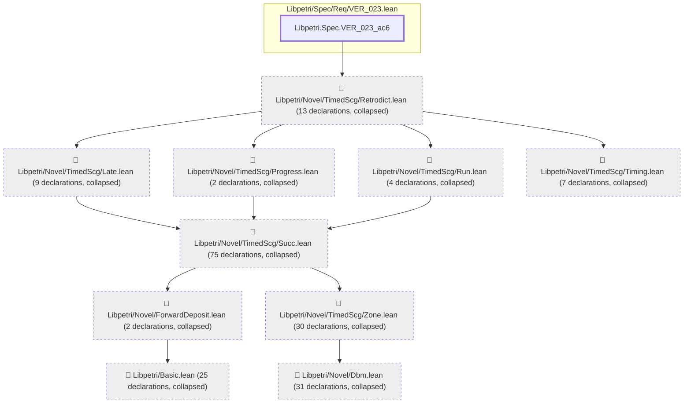

# VER-023

Generated by `scripts/proof-graph.py` from `proof-graph.json`. Do not edit.

Theorems carrying this ID:

- `Libpetri.Spec.VER_023_ac11` (theorem, `Libpetri/Spec/Req/VER_023.lean:493`)
- `Libpetri.Spec.VER_023_ac6` (theorem, `Libpetri/Spec/Req/VER_023.lean:1055`)
- `Libpetri.Spec.VER_023_keeps_timing` (theorem, `Libpetri/Spec/Req/VER_023.lean:373`)
- `Libpetri.Spec.VER_023_spurious_sound` (theorem, `Libpetri/Spec/Req/VER_023.lean:1022`)

> **Note:** the full tree has 312 nodes (limit 60), so it is drawn as one diagram per theorem (4 theorems).

### `Libpetri.Spec.VER_023_ac11`

> Rule: this theorem's whole tree, 47 nodes.

```mermaid
flowchart TD
  subgraph g0["Libpetri/Interning.lean"]
    n38["Libpetri.Explorer"]
    n56["Libpetri.Explorer.bound"]
    n61["Libpetri.Explorer.key"]
    n63["Libpetri.Explorer.mk"]
    n65["Libpetri.Explorer.succ"]
  end
  subgraph g1["Libpetri/Novel/RouteB/Decide.lean"]
    n1542["Libpetri.Novel.RouteB.Decide.Out"]
    n1543["Libpetri.Novel.RouteB.Decide.Out.cls"]
    n1544["Libpetri.Novel.RouteB.Decide.Out.complete"]
    n1545["Libpetri.Novel.RouteB.Decide.Out.early"]
    n1546["Libpetri.Novel.RouteB.Decide.Out.exp"]
    n1547["Libpetri.Novel.RouteB.Decide.Out.mk"]
    n1548["Libpetri.Novel.RouteB.Decide.Out.stopped"]
    n1549["Libpetri.Novel.RouteB.Decide.Prop'"]
    n1550["Libpetri.Novel.RouteB.Decide.Prop'.quiescence"]
    n1551["Libpetri.Novel.RouteB.Decide.Prop'.safety"]
    n1552["Libpetri.Novel.RouteB.Decide.Verdict"]
    n1553["Libpetri.Novel.RouteB.Decide.Verdict.proven"]
    n1554["Libpetri.Novel.RouteB.Decide.Verdict.unknown"]
    n1555["Libpetri.Novel.RouteB.Decide.Verdict.violated"]
    n1573["Libpetri.Novel.RouteB.Decide.nextC"]
    n1576["Libpetri.Novel.RouteB.Decide.quiescentAt"]
    n1581["Libpetri.Novel.RouteB.Decide.verdict"]
    n1582["Libpetri.Novel.RouteB.Decide.violatesAt"]
  end
  subgraph g2["Libpetri/Spec/Req/VER_023.lean"]
    n10229["Libpetri.Spec.TimedOutcome"]
    n10230["Libpetri.Spec.TimedOutcome.confirmed"]
    n10231["Libpetri.Spec.TimedOutcome.spurious"]
    n10232["Libpetri.Spec.TimedOutcome.undecided"]
    n10233["Libpetri.Spec.TimedOutcomeFn"]
    n10843["Libpetri.Spec.VER_023_ac11"]
    n16832["Libpetri.Spec.instDecidableEqTimedOutcome"]
    n16833["Libpetri.Spec.instDecidableEqTimedOutcome.decEq"]
    n19971["Libpetri.Spec.refTimedOutcome"]
    n21710["Libpetri.Spec.ver023ReapL"]
  end
  subgraph g3["Libpetri/Spec/Verifier/Graph.lean"]
    n11267["Libpetri.Spec.Verifier.Graph.addNew"]
    n11271["Libpetri.Spec.Verifier.Graph.bfs"]
    n11276["Libpetri.Spec.Verifier.Graph.buildD"]
    n11302["Libpetri.Spec.Verifier.Graph.cands"]
    n11307["Libpetri.Spec.Verifier.Graph.edges"]
    n11319["Libpetri.Spec.Verifier.Graph.expandD"]
    n11333["Libpetri.Spec.Verifier.Graph.idExplorer"]
    n11337["Libpetri.Spec.Verifier.Graph.keyIdx"]
    n11343["Libpetri.Spec.Verifier.Graph.loopD"]
    n11354["Libpetri.Spec.Verifier.Graph.opened"]
    n11360["Libpetri.Spec.Verifier.Graph.shortest"]
    n11365["Libpetri.Spec.Verifier.Graph.succEdges"]
    n11370["Libpetri.Spec.Verifier.Graph.trace"]
  end
  subgraph g4["Libpetri/Spec/Verifier/Scg.lean"]
    n11616["Libpetri.Spec.Verifier.Scg.Label"]
  end
  n56 --> n38
  n61 --> n38
  n63 --> n38
  n65 --> n38
  n1543 --> n1542
  n1544 --> n1542
  n1545 --> n1542
  n1546 --> n1542
  n1547 --> n1542
  n1548 --> n1542
  n1550 --> n1549
  n1551 --> n1549
  n1553 --> n1552
  n1554 --> n1552
  n1555 --> n1552
  n1573 --> n56
  n1576 --> n56
  n1576 --> n65
  n1576 --> n1543
  n1576 --> n1546
  n1581 --> n1544
  n1581 --> n1548
  n1581 --> n1553
  n1581 --> n1554
  n1581 --> n1555
  n1581 --> n1582
  n1582 --> n1550
  n1582 --> n1551
  n1582 --> n1576
  n10230 --> n10229
  n10230 --> n11616
  n10231 --> n10229
  n10232 --> n10229
  n10233 --> n38
  n10233 --> n1542
  n10233 --> n1549
  n10233 --> n10229
  n10233 --> n11616
  n10843 --> n11276
  n10843 --> n11333
  n10843 --> n16832
  n10843 --> n19971
  n10843 --> n21710
  n11271 --> n11267
  n11271 --> n11302
  n11276 --> n11343
  n11307 --> n11354
  n11307 --> n11365
  n11319 --> n61
  n11333 --> n63
  n11337 --> n61
  n11343 --> n65
  n11343 --> n1547
  n11343 --> n1573
  n11343 --> n11319
  n11354 --> n1545
  n11354 --> n1546
  n11360 --> n11271
  n11365 --> n56
  n11365 --> n65
  n11365 --> n1543
  n11365 --> n11337
  n11370 --> n11307
  n11370 --> n11360
  n16832 --> n16833
  n16833 --> n10230
  n16833 --> n10231
  n16833 --> n10232
  n19971 --> n1581
  n19971 --> n10230
  n19971 --> n10231
  n19971 --> n10232
  n19971 --> n10233
  n19971 --> n11370
  n21710 --> n11616
  classDef root stroke-width:3px
  classDef locked fill:#fff3cd,stroke:#b8860b
  classDef collapsed fill:#eeeeee,stroke-dasharray:4 4
  class n10843 root
```

### `Libpetri.Spec.VER_023_ac6`

> Rule: this theorem's tree has 199 nodes (limit 60); every file other than its own is collapsed into one node, leaving 11.

### `Libpetri.Spec.VER_023_keeps_timing`

> Rule: this theorem's tree has 72 nodes (limit 60); every file other than its own is collapsed into one node, leaving 25.

```mermaid
flowchart TD
  subgraph g0["Libpetri/Spec/Req/VER_023.lean"]
    n10219["Libpetri.Spec.TimedAnnotFn"]
    n10220["Libpetri.Spec.TimedCheckInput"]
    n10221["Libpetri.Spec.TimedCheckInput.enabled"]
    n10222["Libpetri.Spec.TimedCheckInput.envPlaces"]
    n10223["Libpetri.Spec.TimedCheckInput.hasMatch"]
    n10225["Libpetri.Spec.TimedCheckInput.net"]
    n10226["Libpetri.Spec.TimedCheckInput.route"]
    n10227["Libpetri.Spec.TimedCheckInput.verdict"]
    n10228["Libpetri.Spec.TimedGateFn"]
    n10229["Libpetri.Spec.TimedOutcome"]
    n10230["Libpetri.Spec.TimedOutcome.confirmed"]
    n10231["Libpetri.Spec.TimedOutcome.spurious"]
    n10232["Libpetri.Spec.TimedOutcome.undecided"]
    n10233["Libpetri.Spec.TimedOutcomeFn"]
    n10842["Libpetri.Spec.VER_023"]
    n10866["Libpetri.Spec.VER_023_keeps_timing"]
  end
  c6["📁 Libpetri/Interning.lean (5 declarations, collapsed)"]
  c44["📁 Libpetri/Novel/RouteB/Decide.lean (16 declarations, collapsed)"]
  c66["📁 Libpetri/Novel/TimedScg/Timing.lean (2 declarations, collapsed)"]
  c94["📁 Libpetri/Reference/Semantics.lean (3 declarations, collapsed)"]
  c98["📁 Libpetri/Reference/Timed.lean (3 declarations, collapsed)"]
  c146["📁 Libpetri/Spec/GlossaryTime.lean (1 declarations, collapsed)"]
  c364["📁 Libpetri/Spec/Verifier/Graph.lean (5 declarations, collapsed)"]
  c367["📁 Libpetri/Spec/Verifier/Result.lean (20 declarations, collapsed)"]
  c368["📁 Libpetri/Spec/Verifier/Scg.lean (1 declarations, collapsed)"]
  c44 --> c6
  c98 --> c66
  c98 --> c94
  c146 --> c98
  c364 --> c44
  c367 --> c146
  n10219 --> c367
  n10219 --> n10229
  n10221 --> n10220
  n10222 --> n10220
  n10223 --> n10220
  n10225 --> c98
  n10225 --> n10220
  n10226 --> c367
  n10226 --> n10220
  n10227 --> c367
  n10227 --> n10220
  n10228 --> n10220
  n10230 --> c368
  n10230 --> n10229
  n10231 --> n10229
  n10232 --> n10229
  n10233 --> c44
  n10233 --> c368
  n10233 --> n10229
  n10842 --> c364
  n10842 --> n10219
  n10842 --> n10221
  n10842 --> n10222
  n10842 --> n10223
  n10842 --> n10225
  n10842 --> n10226
  n10842 --> n10227
  n10842 --> n10228
  n10842 --> n10230
  n10842 --> n10231
  n10842 --> n10232
  n10842 --> n10233
  n10866 --> n10842
  classDef root stroke-width:3px
  classDef locked fill:#fff3cd,stroke:#b8860b
  classDef collapsed fill:#eeeeee,stroke-dasharray:4 4
  class n10866 root
  class c6,c44,c66,c94,c98,c146,c364,c367,c368 collapsed
```

### `Libpetri.Spec.VER_023_spurious_sound`

> Rule: this theorem's tree has 154 nodes (limit 60); every file other than its own is collapsed into one node, leaving 35.

```mermaid
flowchart TD
  subgraph g0["Libpetri/Spec/Req/VER_023.lean"]
    n10219["Libpetri.Spec.TimedAnnotFn"]
    n10220["Libpetri.Spec.TimedCheckInput"]
    n10221["Libpetri.Spec.TimedCheckInput.enabled"]
    n10222["Libpetri.Spec.TimedCheckInput.envPlaces"]
    n10223["Libpetri.Spec.TimedCheckInput.hasMatch"]
    n10225["Libpetri.Spec.TimedCheckInput.net"]
    n10226["Libpetri.Spec.TimedCheckInput.route"]
    n10227["Libpetri.Spec.TimedCheckInput.verdict"]
    n10228["Libpetri.Spec.TimedGateFn"]
    n10229["Libpetri.Spec.TimedOutcome"]
    n10230["Libpetri.Spec.TimedOutcome.confirmed"]
    n10231["Libpetri.Spec.TimedOutcome.spurious"]
    n10232["Libpetri.Spec.TimedOutcome.undecided"]
    n10233["Libpetri.Spec.TimedOutcomeFn"]
    n10235["Libpetri.Spec.TimedSuccFn"]
    n10236["Libpetri.Spec.TimedSuccReach"]
    n10842["Libpetri.Spec.VER_023"]
    n10860["Libpetri.Spec.VER_023_graph"]
    n10869["Libpetri.Spec.VER_023_spurious_sound"]
    n20800["Libpetri.Spec.timedChkE"]
    n20802["Libpetri.Spec.timedChkGraph"]
  end
  c0["📁 Libpetri/Basic.lean (18 declarations, collapsed)"]
  c6["📁 Libpetri/Interning.lean (6 declarations, collapsed)"]
  c15["📁 Libpetri/Novel/Dbm.lean (9 declarations, collapsed)"]
  c28["📁 Libpetri/Novel/ForwardDeposit.lean (1 declarations, collapsed)"]
  c44["📁 Libpetri/Novel/RouteB/Decide.lean (16 declarations, collapsed)"]
  c65["📁 Libpetri/Novel/TimedScg/Succ.lean (27 declarations, collapsed)"]
  c66["📁 Libpetri/Novel/TimedScg/Timing.lean (5 declarations, collapsed)"]
  c67["📁 Libpetri/Novel/TimedScg/Zone.lean (8 declarations, collapsed)"]
  c94["📁 Libpetri/Reference/Semantics.lean (3 declarations, collapsed)"]
  c98["📁 Libpetri/Reference/Timed.lean (3 declarations, collapsed)"]
  c146["📁 Libpetri/Spec/GlossaryTime.lean (1 declarations, collapsed)"]
  c364["📁 Libpetri/Spec/Verifier/Graph.lean (5 declarations, collapsed)"]
  c367["📁 Libpetri/Spec/Verifier/Result.lean (17 declarations, collapsed)"]
  c368["📁 Libpetri/Spec/Verifier/Scg.lean (14 declarations, collapsed)"]
  c28 --> c0
  c44 --> c6
  c65 --> c28
  c65 --> c67
  c66 --> c65
  c67 --> c15
  c98 --> c66
  c98 --> c94
  c146 --> c98
  c364 --> c44
  c367 --> c146
  c368 --> c66
  n10219 --> c367
  n10219 --> n10229
  n10221 --> n10220
  n10222 --> n10220
  n10223 --> n10220
  n10225 --> c98
  n10225 --> n10220
  n10226 --> c367
  n10226 --> n10220
  n10227 --> c367
  n10227 --> n10220
  n10228 --> n10220
  n10230 --> c368
  n10230 --> n10229
  n10231 --> n10229
  n10232 --> n10229
  n10233 --> c44
  n10233 --> c368
  n10233 --> n10229
  n10235 --> c368
  n10236 --> n10235
  n10842 --> c364
  n10842 --> n10219
  n10842 --> n10221
  n10842 --> n10222
  n10842 --> n10223
  n10842 --> n10225
  n10842 --> n10226
  n10842 --> n10227
  n10842 --> n10228
  n10842 --> n10230
  n10842 --> n10231
  n10842 --> n10232
  n10842 --> n10233
  n10860 --> n10236
  n10860 --> n20802
  n10869 --> n10842
  n10869 --> n10860
  n20800 --> c6
  n20800 --> n10235
  n20802 --> c44
  n20802 --> n20800
  classDef root stroke-width:3px
  classDef locked fill:#fff3cd,stroke:#b8860b
  classDef collapsed fill:#eeeeee,stroke-dasharray:4 4
  class n10869 root
  class c0,c6,c15,c28,c44,c65,c66,c67,c94,c98,c146,c364,c367,c368 collapsed
```

Axioms used:

- `Libpetri.Spec.VER_023_ac11`: `propext`
- `Libpetri.Spec.VER_023_ac6`: `Classical.choice`, `Quot.sound`, `propext`
- `Libpetri.Spec.VER_023_keeps_timing`: `Classical.choice`, `Quot.sound`, `propext`
- `Libpetri.Spec.VER_023_spurious_sound`: `Classical.choice`, `Quot.sound`, `propext`
