# VER-025

Generated by `scripts/proof-graph.py` from `proof-graph.json`. Do not edit.

Theorems carrying this ID:

- `Libpetri.Novel.FiringBound.bmcEnv_complete` (theorem, `Libpetri/Novel/FiringBound/Bmc.lean:1086`)
- `Libpetri.Novel.FiringBound.bmcEnv_sat_replays` (theorem, `Libpetri/Novel/FiringBound/Bmc.lean:1106`)
- `Libpetri.Novel.FiringBound.bmcModelEnv_nil` (theorem, `Libpetri/Novel/FiringBound/Bmc.lean:1124`)
- `Libpetri.Novel.FiringBound.pipeline_eq_fixpoint` (theorem, `Libpetri/Novel/FiringBound/Witness.lean:483`)
- `Libpetri.Novel.FiringBound.pipeline_some_eq` (theorem, `Libpetri/Novel/FiringBound/Witness.lean:471`)
- `Libpetri.Novel.FiringBound.replayEnv_sound` (theorem, `Libpetri/Novel/FiringBound/Bmc.lean:603`)
- `Libpetri.Novel.FiringBound.replayRun_sound` (theorem, `Libpetri/Novel/FiringBound/Witness.lean:100`)
- `Libpetri.Novel.FiringBound.stepEnv_injsOf` (theorem, `Libpetri/Novel/FiringBound/Witness.lean:632`)
- `Libpetri.Novel.FiringBound.trim_first` (theorem, `Libpetri/Novel/FiringBound/Witness.lean:324`)
- `Libpetri.Novel.FiringBound.trim_initial` (theorem, `Libpetri/Novel/FiringBound/Witness.lean:331`)
- `Libpetri.Novel.FiringBound.trim_irredundant` (theorem, `Libpetri/Novel/FiringBound/Witness.lean:355`)
- `Libpetri.Novel.FiringBound.trim_sound` (theorem, `Libpetri/Novel/FiringBound/Witness.lean:318`)
- `Libpetri.Novel.FiringBound.trim_sublist` (theorem, `Libpetri/Novel/FiringBound/Witness.lean:301`)
- `Libpetri.Novel.FiringBound.witnessPhase_depth0` (theorem, `Libpetri/Novel/FiringBound/Witness.lean:511`)
- `Libpetri.Novel.FiringBound.witnessPhase_never_proven` (theorem, `Libpetri/Novel/FiringBound/Witness.lean:495`)
- `Libpetri.Novel.FiringBound.witnessPhase_noRun_exact` (theorem, `Libpetri/Novel/FiringBound/Witness.lean:567`)
- `Libpetri.Novel.FiringBound.witnessPhase_sat_violated` (theorem, `Libpetri/Novel/FiringBound/Witness.lean:599`)
- `Libpetri.Novel.FiringBound.witnessPhase_violated_sound` (theorem, `Libpetri/Novel/FiringBound/Witness.lean:523`)
- `Libpetri.Novel.FiringBound.witness_horn_derivation` (theorem, `Libpetri/Novel/FiringBound/Witness.lean:716`)

> **Note:** the full tree has 244 nodes (limit 60), so it is drawn as one diagram per theorem (19 theorems).

### `Libpetri.Novel.FiringBound.bmcEnv_complete`

#### `Libpetri.Novel.FiringBound.bmcEnv_complete` → `Libpetri.Novel.FiringBound.BadAgrees`

> Rule: this theorem's tree has 99 nodes, still 76 with other files collapsed, so it is split by direct dependency; this part has 3 nodes, other files collapsed.

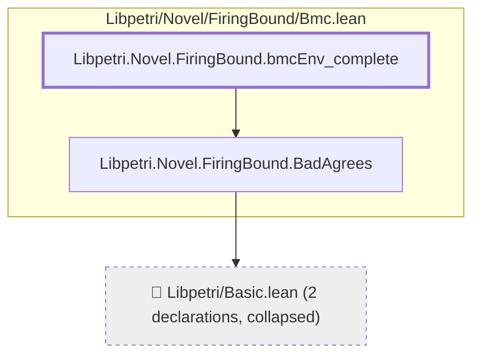

#### `Libpetri.Novel.FiringBound.bmcEnv_complete` → `Libpetri.Novel.FiringBound.BmcModelEnv`

> Rule: this theorem's tree has 99 nodes, still 76 with other files collapsed, so it is split by direct dependency; this part has 6 nodes, other files collapsed.

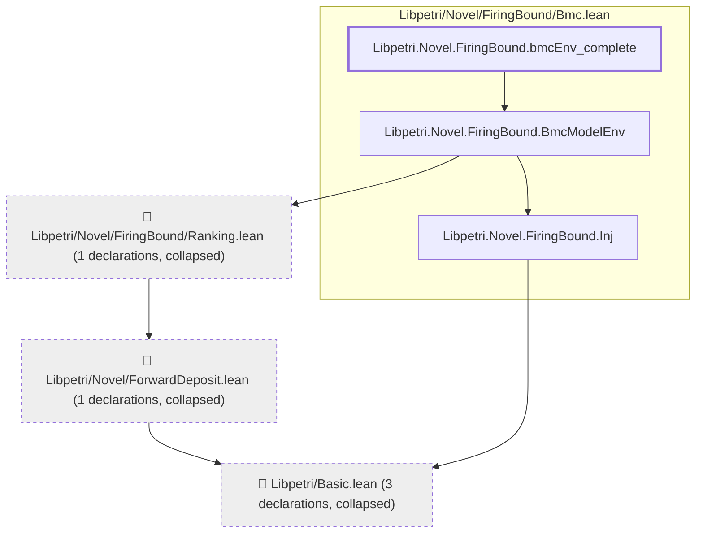

#### `Libpetri.Novel.FiringBound.bmcEnv_complete` → `Libpetri.Novel.FiringBound.BmcModelEnv.bad`

> Rule: this theorem's tree has 99 nodes, still 76 with other files collapsed, so it is split by direct dependency; this part has 8 nodes, other files collapsed.

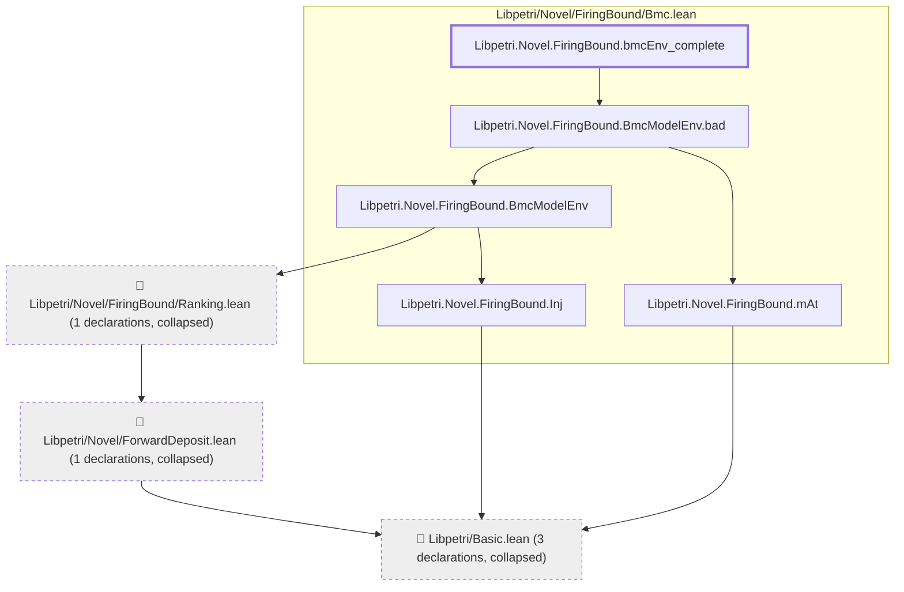

#### `Libpetri.Novel.FiringBound.bmcEnv_complete` → `Libpetri.Novel.FiringBound.BmcSatEnv`

> Rule: this theorem's tree has 99 nodes, still 76 with other files collapsed, so it is split by direct dependency; this part has 7 nodes, other files collapsed.

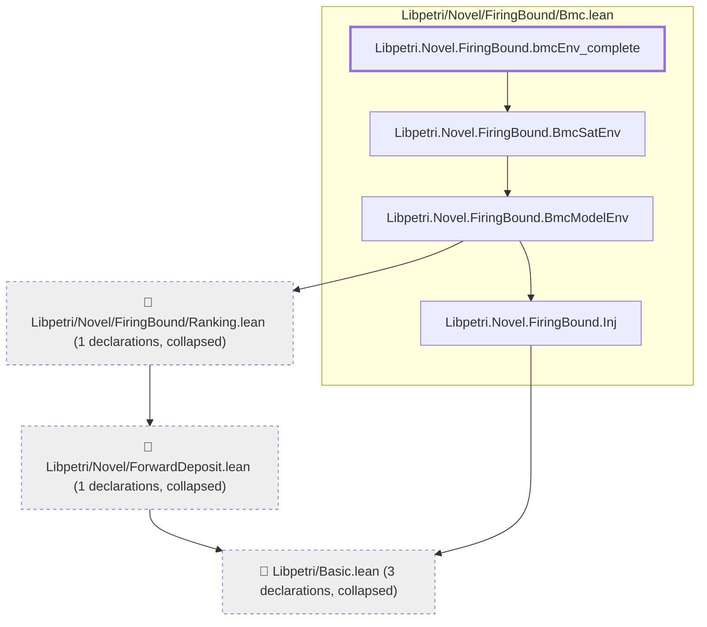

#### `Libpetri.Novel.FiringBound.bmcEnv_complete` → `Libpetri.Novel.FiringBound.Inj`

> Rule: this theorem's tree has 99 nodes, still 76 with other files collapsed, so it is split by direct dependency; this part has 3 nodes, other files collapsed.

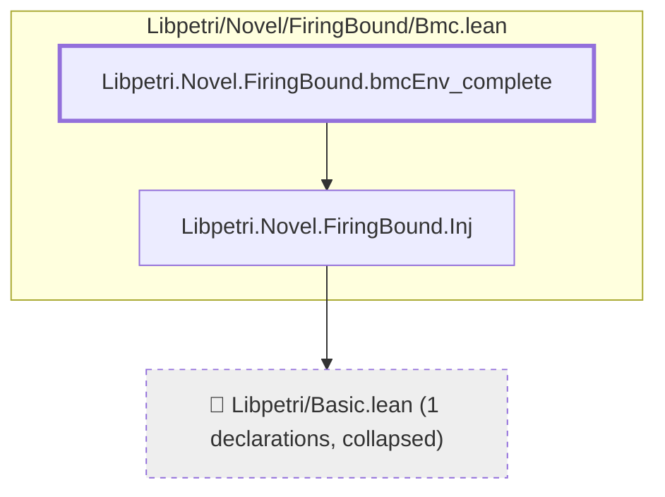

#### `Libpetri.Novel.FiringBound.bmcEnv_complete` → `Libpetri.Novel.FiringBound.InjsDistinct`

> Rule: this theorem's tree has 99 nodes, still 76 with other files collapsed, so it is split by direct dependency; this part has 4 nodes, other files collapsed.

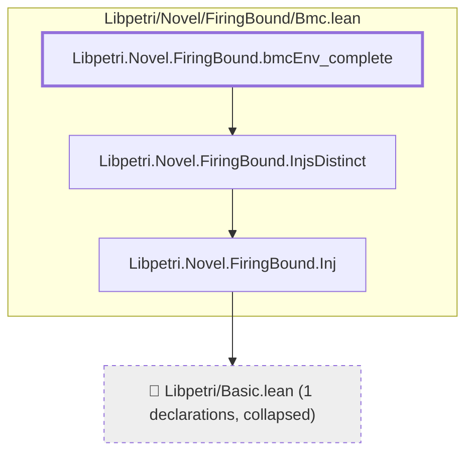

#### `Libpetri.Novel.FiringBound.bmcEnv_complete` → `Libpetri.Novel.FiringBound.InjsIn`

> Rule: this theorem's tree has 99 nodes, still 76 with other files collapsed, so it is split by direct dependency; this part has 4 nodes, other files collapsed.

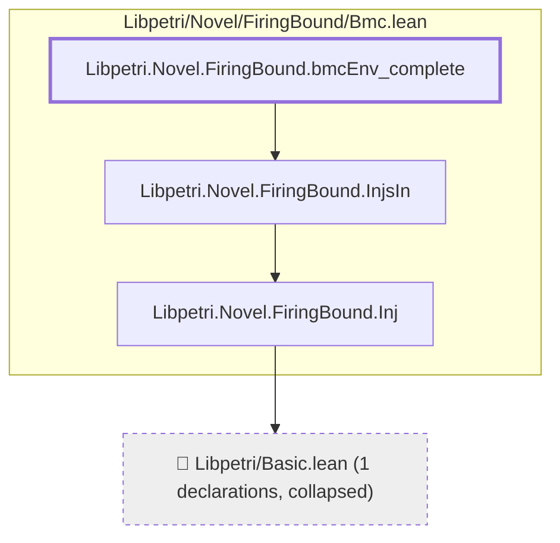

#### `Libpetri.Novel.FiringBound.bmcEnv_complete` → `Libpetri.Novel.FiringBound.Row`

> Rule: this theorem's tree has 99 nodes, still 76 with other files collapsed, so it is split by direct dependency; this part has 4 nodes, other files collapsed.

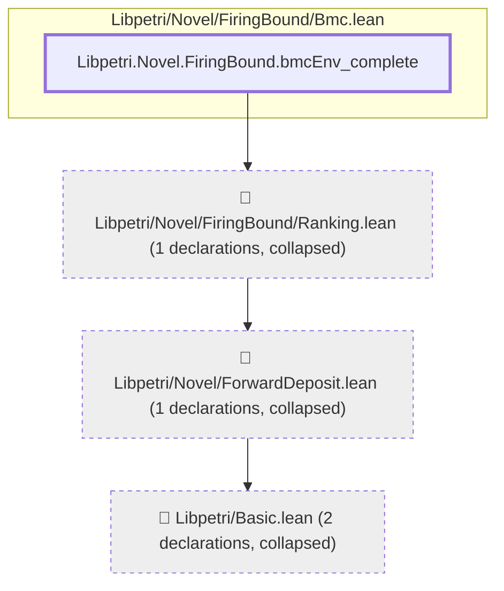

#### `Libpetri.Novel.FiringBound.bmcEnv_complete` → `Libpetri.Novel.FiringBound.WellFormedRows`

> Rule: this theorem's tree has 99 nodes, still 76 with other files collapsed, so it is split by direct dependency; this part has 6 nodes, other files collapsed.

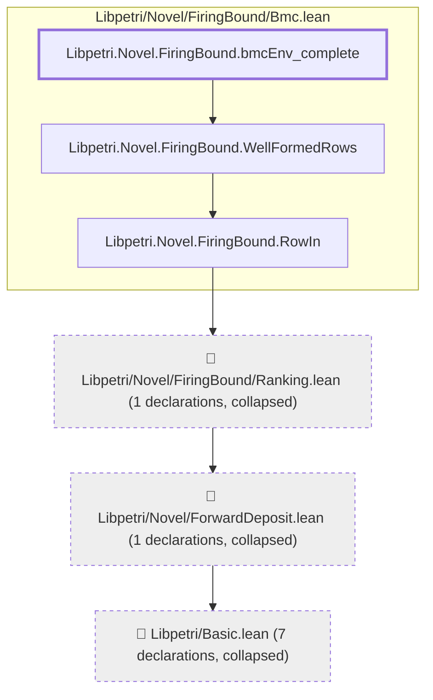

#### `Libpetri.Novel.FiringBound.bmcEnv_complete` → `Libpetri.Novel.FiringBound.bmcEnv_model_replays`

> Rule: this theorem's tree has 99 nodes, still 76 with other files collapsed, so it is split by direct dependency; this part has 58 nodes, other files collapsed.

```mermaid
flowchart TD
  subgraph g0["Libpetri/Novel/FiringBound/Bmc.lean"]
    n534["Libpetri.Novel.FiringBound.BmcModelEnv"]
    n536["Libpetri.Novel.FiringBound.BmcModelEnv.caps"]
    n537["Libpetri.Novel.FiringBound.BmcModelEnv.guard"]
    n538["Libpetri.Novel.FiringBound.BmcModelEnv.idle_final"]
    n539["Libpetri.Novel.FiringBound.BmcModelEnv.inj_guard"]
    n541["Libpetri.Novel.FiringBound.BmcModelEnv.sel_range"]
    n542["Libpetri.Novel.FiringBound.BmcModelEnv.update"]
    n550["Libpetri.Novel.FiringBound.Inj"]
    n552["Libpetri.Novel.FiringBound.InjsIn"]
    n565["Libpetri.Novel.FiringBound.RowIn"]
    n566["Libpetri.Novel.FiringBound.RowIn.deposit"]
    n568["Libpetri.Novel.FiringBound.RowIn.inputs"]
    n571["Libpetri.Novel.FiringBound.RowIn.resets"]
    n583["Libpetri.Novel.FiringBound.WellFormedRows"]
    n618["Libpetri.Novel.FiringBound.bmcEnv_complete"]
    n619["Libpetri.Novel.FiringBound.bmcEnv_model_replays"]
    n634["Libpetri.Novel.FiringBound.capOk"]
    n635["Libpetri.Novel.FiringBound.capsOk"]
    n636["Libpetri.Novel.FiringBound.chain"]
    n637["Libpetri.Novel.FiringBound.chain_append_miss"]
    n638["Libpetri.Novel.FiringBound.chain_congr"]
    n639["Libpetri.Novel.FiringBound.chain_cons"]
    n640["Libpetri.Novel.FiringBound.chain_hit"]
    n642["Libpetri.Novel.FiringBound.chain_idle_env"]
    n643["Libpetri.Novel.FiringBound.chain_inject_env"]
    n644["Libpetri.Novel.FiringBound.chain_miss"]
    n645["Libpetri.Novel.FiringBound.chain_step"]
    n646["Libpetri.Novel.FiringBound.chain_step_env"]
    n649["Libpetri.Novel.FiringBound.clears"]
    n650["Libpetri.Novel.FiringBound.column"]
    n652["Libpetri.Novel.FiringBound.decode"]
    n658["Libpetri.Novel.FiringBound.decodeSel"]
    n668["Libpetri.Novel.FiringBound.fireAD_frame"]
    n677["Libpetri.Novel.FiringBound.guardI"]
    n678["Libpetri.Novel.FiringBound.guardI_iff_enabledA"]
    n679["Libpetri.Novel.FiringBound.injAt"]
    n681["Libpetri.Novel.FiringBound.injOk"]
    n682["Libpetri.Novel.FiringBound.injTouching"]
    n693["Libpetri.Novel.FiringBound.mAt"]
    n695["Libpetri.Novel.FiringBound.mem_injTouching"]
    n696["Libpetri.Novel.FiringBound.mem_touching"]
    n699["Libpetri.Novel.FiringBound.nextVal"]
    n700["Libpetri.Novel.FiringBound.nextValEnv"]
    n740["Libpetri.Novel.FiringBound.replayEnv"]
    n741["Libpetri.Novel.FiringBound.replayEnv_append"]
    n745["Libpetri.Novel.FiringBound.replayEnv_singleton"]
    n746["Libpetri.Novel.FiringBound.replayEnv_snoc"]
    n761["Libpetri.Novel.FiringBound.stepIdx"]
    n772["Libpetri.Novel.FiringBound.touches"]
    n773["Libpetri.Novel.FiringBound.touching"]
    n774["Libpetri.Novel.FiringBound.touchingEnv"]
    n775["Libpetri.Novel.FiringBound.touchingEnv_bounds"]
    n776["Libpetri.Novel.FiringBound.touching_lt"]
  end
  c0["📁 Libpetri/Basic.lean (22 declarations, collapsed)"]
  c24["📁 Libpetri/Novel/FiringBound/Ranking.lean (1 declarations, collapsed)"]
  c27["📁 Libpetri/Novel/ForwardDeposit.lean (2 declarations, collapsed)"]
  c84["📁 Libpetri/Soundness.lean (1 declarations, collapsed)"]
  c154["📁 Libpetri/Strengthening/Hypotheses.lean (1 declarations, collapsed)"]
  c24 --> c27
  c27 --> c0
  c84 --> c0
  c154 --> c84
  n534 --> c24
  n534 --> n550
  n536 --> n534
  n536 --> n693
  n537 --> n534
  n537 --> n677
  n537 --> n693
  n538 --> n534
  n539 --> n534
  n539 --> n693
  n541 --> n534
  n542 --> n534
  n542 --> n636
  n542 --> n693
  n542 --> n700
  n542 --> n774
  n550 --> c0
  n552 --> n550
  n565 --> c24
  n566 --> n565
  n568 --> n565
  n571 --> n565
  n583 --> n565
  n618 --> n619
  n619 --> n536
  n619 --> n537
  n619 --> n538
  n619 --> n539
  n619 --> n541
  n619 --> n542
  n619 --> n552
  n619 --> n583
  n619 --> n642
  n619 --> n643
  n619 --> n646
  n619 --> n652
  n619 --> n668
  n619 --> n678
  n619 --> n746
  n634 --> n550
  n635 --> n634
  n637 --> n644
  n638 --> n639
  n639 --> n636
  n640 --> n639
  n642 --> n644
  n642 --> n775
  n643 --> n640
  n643 --> n644
  n643 --> n695
  n643 --> n700
  n643 --> n774
  n643 --> n776
  n644 --> n639
  n645 --> c154
  n645 --> n640
  n645 --> n644
  n645 --> n696
  n645 --> n699
  n646 --> n637
  n646 --> n638
  n646 --> n645
  n646 --> n695
  n646 --> n700
  n646 --> n774
  n646 --> n776
  n649 --> c24
  n650 --> c24
  n652 --> n658
  n668 --> c84
  n668 --> n566
  n668 --> n568
  n668 --> n571
  n677 --> c0
  n678 --> c154
  n678 --> n568
  n678 --> n677
  n679 --> c0
  n681 --> n550
  n682 --> n550
  n693 --> c0
  n695 --> n682
  n696 --> n773
  n699 --> n649
  n699 --> n650
  n700 --> n699
  n740 --> n761
  n741 --> n740
  n745 --> n740
  n746 --> n741
  n746 --> n745
  n761 --> c24
  n761 --> n635
  n761 --> n679
  n761 --> n681
  n772 --> n649
  n772 --> n650
  n773 --> n772
  n774 --> n682
  n774 --> n773
  n775 --> n695
  n775 --> n774
  n775 --> n776
  n776 --> n696
  classDef root stroke-width:3px
  classDef locked fill:#fff3cd,stroke:#b8860b
  classDef collapsed fill:#eeeeee,stroke-dasharray:4 4
  class n618 root
  class c0,c24,c27,c84,c154 collapsed
```

#### `Libpetri.Novel.FiringBound.bmcEnv_complete` → `Libpetri.Novel.FiringBound.bmcEnv_of_run`

> Rule: this theorem's tree has 99 nodes, still 76 with other files collapsed, so it is split by direct dependency; this part has 64 nodes, other files collapsed.

```mermaid
flowchart TD
  subgraph g0["Libpetri/Novel/FiringBound/Bmc.lean"]
    n526["Libpetri.Novel.FiringBound.BadAgrees"]
    n534["Libpetri.Novel.FiringBound.BmcModelEnv"]
    n540["Libpetri.Novel.FiringBound.BmcModelEnv.mk"]
    n544["Libpetri.Novel.FiringBound.BmcSatEnv"]
    n550["Libpetri.Novel.FiringBound.Inj"]
    n551["Libpetri.Novel.FiringBound.InjsDistinct"]
    n552["Libpetri.Novel.FiringBound.InjsIn"]
    n565["Libpetri.Novel.FiringBound.RowIn"]
    n566["Libpetri.Novel.FiringBound.RowIn.deposit"]
    n568["Libpetri.Novel.FiringBound.RowIn.inputs"]
    n571["Libpetri.Novel.FiringBound.RowIn.resets"]
    n572["Libpetri.Novel.FiringBound.StepEnv"]
    n583["Libpetri.Novel.FiringBound.WellFormedRows"]
    n618["Libpetri.Novel.FiringBound.bmcEnv_complete"]
    n620["Libpetri.Novel.FiringBound.bmcEnv_of_run"]
    n634["Libpetri.Novel.FiringBound.capOk"]
    n635["Libpetri.Novel.FiringBound.capsOk"]
    n636["Libpetri.Novel.FiringBound.chain"]
    n637["Libpetri.Novel.FiringBound.chain_append_miss"]
    n638["Libpetri.Novel.FiringBound.chain_congr"]
    n639["Libpetri.Novel.FiringBound.chain_cons"]
    n640["Libpetri.Novel.FiringBound.chain_hit"]
    n642["Libpetri.Novel.FiringBound.chain_idle_env"]
    n643["Libpetri.Novel.FiringBound.chain_inject_env"]
    n644["Libpetri.Novel.FiringBound.chain_miss"]
    n645["Libpetri.Novel.FiringBound.chain_step"]
    n646["Libpetri.Novel.FiringBound.chain_step_env"]
    n649["Libpetri.Novel.FiringBound.clears"]
    n650["Libpetri.Novel.FiringBound.column"]
    n668["Libpetri.Novel.FiringBound.fireAD_frame"]
    n677["Libpetri.Novel.FiringBound.guardI"]
    n678["Libpetri.Novel.FiringBound.guardI_iff_enabledA"]
    n679["Libpetri.Novel.FiringBound.injAt"]
    n681["Libpetri.Novel.FiringBound.injOk"]
    n682["Libpetri.Novel.FiringBound.injTouching"]
    n693["Libpetri.Novel.FiringBound.mAt"]
    n695["Libpetri.Novel.FiringBound.mem_injTouching"]
    n696["Libpetri.Novel.FiringBound.mem_touching"]
    n699["Libpetri.Novel.FiringBound.nextVal"]
    n700["Libpetri.Novel.FiringBound.nextValEnv"]
    n740["Libpetri.Novel.FiringBound.replayEnv"]
    n741["Libpetri.Novel.FiringBound.replayEnv_append"]
    n742["Libpetri.Novel.FiringBound.replayEnv_frame"]
    n743["Libpetri.Novel.FiringBound.replayEnv_lt"]
    n745["Libpetri.Novel.FiringBound.replayEnv_singleton"]
    n748["Libpetri.Novel.FiringBound.replayEnv_take"]
    n758["Libpetri.Novel.FiringBound.stAtEnv"]
    n761["Libpetri.Novel.FiringBound.stepIdx"]
    n762["Libpetri.Novel.FiringBound.stepIdx_caps"]
    n763["Libpetri.Novel.FiringBound.stepIdx_frame"]
    n764["Libpetri.Novel.FiringBound.stepIdx_inj"]
    n765["Libpetri.Novel.FiringBound.stepIdx_lt"]
    n766["Libpetri.Novel.FiringBound.stepIdx_row"]
    n767["Libpetri.Novel.FiringBound.stepIdx_sound"]
    n772["Libpetri.Novel.FiringBound.touches"]
    n773["Libpetri.Novel.FiringBound.touching"]
    n774["Libpetri.Novel.FiringBound.touchingEnv"]
    n775["Libpetri.Novel.FiringBound.touchingEnv_bounds"]
    n776["Libpetri.Novel.FiringBound.touching_lt"]
  end
  c0["📁 Libpetri/Basic.lean (22 declarations, collapsed)"]
  c24["📁 Libpetri/Novel/FiringBound/Ranking.lean (1 declarations, collapsed)"]
  c27["📁 Libpetri/Novel/ForwardDeposit.lean (3 declarations, collapsed)"]
  c84["📁 Libpetri/Soundness.lean (1 declarations, collapsed)"]
  c154["📁 Libpetri/Strengthening/Hypotheses.lean (1 declarations, collapsed)"]
  c24 --> c27
  c27 --> c0
  c84 --> c0
  c154 --> c84
  n526 --> c0
  n534 --> c24
  n534 --> n550
  n540 --> n534
  n540 --> n636
  n540 --> n677
  n540 --> n693
  n540 --> n700
  n540 --> n774
  n544 --> n534
  n550 --> c0
  n551 --> n550
  n552 --> n550
  n565 --> c24
  n566 --> n565
  n568 --> n565
  n571 --> n565
  n572 --> c24
  n572 --> n635
  n572 --> n679
  n572 --> n681
  n583 --> n565
  n618 --> n620
  n620 --> n526
  n620 --> n540
  n620 --> n544
  n620 --> n642
  n620 --> n643
  n620 --> n646
  n620 --> n678
  n620 --> n742
  n620 --> n743
  n620 --> n745
  n620 --> n748
  n620 --> n762
  n634 --> n550
  n635 --> n634
  n637 --> n644
  n638 --> n639
  n639 --> n636
  n640 --> n639
  n642 --> n644
  n642 --> n775
  n643 --> n640
  n643 --> n644
  n643 --> n695
  n643 --> n700
  n643 --> n774
  n643 --> n776
  n644 --> n639
  n645 --> c154
  n645 --> n640
  n645 --> n644
  n645 --> n696
  n645 --> n699
  n646 --> n637
  n646 --> n638
  n646 --> n645
  n646 --> n695
  n646 --> n700
  n646 --> n774
  n646 --> n776
  n649 --> c24
  n650 --> c24
  n668 --> c84
  n668 --> n566
  n668 --> n568
  n668 --> n571
  n677 --> c0
  n678 --> c154
  n678 --> n568
  n678 --> n677
  n679 --> c0
  n681 --> n550
  n682 --> n550
  n693 --> c0
  n695 --> n682
  n696 --> n773
  n699 --> n649
  n699 --> n650
  n700 --> n699
  n740 --> n761
  n741 --> n740
  n742 --> n740
  n742 --> n763
  n743 --> n740
  n743 --> n765
  n745 --> n740
  n748 --> n741
  n748 --> n758
  n758 --> n740
  n761 --> c24
  n761 --> n635
  n761 --> n679
  n761 --> n681
  n762 --> n551
  n762 --> n767
  n763 --> n552
  n763 --> n583
  n763 --> n668
  n763 --> n767
  n764 --> n761
  n765 --> n761
  n766 --> n761
  n767 --> n572
  n767 --> n764
  n767 --> n765
  n767 --> n766
  n772 --> n649
  n772 --> n650
  n773 --> n772
  n774 --> n682
  n774 --> n773
  n775 --> n695
  n775 --> n774
  n775 --> n776
  n776 --> n696
  classDef root stroke-width:3px
  classDef locked fill:#fff3cd,stroke:#b8860b
  classDef collapsed fill:#eeeeee,stroke-dasharray:4 4
  class n618 root
  class c0,c24,c27,c84,c154 collapsed
```

#### `Libpetri.Novel.FiringBound.bmcEnv_complete` → `Libpetri.Novel.FiringBound.capsOk`

> Rule: this theorem's tree has 99 nodes, still 76 with other files collapsed, so it is split by direct dependency; this part has 5 nodes, other files collapsed.

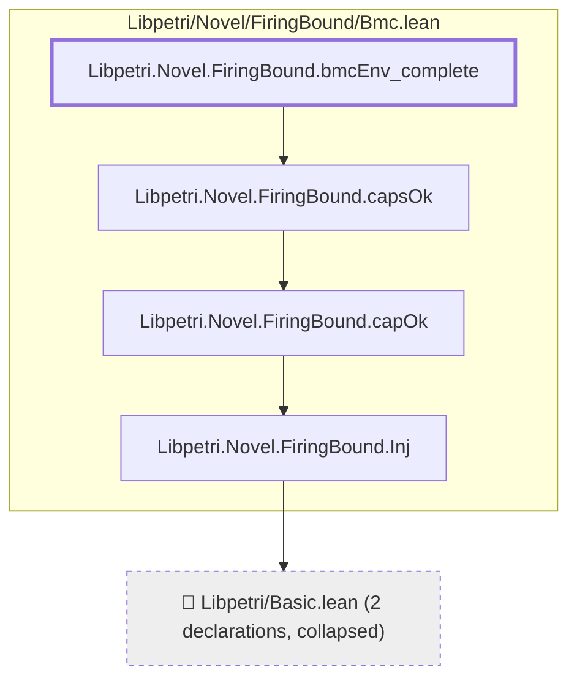

#### `Libpetri.Novel.FiringBound.bmcEnv_complete` → `Libpetri.Novel.FiringBound.decode`

> Rule: this theorem's tree has 99 nodes, still 76 with other files collapsed, so it is split by direct dependency; this part has 3 nodes, other files collapsed.

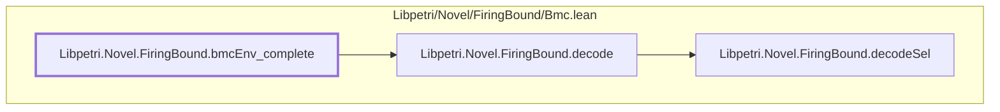

#### `Libpetri.Novel.FiringBound.bmcEnv_complete` → `Libpetri.Novel.FiringBound.decode_length_le`

> Rule: this theorem's tree has 99 nodes, still 76 with other files collapsed, so it is split by direct dependency; this part has 4 nodes, other files collapsed.

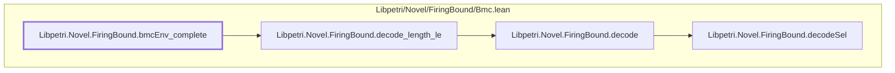

#### `Libpetri.Novel.FiringBound.bmcEnv_complete` → `Libpetri.Novel.FiringBound.mAt`

> Rule: this theorem's tree has 99 nodes, still 76 with other files collapsed, so it is split by direct dependency; this part has 3 nodes, other files collapsed.

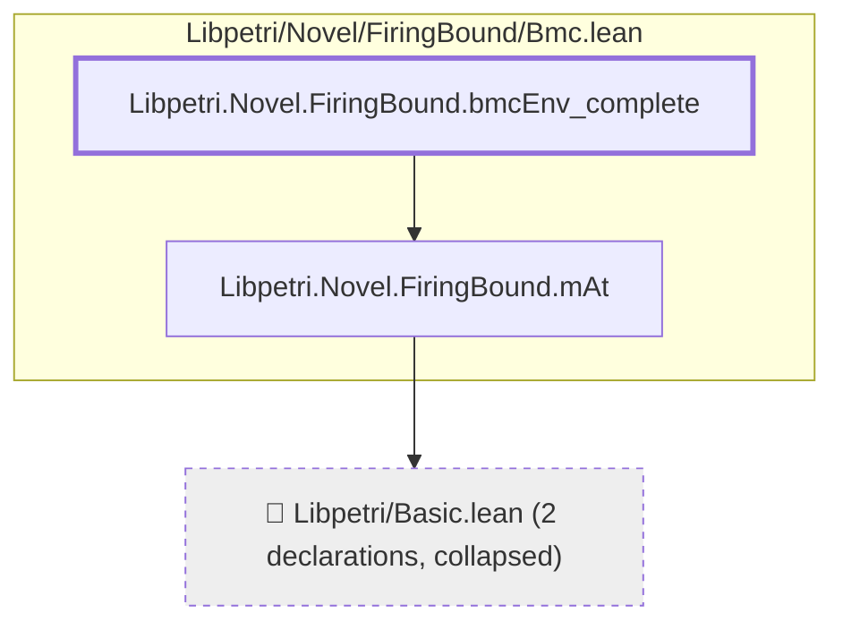

#### `Libpetri.Novel.FiringBound.bmcEnv_complete` → `Libpetri.Novel.FiringBound.replayEnv`

> Rule: this theorem's tree has 99 nodes, still 76 with other files collapsed, so it is split by direct dependency; this part has 11 nodes, other files collapsed.

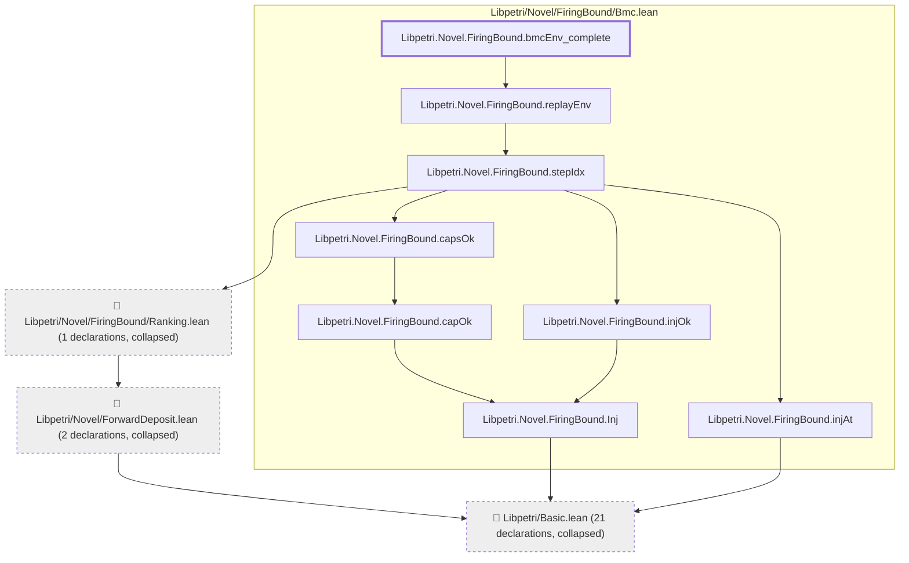

Shared leaves of `Libpetri.Novel.FiringBound.bmcEnv_complete` (direct dependencies too small for a diagram of their own, fewer than 3 nodes):

- `Libpetri.AMarking` (`Libpetri/Basic.lean`)
- `Libpetri.PlaceId` (`Libpetri/Basic.lean`)

### `Libpetri.Novel.FiringBound.bmcEnv_sat_replays`

#### `Libpetri.Novel.FiringBound.bmcEnv_sat_replays` → `Libpetri.Novel.FiringBound.BadAgrees`

> Rule: this theorem's tree has 86 nodes, still 64 with other files collapsed, so it is split by direct dependency; this part has 3 nodes, other files collapsed.

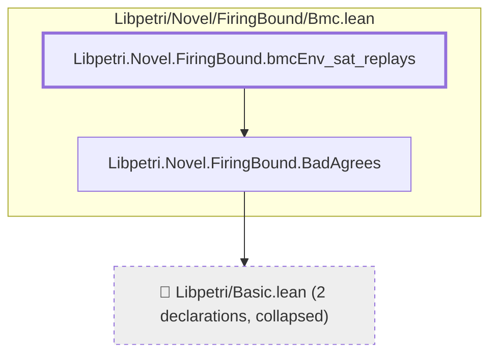

#### `Libpetri.Novel.FiringBound.bmcEnv_sat_replays` → `Libpetri.Novel.FiringBound.BmcModelEnv`

> Rule: this theorem's tree has 86 nodes, still 64 with other files collapsed, so it is split by direct dependency; this part has 6 nodes, other files collapsed.

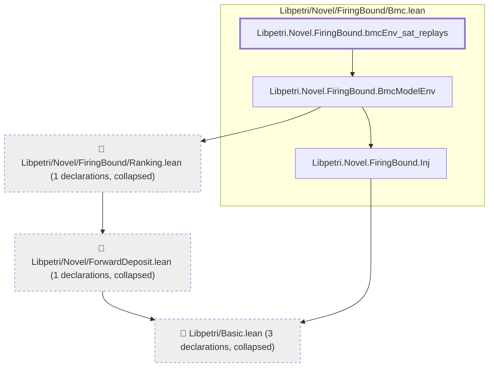

#### `Libpetri.Novel.FiringBound.bmcEnv_sat_replays` → `Libpetri.Novel.FiringBound.BmcModelEnv.bad`

> Rule: this theorem's tree has 86 nodes, still 64 with other files collapsed, so it is split by direct dependency; this part has 8 nodes, other files collapsed.

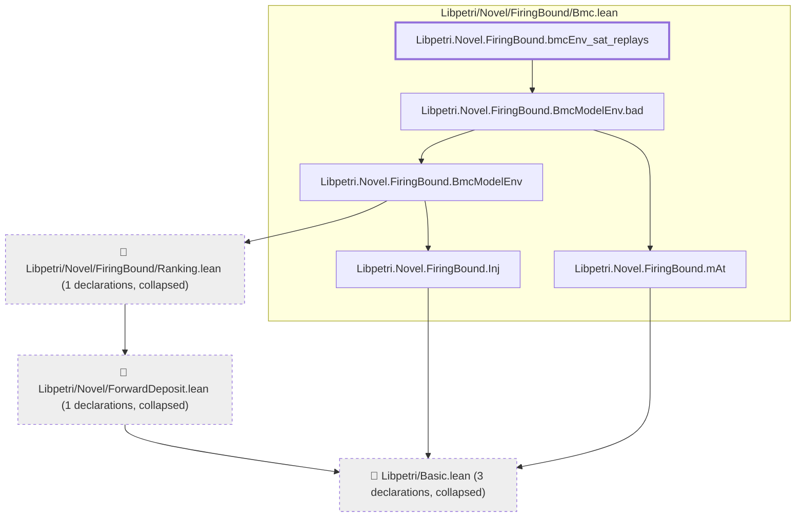

#### `Libpetri.Novel.FiringBound.bmcEnv_sat_replays` → `Libpetri.Novel.FiringBound.Inj`

> Rule: this theorem's tree has 86 nodes, still 64 with other files collapsed, so it is split by direct dependency; this part has 3 nodes, other files collapsed.

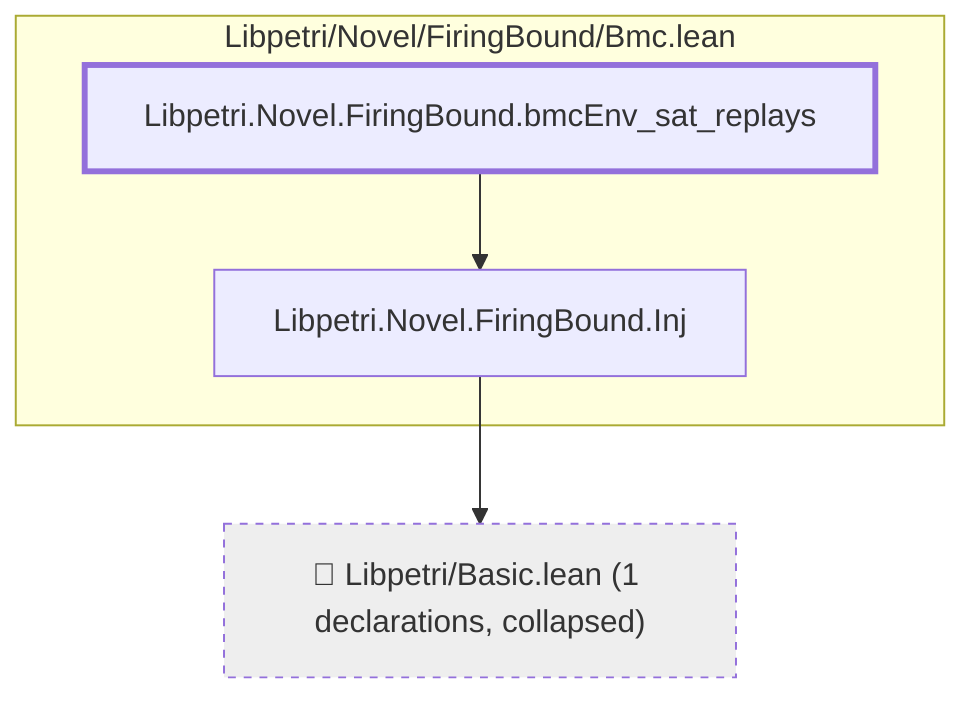

#### `Libpetri.Novel.FiringBound.bmcEnv_sat_replays` → `Libpetri.Novel.FiringBound.InjsIn`

> Rule: this theorem's tree has 86 nodes, still 64 with other files collapsed, so it is split by direct dependency; this part has 4 nodes, other files collapsed.

```mermaid
flowchart TD
  subgraph g0["Libpetri/Novel/FiringBound/Bmc.lean"]
    n550["Libpetri.Novel.FiringBound.Inj"]
    n552["Libpetri.Novel.FiringBound.InjsIn"]
    n621["Libpetri.Novel.FiringBound.bmcEnv_sat_replays"]
  end
  c0["📁 Libpetri/Basic.lean (1 declarations, collapsed)"]
  n550 --> c0
  n552 --> n550
  n621 --> n552
  classDef root stroke-width:3px
  classDef locked fill:#fff3cd,stroke:#b8860b
  classDef collapsed fill:#eeeeee,stroke-dasharray:4 4
  class n621 root
  class c0 collapsed
```

#### `Libpetri.Novel.FiringBound.bmcEnv_sat_replays` → `Libpetri.Novel.FiringBound.Row`

> Rule: this theorem's tree has 86 nodes, still 64 with other files collapsed, so it is split by direct dependency; this part has 4 nodes, other files collapsed.

```mermaid
flowchart TD
  subgraph g0["Libpetri/Novel/FiringBound/Bmc.lean"]
    n621["Libpetri.Novel.FiringBound.bmcEnv_sat_replays"]
  end
  c0["📁 Libpetri/Basic.lean (2 declarations, collapsed)"]
  c24["📁 Libpetri/Novel/FiringBound/Ranking.lean (1 declarations, collapsed)"]
  c27["📁 Libpetri/Novel/ForwardDeposit.lean (1 declarations, collapsed)"]
  c24 --> c27
  c27 --> c0
  n621 --> c24
  classDef root stroke-width:3px
  classDef locked fill:#fff3cd,stroke:#b8860b
  classDef collapsed fill:#eeeeee,stroke-dasharray:4 4
  class n621 root
  class c0,c24,c27 collapsed
```

#### `Libpetri.Novel.FiringBound.bmcEnv_sat_replays` → `Libpetri.Novel.FiringBound.WellFormedRows`

> Rule: this theorem's tree has 86 nodes, still 64 with other files collapsed, so it is split by direct dependency; this part has 6 nodes, other files collapsed.

```mermaid
flowchart TD
  subgraph g0["Libpetri/Novel/FiringBound/Bmc.lean"]
    n565["Libpetri.Novel.FiringBound.RowIn"]
    n583["Libpetri.Novel.FiringBound.WellFormedRows"]
    n621["Libpetri.Novel.FiringBound.bmcEnv_sat_replays"]
  end
  c0["📁 Libpetri/Basic.lean (7 declarations, collapsed)"]
  c24["📁 Libpetri/Novel/FiringBound/Ranking.lean (1 declarations, collapsed)"]
  c27["📁 Libpetri/Novel/ForwardDeposit.lean (1 declarations, collapsed)"]
  c24 --> c27
  c27 --> c0
  n565 --> c24
  n583 --> n565
  n621 --> n583
  classDef root stroke-width:3px
  classDef locked fill:#fff3cd,stroke:#b8860b
  classDef collapsed fill:#eeeeee,stroke-dasharray:4 4
  class n621 root
  class c0,c24,c27 collapsed
```

#### `Libpetri.Novel.FiringBound.bmcEnv_sat_replays` → `Libpetri.Novel.FiringBound.bmcEnv_model_replays`

> Rule: this theorem's tree has 86 nodes, still 64 with other files collapsed, so it is split by direct dependency; this part has 58 nodes, other files collapsed.

```mermaid
flowchart TD
  subgraph g0["Libpetri/Novel/FiringBound/Bmc.lean"]
    n534["Libpetri.Novel.FiringBound.BmcModelEnv"]
    n536["Libpetri.Novel.FiringBound.BmcModelEnv.caps"]
    n537["Libpetri.Novel.FiringBound.BmcModelEnv.guard"]
    n538["Libpetri.Novel.FiringBound.BmcModelEnv.idle_final"]
    n539["Libpetri.Novel.FiringBound.BmcModelEnv.inj_guard"]
    n541["Libpetri.Novel.FiringBound.BmcModelEnv.sel_range"]
    n542["Libpetri.Novel.FiringBound.BmcModelEnv.update"]
    n550["Libpetri.Novel.FiringBound.Inj"]
    n552["Libpetri.Novel.FiringBound.InjsIn"]
    n565["Libpetri.Novel.FiringBound.RowIn"]
    n566["Libpetri.Novel.FiringBound.RowIn.deposit"]
    n568["Libpetri.Novel.FiringBound.RowIn.inputs"]
    n571["Libpetri.Novel.FiringBound.RowIn.resets"]
    n583["Libpetri.Novel.FiringBound.WellFormedRows"]
    n619["Libpetri.Novel.FiringBound.bmcEnv_model_replays"]
    n621["Libpetri.Novel.FiringBound.bmcEnv_sat_replays"]
    n634["Libpetri.Novel.FiringBound.capOk"]
    n635["Libpetri.Novel.FiringBound.capsOk"]
    n636["Libpetri.Novel.FiringBound.chain"]
    n637["Libpetri.Novel.FiringBound.chain_append_miss"]
    n638["Libpetri.Novel.FiringBound.chain_congr"]
    n639["Libpetri.Novel.FiringBound.chain_cons"]
    n640["Libpetri.Novel.FiringBound.chain_hit"]
    n642["Libpetri.Novel.FiringBound.chain_idle_env"]
    n643["Libpetri.Novel.FiringBound.chain_inject_env"]
    n644["Libpetri.Novel.FiringBound.chain_miss"]
    n645["Libpetri.Novel.FiringBound.chain_step"]
    n646["Libpetri.Novel.FiringBound.chain_step_env"]
    n649["Libpetri.Novel.FiringBound.clears"]
    n650["Libpetri.Novel.FiringBound.column"]
    n652["Libpetri.Novel.FiringBound.decode"]
    n658["Libpetri.Novel.FiringBound.decodeSel"]
    n668["Libpetri.Novel.FiringBound.fireAD_frame"]
    n677["Libpetri.Novel.FiringBound.guardI"]
    n678["Libpetri.Novel.FiringBound.guardI_iff_enabledA"]
    n679["Libpetri.Novel.FiringBound.injAt"]
    n681["Libpetri.Novel.FiringBound.injOk"]
    n682["Libpetri.Novel.FiringBound.injTouching"]
    n693["Libpetri.Novel.FiringBound.mAt"]
    n695["Libpetri.Novel.FiringBound.mem_injTouching"]
    n696["Libpetri.Novel.FiringBound.mem_touching"]
    n699["Libpetri.Novel.FiringBound.nextVal"]
    n700["Libpetri.Novel.FiringBound.nextValEnv"]
    n740["Libpetri.Novel.FiringBound.replayEnv"]
    n741["Libpetri.Novel.FiringBound.replayEnv_append"]
    n745["Libpetri.Novel.FiringBound.replayEnv_singleton"]
    n746["Libpetri.Novel.FiringBound.replayEnv_snoc"]
    n761["Libpetri.Novel.FiringBound.stepIdx"]
    n772["Libpetri.Novel.FiringBound.touches"]
    n773["Libpetri.Novel.FiringBound.touching"]
    n774["Libpetri.Novel.FiringBound.touchingEnv"]
    n775["Libpetri.Novel.FiringBound.touchingEnv_bounds"]
    n776["Libpetri.Novel.FiringBound.touching_lt"]
  end
  c0["📁 Libpetri/Basic.lean (22 declarations, collapsed)"]
  c24["📁 Libpetri/Novel/FiringBound/Ranking.lean (1 declarations, collapsed)"]
  c27["📁 Libpetri/Novel/ForwardDeposit.lean (2 declarations, collapsed)"]
  c84["📁 Libpetri/Soundness.lean (1 declarations, collapsed)"]
  c154["📁 Libpetri/Strengthening/Hypotheses.lean (1 declarations, collapsed)"]
  c24 --> c27
  c27 --> c0
  c84 --> c0
  c154 --> c84
  n534 --> c24
  n534 --> n550
  n536 --> n534
  n536 --> n693
  n537 --> n534
  n537 --> n677
  n537 --> n693
  n538 --> n534
  n539 --> n534
  n539 --> n693
  n541 --> n534
  n542 --> n534
  n542 --> n636
  n542 --> n693
  n542 --> n700
  n542 --> n774
  n550 --> c0
  n552 --> n550
  n565 --> c24
  n566 --> n565
  n568 --> n565
  n571 --> n565
  n583 --> n565
  n619 --> n536
  n619 --> n537
  n619 --> n538
  n619 --> n539
  n619 --> n541
  n619 --> n542
  n619 --> n552
  n619 --> n583
  n619 --> n642
  n619 --> n643
  n619 --> n646
  n619 --> n652
  n619 --> n668
  n619 --> n678
  n619 --> n746
  n621 --> n619
  n634 --> n550
  n635 --> n634
  n637 --> n644
  n638 --> n639
  n639 --> n636
  n640 --> n639
  n642 --> n644
  n642 --> n775
  n643 --> n640
  n643 --> n644
  n643 --> n695
  n643 --> n700
  n643 --> n774
  n643 --> n776
  n644 --> n639
  n645 --> c154
  n645 --> n640
  n645 --> n644
  n645 --> n696
  n645 --> n699
  n646 --> n637
  n646 --> n638
  n646 --> n645
  n646 --> n695
  n646 --> n700
  n646 --> n774
  n646 --> n776
  n649 --> c24
  n650 --> c24
  n652 --> n658
  n668 --> c84
  n668 --> n566
  n668 --> n568
  n668 --> n571
  n677 --> c0
  n678 --> c154
  n678 --> n568
  n678 --> n677
  n679 --> c0
  n681 --> n550
  n682 --> n550
  n693 --> c0
  n695 --> n682
  n696 --> n773
  n699 --> n649
  n699 --> n650
  n700 --> n699
  n740 --> n761
  n741 --> n740
  n745 --> n740
  n746 --> n741
  n746 --> n745
  n761 --> c24
  n761 --> n635
  n761 --> n679
  n761 --> n681
  n772 --> n649
  n772 --> n650
  n773 --> n772
  n774 --> n682
  n774 --> n773
  n775 --> n695
  n775 --> n774
  n775 --> n776
  n776 --> n696
  classDef root stroke-width:3px
  classDef locked fill:#fff3cd,stroke:#b8860b
  classDef collapsed fill:#eeeeee,stroke-dasharray:4 4
  class n621 root
  class c0,c24,c27,c84,c154 collapsed
```

#### `Libpetri.Novel.FiringBound.bmcEnv_sat_replays` → `Libpetri.Novel.FiringBound.decode`

> Rule: this theorem's tree has 86 nodes, still 64 with other files collapsed, so it is split by direct dependency; this part has 3 nodes, other files collapsed.

```mermaid
flowchart TD
  subgraph g0["Libpetri/Novel/FiringBound/Bmc.lean"]
    n621["Libpetri.Novel.FiringBound.bmcEnv_sat_replays"]
    n652["Libpetri.Novel.FiringBound.decode"]
    n658["Libpetri.Novel.FiringBound.decodeSel"]
  end
  n621 --> n652
  n652 --> n658
  classDef root stroke-width:3px
  classDef locked fill:#fff3cd,stroke:#b8860b
  classDef collapsed fill:#eeeeee,stroke-dasharray:4 4
  class n621 root
```

#### `Libpetri.Novel.FiringBound.bmcEnv_sat_replays` → `Libpetri.Novel.FiringBound.decodeRust`

> Rule: this theorem's tree has 86 nodes, still 64 with other files collapsed, so it is split by direct dependency; this part has 4 nodes, other files collapsed.

```mermaid
flowchart TD
  subgraph g0["Libpetri/Novel/FiringBound/Bmc.lean"]
    n621["Libpetri.Novel.FiringBound.bmcEnv_sat_replays"]
    n656["Libpetri.Novel.FiringBound.decodeRust"]
    n658["Libpetri.Novel.FiringBound.decodeSel"]
    n768["Libpetri.Novel.FiringBound.takeSome"]
  end
  n621 --> n656
  n656 --> n658
  n656 --> n768
  classDef root stroke-width:3px
  classDef locked fill:#fff3cd,stroke:#b8860b
  classDef collapsed fill:#eeeeee,stroke-dasharray:4 4
  class n621 root
```

#### `Libpetri.Novel.FiringBound.bmcEnv_sat_replays` → `Libpetri.Novel.FiringBound.decodeRust_eq_decode`

> Rule: this theorem's tree has 86 nodes, still 64 with other files collapsed, so it is split by direct dependency; this part has 7 nodes, other files collapsed.

```mermaid
flowchart TD
  subgraph g0["Libpetri/Novel/FiringBound/Bmc.lean"]
    n621["Libpetri.Novel.FiringBound.bmcEnv_sat_replays"]
    n652["Libpetri.Novel.FiringBound.decode"]
    n656["Libpetri.Novel.FiringBound.decodeRust"]
    n657["Libpetri.Novel.FiringBound.decodeRust_eq_decode"]
    n658["Libpetri.Novel.FiringBound.decodeSel"]
    n768["Libpetri.Novel.FiringBound.takeSome"]
    n770["Libpetri.Novel.FiringBound.takeSome_snoc"]
  end
  n621 --> n657
  n652 --> n658
  n656 --> n658
  n656 --> n768
  n657 --> n652
  n657 --> n656
  n657 --> n770
  n770 --> n768
  classDef root stroke-width:3px
  classDef locked fill:#fff3cd,stroke:#b8860b
  classDef collapsed fill:#eeeeee,stroke-dasharray:4 4
  class n621 root
```

#### `Libpetri.Novel.FiringBound.bmcEnv_sat_replays` → `Libpetri.Novel.FiringBound.mAt`

> Rule: this theorem's tree has 86 nodes, still 64 with other files collapsed, so it is split by direct dependency; this part has 3 nodes, other files collapsed.

```mermaid
flowchart TD
  subgraph g0["Libpetri/Novel/FiringBound/Bmc.lean"]
    n621["Libpetri.Novel.FiringBound.bmcEnv_sat_replays"]
    n693["Libpetri.Novel.FiringBound.mAt"]
  end
  c0["📁 Libpetri/Basic.lean (2 declarations, collapsed)"]
  n621 --> n693
  n693 --> c0
  classDef root stroke-width:3px
  classDef locked fill:#fff3cd,stroke:#b8860b
  classDef collapsed fill:#eeeeee,stroke-dasharray:4 4
  class n621 root
  class c0 collapsed
```

#### `Libpetri.Novel.FiringBound.bmcEnv_sat_replays` → `Libpetri.Novel.FiringBound.replayEnv`

> Rule: this theorem's tree has 86 nodes, still 64 with other files collapsed, so it is split by direct dependency; this part has 11 nodes, other files collapsed.

```mermaid
flowchart TD
  subgraph g0["Libpetri/Novel/FiringBound/Bmc.lean"]
    n550["Libpetri.Novel.FiringBound.Inj"]
    n621["Libpetri.Novel.FiringBound.bmcEnv_sat_replays"]
    n634["Libpetri.Novel.FiringBound.capOk"]
    n635["Libpetri.Novel.FiringBound.capsOk"]
    n679["Libpetri.Novel.FiringBound.injAt"]
    n681["Libpetri.Novel.FiringBound.injOk"]
    n740["Libpetri.Novel.FiringBound.replayEnv"]
    n761["Libpetri.Novel.FiringBound.stepIdx"]
  end
  c0["📁 Libpetri/Basic.lean (21 declarations, collapsed)"]
  c24["📁 Libpetri/Novel/FiringBound/Ranking.lean (1 declarations, collapsed)"]
  c27["📁 Libpetri/Novel/ForwardDeposit.lean (2 declarations, collapsed)"]
  c24 --> c27
  c27 --> c0
  n550 --> c0
  n621 --> n740
  n634 --> n550
  n635 --> n634
  n679 --> c0
  n681 --> n550
  n740 --> n761
  n761 --> c24
  n761 --> n635
  n761 --> n679
  n761 --> n681
  classDef root stroke-width:3px
  classDef locked fill:#fff3cd,stroke:#b8860b
  classDef collapsed fill:#eeeeee,stroke-dasharray:4 4
  class n621 root
  class c0,c24,c27 collapsed
```

Shared leaves of `Libpetri.Novel.FiringBound.bmcEnv_sat_replays` (direct dependencies too small for a diagram of their own, fewer than 3 nodes):

- `Libpetri.AMarking` (`Libpetri/Basic.lean`)
- `Libpetri.PlaceId` (`Libpetri/Basic.lean`)

### `Libpetri.Novel.FiringBound.bmcModelEnv_nil`

> Rule: this theorem's whole tree, 53 nodes.

```mermaid
flowchart TD
  subgraph g0["Libpetri/Basic.lean"]
    n0["Libpetri.AMarking"]
    n8["Libpetri.Card"]
    n9["Libpetri.Card.all"]
    n10["Libpetri.Card.atLeast"]
    n11["Libpetri.Card.consumesAll"]
    n12["Libpetri.Card.exactly"]
    n13["Libpetri.Card.one"]
    n14["Libpetri.Card.required"]
    n76["Libpetri.InSpec"]
    n77["Libpetri.InSpec.card"]
    n80["Libpetri.InSpec.place"]
    n2662["Libpetri.PlaceId"]
    n6024["Libpetri.Transition"]
    n6025["Libpetri.Transition.inhibitors"]
    n6026["Libpetri.Transition.inputs"]
    n6030["Libpetri.Transition.reads"]
    n6031["Libpetri.Transition.resets"]
    n6101["Libpetri.consumeAllAt"]
    n6276["Libpetri.pre"]
    n6331["Libpetri.specAt"]
  end
  subgraph g1["Libpetri/Novel/FiringBound/Bmc.lean"]
    n527["Libpetri.Novel.FiringBound.BmcModel"]
    n528["Libpetri.Novel.FiringBound.BmcModel.bad"]
    n529["Libpetri.Novel.FiringBound.BmcModel.guard"]
    n530["Libpetri.Novel.FiringBound.BmcModel.idle_final"]
    n531["Libpetri.Novel.FiringBound.BmcModel.mk"]
    n532["Libpetri.Novel.FiringBound.BmcModel.sel_range"]
    n533["Libpetri.Novel.FiringBound.BmcModel.update"]
    n534["Libpetri.Novel.FiringBound.BmcModelEnv"]
    n535["Libpetri.Novel.FiringBound.BmcModelEnv.bad"]
    n537["Libpetri.Novel.FiringBound.BmcModelEnv.guard"]
    n538["Libpetri.Novel.FiringBound.BmcModelEnv.idle_final"]
    n540["Libpetri.Novel.FiringBound.BmcModelEnv.mk"]
    n541["Libpetri.Novel.FiringBound.BmcModelEnv.sel_range"]
    n542["Libpetri.Novel.FiringBound.BmcModelEnv.update"]
    n550["Libpetri.Novel.FiringBound.Inj"]
    n622["Libpetri.Novel.FiringBound.bmcModelEnv_nil"]
    n636["Libpetri.Novel.FiringBound.chain"]
    n638["Libpetri.Novel.FiringBound.chain_congr"]
    n639["Libpetri.Novel.FiringBound.chain_cons"]
    n649["Libpetri.Novel.FiringBound.clears"]
    n650["Libpetri.Novel.FiringBound.column"]
    n677["Libpetri.Novel.FiringBound.guardI"]
    n682["Libpetri.Novel.FiringBound.injTouching"]
    n693["Libpetri.Novel.FiringBound.mAt"]
    n696["Libpetri.Novel.FiringBound.mem_touching"]
    n699["Libpetri.Novel.FiringBound.nextVal"]
    n700["Libpetri.Novel.FiringBound.nextValEnv"]
    n772["Libpetri.Novel.FiringBound.touches"]
    n773["Libpetri.Novel.FiringBound.touching"]
    n774["Libpetri.Novel.FiringBound.touchingEnv"]
    n776["Libpetri.Novel.FiringBound.touching_lt"]
  end
  subgraph g2["Libpetri/Novel/FiringBound/Ranking.lean"]
    n564["Libpetri.Novel.FiringBound.Row"]
  end
  subgraph g3["Libpetri/Novel/ForwardDeposit.lean"]
    n809["Libpetri.Novel.ForwardDeposit.Deposit"]
  end
  n0 --> n2662
  n9 --> n8
  n10 --> n8
  n11 --> n9
  n11 --> n10
  n11 --> n12
  n11 --> n13
  n12 --> n8
  n13 --> n8
  n14 --> n9
  n14 --> n10
  n14 --> n12
  n14 --> n13
  n77 --> n8
  n77 --> n76
  n80 --> n76
  n80 --> n2662
  n527 --> n0
  n527 --> n564
  n528 --> n527
  n528 --> n693
  n529 --> n527
  n529 --> n677
  n529 --> n693
  n530 --> n527
  n531 --> n527
  n531 --> n636
  n531 --> n677
  n531 --> n693
  n531 --> n699
  n531 --> n773
  n532 --> n527
  n533 --> n527
  n533 --> n636
  n533 --> n693
  n533 --> n699
  n533 --> n773
  n534 --> n0
  n534 --> n550
  n534 --> n564
  n535 --> n534
  n535 --> n693
  n537 --> n534
  n537 --> n677
  n537 --> n693
  n538 --> n534
  n540 --> n534
  n540 --> n636
  n540 --> n677
  n540 --> n693
  n540 --> n700
  n540 --> n774
  n541 --> n534
  n542 --> n534
  n542 --> n636
  n542 --> n693
  n542 --> n700
  n542 --> n774
  n550 --> n2662
  n564 --> n809
  n564 --> n6024
  n622 --> n528
  n622 --> n529
  n622 --> n530
  n622 --> n531
  n622 --> n532
  n622 --> n533
  n622 --> n535
  n622 --> n537
  n622 --> n538
  n622 --> n540
  n622 --> n541
  n622 --> n542
  n622 --> n638
  n622 --> n776
  n638 --> n639
  n639 --> n636
  n649 --> n564
  n649 --> n6031
  n649 --> n6101
  n650 --> n564
  n650 --> n6276
  n677 --> n6025
  n677 --> n6030
  n677 --> n6276
  n682 --> n550
  n693 --> n0
  n696 --> n773
  n699 --> n649
  n699 --> n650
  n700 --> n699
  n772 --> n649
  n772 --> n650
  n773 --> n772
  n774 --> n682
  n774 --> n773
  n776 --> n696
  n809 --> n2662
  n6025 --> n2662
  n6025 --> n6024
  n6026 --> n76
  n6026 --> n6024
  n6030 --> n2662
  n6030 --> n6024
  n6031 --> n2662
  n6031 --> n6024
  n6101 --> n11
  n6101 --> n77
  n6101 --> n6331
  n6276 --> n14
  n6276 --> n77
  n6276 --> n6331
  n6331 --> n80
  n6331 --> n6026
  classDef root stroke-width:3px
  classDef locked fill:#fff3cd,stroke:#b8860b
  classDef collapsed fill:#eeeeee,stroke-dasharray:4 4
  class n622 root
```

### `Libpetri.Novel.FiringBound.pipeline_eq_fixpoint`

> Rule: this theorem's whole tree, 10 nodes.

```mermaid
flowchart TD
  subgraph g0["Libpetri/Novel/FiringBound/Witness.lean"]
    n590["Libpetri.Novel.FiringBound.Witness.Outcome"]
    n591["Libpetri.Novel.FiringBound.Witness.Outcome.inconclusive"]
    n592["Libpetri.Novel.FiringBound.Witness.Outcome.noRun"]
    n593["Libpetri.Novel.FiringBound.Witness.Outcome.violated"]
    n594["Libpetri.Novel.FiringBound.Witness.Reason"]
    n602["Libpetri.Novel.FiringBound.Witness.Verdict"]
    n605["Libpetri.Novel.FiringBound.Witness.Verdict.violated"]
    n718["Libpetri.Novel.FiringBound.pipeline"]
    n719["Libpetri.Novel.FiringBound.pipeline_eq_fixpoint"]
    n720["Libpetri.Novel.FiringBound.pipeline_some_eq"]
  end
  n591 --> n590
  n591 --> n594
  n592 --> n590
  n593 --> n590
  n605 --> n602
  n718 --> n591
  n718 --> n592
  n718 --> n593
  n718 --> n605
  n719 --> n720
  n720 --> n718
  classDef root stroke-width:3px
  classDef locked fill:#fff3cd,stroke:#b8860b
  classDef collapsed fill:#eeeeee,stroke-dasharray:4 4
  class n719 root
```

### `Libpetri.Novel.FiringBound.pipeline_some_eq`

> Rule: this theorem's whole tree, 9 nodes.

```mermaid
flowchart TD
  subgraph g0["Libpetri/Novel/FiringBound/Witness.lean"]
    n590["Libpetri.Novel.FiringBound.Witness.Outcome"]
    n591["Libpetri.Novel.FiringBound.Witness.Outcome.inconclusive"]
    n592["Libpetri.Novel.FiringBound.Witness.Outcome.noRun"]
    n593["Libpetri.Novel.FiringBound.Witness.Outcome.violated"]
    n594["Libpetri.Novel.FiringBound.Witness.Reason"]
    n602["Libpetri.Novel.FiringBound.Witness.Verdict"]
    n605["Libpetri.Novel.FiringBound.Witness.Verdict.violated"]
    n718["Libpetri.Novel.FiringBound.pipeline"]
    n720["Libpetri.Novel.FiringBound.pipeline_some_eq"]
  end
  n591 --> n590
  n591 --> n594
  n592 --> n590
  n593 --> n590
  n605 --> n602
  n718 --> n591
  n718 --> n592
  n718 --> n593
  n718 --> n605
  n720 --> n718
  classDef root stroke-width:3px
  classDef locked fill:#fff3cd,stroke:#b8860b
  classDef collapsed fill:#eeeeee,stroke-dasharray:4 4
  class n720 root
```

### `Libpetri.Novel.FiringBound.replayEnv_sound`

> Rule: this theorem's whole tree, 39 nodes.

```mermaid
flowchart TD
  subgraph g0["Libpetri/Basic.lean"]
    n0["Libpetri.AMarking"]
    n8["Libpetri.Card"]
    n9["Libpetri.Card.all"]
    n10["Libpetri.Card.atLeast"]
    n11["Libpetri.Card.consumesAll"]
    n12["Libpetri.Card.exactly"]
    n13["Libpetri.Card.one"]
    n14["Libpetri.Card.required"]
    n76["Libpetri.InSpec"]
    n77["Libpetri.InSpec.card"]
    n80["Libpetri.InSpec.place"]
    n2662["Libpetri.PlaceId"]
    n6024["Libpetri.Transition"]
    n6025["Libpetri.Transition.inhibitors"]
    n6026["Libpetri.Transition.inputs"]
    n6030["Libpetri.Transition.reads"]
    n6031["Libpetri.Transition.resets"]
    n6101["Libpetri.consumeAllAt"]
    n6153["Libpetri.enabledA"]
    n6276["Libpetri.pre"]
    n6331["Libpetri.specAt"]
  end
  subgraph g1["Libpetri/Novel/FiringBound/Bmc.lean"]
    n550["Libpetri.Novel.FiringBound.Inj"]
    n562["Libpetri.Novel.FiringBound.ReachEnv"]
    n572["Libpetri.Novel.FiringBound.StepEnv"]
    n634["Libpetri.Novel.FiringBound.capOk"]
    n635["Libpetri.Novel.FiringBound.capsOk"]
    n679["Libpetri.Novel.FiringBound.injAt"]
    n681["Libpetri.Novel.FiringBound.injOk"]
    n740["Libpetri.Novel.FiringBound.replayEnv"]
    n747["Libpetri.Novel.FiringBound.replayEnv_sound"]
    n761["Libpetri.Novel.FiringBound.stepIdx"]
    n764["Libpetri.Novel.FiringBound.stepIdx_inj"]
    n765["Libpetri.Novel.FiringBound.stepIdx_lt"]
    n766["Libpetri.Novel.FiringBound.stepIdx_row"]
    n767["Libpetri.Novel.FiringBound.stepIdx_sound"]
  end
  subgraph g2["Libpetri/Novel/FiringBound/Ranking.lean"]
    n564["Libpetri.Novel.FiringBound.Row"]
  end
  subgraph g3["Libpetri/Novel/ForwardDeposit.lean"]
    n809["Libpetri.Novel.ForwardDeposit.Deposit"]
    n822["Libpetri.Novel.ForwardDeposit.StepAD"]
    n837["Libpetri.Novel.ForwardDeposit.fireAD"]
  end
  n0 --> n2662
  n9 --> n8
  n10 --> n8
  n11 --> n9
  n11 --> n10
  n11 --> n12
  n11 --> n13
  n12 --> n8
  n13 --> n8
  n14 --> n9
  n14 --> n10
  n14 --> n12
  n14 --> n13
  n77 --> n8
  n77 --> n76
  n80 --> n76
  n80 --> n2662
  n550 --> n2662
  n562 --> n572
  n564 --> n809
  n564 --> n6024
  n572 --> n564
  n572 --> n635
  n572 --> n679
  n572 --> n681
  n572 --> n822
  n634 --> n0
  n634 --> n550
  n635 --> n634
  n679 --> n0
  n681 --> n0
  n681 --> n550
  n740 --> n761
  n747 --> n562
  n747 --> n740
  n747 --> n767
  n761 --> n564
  n761 --> n635
  n761 --> n679
  n761 --> n681
  n761 --> n837
  n761 --> n6153
  n764 --> n761
  n765 --> n761
  n766 --> n761
  n767 --> n572
  n767 --> n764
  n767 --> n765
  n767 --> n766
  n809 --> n2662
  n822 --> n837
  n822 --> n6153
  n837 --> n0
  n837 --> n809
  n837 --> n6031
  n837 --> n6101
  n837 --> n6276
  n6025 --> n2662
  n6025 --> n6024
  n6026 --> n76
  n6026 --> n6024
  n6030 --> n2662
  n6030 --> n6024
  n6031 --> n2662
  n6031 --> n6024
  n6101 --> n11
  n6101 --> n77
  n6101 --> n6331
  n6153 --> n0
  n6153 --> n14
  n6153 --> n77
  n6153 --> n80
  n6153 --> n6025
  n6153 --> n6026
  n6153 --> n6030
  n6276 --> n14
  n6276 --> n77
  n6276 --> n6331
  n6331 --> n80
  n6331 --> n6026
  classDef root stroke-width:3px
  classDef locked fill:#fff3cd,stroke:#b8860b
  classDef collapsed fill:#eeeeee,stroke-dasharray:4 4
  class n747 root
```

### `Libpetri.Novel.FiringBound.replayRun_sound`

> Rule: this theorem's whole tree, 44 nodes.

```mermaid
flowchart TD
  subgraph g0["Libpetri/Basic.lean"]
    n0["Libpetri.AMarking"]
    n8["Libpetri.Card"]
    n9["Libpetri.Card.all"]
    n10["Libpetri.Card.atLeast"]
    n11["Libpetri.Card.consumesAll"]
    n12["Libpetri.Card.exactly"]
    n13["Libpetri.Card.one"]
    n14["Libpetri.Card.required"]
    n76["Libpetri.InSpec"]
    n77["Libpetri.InSpec.card"]
    n80["Libpetri.InSpec.place"]
    n2662["Libpetri.PlaceId"]
    n6024["Libpetri.Transition"]
    n6025["Libpetri.Transition.inhibitors"]
    n6026["Libpetri.Transition.inputs"]
    n6030["Libpetri.Transition.reads"]
    n6031["Libpetri.Transition.resets"]
    n6101["Libpetri.consumeAllAt"]
    n6153["Libpetri.enabledA"]
    n6276["Libpetri.pre"]
    n6331["Libpetri.specAt"]
  end
  subgraph g1["Libpetri/Novel/FiringBound/Bmc.lean"]
    n550["Libpetri.Novel.FiringBound.Inj"]
    n562["Libpetri.Novel.FiringBound.ReachEnv"]
    n572["Libpetri.Novel.FiringBound.StepEnv"]
    n634["Libpetri.Novel.FiringBound.capOk"]
    n635["Libpetri.Novel.FiringBound.capsOk"]
    n679["Libpetri.Novel.FiringBound.injAt"]
    n681["Libpetri.Novel.FiringBound.injOk"]
    n740["Libpetri.Novel.FiringBound.replayEnv"]
    n743["Libpetri.Novel.FiringBound.replayEnv_lt"]
    n747["Libpetri.Novel.FiringBound.replayEnv_sound"]
    n761["Libpetri.Novel.FiringBound.stepIdx"]
    n764["Libpetri.Novel.FiringBound.stepIdx_inj"]
    n765["Libpetri.Novel.FiringBound.stepIdx_lt"]
    n766["Libpetri.Novel.FiringBound.stepIdx_row"]
    n767["Libpetri.Novel.FiringBound.stepIdx_sound"]
  end
  subgraph g2["Libpetri/Novel/FiringBound/Ranking.lean"]
    n564["Libpetri.Novel.FiringBound.Row"]
  end
  subgraph g3["Libpetri/Novel/FiringBound/Witness.lean"]
    n749["Libpetri.Novel.FiringBound.replayRun"]
    n750["Libpetri.Novel.FiringBound.replayRun_sound"]
    n756["Libpetri.Novel.FiringBound.replays"]
    n757["Libpetri.Novel.FiringBound.replays_iff"]
  end
  subgraph g4["Libpetri/Novel/ForwardDeposit.lean"]
    n809["Libpetri.Novel.ForwardDeposit.Deposit"]
    n822["Libpetri.Novel.ForwardDeposit.StepAD"]
    n837["Libpetri.Novel.ForwardDeposit.fireAD"]
  end
  n0 --> n2662
  n9 --> n8
  n10 --> n8
  n11 --> n9
  n11 --> n10
  n11 --> n12
  n11 --> n13
  n12 --> n8
  n13 --> n8
  n14 --> n9
  n14 --> n10
  n14 --> n12
  n14 --> n13
  n77 --> n8
  n77 --> n76
  n80 --> n76
  n80 --> n2662
  n550 --> n2662
  n562 --> n572
  n564 --> n809
  n564 --> n6024
  n572 --> n564
  n572 --> n635
  n572 --> n679
  n572 --> n681
  n572 --> n822
  n634 --> n0
  n634 --> n550
  n635 --> n634
  n679 --> n0
  n681 --> n0
  n681 --> n550
  n740 --> n761
  n743 --> n740
  n743 --> n765
  n747 --> n562
  n747 --> n740
  n747 --> n767
  n749 --> n740
  n750 --> n743
  n750 --> n747
  n750 --> n757
  n756 --> n749
  n757 --> n756
  n761 --> n564
  n761 --> n635
  n761 --> n679
  n761 --> n681
  n761 --> n837
  n761 --> n6153
  n764 --> n761
  n765 --> n761
  n766 --> n761
  n767 --> n572
  n767 --> n764
  n767 --> n765
  n767 --> n766
  n809 --> n2662
  n822 --> n837
  n822 --> n6153
  n837 --> n0
  n837 --> n809
  n837 --> n6031
  n837 --> n6101
  n837 --> n6276
  n6025 --> n2662
  n6025 --> n6024
  n6026 --> n76
  n6026 --> n6024
  n6030 --> n2662
  n6030 --> n6024
  n6031 --> n2662
  n6031 --> n6024
  n6101 --> n11
  n6101 --> n77
  n6101 --> n6331
  n6153 --> n0
  n6153 --> n14
  n6153 --> n77
  n6153 --> n80
  n6153 --> n6025
  n6153 --> n6026
  n6153 --> n6030
  n6276 --> n14
  n6276 --> n77
  n6276 --> n6331
  n6331 --> n80
  n6331 --> n6026
  classDef root stroke-width:3px
  classDef locked fill:#fff3cd,stroke:#b8860b
  classDef collapsed fill:#eeeeee,stroke-dasharray:4 4
  class n750 root
```

### `Libpetri.Novel.FiringBound.stepEnv_injsOf`

> Rule: this theorem's whole tree, 42 nodes.

```mermaid
flowchart TD
  subgraph g0["Libpetri/Basic.lean"]
    n0["Libpetri.AMarking"]
    n8["Libpetri.Card"]
    n9["Libpetri.Card.all"]
    n10["Libpetri.Card.atLeast"]
    n11["Libpetri.Card.consumesAll"]
    n12["Libpetri.Card.exactly"]
    n13["Libpetri.Card.one"]
    n14["Libpetri.Card.required"]
    n76["Libpetri.InSpec"]
    n77["Libpetri.InSpec.card"]
    n80["Libpetri.InSpec.place"]
    n2662["Libpetri.PlaceId"]
    n6024["Libpetri.Transition"]
    n6025["Libpetri.Transition.inhibitors"]
    n6026["Libpetri.Transition.inputs"]
    n6030["Libpetri.Transition.reads"]
    n6031["Libpetri.Transition.resets"]
    n6101["Libpetri.consumeAllAt"]
    n6153["Libpetri.enabledA"]
    n6276["Libpetri.pre"]
    n6331["Libpetri.specAt"]
  end
  subgraph g1["Libpetri/Novel/EnvSemantics/Step.lean"]
    n263["Libpetri.Novel.EnvSemantics.InjMode"]
    n264["Libpetri.Novel.EnvSemantics.InjMode.admits"]
    n265["Libpetri.Novel.EnvSemantics.InjMode.always"]
    n266["Libpetri.Novel.EnvSemantics.InjMode.bounded"]
    n267["Libpetri.Novel.EnvSemantics.InjMode.capped"]
    n283["Libpetri.Novel.EnvSemantics.Rows"]
    n286["Libpetri.Novel.EnvSemantics.StepAE"]
    n374["Libpetri.Novel.EnvSemantics.injA"]
  end
  subgraph g2["Libpetri/Novel/FiringBound/Bmc.lean"]
    n550["Libpetri.Novel.FiringBound.Inj"]
    n572["Libpetri.Novel.FiringBound.StepEnv"]
    n634["Libpetri.Novel.FiringBound.capOk"]
    n635["Libpetri.Novel.FiringBound.capsOk"]
    n679["Libpetri.Novel.FiringBound.injAt"]
    n681["Libpetri.Novel.FiringBound.injOk"]
  end
  subgraph g3["Libpetri/Novel/FiringBound/Ranking.lean"]
    n564["Libpetri.Novel.FiringBound.Row"]
  end
  subgraph g4["Libpetri/Novel/FiringBound/Witness.lean"]
    n685["Libpetri.Novel.FiringBound.injsOf"]
    n697["Libpetri.Novel.FiringBound.modeBound"]
    n759["Libpetri.Novel.FiringBound.stepEnv_injsOf"]
  end
  subgraph g5["Libpetri/Novel/ForwardDeposit.lean"]
    n809["Libpetri.Novel.ForwardDeposit.Deposit"]
    n822["Libpetri.Novel.ForwardDeposit.StepAD"]
    n837["Libpetri.Novel.ForwardDeposit.fireAD"]
  end
  n0 --> n2662
  n9 --> n8
  n10 --> n8
  n11 --> n9
  n11 --> n10
  n11 --> n12
  n11 --> n13
  n12 --> n8
  n13 --> n8
  n14 --> n9
  n14 --> n10
  n14 --> n12
  n14 --> n13
  n77 --> n8
  n77 --> n76
  n80 --> n76
  n80 --> n2662
  n264 --> n265
  n264 --> n266
  n265 --> n263
  n266 --> n263
  n267 --> n0
  n267 --> n265
  n267 --> n266
  n283 --> n809
  n283 --> n6024
  n286 --> n264
  n286 --> n267
  n286 --> n283
  n286 --> n374
  n286 --> n822
  n374 --> n0
  n550 --> n2662
  n564 --> n809
  n564 --> n6024
  n572 --> n564
  n572 --> n635
  n572 --> n679
  n572 --> n681
  n572 --> n822
  n634 --> n0
  n634 --> n550
  n635 --> n634
  n679 --> n0
  n681 --> n0
  n681 --> n550
  n685 --> n550
  n685 --> n697
  n697 --> n265
  n697 --> n266
  n759 --> n286
  n759 --> n572
  n759 --> n685
  n809 --> n2662
  n822 --> n837
  n822 --> n6153
  n837 --> n0
  n837 --> n809
  n837 --> n6031
  n837 --> n6101
  n837 --> n6276
  n6025 --> n2662
  n6025 --> n6024
  n6026 --> n76
  n6026 --> n6024
  n6030 --> n2662
  n6030 --> n6024
  n6031 --> n2662
  n6031 --> n6024
  n6101 --> n11
  n6101 --> n77
  n6101 --> n6331
  n6153 --> n0
  n6153 --> n14
  n6153 --> n77
  n6153 --> n80
  n6153 --> n6025
  n6153 --> n6026
  n6153 --> n6030
  n6276 --> n14
  n6276 --> n77
  n6276 --> n6331
  n6331 --> n80
  n6331 --> n6026
  classDef root stroke-width:3px
  classDef locked fill:#fff3cd,stroke:#b8860b
  classDef collapsed fill:#eeeeee,stroke-dasharray:4 4
  class n759 root
```

### `Libpetri.Novel.FiringBound.trim_first`

> Rule: this theorem's whole tree, 16 nodes.

```mermaid
flowchart TD
  subgraph g0["Libpetri/Novel/FiringBound/Witness.lean"]
    n549["Libpetri.Novel.FiringBound.FirstOk"]
    n670["Libpetri.Novel.FiringBound.firstOk_of_violatingPrefix"]
    n707["Libpetri.Novel.FiringBound.passFrom"]
    n708["Libpetri.Novel.FiringBound.passFrom_firstOk"]
    n777["Libpetri.Novel.FiringBound.trim"]
    n778["Libpetri.Novel.FiringBound.trimLoop"]
    n779["Libpetri.Novel.FiringBound.trimLoop_firstOk"]
    n782["Libpetri.Novel.FiringBound.trimPass"]
    n783["Libpetri.Novel.FiringBound.trimStep"]
    n784["Libpetri.Novel.FiringBound.trimStep_firstOk"]
    n787["Libpetri.Novel.FiringBound.trim_first"]
    n788["Libpetri.Novel.FiringBound.trim_firstOk"]
    n795["Libpetri.Novel.FiringBound.violatingPrefix"]
    n796["Libpetri.Novel.FiringBound.violatingPrefix_isSome"]
    n797["Libpetri.Novel.FiringBound.violatingPrefix_none"]
    n798["Libpetri.Novel.FiringBound.violatingPrefix_spec"]
  end
  n670 --> n549
  n670 --> n798
  n707 --> n783
  n708 --> n707
  n708 --> n784
  n777 --> n778
  n778 --> n782
  n779 --> n708
  n779 --> n778
  n782 --> n707
  n783 --> n795
  n784 --> n670
  n784 --> n783
  n787 --> n788
  n788 --> n777
  n788 --> n779
  n788 --> n796
  n796 --> n797
  n797 --> n795
  n798 --> n795
  classDef root stroke-width:3px
  classDef locked fill:#fff3cd,stroke:#b8860b
  classDef collapsed fill:#eeeeee,stroke-dasharray:4 4
  class n787 root
```

### `Libpetri.Novel.FiringBound.trim_initial`

> Rule: this theorem's whole tree, 17 nodes.

```mermaid
flowchart TD
  subgraph g0["Libpetri/Novel/FiringBound/Witness.lean"]
    n549["Libpetri.Novel.FiringBound.FirstOk"]
    n670["Libpetri.Novel.FiringBound.firstOk_of_violatingPrefix"]
    n707["Libpetri.Novel.FiringBound.passFrom"]
    n708["Libpetri.Novel.FiringBound.passFrom_firstOk"]
    n777["Libpetri.Novel.FiringBound.trim"]
    n778["Libpetri.Novel.FiringBound.trimLoop"]
    n779["Libpetri.Novel.FiringBound.trimLoop_firstOk"]
    n782["Libpetri.Novel.FiringBound.trimPass"]
    n783["Libpetri.Novel.FiringBound.trimStep"]
    n784["Libpetri.Novel.FiringBound.trimStep_firstOk"]
    n787["Libpetri.Novel.FiringBound.trim_first"]
    n788["Libpetri.Novel.FiringBound.trim_firstOk"]
    n789["Libpetri.Novel.FiringBound.trim_initial"]
    n795["Libpetri.Novel.FiringBound.violatingPrefix"]
    n796["Libpetri.Novel.FiringBound.violatingPrefix_isSome"]
    n797["Libpetri.Novel.FiringBound.violatingPrefix_none"]
    n798["Libpetri.Novel.FiringBound.violatingPrefix_spec"]
  end
  n670 --> n549
  n670 --> n798
  n707 --> n783
  n708 --> n707
  n708 --> n784
  n777 --> n778
  n778 --> n782
  n779 --> n708
  n779 --> n778
  n782 --> n707
  n783 --> n795
  n784 --> n670
  n784 --> n783
  n787 --> n788
  n788 --> n777
  n788 --> n779
  n788 --> n796
  n789 --> n787
  n796 --> n797
  n797 --> n795
  n798 --> n795
  classDef root stroke-width:3px
  classDef locked fill:#fff3cd,stroke:#b8860b
  classDef collapsed fill:#eeeeee,stroke-dasharray:4 4
  class n789 root
```

### `Libpetri.Novel.FiringBound.trim_irredundant`

> Rule: this theorem's whole tree, 15 nodes.

```mermaid
flowchart TD
  subgraph g0["Libpetri/Novel/FiringBound/Witness.lean"]
    n707["Libpetri.Novel.FiringBound.passFrom"]
    n709["Libpetri.Novel.FiringBound.passFrom_keeps"]
    n710["Libpetri.Novel.FiringBound.passFrom_sublist"]
    n777["Libpetri.Novel.FiringBound.trim"]
    n778["Libpetri.Novel.FiringBound.trimLoop"]
    n780["Libpetri.Novel.FiringBound.trimLoop_fixed"]
    n782["Libpetri.Novel.FiringBound.trimPass"]
    n783["Libpetri.Novel.FiringBound.trimStep"]
    n785["Libpetri.Novel.FiringBound.trimStep_keeps"]
    n786["Libpetri.Novel.FiringBound.trimStep_sublist"]
    n790["Libpetri.Novel.FiringBound.trim_irredundant"]
    n791["Libpetri.Novel.FiringBound.trim_irredundant_prefix"]
    n795["Libpetri.Novel.FiringBound.violatingPrefix"]
    n797["Libpetri.Novel.FiringBound.violatingPrefix_none"]
    n798["Libpetri.Novel.FiringBound.violatingPrefix_spec"]
  end
  n707 --> n783
  n709 --> n710
  n709 --> n785
  n710 --> n707
  n710 --> n786
  n777 --> n778
  n778 --> n782
  n780 --> n710
  n780 --> n778
  n782 --> n707
  n783 --> n795
  n785 --> n783
  n785 --> n798
  n786 --> n783
  n786 --> n798
  n790 --> n791
  n790 --> n797
  n791 --> n709
  n791 --> n777
  n791 --> n780
  n797 --> n795
  n798 --> n795
  classDef root stroke-width:3px
  classDef locked fill:#fff3cd,stroke:#b8860b
  classDef collapsed fill:#eeeeee,stroke-dasharray:4 4
  class n790 root
```

### `Libpetri.Novel.FiringBound.trim_sound`

> Rule: this theorem's whole tree, 16 nodes.

```mermaid
flowchart TD
  subgraph g0["Libpetri/Novel/FiringBound/Witness.lean"]
    n549["Libpetri.Novel.FiringBound.FirstOk"]
    n670["Libpetri.Novel.FiringBound.firstOk_of_violatingPrefix"]
    n707["Libpetri.Novel.FiringBound.passFrom"]
    n708["Libpetri.Novel.FiringBound.passFrom_firstOk"]
    n777["Libpetri.Novel.FiringBound.trim"]
    n778["Libpetri.Novel.FiringBound.trimLoop"]
    n779["Libpetri.Novel.FiringBound.trimLoop_firstOk"]
    n782["Libpetri.Novel.FiringBound.trimPass"]
    n783["Libpetri.Novel.FiringBound.trimStep"]
    n784["Libpetri.Novel.FiringBound.trimStep_firstOk"]
    n788["Libpetri.Novel.FiringBound.trim_firstOk"]
    n792["Libpetri.Novel.FiringBound.trim_sound"]
    n795["Libpetri.Novel.FiringBound.violatingPrefix"]
    n796["Libpetri.Novel.FiringBound.violatingPrefix_isSome"]
    n797["Libpetri.Novel.FiringBound.violatingPrefix_none"]
    n798["Libpetri.Novel.FiringBound.violatingPrefix_spec"]
  end
  n670 --> n549
  n670 --> n798
  n707 --> n783
  n708 --> n707
  n708 --> n784
  n777 --> n778
  n778 --> n782
  n779 --> n708
  n779 --> n778
  n782 --> n707
  n783 --> n795
  n784 --> n670
  n784 --> n783
  n788 --> n777
  n788 --> n779
  n788 --> n796
  n792 --> n788
  n796 --> n797
  n797 --> n795
  n798 --> n795
  classDef root stroke-width:3px
  classDef locked fill:#fff3cd,stroke:#b8860b
  classDef collapsed fill:#eeeeee,stroke-dasharray:4 4
  class n792 root
```

### `Libpetri.Novel.FiringBound.trim_sublist`

> Rule: this theorem's whole tree, 11 nodes.

```mermaid
flowchart TD
  subgraph g0["Libpetri/Novel/FiringBound/Witness.lean"]
    n707["Libpetri.Novel.FiringBound.passFrom"]
    n710["Libpetri.Novel.FiringBound.passFrom_sublist"]
    n777["Libpetri.Novel.FiringBound.trim"]
    n778["Libpetri.Novel.FiringBound.trimLoop"]
    n781["Libpetri.Novel.FiringBound.trimLoop_sublist"]
    n782["Libpetri.Novel.FiringBound.trimPass"]
    n783["Libpetri.Novel.FiringBound.trimStep"]
    n786["Libpetri.Novel.FiringBound.trimStep_sublist"]
    n793["Libpetri.Novel.FiringBound.trim_sublist"]
    n795["Libpetri.Novel.FiringBound.violatingPrefix"]
    n798["Libpetri.Novel.FiringBound.violatingPrefix_spec"]
  end
  n707 --> n783
  n710 --> n707
  n710 --> n786
  n777 --> n778
  n778 --> n782
  n781 --> n710
  n781 --> n778
  n782 --> n707
  n783 --> n795
  n786 --> n783
  n786 --> n798
  n793 --> n777
  n793 --> n781
  n798 --> n795
  classDef root stroke-width:3px
  classDef locked fill:#fff3cd,stroke:#b8860b
  classDef collapsed fill:#eeeeee,stroke-dasharray:4 4
  class n793 root
```

### `Libpetri.Novel.FiringBound.witnessPhase_depth0`

> Rule: this theorem's tree has 64 nodes (limit 60); every file other than its own is collapsed into one node, leaving 34.

```mermaid
flowchart TD
  subgraph g0["Libpetri/Novel/FiringBound/Witness.lean"]
    n584["Libpetri.Novel.FiringBound.Witness.Answer"]
    n585["Libpetri.Novel.FiringBound.Witness.Answer.budgetSpent"]
    n586["Libpetri.Novel.FiringBound.Witness.Answer.failure"]
    n587["Libpetri.Novel.FiringBound.Witness.Answer.sat"]
    n588["Libpetri.Novel.FiringBound.Witness.Answer.unknown"]
    n589["Libpetri.Novel.FiringBound.Witness.Answer.unsat"]
    n590["Libpetri.Novel.FiringBound.Witness.Outcome"]
    n591["Libpetri.Novel.FiringBound.Witness.Outcome.inconclusive"]
    n592["Libpetri.Novel.FiringBound.Witness.Outcome.noRun"]
    n593["Libpetri.Novel.FiringBound.Witness.Outcome.violated"]
    n594["Libpetri.Novel.FiringBound.Witness.Reason"]
    n595["Libpetri.Novel.FiringBound.Witness.Reason.budget"]
    n596["Libpetri.Novel.FiringBound.Witness.Reason.nameAlignment"]
    n597["Libpetri.Novel.FiringBound.Witness.Reason.noReplay"]
    n600["Libpetri.Novel.FiringBound.Witness.Reason.transport"]
    n601["Libpetri.Novel.FiringBound.Witness.Reason.unknown"]
    n602["Libpetri.Novel.FiringBound.Witness.Verdict"]
    n605["Libpetri.Novel.FiringBound.Witness.Verdict.violated"]
    n653["Libpetri.Novel.FiringBound.decodeModel"]
    n707["Libpetri.Novel.FiringBound.passFrom"]
    n718["Libpetri.Novel.FiringBound.pipeline"]
    n749["Libpetri.Novel.FiringBound.replayRun"]
    n756["Libpetri.Novel.FiringBound.replays"]
    n777["Libpetri.Novel.FiringBound.trim"]
    n778["Libpetri.Novel.FiringBound.trimLoop"]
    n782["Libpetri.Novel.FiringBound.trimPass"]
    n783["Libpetri.Novel.FiringBound.trimStep"]
    n795["Libpetri.Novel.FiringBound.violatingPrefix"]
    n799["Libpetri.Novel.FiringBound.witnessPhase"]
    n800["Libpetri.Novel.FiringBound.witnessPhase_depth0"]
  end
  c0["📁 Libpetri/Basic.lean (21 declarations, collapsed)"]
  c22["📁 Libpetri/Novel/FiringBound/Bmc.lean (10 declarations, collapsed)"]
  c24["📁 Libpetri/Novel/FiringBound/Ranking.lean (1 declarations, collapsed)"]
  c27["📁 Libpetri/Novel/ForwardDeposit.lean (2 declarations, collapsed)"]
  c22 --> c24
  c24 --> c27
  c27 --> c0
  n585 --> n584
  n586 --> n584
  n587 --> n584
  n588 --> n584
  n589 --> n584
  n591 --> n590
  n591 --> n594
  n592 --> n590
  n593 --> n590
  n595 --> n594
  n596 --> n594
  n597 --> n594
  n600 --> n594
  n601 --> n594
  n605 --> n602
  n653 --> c22
  n707 --> n783
  n718 --> n591
  n718 --> n592
  n718 --> n593
  n718 --> n605
  n749 --> c22
  n756 --> n749
  n777 --> n778
  n778 --> n782
  n782 --> n707
  n783 --> n795
  n799 --> n585
  n799 --> n586
  n799 --> n587
  n799 --> n588
  n799 --> n589
  n799 --> n591
  n799 --> n592
  n799 --> n593
  n799 --> n595
  n799 --> n596
  n799 --> n597
  n799 --> n600
  n799 --> n601
  n799 --> n653
  n799 --> n756
  n799 --> n777
  n800 --> n718
  n800 --> n799
  classDef root stroke-width:3px
  classDef locked fill:#fff3cd,stroke:#b8860b
  classDef collapsed fill:#eeeeee,stroke-dasharray:4 4
  class n800 root
  class c0,c22,c24,c27 collapsed
```

### `Libpetri.Novel.FiringBound.witnessPhase_never_proven`

> Rule: this theorem's tree has 66 nodes (limit 60); every file other than its own is collapsed into one node, leaving 36.

```mermaid
flowchart TD
  subgraph g0["Libpetri/Novel/FiringBound/Witness.lean"]
    n584["Libpetri.Novel.FiringBound.Witness.Answer"]
    n585["Libpetri.Novel.FiringBound.Witness.Answer.budgetSpent"]
    n586["Libpetri.Novel.FiringBound.Witness.Answer.failure"]
    n587["Libpetri.Novel.FiringBound.Witness.Answer.sat"]
    n588["Libpetri.Novel.FiringBound.Witness.Answer.unknown"]
    n589["Libpetri.Novel.FiringBound.Witness.Answer.unsat"]
    n590["Libpetri.Novel.FiringBound.Witness.Outcome"]
    n591["Libpetri.Novel.FiringBound.Witness.Outcome.inconclusive"]
    n592["Libpetri.Novel.FiringBound.Witness.Outcome.noRun"]
    n593["Libpetri.Novel.FiringBound.Witness.Outcome.violated"]
    n594["Libpetri.Novel.FiringBound.Witness.Reason"]
    n595["Libpetri.Novel.FiringBound.Witness.Reason.budget"]
    n596["Libpetri.Novel.FiringBound.Witness.Reason.nameAlignment"]
    n597["Libpetri.Novel.FiringBound.Witness.Reason.noReplay"]
    n600["Libpetri.Novel.FiringBound.Witness.Reason.transport"]
    n601["Libpetri.Novel.FiringBound.Witness.Reason.unknown"]
    n602["Libpetri.Novel.FiringBound.Witness.Verdict"]
    n603["Libpetri.Novel.FiringBound.Witness.Verdict.proven"]
    n604["Libpetri.Novel.FiringBound.Witness.Verdict.unknown"]
    n605["Libpetri.Novel.FiringBound.Witness.Verdict.violated"]
    n653["Libpetri.Novel.FiringBound.decodeModel"]
    n707["Libpetri.Novel.FiringBound.passFrom"]
    n718["Libpetri.Novel.FiringBound.pipeline"]
    n749["Libpetri.Novel.FiringBound.replayRun"]
    n756["Libpetri.Novel.FiringBound.replays"]
    n777["Libpetri.Novel.FiringBound.trim"]
    n778["Libpetri.Novel.FiringBound.trimLoop"]
    n782["Libpetri.Novel.FiringBound.trimPass"]
    n783["Libpetri.Novel.FiringBound.trimStep"]
    n795["Libpetri.Novel.FiringBound.violatingPrefix"]
    n799["Libpetri.Novel.FiringBound.witnessPhase"]
    n801["Libpetri.Novel.FiringBound.witnessPhase_never_proven"]
  end
  c0["📁 Libpetri/Basic.lean (21 declarations, collapsed)"]
  c22["📁 Libpetri/Novel/FiringBound/Bmc.lean (10 declarations, collapsed)"]
  c24["📁 Libpetri/Novel/FiringBound/Ranking.lean (1 declarations, collapsed)"]
  c27["📁 Libpetri/Novel/ForwardDeposit.lean (2 declarations, collapsed)"]
  c22 --> c24
  c24 --> c27
  c27 --> c0
  n585 --> n584
  n586 --> n584
  n587 --> n584
  n588 --> n584
  n589 --> n584
  n591 --> n590
  n591 --> n594
  n592 --> n590
  n593 --> n590
  n595 --> n594
  n596 --> n594
  n597 --> n594
  n600 --> n594
  n601 --> n594
  n603 --> n602
  n604 --> n602
  n605 --> n602
  n653 --> c22
  n707 --> n783
  n718 --> n591
  n718 --> n592
  n718 --> n593
  n718 --> n605
  n749 --> c22
  n756 --> n749
  n777 --> n778
  n778 --> n782
  n782 --> n707
  n783 --> n795
  n799 --> n585
  n799 --> n586
  n799 --> n587
  n799 --> n588
  n799 --> n589
  n799 --> n591
  n799 --> n592
  n799 --> n593
  n799 --> n595
  n799 --> n596
  n799 --> n597
  n799 --> n600
  n799 --> n601
  n799 --> n653
  n799 --> n756
  n799 --> n777
  n801 --> n603
  n801 --> n604
  n801 --> n718
  n801 --> n799
  classDef root stroke-width:3px
  classDef locked fill:#fff3cd,stroke:#b8860b
  classDef collapsed fill:#eeeeee,stroke-dasharray:4 4
  class n801 root
  class c0,c22,c24,c27 collapsed
```

### `Libpetri.Novel.FiringBound.witnessPhase_noRun_exact`

> Rule: this theorem's tree has 128 nodes (limit 60); every file other than its own is collapsed into one node, leaving 33.

```mermaid
flowchart TD
  subgraph g0["Libpetri/Novel/FiringBound/Witness.lean"]
    n584["Libpetri.Novel.FiringBound.Witness.Answer"]
    n585["Libpetri.Novel.FiringBound.Witness.Answer.budgetSpent"]
    n586["Libpetri.Novel.FiringBound.Witness.Answer.failure"]
    n587["Libpetri.Novel.FiringBound.Witness.Answer.sat"]
    n588["Libpetri.Novel.FiringBound.Witness.Answer.unknown"]
    n589["Libpetri.Novel.FiringBound.Witness.Answer.unsat"]
    n590["Libpetri.Novel.FiringBound.Witness.Outcome"]
    n591["Libpetri.Novel.FiringBound.Witness.Outcome.inconclusive"]
    n592["Libpetri.Novel.FiringBound.Witness.Outcome.noRun"]
    n593["Libpetri.Novel.FiringBound.Witness.Outcome.violated"]
    n594["Libpetri.Novel.FiringBound.Witness.Reason"]
    n595["Libpetri.Novel.FiringBound.Witness.Reason.budget"]
    n596["Libpetri.Novel.FiringBound.Witness.Reason.nameAlignment"]
    n597["Libpetri.Novel.FiringBound.Witness.Reason.noReplay"]
    n600["Libpetri.Novel.FiringBound.Witness.Reason.transport"]
    n601["Libpetri.Novel.FiringBound.Witness.Reason.unknown"]
    n653["Libpetri.Novel.FiringBound.decodeModel"]
    n707["Libpetri.Novel.FiringBound.passFrom"]
    n749["Libpetri.Novel.FiringBound.replayRun"]
    n756["Libpetri.Novel.FiringBound.replays"]
    n777["Libpetri.Novel.FiringBound.trim"]
    n778["Libpetri.Novel.FiringBound.trimLoop"]
    n782["Libpetri.Novel.FiringBound.trimPass"]
    n783["Libpetri.Novel.FiringBound.trimStep"]
    n795["Libpetri.Novel.FiringBound.violatingPrefix"]
    n799["Libpetri.Novel.FiringBound.witnessPhase"]
    n802["Libpetri.Novel.FiringBound.witnessPhase_noRun_exact"]
  end
  c0["📁 Libpetri/Basic.lean (22 declarations, collapsed)"]
  c22["📁 Libpetri/Novel/FiringBound/Bmc.lean (73 declarations, collapsed)"]
  c24["📁 Libpetri/Novel/FiringBound/Ranking.lean (1 declarations, collapsed)"]
  c27["📁 Libpetri/Novel/ForwardDeposit.lean (3 declarations, collapsed)"]
  c84["📁 Libpetri/Soundness.lean (1 declarations, collapsed)"]
  c154["📁 Libpetri/Strengthening/Hypotheses.lean (1 declarations, collapsed)"]
  c22 --> c24
  c22 --> c154
  c24 --> c27
  c27 --> c0
  c84 --> c0
  c154 --> c84
  n585 --> n584
  n586 --> n584
  n587 --> n584
  n588 --> n584
  n589 --> n584
  n591 --> n590
  n591 --> n594
  n592 --> n590
  n593 --> n590
  n595 --> n594
  n596 --> n594
  n597 --> n594
  n600 --> n594
  n601 --> n594
  n653 --> c22
  n707 --> n783
  n749 --> c22
  n756 --> n749
  n777 --> n778
  n778 --> n782
  n782 --> n707
  n783 --> n795
  n799 --> n585
  n799 --> n586
  n799 --> n587
  n799 --> n588
  n799 --> n589
  n799 --> n591
  n799 --> n592
  n799 --> n593
  n799 --> n595
  n799 --> n596
  n799 --> n597
  n799 --> n600
  n799 --> n601
  n799 --> n653
  n799 --> n756
  n799 --> n777
  n802 --> n799
  classDef root stroke-width:3px
  classDef locked fill:#fff3cd,stroke:#b8860b
  classDef collapsed fill:#eeeeee,stroke-dasharray:4 4
  class n802 root
  class c0,c22,c24,c27,c84,c154 collapsed
```

### `Libpetri.Novel.FiringBound.witnessPhase_sat_violated`

> Rule: this theorem's tree has 116 nodes (limit 60); every file other than its own is collapsed into one node, leaving 36.

```mermaid
flowchart TD
  subgraph g0["Libpetri/Novel/FiringBound/Witness.lean"]
    n584["Libpetri.Novel.FiringBound.Witness.Answer"]
    n585["Libpetri.Novel.FiringBound.Witness.Answer.budgetSpent"]
    n586["Libpetri.Novel.FiringBound.Witness.Answer.failure"]
    n587["Libpetri.Novel.FiringBound.Witness.Answer.sat"]
    n588["Libpetri.Novel.FiringBound.Witness.Answer.unknown"]
    n589["Libpetri.Novel.FiringBound.Witness.Answer.unsat"]
    n590["Libpetri.Novel.FiringBound.Witness.Outcome"]
    n591["Libpetri.Novel.FiringBound.Witness.Outcome.inconclusive"]
    n592["Libpetri.Novel.FiringBound.Witness.Outcome.noRun"]
    n593["Libpetri.Novel.FiringBound.Witness.Outcome.violated"]
    n594["Libpetri.Novel.FiringBound.Witness.Reason"]
    n595["Libpetri.Novel.FiringBound.Witness.Reason.budget"]
    n596["Libpetri.Novel.FiringBound.Witness.Reason.nameAlignment"]
    n597["Libpetri.Novel.FiringBound.Witness.Reason.noReplay"]
    n600["Libpetri.Novel.FiringBound.Witness.Reason.transport"]
    n601["Libpetri.Novel.FiringBound.Witness.Reason.unknown"]
    n606["Libpetri.Novel.FiringBound.Witness.defined"]
    n653["Libpetri.Novel.FiringBound.decodeModel"]
    n654["Libpetri.Novel.FiringBound.decodeModel_defined"]
    n707["Libpetri.Novel.FiringBound.passFrom"]
    n749["Libpetri.Novel.FiringBound.replayRun"]
    n756["Libpetri.Novel.FiringBound.replays"]
    n757["Libpetri.Novel.FiringBound.replays_iff"]
    n777["Libpetri.Novel.FiringBound.trim"]
    n778["Libpetri.Novel.FiringBound.trimLoop"]
    n782["Libpetri.Novel.FiringBound.trimPass"]
    n783["Libpetri.Novel.FiringBound.trimStep"]
    n795["Libpetri.Novel.FiringBound.violatingPrefix"]
    n799["Libpetri.Novel.FiringBound.witnessPhase"]
    n803["Libpetri.Novel.FiringBound.witnessPhase_sat_violated"]
  end
  c0["📁 Libpetri/Basic.lean (22 declarations, collapsed)"]
  c22["📁 Libpetri/Novel/FiringBound/Bmc.lean (59 declarations, collapsed)"]
  c24["📁 Libpetri/Novel/FiringBound/Ranking.lean (1 declarations, collapsed)"]
  c27["📁 Libpetri/Novel/ForwardDeposit.lean (2 declarations, collapsed)"]
  c84["📁 Libpetri/Soundness.lean (1 declarations, collapsed)"]
  c154["📁 Libpetri/Strengthening/Hypotheses.lean (1 declarations, collapsed)"]
  c22 --> c24
  c22 --> c154
  c24 --> c27
  c27 --> c0
  c84 --> c0
  c154 --> c84
  n585 --> n584
  n586 --> n584
  n587 --> n584
  n588 --> n584
  n589 --> n584
  n591 --> n590
  n591 --> n594
  n592 --> n590
  n593 --> n590
  n595 --> n594
  n596 --> n594
  n597 --> n594
  n600 --> n594
  n601 --> n594
  n653 --> c22
  n654 --> n606
  n654 --> n653
  n707 --> n783
  n749 --> c22
  n756 --> n749
  n757 --> n756
  n777 --> n778
  n778 --> n782
  n782 --> n707
  n783 --> n795
  n799 --> n585
  n799 --> n586
  n799 --> n587
  n799 --> n588
  n799 --> n589
  n799 --> n591
  n799 --> n592
  n799 --> n593
  n799 --> n595
  n799 --> n596
  n799 --> n597
  n799 --> n600
  n799 --> n601
  n799 --> n653
  n799 --> n756
  n799 --> n777
  n803 --> n654
  n803 --> n757
  n803 --> n799
  classDef root stroke-width:3px
  classDef locked fill:#fff3cd,stroke:#b8860b
  classDef collapsed fill:#eeeeee,stroke-dasharray:4 4
  class n803 root
  class c0,c22,c24,c27,c84,c154 collapsed
```

### `Libpetri.Novel.FiringBound.witnessPhase_violated_sound`

> Rule: this theorem's tree has 98 nodes (limit 60); every file other than its own is collapsed into one node, leaving 55.

```mermaid
flowchart TD
  subgraph g0["Libpetri/Novel/FiringBound/Witness.lean"]
    n549["Libpetri.Novel.FiringBound.FirstOk"]
    n584["Libpetri.Novel.FiringBound.Witness.Answer"]
    n585["Libpetri.Novel.FiringBound.Witness.Answer.budgetSpent"]
    n586["Libpetri.Novel.FiringBound.Witness.Answer.failure"]
    n587["Libpetri.Novel.FiringBound.Witness.Answer.sat"]
    n588["Libpetri.Novel.FiringBound.Witness.Answer.unknown"]
    n589["Libpetri.Novel.FiringBound.Witness.Answer.unsat"]
    n590["Libpetri.Novel.FiringBound.Witness.Outcome"]
    n591["Libpetri.Novel.FiringBound.Witness.Outcome.inconclusive"]
    n592["Libpetri.Novel.FiringBound.Witness.Outcome.noRun"]
    n593["Libpetri.Novel.FiringBound.Witness.Outcome.violated"]
    n594["Libpetri.Novel.FiringBound.Witness.Reason"]
    n595["Libpetri.Novel.FiringBound.Witness.Reason.budget"]
    n596["Libpetri.Novel.FiringBound.Witness.Reason.nameAlignment"]
    n597["Libpetri.Novel.FiringBound.Witness.Reason.noReplay"]
    n600["Libpetri.Novel.FiringBound.Witness.Reason.transport"]
    n601["Libpetri.Novel.FiringBound.Witness.Reason.unknown"]
    n653["Libpetri.Novel.FiringBound.decodeModel"]
    n655["Libpetri.Novel.FiringBound.decodeModel_length_le"]
    n670["Libpetri.Novel.FiringBound.firstOk_of_violatingPrefix"]
    n707["Libpetri.Novel.FiringBound.passFrom"]
    n708["Libpetri.Novel.FiringBound.passFrom_firstOk"]
    n709["Libpetri.Novel.FiringBound.passFrom_keeps"]
    n710["Libpetri.Novel.FiringBound.passFrom_sublist"]
    n749["Libpetri.Novel.FiringBound.replayRun"]
    n750["Libpetri.Novel.FiringBound.replayRun_sound"]
    n756["Libpetri.Novel.FiringBound.replays"]
    n757["Libpetri.Novel.FiringBound.replays_iff"]
    n777["Libpetri.Novel.FiringBound.trim"]
    n778["Libpetri.Novel.FiringBound.trimLoop"]
    n779["Libpetri.Novel.FiringBound.trimLoop_firstOk"]
    n780["Libpetri.Novel.FiringBound.trimLoop_fixed"]
    n781["Libpetri.Novel.FiringBound.trimLoop_sublist"]
    n782["Libpetri.Novel.FiringBound.trimPass"]
    n783["Libpetri.Novel.FiringBound.trimStep"]
    n784["Libpetri.Novel.FiringBound.trimStep_firstOk"]
    n785["Libpetri.Novel.FiringBound.trimStep_keeps"]
    n786["Libpetri.Novel.FiringBound.trimStep_sublist"]
    n787["Libpetri.Novel.FiringBound.trim_first"]
    n788["Libpetri.Novel.FiringBound.trim_firstOk"]
    n789["Libpetri.Novel.FiringBound.trim_initial"]
    n790["Libpetri.Novel.FiringBound.trim_irredundant"]
    n791["Libpetri.Novel.FiringBound.trim_irredundant_prefix"]
    n792["Libpetri.Novel.FiringBound.trim_sound"]
    n793["Libpetri.Novel.FiringBound.trim_sublist"]
    n795["Libpetri.Novel.FiringBound.violatingPrefix"]
    n796["Libpetri.Novel.FiringBound.violatingPrefix_isSome"]
    n797["Libpetri.Novel.FiringBound.violatingPrefix_none"]
    n798["Libpetri.Novel.FiringBound.violatingPrefix_spec"]
    n799["Libpetri.Novel.FiringBound.witnessPhase"]
    n804["Libpetri.Novel.FiringBound.witnessPhase_violated_sound"]
  end
  c0["📁 Libpetri/Basic.lean (21 declarations, collapsed)"]
  c22["📁 Libpetri/Novel/FiringBound/Bmc.lean (22 declarations, collapsed)"]
  c24["📁 Libpetri/Novel/FiringBound/Ranking.lean (1 declarations, collapsed)"]
  c27["📁 Libpetri/Novel/ForwardDeposit.lean (3 declarations, collapsed)"]
  c22 --> c24
  c24 --> c27
  c27 --> c0
  n585 --> n584
  n586 --> n584
  n587 --> n584
  n588 --> n584
  n589 --> n584
  n591 --> n590
  n591 --> n594
  n592 --> n590
  n593 --> n590
  n595 --> n594
  n596 --> n594
  n597 --> n594
  n600 --> n594
  n601 --> n594
  n653 --> c22
  n655 --> n653
  n670 --> n549
  n670 --> n798
  n707 --> n783
  n708 --> n707
  n708 --> n784
  n709 --> n710
  n709 --> n785
  n710 --> n707
  n710 --> n786
  n749 --> c22
  n750 --> n757
  n756 --> n749
  n757 --> n756
  n777 --> n778
  n778 --> n782
  n779 --> n708
  n779 --> n778
  n780 --> n710
  n780 --> n778
  n781 --> n710
  n781 --> n778
  n782 --> n707
  n783 --> n795
  n784 --> n670
  n784 --> n783
  n785 --> n783
  n785 --> n798
  n786 --> n783
  n786 --> n798
  n787 --> n788
  n788 --> n777
  n788 --> n779
  n788 --> n796
  n789 --> n787
  n790 --> n791
  n790 --> n797
  n791 --> n709
  n791 --> n777
  n791 --> n780
  n792 --> n788
  n793 --> n777
  n793 --> n781
  n796 --> n797
  n797 --> n795
  n798 --> n795
  n799 --> n585
  n799 --> n586
  n799 --> n587
  n799 --> n588
  n799 --> n589
  n799 --> n591
  n799 --> n592
  n799 --> n593
  n799 --> n595
  n799 --> n596
  n799 --> n597
  n799 --> n600
  n799 --> n601
  n799 --> n653
  n799 --> n756
  n799 --> n777
  n804 --> n655
  n804 --> n750
  n804 --> n789
  n804 --> n790
  n804 --> n792
  n804 --> n793
  n804 --> n799
  classDef root stroke-width:3px
  classDef locked fill:#fff3cd,stroke:#b8860b
  classDef collapsed fill:#eeeeee,stroke-dasharray:4 4
  class n804 root
  class c0,c22,c24,c27 collapsed
```

### `Libpetri.Novel.FiringBound.witness_horn_derivation`

> Rule: this theorem's tree has 107 nodes (limit 60); every file other than its own is collapsed into one node, leaving 20.

```mermaid
flowchart TD
  subgraph g0["Libpetri/Novel/FiringBound/Witness.lean"]
    n563["Libpetri.Novel.FiringBound.ReachHorn"]
    n573["Libpetri.Novel.FiringBound.StepHorn"]
    n685["Libpetri.Novel.FiringBound.injsOf"]
    n697["Libpetri.Novel.FiringBound.modeBound"]
    n734["Libpetri.Novel.FiringBound.reachAE_horn"]
    n735["Libpetri.Novel.FiringBound.reachEnv_injsOf"]
    n759["Libpetri.Novel.FiringBound.stepEnv_injsOf"]
    n805["Libpetri.Novel.FiringBound.witness_horn_derivation"]
  end
  c0["📁 Libpetri/Basic.lean (23 declarations, collapsed)"]
  c6["📁 Libpetri/InvariantSum.lean (8 declarations, collapsed)"]
  c19["📁 Libpetri/Novel/EnvSemantics/Step.lean (9 declarations, collapsed)"]
  c22["📁 Libpetri/Novel/FiringBound/Bmc.lean (14 declarations, collapsed)"]
  c24["📁 Libpetri/Novel/FiringBound/Ranking.lean (1 declarations, collapsed)"]
  c27["📁 Libpetri/Novel/ForwardDeposit.lean (5 declarations, collapsed)"]
  c75["📁 Libpetri/Retrodict.lean (6 declarations, collapsed)"]
  c83["📁 Libpetri/Semiflow.lean (6 declarations, collapsed)"]
  c84["📁 Libpetri/Soundness.lean (4 declarations, collapsed)"]
  c152["📁 Libpetri/StateEquation.lean (18 declarations, collapsed)"]
  c153["📁 Libpetri/Strengthening.lean (1 declarations, collapsed)"]
  c154["📁 Libpetri/Strengthening/Hypotheses.lean (4 declarations, collapsed)"]
  c6 --> c84
  c19 --> c27
  c22 --> c24
  c24 --> c27
  c27 --> c0
  c75 --> c84
  c83 --> c154
  c84 --> c0
  c152 --> c75
  c152 --> c154
  c153 --> c75
  c153 --> c154
  c154 --> c6
  n563 --> n573
  n573 --> c19
  n573 --> c152
  n685 --> c22
  n685 --> n697
  n697 --> c19
  n734 --> c83
  n734 --> c153
  n734 --> n563
  n735 --> n759
  n759 --> n685
  n805 --> n734
  n805 --> n735
  classDef root stroke-width:3px
  classDef locked fill:#fff3cd,stroke:#b8860b
  classDef collapsed fill:#eeeeee,stroke-dasharray:4 4
  class n805 root
  class c0,c6,c19,c22,c24,c27,c75,c83,c84,c152,c153,c154 collapsed
```

Axioms used:

- `Libpetri.Novel.FiringBound.bmcEnv_complete`: `Classical.choice`, `Quot.sound`, `propext`
- `Libpetri.Novel.FiringBound.bmcEnv_sat_replays`: `Classical.choice`, `Quot.sound`, `propext`
- `Libpetri.Novel.FiringBound.bmcModelEnv_nil`: `Quot.sound`, `propext`
- `Libpetri.Novel.FiringBound.pipeline_eq_fixpoint`: `propext`
- `Libpetri.Novel.FiringBound.pipeline_some_eq`: `propext`
- `Libpetri.Novel.FiringBound.replayEnv_sound`: `Quot.sound`, `propext`
- `Libpetri.Novel.FiringBound.replayRun_sound`: `Classical.choice`, `Quot.sound`, `propext`
- `Libpetri.Novel.FiringBound.stepEnv_injsOf`: `Quot.sound`, `propext`
- `Libpetri.Novel.FiringBound.trim_first`: `Classical.choice`, `Quot.sound`, `propext`
- `Libpetri.Novel.FiringBound.trim_initial`: `Classical.choice`, `Quot.sound`, `propext`
- `Libpetri.Novel.FiringBound.trim_irredundant`: `Classical.choice`, `Quot.sound`, `propext`
- `Libpetri.Novel.FiringBound.trim_sound`: `Classical.choice`, `Quot.sound`, `propext`
- `Libpetri.Novel.FiringBound.trim_sublist`: `Classical.choice`, `Quot.sound`, `propext`
- `Libpetri.Novel.FiringBound.witnessPhase_depth0`: `propext`
- `Libpetri.Novel.FiringBound.witnessPhase_never_proven`: `propext`
- `Libpetri.Novel.FiringBound.witnessPhase_noRun_exact`: `Classical.choice`, `Quot.sound`, `propext`
- `Libpetri.Novel.FiringBound.witnessPhase_sat_violated`: `Classical.choice`, `Quot.sound`, `propext`
- `Libpetri.Novel.FiringBound.witnessPhase_violated_sound`: `Classical.choice`, `Quot.sound`, `propext`
- `Libpetri.Novel.FiringBound.witness_horn_derivation`: `Classical.choice`, `Quot.sound`, `propext`
