# VER-025

Generated by `scripts/proof-graph.py` from `proof-graph.json`. Do not edit.

Theorems carrying this ID:

- `Libpetri.Novel.FiringBound.bmcEnv_complete` (theorem, `Libpetri/Novel/FiringBound/Bmc.lean:1086`)
- `Libpetri.Novel.FiringBound.bmcEnv_sat_replays` (theorem, `Libpetri/Novel/FiringBound/Bmc.lean:1106`)
- `Libpetri.Novel.FiringBound.bmcModelEnv_nil` (theorem, `Libpetri/Novel/FiringBound/Bmc.lean:1124`)
- `Libpetri.Novel.FiringBound.pipeline_eq_fixpoint` (theorem, `Libpetri/Novel/FiringBound/Witness.lean:483`)
- `Libpetri.Novel.FiringBound.pipeline_some_eq` (theorem, `Libpetri/Novel/FiringBound/Witness.lean:471`)
- `Libpetri.Novel.FiringBound.replayEnv_sound` (theorem, `Libpetri/Novel/FiringBound/Bmc.lean:603`)
- `Libpetri.Novel.FiringBound.replayRun_sound` (theorem, `Libpetri/Novel/FiringBound/Witness.lean:100`)
- `Libpetri.Novel.FiringBound.stepEnv_injsOf` (theorem, `Libpetri/Novel/FiringBound/Witness.lean:632`)
- `Libpetri.Novel.FiringBound.trim_first` (theorem, `Libpetri/Novel/FiringBound/Witness.lean:324`)
- `Libpetri.Novel.FiringBound.trim_initial` (theorem, `Libpetri/Novel/FiringBound/Witness.lean:331`)
- `Libpetri.Novel.FiringBound.trim_irredundant` (theorem, `Libpetri/Novel/FiringBound/Witness.lean:355`)
- `Libpetri.Novel.FiringBound.trim_sound` (theorem, `Libpetri/Novel/FiringBound/Witness.lean:318`)
- `Libpetri.Novel.FiringBound.trim_sublist` (theorem, `Libpetri/Novel/FiringBound/Witness.lean:301`)
- `Libpetri.Novel.FiringBound.witnessPhase_depth0` (theorem, `Libpetri/Novel/FiringBound/Witness.lean:511`)
- `Libpetri.Novel.FiringBound.witnessPhase_never_proven` (theorem, `Libpetri/Novel/FiringBound/Witness.lean:495`)
- `Libpetri.Novel.FiringBound.witnessPhase_noRun_exact` (theorem, `Libpetri/Novel/FiringBound/Witness.lean:567`)
- `Libpetri.Novel.FiringBound.witnessPhase_sat_violated` (theorem, `Libpetri/Novel/FiringBound/Witness.lean:599`)
- `Libpetri.Novel.FiringBound.witnessPhase_violated_sound` (theorem, `Libpetri/Novel/FiringBound/Witness.lean:523`)
- `Libpetri.Novel.FiringBound.witness_horn_derivation` (theorem, `Libpetri/Novel/FiringBound/Witness.lean:716`)

> **Note:** the full tree has 244 nodes (limit 60), so it is drawn as one diagram per theorem (19 theorems).

### `Libpetri.Novel.FiringBound.bmcEnv_complete`

#### `Libpetri.Novel.FiringBound.bmcEnv_complete` → `Libpetri.Novel.FiringBound.BadAgrees`

> Rule: this theorem's tree has 99 nodes, still 76 with other files collapsed, so it is split by direct dependency; this part has 3 nodes, other files collapsed.

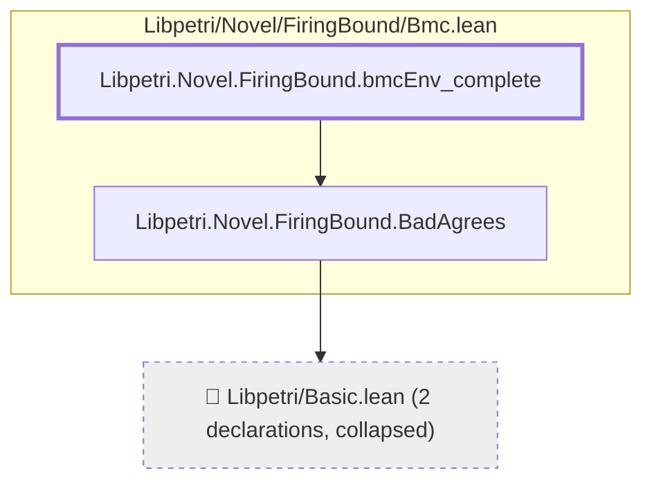

#### `Libpetri.Novel.FiringBound.bmcEnv_complete` → `Libpetri.Novel.FiringBound.BmcModelEnv`

> Rule: this theorem's tree has 99 nodes, still 76 with other files collapsed, so it is split by direct dependency; this part has 6 nodes, other files collapsed.

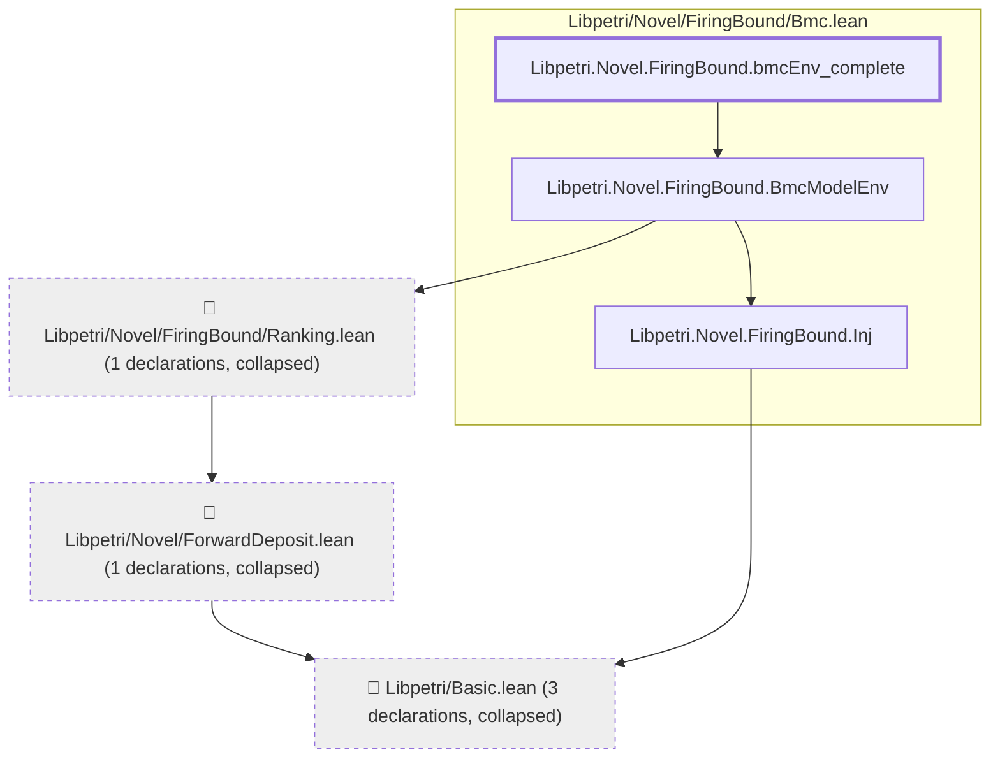

#### `Libpetri.Novel.FiringBound.bmcEnv_complete` → `Libpetri.Novel.FiringBound.BmcModelEnv.bad`

> Rule: this theorem's tree has 99 nodes, still 76 with other files collapsed, so it is split by direct dependency; this part has 8 nodes, other files collapsed.

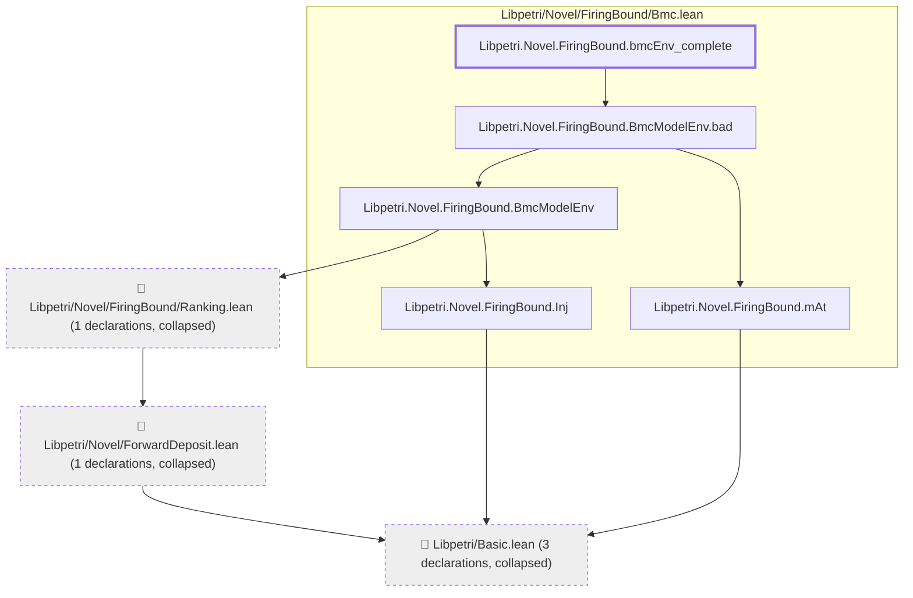

#### `Libpetri.Novel.FiringBound.bmcEnv_complete` → `Libpetri.Novel.FiringBound.BmcSatEnv`

> Rule: this theorem's tree has 99 nodes, still 76 with other files collapsed, so it is split by direct dependency; this part has 7 nodes, other files collapsed.

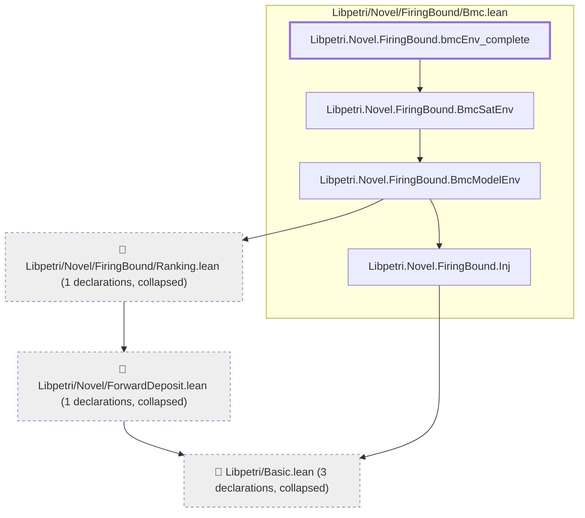

#### `Libpetri.Novel.FiringBound.bmcEnv_complete` → `Libpetri.Novel.FiringBound.Inj`

> Rule: this theorem's tree has 99 nodes, still 76 with other files collapsed, so it is split by direct dependency; this part has 3 nodes, other files collapsed.

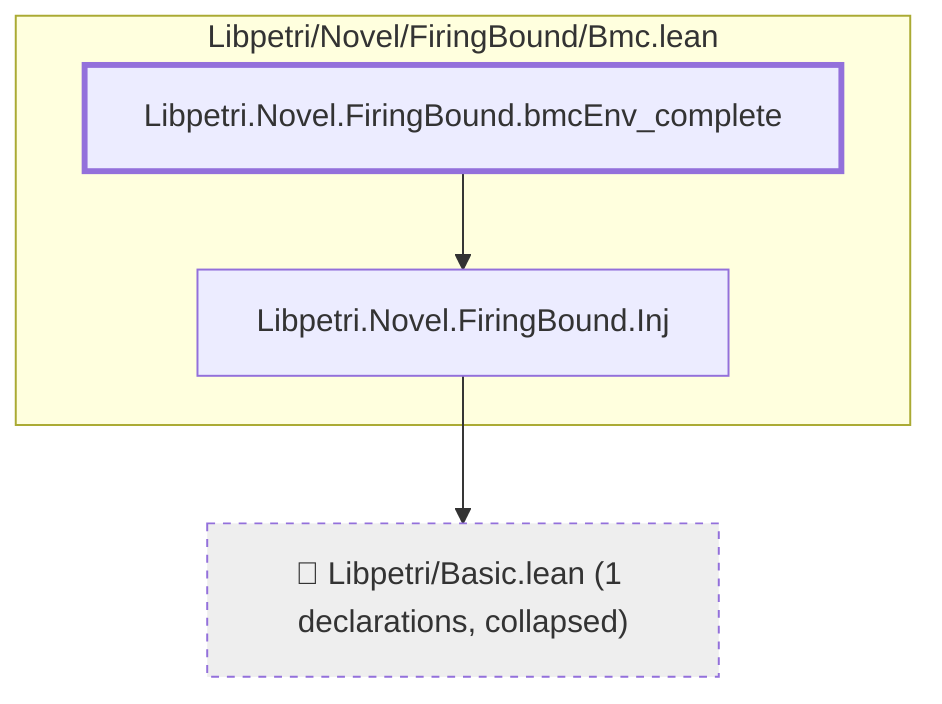

#### `Libpetri.Novel.FiringBound.bmcEnv_complete` → `Libpetri.Novel.FiringBound.InjsDistinct`

> Rule: this theorem's tree has 99 nodes, still 76 with other files collapsed, so it is split by direct dependency; this part has 4 nodes, other files collapsed.

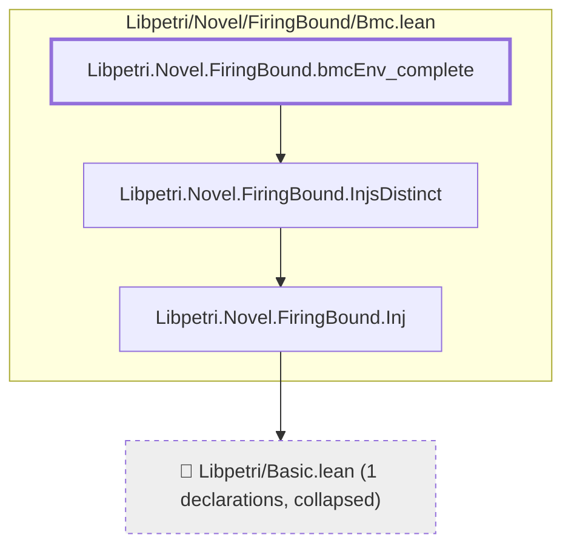

#### `Libpetri.Novel.FiringBound.bmcEnv_complete` → `Libpetri.Novel.FiringBound.InjsIn`

> Rule: this theorem's tree has 99 nodes, still 76 with other files collapsed, so it is split by direct dependency; this part has 4 nodes, other files collapsed.

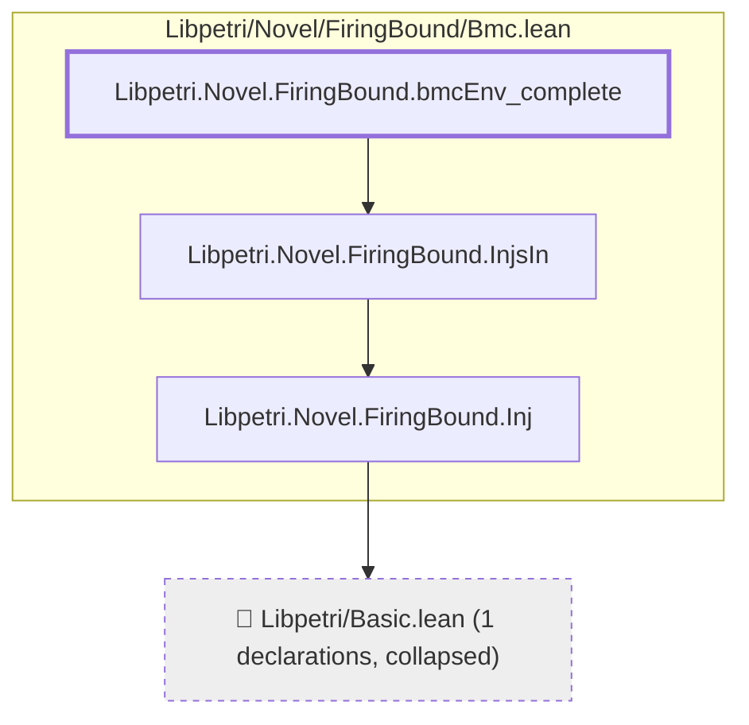

#### `Libpetri.Novel.FiringBound.bmcEnv_complete` → `Libpetri.Novel.FiringBound.Row`

> Rule: this theorem's tree has 99 nodes, still 76 with other files collapsed, so it is split by direct dependency; this part has 4 nodes, other files collapsed.

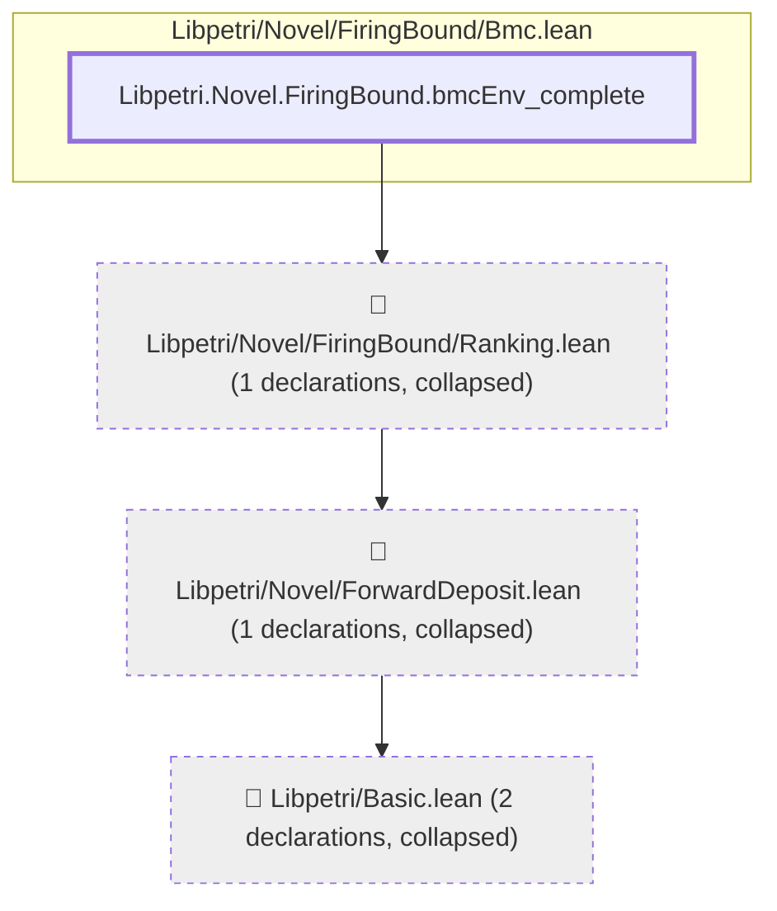

#### `Libpetri.Novel.FiringBound.bmcEnv_complete` → `Libpetri.Novel.FiringBound.WellFormedRows`

> Rule: this theorem's tree has 99 nodes, still 76 with other files collapsed, so it is split by direct dependency; this part has 6 nodes, other files collapsed.

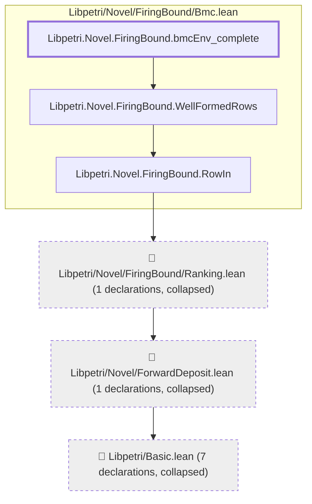

#### `Libpetri.Novel.FiringBound.bmcEnv_complete` → `Libpetri.Novel.FiringBound.bmcEnv_model_replays`

> Rule: this theorem's tree has 99 nodes, still 76 with other files collapsed, so it is split by direct dependency; this part has 58 nodes, other files collapsed.

```mermaid
flowchart TD
  subgraph g0["Libpetri/Novel/FiringBound/Bmc.lean"]
    n534["Libpetri.Novel.FiringBound.BmcModelEnv"]
    n536["Libpetri.Novel.FiringBound.BmcModelEnv.caps"]
    n537["Libpetri.Novel.FiringBound.BmcModelEnv.guard"]
    n538["Libpetri.Novel.FiringBound.BmcModelEnv.idle_final"]
    n539["Libpetri.Novel.FiringBound.BmcModelEnv.inj_guard"]
    n541["Libpetri.Novel.FiringBound.BmcModelEnv.sel_range"]
    n542["Libpetri.Novel.FiringBound.BmcModelEnv.update"]
    n550["Libpetri.Novel.FiringBound.Inj"]
    n552["Libpetri.Novel.FiringBound.InjsIn"]
    n565["Libpetri.Novel.FiringBound.RowIn"]
    n566["Libpetri.Novel.FiringBound.RowIn.deposit"]
    n568["Libpetri.Novel.FiringBound.RowIn.inputs"]
    n571["Libpetri.Novel.FiringBound.RowIn.resets"]
    n583["Libpetri.Novel.FiringBound.WellFormedRows"]
    n618["Libpetri.Novel.FiringBound.bmcEnv_complete"]
    n619["Libpetri.Novel.FiringBound.bmcEnv_model_replays"]
    n634["Libpetri.Novel.FiringBound.capOk"]
    n635["Libpetri.Novel.FiringBound.capsOk"]
    n636["Libpetri.Novel.FiringBound.chain"]
    n637["Libpetri.Novel.FiringBound.chain_append_miss"]
    n638["Libpetri.Novel.FiringBound.chain_congr"]
    n639["Libpetri.Novel.FiringBound.chain_cons"]
    n640["Libpetri.Novel.FiringBound.chain_hit"]
    n642["Libpetri.Novel.FiringBound.chain_idle_env"]
    n643["Libpetri.Novel.FiringBound.chain_inject_env"]
    n644["Libpetri.Novel.FiringBound.chain_miss"]
    n645["Libpetri.Novel.FiringBound.chain_step"]
    n646["Libpetri.Novel.FiringBound.chain_step_env"]
    n649["Libpetri.Novel.FiringBound.clears"]
    n650["Libpetri.Novel.FiringBound.column"]
    n652["Libpetri.Novel.FiringBound.decode"]
    n658["Libpetri.Novel.FiringBound.decodeSel"]
    n668["Libpetri.Novel.FiringBound.fireAD_frame"]
    n677["Libpetri.Novel.FiringBound.guardI"]
    n678["Libpetri.Novel.FiringBound.guardI_iff_enabledA"]
    n679["Libpetri.Novel.FiringBound.injAt"]
    n681["Libpetri.Novel.FiringBound.injOk"]
    n682["Libpetri.Novel.FiringBound.injTouching"]
    n693["Libpetri.Novel.FiringBound.mAt"]
    n695["Libpetri.Novel.FiringBound.mem_injTouching"]
    n696["Libpetri.Novel.FiringBound.mem_touching"]
    n699["Libpetri.Novel.FiringBound.nextVal"]
    n700["Libpetri.Novel.FiringBound.nextValEnv"]
    n740["Libpetri.Novel.FiringBound.replayEnv"]
    n741["Libpetri.Novel.FiringBound.replayEnv_append"]
    n745["Libpetri.Novel.FiringBound.replayEnv_singleton"]
    n746["Libpetri.Novel.FiringBound.replayEnv_snoc"]
    n761["Libpetri.Novel.FiringBound.stepIdx"]
    n772["Libpetri.Novel.FiringBound.touches"]
    n773["Libpetri.Novel.FiringBound.touching"]
    n774["Libpetri.Novel.FiringBound.touchingEnv"]
    n775["Libpetri.Novel.FiringBound.touchingEnv_bounds"]
    n776["Libpetri.Novel.FiringBound.touching_lt"]
  end
  c0["📁 Libpetri/Basic.lean (22 declarations, collapsed)"]
  c24["📁 Libpetri/Novel/FiringBound/Ranking.lean (1 declarations, collapsed)"]
  c27["📁 Libpetri/Novel/ForwardDeposit.lean (2 declarations, collapsed)"]
  c84["📁 Libpetri/Soundness.lean (1 declarations, collapsed)"]
  c154["📁 Libpetri/Strengthening/Hypotheses.lean (1 declarations, collapsed)"]
  c24 --> c27
  c27 --> c0
  c84 --> c0
  c154 --> c84
  n534 --> c24
  n534 --> n550
  n536 --> n534
  n536 --> n693
  n537 --> n534
  n537 --> n677
  n537 --> n693
  n538 --> n534
  n539 --> n534
  n539 --> n693
  n541 --> n534
  n542 --> n534
  n542 --> n636
  n542 --> n693
  n542 --> n700
  n542 --> n774
  n550 --> c0
  n552 --> n550
  n565 --> c24
  n566 --> n565
  n568 --> n565
  n571 --> n565
  n583 --> n565
  n618 --> n619
  n619 --> n536
  n619 --> n537
  n619 --> n538
  n619 --> n539
  n619 --> n541
  n619 --> n542
  n619 --> n552
  n619 --> n583
  n619 --> n642
  n619 --> n643
  n619 --> n646
  n619 --> n652
  n619 --> n668
  n619 --> n678
  n619 --> n746
  n634 --> n550
  n635 --> n634
  n637 --> n644
  n638 --> n639
  n639 --> n636
  n640 --> n639
  n642 --> n644
  n642 --> n775
  n643 --> n640
  n643 --> n644
  n643 --> n695
  n643 --> n700
  n643 --> n774
  n643 --> n776
  n644 --> n639
  n645 --> c154
  n645 --> n640
  n645 --> n644
  n645 --> n696
  n645 --> n699
  n646 --> n637
  n646 --> n638
  n646 --> n645
  n646 --> n695
  n646 --> n700
  n646 --> n774
  n646 --> n776
  n649 --> c24
  n650 --> c24
  n652 --> n658
  n668 --> c84
  n668 --> n566
  n668 --> n568
  n668 --> n571
  n677 --> c0
  n678 --> c154
  n678 --> n568
  n678 --> n677
  n679 --> c0
  n681 --> n550
  n682 --> n550
  n693 --> c0
  n695 --> n682
  n696 --> n773
  n699 --> n649
  n699 --> n650
  n700 --> n699
  n740 --> n761
  n741 --> n740
  n745 --> n740
  n746 --> n741
  n746 --> n745
  n761 --> c24
  n761 --> n635
  n761 --> n679
  n761 --> n681
  n772 --> n649
  n772 --> n650
  n773 --> n772
  n774 --> n682
  n774 --> n773
  n775 --> n695
  n775 --> n774
  n775 --> n776
  n776 --> n696
  classDef root stroke-width:3px
  classDef locked fill:#fff3cd,stroke:#b8860b
  classDef collapsed fill:#eeeeee,stroke-dasharray:4 4
  class n618 root
  class c0,c24,c27,c84,c154 collapsed
```

#### `Libpetri.Novel.FiringBound.bmcEnv_complete` → `Libpetri.Novel.FiringBound.bmcEnv_of_run`

> Rule: this theorem's tree has 99 nodes, still 76 with other files collapsed, so it is split by direct dependency; this part has 64 nodes, other files collapsed.

```mermaid
flowchart TD
  subgraph g0["Libpetri/Novel/FiringBound/Bmc.lean"]
    n526["Libpetri.Novel.FiringBound.BadAgrees"]
    n534["Libpetri.Novel.FiringBound.BmcModelEnv"]
    n540["Libpetri.Novel.FiringBound.BmcModelEnv.mk"]
    n544["Libpetri.Novel.FiringBound.BmcSatEnv"]
    n550["Libpetri.Novel.FiringBound.Inj"]
    n551["Libpetri.Novel.FiringBound.InjsDistinct"]
    n552["Libpetri.Novel.FiringBound.InjsIn"]
    n565["Libpetri.Novel.FiringBound.RowIn"]
    n566["Libpetri.Novel.FiringBound.RowIn.deposit"]
    n568["Libpetri.Novel.FiringBound.RowIn.inputs"]
    n571["Libpetri.Novel.FiringBound.RowIn.resets"]
    n572["Libpetri.Novel.FiringBound.StepEnv"]
    n583["Libpetri.Novel.FiringBound.WellFormedRows"]
    n618["Libpetri.Novel.FiringBound.bmcEnv_complete"]
    n620["Libpetri.Novel.FiringBound.bmcEnv_of_run"]
    n634["Libpetri.Novel.FiringBound.capOk"]
    n635["Libpetri.Novel.FiringBound.capsOk"]
    n636["Libpetri.Novel.FiringBound.chain"]
    n637["Libpetri.Novel.FiringBound.chain_append_miss"]
    n638["Libpetri.Novel.FiringBound.chain_congr"]
    n639["Libpetri.Novel.FiringBound.chain_cons"]
    n640["Libpetri.Novel.FiringBound.chain_hit"]
    n642["Libpetri.Novel.FiringBound.chain_idle_env"]
    n643["Libpetri.Novel.FiringBound.chain_inject_env"]
    n644["Libpetri.Novel.FiringBound.chain_miss"]
    n645["Libpetri.Novel.FiringBound.chain_step"]
    n646["Libpetri.Novel.FiringBound.chain_step_env"]
    n649["Libpetri.Novel.FiringBound.clears"]
    n650["Libpetri.Novel.FiringBound.column"]
    n668["Libpetri.Novel.FiringBound.fireAD_frame"]
    n677["Libpetri.Novel.FiringBound.guardI"]
    n678["Libpetri.Novel.FiringBound.guardI_iff_enabledA"]
    n679["Libpetri.Novel.FiringBound.injAt"]
    n681["Libpetri.Novel.FiringBound.injOk"]
    n682["Libpetri.Novel.FiringBound.injTouching"]
    n693["Libpetri.Novel.FiringBound.mAt"]
    n695["Libpetri.Novel.FiringBound.mem_injTouching"]
    n696["Libpetri.Novel.FiringBound.mem_touching"]
    n699["Libpetri.Novel.FiringBound.nextVal"]
    n700["Libpetri.Novel.FiringBound.nextValEnv"]
    n740["Libpetri.Novel.FiringBound.replayEnv"]
    n741["Libpetri.Novel.FiringBound.replayEnv_append"]
    n742["Libpetri.Novel.FiringBound.replayEnv_frame"]
    n743["Libpetri.Novel.FiringBound.replayEnv_lt"]
    n745["Libpetri.Novel.FiringBound.replayEnv_singleton"]
    n748["Libpetri.Novel.FiringBound.replayEnv_take"]
    n758["Libpetri.Novel.FiringBound.stAtEnv"]
    n761["Libpetri.Novel.FiringBound.stepIdx"]
    n762["Libpetri.Novel.FiringBound.stepIdx_caps"]
    n763["Libpetri.Novel.FiringBound.stepIdx_frame"]
    n764["Libpetri.Novel.FiringBound.stepIdx_inj"]
    n765["Libpetri.Novel.FiringBound.stepIdx_lt"]
    n766["Libpetri.Novel.FiringBound.stepIdx_row"]
    n767["Libpetri.Novel.FiringBound.stepIdx_sound"]
    n772["Libpetri.Novel.FiringBound.touches"]
    n773["Libpetri.Novel.FiringBound.touching"]
    n774["Libpetri.Novel.FiringBound.touchingEnv"]
    n775["Libpetri.Novel.FiringBound.touchingEnv_bounds"]
    n776["Libpetri.Novel.FiringBound.touching_lt"]
  end
  c0["📁 Libpetri/Basic.lean (22 declarations, collapsed)"]
  c24["📁 Libpetri/Novel/FiringBound/Ranking.lean (1 declarations, collapsed)"]
  c27["📁 Libpetri/Novel/ForwardDeposit.lean (3 declarations, collapsed)"]
  c84["📁 Libpetri/Soundness.lean (1 declarations, collapsed)"]
  c154["📁 Libpetri/Strengthening/Hypotheses.lean (1 declarations, collapsed)"]
  c24 --> c27
  c27 --> c0
  c84 --> c0
  c154 --> c84
  n526 --> c0
  n534 --> c24
  n534 --> n550
  n540 --> n534
  n540 --> n636
  n540 --> n677
  n540 --> n693
  n540 --> n700
  n540 --> n774
  n544 --> n534
  n550 --> c0
  n551 --> n550
  n552 --> n550
  n565 --> c24
  n566 --> n565
  n568 --> n565
  n571 --> n565
  n572 --> c24
  n572 --> n635
  n572 --> n679
  n572 --> n681
  n583 --> n565
  n618 --> n620
  n620 --> n526
  n620 --> n540
  n620 --> n544
  n620 --> n642
  n620 --> n643
  n620 --> n646
  n620 --> n678
  n620 --> n742
  n620 --> n743
  n620 --> n745
  n620 --> n748
  n620 --> n762
  n634 --> n550
  n635 --> n634
  n637 --> n644
  n638 --> n639
  n639 --> n636
  n640 --> n639
  n642 --> n644
  n642 --> n775
  n643 --> n640
  n643 --> n644
  n643 --> n695
  n643 --> n700
  n643 --> n774
  n643 --> n776
  n644 --> n639
  n645 --> c154
  n645 --> n640
  n645 --> n644
  n645 --> n696
  n645 --> n699
  n646 --> n637
  n646 --> n638
  n646 --> n645
  n646 --> n695
  n646 --> n700
  n646 --> n774
  n646 --> n776
  n649 --> c24
  n650 --> c24
  n668 --> c84
  n668 --> n566
  n668 --> n568
  n668 --> n571
  n677 --> c0
  n678 --> c154
  n678 --> n568
  n678 --> n677
  n679 --> c0
  n681 --> n550
  n682 --> n550
  n693 --> c0
  n695 --> n682
  n696 --> n773
  n699 --> n649
  n699 --> n650
  n700 --> n699
  n740 --> n761
  n741 --> n740
  n742 --> n740
  n742 --> n763
  n743 --> n740
  n743 --> n765
  n745 --> n740
  n748 --> n741
  n748 --> n758
  n758 --> n740
  n761 --> c24
  n761 --> n635
  n761 --> n679
  n761 --> n681
  n762 --> n551
  n762 --> n767
  n763 --> n552
  n763 --> n583
  n763 --> n668
  n763 --> n767
  n764 --> n761
  n765 --> n761
  n766 --> n761
  n767 --> n572
  n767 --> n764
  n767 --> n765
  n767 --> n766
  n772 --> n649
  n772 --> n650
  n773 --> n772
  n774 --> n682
  n774 --> n773
  n775 --> n695
  n775 --> n774
  n775 --> n776
  n776 --> n696
  classDef root stroke-width:3px
  classDef locked fill:#fff3cd,stroke:#b8860b
  classDef collapsed fill:#eeeeee,stroke-dasharray:4 4
  class n618 root
  class c0,c24,c27,c84,c154 collapsed
```

#### `Libpetri.Novel.FiringBound.bmcEnv_complete` → `Libpetri.Novel.FiringBound.capsOk`

> Rule: this theorem's tree has 99 nodes, still 76 with other files collapsed, so it is split by direct dependency; this part has 5 nodes, other files collapsed.

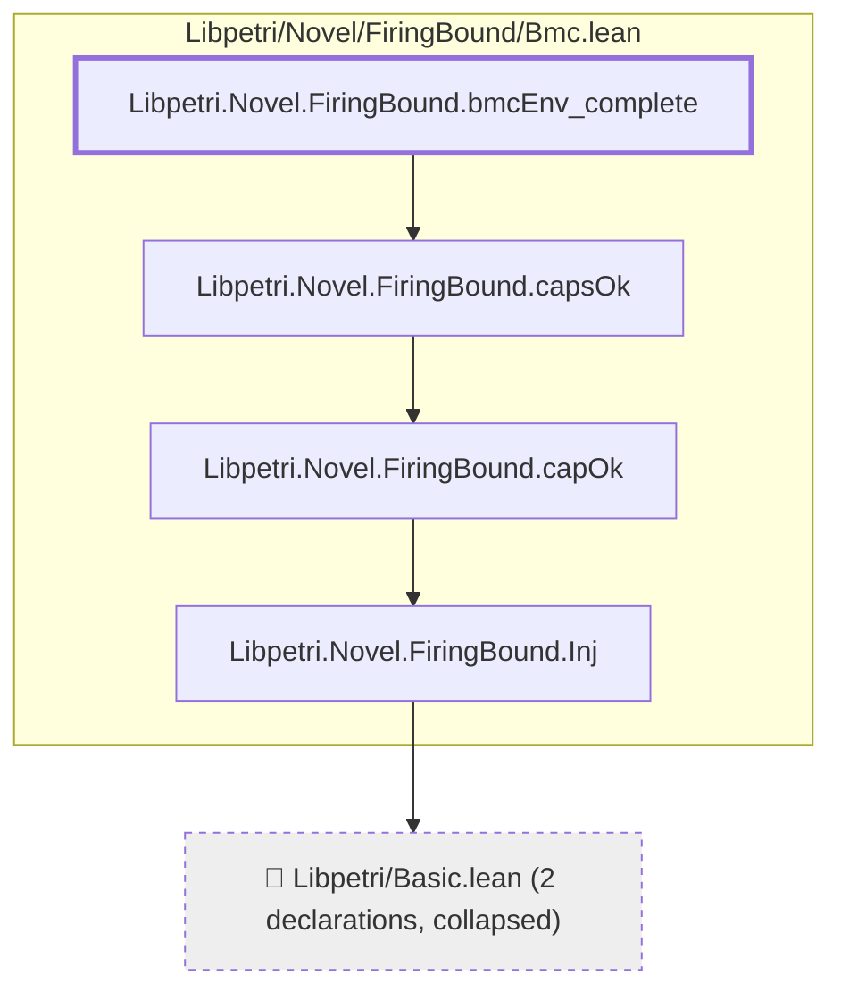

#### `Libpetri.Novel.FiringBound.bmcEnv_complete` → `Libpetri.Novel.FiringBound.decode`

> Rule: this theorem's tree has 99 nodes, still 76 with other files collapsed, so it is split by direct dependency; this part has 3 nodes, other files collapsed.

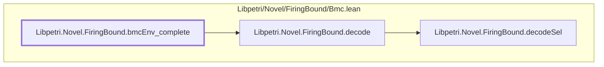

#### `Libpetri.Novel.FiringBound.bmcEnv_complete` → `Libpetri.Novel.FiringBound.decode_length_le`

> Rule: this theorem's tree has 99 nodes, still 76 with other files collapsed, so it is split by direct dependency; this part has 4 nodes, other files collapsed.

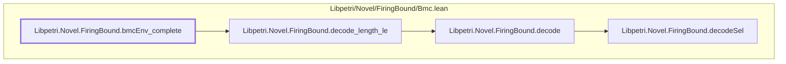

#### `Libpetri.Novel.FiringBound.bmcEnv_complete` → `Libpetri.Novel.FiringBound.mAt`

> Rule: this theorem's tree has 99 nodes, still 76 with other files collapsed, so it is split by direct dependency; this part has 3 nodes, other files collapsed.

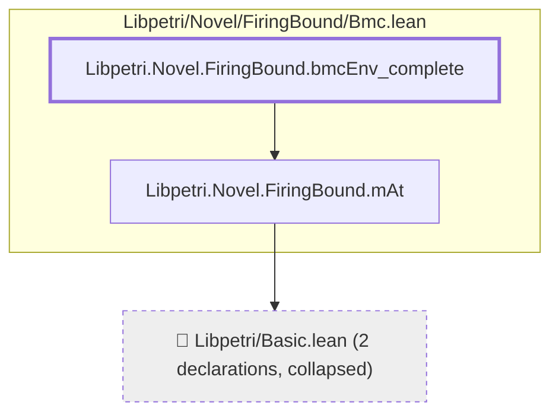

#### `Libpetri.Novel.FiringBound.bmcEnv_complete` → `Libpetri.Novel.FiringBound.replayEnv`

> Rule: this theorem's tree has 99 nodes, still 76 with other files collapsed, so it is split by direct dependency; this part has 11 nodes, other files collapsed.

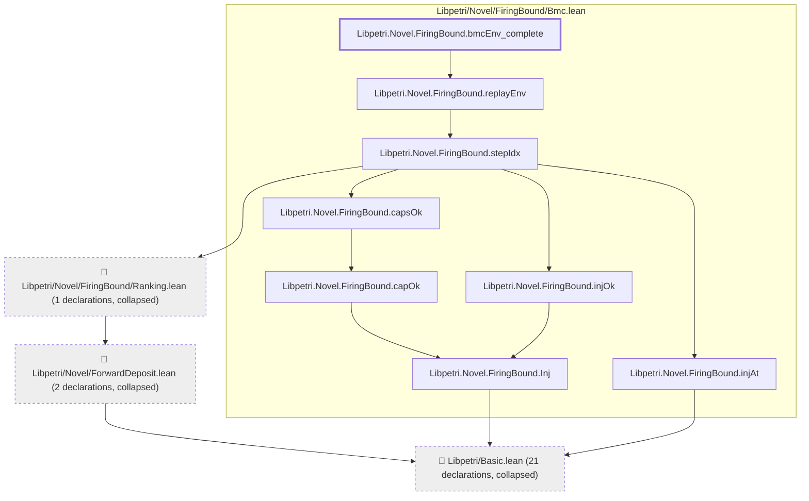

Shared leaves of `Libpetri.Novel.FiringBound.bmcEnv_complete` (direct dependencies too small for a diagram of their own, fewer than 3 nodes):

- `Libpetri.AMarking` (`Libpetri/Basic.lean`)
- `Libpetri.PlaceId` (`Libpetri/Basic.lean`)

### `Libpetri.Novel.FiringBound.bmcEnv_sat_replays`

#### `Libpetri.Novel.FiringBound.bmcEnv_sat_replays` → `Libpetri.Novel.FiringBound.BadAgrees`

> Rule: this theorem's tree has 86 nodes, still 64 with other files collapsed, so it is split by direct dependency; this part has 3 nodes, other files collapsed.

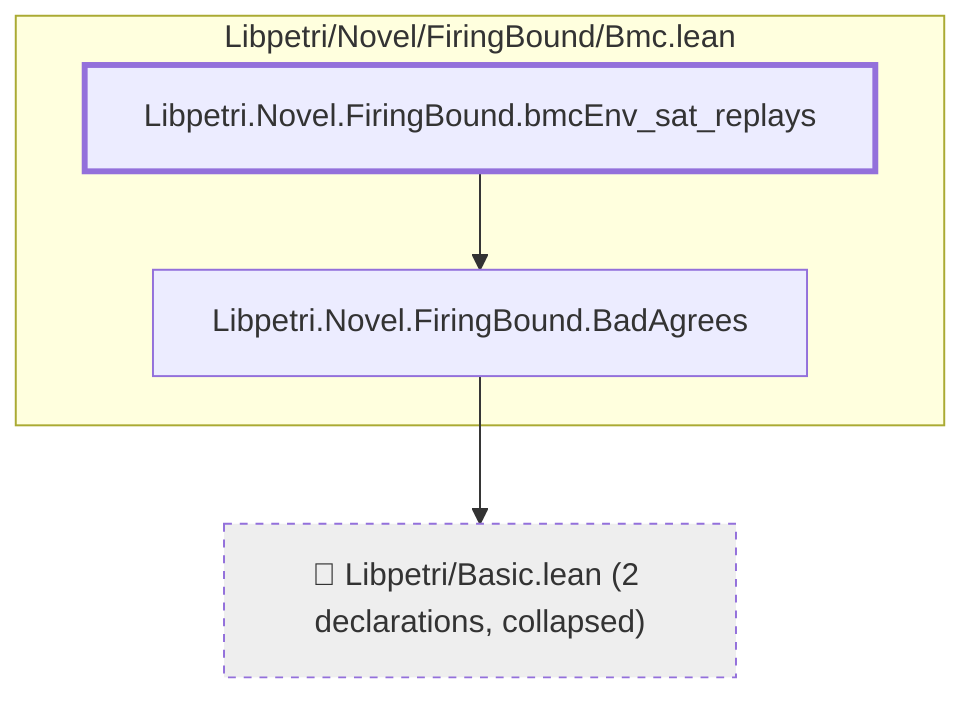

#### `Libpetri.Novel.FiringBound.bmcEnv_sat_replays` → `Libpetri.Novel.FiringBound.BmcModelEnv`

> Rule: this theorem's tree has 86 nodes, still 64 with other files collapsed, so it is split by direct dependency; this part has 6 nodes, other files collapsed.

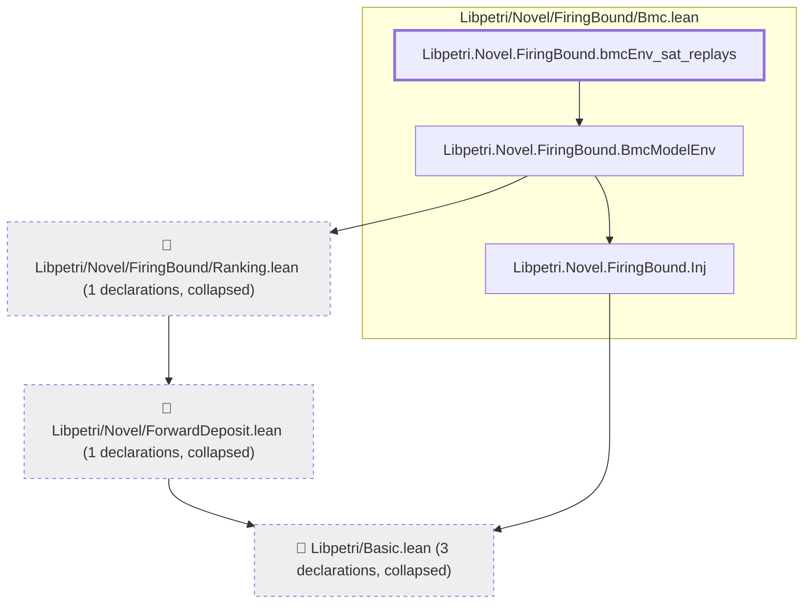

#### `Libpetri.Novel.FiringBound.bmcEnv_sat_replays` → `Libpetri.Novel.FiringBound.BmcModelEnv.bad`

> Rule: this theorem's tree has 86 nodes, still 64 with other files collapsed, so it is split by direct dependency; this part has 8 nodes, other files collapsed.

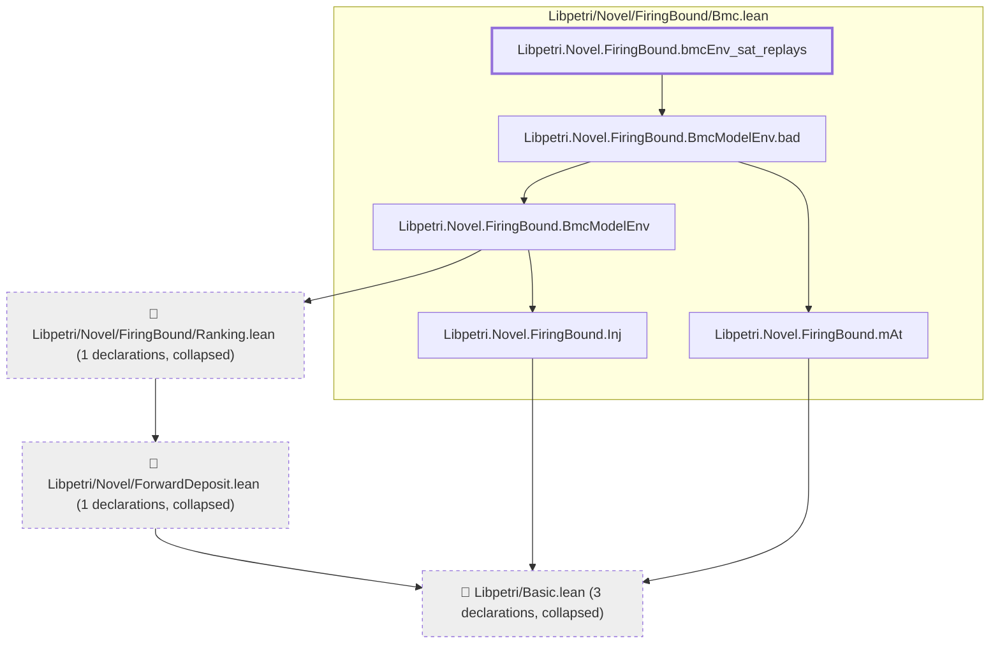

#### `Libpetri.Novel.FiringBound.bmcEnv_sat_replays` → `Libpetri.Novel.FiringBound.Inj`

> Rule: this theorem's tree has 86 nodes, still 64 with other files collapsed, so it is split by direct dependency; this part has 3 nodes, other files collapsed.

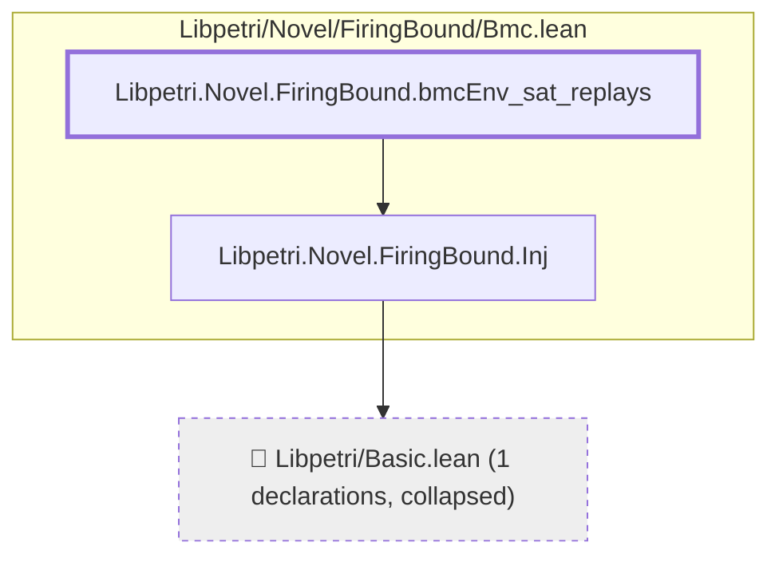

#### `Libpetri.Novel.FiringBound.bmcEnv_sat_replays` → `Libpetri.Novel.FiringBound.InjsIn`

> Rule: this theorem's tree has 86 nodes, still 64 with other files collapsed, so it is split by direct dependency; this part has 4 nodes, other files collapsed.

```mermaid
flowchart TD
  subgraph g0["Libpetri/Novel/FiringBound/Bmc.lean"]
    n608["Libpetri.Novel.FiringBound.Inj"]
    n610["Libpetri.Novel.FiringBound.InjsIn"]
    n679["Libpetri.Novel.FiringBound.bmcEnv_sat_replays"]
  end
  c0["📁 Libpetri/Basic.lean (1 declarations, collapsed)"]
  n608 --> c0
  n610 --> n608
  n679 --> n610
  classDef root stroke-width:3px
  classDef locked fill:#fff3cd,stroke:#b8860b
  classDef collapsed fill:#eeeeee,stroke-dasharray:4 4
  class n679 root
  class c0 collapsed
```

#### `Libpetri.Novel.FiringBound.bmcEnv_sat_replays` → `Libpetri.Novel.FiringBound.Row`

> Rule: this theorem's tree has 86 nodes, still 64 with other files collapsed, so it is split by direct dependency; this part has 4 nodes, other files collapsed.

```mermaid
flowchart TD
  subgraph g0["Libpetri/Novel/FiringBound/Bmc.lean"]
    n679["Libpetri.Novel.FiringBound.bmcEnv_sat_replays"]
  end
  c0["📁 Libpetri/Basic.lean (2 declarations, collapsed)"]
  c25["📁 Libpetri/Novel/FiringBound/Ranking.lean (1 declarations, collapsed)"]
  c28["📁 Libpetri/Novel/ForwardDeposit.lean (1 declarations, collapsed)"]
  c25 --> c28
  c28 --> c0
  n679 --> c25
  classDef root stroke-width:3px
  classDef locked fill:#fff3cd,stroke:#b8860b
  classDef collapsed fill:#eeeeee,stroke-dasharray:4 4
  class n679 root
  class c0,c25,c28 collapsed
```

#### `Libpetri.Novel.FiringBound.bmcEnv_sat_replays` → `Libpetri.Novel.FiringBound.WellFormedRows`

> Rule: this theorem's tree has 86 nodes, still 64 with other files collapsed, so it is split by direct dependency; this part has 6 nodes, other files collapsed.

```mermaid
flowchart TD
  subgraph g0["Libpetri/Novel/FiringBound/Bmc.lean"]
    n623["Libpetri.Novel.FiringBound.RowIn"]
    n641["Libpetri.Novel.FiringBound.WellFormedRows"]
    n679["Libpetri.Novel.FiringBound.bmcEnv_sat_replays"]
  end
  c0["📁 Libpetri/Basic.lean (7 declarations, collapsed)"]
  c25["📁 Libpetri/Novel/FiringBound/Ranking.lean (1 declarations, collapsed)"]
  c28["📁 Libpetri/Novel/ForwardDeposit.lean (1 declarations, collapsed)"]
  c25 --> c28
  c28 --> c0
  n623 --> c25
  n641 --> n623
  n679 --> n641
  classDef root stroke-width:3px
  classDef locked fill:#fff3cd,stroke:#b8860b
  classDef collapsed fill:#eeeeee,stroke-dasharray:4 4
  class n679 root
  class c0,c25,c28 collapsed
```

#### `Libpetri.Novel.FiringBound.bmcEnv_sat_replays` → `Libpetri.Novel.FiringBound.bmcEnv_model_replays`

> Rule: this theorem's tree has 86 nodes, still 64 with other files collapsed, so it is split by direct dependency; this part has 58 nodes, other files collapsed.

```mermaid
flowchart TD
  subgraph g0["Libpetri/Novel/FiringBound/Bmc.lean"]
    n592["Libpetri.Novel.FiringBound.BmcModelEnv"]
    n594["Libpetri.Novel.FiringBound.BmcModelEnv.caps"]
    n595["Libpetri.Novel.FiringBound.BmcModelEnv.guard"]
    n596["Libpetri.Novel.FiringBound.BmcModelEnv.idle_final"]
    n597["Libpetri.Novel.FiringBound.BmcModelEnv.inj_guard"]
    n599["Libpetri.Novel.FiringBound.BmcModelEnv.sel_range"]
    n600["Libpetri.Novel.FiringBound.BmcModelEnv.update"]
    n608["Libpetri.Novel.FiringBound.Inj"]
    n610["Libpetri.Novel.FiringBound.InjsIn"]
    n623["Libpetri.Novel.FiringBound.RowIn"]
    n624["Libpetri.Novel.FiringBound.RowIn.deposit"]
    n626["Libpetri.Novel.FiringBound.RowIn.inputs"]
    n629["Libpetri.Novel.FiringBound.RowIn.resets"]
    n641["Libpetri.Novel.FiringBound.WellFormedRows"]
    n677["Libpetri.Novel.FiringBound.bmcEnv_model_replays"]
    n679["Libpetri.Novel.FiringBound.bmcEnv_sat_replays"]
    n692["Libpetri.Novel.FiringBound.capOk"]
    n693["Libpetri.Novel.FiringBound.capsOk"]
    n694["Libpetri.Novel.FiringBound.chain"]
    n695["Libpetri.Novel.FiringBound.chain_append_miss"]
    n696["Libpetri.Novel.FiringBound.chain_congr"]
    n697["Libpetri.Novel.FiringBound.chain_cons"]
    n698["Libpetri.Novel.FiringBound.chain_hit"]
    n700["Libpetri.Novel.FiringBound.chain_idle_env"]
    n701["Libpetri.Novel.FiringBound.chain_inject_env"]
    n702["Libpetri.Novel.FiringBound.chain_miss"]
    n703["Libpetri.Novel.FiringBound.chain_step"]
    n704["Libpetri.Novel.FiringBound.chain_step_env"]
    n707["Libpetri.Novel.FiringBound.clears"]
    n708["Libpetri.Novel.FiringBound.column"]
    n710["Libpetri.Novel.FiringBound.decode"]
    n716["Libpetri.Novel.FiringBound.decodeSel"]
    n726["Libpetri.Novel.FiringBound.fireAD_frame"]
    n735["Libpetri.Novel.FiringBound.guardI"]
    n736["Libpetri.Novel.FiringBound.guardI_iff_enabledA"]
    n737["Libpetri.Novel.FiringBound.injAt"]
    n739["Libpetri.Novel.FiringBound.injOk"]
    n740["Libpetri.Novel.FiringBound.injTouching"]
    n751["Libpetri.Novel.FiringBound.mAt"]
    n753["Libpetri.Novel.FiringBound.mem_injTouching"]
    n754["Libpetri.Novel.FiringBound.mem_touching"]
    n757["Libpetri.Novel.FiringBound.nextVal"]
    n758["Libpetri.Novel.FiringBound.nextValEnv"]
    n798["Libpetri.Novel.FiringBound.replayEnv"]
    n799["Libpetri.Novel.FiringBound.replayEnv_append"]
    n803["Libpetri.Novel.FiringBound.replayEnv_singleton"]
    n804["Libpetri.Novel.FiringBound.replayEnv_snoc"]
    n819["Libpetri.Novel.FiringBound.stepIdx"]
    n830["Libpetri.Novel.FiringBound.touches"]
    n831["Libpetri.Novel.FiringBound.touching"]
    n832["Libpetri.Novel.FiringBound.touchingEnv"]
    n833["Libpetri.Novel.FiringBound.touchingEnv_bounds"]
    n834["Libpetri.Novel.FiringBound.touching_lt"]
  end
  c0["📁 Libpetri/Basic.lean (22 declarations, collapsed)"]
  c25["📁 Libpetri/Novel/FiringBound/Ranking.lean (1 declarations, collapsed)"]
  c28["📁 Libpetri/Novel/ForwardDeposit.lean (2 declarations, collapsed)"]
  c111["📁 Libpetri/Soundness.lean (1 declarations, collapsed)"]
  c373["📁 Libpetri/Strengthening/Hypotheses.lean (1 declarations, collapsed)"]
  c25 --> c28
  c28 --> c0
  c111 --> c0
  c373 --> c111
  n592 --> c25
  n592 --> n608
  n594 --> n592
  n594 --> n751
  n595 --> n592
  n595 --> n735
  n595 --> n751
  n596 --> n592
  n597 --> n592
  n597 --> n751
  n599 --> n592
  n600 --> n592
  n600 --> n694
  n600 --> n751
  n600 --> n758
  n600 --> n832
  n608 --> c0
  n610 --> n608
  n623 --> c25
  n624 --> n623
  n626 --> n623
  n629 --> n623
  n641 --> n623
  n677 --> n594
  n677 --> n595
  n677 --> n596
  n677 --> n597
  n677 --> n599
  n677 --> n600
  n677 --> n610
  n677 --> n641
  n677 --> n700
  n677 --> n701
  n677 --> n704
  n677 --> n710
  n677 --> n726
  n677 --> n736
  n677 --> n804
  n679 --> n677
  n692 --> n608
  n693 --> n692
  n695 --> n702
  n696 --> n697
  n697 --> n694
  n698 --> n697
  n700 --> n702
  n700 --> n833
  n701 --> n698
  n701 --> n702
  n701 --> n753
  n701 --> n758
  n701 --> n832
  n701 --> n834
  n702 --> n697
  n703 --> c373
  n703 --> n698
  n703 --> n702
  n703 --> n754
  n703 --> n757
  n704 --> n695
  n704 --> n696
  n704 --> n703
  n704 --> n753
  n704 --> n758
  n704 --> n832
  n704 --> n834
  n707 --> c25
  n708 --> c25
  n710 --> n716
  n726 --> c111
  n726 --> n624
  n726 --> n626
  n726 --> n629
  n735 --> c0
  n736 --> c373
  n736 --> n626
  n736 --> n735
  n737 --> c0
  n739 --> n608
  n740 --> n608
  n751 --> c0
  n753 --> n740
  n754 --> n831
  n757 --> n707
  n757 --> n708
  n758 --> n757
  n798 --> n819
  n799 --> n798
  n803 --> n798
  n804 --> n799
  n804 --> n803
  n819 --> c25
  n819 --> n693
  n819 --> n737
  n819 --> n739
  n830 --> n707
  n830 --> n708
  n831 --> n830
  n832 --> n740
  n832 --> n831
  n833 --> n753
  n833 --> n832
  n833 --> n834
  n834 --> n754
  classDef root stroke-width:3px
  classDef locked fill:#fff3cd,stroke:#b8860b
  classDef collapsed fill:#eeeeee,stroke-dasharray:4 4
  class n679 root
  class c0,c25,c28,c111,c373 collapsed
```

#### `Libpetri.Novel.FiringBound.bmcEnv_sat_replays` → `Libpetri.Novel.FiringBound.decode`

> Rule: this theorem's tree has 86 nodes, still 64 with other files collapsed, so it is split by direct dependency; this part has 3 nodes, other files collapsed.

```mermaid
flowchart TD
  subgraph g0["Libpetri/Novel/FiringBound/Bmc.lean"]
    n679["Libpetri.Novel.FiringBound.bmcEnv_sat_replays"]
    n710["Libpetri.Novel.FiringBound.decode"]
    n716["Libpetri.Novel.FiringBound.decodeSel"]
  end
  n679 --> n710
  n710 --> n716
  classDef root stroke-width:3px
  classDef locked fill:#fff3cd,stroke:#b8860b
  classDef collapsed fill:#eeeeee,stroke-dasharray:4 4
  class n679 root
```

#### `Libpetri.Novel.FiringBound.bmcEnv_sat_replays` → `Libpetri.Novel.FiringBound.decodeRust`

> Rule: this theorem's tree has 86 nodes, still 64 with other files collapsed, so it is split by direct dependency; this part has 4 nodes, other files collapsed.

```mermaid
flowchart TD
  subgraph g0["Libpetri/Novel/FiringBound/Bmc.lean"]
    n679["Libpetri.Novel.FiringBound.bmcEnv_sat_replays"]
    n714["Libpetri.Novel.FiringBound.decodeRust"]
    n716["Libpetri.Novel.FiringBound.decodeSel"]
    n826["Libpetri.Novel.FiringBound.takeSome"]
  end
  n679 --> n714
  n714 --> n716
  n714 --> n826
  classDef root stroke-width:3px
  classDef locked fill:#fff3cd,stroke:#b8860b
  classDef collapsed fill:#eeeeee,stroke-dasharray:4 4
  class n679 root
```

#### `Libpetri.Novel.FiringBound.bmcEnv_sat_replays` → `Libpetri.Novel.FiringBound.decodeRust_eq_decode`

> Rule: this theorem's tree has 86 nodes, still 64 with other files collapsed, so it is split by direct dependency; this part has 7 nodes, other files collapsed.

```mermaid
flowchart TD
  subgraph g0["Libpetri/Novel/FiringBound/Bmc.lean"]
    n679["Libpetri.Novel.FiringBound.bmcEnv_sat_replays"]
    n710["Libpetri.Novel.FiringBound.decode"]
    n714["Libpetri.Novel.FiringBound.decodeRust"]
    n715["Libpetri.Novel.FiringBound.decodeRust_eq_decode"]
    n716["Libpetri.Novel.FiringBound.decodeSel"]
    n826["Libpetri.Novel.FiringBound.takeSome"]
    n828["Libpetri.Novel.FiringBound.takeSome_snoc"]
  end
  n679 --> n715
  n710 --> n716
  n714 --> n716
  n714 --> n826
  n715 --> n710
  n715 --> n714
  n715 --> n828
  n828 --> n826
  classDef root stroke-width:3px
  classDef locked fill:#fff3cd,stroke:#b8860b
  classDef collapsed fill:#eeeeee,stroke-dasharray:4 4
  class n679 root
```

#### `Libpetri.Novel.FiringBound.bmcEnv_sat_replays` → `Libpetri.Novel.FiringBound.mAt`

> Rule: this theorem's tree has 86 nodes, still 64 with other files collapsed, so it is split by direct dependency; this part has 3 nodes, other files collapsed.

```mermaid
flowchart TD
  subgraph g0["Libpetri/Novel/FiringBound/Bmc.lean"]
    n679["Libpetri.Novel.FiringBound.bmcEnv_sat_replays"]
    n751["Libpetri.Novel.FiringBound.mAt"]
  end
  c0["📁 Libpetri/Basic.lean (2 declarations, collapsed)"]
  n679 --> n751
  n751 --> c0
  classDef root stroke-width:3px
  classDef locked fill:#fff3cd,stroke:#b8860b
  classDef collapsed fill:#eeeeee,stroke-dasharray:4 4
  class n679 root
  class c0 collapsed
```

#### `Libpetri.Novel.FiringBound.bmcEnv_sat_replays` → `Libpetri.Novel.FiringBound.replayEnv`

> Rule: this theorem's tree has 86 nodes, still 64 with other files collapsed, so it is split by direct dependency; this part has 11 nodes, other files collapsed.

```mermaid
flowchart TD
  subgraph g0["Libpetri/Novel/FiringBound/Bmc.lean"]
    n608["Libpetri.Novel.FiringBound.Inj"]
    n679["Libpetri.Novel.FiringBound.bmcEnv_sat_replays"]
    n692["Libpetri.Novel.FiringBound.capOk"]
    n693["Libpetri.Novel.FiringBound.capsOk"]
    n737["Libpetri.Novel.FiringBound.injAt"]
    n739["Libpetri.Novel.FiringBound.injOk"]
    n798["Libpetri.Novel.FiringBound.replayEnv"]
    n819["Libpetri.Novel.FiringBound.stepIdx"]
  end
  c0["📁 Libpetri/Basic.lean (21 declarations, collapsed)"]
  c25["📁 Libpetri/Novel/FiringBound/Ranking.lean (1 declarations, collapsed)"]
  c28["📁 Libpetri/Novel/ForwardDeposit.lean (2 declarations, collapsed)"]
  c25 --> c28
  c28 --> c0
  n608 --> c0
  n679 --> n798
  n692 --> n608
  n693 --> n692
  n737 --> c0
  n739 --> n608
  n798 --> n819
  n819 --> c25
  n819 --> n693
  n819 --> n737
  n819 --> n739
  classDef root stroke-width:3px
  classDef locked fill:#fff3cd,stroke:#b8860b
  classDef collapsed fill:#eeeeee,stroke-dasharray:4 4
  class n679 root
  class c0,c25,c28 collapsed
```

Shared leaves of `Libpetri.Novel.FiringBound.bmcEnv_sat_replays` (direct dependencies too small for a diagram of their own, fewer than 3 nodes):

- `Libpetri.AMarking` (`Libpetri/Basic.lean`)
- `Libpetri.PlaceId` (`Libpetri/Basic.lean`)

### `Libpetri.Novel.FiringBound.bmcModelEnv_nil`

> Rule: this theorem's whole tree, 53 nodes.

```mermaid
flowchart TD
  subgraph g0["Libpetri/Basic.lean"]
    n0["Libpetri.AMarking"]
    n8["Libpetri.Card"]
    n9["Libpetri.Card.all"]
    n10["Libpetri.Card.atLeast"]
    n11["Libpetri.Card.consumesAll"]
    n12["Libpetri.Card.exactly"]
    n13["Libpetri.Card.one"]
    n14["Libpetri.Card.required"]
    n134["Libpetri.InSpec"]
    n135["Libpetri.InSpec.card"]
    n138["Libpetri.InSpec.place"]
    n2723["Libpetri.PlaceId"]
    n22401["Libpetri.Transition"]
    n22402["Libpetri.Transition.inhibitors"]
    n22403["Libpetri.Transition.inputs"]
    n22407["Libpetri.Transition.reads"]
    n22408["Libpetri.Transition.resets"]
    n22478["Libpetri.consumeAllAt"]
    n22653["Libpetri.pre"]
    n22708["Libpetri.specAt"]
  end
  subgraph g1["Libpetri/Novel/FiringBound/Bmc.lean"]
    n585["Libpetri.Novel.FiringBound.BmcModel"]
    n586["Libpetri.Novel.FiringBound.BmcModel.bad"]
    n587["Libpetri.Novel.FiringBound.BmcModel.guard"]
    n588["Libpetri.Novel.FiringBound.BmcModel.idle_final"]
    n589["Libpetri.Novel.FiringBound.BmcModel.mk"]
    n590["Libpetri.Novel.FiringBound.BmcModel.sel_range"]
    n591["Libpetri.Novel.FiringBound.BmcModel.update"]
    n592["Libpetri.Novel.FiringBound.BmcModelEnv"]
    n593["Libpetri.Novel.FiringBound.BmcModelEnv.bad"]
    n595["Libpetri.Novel.FiringBound.BmcModelEnv.guard"]
    n596["Libpetri.Novel.FiringBound.BmcModelEnv.idle_final"]
    n598["Libpetri.Novel.FiringBound.BmcModelEnv.mk"]
    n599["Libpetri.Novel.FiringBound.BmcModelEnv.sel_range"]
    n600["Libpetri.Novel.FiringBound.BmcModelEnv.update"]
    n608["Libpetri.Novel.FiringBound.Inj"]
    n680["Libpetri.Novel.FiringBound.bmcModelEnv_nil"]
    n694["Libpetri.Novel.FiringBound.chain"]
    n696["Libpetri.Novel.FiringBound.chain_congr"]
    n697["Libpetri.Novel.FiringBound.chain_cons"]
    n707["Libpetri.Novel.FiringBound.clears"]
    n708["Libpetri.Novel.FiringBound.column"]
    n735["Libpetri.Novel.FiringBound.guardI"]
    n740["Libpetri.Novel.FiringBound.injTouching"]
    n751["Libpetri.Novel.FiringBound.mAt"]
    n754["Libpetri.Novel.FiringBound.mem_touching"]
    n757["Libpetri.Novel.FiringBound.nextVal"]
    n758["Libpetri.Novel.FiringBound.nextValEnv"]
    n830["Libpetri.Novel.FiringBound.touches"]
    n831["Libpetri.Novel.FiringBound.touching"]
    n832["Libpetri.Novel.FiringBound.touchingEnv"]
    n834["Libpetri.Novel.FiringBound.touching_lt"]
  end
  subgraph g2["Libpetri/Novel/FiringBound/Ranking.lean"]
    n622["Libpetri.Novel.FiringBound.Row"]
  end
  subgraph g3["Libpetri/Novel/ForwardDeposit.lean"]
    n867["Libpetri.Novel.ForwardDeposit.Deposit"]
  end
  n0 --> n2723
  n9 --> n8
  n10 --> n8
  n11 --> n9
  n11 --> n10
  n11 --> n12
  n11 --> n13
  n12 --> n8
  n13 --> n8
  n14 --> n9
  n14 --> n10
  n14 --> n12
  n14 --> n13
  n135 --> n8
  n135 --> n134
  n138 --> n134
  n138 --> n2723
  n585 --> n0
  n585 --> n622
  n586 --> n585
  n586 --> n751
  n587 --> n585
  n587 --> n735
  n587 --> n751
  n588 --> n585
  n589 --> n585
  n589 --> n694
  n589 --> n735
  n589 --> n751
  n589 --> n757
  n589 --> n831
  n590 --> n585
  n591 --> n585
  n591 --> n694
  n591 --> n751
  n591 --> n757
  n591 --> n831
  n592 --> n0
  n592 --> n608
  n592 --> n622
  n593 --> n592
  n593 --> n751
  n595 --> n592
  n595 --> n735
  n595 --> n751
  n596 --> n592
  n598 --> n592
  n598 --> n694
  n598 --> n735
  n598 --> n751
  n598 --> n758
  n598 --> n832
  n599 --> n592
  n600 --> n592
  n600 --> n694
  n600 --> n751
  n600 --> n758
  n600 --> n832
  n608 --> n2723
  n622 --> n867
  n622 --> n22401
  n680 --> n586
  n680 --> n587
  n680 --> n588
  n680 --> n589
  n680 --> n590
  n680 --> n591
  n680 --> n593
  n680 --> n595
  n680 --> n596
  n680 --> n598
  n680 --> n599
  n680 --> n600
  n680 --> n696
  n680 --> n834
  n696 --> n697
  n697 --> n694
  n707 --> n622
  n707 --> n22408
  n707 --> n22478
  n708 --> n622
  n708 --> n22653
  n735 --> n22402
  n735 --> n22407
  n735 --> n22653
  n740 --> n608
  n751 --> n0
  n754 --> n831
  n757 --> n707
  n757 --> n708
  n758 --> n757
  n830 --> n707
  n830 --> n708
  n831 --> n830
  n832 --> n740
  n832 --> n831
  n834 --> n754
  n867 --> n2723
  n22402 --> n2723
  n22402 --> n22401
  n22403 --> n134
  n22403 --> n22401
  n22407 --> n2723
  n22407 --> n22401
  n22408 --> n2723
  n22408 --> n22401
  n22478 --> n11
  n22478 --> n135
  n22478 --> n22708
  n22653 --> n14
  n22653 --> n135
  n22653 --> n22708
  n22708 --> n138
  n22708 --> n22403
  classDef root stroke-width:3px
  classDef locked fill:#fff3cd,stroke:#b8860b
  classDef collapsed fill:#eeeeee,stroke-dasharray:4 4
  class n680 root
```

### `Libpetri.Novel.FiringBound.pipeline_eq_fixpoint`

> Rule: this theorem's whole tree, 10 nodes.

```mermaid
flowchart TD
  subgraph g0["Libpetri/Novel/FiringBound/Witness.lean"]
    n648["Libpetri.Novel.FiringBound.Witness.Outcome"]
    n649["Libpetri.Novel.FiringBound.Witness.Outcome.inconclusive"]
    n650["Libpetri.Novel.FiringBound.Witness.Outcome.noRun"]
    n651["Libpetri.Novel.FiringBound.Witness.Outcome.violated"]
    n652["Libpetri.Novel.FiringBound.Witness.Reason"]
    n660["Libpetri.Novel.FiringBound.Witness.Verdict"]
    n663["Libpetri.Novel.FiringBound.Witness.Verdict.violated"]
    n776["Libpetri.Novel.FiringBound.pipeline"]
    n777["Libpetri.Novel.FiringBound.pipeline_eq_fixpoint"]
    n778["Libpetri.Novel.FiringBound.pipeline_some_eq"]
  end
  n649 --> n648
  n649 --> n652
  n650 --> n648
  n651 --> n648
  n663 --> n660
  n776 --> n649
  n776 --> n650
  n776 --> n651
  n776 --> n663
  n777 --> n778
  n778 --> n776
  classDef root stroke-width:3px
  classDef locked fill:#fff3cd,stroke:#b8860b
  classDef collapsed fill:#eeeeee,stroke-dasharray:4 4
  class n777 root
```

### `Libpetri.Novel.FiringBound.pipeline_some_eq`

> Rule: this theorem's whole tree, 9 nodes.

```mermaid
flowchart TD
  subgraph g0["Libpetri/Novel/FiringBound/Witness.lean"]
    n648["Libpetri.Novel.FiringBound.Witness.Outcome"]
    n649["Libpetri.Novel.FiringBound.Witness.Outcome.inconclusive"]
    n650["Libpetri.Novel.FiringBound.Witness.Outcome.noRun"]
    n651["Libpetri.Novel.FiringBound.Witness.Outcome.violated"]
    n652["Libpetri.Novel.FiringBound.Witness.Reason"]
    n660["Libpetri.Novel.FiringBound.Witness.Verdict"]
    n663["Libpetri.Novel.FiringBound.Witness.Verdict.violated"]
    n776["Libpetri.Novel.FiringBound.pipeline"]
    n778["Libpetri.Novel.FiringBound.pipeline_some_eq"]
  end
  n649 --> n648
  n649 --> n652
  n650 --> n648
  n651 --> n648
  n663 --> n660
  n776 --> n649
  n776 --> n650
  n776 --> n651
  n776 --> n663
  n778 --> n776
  classDef root stroke-width:3px
  classDef locked fill:#fff3cd,stroke:#b8860b
  classDef collapsed fill:#eeeeee,stroke-dasharray:4 4
  class n778 root
```

### `Libpetri.Novel.FiringBound.replayEnv_sound`

> Rule: this theorem's whole tree, 39 nodes.

```mermaid
flowchart TD
  subgraph g0["Libpetri/Basic.lean"]
    n0["Libpetri.AMarking"]
    n8["Libpetri.Card"]
    n9["Libpetri.Card.all"]
    n10["Libpetri.Card.atLeast"]
    n11["Libpetri.Card.consumesAll"]
    n12["Libpetri.Card.exactly"]
    n13["Libpetri.Card.one"]
    n14["Libpetri.Card.required"]
    n134["Libpetri.InSpec"]
    n135["Libpetri.InSpec.card"]
    n138["Libpetri.InSpec.place"]
    n2723["Libpetri.PlaceId"]
    n22401["Libpetri.Transition"]
    n22402["Libpetri.Transition.inhibitors"]
    n22403["Libpetri.Transition.inputs"]
    n22407["Libpetri.Transition.reads"]
    n22408["Libpetri.Transition.resets"]
    n22478["Libpetri.consumeAllAt"]
    n22530["Libpetri.enabledA"]
    n22653["Libpetri.pre"]
    n22708["Libpetri.specAt"]
  end
  subgraph g1["Libpetri/Novel/FiringBound/Bmc.lean"]
    n608["Libpetri.Novel.FiringBound.Inj"]
    n620["Libpetri.Novel.FiringBound.ReachEnv"]
    n630["Libpetri.Novel.FiringBound.StepEnv"]
    n692["Libpetri.Novel.FiringBound.capOk"]
    n693["Libpetri.Novel.FiringBound.capsOk"]
    n737["Libpetri.Novel.FiringBound.injAt"]
    n739["Libpetri.Novel.FiringBound.injOk"]
    n798["Libpetri.Novel.FiringBound.replayEnv"]
    n805["Libpetri.Novel.FiringBound.replayEnv_sound"]
    n819["Libpetri.Novel.FiringBound.stepIdx"]
    n822["Libpetri.Novel.FiringBound.stepIdx_inj"]
    n823["Libpetri.Novel.FiringBound.stepIdx_lt"]
    n824["Libpetri.Novel.FiringBound.stepIdx_row"]
    n825["Libpetri.Novel.FiringBound.stepIdx_sound"]
  end
  subgraph g2["Libpetri/Novel/FiringBound/Ranking.lean"]
    n622["Libpetri.Novel.FiringBound.Row"]
  end
  subgraph g3["Libpetri/Novel/ForwardDeposit.lean"]
    n867["Libpetri.Novel.ForwardDeposit.Deposit"]
    n880["Libpetri.Novel.ForwardDeposit.StepAD"]
    n895["Libpetri.Novel.ForwardDeposit.fireAD"]
  end
  n0 --> n2723
  n9 --> n8
  n10 --> n8
  n11 --> n9
  n11 --> n10
  n11 --> n12
  n11 --> n13
  n12 --> n8
  n13 --> n8
  n14 --> n9
  n14 --> n10
  n14 --> n12
  n14 --> n13
  n135 --> n8
  n135 --> n134
  n138 --> n134
  n138 --> n2723
  n608 --> n2723
  n620 --> n630
  n622 --> n867
  n622 --> n22401
  n630 --> n622
  n630 --> n693
  n630 --> n737
  n630 --> n739
  n630 --> n880
  n692 --> n0
  n692 --> n608
  n693 --> n692
  n737 --> n0
  n739 --> n0
  n739 --> n608
  n798 --> n819
  n805 --> n620
  n805 --> n798
  n805 --> n825
  n819 --> n622
  n819 --> n693
  n819 --> n737
  n819 --> n739
  n819 --> n895
  n819 --> n22530
  n822 --> n819
  n823 --> n819
  n824 --> n819
  n825 --> n630
  n825 --> n822
  n825 --> n823
  n825 --> n824
  n867 --> n2723
  n880 --> n895
  n880 --> n22530
  n895 --> n0
  n895 --> n867
  n895 --> n22408
  n895 --> n22478
  n895 --> n22653
  n22402 --> n2723
  n22402 --> n22401
  n22403 --> n134
  n22403 --> n22401
  n22407 --> n2723
  n22407 --> n22401
  n22408 --> n2723
  n22408 --> n22401
  n22478 --> n11
  n22478 --> n135
  n22478 --> n22708
  n22530 --> n0
  n22530 --> n14
  n22530 --> n135
  n22530 --> n138
  n22530 --> n22402
  n22530 --> n22403
  n22530 --> n22407
  n22653 --> n14
  n22653 --> n135
  n22653 --> n22708
  n22708 --> n138
  n22708 --> n22403
  classDef root stroke-width:3px
  classDef locked fill:#fff3cd,stroke:#b8860b
  classDef collapsed fill:#eeeeee,stroke-dasharray:4 4
  class n805 root
```

### `Libpetri.Novel.FiringBound.replayRun_sound`

> Rule: this theorem's whole tree, 44 nodes.

```mermaid
flowchart TD
  subgraph g0["Libpetri/Basic.lean"]
    n0["Libpetri.AMarking"]
    n8["Libpetri.Card"]
    n9["Libpetri.Card.all"]
    n10["Libpetri.Card.atLeast"]
    n11["Libpetri.Card.consumesAll"]
    n12["Libpetri.Card.exactly"]
    n13["Libpetri.Card.one"]
    n14["Libpetri.Card.required"]
    n134["Libpetri.InSpec"]
    n135["Libpetri.InSpec.card"]
    n138["Libpetri.InSpec.place"]
    n2723["Libpetri.PlaceId"]
    n22401["Libpetri.Transition"]
    n22402["Libpetri.Transition.inhibitors"]
    n22403["Libpetri.Transition.inputs"]
    n22407["Libpetri.Transition.reads"]
    n22408["Libpetri.Transition.resets"]
    n22478["Libpetri.consumeAllAt"]
    n22530["Libpetri.enabledA"]
    n22653["Libpetri.pre"]
    n22708["Libpetri.specAt"]
  end
  subgraph g1["Libpetri/Novel/FiringBound/Bmc.lean"]
    n608["Libpetri.Novel.FiringBound.Inj"]
    n620["Libpetri.Novel.FiringBound.ReachEnv"]
    n630["Libpetri.Novel.FiringBound.StepEnv"]
    n692["Libpetri.Novel.FiringBound.capOk"]
    n693["Libpetri.Novel.FiringBound.capsOk"]
    n737["Libpetri.Novel.FiringBound.injAt"]
    n739["Libpetri.Novel.FiringBound.injOk"]
    n798["Libpetri.Novel.FiringBound.replayEnv"]
    n801["Libpetri.Novel.FiringBound.replayEnv_lt"]
    n805["Libpetri.Novel.FiringBound.replayEnv_sound"]
    n819["Libpetri.Novel.FiringBound.stepIdx"]
    n822["Libpetri.Novel.FiringBound.stepIdx_inj"]
    n823["Libpetri.Novel.FiringBound.stepIdx_lt"]
    n824["Libpetri.Novel.FiringBound.stepIdx_row"]
    n825["Libpetri.Novel.FiringBound.stepIdx_sound"]
  end
  subgraph g2["Libpetri/Novel/FiringBound/Ranking.lean"]
    n622["Libpetri.Novel.FiringBound.Row"]
  end
  subgraph g3["Libpetri/Novel/FiringBound/Witness.lean"]
    n807["Libpetri.Novel.FiringBound.replayRun"]
    n808["Libpetri.Novel.FiringBound.replayRun_sound"]
    n814["Libpetri.Novel.FiringBound.replays"]
    n815["Libpetri.Novel.FiringBound.replays_iff"]
  end
  subgraph g4["Libpetri/Novel/ForwardDeposit.lean"]
    n867["Libpetri.Novel.ForwardDeposit.Deposit"]
    n880["Libpetri.Novel.ForwardDeposit.StepAD"]
    n895["Libpetri.Novel.ForwardDeposit.fireAD"]
  end
  n0 --> n2723
  n9 --> n8
  n10 --> n8
  n11 --> n9
  n11 --> n10
  n11 --> n12
  n11 --> n13
  n12 --> n8
  n13 --> n8
  n14 --> n9
  n14 --> n10
  n14 --> n12
  n14 --> n13
  n135 --> n8
  n135 --> n134
  n138 --> n134
  n138 --> n2723
  n608 --> n2723
  n620 --> n630
  n622 --> n867
  n622 --> n22401
  n630 --> n622
  n630 --> n693
  n630 --> n737
  n630 --> n739
  n630 --> n880
  n692 --> n0
  n692 --> n608
  n693 --> n692
  n737 --> n0
  n739 --> n0
  n739 --> n608
  n798 --> n819
  n801 --> n798
  n801 --> n823
  n805 --> n620
  n805 --> n798
  n805 --> n825
  n807 --> n798
  n808 --> n801
  n808 --> n805
  n808 --> n815
  n814 --> n807
  n815 --> n814
  n819 --> n622
  n819 --> n693
  n819 --> n737
  n819 --> n739
  n819 --> n895
  n819 --> n22530
  n822 --> n819
  n823 --> n819
  n824 --> n819
  n825 --> n630
  n825 --> n822
  n825 --> n823
  n825 --> n824
  n867 --> n2723
  n880 --> n895
  n880 --> n22530
  n895 --> n0
  n895 --> n867
  n895 --> n22408
  n895 --> n22478
  n895 --> n22653
  n22402 --> n2723
  n22402 --> n22401
  n22403 --> n134
  n22403 --> n22401
  n22407 --> n2723
  n22407 --> n22401
  n22408 --> n2723
  n22408 --> n22401
  n22478 --> n11
  n22478 --> n135
  n22478 --> n22708
  n22530 --> n0
  n22530 --> n14
  n22530 --> n135
  n22530 --> n138
  n22530 --> n22402
  n22530 --> n22403
  n22530 --> n22407
  n22653 --> n14
  n22653 --> n135
  n22653 --> n22708
  n22708 --> n138
  n22708 --> n22403
  classDef root stroke-width:3px
  classDef locked fill:#fff3cd,stroke:#b8860b
  classDef collapsed fill:#eeeeee,stroke-dasharray:4 4
  class n808 root
```

### `Libpetri.Novel.FiringBound.stepEnv_injsOf`

> Rule: this theorem's whole tree, 42 nodes.

```mermaid
flowchart TD
  subgraph g0["Libpetri/Basic.lean"]
    n0["Libpetri.AMarking"]
    n8["Libpetri.Card"]
    n9["Libpetri.Card.all"]
    n10["Libpetri.Card.atLeast"]
    n11["Libpetri.Card.consumesAll"]
    n12["Libpetri.Card.exactly"]
    n13["Libpetri.Card.one"]
    n14["Libpetri.Card.required"]
    n134["Libpetri.InSpec"]
    n135["Libpetri.InSpec.card"]
    n138["Libpetri.InSpec.place"]
    n2723["Libpetri.PlaceId"]
    n22401["Libpetri.Transition"]
    n22402["Libpetri.Transition.inhibitors"]
    n22403["Libpetri.Transition.inputs"]
    n22407["Libpetri.Transition.reads"]
    n22408["Libpetri.Transition.resets"]
    n22478["Libpetri.consumeAllAt"]
    n22530["Libpetri.enabledA"]
    n22653["Libpetri.pre"]
    n22708["Libpetri.specAt"]
  end
  subgraph g1["Libpetri/Novel/EnvSemantics/Step.lean"]
    n321["Libpetri.Novel.EnvSemantics.InjMode"]
    n322["Libpetri.Novel.EnvSemantics.InjMode.admits"]
    n323["Libpetri.Novel.EnvSemantics.InjMode.always"]
    n324["Libpetri.Novel.EnvSemantics.InjMode.bounded"]
    n325["Libpetri.Novel.EnvSemantics.InjMode.capped"]
    n341["Libpetri.Novel.EnvSemantics.Rows"]
    n344["Libpetri.Novel.EnvSemantics.StepAE"]
    n432["Libpetri.Novel.EnvSemantics.injA"]
  end
  subgraph g2["Libpetri/Novel/FiringBound/Bmc.lean"]
    n608["Libpetri.Novel.FiringBound.Inj"]
    n630["Libpetri.Novel.FiringBound.StepEnv"]
    n692["Libpetri.Novel.FiringBound.capOk"]
    n693["Libpetri.Novel.FiringBound.capsOk"]
    n737["Libpetri.Novel.FiringBound.injAt"]
    n739["Libpetri.Novel.FiringBound.injOk"]
  end
  subgraph g3["Libpetri/Novel/FiringBound/Ranking.lean"]
    n622["Libpetri.Novel.FiringBound.Row"]
  end
  subgraph g4["Libpetri/Novel/FiringBound/Witness.lean"]
    n743["Libpetri.Novel.FiringBound.injsOf"]
    n755["Libpetri.Novel.FiringBound.modeBound"]
    n817["Libpetri.Novel.FiringBound.stepEnv_injsOf"]
  end
  subgraph g5["Libpetri/Novel/ForwardDeposit.lean"]
    n867["Libpetri.Novel.ForwardDeposit.Deposit"]
    n880["Libpetri.Novel.ForwardDeposit.StepAD"]
    n895["Libpetri.Novel.ForwardDeposit.fireAD"]
  end
  n0 --> n2723
  n9 --> n8
  n10 --> n8
  n11 --> n9
  n11 --> n10
  n11 --> n12
  n11 --> n13
  n12 --> n8
  n13 --> n8
  n14 --> n9
  n14 --> n10
  n14 --> n12
  n14 --> n13
  n135 --> n8
  n135 --> n134
  n138 --> n134
  n138 --> n2723
  n322 --> n323
  n322 --> n324
  n323 --> n321
  n324 --> n321
  n325 --> n0
  n325 --> n323
  n325 --> n324
  n341 --> n867
  n341 --> n22401
  n344 --> n322
  n344 --> n325
  n344 --> n341
  n344 --> n432
  n344 --> n880
  n432 --> n0
  n608 --> n2723
  n622 --> n867
  n622 --> n22401
  n630 --> n622
  n630 --> n693
  n630 --> n737
  n630 --> n739
  n630 --> n880
  n692 --> n0
  n692 --> n608
  n693 --> n692
  n737 --> n0
  n739 --> n0
  n739 --> n608
  n743 --> n608
  n743 --> n755
  n755 --> n323
  n755 --> n324
  n817 --> n344
  n817 --> n630
  n817 --> n743
  n867 --> n2723
  n880 --> n895
  n880 --> n22530
  n895 --> n0
  n895 --> n867
  n895 --> n22408
  n895 --> n22478
  n895 --> n22653
  n22402 --> n2723
  n22402 --> n22401
  n22403 --> n134
  n22403 --> n22401
  n22407 --> n2723
  n22407 --> n22401
  n22408 --> n2723
  n22408 --> n22401
  n22478 --> n11
  n22478 --> n135
  n22478 --> n22708
  n22530 --> n0
  n22530 --> n14
  n22530 --> n135
  n22530 --> n138
  n22530 --> n22402
  n22530 --> n22403
  n22530 --> n22407
  n22653 --> n14
  n22653 --> n135
  n22653 --> n22708
  n22708 --> n138
  n22708 --> n22403
  classDef root stroke-width:3px
  classDef locked fill:#fff3cd,stroke:#b8860b
  classDef collapsed fill:#eeeeee,stroke-dasharray:4 4
  class n817 root
```

### `Libpetri.Novel.FiringBound.trim_first`

> Rule: this theorem's whole tree, 16 nodes.

```mermaid
flowchart TD
  subgraph g0["Libpetri/Novel/FiringBound/Witness.lean"]
    n607["Libpetri.Novel.FiringBound.FirstOk"]
    n728["Libpetri.Novel.FiringBound.firstOk_of_violatingPrefix"]
    n765["Libpetri.Novel.FiringBound.passFrom"]
    n766["Libpetri.Novel.FiringBound.passFrom_firstOk"]
    n835["Libpetri.Novel.FiringBound.trim"]
    n836["Libpetri.Novel.FiringBound.trimLoop"]
    n837["Libpetri.Novel.FiringBound.trimLoop_firstOk"]
    n840["Libpetri.Novel.FiringBound.trimPass"]
    n841["Libpetri.Novel.FiringBound.trimStep"]
    n842["Libpetri.Novel.FiringBound.trimStep_firstOk"]
    n845["Libpetri.Novel.FiringBound.trim_first"]
    n846["Libpetri.Novel.FiringBound.trim_firstOk"]
    n853["Libpetri.Novel.FiringBound.violatingPrefix"]
    n854["Libpetri.Novel.FiringBound.violatingPrefix_isSome"]
    n855["Libpetri.Novel.FiringBound.violatingPrefix_none"]
    n856["Libpetri.Novel.FiringBound.violatingPrefix_spec"]
  end
  n728 --> n607
  n728 --> n856
  n765 --> n841
  n766 --> n765
  n766 --> n842
  n835 --> n836
  n836 --> n840
  n837 --> n766
  n837 --> n836
  n840 --> n765
  n841 --> n853
  n842 --> n728
  n842 --> n841
  n845 --> n846
  n846 --> n835
  n846 --> n837
  n846 --> n854
  n854 --> n855
  n855 --> n853
  n856 --> n853
  classDef root stroke-width:3px
  classDef locked fill:#fff3cd,stroke:#b8860b
  classDef collapsed fill:#eeeeee,stroke-dasharray:4 4
  class n845 root
```

### `Libpetri.Novel.FiringBound.trim_initial`

> Rule: this theorem's whole tree, 17 nodes.

```mermaid
flowchart TD
  subgraph g0["Libpetri/Novel/FiringBound/Witness.lean"]
    n607["Libpetri.Novel.FiringBound.FirstOk"]
    n728["Libpetri.Novel.FiringBound.firstOk_of_violatingPrefix"]
    n765["Libpetri.Novel.FiringBound.passFrom"]
    n766["Libpetri.Novel.FiringBound.passFrom_firstOk"]
    n835["Libpetri.Novel.FiringBound.trim"]
    n836["Libpetri.Novel.FiringBound.trimLoop"]
    n837["Libpetri.Novel.FiringBound.trimLoop_firstOk"]
    n840["Libpetri.Novel.FiringBound.trimPass"]
    n841["Libpetri.Novel.FiringBound.trimStep"]
    n842["Libpetri.Novel.FiringBound.trimStep_firstOk"]
    n845["Libpetri.Novel.FiringBound.trim_first"]
    n846["Libpetri.Novel.FiringBound.trim_firstOk"]
    n847["Libpetri.Novel.FiringBound.trim_initial"]
    n853["Libpetri.Novel.FiringBound.violatingPrefix"]
    n854["Libpetri.Novel.FiringBound.violatingPrefix_isSome"]
    n855["Libpetri.Novel.FiringBound.violatingPrefix_none"]
    n856["Libpetri.Novel.FiringBound.violatingPrefix_spec"]
  end
  n728 --> n607
  n728 --> n856
  n765 --> n841
  n766 --> n765
  n766 --> n842
  n835 --> n836
  n836 --> n840
  n837 --> n766
  n837 --> n836
  n840 --> n765
  n841 --> n853
  n842 --> n728
  n842 --> n841
  n845 --> n846
  n846 --> n835
  n846 --> n837
  n846 --> n854
  n847 --> n845
  n854 --> n855
  n855 --> n853
  n856 --> n853
  classDef root stroke-width:3px
  classDef locked fill:#fff3cd,stroke:#b8860b
  classDef collapsed fill:#eeeeee,stroke-dasharray:4 4
  class n847 root
```

### `Libpetri.Novel.FiringBound.trim_irredundant`

> Rule: this theorem's whole tree, 15 nodes.

```mermaid
flowchart TD
  subgraph g0["Libpetri/Novel/FiringBound/Witness.lean"]
    n765["Libpetri.Novel.FiringBound.passFrom"]
    n767["Libpetri.Novel.FiringBound.passFrom_keeps"]
    n768["Libpetri.Novel.FiringBound.passFrom_sublist"]
    n835["Libpetri.Novel.FiringBound.trim"]
    n836["Libpetri.Novel.FiringBound.trimLoop"]
    n838["Libpetri.Novel.FiringBound.trimLoop_fixed"]
    n840["Libpetri.Novel.FiringBound.trimPass"]
    n841["Libpetri.Novel.FiringBound.trimStep"]
    n843["Libpetri.Novel.FiringBound.trimStep_keeps"]
    n844["Libpetri.Novel.FiringBound.trimStep_sublist"]
    n848["Libpetri.Novel.FiringBound.trim_irredundant"]
    n849["Libpetri.Novel.FiringBound.trim_irredundant_prefix"]
    n853["Libpetri.Novel.FiringBound.violatingPrefix"]
    n855["Libpetri.Novel.FiringBound.violatingPrefix_none"]
    n856["Libpetri.Novel.FiringBound.violatingPrefix_spec"]
  end
  n765 --> n841
  n767 --> n768
  n767 --> n843
  n768 --> n765
  n768 --> n844
  n835 --> n836
  n836 --> n840
  n838 --> n768
  n838 --> n836
  n840 --> n765
  n841 --> n853
  n843 --> n841
  n843 --> n856
  n844 --> n841
  n844 --> n856
  n848 --> n849
  n848 --> n855
  n849 --> n767
  n849 --> n835
  n849 --> n838
  n855 --> n853
  n856 --> n853
  classDef root stroke-width:3px
  classDef locked fill:#fff3cd,stroke:#b8860b
  classDef collapsed fill:#eeeeee,stroke-dasharray:4 4
  class n848 root
```

### `Libpetri.Novel.FiringBound.trim_sound`

> Rule: this theorem's whole tree, 16 nodes.

```mermaid
flowchart TD
  subgraph g0["Libpetri/Novel/FiringBound/Witness.lean"]
    n607["Libpetri.Novel.FiringBound.FirstOk"]
    n728["Libpetri.Novel.FiringBound.firstOk_of_violatingPrefix"]
    n765["Libpetri.Novel.FiringBound.passFrom"]
    n766["Libpetri.Novel.FiringBound.passFrom_firstOk"]
    n835["Libpetri.Novel.FiringBound.trim"]
    n836["Libpetri.Novel.FiringBound.trimLoop"]
    n837["Libpetri.Novel.FiringBound.trimLoop_firstOk"]
    n840["Libpetri.Novel.FiringBound.trimPass"]
    n841["Libpetri.Novel.FiringBound.trimStep"]
    n842["Libpetri.Novel.FiringBound.trimStep_firstOk"]
    n846["Libpetri.Novel.FiringBound.trim_firstOk"]
    n850["Libpetri.Novel.FiringBound.trim_sound"]
    n853["Libpetri.Novel.FiringBound.violatingPrefix"]
    n854["Libpetri.Novel.FiringBound.violatingPrefix_isSome"]
    n855["Libpetri.Novel.FiringBound.violatingPrefix_none"]
    n856["Libpetri.Novel.FiringBound.violatingPrefix_spec"]
  end
  n728 --> n607
  n728 --> n856
  n765 --> n841
  n766 --> n765
  n766 --> n842
  n835 --> n836
  n836 --> n840
  n837 --> n766
  n837 --> n836
  n840 --> n765
  n841 --> n853
  n842 --> n728
  n842 --> n841
  n846 --> n835
  n846 --> n837
  n846 --> n854
  n850 --> n846
  n854 --> n855
  n855 --> n853
  n856 --> n853
  classDef root stroke-width:3px
  classDef locked fill:#fff3cd,stroke:#b8860b
  classDef collapsed fill:#eeeeee,stroke-dasharray:4 4
  class n850 root
```

### `Libpetri.Novel.FiringBound.trim_sublist`

> Rule: this theorem's whole tree, 11 nodes.

```mermaid
flowchart TD
  subgraph g0["Libpetri/Novel/FiringBound/Witness.lean"]
    n765["Libpetri.Novel.FiringBound.passFrom"]
    n768["Libpetri.Novel.FiringBound.passFrom_sublist"]
    n835["Libpetri.Novel.FiringBound.trim"]
    n836["Libpetri.Novel.FiringBound.trimLoop"]
    n839["Libpetri.Novel.FiringBound.trimLoop_sublist"]
    n840["Libpetri.Novel.FiringBound.trimPass"]
    n841["Libpetri.Novel.FiringBound.trimStep"]
    n844["Libpetri.Novel.FiringBound.trimStep_sublist"]
    n851["Libpetri.Novel.FiringBound.trim_sublist"]
    n853["Libpetri.Novel.FiringBound.violatingPrefix"]
    n856["Libpetri.Novel.FiringBound.violatingPrefix_spec"]
  end
  n765 --> n841
  n768 --> n765
  n768 --> n844
  n835 --> n836
  n836 --> n840
  n839 --> n768
  n839 --> n836
  n840 --> n765
  n841 --> n853
  n844 --> n841
  n844 --> n856
  n851 --> n835
  n851 --> n839
  n856 --> n853
  classDef root stroke-width:3px
  classDef locked fill:#fff3cd,stroke:#b8860b
  classDef collapsed fill:#eeeeee,stroke-dasharray:4 4
  class n851 root
```

### `Libpetri.Novel.FiringBound.witnessPhase_depth0`

> Rule: this theorem's tree has 64 nodes (limit 60); every file other than its own is collapsed into one node, leaving 34.

```mermaid
flowchart TD
  subgraph g0["Libpetri/Novel/FiringBound/Witness.lean"]
    n642["Libpetri.Novel.FiringBound.Witness.Answer"]
    n643["Libpetri.Novel.FiringBound.Witness.Answer.budgetSpent"]
    n644["Libpetri.Novel.FiringBound.Witness.Answer.failure"]
    n645["Libpetri.Novel.FiringBound.Witness.Answer.sat"]
    n646["Libpetri.Novel.FiringBound.Witness.Answer.unknown"]
    n647["Libpetri.Novel.FiringBound.Witness.Answer.unsat"]
    n648["Libpetri.Novel.FiringBound.Witness.Outcome"]
    n649["Libpetri.Novel.FiringBound.Witness.Outcome.inconclusive"]
    n650["Libpetri.Novel.FiringBound.Witness.Outcome.noRun"]
    n651["Libpetri.Novel.FiringBound.Witness.Outcome.violated"]
    n652["Libpetri.Novel.FiringBound.Witness.Reason"]
    n653["Libpetri.Novel.FiringBound.Witness.Reason.budget"]
    n654["Libpetri.Novel.FiringBound.Witness.Reason.nameAlignment"]
    n655["Libpetri.Novel.FiringBound.Witness.Reason.noReplay"]
    n658["Libpetri.Novel.FiringBound.Witness.Reason.transport"]
    n659["Libpetri.Novel.FiringBound.Witness.Reason.unknown"]
    n660["Libpetri.Novel.FiringBound.Witness.Verdict"]
    n663["Libpetri.Novel.FiringBound.Witness.Verdict.violated"]
    n711["Libpetri.Novel.FiringBound.decodeModel"]
    n765["Libpetri.Novel.FiringBound.passFrom"]
    n776["Libpetri.Novel.FiringBound.pipeline"]
    n807["Libpetri.Novel.FiringBound.replayRun"]
    n814["Libpetri.Novel.FiringBound.replays"]
    n835["Libpetri.Novel.FiringBound.trim"]
    n836["Libpetri.Novel.FiringBound.trimLoop"]
    n840["Libpetri.Novel.FiringBound.trimPass"]
    n841["Libpetri.Novel.FiringBound.trimStep"]
    n853["Libpetri.Novel.FiringBound.violatingPrefix"]
    n857["Libpetri.Novel.FiringBound.witnessPhase"]
    n858["Libpetri.Novel.FiringBound.witnessPhase_depth0"]
  end
  c0["📁 Libpetri/Basic.lean (21 declarations, collapsed)"]
  c23["📁 Libpetri/Novel/FiringBound/Bmc.lean (10 declarations, collapsed)"]
  c25["📁 Libpetri/Novel/FiringBound/Ranking.lean (1 declarations, collapsed)"]
  c28["📁 Libpetri/Novel/ForwardDeposit.lean (2 declarations, collapsed)"]
  c23 --> c25
  c25 --> c28
  c28 --> c0
  n643 --> n642
  n644 --> n642
  n645 --> n642
  n646 --> n642
  n647 --> n642
  n649 --> n648
  n649 --> n652
  n650 --> n648
  n651 --> n648
  n653 --> n652
  n654 --> n652
  n655 --> n652
  n658 --> n652
  n659 --> n652
  n663 --> n660
  n711 --> c23
  n765 --> n841
  n776 --> n649
  n776 --> n650
  n776 --> n651
  n776 --> n663
  n807 --> c23
  n814 --> n807
  n835 --> n836
  n836 --> n840
  n840 --> n765
  n841 --> n853
  n857 --> n643
  n857 --> n644
  n857 --> n645
  n857 --> n646
  n857 --> n647
  n857 --> n649
  n857 --> n650
  n857 --> n651
  n857 --> n653
  n857 --> n654
  n857 --> n655
  n857 --> n658
  n857 --> n659
  n857 --> n711
  n857 --> n814
  n857 --> n835
  n858 --> n776
  n858 --> n857
  classDef root stroke-width:3px
  classDef locked fill:#fff3cd,stroke:#b8860b
  classDef collapsed fill:#eeeeee,stroke-dasharray:4 4
  class n858 root
  class c0,c23,c25,c28 collapsed
```

### `Libpetri.Novel.FiringBound.witnessPhase_never_proven`

> Rule: this theorem's tree has 66 nodes (limit 60); every file other than its own is collapsed into one node, leaving 36.

```mermaid
flowchart TD
  subgraph g0["Libpetri/Novel/FiringBound/Witness.lean"]
    n642["Libpetri.Novel.FiringBound.Witness.Answer"]
    n643["Libpetri.Novel.FiringBound.Witness.Answer.budgetSpent"]
    n644["Libpetri.Novel.FiringBound.Witness.Answer.failure"]
    n645["Libpetri.Novel.FiringBound.Witness.Answer.sat"]
    n646["Libpetri.Novel.FiringBound.Witness.Answer.unknown"]
    n647["Libpetri.Novel.FiringBound.Witness.Answer.unsat"]
    n648["Libpetri.Novel.FiringBound.Witness.Outcome"]
    n649["Libpetri.Novel.FiringBound.Witness.Outcome.inconclusive"]
    n650["Libpetri.Novel.FiringBound.Witness.Outcome.noRun"]
    n651["Libpetri.Novel.FiringBound.Witness.Outcome.violated"]
    n652["Libpetri.Novel.FiringBound.Witness.Reason"]
    n653["Libpetri.Novel.FiringBound.Witness.Reason.budget"]
    n654["Libpetri.Novel.FiringBound.Witness.Reason.nameAlignment"]
    n655["Libpetri.Novel.FiringBound.Witness.Reason.noReplay"]
    n658["Libpetri.Novel.FiringBound.Witness.Reason.transport"]
    n659["Libpetri.Novel.FiringBound.Witness.Reason.unknown"]
    n660["Libpetri.Novel.FiringBound.Witness.Verdict"]
    n661["Libpetri.Novel.FiringBound.Witness.Verdict.proven"]
    n662["Libpetri.Novel.FiringBound.Witness.Verdict.unknown"]
    n663["Libpetri.Novel.FiringBound.Witness.Verdict.violated"]
    n711["Libpetri.Novel.FiringBound.decodeModel"]
    n765["Libpetri.Novel.FiringBound.passFrom"]
    n776["Libpetri.Novel.FiringBound.pipeline"]
    n807["Libpetri.Novel.FiringBound.replayRun"]
    n814["Libpetri.Novel.FiringBound.replays"]
    n835["Libpetri.Novel.FiringBound.trim"]
    n836["Libpetri.Novel.FiringBound.trimLoop"]
    n840["Libpetri.Novel.FiringBound.trimPass"]
    n841["Libpetri.Novel.FiringBound.trimStep"]
    n853["Libpetri.Novel.FiringBound.violatingPrefix"]
    n857["Libpetri.Novel.FiringBound.witnessPhase"]
    n859["Libpetri.Novel.FiringBound.witnessPhase_never_proven"]
  end
  c0["📁 Libpetri/Basic.lean (21 declarations, collapsed)"]
  c23["📁 Libpetri/Novel/FiringBound/Bmc.lean (10 declarations, collapsed)"]
  c25["📁 Libpetri/Novel/FiringBound/Ranking.lean (1 declarations, collapsed)"]
  c28["📁 Libpetri/Novel/ForwardDeposit.lean (2 declarations, collapsed)"]
  c23 --> c25
  c25 --> c28
  c28 --> c0
  n643 --> n642
  n644 --> n642
  n645 --> n642
  n646 --> n642
  n647 --> n642
  n649 --> n648
  n649 --> n652
  n650 --> n648
  n651 --> n648
  n653 --> n652
  n654 --> n652
  n655 --> n652
  n658 --> n652
  n659 --> n652
  n661 --> n660
  n662 --> n660
  n663 --> n660
  n711 --> c23
  n765 --> n841
  n776 --> n649
  n776 --> n650
  n776 --> n651
  n776 --> n663
  n807 --> c23
  n814 --> n807
  n835 --> n836
  n836 --> n840
  n840 --> n765
  n841 --> n853
  n857 --> n643
  n857 --> n644
  n857 --> n645
  n857 --> n646
  n857 --> n647
  n857 --> n649
  n857 --> n650
  n857 --> n651
  n857 --> n653
  n857 --> n654
  n857 --> n655
  n857 --> n658
  n857 --> n659
  n857 --> n711
  n857 --> n814
  n857 --> n835
  n859 --> n661
  n859 --> n662
  n859 --> n776
  n859 --> n857
  classDef root stroke-width:3px
  classDef locked fill:#fff3cd,stroke:#b8860b
  classDef collapsed fill:#eeeeee,stroke-dasharray:4 4
  class n859 root
  class c0,c23,c25,c28 collapsed
```

### `Libpetri.Novel.FiringBound.witnessPhase_noRun_exact`

> Rule: this theorem's tree has 128 nodes (limit 60); every file other than its own is collapsed into one node, leaving 33.

```mermaid
flowchart TD
  subgraph g0["Libpetri/Novel/FiringBound/Witness.lean"]
    n642["Libpetri.Novel.FiringBound.Witness.Answer"]
    n643["Libpetri.Novel.FiringBound.Witness.Answer.budgetSpent"]
    n644["Libpetri.Novel.FiringBound.Witness.Answer.failure"]
    n645["Libpetri.Novel.FiringBound.Witness.Answer.sat"]
    n646["Libpetri.Novel.FiringBound.Witness.Answer.unknown"]
    n647["Libpetri.Novel.FiringBound.Witness.Answer.unsat"]
    n648["Libpetri.Novel.FiringBound.Witness.Outcome"]
    n649["Libpetri.Novel.FiringBound.Witness.Outcome.inconclusive"]
    n650["Libpetri.Novel.FiringBound.Witness.Outcome.noRun"]
    n651["Libpetri.Novel.FiringBound.Witness.Outcome.violated"]
    n652["Libpetri.Novel.FiringBound.Witness.Reason"]
    n653["Libpetri.Novel.FiringBound.Witness.Reason.budget"]
    n654["Libpetri.Novel.FiringBound.Witness.Reason.nameAlignment"]
    n655["Libpetri.Novel.FiringBound.Witness.Reason.noReplay"]
    n658["Libpetri.Novel.FiringBound.Witness.Reason.transport"]
    n659["Libpetri.Novel.FiringBound.Witness.Reason.unknown"]
    n711["Libpetri.Novel.FiringBound.decodeModel"]
    n765["Libpetri.Novel.FiringBound.passFrom"]
    n807["Libpetri.Novel.FiringBound.replayRun"]
    n814["Libpetri.Novel.FiringBound.replays"]
    n835["Libpetri.Novel.FiringBound.trim"]
    n836["Libpetri.Novel.FiringBound.trimLoop"]
    n840["Libpetri.Novel.FiringBound.trimPass"]
    n841["Libpetri.Novel.FiringBound.trimStep"]
    n853["Libpetri.Novel.FiringBound.violatingPrefix"]
    n857["Libpetri.Novel.FiringBound.witnessPhase"]
    n860["Libpetri.Novel.FiringBound.witnessPhase_noRun_exact"]
  end
  c0["📁 Libpetri/Basic.lean (22 declarations, collapsed)"]
  c23["📁 Libpetri/Novel/FiringBound/Bmc.lean (73 declarations, collapsed)"]
  c25["📁 Libpetri/Novel/FiringBound/Ranking.lean (1 declarations, collapsed)"]
  c28["📁 Libpetri/Novel/ForwardDeposit.lean (3 declarations, collapsed)"]
  c111["📁 Libpetri/Soundness.lean (1 declarations, collapsed)"]
  c373["📁 Libpetri/Strengthening/Hypotheses.lean (1 declarations, collapsed)"]
  c23 --> c25
  c23 --> c373
  c25 --> c28
  c28 --> c0
  c111 --> c0
  c373 --> c111
  n643 --> n642
  n644 --> n642
  n645 --> n642
  n646 --> n642
  n647 --> n642
  n649 --> n648
  n649 --> n652
  n650 --> n648
  n651 --> n648
  n653 --> n652
  n654 --> n652
  n655 --> n652
  n658 --> n652
  n659 --> n652
  n711 --> c23
  n765 --> n841
  n807 --> c23
  n814 --> n807
  n835 --> n836
  n836 --> n840
  n840 --> n765
  n841 --> n853
  n857 --> n643
  n857 --> n644
  n857 --> n645
  n857 --> n646
  n857 --> n647
  n857 --> n649
  n857 --> n650
  n857 --> n651
  n857 --> n653
  n857 --> n654
  n857 --> n655
  n857 --> n658
  n857 --> n659
  n857 --> n711
  n857 --> n814
  n857 --> n835
  n860 --> n857
  classDef root stroke-width:3px
  classDef locked fill:#fff3cd,stroke:#b8860b
  classDef collapsed fill:#eeeeee,stroke-dasharray:4 4
  class n860 root
  class c0,c23,c25,c28,c111,c373 collapsed
```

### `Libpetri.Novel.FiringBound.witnessPhase_sat_violated`

> Rule: this theorem's tree has 116 nodes (limit 60); every file other than its own is collapsed into one node, leaving 36.

```mermaid
flowchart TD
  subgraph g0["Libpetri/Novel/FiringBound/Witness.lean"]
    n642["Libpetri.Novel.FiringBound.Witness.Answer"]
    n643["Libpetri.Novel.FiringBound.Witness.Answer.budgetSpent"]
    n644["Libpetri.Novel.FiringBound.Witness.Answer.failure"]
    n645["Libpetri.Novel.FiringBound.Witness.Answer.sat"]
    n646["Libpetri.Novel.FiringBound.Witness.Answer.unknown"]
    n647["Libpetri.Novel.FiringBound.Witness.Answer.unsat"]
    n648["Libpetri.Novel.FiringBound.Witness.Outcome"]
    n649["Libpetri.Novel.FiringBound.Witness.Outcome.inconclusive"]
    n650["Libpetri.Novel.FiringBound.Witness.Outcome.noRun"]
    n651["Libpetri.Novel.FiringBound.Witness.Outcome.violated"]
    n652["Libpetri.Novel.FiringBound.Witness.Reason"]
    n653["Libpetri.Novel.FiringBound.Witness.Reason.budget"]
    n654["Libpetri.Novel.FiringBound.Witness.Reason.nameAlignment"]
    n655["Libpetri.Novel.FiringBound.Witness.Reason.noReplay"]
    n658["Libpetri.Novel.FiringBound.Witness.Reason.transport"]
    n659["Libpetri.Novel.FiringBound.Witness.Reason.unknown"]
    n664["Libpetri.Novel.FiringBound.Witness.defined"]
    n711["Libpetri.Novel.FiringBound.decodeModel"]
    n712["Libpetri.Novel.FiringBound.decodeModel_defined"]
    n765["Libpetri.Novel.FiringBound.passFrom"]
    n807["Libpetri.Novel.FiringBound.replayRun"]
    n814["Libpetri.Novel.FiringBound.replays"]
    n815["Libpetri.Novel.FiringBound.replays_iff"]
    n835["Libpetri.Novel.FiringBound.trim"]
    n836["Libpetri.Novel.FiringBound.trimLoop"]
    n840["Libpetri.Novel.FiringBound.trimPass"]
    n841["Libpetri.Novel.FiringBound.trimStep"]
    n853["Libpetri.Novel.FiringBound.violatingPrefix"]
    n857["Libpetri.Novel.FiringBound.witnessPhase"]
    n861["Libpetri.Novel.FiringBound.witnessPhase_sat_violated"]
  end
  c0["📁 Libpetri/Basic.lean (22 declarations, collapsed)"]
  c23["📁 Libpetri/Novel/FiringBound/Bmc.lean (59 declarations, collapsed)"]
  c25["📁 Libpetri/Novel/FiringBound/Ranking.lean (1 declarations, collapsed)"]
  c28["📁 Libpetri/Novel/ForwardDeposit.lean (2 declarations, collapsed)"]
  c111["📁 Libpetri/Soundness.lean (1 declarations, collapsed)"]
  c373["📁 Libpetri/Strengthening/Hypotheses.lean (1 declarations, collapsed)"]
  c23 --> c25
  c23 --> c373
  c25 --> c28
  c28 --> c0
  c111 --> c0
  c373 --> c111
  n643 --> n642
  n644 --> n642
  n645 --> n642
  n646 --> n642
  n647 --> n642
  n649 --> n648
  n649 --> n652
  n650 --> n648
  n651 --> n648
  n653 --> n652
  n654 --> n652
  n655 --> n652
  n658 --> n652
  n659 --> n652
  n711 --> c23
  n712 --> n664
  n712 --> n711
  n765 --> n841
  n807 --> c23
  n814 --> n807
  n815 --> n814
  n835 --> n836
  n836 --> n840
  n840 --> n765
  n841 --> n853
  n857 --> n643
  n857 --> n644
  n857 --> n645
  n857 --> n646
  n857 --> n647
  n857 --> n649
  n857 --> n650
  n857 --> n651
  n857 --> n653
  n857 --> n654
  n857 --> n655
  n857 --> n658
  n857 --> n659
  n857 --> n711
  n857 --> n814
  n857 --> n835
  n861 --> n712
  n861 --> n815
  n861 --> n857
  classDef root stroke-width:3px
  classDef locked fill:#fff3cd,stroke:#b8860b
  classDef collapsed fill:#eeeeee,stroke-dasharray:4 4
  class n861 root
  class c0,c23,c25,c28,c111,c373 collapsed
```

### `Libpetri.Novel.FiringBound.witnessPhase_violated_sound`

> Rule: this theorem's tree has 98 nodes (limit 60); every file other than its own is collapsed into one node, leaving 55.

```mermaid
flowchart TD
  subgraph g0["Libpetri/Novel/FiringBound/Witness.lean"]
    n607["Libpetri.Novel.FiringBound.FirstOk"]
    n642["Libpetri.Novel.FiringBound.Witness.Answer"]
    n643["Libpetri.Novel.FiringBound.Witness.Answer.budgetSpent"]
    n644["Libpetri.Novel.FiringBound.Witness.Answer.failure"]
    n645["Libpetri.Novel.FiringBound.Witness.Answer.sat"]
    n646["Libpetri.Novel.FiringBound.Witness.Answer.unknown"]
    n647["Libpetri.Novel.FiringBound.Witness.Answer.unsat"]
    n648["Libpetri.Novel.FiringBound.Witness.Outcome"]
    n649["Libpetri.Novel.FiringBound.Witness.Outcome.inconclusive"]
    n650["Libpetri.Novel.FiringBound.Witness.Outcome.noRun"]
    n651["Libpetri.Novel.FiringBound.Witness.Outcome.violated"]
    n652["Libpetri.Novel.FiringBound.Witness.Reason"]
    n653["Libpetri.Novel.FiringBound.Witness.Reason.budget"]
    n654["Libpetri.Novel.FiringBound.Witness.Reason.nameAlignment"]
    n655["Libpetri.Novel.FiringBound.Witness.Reason.noReplay"]
    n658["Libpetri.Novel.FiringBound.Witness.Reason.transport"]
    n659["Libpetri.Novel.FiringBound.Witness.Reason.unknown"]
    n711["Libpetri.Novel.FiringBound.decodeModel"]
    n713["Libpetri.Novel.FiringBound.decodeModel_length_le"]
    n728["Libpetri.Novel.FiringBound.firstOk_of_violatingPrefix"]
    n765["Libpetri.Novel.FiringBound.passFrom"]
    n766["Libpetri.Novel.FiringBound.passFrom_firstOk"]
    n767["Libpetri.Novel.FiringBound.passFrom_keeps"]
    n768["Libpetri.Novel.FiringBound.passFrom_sublist"]
    n807["Libpetri.Novel.FiringBound.replayRun"]
    n808["Libpetri.Novel.FiringBound.replayRun_sound"]
    n814["Libpetri.Novel.FiringBound.replays"]
    n815["Libpetri.Novel.FiringBound.replays_iff"]
    n835["Libpetri.Novel.FiringBound.trim"]
    n836["Libpetri.Novel.FiringBound.trimLoop"]
    n837["Libpetri.Novel.FiringBound.trimLoop_firstOk"]
    n838["Libpetri.Novel.FiringBound.trimLoop_fixed"]
    n839["Libpetri.Novel.FiringBound.trimLoop_sublist"]
    n840["Libpetri.Novel.FiringBound.trimPass"]
    n841["Libpetri.Novel.FiringBound.trimStep"]
    n842["Libpetri.Novel.FiringBound.trimStep_firstOk"]
    n843["Libpetri.Novel.FiringBound.trimStep_keeps"]
    n844["Libpetri.Novel.FiringBound.trimStep_sublist"]
    n845["Libpetri.Novel.FiringBound.trim_first"]
    n846["Libpetri.Novel.FiringBound.trim_firstOk"]
    n847["Libpetri.Novel.FiringBound.trim_initial"]
    n848["Libpetri.Novel.FiringBound.trim_irredundant"]
    n849["Libpetri.Novel.FiringBound.trim_irredundant_prefix"]
    n850["Libpetri.Novel.FiringBound.trim_sound"]
    n851["Libpetri.Novel.FiringBound.trim_sublist"]
    n853["Libpetri.Novel.FiringBound.violatingPrefix"]
    n854["Libpetri.Novel.FiringBound.violatingPrefix_isSome"]
    n855["Libpetri.Novel.FiringBound.violatingPrefix_none"]
    n856["Libpetri.Novel.FiringBound.violatingPrefix_spec"]
    n857["Libpetri.Novel.FiringBound.witnessPhase"]
    n862["Libpetri.Novel.FiringBound.witnessPhase_violated_sound"]
  end
  c0["📁 Libpetri/Basic.lean (21 declarations, collapsed)"]
  c23["📁 Libpetri/Novel/FiringBound/Bmc.lean (22 declarations, collapsed)"]
  c25["📁 Libpetri/Novel/FiringBound/Ranking.lean (1 declarations, collapsed)"]
  c28["📁 Libpetri/Novel/ForwardDeposit.lean (3 declarations, collapsed)"]
  c23 --> c25
  c25 --> c28
  c28 --> c0
  n643 --> n642
  n644 --> n642
  n645 --> n642
  n646 --> n642
  n647 --> n642
  n649 --> n648
  n649 --> n652
  n650 --> n648
  n651 --> n648
  n653 --> n652
  n654 --> n652
  n655 --> n652
  n658 --> n652
  n659 --> n652
  n711 --> c23
  n713 --> n711
  n728 --> n607
  n728 --> n856
  n765 --> n841
  n766 --> n765
  n766 --> n842
  n767 --> n768
  n767 --> n843
  n768 --> n765
  n768 --> n844
  n807 --> c23
  n808 --> n815
  n814 --> n807
  n815 --> n814
  n835 --> n836
  n836 --> n840
  n837 --> n766
  n837 --> n836
  n838 --> n768
  n838 --> n836
  n839 --> n768
  n839 --> n836
  n840 --> n765
  n841 --> n853
  n842 --> n728
  n842 --> n841
  n843 --> n841
  n843 --> n856
  n844 --> n841
  n844 --> n856
  n845 --> n846
  n846 --> n835
  n846 --> n837
  n846 --> n854
  n847 --> n845
  n848 --> n849
  n848 --> n855
  n849 --> n767
  n849 --> n835
  n849 --> n838
  n850 --> n846
  n851 --> n835
  n851 --> n839
  n854 --> n855
  n855 --> n853
  n856 --> n853
  n857 --> n643
  n857 --> n644
  n857 --> n645
  n857 --> n646
  n857 --> n647
  n857 --> n649
  n857 --> n650
  n857 --> n651
  n857 --> n653
  n857 --> n654
  n857 --> n655
  n857 --> n658
  n857 --> n659
  n857 --> n711
  n857 --> n814
  n857 --> n835
  n862 --> n713
  n862 --> n808
  n862 --> n847
  n862 --> n848
  n862 --> n850
  n862 --> n851
  n862 --> n857
  classDef root stroke-width:3px
  classDef locked fill:#fff3cd,stroke:#b8860b
  classDef collapsed fill:#eeeeee,stroke-dasharray:4 4
  class n862 root
  class c0,c23,c25,c28 collapsed
```

### `Libpetri.Novel.FiringBound.witness_horn_derivation`

> Rule: this theorem's tree has 107 nodes (limit 60); every file other than its own is collapsed into one node, leaving 20.

```mermaid
flowchart TD
  subgraph g0["Libpetri/Novel/FiringBound/Witness.lean"]
    n621["Libpetri.Novel.FiringBound.ReachHorn"]
    n631["Libpetri.Novel.FiringBound.StepHorn"]
    n743["Libpetri.Novel.FiringBound.injsOf"]
    n755["Libpetri.Novel.FiringBound.modeBound"]
    n792["Libpetri.Novel.FiringBound.reachAE_horn"]
    n793["Libpetri.Novel.FiringBound.reachEnv_injsOf"]
    n817["Libpetri.Novel.FiringBound.stepEnv_injsOf"]
    n863["Libpetri.Novel.FiringBound.witness_horn_derivation"]
  end
  c0["📁 Libpetri/Basic.lean (23 declarations, collapsed)"]
  c7["📁 Libpetri/InvariantSum.lean (8 declarations, collapsed)"]
  c20["📁 Libpetri/Novel/EnvSemantics/Step.lean (9 declarations, collapsed)"]
  c23["📁 Libpetri/Novel/FiringBound/Bmc.lean (14 declarations, collapsed)"]
  c25["📁 Libpetri/Novel/FiringBound/Ranking.lean (1 declarations, collapsed)"]
  c28["📁 Libpetri/Novel/ForwardDeposit.lean (5 declarations, collapsed)"]
  c102["📁 Libpetri/Retrodict.lean (6 declarations, collapsed)"]
  c110["📁 Libpetri/Semiflow.lean (6 declarations, collapsed)"]
  c111["📁 Libpetri/Soundness.lean (4 declarations, collapsed)"]
  c371["📁 Libpetri/StateEquation.lean (18 declarations, collapsed)"]
  c372["📁 Libpetri/Strengthening.lean (1 declarations, collapsed)"]
  c373["📁 Libpetri/Strengthening/Hypotheses.lean (4 declarations, collapsed)"]
  c7 --> c111
  c20 --> c28
  c23 --> c25
  c25 --> c28
  c28 --> c0
  c102 --> c111
  c110 --> c373
  c111 --> c0
  c371 --> c102
  c371 --> c373
  c372 --> c102
  c372 --> c373
  c373 --> c7
  n621 --> n631
  n631 --> c20
  n631 --> c371
  n743 --> c23
  n743 --> n755
  n755 --> c20
  n792 --> c110
  n792 --> c372
  n792 --> n621
  n793 --> n817
  n817 --> n743
  n863 --> n792
  n863 --> n793
  classDef root stroke-width:3px
  classDef locked fill:#fff3cd,stroke:#b8860b
  classDef collapsed fill:#eeeeee,stroke-dasharray:4 4
  class n863 root
  class c0,c7,c20,c23,c25,c28,c102,c110,c111,c371,c372,c373 collapsed
```

Axioms used:

- `Libpetri.Novel.FiringBound.bmcEnv_complete`: `Classical.choice`, `Quot.sound`, `propext`
- `Libpetri.Novel.FiringBound.bmcEnv_sat_replays`: `Classical.choice`, `Quot.sound`, `propext`
- `Libpetri.Novel.FiringBound.bmcModelEnv_nil`: `Quot.sound`, `propext`
- `Libpetri.Novel.FiringBound.pipeline_eq_fixpoint`: `propext`
- `Libpetri.Novel.FiringBound.pipeline_some_eq`: `propext`
- `Libpetri.Novel.FiringBound.replayEnv_sound`: `Quot.sound`, `propext`
- `Libpetri.Novel.FiringBound.replayRun_sound`: `Classical.choice`, `Quot.sound`, `propext`
- `Libpetri.Novel.FiringBound.stepEnv_injsOf`: `Quot.sound`, `propext`
- `Libpetri.Novel.FiringBound.trim_first`: `Classical.choice`, `Quot.sound`, `propext`
- `Libpetri.Novel.FiringBound.trim_initial`: `Classical.choice`, `Quot.sound`, `propext`
- `Libpetri.Novel.FiringBound.trim_irredundant`: `Classical.choice`, `Quot.sound`, `propext`
- `Libpetri.Novel.FiringBound.trim_sound`: `Classical.choice`, `Quot.sound`, `propext`
- `Libpetri.Novel.FiringBound.trim_sublist`: `Classical.choice`, `Quot.sound`, `propext`
- `Libpetri.Novel.FiringBound.witnessPhase_depth0`: `propext`
- `Libpetri.Novel.FiringBound.witnessPhase_never_proven`: `propext`
- `Libpetri.Novel.FiringBound.witnessPhase_noRun_exact`: `Classical.choice`, `Quot.sound`, `propext`
- `Libpetri.Novel.FiringBound.witnessPhase_sat_violated`: `Classical.choice`, `Quot.sound`, `propext`
- `Libpetri.Novel.FiringBound.witnessPhase_violated_sound`: `Classical.choice`, `Quot.sound`, `propext`
- `Libpetri.Novel.FiringBound.witness_horn_derivation`: `Classical.choice`, `Quot.sound`, `propext`
